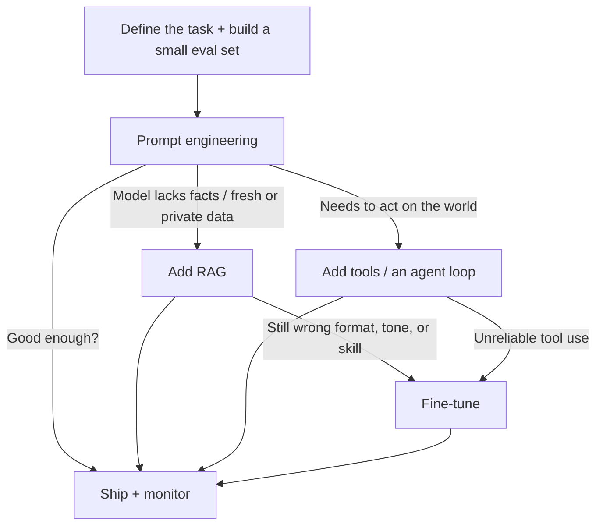
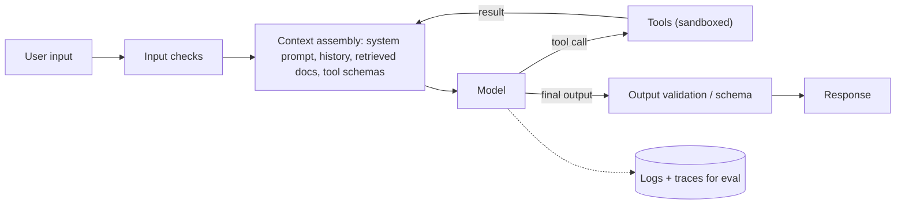

# Applications: From Model to Product

By this point you can build a transformer, pretrain it, post-train it into an assistant, serve it, and ground it in your own documents. None of that is a product yet. A product is a model plus everything around it: the instructions it reads, the context you assemble for it, the tools it may call, the format its output must take, and the tests that tell you it still works after you change any of those. This section is about that "everything around it". It is where most real-world LLM engineering time goes, and it is also where a small model with a good harness beats a large model with a sloppy one.

!!! abstract "What you'll learn"
    - Why the first thing to try is almost never training
    - The prompt, then RAG, then fine-tune ladder, and how to tell which rung you are on
    - How prompting, structured output, tool use and agents fit together
    - Where this section connects to the training, RAG and decision-model sections

## The model sees one thing: a token sequence

Everything in this section rests on one fact you already know from [the Transformer page](../llm/transformer.md): at inference time, the model receives a sequence of token IDs and returns a distribution over the next token. The system prompt, the chat history, few-shot examples, retrieved passages, tool definitions, tool results, and even the "assistant" role marker are all just tokens in that sequence, laid out by a [chat template](../post-training/sft.md#chat-templates).

That gives you exactly three levers for changing behavior:

1. **Change the tokens going in** (prompting, context engineering, RAG, tool results).
2. **Change which tokens are allowed out** (constrained decoding, stop sequences, sampling settings).
3. **Change the weights** (SFT, preference tuning, RL, LoRA).

Levers 1 and 2 are cheap, instant to iterate on, and reversible. Lever 3 is slow, expensive, and needs data. So you exhaust the first two before reaching for the third.

## The ladder: prompt, then RAG, then fine-tune

The diagnostic question at each rung is *what kind of failure* you are seeing:

| Symptom | Likely fix | Where |
|---|---|---|
| Ignores instructions, wrong format, inconsistent style | Better prompt, few-shot examples, structured output | [Prompt & Context Engineering](prompting.md) |
| Does not know your facts, or they change weekly | Retrieval | [RAG Fundamentals](../rag/fundamentals.md) |
| Needs live data or must take actions | Tools and an agent loop | [Agents & Tool Use](agents.md) |
| Always classifying or routing into fixed labels | A small decision model, not a generator | [Routing & Classification](../decision/routing-models.md) |
| Correct with a 2,000-token prompt but too slow or costly | Fine-tune or distill so the behavior lives in the weights | [SFT](../post-training/sft.md), [LoRA](../finetuning/lora-qlora.md), [Distillation](../post-training/distillation-synthetic-data.md) |
| Needs a skill the base model never had (a new language, a niche DSL) | Continued pretraining or fine-tuning | [Continued Pretraining](../finetuning/merging-continued-pretraining.md) |

Two rules of thumb fall out of this table:

- **Fine-tuning teaches behavior, not facts.** It is good at "always answer in this JSON format", "write like our support team", "use these tools correctly". It is poor at "remember our 40,000-page knowledge base", which is a retrieval problem.
- **Prompts are the spec for a later fine-tune.** The prompt and eval set you build at rung one become the data-generation recipe and the test suite if you later distill the behavior into a small model. Nothing at the bottom of the ladder is wasted.

!!! tip "Start with the eval set, not the prompt"
    Write 20 to 50 realistic inputs with what a good output looks like *before* writing the first prompt. Without them you cannot tell whether a change helped, and every rung of the ladder becomes guesswork. Both pages in this section come back to this.

## Small vs large models in products

Most of this site is about building small models, and small models change the application picture:

- A frontier API model can follow a vague, long prompt. A 0.5B to 3B model needs short, explicit instructions, examples, and usually constrained output.
- A small model with [constrained decoding](prompting.md#structured-output) and a tight task can be cheaper, faster and more predictable than a general model, and can run on your own hardware.
- A common architecture is a **cascade**: a small model or classifier handles the easy, high-volume cases and routes the hard ones to a large model. See [routers](../decision/routing-models.md#routers-the-same-machinery).

## A typical application stack

Each box is a place where quality is won or lost, and each one is covered somewhere on this site. Context assembly and output validation are covered on the prompting page, tools on the agents page, retrieval in the [RAG section](../rag/index.md), and input/output guardrails in [Safety & Production](../production/safety.md).

## Pages in this section

-   **[Prompt & Context Engineering](prompting.md)**

    ---

    Why prompts work from the model's point of view, in-context learning, instructions, few-shot selection, delimiters, chain of thought and reasoning models, structured output with a from-scratch constrained decoder, prompt chaining, self-consistency, long-context engineering and systematic prompt evaluation.

-   **[Agents & Tool Use](agents.md)**

    ---

    The agent loop, how tool calls are tokens in the chat template, ReAct, a minimal agent in about 100 lines of Python, the Model Context Protocol with a working server, multi-agent patterns, training models for tool use, agent evaluation and safety.

## Prerequisites

- [Supervised Fine-Tuning](../post-training/sft.md), at least the section on chat templates.
- [Sampling, KV Cache & Quantization](../inference/inference.md): you should know what logits, temperature and the KV cache are.
- [RAG Fundamentals](../rag/fundamentals.md) is helpful context for the agents page.
