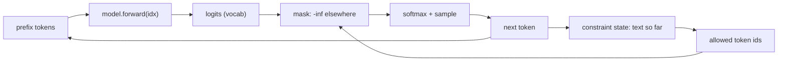

# Prompt & Context Engineering

"Prompt engineering" sounds like folklore: magic phrases, capital letters, offering the model a tip. Once you have trained a model yourself it stops being mysterious. A prompt is the prefix the model conditions on, and everything that works does so because it makes the desired continuation more probable under the distribution the model learned in pretraining and post-training. This page explains prompting from the model's side, then covers the techniques that hold up in practice: clear instructions, examples, delimiters, chain of thought, structured output (with a constrained decoder you build from scratch), chaining, self-consistency, and managing long contexts. It ends with the part most teams skip, which is testing prompts like code.

!!! abstract "What you'll learn"
    - Why prompts work: in-context learning, and system prompts as ordinary tokens in a chat template
    - Instructions, roles, few-shot example selection, and delimiters / XML-style tags
    - Chain of thought, and when *not* to ask for it with reasoning models
    - Structured output: JSON schemas, grammar-constrained decoding, and a from-scratch logit-masking decoder
    - Prompt chaining and self-consistency
    - Context engineering for long inputs: ordering, "lost in the middle", compaction, prefix caching
    - How prompting differs for small and large models
    - Evaluating prompts with test sets and regression tests

## Why prompts work at all

### In-context learning

A pretrained model has seen billions of documents in which a pattern is set up and then continued: a list of question/answer pairs, a table, a function signature followed by its body. To predict the next token well, it had to learn to infer the task *from the prefix itself*. GPT-3 made this famous: with a few examples in the prompt and no weight updates, the model performs the task. That is **in-context learning**.

Mechanically, nothing special happens. Your examples are tokens in the context; attention lets later positions read from them; the next-token distribution shifts toward continuations consistent with the pattern. Two consequences follow:

- **The prompt selects a distribution, it does not program a machine.** "Write like a senior engineer reviewing a PR" works because text like that was in the training data and the instruction makes it the likely continuation. A request for something the model never saw anything like will not work no matter how it is phrased.
- **Everything in the context has influence**, including things you did not intend: a typo-ridden example invites typos; a retrieved passage written in French nudges the answer toward French; a stray instruction inside a document can be obeyed (that is prompt injection, covered on the [agents page](agents.md#safety)).

### System prompts and roles are just tokens

Instruction-tuned models were trained with a [chat template](../post-training/sft.md#chat-templates). A "system prompt" is not a separate channel into the model. It is the first block of tokens, wrapped in role markers:

```text
<|im_start|>system
You are a support assistant for Acme. Answer in two sentences or fewer.<|im_end|>
<|im_start|>user
How do I reset my password?<|im_end|>
<|im_start|>assistant
```

The model obeys the system block more than user text only to the extent that SFT and preference data taught it to. Practical consequences:

- Always render through the model's own template (`tokenizer.apply_chat_template`). Hand-built strings with the wrong markers silently degrade quality.
- The trailing `<|im_start|>assistant\n` (the "generation prompt") is itself a prompt. Some APIs and most local stacks let you **prefill** the start of the assistant turn, such as `{"` to force JSON or `Answer:` to skip preamble. That is a strong, cheap lever.
- A system prompt is a *strong suggestion*, not a security boundary. Anything that must never happen has to be enforced in code.

## Core techniques

### Clear, specific instructions

The single most effective change to most prompts is to say what you actually want. Ask: if you gave this prompt to a capable new colleague with no context, would they produce the output you expect?

```text title="Vague"
Summarize this ticket.
```

```text title="Specific"
Summarize the support ticket below for an on-call engineer.
- One line: what is broken, for whom, since when.
- Then up to 3 bullets of concrete evidence (error codes, timestamps, affected IDs).
- If the ticket does not say when it started, write "start time unknown". Do not guess.
- Plain text, no headings.
```

Habits that help:

- **State the audience and purpose**, not just the task. "For an on-call engineer" changes what details matter.
- **Specify the output shape**: length, format, sections, what to do when information is missing.
- **Say what to do, not only what to avoid.** "Write in plain prose paragraphs" works better than "don't use markdown", partly because the negative instruction still puts the unwanted concept into context.
- **Give the reason** behind non-obvious constraints. "Keep it under 160 characters because it is sent as an SMS" lets the model make sensible trade-offs.

### Roles and personas

A role ("You are a meticulous security reviewer") shifts the register and the kinds of details the model attends to. It helps with tone and focus. It does not add knowledge the model lacks, and elaborate fictional backstories mostly waste tokens. One sentence of role plus concrete task instructions beats a paragraph of persona.

### Few-shot examples, and how to choose them

Examples are the most direct way to show format and judgment. They are also the most likely to be over-imitated: the model copies length, phrasing, and even the specific entities in your examples.

How to select them:

- **Cover the label space and edge cases.** For a classifier prompt, include each class and at least one tricky case (an ambiguous input with the decision you want).
- **Vary the surface form.** If every example is three sentences long, every output will be three sentences long.
- **Balance and shuffle.** Models are sensitive to example order and to the label of the last example. Do not put all the positives at the end.
- **Use dynamic few-shot when you have many examples.** Embed your labeled pool, then for each query retrieve the 3 to 8 most similar examples (the same retrieval machinery as [RAG](../rag/fundamentals.md)). Similar examples transfer much better than generic ones.
- **Keep labels correct.** A wrong label in an example is a strong, confusing signal.

### Delimiters and XML-style tags

When a prompt mixes instructions, data, and examples, mark the boundaries so the model knows which is which. XML-style tags work well across model families because markup like that is abundant in pretraining data and easy to reference by name:

```text
Answer the question using only the documents below. Cite document ids in square brackets.
If the documents do not contain the answer, say "I don't know".

<documents>
<doc id="1" source="runbook.md">Restart the ingest worker with `systemctl restart ingest`...</doc>
<doc id="2" source="faq.md">Alerts are delayed up to 5 minutes during failover...</doc>
</documents>

<question>Why are EU alerts delayed?</question>
```

Tag names have no special meaning to the model beyond what they suggest; consistency matters more than the exact names. Tags also make parsing easier when you ask for `<answer>...</answer>` back. They do *not* make untrusted content safe: text inside `<doc>` can still contain instructions the model follows.

### Chain of thought, and when not to use it

For multi-step problems, letting the model write intermediate steps before the answer improves accuracy. The intuition is about compute: each generated token gets one forward pass, so a model forced to answer in one token has a fixed, small compute budget, while reasoning tokens let it spend more forward passes and condition later steps on earlier results. Chain-of-thought prompting (worked reasoning in the examples) and the zero-shot "think step by step" both exploit this.

Rules for applying it:

- **Reasoning before answer.** If the answer comes first, the reasoning is a post-hoc justification and cannot help. In a JSON schema, put the `reasoning` field before the `answer` field.
- **Separate reasoning from output** with tags (`<thinking>` then `<answer>`) so your code extracts only the answer.
- **Not for simple lookups or classification**, where it adds latency and sometimes talks the model out of a correct first instinct.

**Reasoning models are different.** Models trained with RL to think before answering (DeepSeek-R1, Qwen3 in thinking mode, and similar; see [Reasoning & RL](../post-training/reasoning-rl.md)) already produce a long internal chain of thought. For them:

- Do not add "think step by step" or prescribe a rigid sequence of reasoning steps; give the goal, the constraints, and the success criteria, and let the model plan. Overly prescriptive process instructions often hurt.
- Few-shot examples of *reasoning* matter less; examples of the *output format* still help.
- Control cost with the provided knobs (a thinking budget or a thinking on/off switch) rather than with prompt text.
- Do not feed the raw thinking back into the next turn unless the model's template expects it; most templates strip it from history.

### Structured output

Applications need output a program can consume. There are three levels of reliability:

1. **Ask nicely.** "Respond with JSON matching this schema" plus an example. Large models comply most of the time; small models fail often. Always validate and retry.
2. **Prefill.** Start the assistant turn with `{"` or the first key. Cheap and surprisingly effective.
3. **Constrain the decoder.** At every step, mask the logits of all tokens that would make the output invalid. The output is then *guaranteed* to match the grammar. This is what vLLM's structured outputs, llama.cpp grammars, Outlines, XGrammar and the structured-output modes of hosted APIs do.

Level 3 is simple to understand once you see it on your own model. The decoding loop from [the Transformer page](../llm/transformer.md) samples from `softmax(logits)`. Constrained decoding adds one step: compute the set of tokens that are legal in the current state, set every other logit to minus infinity, then sample.



Here is a complete constrained decoder for the simplest useful grammar: "the output must be exactly one of these strings", for example `{"team": "billing"}`, `{"team": "shipping"}` or `{"team": "technical"}`. It works on any model with the `forward(idx) -> logits` interface from this site.

```python title="constrained.py"
import torch


class EnumJSONConstraint:
    """Allow only outputs that are exactly one of `targets` (a finite set of strings).

    State = the text generated so far. A token is legal iff appending it keeps the
    text a prefix of at least one target. EOS is legal only once the text is complete.
    """

    def __init__(self, targets, vocab, eos_id):
        self.targets = list(targets)
        self.vocab = vocab            # list: token id -> decoded string
        self.eos_id = eos_id

    def allowed(self, text):
        ids = [i for i, s in enumerate(self.vocab)
               if i != self.eos_id and s
               and any(t.startswith(text + s) for t in self.targets)]
        if text in self.targets:
            ids.append(self.eos_id)
        return ids


@torch.no_grad()
def constrained_generate(model, prompt_ids, constraint, max_new_tokens=64, temperature=1.0):
    idx = torch.tensor([prompt_ids])
    text, logprob = "", 0.0
    for _ in range(max_new_tokens):
        logits = model(idx[:, -model.cfg.block_size:])[0, -1]      # (vocab,)
        mask = torch.full_like(logits, float("-inf"))
        allowed = constraint.allowed(text)
        assert allowed, f"dead end after {text!r}"
        mask[allowed] = 0.0
        logp = torch.log_softmax(logits / temperature + mask, dim=-1)
        next_id = torch.multinomial(logp.exp(), 1).item()
        logprob += logp[next_id].item()
        if next_id == constraint.eos_id:
            break
        text += constraint.vocab[next_id]
        idx = torch.cat([idx, torch.tensor([[next_id]])], dim=1)
    return text, logprob
```

Try it on an untrained model with a toy vocabulary that includes some multi-character "merges", so you can see that tokens of different lengths are handled:

```python title="demo_constrained.py"
import json, string, torch
from gpt import GPT, GPTConfig            # the GPT from "The Transformer, Line by Line"
from constrained import EnumJSONConstraint, constrained_generate

merges = ['{"', '":', ' "', '"}', 'team', 'bill', 'ing', 'ship', 'tech', 'nical', 'refund']
vocab = ["<eos>"] + list(string.printable[:100]) + merges
EOS, stoi = 0, {s: i for i, s in enumerate(vocab)}

labels = ["billing", "shipping", "technical"]
targets = [json.dumps({"team": l}) for l in labels]   # '{"team": "billing"}', ...
constraint = EnumJSONConstraint(targets, vocab, EOS)

torch.manual_seed(0)
model = GPT(GPTConfig(vocab_size=len(vocab), block_size=128,
                      n_layer=2, n_head=2, d_model=64)).eval()
prompt = [stoi[ch] for ch in "Route: my parcel never arrived\n"]

out, lp = constrained_generate(model, prompt, constraint)
print(out, json.loads(out)["team"] in labels, f"logprob={lp:.2f}")
# e.g. {"team": "technical"} True logprob=-6.20 (the choice is random: weights are untrained)

raw = model.generate(torch.tensor([prompt]), 20)[0, len(prompt):].tolist()
print(repr("".join(vocab[i] for i in raw)))   # unconstrained: random characters
```

Even a model with random weights now produces valid JSON with a valid label every time. Its *choice* is random, of course; constraints guarantee form, the model supplies content. With a trained model, `logprob` is also useful: it is the model's log-probability of the whole constrained answer, a much better confidence signal than a self-reported `"confidence"` field (see [calibration](../decision/routing-models.md#calibration)).

How real libraries generalize this:

- **From a finite set to a grammar.** A JSON schema or a regular expression compiles to a finite-state machine; full JSON or a programming language needs a context-free grammar, handled by a pushdown automaton. The "state" is the automaton state instead of the raw text.
- **Precomputing masks.** Checking every vocabulary entry at every step is too slow for a 150k-token vocabulary. Outlines precomputes, for each FSM state, which tokens are legal. XGrammar splits tokens into those whose legality depends only on the current state (cached) and the few that need the stack checked at runtime. That keeps the overhead small next to the forward pass.
- **Grammar formats.** llama.cpp uses GBNF. The same enum as above:

    ```text
    root ::= "{\"team\": \"" team "\"}"
    team ::= "billing" | "shipping" | "technical"
    ```

!!! warning "Constraints can distort the distribution"
    Masking forces the model down paths it may consider unlikely. If your prompt does not tell the model about the format, a forced format can lower answer quality, because the model is writing something it did not "plan". Describe the schema in the prompt *and* constrain the decoder. Also watch for token boundary effects: forcing a key like `"team"` as characters when the model would naturally emit it as one merged token pushes it off-distribution. Good libraries handle this by allowing every tokenization that spells a legal string, as the decoder above does.

For pure single-label decisions, you do not even need to generate: score the label tokens' logits directly ([Design A on the routing page](../decision/routing-models.md#design-a-score-the-option-labels-next-token-logits)).

## Composing calls

### Prompt chaining

One prompt doing five things does all of them less well than five prompts doing one thing each. **Chaining** splits a task into steps, with code in between:


Benefits: each step has a short focused prompt, you can validate and retry between steps, steps can use different (cheaper) models, and you can evaluate each step on its own test set. The cost is latency and more calls. Pass structured data between steps (JSON or tagged sections), not free text you will have to re-parse.

### Self-consistency

Sample the same reasoning prompt several times at temperature above 0 and take the majority answer. Different reasoning paths make different mistakes, so the most common final answer is more likely correct than any single sample. It works best when answers are short and comparable (a number, a label, a multiple-choice letter).

```python
from collections import Counter

def self_consistent(generate, prompt, extract_answer, n=7, temperature=0.8):
    answers = [extract_answer(generate(prompt, temperature=temperature)) for _ in range(n)]
    answers = [a for a in answers if a is not None]
    best, votes = Counter(answers).most_common(1)[0]
    return best, votes / len(answers)       # agreement rate doubles as a confidence signal
```

The cost is n times the tokens. Low agreement is a useful signal by itself: route those cases to a bigger model or a human.

## Context engineering for long contexts

As applications grow, the question shifts from "what instructions do I write" to "what goes into the window, in what order, and what gets left out". Treat the context window as a scarce, curated resource.

### Ordering and "lost in the middle"

Models use information at the beginning and end of a long context more reliably than information buried in the middle (Liu et al., 2023, measured this on multi-document QA; newer models are better but the effect has not vanished). Practical ordering for a long prompt:

1. Stable instructions and tool definitions first (also best for caching, below).
2. Long reference material (documents, logs, code) next.
3. The specific question and any final instructions **last**, right before generation.

When you retrieve many passages, put the most relevant ones at the edges rather than in rank order down the middle, and prefer fewer, better passages (a [reranker](../rag/advanced.md#rerankers-cross-encoders) helps here) over stuffing the window.

### Compaction and summarization

Long-running chats and agents eventually overflow the window, and quality degrades well before the hard limit. Strategies:

- **Truncate old tool outputs** first. A 5,000-line log the agent already read rarely needs to stay verbatim; keep a one-line note of what it contained.
- **Rolling summary.** When history exceeds a threshold, replace the oldest turns with a model-written summary that keeps decisions, open questions, and facts the user stated. Keep the most recent turns verbatim.
- **External memory.** Write durable facts to a store and retrieve them when relevant instead of keeping everything in context (see [memory on the agents page](agents.md#memory)).

Summaries are lossy and errors compound, so test compaction with long conversations from your eval set, not just short ones.

### Caching prefixes

Prefill (processing the prompt) costs compute proportional to its length. If many requests share the same prefix, such as a 3,000-token system prompt with tool schemas and examples, the server can reuse the [KV cache](../inference/inference.md) for that prefix instead of recomputing it. vLLM and SGLang do this automatically (automatic prefix caching, RadixAttention), and hosted APIs offer prompt caching at reduced price.

The rule is to put **stable content first and variable content last**. A timestamp or user name at the top of the system prompt invalidates the cache for everything after it.

### Long context vs retrieval

Whether to paste the whole corpus or retrieve from it is covered in [Long context vs RAG](../rag/advanced.md#long-context-vs-rag). The short version: retrieve to select, use the big window for larger, more complete units.

## Prompts for small vs large models

| | Large / frontier models | Small models (under roughly 8B) |
|---|---|---|
| Instructions | Follow nuanced, long instructions | Need short, explicit, one-task prompts |
| Examples | Often optional | Usually essential (3 to 8 good ones) |
| Output format | Mostly comply when asked | Constrain the decoder; validate everything |
| Chain of thought | Helps on hard tasks | Helps less; short chains can introduce errors |
| Long context | Usable, with ordering care | Degrades quickly; keep context short |
| Template sensitivity | Robust | Very sensitive to the exact chat template and wording |

The small-model playbook: one narrow task per call, constrained output, dynamic few-shot, and chaining. When even that is not reliable enough, the prompt and test set you have built are exactly what you need to [fine-tune](../finetuning/lora-qlora.md) or [distill](../post-training/distillation-synthetic-data.md) the behavior into the model.

## Evaluating prompts systematically

A prompt is code that runs on a stochastic interpreter. Treat it that way.

1. **Build a test set** of 30 to 200 realistic inputs, including edge cases and past failures. For each, write either an exact expected output (classification, extraction) or a rubric (open-ended generation).
2. **Pick metrics per case type**: exact match or F1 for extraction, accuracy for labels, schema validity rate for structured output, [LLM-as-judge](../rag/advanced.md#llm-as-judge) with a calibrated rubric for free text.
3. **Run every prompt change against the whole set** and compare to the previous version. Look at the diffs, not only the average.
4. **Keep prompts in version control** next to the code, with the model name and sampling settings they were tested against. A prompt tuned for one model is not portable to another.
5. **Add every production failure to the test set** as a regression case.

A minimal regression test with pytest:

```python title="test_prompts.py"
import json, pytest
from app import extract_ticket_fields      # calls the model with your prompt

CASES = json.load(open("tests/ticket_cases.json"))   # [{"input": ..., "expected": {...}}, ...]

@pytest.mark.parametrize("case", CASES, ids=[c["id"] for c in CASES])
def test_extraction(case):
    out = extract_ticket_fields(case["input"])
    assert out["product"] == case["expected"]["product"]
    assert out["severity"] in {"low", "medium", "high"}
    if case["expected"].get("start_time") is None:
        assert out["start_time"] is None, "model invented a start time"
```

Two caveats. Temperature 0 is not fully deterministic on most serving stacks (batching and floating point order change results), so run flaky cases a few times and track pass *rates*. And small test sets have wide error bars: a change from 41/50 to 43/50 is noise.

!!! warning "Common pitfalls"
    - **Tuning by vibes.** Changing a prompt based on two examples you happened to look at. Use a test set.
    - **Wrong or missing chat template.** Hand-building prompt strings for an instruct model, or forgetting the generation prompt. Print the rendered string once.
    - **Over-imitated examples.** Outputs copy the length and entities of your few-shot examples. Vary them.
    - **Answer before reasoning.** In schemas or templates that put the answer first, chain of thought cannot help.
    - **Prescribing steps to a reasoning model.** Give goals and constraints; let it plan.
    - **Trusting "respond in JSON".** Validate every output; constrain the decoder for small models.
    - **Variable content at the top of the prompt**, which defeats prefix caching.
    - **Assuming the system prompt is a security boundary.** Enforce hard rules in code.

## Check your understanding

??? question "Why does a few-shot prompt work without any weight updates?"
    Pretraining text is full of patterns that are set up and then continued, so predicting the next token well requires inferring the task from the prefix. The examples are tokens in the context; attention lets the model condition on them, shifting the next-token distribution toward continuations that fit the pattern. Nothing about the weights changes.

??? question "You constrain a model to a JSON schema and validity goes to 100%, but field accuracy drops. Why might that happen, and what do you do?"
    The mask can force the model onto token paths it assigns low probability, especially if the prompt never described the format or if forced token boundaries differ from its natural tokenization. Describe the schema and give an example in the prompt so the model "intends" that format, put reasoning fields before answer fields if needed, and use a library that allows all tokenizations of legal strings.

??? question "Your system prompt starts with 'Current time: 2026-11-14 10:32:05' followed by 4,000 tokens of instructions. What is the performance problem?"
    The varying timestamp at the very beginning changes the prefix on every request, so prefix/prompt caching cannot reuse the KV cache for the 4,000 stable tokens after it. Move variable content to the end, after the stable instructions.

??? question "When would self-consistency not help?"
    When outputs are long and free-form (no simple way to vote), when the model makes the same systematic error on most samples (majority of wrong is still wrong), or when the n-fold cost is unacceptable. It helps most for short, comparable answers on reasoning tasks where errors are diverse.

??? question "Should you add 'think step by step' to a prompt for a reasoning model like DeepSeek-R1?"
    Generally no. It already reasons at length before answering; prescriptive process instructions add little and can hurt. Give the goal, constraints and output format, and control reasoning cost with the model's thinking budget or mode switch.

## Further reading

- Brown et al., [Language Models are Few-Shot Learners](https://arxiv.org/abs/2005.14165) (2020), the GPT-3 paper that introduced in-context learning at scale.
- Wei et al., [Chain-of-Thought Prompting Elicits Reasoning in Large Language Models](https://arxiv.org/abs/2201.11903) (2022).
- Kojima et al., [Large Language Models are Zero-Shot Reasoners](https://arxiv.org/abs/2205.11916) (2022), "let's think step by step".
- Wang et al., [Self-Consistency Improves Chain of Thought Reasoning in Language Models](https://arxiv.org/abs/2203.11171) (2022).
- Liu et al., [Lost in the Middle: How Language Models Use Long Contexts](https://arxiv.org/abs/2307.03172) (2023).
- Willard and Louf, [Efficient Guided Generation for Large Language Models](https://arxiv.org/abs/2307.09702) (2023), the method behind Outlines.
- Dong et al., [XGrammar: Flexible and Efficient Structured Generation Engine for Large Language Models](https://arxiv.org/abs/2411.15100) (2024).
- [llama.cpp GBNF grammar guide](https://github.com/ggml-org/llama.cpp/blob/master/grammars/README.md).
