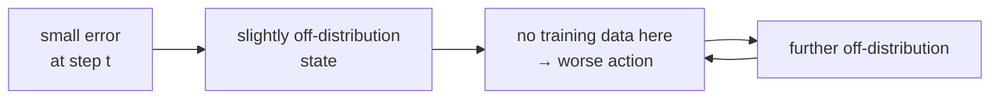
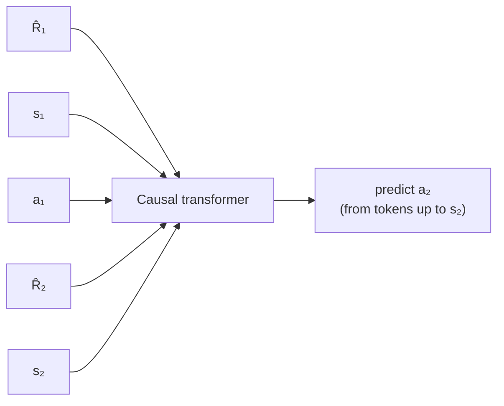

# Imitation Learning

Reward functions are hard to write, and RL agents are expensive to train from scratch. Demonstrations are often much easier to get: a human plays the game, a teleoperator drives the robot, a scripted controller does the job well enough. Imitation learning trains a policy from those demonstrations. It is also the right mental model for large language models. Pretraining and SFT are behavior cloning on human-written text, and RLHF is RL applied on top of that cloned policy. This page covers behavior cloning, why it fails in a specific and predictable way, DAgger (which fixes it), a short tour of inverse RL, and the Decision Transformer, which treats RL as sequence modeling.

!!! abstract "What you'll learn"
    - Behavior cloning (BC): imitation as supervised classification
    - Distribution shift and compounding errors, and why small per-step errors give large failures over long episodes
    - DAgger: collecting expert labels on the learner's own states
    - Inverse RL and adversarial imitation (GAIL), briefly
    - The Decision Transformer: conditioning a GPT-style model on the return you want
    - How all of this maps onto LLM pretraining, SFT and RLHF

## Behavior cloning

Collect a dataset of expert state-action pairs $\mathcal{D} = \{(s_i, a_i)\}$ and fit a policy by maximum likelihood:

$$
\theta^* = \arg\max_\theta \sum_{(s,a) \in \mathcal{D}} \log \pi_\theta(a \mid s)
$$

For discrete actions that is cross-entropy classification. For continuous actions it is regression, or a Gaussian, mixture, or diffusion head when the expert's behavior is multimodal. No reward, no environment interaction, no RL. You can train it in minutes.

```python title="bc.py"
import torch
import torch.nn as nn
import torch.nn.functional as F

policy = nn.Sequential(nn.Linear(obs_dim, 128), nn.Tanh(),
                       nn.Linear(128, 128), nn.Tanh(),
                       nn.Linear(128, n_actions))
opt = torch.optim.AdamW(policy.parameters(), lr=1e-3)

for epoch in range(30):
    for obs_b, act_b in loader:               # demonstrations: (obs, expert action)
        loss = F.cross_entropy(policy(obs_b), act_b)
        opt.zero_grad(); loss.backward(); opt.step()
```

That is the whole algorithm. [Project 4](../projects/p4-decision-model.md) does exactly this, with demonstrations from a scripted expert or from you playing with the keyboard.

### When BC works well

- You have plenty of demonstrations covering the situations the policy will meet.
- The expert is **consistent**: the same state leads to (roughly) the same action. Two humans with different styles produce averaged, mushy behavior.
- The observation contains what the expert used to decide. If a human driver looked at a mirror that your camera does not see, the policy cannot copy that decision.
- Episodes are short, or mistakes are recoverable.

## Distribution shift and compounding errors

Here is the core problem. BC trains on states from the **expert's** distribution, $d_{\pi^*}$. At test time the policy visits states from **its own** distribution, $d_{\pi_\theta}$. These differ, because the policy makes small mistakes, the mistakes take it to states the expert never visited, it has never seen what to do there, so it makes bigger mistakes, and so on.



The classic analysis (Ross & Bagnell, 2010; Ross, Gordon & Bagnell, 2011) makes this precise. Suppose the cloned policy makes a mistake with probability $\epsilon$ on states from the expert's distribution, and a mistake can derail the rest of an episode of length $T$. Then the expected cost of BC can grow as $O(\epsilon T^2)$. Errors compound quadratically with the horizon. An interactive method like DAgger brings this down to $O(\epsilon T)$, linear in the horizon.

You can see this in a self-driving setting. The expert always drives in the middle of the lane, so the dataset has no examples of "you're drifting toward the edge, steer back". The first time the cloned policy drifts, it is in unfamiliar territory.

Practical mitigations short of DAgger:

- **Noise injection during demonstration** (as in DART). Perturb the expert's actions while recording, but label each state with the expert's *intended* action. The dataset then contains recovery behavior.
- **More diverse demonstrations**: multiple starting conditions and deliberately recovering from mistakes.
- **Data augmentation** on observations, such as random crops for image policies.
- **Action chunking**: predicting several future actions at once reduces the number of decision points where errors can compound. This is used in robot policies such as ACT.
- **Fine-tune with RL** from the BC initialization. The RL objective optimizes the policy on its own state distribution, which is exactly what BC lacks. This is what Project 4 does with PPO.

## DAgger: Dataset Aggregation

DAgger (Ross, Gordon & Bagnell, 2011) fixes distribution shift directly. Let the **learner** drive, ask the **expert** what it would have done in each visited state, add those labels to the dataset, and retrain.

```text
D ← expert demonstrations
π₁ ← BC on D
for i = 1..N:
    run πᵢ in the environment, record visited states s
    label each s with the expert's action a* = π*(s)
    D ← D ∪ {(s, a*)}
    πᵢ₊₁ ← BC on D
return best πᵢ on validation
```

```python title="dagger_loop.py"
for it in range(n_dagger_iters):
    visited = []
    for ep in range(episodes_per_iter):
        obs, _ = env.reset(seed=1000 * it + ep)
        done = False
        while not done:
            visited.append(obs)
            obs, r, term, trunc, _ = env.step(learner_action(obs))   # learner drives
            done = term or trunc
    new_labels = [expert_action(o) for o in visited]                  # expert labels
    dataset.add(visited, new_labels)
    train_bc(policy, dataset)                                         # retrain on aggregate
```

The catch is that you need an expert you can **query on arbitrary states**. A scripted controller or a planner with privileged information is perfect for this. A human can do it too, but labeling "what would you press here?" for states you are not controlling is unnatural and tiring. Some variants (HG-DAgger) only ask the human to take over when the learner is about to fail.

!!! tip "Privileged teacher, sensor-limited student"
    A very effective pattern in robotics and games: train or script a *teacher* that sees the true simulator state (exact positions, velocities, terrain), then use DAgger-style distillation into a *student* that only sees what real sensors provide. The teacher is easy to get right. The student is what you deploy.

## Inverse RL and adversarial imitation, briefly

BC copies actions. **Inverse reinforcement learning** (IRL) tries to recover the *reward function* the expert was optimizing, and then runs RL on that reward. The pitch is that a reward generalizes better than a copied policy. If the environment changes (a new obstacle), the policy re-optimized for the inferred reward adapts, while the cloned policy does not.

- The problem is ill-posed: many rewards (including "zero everywhere") make the expert optimal. **Maximum-entropy IRL** (Ziebart et al., 2008) resolves this by preferring the reward under which the expert's behavior is most likely with the fewest extra assumptions.
- IRL is expensive, because every update to the reward requires solving an RL problem.
- **GAIL** (Ho & Ermon, 2016) skips the explicit reward. A discriminator learns to tell expert state-action pairs from the policy's, and the policy is trained with RL to fool it, as in a GAN. The discriminator's output acts as a learned reward.

A useful connection: an RLHF **reward model**, trained on human preference comparisons, is a form of reward learning from human feedback. It is not classic IRL from demonstrations, but it has the same goal of inferring what humans want and then optimizing for it.

## The Decision Transformer: RL as sequence modeling

The Decision Transformer (Chen et al., 2021) recasts offline RL as conditional sequence modeling. Represent each trajectory as a sequence of tokens:

$$
(\hat{R}_1, s_1, a_1,\; \hat{R}_2, s_2, a_2,\; \dots), \qquad \hat{R}_t = \sum_{t'=t}^{T} r_{t'}
$$

where $\hat{R}_t$ is the **return-to-go**, the reward still to come. Train a causal transformer, like GPT, to predict $a_t$ from everything before it, including $\hat{R}_t$ and $s_t$. That is supervised learning on logged data: no value functions, no Bellman backups, no policy gradients.

At test time you **choose the return you want**. Set $\hat{R}_1$ to a high target (for example, the best return in the dataset), act, subtract each reward as you receive it, and feed the updated return-to-go back in. The model has learned "what actions tend to come next in trajectories that went on to earn this much reward", so asking for high return produces good behavior, as long as that return was achieved somewhere in the data.



```python title="decision_transformer.py"
import torch
import torch.nn as nn
import torch.nn.functional as F

class DecisionTransformer(nn.Module):
    """GPT-style model over interleaved (return-to-go, state, action) tokens."""

    def __init__(self, obs_dim, n_actions, d_model=128, n_layers=3, n_heads=4, max_t=1000):
        super().__init__()
        self.embed_rtg = nn.Linear(1, d_model)
        self.embed_obs = nn.Linear(obs_dim, d_model)
        self.embed_act = nn.Embedding(n_actions, d_model)
        self.embed_time = nn.Embedding(max_t, d_model)       # absolute timestep, shared by the 3 tokens
        layer = nn.TransformerEncoderLayer(d_model, n_heads, 4 * d_model, dropout=0.1,
                                           batch_first=True, norm_first=True)
        self.blocks = nn.TransformerEncoder(layer, n_layers, enable_nested_tensor=False)
        self.ln = nn.LayerNorm(d_model)
        self.head = nn.Linear(d_model, n_actions)

    def forward(self, rtg, obs, act, timesteps):
        # rtg: (B, K, 1)  obs: (B, K, obs_dim)  act: (B, K) long  timesteps: (B, K) long
        B, K, _ = obs.shape
        t = self.embed_time(timesteps)
        tokens = torch.stack([self.embed_rtg(rtg) + t,
                              self.embed_obs(obs) + t,
                              self.embed_act(act) + t], dim=2)     # (B, K, 3, d)
        x = tokens.reshape(B, 3 * K, -1)                          # R1 s1 a1 R2 s2 a2 ...
        causal = torch.triu(torch.ones(3 * K, 3 * K, dtype=torch.bool, device=x.device), 1)
        h = self.ln(self.blocks(x, mask=causal))
        h_state = h.reshape(B, K, 3, -1)[:, :, 1]                 # hidden state at each s_t token
        return self.head(h_state)                                 # predict a_t from (..., R_t, s_t)

def dt_loss(model, rtg, obs, act, timesteps):
    logits = model(rtg, obs, act, timesteps)
    return F.cross_entropy(logits.reshape(-1, logits.shape[-1]), act.reshape(-1))
```

Train it on random windows of $K$ steps from logged trajectories, with return-to-go scaled down (for example divided by the maximum return) so that it is around 1. The causal mask matters. Each action prediction is read from the hidden state at the $s_t$ token, which can see $\hat{R}_t$ and $s_t$ but not $a_t$ itself.

**Strengths:** it is simple, stable, reuses LLM machinery, and handles long-horizon credit assignment through attention. **Limitations:** it cannot reliably "stitch" together pieces of different suboptimal trajectories into a better one the way value-based offline RL methods (CQL, IQL) can, and asking for a return far above anything in the data does not produce superhuman play. Treat it as return-conditioned behavior cloning.

## LLMs are behavior-cloned policies

Read an LLM through this page's vocabulary:

| RL / imitation concept | LLM equivalent |
|---|---|
| state $s_t$ | the prompt plus all tokens generated so far |
| action $a_t$ | the next token |
| policy $\pi_\theta(a \mid s)$ | the softmax over the vocabulary |
| expert demonstrations | web text (pretraining), curated responses (SFT) |
| behavior cloning | next-token cross-entropy |
| distribution shift | the model conditions on *its own* earlier tokens at inference ("exposure bias"); one bad token can derail a long answer |
| reward function | a reward model trained on human preferences, or a verifier (unit tests, math checkers) |
| RL fine-tuning from a BC init | RLHF with PPO, GRPO for reasoning |
| KL penalty to the BC policy | the KL term to the SFT/reference model in RLHF |

So the standard LLM recipe is the same as the robotics recipe: **behavior-clone a broad policy from demonstrations, then fine-tune with RL** against a reward to fix BC's weaknesses (compounding errors, being only as good as the average demonstrator, no notion of the objective). The KL penalty in RLHF does the job of "don't wander too far from the competent BC policy while optimizing a possibly imperfect reward". You will see the same constraint, as critic warmup and KL early stopping, when PPO fine-tunes the BC policy in [Project 4](../projects/p4-decision-model.md). For the LLM side, see [SFT](../post-training/sft.md), [Preference Optimization](../post-training/preference.md), and [Reasoning & RL with Verifiable Rewards](../post-training/reasoning-rl.md).

!!! warning "Common pitfalls"
    - **Judging BC by validation accuracy.** High accuracy on held-out expert states says little about closed-loop performance. Always roll the policy out in the environment.
    - **Inconsistent or multimodal demonstrations.** If the expert sometimes goes left and sometimes right around an obstacle, a cross-entropy policy may split the probability, and an MSE regression policy will average to straight into the obstacle. Use one consistent demonstrator, a multimodal head, or action chunking.
    - **Missing information.** If the expert's decision depended on something not in the observation, the clone cannot copy it.
    - **Dropping failure data carelessly.** Throwing away all crashed episodes removes the states just before a crash, which are often the ones where correct recovery labels matter most (DAgger collects exactly those).
    - **Destroying the BC policy with RL.** An untrained critic produces garbage advantages that can wreck a good initialization in a few updates. Warm up the critic, use a small learning rate, and limit the KL.

## Check your understanding

??? question "Why does behavior cloning's error grow with the square of the horizon?"
    Each step has some chance ε of a mistake. Once a mistake takes the policy off the expert's state distribution, its later actions are no longer reliable, so it can keep failing for the rest of the episode. With roughly $T$ chances to make a first mistake and up to $T$ steps of cost after each one, the bound is $O(\epsilon T^2)$.

??? question "What does DAgger need that plain BC does not?"
    An expert that can be queried on arbitrary states, including states the expert would never reach on its own, plus the ability to run the learner in the environment. In exchange it trains on the learner's own state distribution and gets error that grows linearly with the horizon.

??? question "At test time, what do you feed the Decision Transformer as the first return-to-go, and how does it change?"
    A target return, typically near the best return in the dataset (scaled the same way as in training). After each step you subtract the reward you received, so the return-to-go tracks "how much reward is still needed".

??? question "In what sense is RLHF 'RL on top of behavior cloning'?"
    The SFT model is a policy behavior-cloned from human-written responses. RLHF then optimizes that policy's expected reward (from a learned reward model) with PPO or similar, starting from the BC weights and with a KL penalty that keeps it close to them. That is the same BC-then-RL pipeline used for robots and game agents.

## Further reading

- Pomerleau (1989), "ALVINN: An Autonomous Land Vehicle in a Neural Network". The original behavior-cloning driving system.
- Ross, Gordon & Bagnell, [A Reduction of Imitation Learning and Structured Prediction to No-Regret Online Learning](https://arxiv.org/abs/1011.0686) (2011, DAgger).
- Ho & Ermon, [Generative Adversarial Imitation Learning](https://arxiv.org/abs/1606.03476) (2016).
- Ziebart et al. (2008), "Maximum Entropy Inverse Reinforcement Learning".
- Chen et al., [Decision Transformer: Reinforcement Learning via Sequence Modeling](https://arxiv.org/abs/2106.01345) (2021).
- Zhao et al., [Learning Fine-Grained Bimanual Manipulation with Low-Cost Hardware](https://arxiv.org/abs/2304.13705) (2023, ACT / action chunking).
- Ouyang et al., [Training language models to follow instructions with human feedback](https://arxiv.org/abs/2203.02155) (2022, InstructGPT).
