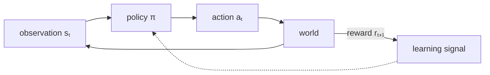
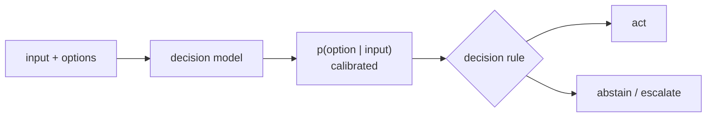

# Decision Models

Not every useful model writes text. A game agent picks a button to press 60 times a second. A robot picks joint targets. A router picks which LLM answers a query, a guard picks "allow" or "block", and a loan system picks "approve", "decline" or "refer". These are all **decision models**: models whose output is a *choice*, and whose quality is judged by the consequences of that choice. This section teaches the two main kinds from scratch, shows how they connect to LLMs, and ends with a project in which you build an agent that plays an original game.

!!! abstract "What you'll learn in this section"
    - What "decision model" means in two senses: **sequential policies** (observation → action, over time) and **one-shot decision models** (input → calibrated probabilities over options)
    - Bandits, MDPs, Bellman equations and Q-learning
    - DQN and PPO, implemented in PyTorch
    - Imitation learning, DAgger and the Decision Transformer, and why LLMs are behavior-cloned policies
    - System 1 / System 2 designs: fast reactive policies paired with slow reasoning models
    - Routers, intent and guard classifiers, decision language models, calibration and cost-aware thresholds
    - Classical decision models: decision trees and rule-based business decision tables (below)

## Two meanings of "decision model"

### (a) Sequential decision-making: policies

A **policy** $\pi(a \mid s)$ maps what the agent observes to what it does, step after step. Each action changes the world, so the next observation depends on the last decision. Rewards may come much later. This is the territory of **reinforcement learning** and **imitation learning**:



Examples: game agents, robot controllers, trading agents, dialogue policies, and LLMs, which choose one token at a time and are fine-tuned with RL in RLHF and in reasoning training.

### (b) One-shot decisions: routing and classification

Here the model makes **one choice per input** and the choice does not affect the next input. The output is not free text but a **calibrated probability for each option**, which a decision rule (threshold, expected cost) turns into an action:



Examples: LLM routers (cheap vs expensive model), intent and tool classifiers for agents, safety/guard classifiers, ticket triage, rerankers. If a one-shot decision affects what you see next only weakly, a **contextual bandit** (see [RL Basics](rl-basics.md)) connects the two worlds.

| | Sequential policy | One-shot decision model |
|---|---|---|
| Output | an action, every step | probabilities over options |
| Feedback | rewards, often delayed | labels (or outcomes) per example |
| Training | RL, imitation learning | supervised learning plus calibration |
| Key risk | compounding errors, reward hacking | miscalibration, drift, asymmetric costs |
| Pages | [RL Basics](rl-basics.md), [DQN & PPO](policy-methods.md), [Imitation](imitation.md), [System 1 & 2](system-one.md) | [Routing & Classification](routing-models.md) |

## Section map

<div class="grid cards" markdown>

- **[Reinforcement Learning Basics](rl-basics.md)**

    Bandits (ε-greedy, UCB, Thompson sampling), MDPs, returns, value functions, Bellman equations, tabular Q-learning from scratch, and the Gymnasium API.

- **[DQN & PPO](policy-methods.md)**

    DQN with replay and target networks, the REINFORCE derivation, actor-critic, GAE, the PPO clipped objective, plus reward shaping and RL debugging.

- **[Imitation Learning](imitation.md)**

    Behavior cloning, distribution shift, DAgger, inverse RL, the Decision Transformer, and LLMs as behavior-cloned policies.

- **[System 1 & System 2 Models](system-one.md)**

    Fast reactive policies plus slow deliberate reasoners: latency budgets, dual-system robot architectures, distillation.

- **[Routing & Classification](routing-models.md)**

    Routers, intent and guard classifiers, decision language models that score options in one prefill, calibration, thresholds, cost-aware evaluation.

- **[Project 4: A Decision Model That Plays](../projects/p4-decision-model.md)**

    An original arcade game as a Gymnasium env, a scripted expert, behavior cloning, PPO fine-tuning, ONNX export, plus an in-browser demo that trains live.

</div>

## Classical decision models

Before neural networks, and still very widely used, there are two classical ways to encode decisions: **decision trees**, which are learned from data, and **decision tables and rules**, which are written by people. Both are worth knowing. They are often the right tool, and they are a useful reference point for what neural decision models add.

### Decision trees

A decision tree asks a sequence of yes/no questions about the features ("is `petal_length` ≤ 2.35?") until it reaches a leaf that holds a class distribution. It is learned greedily: at each node, try every feature and threshold, and keep the split that makes the children **purest**.

Two common impurity measures for a node whose class proportions are $p_1, \dots, p_C$:

$$
\text{Gini}(S) = 1 - \sum_c p_c^2 \qquad\qquad H(S) = -\sum_c p_c \log_2 p_c
$$

Both are zero for a pure node and largest for a uniform mix. The **information gain** of a split (the impurity decrease) is

$$
\text{Gain} = I(S) - \frac{|S_L|}{|S|} I(S_L) - \frac{|S_R|}{|S|} I(S_R)
$$

With entropy as $I$ this is literally the information gained about the label by asking the question. CART uses Gini. ID3 and C4.5 use entropy-based gain. In practice the two give very similar trees.

Here is a complete tree learner from scratch, about 50 lines of numpy, checked against scikit-learn:

```python title="decision_tree.py"
import numpy as np

def gini(y):
    p = np.bincount(y) / len(y)
    return 1.0 - np.sum(p ** 2)

def entropy(y):
    p = np.bincount(y) / len(y)
    p = p[p > 0]
    return -np.sum(p * np.log2(p))

def best_split(X, y, impurity=gini, min_leaf=1):
    parent, n = impurity(y), len(y)
    best = (None, None, 0.0)                         # (feature, threshold, gain)
    for f in range(X.shape[1]):
        values = np.unique(X[:, f])
        for thr in (values[:-1] + values[1:]) / 2:   # midpoints between sorted unique values
            left = X[:, f] <= thr
            nl, nr = left.sum(), n - left.sum()
            if nl < min_leaf or nr < min_leaf:
                continue
            child = (nl / n) * impurity(y[left]) + (nr / n) * impurity(y[~left])
            gain = parent - child                    # information gain (impurity decrease)
            if gain > best[2]:
                best = (f, thr, gain)
    return best

class Node:
    def __init__(self, pred=None, proba=None, feature=None, thr=None, left=None, right=None):
        self.pred, self.proba, self.feature, self.thr, self.left, self.right = pred, proba, feature, thr, left, right

def build(X, y, n_classes, depth=0, max_depth=4, min_leaf=5, impurity=gini):
    proba = np.bincount(y, minlength=n_classes) / len(y)
    f, thr, gain = best_split(X, y, impurity, min_leaf)
    if depth >= max_depth or f is None or gain <= 1e-9:
        return Node(pred=int(proba.argmax()), proba=proba)          # leaf
    m = X[:, f] <= thr
    return Node(feature=f, thr=thr,
                left=build(X[m], y[m], n_classes, depth + 1, max_depth, min_leaf, impurity),
                right=build(X[~m], y[~m], n_classes, depth + 1, max_depth, min_leaf, impurity))

def predict_proba(node, x):
    while node.feature is not None:
        node = node.left if x[node.feature] <= node.thr else node.right
    return node.proba

def show(node, names, indent=""):
    if node.feature is None:
        print(f"{indent}-> class {node.pred}  p={np.round(node.proba, 2)}")
        return
    print(f"{indent}if {names[node.feature]} <= {node.thr:.2f}:")
    show(node.left, names, indent + "    ")
    print(f"{indent}else:")
    show(node.right, names, indent + "    ")

from sklearn.datasets import load_iris
from sklearn.model_selection import train_test_split
from sklearn.tree import DecisionTreeClassifier, export_text

X, y = load_iris(return_X_y=True)
names = ["sepal_len", "sepal_wid", "petal_len", "petal_wid"]
Xtr, Xte, ytr, yte = train_test_split(X, y, test_size=0.3, random_state=0, stratify=y)

root = build(Xtr, ytr, n_classes=3, max_depth=3)
show(root, names)
acc = np.mean([predict_proba(root, x).argmax() == t for x, t in zip(Xte, yte)])
print(f"from-scratch tree accuracy: {acc:.3f}")

clf = DecisionTreeClassifier(criterion="gini", max_depth=3, min_samples_leaf=5, random_state=0).fit(Xtr, ytr)
print(f"scikit-learn tree accuracy: {clf.score(Xte, yte):.3f}")
print(export_text(clf, feature_names=names))
```

Both trees reach about 0.96 test accuracy on this split. The printed structures can differ slightly. On Iris, `petal_len` and `petal_wid` both separate setosa perfectly, so the gains tie, and scikit-learn also shuffles the order in which features are considered, so it may pick the other feature. That is a good reminder that tree structure is unstable even when accuracy is not.

What to know about trees in practice:

- **Strengths:** they are interpretable (you can print the rules), need no feature scaling, handle mixed feature types, and are fast at inference (a few comparisons).
- **Weaknesses:** a single deep tree overfits and is unstable (small data changes, different tree). Control it with `max_depth`, `min_samples_leaf` or cost-complexity pruning (`ccp_alpha`).
- **Ensembles fix most of this.** **Random forests** (average many trees, each trained on bootstrapped data with random feature subsets) and **gradient-boosted trees** (XGBoost, LightGBM, CatBoost, scikit-learn's `HistGradientBoostingClassifier`) are still the strongest default for **tabular data**, and are often better than neural networks there.
- **Calibration:** leaf frequencies from a single tree are coarse, and boosted ensembles can be miscalibrated. Use the same calibration tools as on the [routing page](routing-models.md) (`CalibratedClassifierCV` in scikit-learn).

### Rule-based business decision models (DMN)

Many organizations encode decisions as explicit, human-written rules: eligibility, pricing, approval routing, compliance checks. The OMG standard for this is **DMN (Decision Model and Notation)**, supported by a range of business-rules engines. Its main building blocks:

- **Decision tables.** Rows are rules, columns are input conditions and outputs. For example:

    | Credit score | Debt-to-income | Amount | → Decision |
    |---|---|---|---|
    | ≥ 720 | < 0.35 | ≤ 50,000 | approve |
    | ≥ 720 | ≥ 0.35 | - | refer |
    | 640..719 | < 0.30 | ≤ 20,000 | approve |
    | < 640 | - | - | decline |

- **Hit policies** say what happens when several rows match: **U**nique (exactly one row may match), **F**irst (top-most match wins), **P**riority (highest-priority output wins), **A**ny (all matches must agree), and **C**ollect (return all matches, optionally aggregated with sum/min/max/count).
- **FEEL (Friendly Enough Expression Language)** is DMN's small expression language for conditions and calculations, such as ranges like `[640..719]`, comparisons, date arithmetic and list functions, designed to be readable by business analysts.
- **Decision Requirements Diagrams (DRDs)** connect decisions, their input data and the knowledge sources behind them into a graph, so a "loan decision" can depend on "risk category", which in turn depends on a scoring model.

### How ML decision models complement rules

Rules and learned models are not competitors. Most production decision systems combine them:

- **Rules for hard constraints**, such as legal requirements, policy limits and "never do X". They are auditable, deterministic, and easy to change without retraining.
- **Models for judgment**, meaning patterns too subtle or too high-dimensional to write by hand: fraud likelihood, intent, risk scores, "is this message unsafe?".
- **Models as inputs to rules.** A calibrated ML score becomes one column of a decision table ("risk score ≥ 0.8 → refer"). DMN's DRDs explicitly allow a decision to depend on a model.
- **Rules as guardrails on models.** An RL policy or an LLM agent proposes an action, and a rule layer vetoes unsafe or non-compliant ones.
- **Trees as a bridge.** A shallow decision tree, trained directly or distilled from a complex model, can be read as a rule set and reviewed by domain experts.

The rest of this section focuses on learned decision models, but keep this layered picture in mind: **calibrated scores from models, explicit rules for constraints, and a clear decision rule that turns both into actions.**

!!! tip "Prerequisites"
    You should be comfortable with PyTorch basics ([Python & PyTorch](../foundations/pytorch.md)) and with training a small network ([Neural Networks & Backprop](../foundations/neural-networks.md)). The LLM connections make more sense after [Supervised Fine-Tuning](../post-training/sft.md) and [Preference Optimization](../post-training/preference.md), but those are not required to start.

**Next:** [Reinforcement Learning Basics](rl-basics.md)
