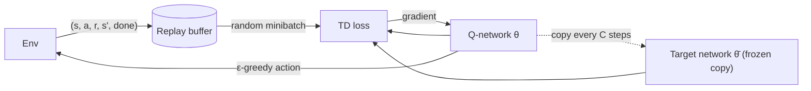
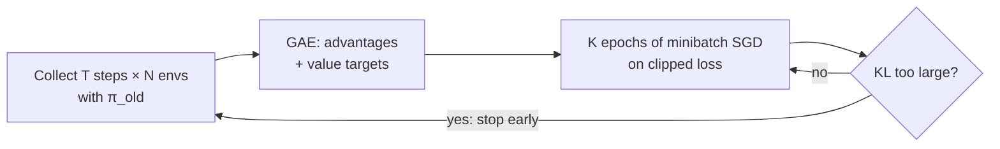

# DQN & PPO

Tabular Q-learning breaks down as soon as states are continuous or numerous, because you cannot keep one table entry per state. Deep RL replaces the table with a neural network. This page covers the two families that most practical deep RL comes from. **Value-based** methods (DQN) learn $Q(s,a)$ and act greedily. **Policy-gradient** methods (REINFORCE, actor-critic, PPO) learn the policy directly. PPO matters beyond games and robots: it is the algorithm used in classic RLHF for LLMs (see [Preference Optimization](../post-training/preference.md)), and the same machinery, simplified, underlies GRPO for [reasoning models](../post-training/reasoning-rl.md).

!!! abstract "What you'll learn"
    - DQN: function approximation for Q, why it needs a replay buffer and a target network, and a working PyTorch implementation on CartPole
    - The policy-gradient theorem and the REINFORCE derivation, step by step
    - Baselines, advantages and actor-critic, and how Generalized Advantage Estimation (GAE) trades bias against variance
    - PPO's clipped surrogate objective, with the math and a compact, correct PyTorch implementation
    - Reward shaping, hyperparameters that matter, and a debugging checklist for when nothing learns

## Deep Q-Networks (DQN)

The idea: approximate $Q^*(s,a)$ with a network $Q_\theta(s, \cdot)$ that takes a state and outputs one value per action. Train it to satisfy the Bellman optimality equation by regressing toward the TD target:

$$
\mathcal{L}(\theta) = \mathbb{E}_{(s,a,r,s',d)}\Big[ \big( Q_\theta(s,a) - \underbrace{(r + \gamma (1-d) \max_{a'} Q_{\bar\theta}(s', a'))}_{y} \big)^2 \Big]
$$

Done naively, this is unstable. Two tricks from the DQN paper (Mnih et al., 2015) make it work:

1. **Experience replay.** Store transitions in a large buffer and train on random minibatches from it. Consecutive transitions are highly correlated (frame 101 looks like frame 100), and SGD assumes roughly independent samples. Replay breaks that correlation and lets you reuse each transition many times.
2. **Target network.** The target $y$ uses a separate copy of the network, $Q_{\bar\theta}$, that is only updated every few hundred steps (or slowly averaged toward $Q_\theta$). Without it you are chasing a target that moves with every gradient step, and the estimates can diverge.



```python title="dqn_cartpole.py"
import random
from collections import deque

import gymnasium as gym
import numpy as np
import torch
import torch.nn as nn
import torch.nn.functional as F

class ReplayBuffer:
    def __init__(self, capacity=50_000):
        self.buf = deque(maxlen=capacity)
    def push(self, s, a, r, s2, terminated):
        self.buf.append((s, a, r, s2, terminated))
    def sample(self, batch_size):
        s, a, r, s2, d = zip(*random.sample(self.buf, batch_size))
        return (torch.as_tensor(np.array(s), dtype=torch.float32),
                torch.as_tensor(a),
                torch.as_tensor(r, dtype=torch.float32),
                torch.as_tensor(np.array(s2), dtype=torch.float32),
                torch.as_tensor(d, dtype=torch.float32))
    def __len__(self):
        return len(self.buf)

def mlp(n_in, n_out, hidden=128):
    return nn.Sequential(nn.Linear(n_in, hidden), nn.ReLU(),
                         nn.Linear(hidden, hidden), nn.ReLU(),
                         nn.Linear(hidden, n_out))

def train_dqn(total_steps=50_000, gamma=0.99, lr=5e-4, batch_size=128,
              warmup=1_000, target_every=500, eps_decay_steps=15_000, seed=0):
    random.seed(seed); np.random.seed(seed); torch.manual_seed(seed)
    env = gym.make("CartPole-v1")
    n_obs, n_act = env.observation_space.shape[0], env.action_space.n
    q, q_target = mlp(n_obs, n_act), mlp(n_obs, n_act)
    q_target.load_state_dict(q.state_dict())
    opt = torch.optim.Adam(q.parameters(), lr=lr)
    buf = ReplayBuffer()

    s, _ = env.reset(seed=seed)
    ep_ret, returns = 0.0, []
    for step in range(total_steps):
        eps = max(0.05, 1.0 - step / eps_decay_steps)
        if random.random() < eps:
            a = env.action_space.sample()
        else:
            with torch.no_grad():
                a = int(q(torch.as_tensor(s, dtype=torch.float32)).argmax())
        s2, r, terminated, truncated, _ = env.step(a)
        buf.push(s, a, r, s2, terminated)       # (1)!
        s, ep_ret = s2, ep_ret + r
        if terminated or truncated:
            returns.append(ep_ret)
            s, _ = env.reset()
            ep_ret = 0.0

        if len(buf) >= warmup:
            bs, ba, br, bs2, bd = buf.sample(batch_size)
            q_sa = q(bs).gather(1, ba.unsqueeze(1)).squeeze(1)
            with torch.no_grad():
                target = br + gamma * (1 - bd) * q_target(bs2).max(1).values
            loss = F.smooth_l1_loss(q_sa, target)   # (2)!
            opt.zero_grad()
            loss.backward()
            nn.utils.clip_grad_norm_(q.parameters(), 10.0)
            opt.step()
        if step % target_every == 0:
            q_target.load_state_dict(q.state_dict())  # (3)!
        if step % 5_000 == 0 and returns:
            print(f"step {step:6d}  eps {eps:.2f}  mean return (last 20) {np.mean(returns[-20:]):.1f}")
    return q

def evaluate(q, episodes=20):
    env, rets = gym.make("CartPole-v1"), []
    for ep in range(episodes):
        s, _ = env.reset(seed=10_000 + ep)
        done, total = False, 0.0
        while not done:
            with torch.no_grad():
                a = int(q(torch.as_tensor(s, dtype=torch.float32)).argmax())
            s, r, term, trunc, _ = env.step(a)
            total, done = total + r, term or trunc
        rets.append(total)
    return np.mean(rets)

if __name__ == "__main__":
    q = train_dqn()
    print("greedy eval return:", evaluate(q))
```

1. Store `terminated`, not `terminated or truncated`. A CartPole episode that hits the 500-step limit did not "die", so its last state should still bootstrap.
2. Huber loss behaves like MSE for small errors and like L1 for large ones, so occasional huge TD errors do not blow up the gradients.
3. Hard target update. A common alternative is a soft (Polyak) update every step: `pt.lerp_(p, 0.005)` for each parameter pair.

On a laptop CPU this takes about a minute. The training return (measured with ε = 0.05 still on) climbs from about 20 to the low hundreds, but noisily: it can rise, collapse and recover. This is normal for DQN on CartPole, and it is a useful first look at how unstable value-based deep RL can be. Always evaluate the greedy policy separately. To make it more robust, add **Double DQN**: pick the next action with the online net, `a* = q(bs2).argmax(1)`, and evaluate it with the target net, `q_target(bs2).gather(1, a*)`. This reduces the overestimation that comes from always taking a max over noisy estimates.

!!! info "The DQN family in one breath"
    Double DQN (decouple action selection from evaluation), Dueling DQN (separate $V(s)$ and advantage heads), Prioritized Replay (sample high-TD-error transitions more often), n-step returns, and distributional RL (C51, QR-DQN). Rainbow (Hessel et al., 2017) combined them. DQN-style methods only handle **discrete** actions, because they need $\max_a Q(s,a)$. For continuous control, see DDPG/TD3/SAC, or use policy gradients.

## Policy gradients

Instead of learning values and deriving a policy from them, parameterize the policy $\pi_\theta(a \mid s)$ directly and do gradient ascent on expected return:

$$
J(\theta) = \mathbb{E}_{\tau \sim \pi_\theta}\big[ R(\tau) \big], \qquad R(\tau) = \sum_{t} \gamma^t r_{t+1}
$$

where $\tau = (s_0, a_0, r_1, s_1, a_1, \dots)$ is a trajectory. Policy gradients handle discrete and continuous actions alike, learn stochastic policies naturally, and, for LLMs, work directly on the token distribution.

### Deriving REINFORCE

The difficulty is that $R(\tau)$ depends on $\theta$ only through the distribution of trajectories, and the environment's dynamics are unknown and not differentiable. The **log-derivative trick** gets around this.

**Step 1.** Write the expectation as an integral and differentiate:

$$
\nabla_\theta J = \nabla_\theta \int p_\theta(\tau) R(\tau)\, d\tau = \int \nabla_\theta p_\theta(\tau)\, R(\tau)\, d\tau
$$

**Step 2.** Use $\nabla_\theta p = p \nabla_\theta \log p$:

$$
\nabla_\theta J = \int p_\theta(\tau) \nabla_\theta \log p_\theta(\tau)\, R(\tau)\, d\tau = \mathbb{E}_{\tau}\big[ \nabla_\theta \log p_\theta(\tau)\, R(\tau) \big]
$$

**Step 3.** Expand the trajectory probability. The dynamics terms do not depend on $\theta$, so they disappear from the gradient:

$$
\log p_\theta(\tau) = \log p(s_0) + \sum_t \big[\log \pi_\theta(a_t \mid s_t) + \log P(s_{t+1} \mid s_t, a_t)\big]
\;\Rightarrow\;
\nabla_\theta \log p_\theta(\tau) = \sum_t \nabla_\theta \log \pi_\theta(a_t \mid s_t)
$$

**Step 4.** Causality: an action at time $t$ cannot affect rewards that came before it. Replacing $R(\tau)$ with the reward-to-go $G_t$ removes noise without changing the expected gradient:

$$
\boxed{\nabla_\theta J = \mathbb{E}_{\tau \sim \pi_\theta}\Big[ \sum_t \nabla_\theta \log \pi_\theta(a_t \mid s_t)\, G_t \Big]}
$$

That is **REINFORCE** (Williams, 1992). In code, you sample episodes, compute $G_t$, and minimize `-(log_prob * G).mean()`. Intuitively, it is supervised learning on your own actions, with each action's log-likelihood weighted by how well things turned out afterwards. Good actions become more likely and bad ones less likely.

```python title="reinforce_loss.py"
def reinforce_loss(logits, actions, returns):
    # logits: (T, n_actions), actions: (T,), returns: (T,) reward-to-go G_t
    logp = torch.distributions.Categorical(logits=logits).log_prob(actions)
    adv = (returns - returns.mean()) / (returns.std() + 1e-8)   # crude baseline + scaling
    return -(logp * adv).mean()
```

### Baselines, advantages and actor-critic

REINFORCE is unbiased but has very **high variance**. If every return is positive, every action gets pushed up, just some more than others, and you need many samples to average out the noise. Subtracting a **baseline** $b(s_t)$ that does not depend on the action leaves the expected gradient unchanged (because $\mathbb{E}_a[\nabla \log \pi(a|s)] = 0$) and greatly reduces variance. The best simple baseline is the state value, which turns $G_t$ into an **advantage**:

$$
\nabla_\theta J = \mathbb{E}\Big[ \sum_t \nabla_\theta \log \pi_\theta(a_t \mid s_t)\, \hat{A}_t \Big], \qquad \hat{A}_t \approx Q(s_t, a_t) - V(s_t)
$$

An **actor-critic** learns both pieces: the actor $\pi_\theta$ and a critic $V_\phi(s)$ trained by regression on returns. The simplest advantage estimate uses the one-step TD error:

$$
\delta_t = r_{t+1} + \gamma V_\phi(s_{t+1}) - V_\phi(s_t)
$$

That estimate has low variance, but it is biased whenever $V_\phi$ is wrong, which early in training it always is. The full Monte Carlo return $G_t - V(s_t)$ is unbiased but noisy. GAE interpolates between the two.

### Generalized Advantage Estimation (GAE)

GAE (Schulman et al., 2015) takes an exponentially weighted average of multi-step TD errors:

$$
\hat{A}_t^{\text{GAE}(\gamma,\lambda)} = \sum_{l=0}^{\infty} (\gamma\lambda)^l\, \delta_{t+l}
\qquad\Longleftrightarrow\qquad
\hat{A}_t = \delta_t + \gamma\lambda\, \hat{A}_{t+1}
$$

- $\lambda = 0$: $\hat{A}_t = \delta_t$, the one-step actor-critic (low variance, biased).
- $\lambda = 1$: $\hat{A}_t = G_t - V(s_t)$, Monte Carlo (unbiased, high variance).
- $\lambda = 0.95$ is the usual default.

The recursive form is what you implement: one backward pass over the rollout, resetting at episode boundaries. The value targets for the critic are $\hat{A}_t + V(s_t)$.

## PPO: Proximal Policy Optimization

Vanilla policy gradients use each batch of experience for a single gradient step and then throw it away. Taking several steps on the same batch is tempting, but if the policy moves too far from the one that collected the data, the gradient estimate stops being valid and performance can collapse. PPO (Schulman et al., 2017) lets you take several epochs of minibatch steps per batch while keeping the new policy close to the old one.

### The clipped surrogate objective

Let $r_t(\theta) = \dfrac{\pi_\theta(a_t \mid s_t)}{\pi_{\theta_\text{old}}(a_t \mid s_t)}$ be the probability ratio between the new and old policies on actions from the rollout. Optimizing $r_t \hat{A}_t$ is importance-sampled policy gradient: at $\theta = \theta_\text{old}$ its gradient equals the policy gradient. PPO clips it:

$$
L^{\text{CLIP}}(\theta) = \mathbb{E}_t\Big[ \min\big( r_t(\theta)\hat{A}_t,\; \text{clip}(r_t(\theta), 1-\epsilon, 1+\epsilon)\,\hat{A}_t \big) \Big]
$$

What the min and clip do:

- **$\hat{A}_t > 0$** (the action was better than expected): the objective grows with $r_t$ until $r_t = 1+\epsilon$, then goes flat. The policy gets no extra credit for pushing that action's probability more than 20% (with $\epsilon=0.2$) above the old policy.
- **$\hat{A}_t < 0$** (worse than expected): the objective improves as $r_t$ falls, until $r_t = 1-\epsilon$, then goes flat.
- The `min` makes it a pessimistic bound. If a change makes the objective *worse*, it is never clipped, so the policy is always pulled back from bad moves.

The full loss combines three terms:

$$
\mathcal{L} = -L^{\text{CLIP}} + c_v \, \mathbb{E}\big[(V_\phi(s_t) - \hat{R}_t)^2\big] - c_e \, \mathbb{E}\big[\mathcal{H}[\pi_\theta(\cdot \mid s_t)]\big]
$$

The value loss trains the critic, and the entropy bonus discourages the policy from becoming deterministic too early.



### A compact PPO in PyTorch

This is a complete single-file PPO for any discrete-action Gymnasium environment. The [Project 4](../projects/p4-decision-model.md) trainer uses the same structure with a few additions (BC initialization, critic warmup, KL early stopping).

```python title="ppo_cartpole.py"
import gymnasium as gym
import numpy as np
import torch
import torch.nn as nn

class ActorCritic(nn.Module):
    def __init__(self, n_obs, n_act, hidden=64):
        super().__init__()
        self.actor = nn.Sequential(nn.Linear(n_obs, hidden), nn.Tanh(),
                                   nn.Linear(hidden, hidden), nn.Tanh(),
                                   nn.Linear(hidden, n_act))
        self.critic = nn.Sequential(nn.Linear(n_obs, hidden), nn.Tanh(),
                                    nn.Linear(hidden, hidden), nn.Tanh(),
                                    nn.Linear(hidden, 1))
    def dist(self, obs):
        return torch.distributions.Categorical(logits=self.actor(obs))
    def value(self, obs):
        return self.critic(obs).squeeze(-1)

def gae(rew, val, done, last_val, gamma=0.99, lam=0.95):
    """rew, val, done: (T, N) tensors. done[t] = 1 if s_{t+1} is terminal."""
    adv = torch.zeros_like(rew)
    running = torch.zeros_like(last_val)
    for t in reversed(range(rew.shape[0])):
        next_val = last_val if t == rew.shape[0] - 1 else val[t + 1]
        delta = rew[t] + gamma * next_val * (1 - done[t]) - val[t]
        running = delta + gamma * lam * (1 - done[t]) * running
        adv[t] = running
    return adv, adv + val                     # advantages, value targets (returns)

def train_ppo(iters=100, n_envs=8, T=128, epochs=4, minibatch=256,
              lr=2.5e-4, clip=0.2, vf_coef=0.5, ent_coef=0.01, gamma=0.99, seed=0):
    torch.manual_seed(seed)
    envs = [gym.make("CartPole-v1") for _ in range(n_envs)]
    obs = np.stack([e.reset(seed=seed + i)[0] for i, e in enumerate(envs)])
    n_obs, n_act = obs.shape[1], envs[0].action_space.n
    ac = ActorCritic(n_obs, n_act)
    opt = torch.optim.Adam(ac.parameters(), lr=lr, eps=1e-5)
    ep_ret, finished = np.zeros(n_envs), []

    for it in range(iters):
        B_obs = torch.zeros(T, n_envs, n_obs); B_act = torch.zeros(T, n_envs, dtype=torch.long)
        B_logp = torch.zeros(T, n_envs); B_rew = torch.zeros(T, n_envs)
        B_done = torch.zeros(T, n_envs); B_val = torch.zeros(T, n_envs)
        # 1) collect a rollout with the current (old) policy
        for t in range(T):
            o = torch.as_tensor(obs, dtype=torch.float32)
            with torch.no_grad():
                d = ac.dist(o); a = d.sample()
                B_logp[t], B_val[t] = d.log_prob(a), ac.value(o)
            B_obs[t], B_act[t] = o, a
            for i, env in enumerate(envs):
                o2, r, term, trunc, _ = env.step(int(a[i]))
                ep_ret[i] += r
                if trunc and not term:        # time limit: bootstrap instead of treating as death
                    with torch.no_grad():
                        r += gamma * ac.value(torch.as_tensor(o2, dtype=torch.float32)).item()
                B_rew[t, i], B_done[t, i] = r, float(term or trunc)
                if term or trunc:
                    finished.append(ep_ret[i]); ep_ret[i] = 0
                    o2, _ = env.reset()
                obs[i] = o2
        with torch.no_grad():
            last_val = ac.value(torch.as_tensor(obs, dtype=torch.float32))
        adv, ret = gae(B_rew, B_val, B_done, last_val, gamma)

        # 2) several epochs of minibatch updates on the clipped objective
        b_obs, b_act, b_logp = B_obs.reshape(-1, n_obs), B_act.reshape(-1), B_logp.reshape(-1)
        b_adv, b_ret = adv.reshape(-1), ret.reshape(-1)
        for _ in range(epochs):
            for idx in torch.randperm(T * n_envs).split(minibatch):
                d = ac.dist(b_obs[idx])
                ratio = torch.exp(d.log_prob(b_act[idx]) - b_logp[idx])
                A = (b_adv[idx] - b_adv[idx].mean()) / (b_adv[idx].std() + 1e-8)
                pi_loss = -torch.min(ratio * A, ratio.clamp(1 - clip, 1 + clip) * A).mean()
                v_loss = (ac.value(b_obs[idx]) - b_ret[idx]).pow(2).mean()
                loss = pi_loss + vf_coef * v_loss - ent_coef * d.entropy().mean()
                opt.zero_grad(); loss.backward()
                nn.utils.clip_grad_norm_(ac.parameters(), 0.5)
                opt.step()
        if it % 10 == 0 and finished:
            print(f"iter {it:3d}  mean return (last 20 eps) {np.mean(finished[-20:]):6.1f}")
    return ac

if __name__ == "__main__":
    train_ppo()
```

On a CPU this takes around 10 seconds for 100 iterations (about 100k environment steps). The return climbs from about 20 into the several hundreds (500 is the maximum). Compare that with DQN above: PPO's curve is usually much smoother, which is one reason it is the default choice.

A few implementation details matter more than they look:

- **The truncation bootstrap.** `r += gamma * V(s_final)` on time-limit truncation, followed by `done = 1`, is the simplest correct way to handle `truncated` without storing the final observation separately.
- **Per-minibatch advantage normalization** keeps the policy loss on a consistent scale regardless of the reward scale.
- **Separate actor and critic networks** avoid interference between the two losses on small problems. Large models (including LLM RLHF) often share a trunk and use separate heads.
- **`log_prob` from rollout time** (`B_logp`) is fixed. Recomputing it during the update would make the ratio always 1.

!!! tip "Where this shows up in LLMs"
    In RLHF with PPO, the "environment" is a prompt, an "episode" is one sampled completion, the actions are tokens, and the reward comes from a reward model at the end of the sequence, plus a per-token KL penalty toward the SFT model. The clipped objective is the same one. **GRPO** (used for DeepSeek-R1-style reasoning training) removes the critic and instead computes each completion's advantage relative to a group of completions sampled for the same prompt. See [Reasoning & RL with Verifiable Rewards](../post-training/reasoning-rl.md).

## Reward shaping

Sparse rewards ("+1 when you win, 0 otherwise") make credit assignment very hard. Random exploration may never find the win at all. **Reward shaping** adds intermediate signal, but careless shaping changes *which* policy is optimal, and agents are very good at exploiting it. Classic failures include an agent circling forever to collect a respawning bonus, or vibrating in place to pick up "progress" reward.

The safe recipe is **potential-based shaping** (Ng, Harada & Russell, 1999). Pick a potential $\Phi(s)$, for example minus the distance to the goal, and add

$$
F(s, s') = \gamma \Phi(s') - \Phi(s)
$$

to every reward. Over a trajectory these terms telescope, so the optimal policy is provably unchanged, while the agent still gets a dense hint at every step. The Project 4 game uses (approximately) this form: reward proportional to the decrease in distance to the current package.

Other practical tools:

- Scale rewards so that typical per-step values are around 0.01-1.
- Add a small per-step cost to encourage speed, but keep it small enough that "crash immediately" is never the best option.
- Use a **curriculum**: start easy (fewer hazards, larger goals) and make the task harder as the agent improves.

## Hyperparameter tips

Good starting points for PPO on small discrete-control tasks:

| Hyperparameter | Typical | Notes |
|---|---|---|
| learning rate | 2.5e-4 to 3e-4 | Adam, `eps=1e-5`. Linear decay often helps. |
| rollout size (T × N) | 1k to 8k steps | More envs give less correlated batches. |
| epochs per rollout | 3 to 10 | More epochs = more sample reuse, more risk. |
| minibatch | 4 to 32 per rollout | |
| clip ε | 0.1 to 0.2 | |
| γ, λ | 0.99, 0.95 | Raise γ for long horizons. |
| entropy coef | 0.0 to 0.01 | Higher if the policy collapses early. |
| value coef | 0.5 | |
| grad-norm clip | 0.5 | |
| target KL (early stop) | 0.01 to 0.03 | Optional safety net. |

For DQN: buffer size 1e4 to 1e6, learning rate around 1e-4 to 1e-3, target update every 500 to 10k steps (or τ ≈ 0.005), ε decayed over the first 10-20% of training, and a warmup of a few thousand random steps before learning starts.

## Debugging RL

RL code fails quietly. It runs, nothing crashes, and the agent just does not learn. Work through this checklist in order:

1. **Test the environment on its own.** Run `check_env`. Play it yourself, or render random actions. Confirm that a hand-written heuristic gets a high reward. If you cannot solve it, the reward or the observation is probably broken.
2. **Overfit a trivial version.** Shrink the task (one hazard, a close goal) and confirm that the agent learns it quickly.
3. **Check that the learner can learn at all.** Try a known benchmark (CartPole) with your exact code before using it on your own environment.
4. **Log the right things.** Mean episode return and length, policy entropy (it should fall slowly, not crash to zero), approximate KL and clip fraction (KL around 0.01, clip fraction around 0.1-0.2 are healthy), value loss, and **explained variance** of the critic, $1 - \text{Var}(R - V)/\text{Var}(R)$, which should rise toward 1.
5. **Look for the classic bugs:** terminated/truncated confusion, observations not normalized (features at a scale of 100 next to features at 0.01), reusing `log_prob` incorrectly, advantages computed across episode boundaries, a missing `.detach()` on targets, or a forgotten `env.reset()`.
6. **Watch the agent.** Render a few episodes. Reward hacking is usually obvious the moment you look.
7. **Run several seeds** before you conclude anything.

!!! warning "Common pitfalls"
    - **Trusting the training curve.** Training returns include exploration noise. Evaluate the greedy policy on held-out seeds.
    - **Changing several hyperparameters at once.** RL is sensitive and noisy. Change one thing, run 3 seeds.
    - **Too-large learning rates for PPO.** The KL spikes, the clip fraction goes above 0.3, entropy collapses, and returns drop. Lower the learning rate or the number of epochs.
    - **Overestimation in DQN.** Q-values that grow without bound usually mean you need Double DQN, a slower target update, or a lower learning rate.
    - **Shaping that changes the optimum.** If the agent found a loophole, it is optimizing exactly what you asked for. Fix the reward, not the agent.

## Check your understanding

??? question "Why does DQN need a target network, but PPO does not?"
    DQN regresses $Q_\theta$ toward a target that depends on $Q$ itself, via $\max_{a'} Q(s', a')$. If the same parameters produce both the prediction and the target, every update moves the target too, and that feedback can diverge. PPO's critic also bootstraps, but its targets are computed once per rollout from fixed values and the critic is fit for only a few epochs, so the target is effectively frozen during each update.

??? question "Why can you subtract a baseline b(s) in the policy gradient without introducing bias?"
    Because $\mathbb{E}_{a \sim \pi}[\nabla_\theta \log \pi_\theta(a \mid s)\, b(s)] = b(s) \nabla_\theta \sum_a \pi_\theta(a \mid s) = b(s) \nabla_\theta 1 = 0$. The baseline does not depend on the action, so in expectation it contributes nothing to the gradient, but it lowers the variance of each sample.

??? question "With  > 0 and ratio r = 1.5 (ε = 0.2), what gradient does PPO's clipped term give the policy?"
    Zero. $\min(1.5\hat{A}, 1.2\hat{A}) = 1.2\hat{A}$ is a constant with respect to θ, so that sample stops pushing the action's probability up. The policy has already moved "far enough" on that sample.

??? question "What do λ = 0 and λ = 1 correspond to in GAE?"
    λ = 0 gives the one-step TD error $\delta_t$ (low variance, biased by critic error). λ = 1 gives the Monte Carlo advantage $G_t - V(s_t)$ (unbiased, high variance). Values in between trade off the two, and 0.95 is the common default.

??? question "Your PPO agent's entropy drops to near zero in the first 20 iterations and returns plateau low. What would you try?"
    The policy has become deterministic before it found good behavior. Increase the entropy coefficient, lower the learning rate or the number of epochs, check that advantages are normalized, and check the reward scale (very large advantages produce very large updates). Initializing from a behavior-cloned policy (see [Imitation Learning](imitation.md)) also helps, because exploration starts from competent behavior.

## Further reading

- Mnih et al., [Human-level control through deep reinforcement learning](https://www.nature.com/articles/nature14236) (Nature 2015, DQN). The earlier workshop version is [arXiv:1312.5602](https://arxiv.org/abs/1312.5602).
- van Hasselt, Guez & Silver, [Deep Reinforcement Learning with Double Q-learning](https://arxiv.org/abs/1509.06461) (2015).
- Hessel et al., [Rainbow: Combining Improvements in Deep Reinforcement Learning](https://arxiv.org/abs/1710.02298) (2017).
- Williams (1992), "Simple statistical gradient-following algorithms for connectionist reinforcement learning" (REINFORCE).
- Schulman et al., [High-Dimensional Continuous Control Using Generalized Advantage Estimation](https://arxiv.org/abs/1506.02438) (2015).
- Schulman et al., [Proximal Policy Optimization Algorithms](https://arxiv.org/abs/1707.06347) (2017).
- Huang et al., [The 37 Implementation Details of Proximal Policy Optimization](https://iclr-blog-track.github.io/2022/03/25/ppo-implementation-details/) (ICLR blog track 2022), plus the [CleanRL](https://github.com/vwxyzjn/cleanrl) single-file implementations.
- Ng, Harada & Russell (1999), "Policy invariance under reward transformations: Theory and application to reward shaping".
