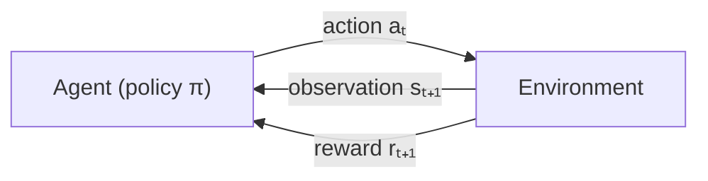

# Reinforcement Learning Basics

Supervised learning needs someone to tell the model the right answer for each input. Reinforcement learning (RL) drops that requirement. An agent acts, the world responds, and the only feedback is a number, the reward, that says how good the outcome was, often many steps after the decision that caused it. This page builds the core ideas from the simplest case (one decision, no state) up to Markov decision processes, Bellman equations, and tabular Q-learning, which you implement from scratch. Everything later in this section (DQN, PPO, imitation learning, and RLHF for LLMs) uses this vocabulary.

!!! abstract "What you'll learn"
    - The agent-environment loop, and why RL is harder than supervised learning
    - Multi-armed bandits: the explore/exploit trade-off with ε-greedy, UCB and Thompson sampling
    - Markov decision processes (MDPs): states, actions, transitions, rewards, discounting
    - Policies, value functions $V^\pi$ and $Q^\pi$, and the Bellman equations
    - Tabular Q-learning on a gridworld in plain numpy
    - The Gymnasium API (`reset`, `step`, `terminated` vs `truncated`) used everywhere else on this site

## The agent-environment loop



At each time step the agent sees an observation $s_t$, picks an action $a_t$, and the environment returns a reward $r_{t+1}$ and the next observation. The goal is to pick actions that maximize the total reward over time, not the immediate reward.

Three things make this harder than supervised learning:

1. **No labels.** You only learn how good the action you took was, never what the best action would have been.
2. **Credit assignment.** A reward may arrive many steps after the decision that earned it. Which of the last 200 actions deserves credit for winning?
3. **Your data depends on your behavior.** The states you see are produced by your own policy. A bad policy collects bad data. This is a feedback loop that supervised learning does not have.

## Multi-armed bandits: exploration in its purest form

Start with the simplest RL problem: no state, just repeated choices. You face $k$ slot machines ("arms"). Arm $i$ pays reward 1 with unknown probability $p_i$. Every round you pull one arm. How do you maximize total payout?

If you always pull the arm that looks best so far (**exploit**), an unlucky early streak can lock you into a bad arm forever. If you pull randomly (**explore**), you waste pulls on arms you already know are bad. The explore/exploit trade-off appears in every RL algorithm, and bandits isolate it.

The standard way to score a bandit strategy is **regret**: how much reward you lost compared with always pulling the best arm.

$$
\text{Regret}(T) = T \cdot p^* - \sum_{t=1}^{T} p_{a_t}, \qquad p^* = \max_i p_i
$$

Good algorithms have regret that grows like $\log T$, which means they eventually stop wasting pulls almost entirely.

Bandits are not only a teaching tool. A/B testing with adaptive traffic, recommendation slates, ad selection and choosing between LLMs for a query class (see [routing models](routing-models.md)) are all bandit problems.

### Three classic strategies

**ε-greedy.** With probability ε pick a random arm, otherwise pick the arm with the highest estimated mean $\hat{Q}(i)$. Simple, but it keeps exploring at rate ε forever, including arms it knows are terrible.

**UCB1 (upper confidence bound).** Be optimistic about arms you have not tried much. Pick

$$
a_t = \arg\max_i \left[ \hat{Q}(i) + \sqrt{\frac{c \ln t}{n_i}} \right]
$$

where $n_i$ is how many times arm $i$ was pulled. The bonus shrinks as an arm is tried more, so exploration concentrates on arms that might still be the best.

**Thompson sampling.** Keep a probability distribution over each arm's true payout rate. For 0/1 rewards a Beta distribution is the natural choice: start with $\text{Beta}(1,1)$ (uniform), and after a success or a failure add 1 to $\alpha$ or to $\beta$. Each round, *sample* a plausible rate for each arm from its distribution and pull the arm with the highest sample. Uncertain arms sometimes produce high samples and get explored; arms that are clearly bad almost never do.

```python title="bandits.py"
import numpy as np

class BernoulliBandit:
    def __init__(self, probs, seed=0):
        self.probs = np.asarray(probs)
        self.rng = np.random.default_rng(seed)
    def pull(self, arm):
        return float(self.rng.random() < self.probs[arm])

def run(agent, bandit, steps=5000):
    regret, best = [], bandit.probs.max()
    for t in range(steps):
        arm = agent.select(t)
        r = bandit.pull(arm)
        agent.update(arm, r)
        regret.append(best - bandit.probs[arm])
    return np.cumsum(regret)

class EpsGreedy:
    def __init__(self, k, eps=0.1, seed=0):
        self.q, self.n, self.eps = np.zeros(k), np.zeros(k), eps
        self.rng = np.random.default_rng(seed)
    def select(self, t):
        if self.rng.random() < self.eps:
            return int(self.rng.integers(len(self.q)))
        return int(np.argmax(self.q))
    def update(self, arm, r):
        self.n[arm] += 1
        self.q[arm] += (r - self.q[arm]) / self.n[arm]   # incremental mean

class UCB1:
    def __init__(self, k, c=2.0):
        self.q, self.n, self.c = np.zeros(k), np.zeros(k), c
    def select(self, t):
        if (self.n == 0).any():
            return int(np.argmin(self.n))                # try every arm once
        bonus = np.sqrt(self.c * np.log(t + 1) / self.n)
        return int(np.argmax(self.q + bonus))
    def update(self, arm, r):
        self.n[arm] += 1
        self.q[arm] += (r - self.q[arm]) / self.n[arm]

class Thompson:
    def __init__(self, k, seed=0):
        self.a, self.b = np.ones(k), np.ones(k)          # Beta(1,1) = uniform prior
        self.rng = np.random.default_rng(seed)
    def select(self, t):
        return int(np.argmax(self.rng.beta(self.a, self.b)))
    def update(self, arm, r):
        self.a[arm] += r
        self.b[arm] += 1 - r

probs = [0.10, 0.25, 0.30, 0.45, 0.50]
for name, agent in [("eps-greedy", EpsGreedy(5)), ("UCB1", UCB1(5)), ("Thompson", Thompson(5))]:
    cum = run(agent, BernoulliBandit(probs, seed=1))
    print(f"{name:10s} cumulative regret after 5000 pulls: {cum[-1]:.1f}")
```

On this problem, one run gives ε-greedy about twice the regret of UCB1 and Thompson sampling. The exact numbers change with the seed, so average many seeds before you trust a comparison. The real lesson is in the shape of the curves: plot `cum` for each agent and you will see ε-greedy's regret keep growing in a straight line (it explores at a constant rate), while the other two flatten out.

!!! tip "Contextual bandits"
    If each round also gives you a feature vector $x$ (the user, the query) and the best arm depends on $x$, you have a **contextual bandit**. Instead of a table you learn a model $\hat{Q}(x, a)$. This is the right framing for a lot of production decision systems. It is still not full RL, because your action does not change the next context.

## Markov decision processes

Bandits have no state: pulling an arm does not change the future. Most interesting problems are different. Moving a robot changes where it is. Spending money changes your budget. The **Markov decision process** (MDP) formalizes this with five pieces:

| Symbol | Meaning | Gridworld example |
|---|---|---|
| $\mathcal{S}$ | states | the grid cells |
| $\mathcal{A}$ | actions | up, right, down, left |
| $P(s' \mid s, a)$ | transition probabilities | move as intended 90% of the time, slip 10% |
| $R(s, a, s')$ | reward | +1 at goal, -1 in pit, -0.01 per step |
| $\gamma \in [0, 1)$ | discount factor | 0.95 |

The **Markov property** says that the next state depends only on the current state and action, not on the earlier history: $P(s_{t+1} \mid s_t, a_t, s_{t-1}, \dots) = P(s_{t+1} \mid s_t, a_t)$. When your observation does not contain everything relevant (one video frame does not show velocity, for example), you have a *partially observable* MDP. The usual fixes are to stack recent observations, add velocity features, or give the policy memory (an RNN or a transformer).

### Returns and discounting

The **return** from time $t$ is the discounted sum of future rewards:

$$
G_t = r_{t+1} + \gamma r_{t+2} + \gamma^2 r_{t+3} + \dots = \sum_{k=0}^{\infty} \gamma^k r_{t+k+1}
$$

Why discount?

- **Math:** with $\gamma < 1$ and bounded rewards, the infinite sum is finite.
- **Preference:** reward now is worth more than reward later, because the future is uncertain.
- **Horizon:** $\gamma$ sets an effective planning horizon of roughly $1/(1-\gamma)$ steps. With $\gamma = 0.99$ that is about 100 steps; with $0.9$ it is about 10.

The return satisfies a simple recursion, and the Bellman equations below are built on it:

$$
G_t = r_{t+1} + \gamma G_{t+1}
$$

### Policies

A **policy** $\pi$ is the decision model: it maps a state to an action.

- Deterministic: $a = \pi(s)$.
- Stochastic: $a \sim \pi(a \mid s)$, a probability distribution over actions. Neural network policies usually output logits and you sample from the softmax. An LLM is exactly this, with tokens as actions.

### Value functions

Value functions predict future return. They are how an agent can judge an action without waiting until the episode ends.

$$
V^\pi(s) = \mathbb{E}_\pi\left[ G_t \mid s_t = s \right] \qquad
Q^\pi(s, a) = \mathbb{E}_\pi\left[ G_t \mid s_t = s, a_t = a \right]
$$

$V^\pi(s)$ is "how good is it to be here, if I follow $\pi$". $Q^\pi(s, a)$ is "how good is it to take action $a$ here, and then follow $\pi$". They are related by $V^\pi(s) = \sum_a \pi(a \mid s) Q^\pi(s, a)$. The difference $A^\pi(s,a) = Q^\pi(s,a) - V^\pi(s)$ is the **advantage**, which tells you how much better action $a$ is than the policy's average. Advantages are central to [policy-gradient methods](policy-methods.md).

### Bellman equations

Substitute $G_t = r_{t+1} + \gamma G_{t+1}$ into the definitions and take expectations. You get the **Bellman expectation equation**:

$$
Q^\pi(s, a) = \mathbb{E}_{s' \sim P(\cdot \mid s,a)}\Big[ R(s,a,s') + \gamma \sum_{a'} \pi(a' \mid s') \, Q^\pi(s', a') \Big]
$$

In words: the value of an action is the immediate reward plus the discounted value of wherever you land. The **optimal** action-value function $Q^*$, the best achievable by any policy, satisfies the **Bellman optimality equation**:

$$
Q^*(s, a) = \mathbb{E}_{s'}\Big[ R(s,a,s') + \gamma \max_{a'} Q^*(s', a') \Big]
$$

Once you have $Q^*$, acting optimally is trivial: $\pi^*(s) = \arg\max_a Q^*(s,a)$. Most value-based RL comes down to estimating $Q^*$ from experience by repeatedly nudging $Q$ toward the right-hand side of this equation.

!!! note "Dynamic programming vs learning"
    If you *know* $P$ and $R$, you can solve the Bellman equations directly. Value iteration repeats $Q \leftarrow R + \gamma P \max Q$ until it converges. RL is what you do when you do not know $P$ and $R$ and can only sample transitions by acting.

## Tabular Q-learning from scratch

Q-learning keeps a table `Q[s, a]`. After every transition $(s, a, r, s')$ it applies a **temporal-difference (TD) update**:

$$
Q(s,a) \leftarrow Q(s,a) + \alpha \Big[ \underbrace{r + \gamma \max_{a'} Q(s', a')}_{\text{TD target}} - Q(s,a) \Big]
$$

The bracketed term is the **TD error**: the difference between what you predicted and a slightly better estimate that uses one real reward. Q-learning is **off-policy**. The target uses $\max_{a'}$, the greedy action, regardless of which action the agent actually takes next. So the agent can explore with random actions while still learning the value of the greedy policy. Under standard conditions (every state-action pair visited infinitely often, learning rate decaying appropriately) tabular Q-learning converges to $Q^*$.

### Exploration: ε-greedy with decay

As with bandits, the agent has to try actions it currently thinks are worse. The usual schedule starts at ε = 1 (all random), decays linearly to a small floor such as 0.05, and stays there.

```python title="gridworld_qlearning.py"
import numpy as np

class GridWorld:
    """4x5 grid. S = start, G = goal (+1), X = pit (-1), # = wall. Each step costs -0.01."""
    LAYOUT = [
        "S..#.",
        ".#...",
        "...#X",
        ".#..G",
    ]
    MOVES = [(-1, 0), (0, 1), (1, 0), (0, -1)]  # up, right, down, left

    def __init__(self, slip=0.1, seed=0):
        self.grid = [list(r) for r in self.LAYOUT]
        self.h, self.w = len(self.grid), len(self.grid[0])
        self.n_states, self.n_actions = self.h * self.w, 4
        self.slip = slip
        self.rng = np.random.default_rng(seed)

    def reset(self):
        self.pos = (0, 0)
        return self._s()

    def _s(self):
        return self.pos[0] * self.w + self.pos[1]

    def step(self, a):
        if self.rng.random() < self.slip:          # stochastic transitions
            a = int(self.rng.integers(4))
        dr, dc = self.MOVES[a]
        r, c = self.pos[0] + dr, self.pos[1] + dc
        if 0 <= r < self.h and 0 <= c < self.w and self.grid[r][c] != "#":
            self.pos = (r, c)
        cell = self.grid[self.pos[0]][self.pos[1]]
        if cell == "G":
            return self._s(), 1.0, True
        if cell == "X":
            return self._s(), -1.0, True
        return self._s(), -0.01, False

def q_learning(env, episodes=3000, alpha=0.1, gamma=0.95,
               eps_start=1.0, eps_end=0.05, max_steps=100, seed=0):
    rng = np.random.default_rng(seed)
    Q = np.zeros((env.n_states, env.n_actions))
    for ep in range(episodes):
        eps = max(eps_end, eps_start - (eps_start - eps_end) * ep / (0.7 * episodes))
        s = env.reset()
        for t in range(max_steps):
            if rng.random() < eps:                       # explore
                a = int(rng.integers(env.n_actions))
            else:                                        # exploit (random tie-break)
                a = int(rng.choice(np.flatnonzero(Q[s] == Q[s].max())))
            s2, r, done = env.step(a)
            target = r if done else r + gamma * Q[s2].max()   # Bellman optimality target
            Q[s, a] += alpha * (target - Q[s, a])             # TD update
            s = s2
            if done:
                break
    return Q

env = GridWorld()
Q = q_learning(env)
arrows = "^>v<"
for r in range(env.h):
    row = ""
    for c in range(env.w):
        ch = env.grid[r][c]
        row += ch if ch in "#GX" else arrows[int(Q[r * env.w + c].argmax())]
    print(row)
print("V(start) =", Q[0].max().round(3))
```

Running it prints the greedy policy as arrows:

```text
>>v#v
v#v<<
>>v#X
^#>>G
V(start) = 0.655
```

From the start, the path goes right, right, down through the gap, then along the bottom row to G, and it stays away from the pit. Cells the agent rarely visits (bottom-left, for example) may show odd arrows. Their Q-values are barely trained, and that does not matter because the policy never goes there. Things worth trying:

- Set `slip=0.0` and see the policy hug the pit, because there is no longer any risk of slipping in.
- Set `gamma=0.5` and watch the agent stop caring about the distant goal.
- Set `eps_end=0.0` and decay faster. Sometimes the agent settles on a worse route and never finds the better one.

!!! info "SARSA: the on-policy cousin"
    Replace `Q[s2].max()` with `Q[s2, a2]`, where `a2` is the action you will *actually* take next (including exploratory ones), and you get SARSA. SARSA learns the value of the ε-greedy policy it is running, so it learns safer routes near cliffs because it accounts for its own random moves. Q-learning learns the value of the greedy policy and ignores the risk of its own exploration.

Tabular methods stop working once the state space is large or continuous: a table cannot generalize from one state to a similar one it has never visited. The fix is to replace the table with a neural network, which is DQN, covered on the [next page](policy-methods.md).

## The Gymnasium API

[Gymnasium](https://gymnasium.farama.org/) (the maintained fork of OpenAI Gym) is the standard interface between RL agents and environments. Every environment on this site, including the custom game in [Project 4](../projects/p4-decision-model.md), follows it.

```python
import gymnasium as gym

env = gym.make("CartPole-v1")
obs, info = env.reset(seed=42)          # seed once at the start for reproducibility
print(env.observation_space)            # a Box of shape (4,): cart pos/vel, pole angle/ang. vel
print(env.action_space)                 # Discrete(2)

terminated = truncated = False
while not (terminated or truncated):
    action = env.action_space.sample()  # replace with your policy
    obs, reward, terminated, truncated, info = env.step(action)
env.close()
```

The key details:

- `reset()` returns `(obs, info)`. `step()` returns five values: `(obs, reward, terminated, truncated, info)`.
- **`terminated`** means the MDP reached a real terminal state (the pole fell, the agent reached the goal). The future value is zero.
- **`truncated`** means the episode was cut off for an outside reason, usually a time limit. The state was *not* terminal, so when you compute targets you should still bootstrap from $V(s')$. Mixing these up is one of the most common RL bugs.
- **Spaces** describe shapes: `Discrete(n)` for n choices, `Box(low, high, shape)` for continuous vectors. `env.observation_space.sample()` and `.contains(x)` are handy in tests.
- **Wrappers** change behavior without editing the environment: `TimeLimit`, `RecordEpisodeStatistics`, `NormalizeObservation`, `FrameStackObservation`, and others.
- **Vector environments** (`gym.vector.SyncVectorEnv` / `AsyncVectorEnv`) step N copies together to collect batches. Their auto-reset behavior changed in Gymnasium 1.0, so check the docs for the version you have installed.

Here is the same Q-learning update on Gymnasium's `FrozenLake-v1`, a slippery 4x4 grid with a sparse reward (1 only for reaching the goal):

```python title="frozenlake_q.py"
import gymnasium as gym
import numpy as np

env = gym.make("FrozenLake-v1", map_name="4x4", is_slippery=True)
nS, nA = env.observation_space.n, env.action_space.n
Q = np.zeros((nS, nA))
rng = np.random.default_rng(0)
alpha, gamma = 0.1, 0.99

for ep in range(20_000):
    eps = max(0.05, 1.0 - ep / 10_000)
    s, info = env.reset(seed=ep)
    terminated = truncated = False
    while not (terminated or truncated):
        a = env.action_space.sample() if rng.random() < eps else int(Q[s].argmax())
        s2, r, terminated, truncated, info = env.step(a)
        target = r + gamma * Q[s2].max() * (not terminated)   # bootstrap unless truly terminal
        Q[s, a] += alpha * (target - Q[s, a])
        s = s2

wins = 0
for ep in range(1000):
    s, _ = env.reset(seed=100_000 + ep)
    done = False
    while not done:
        s, r, term, trunc, _ = env.step(int(Q[s].argmax()))
        done = term or trunc
    wins += r
print(f"greedy success rate: {wins / 1000:.1%}")
```

This reaches a success rate of roughly 70-75%. Because the ice is slippery, even the optimal policy fails a sizable fraction of the time, so do not expect 100%.

To write your own environment, subclass `gymnasium.Env`. Define `observation_space` and `action_space`, implement `reset(seed=...)` (call `super().reset(seed=seed)` and draw randomness from `self.np_random`) and `step(action)`, then run `gymnasium.utils.env_checker.check_env(env)` to catch API mistakes.

!!! warning "Common pitfalls"
    - **Treating truncation as termination.** Zeroing the bootstrap at a time limit teaches the agent that the world ends at step 500, which biases values near the limit.
    - **Never-ending exploration, or none at all.** Too high an ε floor caps performance. Decaying to zero too fast freezes the agent on its first decent idea.
    - **Reward scale.** Very large rewards make TD errors, and therefore updates, huge. Keep per-step rewards roughly in [-1, 1], or normalize them.
    - **Judging from one seed.** RL results vary a lot between seeds. Compare methods over 3-5 seeds at minimum.
    - **Evaluating with exploration on.** Report greedy (or deterministic) performance on held-out seeds separately from training returns.
    - **Non-Markov observations.** If the right action depends on something the observation does not show, no amount of training will fix it. Add the missing information.

## Check your understanding

??? question "Why does ε-greedy have linear regret while UCB and Thompson sampling do not?"
    ε-greedy keeps picking a uniformly random arm with probability ε forever, so it pays a roughly constant cost per step even after it has identified the best arm. UCB's exploration bonus and Thompson sampling's posterior width both shrink as an arm is tried more, so the rate of exploration falls over time and total regret grows only logarithmically.

??? question "What does the discount factor γ = 0.99 imply about the agent's horizon?"
    The effective horizon is about $1/(1-\gamma) = 100$ steps. Rewards much further away than that contribute little to the return. If your task needs credit assigned over 1000 steps, either increase γ (and accept higher-variance learning) or shape the reward so that useful signal arrives sooner.

??? question "In the Q-learning update, why is it fine for the agent to take random actions?"
    Q-learning is off-policy. Its target $r + \gamma \max_{a'} Q(s', a')$ is the value of acting greedily from $s'$, whatever action the agent actually takes next. Exploratory actions only decide which transitions get sampled. They do not bias the target.

??? question "An episode ends because of a 500-step time limit. Should the TD target at the last step be $r$ or $r + \gamma V(s')$?"
    $r + \gamma V(s')$. The state at step 500 is not terminal in the underlying task. The episode was only cut off. Bootstrapping keeps the value estimates consistent. Only `terminated=True` should zero out the future value.

??? question "When is a contextual bandit enough, and when do you need a full MDP?"
    Use a contextual bandit when your action does not affect future contexts, for example choosing which model answers an incoming query. Use an MDP when actions change the future state, for example a robot's movement or a dialogue where each reply shapes the next turn. Then you need value functions that account for future consequences.

## Further reading

- Sutton & Barto, [*Reinforcement Learning: An Introduction* (2nd ed.)](http://incompleteideas.net/book/the-book-2nd.html). The standard textbook, free online. Chapters 2 (bandits), 3 (MDPs) and 6 (TD learning) cover this page.
- Auer, Cesa-Bianchi & Fischer (2002), "Finite-time Analysis of the Multiarmed Bandit Problem" (the UCB1 paper).
- Russo et al., [A Tutorial on Thompson Sampling](https://arxiv.org/abs/1707.02038) (2017).
- [Gymnasium documentation](https://gymnasium.farama.org/), especially "Create a Custom Environment" and the notes on `terminated`/`truncated`.
- OpenAI [Spinning Up in Deep RL](https://spinningup.openai.com/), a concise and practical introduction.

**Next:** [DQN & PPO](policy-methods.md)
