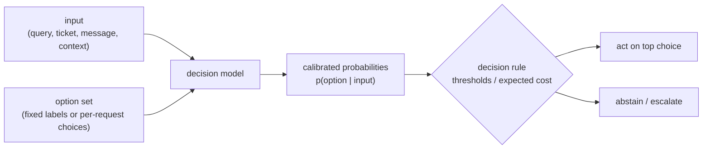
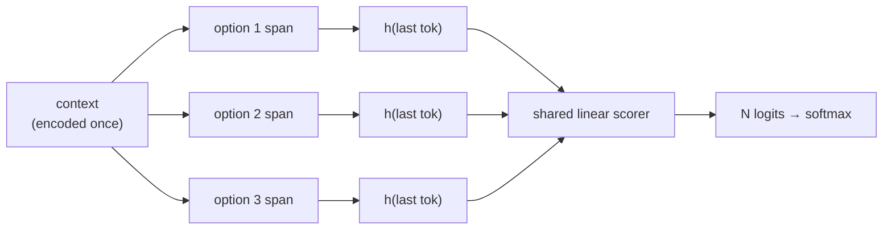

# Decision Models for Routing & Classification

Many "AI decisions" in production are not free-form text. Which model should answer this query? Which tool should the agent call? Is this message safe to send? Which team gets this ticket? Each of these is a choice among a **fixed set of options**, and the thing you need back is a **probability you can act on**, not a paragraph. This page covers how to build these decision models well: from embeddings with a linear head, to fine-tuned encoders, to *decision language models* that score options in a single forward pass. It then covers the parts that make them trustworthy: calibration, thresholds, abstention, and cost-aware evaluation.

!!! abstract "What you'll learn"
    - Where classification-style decision models sit in LLM systems: routers, intent/tool classifiers, guard models
    - Three ways to build one, in increasing cost: embeddings + linear head, fine-tuned small encoder, small LM with a classification head
    - **Decision language models:** context + options → calibrated probabilities in one prefill, with order invariance built in
    - Calibration: reliability diagrams, ECE, temperature scaling
    - Thresholds, abstention and cost-weighted decisions
    - Constrained/structured outputs as a decision interface
    - Evaluation: precision, recall, confusion matrices, and expected cost

## Decisions vs generations

A generative LLM answering "which team should handle this ticket?" produces text that you then have to parse. It is slow (one forward pass per output token), it can produce invalid labels, and its confidence is hidden. A **decision model** has a different contract:



Splitting **scores** (what the model believes) from the **decision rule** (what you do about it) is the main idea of this page. Scores come from a model and should be calibrated. The decision rule encodes business costs and risk tolerance and can change without retraining.

### Where these show up

- **LLM routers.** Send each request to the cheapest model that will answer it well enough: a small local model, a mid-size API model, or a large reasoning model. The router predicts "will the cheap model be good enough?" ([System 1 / System 2](system-one.md) applied to model selection.)
- **Intent classification and tool routing for agents.** Map a user message to one of N intents or tools before (or instead of) asking an LLM to choose. It is faster, cheaper and easier to test, and the LLM can be reserved for ambiguous cases.
- **Guard and safety classifiers.** Classify prompts or responses as safe/unsafe, or into policy categories, before they reach the user or the main model. Several open LLM-based safety classifiers exist (for example Meta's Llama Guard family). They are classifiers, and the same calibration and threshold work applies to them.
- **Everything else:** ticket triage, content moderation, lead scoring, fraud flags, retrieval reranking (a reranker is a binary relevance classifier).

## Approach 1: embeddings + a linear head

The cheapest strong baseline. Embed each text with a pretrained sentence encoder, then train logistic regression on top. Training takes seconds, inference costs one encoder pass, and it works surprisingly well with a few dozen examples per class.

```python title="embedding_classifier.py"
import numpy as np
from sentence_transformers import SentenceTransformer
from sklearn.linear_model import LogisticRegression

texts = [
    "what's the weather in Paris tomorrow", "will it rain this weekend", "temperature in Tokyo right now",
    "book a table for two at 7pm", "reserve a restaurant tonight", "find me a sushi place and book it",
    "convert 100 dollars to euros", "what's the exchange rate for yen", "how many pounds is 50 euros",
    "tell me a joke", "who won the world cup in 2018", "explain quantum entanglement simply",
]
labels = ["weather"] * 3 + ["restaurant"] * 3 + ["currency"] * 3 + ["chitchat"] * 3

encoder = SentenceTransformer("sentence-transformers/all-MiniLM-L6-v2")
X = encoder.encode(texts, normalize_embeddings=True)            # (N, 384)
clf = LogisticRegression(C=10.0, max_iter=1000).fit(X, labels)

queries = ["is it going to snow in Oslo", "book dinner for four on friday", "usd to inr rate"]
probs = clf.predict_proba(encoder.encode(queries, normalize_embeddings=True))
for q, p in zip(queries, probs):
    top = np.argsort(p)[::-1][:2]
    print(f"{q!r:40s} -> " + ", ".join(f"{clf.classes_[i]} {p[i]:.2f}" for i in top))
```

With three examples per class this already routes all three queries correctly, with top probabilities around 0.6-0.7. Those probabilities are **not** calibrated yet. They depend heavily on `C`, and you should not threshold on them until you have done the calibration step below. Upgrades that cost little: a better embedding model, more labeled data, and an MLP head instead of logistic regression.

## Approach 2: fine-tune a small encoder

When you have hundreds to thousands of labeled examples, fine-tuning a whole encoder usually beats a frozen-embedding head by a clear margin. Good choices are **ModernBERT** (base around 150M parameters, long context, fast) and **DeBERTa-v3** (a strong classic). Both run in a few milliseconds on a GPU and tens of milliseconds on a CPU at short sequence lengths.

```python title="finetune_encoder.py"
from datasets import Dataset
from sklearn.metrics import f1_score
from transformers import (AutoModelForSequenceClassification, AutoTokenizer,
                          DataCollatorWithPadding, Trainer, TrainingArguments)

LABELS = ["weather", "restaurant", "currency", "chitchat"]
label2id = {l: i for i, l in enumerate(LABELS)}
train_rows = [...]   # list of {"text": ..., "label": ...}
val_rows = [...]

name = "answerdotai/ModernBERT-base"          # or "microsoft/deberta-v3-base"
tok = AutoTokenizer.from_pretrained(name)
model = AutoModelForSequenceClassification.from_pretrained(
    name, num_labels=len(LABELS), id2label=dict(enumerate(LABELS)), label2id=label2id)

def encode(batch):
    enc = tok(batch["text"], truncation=True, max_length=128)
    enc["labels"] = [label2id[l] for l in batch["label"]]
    return enc

train_ds = Dataset.from_list(train_rows).map(encode, batched=True, remove_columns=["text", "label"])
val_ds = Dataset.from_list(val_rows).map(encode, batched=True, remove_columns=["text", "label"])

def metrics(eval_pred):
    logits, y = eval_pred
    pred = logits.argmax(-1)
    return {"accuracy": (pred == y).mean(), "macro_f1": f1_score(y, pred, average="macro")}

args = TrainingArguments(
    output_dir="intent-modernbert", learning_rate=3e-5, per_device_train_batch_size=16,
    num_train_epochs=3, weight_decay=0.01, warmup_steps=100,
    eval_strategy="epoch", save_strategy="epoch", logging_steps=50, report_to="none",
)
trainer = Trainer(model=model, args=args, train_dataset=train_ds, eval_dataset=val_ds,
                  data_collator=DataCollatorWithPadding(tok), compute_metrics=metrics)
trainer.train()
```

Notes:

- This code is written for `transformers` v5 (ModernBERT itself needs 4.48 or newer). `TrainingArguments` has changed over versions: `eval_strategy` replaced `evaluation_strategy`, and v5 reworked the warmup options, so adjust the arguments if you are pinned to an older release.
- Keep a separate **calibration split** (on top of train/val/test). You will fit a temperature on it.
- For **multi-label** problems (a message can be both "billing" and "urgent"), set `problem_type="multi_label_classification"` and use one sigmoid per label.

### Small decoder LMs with a classification head

Decoder-only models work as classifiers too. `AutoModelForSequenceClassification` supports Qwen2.5, Llama, SmolLM2 and others: it puts a linear head on the hidden state of the **last non-padding token**. You must set a pad token (`tok.pad_token = tok.eos_token` and `model.config.pad_token_id = tok.pad_token_id`) so the model can find that last token. Combine this with [LoRA](../finetuning/lora-qlora.md) to fine-tune cheaply. A 0.5B decoder brings much more world knowledge than a 150M encoder, which helps when the label depends on understanding the request, as with "can the small model answer this?" in a router.

## Decision language models

The approaches above assume a **fixed label set** baked into the classification head. Many decisions do not work like that. An agent chooses among *the tools available in this session*. A router chooses among *the models currently deployed*. A recommender picks among *these five candidates*. You want a model that takes a **context and a list of options supplied at request time** and returns a probability for each option, quickly.

A **decision language model** is a (small) LM adapted to do exactly that:

> **input:** context + N options (any N, any order)  
> **output:** N logits → softmax → calibrated $p(\text{option}_k \mid \text{context})$  
> **cost:** one prefill pass, no token-by-token generation  
> **training:** cross-entropy over the user-defined choices

There are three practical designs.

### Design A: score the option labels' next-token logits

List the options with letters and read the LM's next-token distribution, restricted to the letter tokens:

```python title="letter_scoring.py"
import torch
from transformers import AutoModelForCausalLM, AutoTokenizer

name = "Qwen/Qwen2.5-0.5B"
tok = AutoTokenizer.from_pretrained(name)
lm = AutoModelForCausalLM.from_pretrained(name, dtype=torch.float32).eval()   # v5 would otherwise load the checkpoint's bf16
LETTERS = "ABCDEFGH"

@torch.inference_mode()
def letter_probs(context, options):
    prompt = context + "\n" + "\n".join(f"{LETTERS[i]}. {o}" for i, o in enumerate(options)) + "\nAnswer:"
    ids = tok(prompt, return_tensors="pt").input_ids
    next_logits = lm(ids).logits[0, -1]                       # one prefill, read the next-token logits
    letter_ids = [tok(" " + LETTERS[i], add_special_tokens=False).input_ids[0] for i in range(len(options))]
    return next_logits[letter_ids].softmax(-1)                # distribution over the N choices only
```

This is one forward pass, and it works zero-shot with instruction-tuned models. It has a serious flaw, though: **position and label bias**. LMs systematically prefer some letters or positions. Running the base Qwen2.5-0.5B zero-shot on a "charged twice, which team?" ticket with options [billing, technical support, shipping, account security] gave roughly `[0.31, 0.28, 0.34, 0.07]`. With the options listed in reverse order (and the result mapped back), it gave `[0.39, 0.21, 0.29, 0.12]`. Same question, same options, different answer depending on the order. Fine-tuning reduces this bias but does not remove it structurally.

### Design B (the cheap fix for A): permutation averaging

Score several orderings and average each option's probability across them. Cyclic shifts are enough to put each option in every slot once:

```python title="permutation_average.py"
@torch.inference_mode()
def permutation_averaged(context, options, n_shifts=None):
    n = len(options)
    total = torch.zeros(n)
    for s in range(n_shifts or n):                            # cyclic shifts: each option visits every slot
        order = [(i + s) % n for i in range(n)]
        p = letter_probs(context, [options[j] for j in order])
        for slot, j in enumerate(order):
            total[j] += p[slot]
    return total / (n_shifts or n)
```

This cancels most of the position bias, but costs N prefills instead of one. You can batch them, but it is still N times the compute. In training, the matching trick is to **shuffle option order** in every example, so the model never gets to learn "the answer is usually B".

### Design C: per-option scoring with shared encoding (order-invariant by construction)

The cleanest design gets order invariance *exactly* from a single prefill. Pack everything into one sequence:

```text
[context tokens] [sep + option 1 tokens] [sep + option 2 tokens] ... [sep + option N tokens]
```

and modify two things:

1. **Attention mask.** Each option's tokens can attend to the context and to earlier tokens of *the same option*, but not to other options. The context is encoded once and shared.
2. **Position ids.** Every option's positions restart right after the context, so option 3 is not "further away" than option 1.

With both changes, the hidden states for option $k$ are *exactly* what you would get by running `context + option_k` alone. Option order cannot affect any score, because no option can see any other option and they all sit at the same positions. Take the hidden state at each option's **last token**, apply a shared linear scorer to get one logit per option, and train with cross-entropy over the options.



```python title="decision_lm.py"
import torch
import torch.nn as nn
import torch.nn.functional as F
from transformers import AutoModel, AutoTokenizer

class DecisionLM(nn.Module):
    """Context + N options -> N logits, in ONE forward pass, order-invariant by construction."""

    def __init__(self, name="Qwen/Qwen2.5-0.5B", dtype=torch.float32):
        super().__init__()
        self.tok = AutoTokenizer.from_pretrained(name)
        # older transformers 4.x releases: the argument is torch_dtype= instead of dtype=
        self.backbone = AutoModel.from_pretrained(name, dtype=dtype, attn_implementation="sdpa")
        d = self.backbone.config.hidden_size
        self.scorer = nn.Linear(d, 1)
        nn.init.zeros_(self.scorer.weight); nn.init.zeros_(self.scorer.bias)  # start uniform
        self.sep = self.tok("\nOption:", add_special_tokens=False).input_ids

    def pack(self, context, options):
        """Token ids, segment ids (0 = context, k = option k), position ids, last-token index per option."""
        ids = self.tok(context, add_special_tokens=False).input_ids
        seg, pos = [0] * len(ids), list(range(len(ids)))
        L, last = len(ids), []
        for k, opt in enumerate(options, start=1):
            o = self.sep + self.tok(" " + opt, add_special_tokens=False).input_ids
            ids += o
            seg += [k] * len(o)
            pos += list(range(L, L + len(o)))    # every option restarts right after the context
            last.append(len(ids) - 1)
        return ids, seg, pos, last

    def build_mask(self, seg, dtype):
        # allowed[i, j]: causal AND (j is context OR j in the same option as i); padding (seg=-1) sees itself
        seg = torch.as_tensor(seg)
        n = seg.shape[-1]
        causal = torch.ones(n, n, dtype=torch.bool).tril()
        same = (seg[:, :, None] == seg[:, None, :]) | (seg[:, None, :] == 0)
        allowed = causal & same & (seg[:, None, :] >= 0)
        allowed |= torch.eye(n, dtype=torch.bool)                    # no fully-masked rows
        mask = torch.zeros(allowed.shape, dtype=dtype)
        mask.masked_fill_(~allowed, torch.finfo(dtype).min)
        return mask[:, None]                                         # (B, 1, N, N) additive mask

    def forward(self, contexts, options_list):
        packed = [self.pack(c, o) for c, o in zip(contexts, options_list)]
        n = max(len(p[0]) for p in packed)
        pad = self.tok.pad_token_id or 0
        ids = torch.tensor([p[0] + [pad] * (n - len(p[0])) for p in packed])
        seg = [p[1] + [-1] * (n - len(p[1])) for p in packed]
        pos = torch.tensor([p[2] + [0] * (n - len(p[2])) for p in packed])
        dtype = next(self.backbone.parameters()).dtype
        h = self.backbone(input_ids=ids, attention_mask=self.build_mask(seg, dtype),
                          position_ids=pos).last_hidden_state                  # (B, N, d)
        max_opts = max(len(p[3]) for p in packed)
        logits = torch.full((len(packed), max_opts), float("-inf"))           # -inf = "no such option"
        for b, p in enumerate(packed):
            logits[b, :len(p[3])] = self.scorer(h[b, p[3]].float()).squeeze(-1)
        return logits                                                          # (B, max_opts)
```

The custom 4D attention mask is passed straight to the backbone. Recent `transformers` versions accept an additive float mask of shape `(batch, 1, q_len, kv_len)` for Llama/Qwen-family models with eager or SDPA attention. FlashAttention-2 does not support arbitrary masks. Check exactness in your environment. With Qwen2.5-0.5B on `transformers` v5, the logits for `options`, for `options[::-1]` (mapped back), and for each option run alone in its own separate sequence agree to within about 1e-4, which is floating-point noise.

**Training** is ordinary cross-entropy over the options, with the option order shuffled anyway. Shuffling is harmless for Design C, it lets you swap in Design A or B later, and it protects you if you ever change the mask:

```python title="train_decision_lm.py"
import random
import torch
import torch.nn.functional as F

TEAMS = ["billing", "technical support", "shipping", "account security"]
train = [("I was charged twice for my order", "billing"),
         ("The app crashes when I open settings", "technical support"),
         ("My parcel says delivered but nothing came", "shipping"),
         ("Someone logged into my account from another country", "account security"),
         ...]

def make_example(text, label, options=TEAMS):
    opts = options[:]
    random.shuffle(opts)                                   # order augmentation
    return f"Ticket: {text}\nRoute this ticket to the right team.", opts, opts.index(label)

model = DecisionLM()
for p in model.backbone.parameters():                      # cheap variant: freeze most of the backbone
    p.requires_grad = False
for layer in model.backbone.layers[-2:]:                   # ...train the top 2 blocks + scorer
    for p in layer.parameters():
        p.requires_grad = True
opt = torch.optim.AdamW([
    {"params": [p for p in model.backbone.parameters() if p.requires_grad], "lr": 2e-5},
    {"params": model.scorer.parameters(), "lr": 1e-3},     # fresh head needs a higher LR
])

model.train()
for step in range(2000):
    ctx, opts, y = zip(*[make_example(*random.choice(train)) for _ in range(16)])
    loss = F.cross_entropy(model(list(ctx), list(opts)), torch.tensor(y))
    opt.zero_grad(); loss.backward(); opt.step()
```

Even a few dozen steps on a toy dataset of 8 tickets moves the model from uniform to putting about 0.97 on "account security" for an unseen "I think my account was hacked" ticket. Practical extensions:

- **Variable option sets.** Train with random subsets of the options, so the model learns to score whatever is offered, not a fixed list. The `-inf` padding handles different N within a batch.
- **Rich option descriptions.** An option can be a whole tool description or model card, not only a label. The model scores "context × this description".
- **"None of the above".** Add an explicit abstain option, or threshold the top probability (see below).
- **LoRA instead of freezing.** Apply [LoRA](../finetuning/lora-qlora.md) to all attention/MLP layers for better accuracy at similar cost.
- **Calibrate afterwards.** Fit a temperature on held-out data. The softmax over option logits works with temperature scaling exactly like any other classifier.
- **Reuse the context's KV cache.** If the same context is scored against many option sets, prefill the context once and score only the option spans.

### Latency: one prefill vs generation

Generating a decision as text costs one prefill plus one forward pass **per output token**, and the decode steps run one after another. A decision LM costs one prefill, which processes all tokens in parallel. You can measure the difference directly:

```python title="latency_compare.py"
import time, torch
from transformers import AutoModelForCausalLM

ctx = "Ticket: I think my account was hacked\nRoute this ticket to the right team."
with torch.inference_mode():
    # decision LM: one prefill over context + all options
    t0 = time.perf_counter(); model([ctx], [TEAMS]); t_dec = time.perf_counter() - t0
    # generative baseline: ask for a short JSON answer
    lm = AutoModelForCausalLM.from_pretrained("Qwen/Qwen2.5-0.5B", dtype=torch.float32)   # same precision as the decision LM
    prompt = ctx + "\nTeams: " + ", ".join(TEAMS) + '\nAnswer as JSON {"team": ...}:'
    enc = model.tok(prompt, return_tensors="pt")
    t0 = time.perf_counter()
    lm.generate(**enc, max_new_tokens=12, min_new_tokens=12, do_sample=False)
    t_gen = time.perf_counter() - t0
print(f"decision LM: {t_dec*1000:.0f} ms   generate 12 tokens: {t_gen*1000:.0f} ms")
```

(Warm up both paths a few times before timing.) On a laptop CPU in fp32 this takes about 80 ms for the decision LM and roughly 1 to 1.5 s for 12 generated tokens: more than 10x. On a GPU both are much faster, but the ratio stays large, because decode steps are sequential and memory-bandwidth-bound while prefill is parallel. The decision LM also always returns a valid choice, and its probabilities can be calibrated. Parsed generations are not reliably either.

## Approach selection at a glance

| | Embeddings + linear | Fine-tuned encoder | Decoder + cls head / Decision LM | Generative LLM, constrained |
|---|---|---|---|---|
| labeled data needed | tens per class | hundreds+ | hundreds+ | none (zero/few-shot) |
| label set | fixed | fixed | fixed / **per-request options** | per-request |
| latency | lowest | low | low-medium (one prefill) | highest (decode loop) |
| world knowledge | low | medium | high | highest |
| calibrated probs | after scaling | after scaling | after scaling | hard |

## Calibration

A model is **calibrated** if, among all predictions it makes with confidence 0.8, about 80% are correct. Calibration is what makes probabilities usable for thresholds, expected-cost decisions and escalation. Modern neural networks, fine-tuned transformers included, are often **overconfident** (Guo et al., 2017): a 0.95 might really mean 0.8.

### Reliability diagrams and ECE

Bin predictions by confidence, and in each bin compare mean confidence with accuracy. A perfectly calibrated model lies on the diagonal. **Expected Calibration Error** (ECE) is the sample-weighted average gap:

$$
\text{ECE} = \sum_{b=1}^{B} \frac{|S_b|}{N} \Big| \text{acc}(S_b) - \text{conf}(S_b) \Big|
$$

### Temperature scaling

The simplest effective fix: divide the logits by a single scalar $T > 0$ fitted on a held-out set to minimize negative log-likelihood. $T > 1$ softens overconfident predictions. Because dividing by $T$ does not change the argmax, **accuracy is unchanged**. Only the confidence moves.

```python title="calibration.py"
import numpy as np
import torch
import torch.nn.functional as F

def expected_calibration_error(probs, labels, n_bins=15):
    """probs: (N, C) predicted probabilities, labels: (N,) ints."""
    conf = probs.max(1)
    pred = probs.argmax(1)
    correct = (pred == labels).astype(float)
    bins = np.linspace(0, 1, n_bins + 1)
    ece, rows = 0.0, []
    for lo, hi in zip(bins[:-1], bins[1:]):
        m = (conf > lo) & (conf <= hi)
        if m.any():
            gap = abs(correct[m].mean() - conf[m].mean())
            ece += m.mean() * gap                       # weight by fraction of samples in bin
            rows.append((lo, hi, conf[m].mean(), correct[m].mean(), m.sum()))
    return ece, rows

def fit_temperature(val_logits, val_labels, iters=200):
    """Learn a single scalar T > 0 minimizing NLL on a held-out set."""
    logits = torch.as_tensor(val_logits, dtype=torch.float32)
    labels = torch.as_tensor(val_labels)
    log_t = torch.zeros(1, requires_grad=True)          # optimize log T so T stays positive
    opt = torch.optim.LBFGS([log_t], lr=0.1, max_iter=iters)
    def closure():
        opt.zero_grad()
        loss = F.cross_entropy(logits / log_t.exp(), labels)
        loss.backward()
        return loss
    opt.step(closure)
    return log_t.exp().item()

# demo with a deliberately overconfident "model"
rng = np.random.default_rng(0)
N, C = 5000, 4
labels = rng.integers(0, C, N)
clean = rng.normal(0, 1, (N, C)); clean[np.arange(N), labels] += 1.5
logits = 3.0 * clean                                    # x3 = overconfident
val, test = slice(0, 2500), slice(2500, N)
T = fit_temperature(logits[val], labels[val])
p_raw = torch.softmax(torch.tensor(logits[test]), -1).numpy()
p_cal = torch.softmax(torch.tensor(logits[test] / T), -1).numpy()
print(f"T = {T:.2f}")
print(f"ECE before {expected_calibration_error(p_raw, labels[test])[0]:.3f}  "
      f"after {expected_calibration_error(p_cal, labels[test])[0]:.3f}")
```

This prints roughly `T = 2.12` and ECE dropping from about 0.13 to about 0.02, with identical predictions. To draw the reliability diagram:

```python title="reliability_diagram.py"
import matplotlib.pyplot as plt

def reliability_diagram(probs, labels, n_bins=15, ax=None, label=None):
    _, rows = expected_calibration_error(probs, labels, n_bins)
    conf = [r[2] for r in rows]; acc = [r[3] for r in rows]
    ax = ax or plt.gca()
    ax.plot([0, 1], [0, 1], "--", color="gray", linewidth=1)   # perfect calibration
    ax.plot(conf, acc, "o-", label=label)
    ax.set_xlabel("confidence"); ax.set_ylabel("accuracy"); ax.set_aspect("equal")
    return ax

ax = reliability_diagram(p_raw, labels[test], label="raw")
reliability_diagram(p_cal, labels[test], ax=ax, label=f"T={T:.2f}")
ax.legend(); plt.savefig("reliability.png", dpi=150)
```

Other calibrators: **Platt scaling** (logistic regression on a binary score), **isotonic regression** (non-parametric, needs more data), and **vector/matrix scaling** (per-class parameters, which overfit easily). Temperature scaling is the right default for neural classifiers. Always fit the calibrator on data the model did not train on, and re-check calibration when the input distribution shifts.

## Thresholds and abstention

Once the probabilities are calibrated, you choose a decision rule.

**Single threshold.** Act on the top class if $p_{\max} \geq \tau$, otherwise abstain: ask a clarifying question, escalate to a bigger model, or send to a human. Plotting **coverage** (fraction you act on) against **accuracy on covered cases** shows the trade-off. Pick $\tau$ to hit a target risk:

```python
def threshold_for_precision(conf, correct, target=0.98):
    """Smallest threshold whose accepted predictions reach the target precision."""
    order = np.argsort(-conf)
    prec = np.cumsum(correct[order]) / np.arange(1, len(conf) + 1)
    ok = np.flatnonzero(prec >= target)
    if len(ok) == 0:
        return None                        # unreachable: abstain on everything
    k = ok.max()
    return conf[order][k], (k + 1) / len(conf)   # threshold, coverage
```

**Per-class thresholds.** Errors cost different amounts. A safety classifier might block when P(unsafe) ≥ 0.2 but only auto-approve when P(safe) ≥ 0.99.

**Expected-cost decisions.** The most general rule. Write down a cost matrix $C[a, y]$, the cost of taking action $a$ when the truth is $y$, and choose the action with minimum expected cost under the calibrated probabilities:

$$
a^*(x) = \arg\min_a \sum_y p(y \mid x)\, C[a, y]
$$

```python title="cost_decision.py"
import numpy as np

def bayes_decision(probs, cost):
    """probs: (N, C) calibrated class probabilities. cost[a, y]: cost of action a when truth is y."""
    expected = probs @ cost.T                                 # (N, A)
    return expected.argmin(1), expected.min(1)

# guard example: classes = [safe, unsafe]; actions = [allow, block, send to human review]
cost = np.array([[0.0, 50.0],    # allow:  free if safe, very costly if unsafe
                 [5.0, 0.0],     # block:  annoys a safe user
                 [1.0, 1.0]])    # review: fixed cost either way
probs = np.array([[0.99, 0.01], [0.90, 0.10], [0.60, 0.40], [0.05, 0.95]])
actions, exp_cost = bayes_decision(probs, cost)
print([["allow", "block", "review"][a] for a in actions])   # ['allow', 'review', 'review', 'block']
```

Notice that "review" (abstain) comes out naturally as the best action under uncertainty, with no special-case code. This only works if the probabilities are calibrated. With overconfident scores, the 0.90/0.10 message would wrongly be allowed.

### Routers: the same machinery

An LLM router is a binary decision model, $p = P(\text{cheap model's answer is acceptable} \mid \text{query})$. To build one:

1. Collect a few thousand representative queries. Run both the cheap and the strong model on each, and label each answer acceptable or not (human review or an LLM judge, against a fixed rubric).
2. Train a classifier on (query → cheap_ok), using any of the approaches above.
3. Calibrate, then sweep the threshold on a validation set, computing quality and cost at each value:

```python title="router_threshold.py"
import numpy as np

def router_curve(p_cheap_ok, cheap_ok, strong_ok, cost_cheap=1.0, cost_strong=20.0):
    rows = []
    for tau in np.linspace(0, 1, 21):
        to_cheap = p_cheap_ok >= tau
        quality = np.where(to_cheap, cheap_ok, strong_ok).mean()
        cost = np.where(to_cheap, cost_cheap, cost_strong).mean()
        rows.append((tau, to_cheap.mean(), quality, cost))
    return rows

def pick_threshold(rows, min_quality):
    ok = [r for r in rows if r[2] >= min_quality]
    return min(ok, key=lambda r: r[3]) if ok else None        # cheapest setting meeting the bar
```

4. Choose the cheapest operating point that meets your quality bar (for example, at least 95% of always-strong quality), and monitor it. When either model is updated, the labels go stale and the router must be retrained. Published router work, such as RouteLLM (Ong et al., 2024), follows this general pattern of learning from preference or correctness data which queries need the strong model.

## Structured and constrained outputs as a decision interface

Sometimes a generative model has to make the decision, for example zero-shot with no training data, or as part of a larger response. Then **constrain the output space** so the decision is always valid and machine-readable. [Prompt & Context Engineering](../applications/prompting.md#structured-output) builds a constrained decoder from scratch. The options in practice:

- **Enums in a JSON schema.** `{"team": {"enum": ["billing", "shipping", ...]}, "confidence": ...}`. Most serving stacks support schema- or grammar-constrained decoding (for example vLLM's structured outputs, llama.cpp grammars, and the Outlines and XGrammar libraries), and many hosted APIs offer structured-output modes. The decoder masks every token that would violate the schema.
- **Logit masking for single-token labels.** That is Design A above. Restrict the next token to the label tokens and read the probabilities, rather than sampling text.
- **Do not trust self-reported confidence.** A "confidence": 0.9 field written by the model is generated text, not a probability. Use token-level probabilities of the constrained choice, or better, a trained decision model, and calibrate it.

A good pattern for agents: let a fast decision model choose among tools, and let a generative LLM fill in the **arguments** with schema-constrained decoding. Each component does the job it is suited for.

## Evaluation

Accuracy alone hides most of what matters. Report:

- **Precision** (of the cases you flagged, how many were right) and **recall** (of the true cases, how many you caught), per class. Use **macro-F1** when classes are imbalanced and all of them matter.
- **Confusion matrix**, which shows *which* classes get confused ("refund" vs "billing" might be fine, "unsafe" vs "safe" is not).
- **Threshold-free curves:** precision-recall curves and PR-AUC for imbalanced binary problems (guards, fraud). ROC-AUC can look good even when precision at a useful operating point is poor.
- **Calibration:** ECE and a reliability diagram.
- **Selective metrics:** accuracy at a fixed coverage, or coverage at a fixed accuracy, for systems that abstain.
- **Expected cost** under your cost matrix, which is the number the business actually cares about.

```python title="evaluate_classifier.py"
import numpy as np
from sklearn.metrics import classification_report, confusion_matrix

def evaluate(probs, y, class_names, cost=None):
    pred = probs.argmax(1)
    print(classification_report(y, pred, target_names=class_names, digits=3))
    print("confusion matrix (rows = true, cols = predicted):")
    print(confusion_matrix(y, pred))
    ece, _ = expected_calibration_error(probs, y)
    print(f"ECE: {ece:.3f}")
    if cost is not None:                      # cost[pred, true]
        print(f"mean cost per decision: {cost[pred, y].mean():.3f}")
```

Build the test set from **real traffic**, stratified so that rare but important classes are represented, and keep it frozen. Slice the metrics by language, user segment and input length. Overall averages hide failures on small slices.

!!! warning "Common pitfalls"
    - **Thresholding uncalibrated scores.** A 0.9 from an uncalibrated model is not a 90% chance. Fit a temperature on held-out data first.
    - **Calibrating on the training set.** Training-set logits are overconfident by construction. Use a separate split.
    - **Position bias in option scoring.** Letter-scoring prompts (Design A) prefer certain slots. Shuffle during training, average permutations, or use the order-invariant Design C.
    - **Label leakage through the option list.** If the correct option is always listed first in your training data, the model learns "pick first". Shuffle.
    - **Using a self-reported "confidence" field.** It is text, not a probability.
    - **Ignoring drift.** New intents, new tools and new model versions all invalidate a decision model. Monitor the class distribution, the abstention rate and calibration in production.
    - **Optimizing accuracy when costs are asymmetric.** Pick operating points using expected cost or a precision/recall target, not argmax accuracy.

## Check your understanding

??? question "Why does temperature scaling not change accuracy?"
    Dividing every logit by the same positive $T$ preserves their order, so the argmax (the predicted class) is unchanged. Only the sharpness of the softmax changes, and therefore the confidence.

??? question "In Design C, what two changes make the option scores exactly order-invariant?"
    (1) An attention mask under which each option's tokens attend only to the context and to their own earlier tokens, never to other options. (2) Position ids that restart right after the context for every option. Together they make each option's hidden states identical to running `context + option` alone, so order cannot matter.

??? question "Why is a decision LM faster than asking the LLM to generate the answer?"
    It needs a single prefill pass, which processes all tokens in parallel. Generation adds one sequential forward pass per output token, and each of those is memory-bandwidth-bound. Even a short JSON answer costs around ten extra passes.

??? question "A guard model outputs P(unsafe) = 0.1 for a message. Should you allow it?"
    It depends on the costs, not only on the probability. With the cost matrix above (allowing an unsafe message costs 50, blocking a safe one costs 5, review costs 1), the expected cost of allowing is 0.1 × 50 = 5, of blocking is 0.9 × 5 = 4.5, and of review is 1, so review wins. And the conclusion only holds if 0.1 is calibrated.

??? question "What labels do you need to train an LLM router?"
    For each query in a representative set, whether the cheap model's answer was acceptable (and ideally whether the strong model's was), judged against a fixed rubric by humans or an LLM judge. The router learns P(cheap is good enough | query), and the threshold is chosen from a quality/cost curve on validation data.

## Further reading

- Guo, Pleiss, Sun & Weinberger, [On Calibration of Modern Neural Networks](https://arxiv.org/abs/1706.04599) (2017). Temperature scaling and ECE.
- Warner et al., [Smarter, Better, Faster, Longer: A Modern Bidirectional Encoder (ModernBERT)](https://arxiv.org/abs/2412.13663) (2024).
- He, Gao & Chen, [DeBERTaV3](https://arxiv.org/abs/2111.09543) (2021).
- Ong et al., [RouteLLM: Learning to Route LLMs with Preference Data](https://arxiv.org/abs/2406.18665) (2024).
- Zheng et al., [Large Language Models Are Not Robust Multiple Choice Selectors](https://arxiv.org/abs/2309.03882) (2023). Position/label-token bias in option scoring.
- Inan et al., [Llama Guard: LLM-based Input-Output Safeguard for Human-AI Conversations](https://arxiv.org/abs/2312.06674) (2023).
- Geifman & El-Yaniv, [Selective Classification for Deep Neural Networks](https://arxiv.org/abs/1705.08500) (2017).
- [scikit-learn: probability calibration](https://scikit-learn.org/stable/modules/calibration.html).
