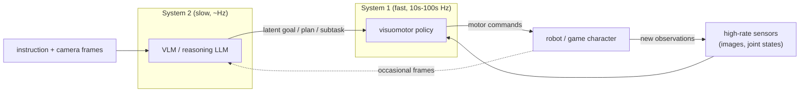
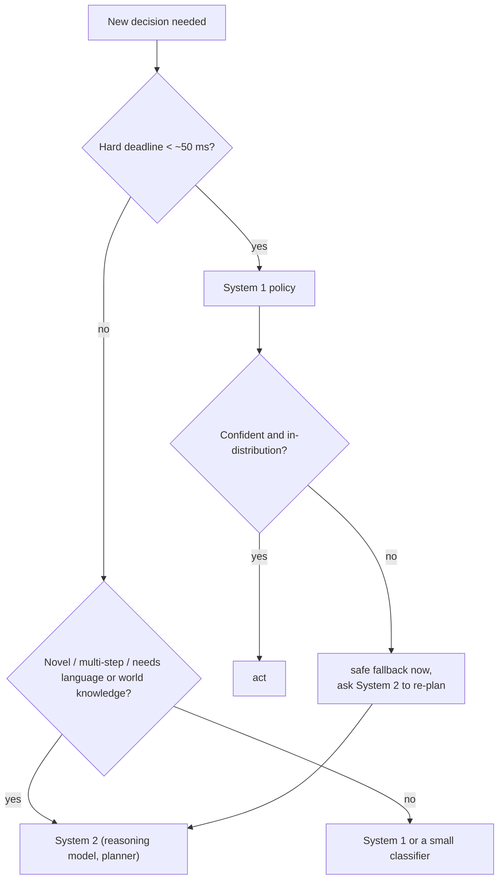

# System 1 & System 2 Models

Some decisions have to be made in milliseconds: dodging an obstacle, keeping a gripper steady, choosing the next move in a fast game. Others can take seconds or minutes: planning a route, working through a math proof, deciding which tool to call. Running both kinds of decision through the same model wastes compute on easy decisions or misses deadlines on hard ones, usually both. This page borrows Daniel Kahneman's System 1 / System 2 framing to describe a design pattern that is becoming standard in robotics and agents: a **fast reactive policy** paired with a **slow deliberate reasoner**. It then shows how to build the fast half.

!!! abstract "What you'll learn"
    - The System 1 / System 2 framing, and what it means for model design (not neuroscience)
    - What makes a good System 1 model: latency budgets, control rates, small architectures
    - System 2: reasoning LLMs, planning, test-time compute
    - Dual-system architectures in robotics (Figure's Helix and NVIDIA's GR00T N1, at a high level)
    - How to build a System 1 policy: distillation from a slow teacher, quantization, export, measuring latency
    - When to use which, and how to escalate from fast to slow

## The framing

In *Thinking, Fast and Slow* (2011), Kahneman describes two modes of human thinking:

- **System 1:** fast, automatic, effortless, always on. Catching a ball, reading a face, finishing "bread and ___".
- **System 2:** slow, deliberate, effortful, used only when needed. Multiplying 17 × 24, planning a trip, checking an argument.

Treat this as an engineering metaphor, not a claim about brains. In ML systems it maps onto a real trade-off:

| | System 1 model | System 2 model |
|---|---|---|
| Job | react: observation → action, every tick | deliberate: understand, plan, reason, decide what to do |
| Latency | microseconds to ~10 ms | hundreds of ms to minutes |
| Rate | 30-1000 Hz | event-driven or ~1-10 Hz |
| Size | thousands to tens of millions of parameters | billions of parameters |
| Compute per decision | fixed, tiny | variable, can scale up at test time |
| Typical form | MLP, small CNN, small transformer, diffusion/flow action head | LLM/VLM, often with chain-of-thought, search or tool use |
| Failure mode | brittle outside its training distribution | too slow for real-time loops, expensive |

## System 1: fast reactive policies

A System 1 model is a **policy** in the RL sense, $a_t = \pi(o_t)$, evaluated inside a control loop with a hard deadline. Examples:

- **Game agents.** A bot that has to choose an action every frame. At 60 frames per second, the whole frame (physics, rendering, input, AI) gets about 16.7 ms. The policy should take a small fraction of that, ideally well under 1 ms. The agent in [Project 4](../projects/game-agent.md) is an MLP with about 23k parameters that runs in microseconds.
- **Robot visuomotor control.** Camera images and joint states in, joint targets out, at tens to hundreds of Hz. Missing a deadline here means jerky or unsafe motion, not just a slow answer.
- **Low-level controllers in general:** drone stabilization, legged locomotion, autonomous-driving trajectory tracking. Many of these are trained with RL in simulation (see [DQN & PPO](policy-methods.md)) and deployed as small networks.

What System 1 models have in common:

1. **Fixed, small compute per step.** No variable-length generation. One forward pass gives one action (or a short chunk of actions).
2. **Rich, low-level input.** Proprioception, rays, pixels: whatever the sensors provide every tick.
3. **Short effective memory.** A few stacked frames, a small recurrent state, or a short context window.
4. **Robustness over generality.** It needs to be very reliable on the distribution it was trained on, and it should fail safely outside it.

### Latency budgets

Start any System 1 design from the deadline and work backwards:

| Loop | Rate | Per-step budget | What fits |
|---|---|---|---|
| Physics-level control (motor torque, balance) | 500-1000 Hz | 1-2 ms | tiny MLP, classical controller |
| Visuomotor manipulation | 30-200 Hz | 5-30 ms | small CNN/ViT encoder plus action head on an embedded GPU |
| Game AI per frame | 30-60 Hz | well under 16 ms (shared with the rest of the frame) | MLP / small CNN on CPU |
| Conversational turn start | ~1-5 Hz | 200-500 ms to first token | small LM, or a large LM with fast prefill |
| Deliberate planning / reasoning | event-driven | seconds to minutes | reasoning LLM, search |

Measure **tail latency** (p99) as well as the mean. A controller that usually takes 2 ms but occasionally takes 40 ms will miss deadlines. Garbage collection, Python overhead, thread contention, CPU frequency scaling and first-call kernel compilation are typical causes.

### Designing a small, fast policy

- **Keep inputs compact and informative.** Engineered features (ray distances, relative goal direction, velocities) let a 23k-parameter MLP do what would otherwise need a CNN on pixels. When you do need pixels, use small, low-resolution crops and a lightweight encoder.
- **Pick shallow, wide-enough architectures.** 2-3 layers of 64-256 units for vector observations. For images, a few strided convolutions, or a small pretrained encoder that you freeze or distill.
- **Predict action chunks.** Outputting the next $k$ actions at once (with the loop executing or blending them) lets a slower network still drive a fast loop, and smooths motion.
- **Do the inference engineering:** batch size 1, a single thread for small models (lower jitter), ONNX Runtime or TensorRT, half precision or int8 where accuracy allows, and no Python in the hot loop for the most demanding cases.
- **Fall back safely.** If the policy's confidence is low or a deadline is missed, use a safe default action (brake, hold position) rather than nothing.

```python title="measure_latency.py"
import time
import numpy as np
import torch

def latency_profile(fn, x, n=5000, warmup=500):
    for _ in range(warmup):
        fn(x)
    times = np.empty(n)
    for i in range(n):
        t0 = time.perf_counter()
        fn(x)
        times[i] = time.perf_counter() - t0
    us = times * 1e6
    return {"mean_us": us.mean(), "p50_us": np.percentile(us, 50),
            "p99_us": np.percentile(us, 99), "max_us": us.max()}

torch.set_num_threads(1)
policy = torch.nn.Sequential(torch.nn.Linear(37, 128), torch.nn.Tanh(),
                             torch.nn.Linear(128, 128), torch.nn.Tanh(),
                             torch.nn.Linear(128, 9)).eval()
x = torch.zeros(1, 37)
with torch.inference_mode():
    print(latency_profile(policy, x))
```

## System 2: slow, deliberate reasoning

System 2 models trade latency for capability. Today that mostly means:

- **Reasoning LLMs** that generate a long chain of thought before answering. DeepSeek-R1 and the Qwen3 "thinking" modes are open examples. They are trained with RL on verifiable rewards so that extra tokens turn into better answers. See [Reasoning & RL with Verifiable Rewards](../post-training/reasoning-rl.md).
- **Planning and search:** tree search over actions with a learned value function (as in AlphaZero-style systems), model-predictive control that optimizes a trajectory through a dynamics model at each step, or an LLM agent that writes and revises a plan and calls tools.
- **Vision-language models (VLMs)** that take a camera image and an instruction ("put the red cup in the sink") and work out what to do: which object, where, in what order.

The defining property is **test-time compute**. System 2 can spend more computation on harder problems: more reasoning tokens, more search, more samples with majority voting or verification. System 1 spends the same small amount on every input.

## Dual-system architectures

The natural design combines the two. A System 2 model runs slowly and decides *what* to do. A System 1 model runs fast and works out *how* to do it, moment to moment, conditioned on System 2's latest output.



Two humanoid-robot systems announced in 2025 describe themselves in exactly these terms:

- **Figure's Helix** pairs a "System 2" VLM, which handles scene understanding and language at a low rate, with a much smaller "System 1" visuomotor policy that turns System 2's latent output plus high-rate sensor input into continuous control of the upper body at a much higher rate. The two are trained end-to-end, so System 1 learns to follow System 2's latent intent.
- **NVIDIA's Isaac GR00T N1**, an openly released foundation model for humanoids, has a System 2 built on a pretrained VLM that interprets images and instructions, and a System 1 action module, a diffusion transformer trained with flow matching, that generates motor actions conditioned on System 2's representations. It is trained on a mix of real robot data, human videos and synthetic data.

The architectural point matters more than the exact parameter counts and control rates: **the slow model never sits inside the fast control loop.** The two run asynchronously. System 1 always acts on the latest available System 2 output, even if that output is a few hundred milliseconds old.

The same pattern shows up outside robotics:

- **Game AI:** a planner or LLM picks goals ("defend the base", "collect the blue package next"), and a reactive policy steers and dodges.
- **Autonomous driving stacks:** route planning and behavior decisions at low rates, trajectory tracking at high rates.
- **LLM applications:** a small, fast classifier or router handles most requests and escalates the hard ones to a reasoning model. That is System 1 / System 2 applied to *which model answers*. See [Decision Models for Routing & Classification](routing-models.md).

### A minimal dual-rate loop

```python title="dual_rate_loop.py"
import threading, time

latest_goal = {"z": None, "t": 0.0}          # shared slot, written by S2, read by S1
lock = threading.Lock()
running = True                               # set to False to stop both loops

def system2_loop(get_frame, vlm_plan, hz=2):
    while running:
        z = vlm_plan(get_frame())            # slow: hundreds of ms
        with lock:
            latest_goal["z"], latest_goal["t"] = z, time.monotonic()
        time.sleep(1 / hz)

def system1_loop(get_obs, policy, send_action, safe_action, hz=100, max_goal_age=1.0):
    period = 1 / hz
    next_tick = time.monotonic()
    while running:
        with lock:
            z, age = latest_goal["z"], time.monotonic() - latest_goal["t"]
        if z is None or age > max_goal_age:  # no fresh plan: fail safe
            send_action(safe_action)
        else:
            send_action(policy(get_obs(), z))  # fast: well under the period
        next_tick += period
        time.sleep(max(0.0, next_tick - time.monotonic()))
```

In a real system the System 1 loop runs on a real-time thread or a separate process (often in C++), and System 2 runs on its own accelerator. The structure is the same.

## Building a System 1 model

You rarely train a System 1 model from nothing. The common recipes are:

### 1. Imitation of a slow expert (distillation)

If you have a slow but good decision-maker (a planner, a search procedure, a big model, a human), use it as the teacher and **behavior-clone** it into a small fast student. That is exactly [imitation learning](imitation.md), and DAgger is the right tool for it: run the student, query the teacher on the states the student visits, aggregate, retrain. Labels can be:

- **Hard labels:** the teacher's chosen action, trained with cross-entropy.
- **Soft labels:** the teacher's full action distribution, trained with KL divergence. Soft labels carry more information per example ("left is nearly as good as up here").

$$
\mathcal{L}_{\text{distill}} = \tau^2 \, \mathrm{KL}\Big( \mathrm{softmax}(z_T/\tau) \;\Big\|\; \mathrm{softmax}(z_S/\tau) \Big)
$$

```python title="distill.py"
import torch.nn.functional as F

def distill_loss(student_logits, teacher_logits, hard_actions=None, tau=2.0, alpha=0.5):
    soft = F.kl_div(F.log_softmax(student_logits / tau, -1),
                    F.softmax(teacher_logits / tau, -1),
                    reduction="batchmean") * tau ** 2
    if hard_actions is None:
        return soft
    hard = F.cross_entropy(student_logits, hard_actions)
    return alpha * soft + (1 - alpha) * hard
```

### 2. RL in simulation

Train the small policy directly with PPO in a simulator, often with **privileged information** available to the critic or to a teacher policy, then distill into a student that only sees deployable sensors. Use domain randomization (masses, friction, latency, sensor noise) so that it transfers to reality.

### 3. BC then RL

Clone demonstrations for a competent start, then fine-tune with RL to exceed the demonstrator and recover from its own mistakes. [Project 4](../projects/game-agent.md) follows this recipe end to end and finishes with an ONNX export and a latency measurement.

### 4. Shrinking

Once a policy works: prune or narrow it, quantize to int8 or fp16, export (ONNX, TensorRT, Core ML, TFLite), and re-measure both **task performance** and **p99 latency**. A small loss in accuracy is often worth a large gain in control rate, because a policy that reacts 5x faster can correct its own mistakes sooner.

## When to use which



Rules of thumb:

- **Use System 1 alone** when the task is narrow, the inputs are well covered by training data, and latency matters. Most game AI and low-level control fall here.
- **Use System 2 alone** when there is no real-time constraint and the problem is open-ended: research, multi-step tool use, novel instructions.
- **Use both** when you need real-time action *and* open-ended understanding: instruction-following robots, game NPCs that hold conversations, agents in fast environments.
- **Escalate on uncertainty.** Use System 1's confidence (a calibrated softmax, an ensemble's disagreement, an out-of-distribution score) to decide when to ask System 2. Calibration is covered in [Decision Models for Routing & Classification](routing-models.md#calibration).
- **Distill over time.** Log System 2's decisions in production and periodically distill the common cases into System 1, so expensive reasoning is reserved for the cases that need it.

!!! warning "Common pitfalls"
    - **Putting the big model in the fast loop.** If an LLM call sits on the path from sensor to actuator, latency spikes become physical failures. Run the two asynchronously.
    - **Optimizing mean latency only.** Deadlines are set by the tail. Measure p99 and max, under load, on the target hardware.
    - **Stale plans.** System 1 must handle a System 2 output that is old or missing. Time-stamp it and fail safe.
    - **Distribution mismatch in distillation.** A student trained only on the teacher's trajectories suffers from compounding errors. Use DAgger-style relabeling on the student's own states.
    - **Overconfident System 1.** If the fast model's probabilities are not calibrated, confidence-based escalation will not trigger when it should.

## Check your understanding

??? question "Why not just run a large VLM fast enough to be the whole controller?"
    Generating actions through a multi-billion-parameter model usually takes tens to hundreds of milliseconds per step on embedded hardware, with variable latency. Control loops need consistent, high-rate updates. Splitting the work lets the big model run at a few Hz on what it is good at (understanding and planning) while a small model handles the fast reactive part.

??? question "Your System 1 policy averages 1 ms per step, but the robot occasionally jerks. What should you check?"
    Tail latency (p99/max) and deadline misses. Causes include garbage collection, thread contention, CPU frequency scaling, first-call compilation, and blocking I/O in the loop. Pin threads, preallocate buffers, warm up the model, move the loop out of Python if necessary, and add a deadline-miss fallback.

??? question "What are soft labels in policy distillation, and why do they help?"
    They are the teacher's full probability distribution over actions instead of only its top choice. They tell the student how much better the best action is than the alternatives, which gives more information per example and usually a smoother, better-generalizing student.

??? question "How is a cheap-model / expensive-model LLM router an instance of System 1 / System 2?"
    The router plus the cheap model handles the common, easy requests quickly and cheaply (System 1). When the router is not confident the cheap model will succeed, the request goes to an expensive reasoning model (System 2). The key ingredient is the same: a calibrated confidence signal that decides when to escalate.

## Further reading

- Kahneman, *Thinking, Fast and Slow* (2011).
- Figure AI, [Helix: A Vision-Language-Action Model for Generalist Humanoid Control](https://www.figure.ai/news/helix) (2025). The primary description of the S1/S2 design.
- NVIDIA et al., [GR00T N1: An Open Foundation Model for Generalist Humanoid Robots](https://arxiv.org/abs/2503.14734) (2025).
- Hinton, Vinyals & Dean, [Distilling the Knowledge in a Neural Network](https://arxiv.org/abs/1503.02531) (2015).
- DeepSeek-AI, [DeepSeek-R1: Incentivizing Reasoning Capability in LLMs via Reinforcement Learning](https://arxiv.org/abs/2501.12948) (2025).
- Silver et al., [Mastering Chess and Shogi by Self-Play with a General Reinforcement Learning Algorithm](https://arxiv.org/abs/1712.01815) (2017, AlphaZero). Fast policy/value nets guiding slow search.
