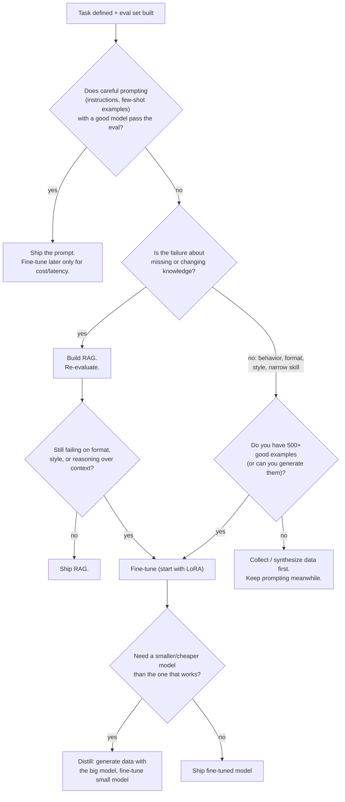
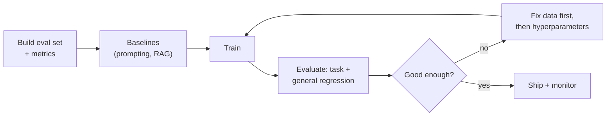

# Fine-tuning: When, Why, and How Much

Fine-tuning means taking a pretrained (usually already instruction-tuned) model and training it further on *your* data, so it does *your* task better. It's the most over-prescribed tool in applied LLM work. Many teams reach for it when a better prompt or a retrieval system would have solved the problem in a day. It's also irreplaceable when you need a small, fast, cheap model to do one thing extremely well, or a specific output format every single time. This page helps you decide whether to fine-tune, and if so, how to set yourself up to succeed.

!!! abstract "What you'll learn"
    - A decision process for prompting vs. RAG vs. fine-tuning (and when to combine them)
    - Full fine-tuning vs. parameter-efficient fine-tuning (PEFT)
    - Catastrophic forgetting: what it is and how to limit it
    - How much data you need, and what kind
    - How to choose a base model: license, size, language, base vs. instruct
    - The evaluation-first mindset: build the eval before you train anything

## What fine-tuning is good at, and what it isn't

Fine-tuning changes **behavior**: style, format, tone, task-specific skills, which outputs the model favors. It is poor at adding **knowledge**, especially facts that change.

| Goal | Fine-tune? |
|---|---|
| Always output valid JSON in your schema | Yes, very effective |
| Classify support tickets into your 40 categories | Yes (or a small classifier) |
| Match your brand voice | Yes |
| Make a 1B model do what a 70B model does on one narrow task | Yes, usually via distillation |
| Answer questions about your internal docs | Mostly no: use RAG |
| Know about events after the model's cutoff | No: use RAG or tools |
| Stop hallucinating | Not by itself. It can even make it worse if you train on facts the model didn't know. |

The last row deserves emphasis: training a model on facts it didn't learn in pretraining tends to teach it to *confidently produce answers in that style*, including for questions it can't answer. Knowledge that must be correct and current belongs in a retrieval system ([RAG Fundamentals](../rag/fundamentals.md)).

## Decision flowchart

Work through these in order. Each step is cheaper than the next.

Some heuristics that hold up:

- **Prompt first, always.** It gives you a baseline, and the prompt often becomes the system prompt of your training data anyway.
- **RAG and fine-tuning compose.** A common production pattern is a fine-tuned small model that's good at *reading retrieved context* and answering in your format.
- **Fine-tune for economics.** A frequent, legitimate reason: a frontier API model works, but you need 10× lower cost or latency, or on-prem deployment. Distill its behavior into a 1B to 8B open model.

## Full fine-tuning vs. PEFT

**Full fine-tuning** updates every weight. It has the most capacity to change the model, but costs the most memory and produces a full-size checkpoint per task.

**Parameter-efficient fine-tuning (PEFT)** freezes the base model and trains a small number of new parameters. The dominant method is **LoRA**, which learns a low-rank update to selected weight matrices. QLoRA does the same on top of a 4-bit quantized base model. Details and math in [LoRA & QLoRA](lora-qlora.md).

| | Full fine-tuning | LoRA | QLoRA |
|---|---|---|---|
| Trainable params | 100% | ~0.1-2% | ~0.1-2% |
| GPU memory for an 8B model | ~130 GB+ (multi-GPU) | ~20-24 GB | ~10-16 GB |
| Output | full checkpoint (16 GB for 8B in bf16) | adapter (tens to hundreds of MB) | adapter |
| Quality ceiling | highest | close to full FT for most tasks | close to LoRA |
| Forgetting | most | less | less |
| Multiple tasks | one model each | swap adapters on one base | swap adapters |

For most applied tasks, **start with LoRA**. Move to full fine-tuning when you have lots of data (hundreds of thousands of examples), the task is far from the base model's distribution (a new language, a new domain like proteins), and you have the hardware.

## Catastrophic forgetting

When you fine-tune hard on a narrow dataset, the model gets better at that task and worse at others. A model fine-tuned only on SQL generation may lose much of its ability to chat or follow general instructions. This is **catastrophic forgetting**: gradient updates for the new task overwrite weights that encoded old skills.

How to limit it:

- **Use LoRA.** Freezing the base and constraining the update to low rank limits damage. The paper *LoRA Learns Less and Forgets Less* found exactly that tradeoff: LoRA underperforms full fine-tuning on the target domain but preserves more of the base model's other abilities.
- **Lower learning rate, fewer epochs.** Most forgetting happens from overtraining.
- **Mix in general data.** Replay 5-20% of general instruction data (e.g. from a public SFT mix) alongside your task data.
- **Measure it.** Keep a small "general capability" eval (a few hundred MMLU and instruction-following items, plus your own sanity prompts) and run it after every training run.

Sometimes forgetting is fine. If the model will only ever see one kind of input in production, you may not care that it got worse at poetry. Decide deliberately.

## Data requirements

Data is where fine-tuning projects succeed or fail. Rough guidance for LoRA on an instruct model:

| Task type | Rough data needed |
|---|---|
| Output format / style / tone | a few hundred to ~2k examples |
| Classification / extraction | ~1k to 10k examples (more for many classes) |
| Narrow skill (SQL for your schema, domain QA style) | ~5k to 50k |
| Distilling a broad capability from a bigger model | 50k+ |
| New language or domain adaptation | continued pretraining on large unlabeled text, then SFT |

What matters more than the count:

- **Representative inputs.** Training examples should look like production inputs: same length distribution, same messiness, same edge cases. Pull real (anonymized) inputs if you can.
- **Consistent outputs.** If two annotators would label the same input differently, the model learns the noise. Write labeling guidelines.
- **Coverage of hard cases.** Ambiguous inputs, inputs that should be refused or answered with "I don't know", very long inputs.
- **Clean held-out splits.** Split by user, document, or time, not randomly, if near-duplicates exist.

Synthetic data from a stronger model is legitimate and common. Generate, then **filter** with rules, a verifier, or an LLM judge, and spot-check by hand. See [SFT](../post-training/sft.md#datasets) for the data format.

## Choosing a base model

Four questions, in order:

**1. License.** Can you use it commercially, and are there conditions? Apache 2.0 (Qwen2.5 most sizes, Qwen3, Mistral 7B, OLMo 2, SmolLM2/3) and MIT (Phi-3/Phi-4, DeepSeek-R1) are the least restrictive. Llama 3.x and Gemma 3 have custom licenses with use policies and attribution or naming requirements. Read the actual license, not a summary.

**2. Size.** Pick the smallest model that can pass your eval after fine-tuning.

| Size | Typical fit |
|---|---|
| 0.1B-1B (SmolLM2-360M, Qwen2.5-0.5B) | classification, extraction, simple formatting, on-device |
| 1B-4B (Llama 3.2 3B, Qwen2.5-3B, Gemma 3 4B, SmolLM3-3B) | narrow assistants, structured output, RAG readers |
| 7B-9B (Llama 3.1 8B, Qwen2.5-7B, Gemma 2 9B) | strong general fine-tunes; a single 24 GB GPU with QLoRA |
| 14B-32B | harder reasoning and code; multi-GPU or aggressive quantization |

A quick way to choose: run your eval with few-shot prompting on two or three sizes. The fine-tuned smaller model usually lands somewhere above the prompted version of the same size.

**3. Language and domain.** Check the model card for which languages were in pretraining. Qwen and Gemma models are notably multilingual; tokenizer efficiency for your language matters for both cost and quality (see [Tokenization](../llm/tokenization.md)). For code, pick a model with heavy code pretraining.

**4. Base vs. instruct.** For task-specific SFT, starting from the **instruct** model is usually best: it already follows instructions and has safety behavior, and your data only needs to teach the task. Start from the **base** model if you're building your own full post-training pipeline, or if the instruct model's style fights yours. Either way, use the model's own chat template.

## The evaluation-first mindset

Build the evaluation *before* you train anything. It's the single habit that most distinguishes successful fine-tuning projects.

1. **Write down success criteria.** "Valid JSON matching the schema 99.5% of the time; field-level F1 above 0.9; p95 latency under 300 ms."
2. **Build a test set of 100-500 real examples** with gold outputs, held out from all training. Include edge cases.
3. **Automate scoring.** Exact match, schema validation, F1, unit tests, or an LLM judge with a rubric (validated against your own judgments on a sample).
4. **Get baselines**: prompted small model, prompted big model, the RAG system. Now you know what fine-tuning has to beat.
5. **Train, evaluate, iterate.** Every run gets the same eval. Change one thing at a time.
6. **Check for regressions** on a general capability set (see catastrophic forgetting above).

When a run underperforms, **look at the data before the hyperparameters.** Read the model's failures on the eval set and the training examples nearest to them. Nine times out of ten the fix is in the data.

!!! warning "Common pitfalls"
    - **Fine-tuning to add knowledge.** Use RAG for facts; fine-tune for behavior.
    - **No baseline.** Without a prompted baseline you can't tell whether fine-tuning helped.
    - **Eval contamination.** Near-duplicates of test examples in training data inflate scores. Deduplicate across splits.
    - **Wrong chat template.** Fine-tuning an instruct model with a different template than the one it was trained on throws away much of its instruction tuning.
    - **Ignoring the license** until launch week.
    - **Overtraining a small dataset.** Five epochs on 500 examples produces a parrot. Watch held-out loss and eval metrics per epoch.

## Check your understanding

??? question "A team wants to fine-tune a model on their 2,000-page product manual so it can answer customer questions. What would you suggest?"
    RAG first. The manual is knowledge that changes with product versions, and fine-tuning is poor at reliably injecting facts (and can increase confident hallucinations). If RAG answers are correct but the style or format is off, fine-tune a model on (question, retrieved context, ideal answer) examples so it gets better at using the context.

??? question "Why does LoRA tend to forget less than full fine-tuning?"
    The base weights are frozen, and the update is constrained to a low-rank subspace of a few matrices, so the model can only move a limited distance from its pretrained function. Full fine-tuning can change every weight in any direction, so it fits the new task better but also overwrites more of what the model knew.

??? question "When is starting from a base model (instead of instruct) the better choice?"
    When you are doing your own full post-training (SFT and preference tuning) and want full control of behavior, when the instruct model's style or safety tuning conflicts strongly with your use case, or when you are adapting to a very different domain or language and will do continued pretraining first.

??? question "Your fine-tuned model scores 95% on your test set but users report it fails often. What are likely causes?"
    The test set doesn't represent production inputs (cleaner, shorter, different distribution), test examples leaked into training (near-duplicates), or the serving stack uses a different chat template or decoding settings from your eval. Sample real production failures and add them to the eval set.

## Further reading

- Biderman et al., *LoRA Learns Less and Forgets Less* - [arXiv:2405.09673](https://arxiv.org/abs/2405.09673)
- Hu et al., *LoRA: Low-Rank Adaptation of Large Language Models* - [arXiv:2106.09685](https://arxiv.org/abs/2106.09685)
- Zhou et al., *LIMA: Less Is More for Alignment* - [arXiv:2305.11206](https://arxiv.org/abs/2305.11206)
- Hugging Face PEFT docs - [huggingface.co/docs/peft](https://huggingface.co/docs/peft)
- Hugging Face TRL docs - [huggingface.co/docs/trl](https://huggingface.co/docs/trl)

Ready to do it for real? [Project 2: Fine-tune an Open-Weight Model](../projects/p2-finetune.md) walks you through an end-to-end run.

**Next:** [LoRA & QLoRA](lora-qlora.md)
