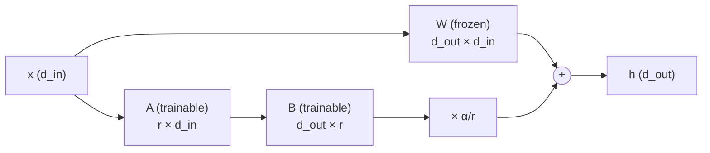

# LoRA & QLoRA

Full fine-tuning an 8B model needs well over 100 GB of GPU memory, mostly for optimizer state. LoRA cuts the trainable parameters by a factor of a hundred or more by betting that the *change* you need to make to each weight matrix is low-rank. QLoRA goes further and stores the frozen base model in 4 bits. Together they let you fine-tune an 8B model on a single 24 GB consumer GPU, and they're the default way most people fine-tune open-weight models. This page derives LoRA, builds it from scratch, does the memory math, and then shows the production tooling.

!!! abstract "What you'll learn"
    - The LoRA update $W + \frac{\alpha}{r}BA$: rank, alpha, scaling, and initialization
    - A LoRA linear layer from scratch, injected into an existing model, plus merging
    - Which modules to target, and how many parameters that adds
    - QLoRA: NF4 quantization, double quantization, paged optimizers
    - Memory math for 7B/8B models on a 24 GB GPU
    - The Hugging Face PEFT library, merging adapters, DoRA, Unsloth
    - Hyperparameter defaults, and serving many adapters from one base model

## The idea: the update is low-rank

A linear layer computes $h = Wx$ with $W \in \mathbb{R}^{d_{\text{out}} \times d_{\text{in}}}$. Fine-tuning learns an update $\Delta W$ so the new layer is $(W + \Delta W)x$. Full fine-tuning learns all $d_{\text{out}} \cdot d_{\text{in}}$ entries of $\Delta W$.

LoRA (Hu et al., 2021) constrains $\Delta W$ to have rank at most $r$ by writing it as a product of two thin matrices:

$$
\Delta W = \frac{\alpha}{r}\, B A, \qquad B \in \mathbb{R}^{d_{\text{out}} \times r},\quad A \in \mathbb{R}^{r \times d_{\text{in}}},\quad r \ll \min(d_{\text{in}}, d_{\text{out}})
$$

The forward pass becomes:

$$
h = W x + \frac{\alpha}{r} B (A x)
$$

$W$ is frozen. Only $A$ and $B$ are trained.



**Why would a low-rank update be enough?** Empirically, the weight changes from fine-tuning have low "intrinsic dimension": most of the change lives in a few directions. A pretrained model already has the features; adapting to a task mostly re-weights and combines them. Rank 8 to 64 is enough for most instruction and task tuning. It's *not* always enough for learning something truly new (a new language, a large domain shift), which is where full fine-tuning still wins.

**Parameter savings.** For a 4096 × 4096 projection, full $\Delta W$ is about 16.8M parameters. With $r = 16$: $16 \times (4096 + 4096) = 131{,}072$ parameters, about 128× fewer.

### Initialization and scaling

- $A$ is initialized randomly (Kaiming-uniform in the reference implementation), **$B$ is initialized to zero**. So $BA = 0$ at step 0, and the model starts exactly equal to the pretrained model. Training begins from a known-good point.
- The scale factor $\alpha / r$ decouples the update magnitude from the rank. If you double $r$ and keep $\alpha$ fixed, each rank-1 component is scaled down, so you don't have to retune the learning rate as much. Common practice: $\alpha = r$ or $\alpha = 2r$.
- **rsLoRA** (rank-stabilized LoRA) argues the right scaling is $\alpha / \sqrt{r}$, which keeps learning stable at high ranks. PEFT supports it with `use_rslora=True`.

### Merging: zero inference overhead

After training you can fold the adapter into the base weights:

$$
W' = W + \frac{\alpha}{r} B A
$$

$W'$ has the same shape as $W$, so the merged model is a normal model with no extra latency. Or keep the adapter separate and swap adapters per request (see [multi-adapter serving](#multi-adapter-serving)).

## LoRA from scratch

Here's a complete LoRA layer that wraps an existing `nn.Linear`:

```python title="lora.py"
import math
import torch
import torch.nn as nn

class LoRALinear(nn.Module):
    def __init__(self, base: nn.Linear, r: int = 16, alpha: float = 32,
                 dropout: float = 0.05):
        super().__init__()
        self.base = base
        self.base.weight.requires_grad_(False)
        if self.base.bias is not None:
            self.base.bias.requires_grad_(False)

        self.r = r
        self.scaling = alpha / r
        dev, dt = base.weight.device, base.weight.dtype
        self.lora_A = nn.Parameter(torch.empty(r, base.in_features, device=dev, dtype=dt))
        self.lora_B = nn.Parameter(torch.zeros(base.out_features, r, device=dev, dtype=dt))
        nn.init.kaiming_uniform_(self.lora_A, a=math.sqrt(5))   # (1)!
        self.dropout = nn.Dropout(dropout) if dropout > 0 else nn.Identity()
        self.merged = False

    def forward(self, x):
        out = self.base(x)
        if self.merged:
            return out
        # x @ A^T @ B^T  ==  (B A x) for each row; never materialize B@A
        lora = (self.dropout(x) @ self.lora_A.T) @ self.lora_B.T
        return out + lora * self.scaling

    @torch.no_grad()
    def merge(self):
        if not self.merged:
            self.base.weight += (self.lora_B @ self.lora_A) * self.scaling
            self.merged = True

    @torch.no_grad()
    def unmerge(self):
        if self.merged:
            self.base.weight -= (self.lora_B @ self.lora_A) * self.scaling
            self.merged = False
```

1. Same init as `nn.Linear` and the reference LoRA code. Because $B = 0$, the scale of $A$ doesn't change the starting output, only the early gradient dynamics.

Computing `(x @ A.T) @ B.T` costs $O(r(d_{\text{in}} + d_{\text{out}}))$ per token instead of materializing the full $d_{\text{out}} \times d_{\text{in}}$ matrix $BA$.

### Injecting LoRA into a model

Walk the module tree, find linear layers whose names match your targets, and replace them in their parent:

```python title="inject.py"
import torch.nn as nn
from lora import LoRALinear

def inject_lora(model: nn.Module, targets=("q_proj", "k_proj", "v_proj", "o_proj"),
                r=16, alpha=32, dropout=0.05):
    # 1) Freeze everything.
    for p in model.parameters():
        p.requires_grad_(False)

    # 2) Collect matches first; mutating while iterating named_modules() is unsafe.
    to_wrap = [(name, mod) for name, mod in model.named_modules()
               if isinstance(mod, nn.Linear) and name.split(".")[-1] in targets]

    for name, mod in to_wrap:
        parent_name, _, child_name = name.rpartition(".")
        parent = model.get_submodule(parent_name) if parent_name else model
        setattr(parent, child_name, LoRALinear(mod, r=r, alpha=alpha, dropout=dropout))
    return model

def merge_lora(model: nn.Module):
    for mod in model.modules():
        if isinstance(mod, LoRALinear):
            mod.merge()

def lora_state_dict(model: nn.Module):
    """Only the adapter weights: this is the tiny file you save."""
    return {k: v for k, v in model.state_dict().items() if "lora_" in k}

def count_params(model: nn.Module):
    total = sum(p.numel() for p in model.parameters())
    trainable = sum(p.numel() for p in model.parameters() if p.requires_grad)
    return trainable, total
```

Use it on your own GPT (rename `targets` to match its layer names, e.g. `("c_attn", "c_proj")` in a GPT-2-style model) or on any Hugging Face model:

```python title="try_lora.py"
import torch
from transformers import AutoModelForCausalLM
from inject import inject_lora, merge_lora, count_params

model = AutoModelForCausalLM.from_pretrained("HuggingFaceTB/SmolLM2-135M")
inject_lora(model, targets=("q_proj", "k_proj", "v_proj", "o_proj",
                            "gate_proj", "up_proj", "down_proj"), r=16, alpha=32)
trainable, total = count_params(model)
print(f"trainable {trainable:,} / {total:,} = {100 * trainable / total:.2f}%")

opt = torch.optim.AdamW([p for p in model.parameters() if p.requires_grad], lr=2e-4)
# ... your usual training loop (e.g. the SFT loop from the SFT page) ...

model.eval()
x = torch.randint(0, 1000, (1, 16))
with torch.no_grad():
    before = model(x).logits
    merge_lora(model)
    after = model(x).logits
print("max diff after merge:", (before - after).abs().max().item())  # ~1e-5 or smaller
```

Pass only the trainable parameters to the optimizer. AdamW state is then allocated only for the adapters, which is where the memory savings come from.

## Which modules to target

A transformer block has attention projections (`q_proj`, `k_proj`, `v_proj`, `o_proj` in Llama-style naming) and MLP projections (`gate_proj`, `up_proj`, `down_proj`). The original LoRA paper adapted only `q` and `v`. Later work, including the QLoRA paper, found that **adapting all linear layers** gives clearly better results, and that this matters more than the rank. Today's default is `target_modules="all-linear"` in PEFT.

Leave the embedding and `lm_head` frozen unless you've added new tokens (then train those rows, or use PEFT's `modules_to_save=["embed_tokens", "lm_head"]` / `trainable_token_indices`).

**Parameter count for Llama 3.1 8B with $r = 16$, all linear layers.** Hidden size 4096, 8 KV heads × 128 dims = 1024 for K/V, MLP size 14336, 32 layers. Each adapted matrix adds $r(d_{\text{in}} + d_{\text{out}})$:

| Matrix | Shape (in → out) | LoRA params at r=16 |
|---|---|---|
| q_proj, o_proj | 4096 → 4096 | 131,072 each |
| k_proj, v_proj | 4096 → 1024 | 81,920 each |
| gate_proj, up_proj | 4096 → 14336 | 294,912 each |
| down_proj | 14336 → 4096 | 294,912 |
| **per layer** | | **1,310,720** |
| **× 32 layers** | | **≈ 41.9M (≈ 0.5% of 8B)** |

## QLoRA: LoRA on a 4-bit base model

LoRA shrinks the trainable state, but the frozen base model still sits in memory at 2 bytes per parameter in bf16: 16 GB for an 8B model. QLoRA (Dettmers et al., 2023) stores the base model in 4 bits, dequantizes each weight block to bf16 on the fly for the matmul, and backpropagates through it into the bf16 LoRA adapters. Three ideas make it work:

### 1. NF4 (4-bit NormalFloat)

A 4-bit number has 16 possible values. Plain 4-bit integers space them uniformly, but pretrained weights are roughly normally distributed: most values near zero, few in the tails. **NF4** places the 16 levels at quantiles of a standard normal distribution, so each level is used about equally often. That's information-theoretically optimal for normally distributed data.

Quantization is **blockwise**: weights are split into blocks of 64, each block is scaled by its absolute max into $[-1, 1]$, and each value is mapped to the nearest NF4 level. The per-block scale (absmax) is stored alongside. Blockwise scaling keeps one outlier from wrecking the precision of the whole tensor.

### 2. Double quantization

The absmax constants cost memory too: one fp32 per 64 weights is $32/64 = 0.5$ bits per parameter. Double quantization quantizes those constants themselves to 8 bits (in blocks of 256, with their own fp32 scale), bringing the overhead to roughly $8/64 + 32/(64 \cdot 256) \approx 0.127$ bits per parameter. That saves about 0.37 bits per parameter, around 3 GB on a 65B model.

### 3. Paged optimizers

Long sequences cause memory spikes (activations, especially with gradient checkpointing recomputation) that can OOM an otherwise-fitting run. Paged optimizers allocate optimizer state in CUDA unified memory, which can be paged out to CPU RAM automatically under pressure, then paged back when needed. In Transformers you enable this with `optim="paged_adamw_8bit"` or `"paged_adamw_32bit"`.

!!! note "Compute dtype"
    The base weights are *stored* in NF4 but *computed* in `bnb_4bit_compute_dtype` (use bf16 on Ampere or newer GPUs). LoRA adapters stay in bf16/fp32. QLoRA is slower per step than bf16 LoRA (dequantization overhead), but usually reaches very similar quality.

## Memory math: 7B/8B on a 24 GB GPU

Rough per-parameter costs (ignoring activations for now):

| Item | Bytes per param |
|---|---|
| Weights, bf16 | 2 |
| Weights, NF4 + double quant | ~0.52 |
| Gradients, bf16 | 2 |
| AdamW state (fp32 m and v) | 8 |
| fp32 master weights (mixed precision) | 4 |

So for an 8B model:

| Setup | Base weights | Trainable state | Total before activations | 24 GB GPU? |
|---|---|---|---|---|
| Full FT, bf16 + AdamW | 16 GB | 8B × (2 + 8 + 4) = 112 GB | **~128 GB** | No (needs multi-GPU + sharding) |
| LoRA r=16, bf16 base | 16 GB | 42M × ~16 B ≈ 0.7 GB | **~17 GB** | Tight; works with short sequences + gradient checkpointing (7B is easier: ~15 GB) |
| QLoRA r=16, NF4 base | ~5.5-6 GB | ≈ 0.7 GB | **~6.5 GB** | Yes, with room for 2k-8k context |

Why ~5.5-6 GB for QLoRA and not 4 GB: bitsandbytes only quantizes the linear layers inside the blocks. For Llama 3.1 8B, the embedding and `lm_head` are each 128,256 × 4096 ≈ 525M parameters and stay in bf16 (about 2.1 GB together), and the remaining ~7B block parameters cost roughly 3.6 GB in NF4.

**Activations** come on top and scale with batch size × sequence length × hidden size × layers. With **gradient checkpointing** (store only layer inputs, recompute the rest during backward), a batch of 1 at 2048 tokens for an 8B model costs on the order of a few GB. Practical recipe for a 24 GB card: QLoRA, gradient checkpointing on, micro-batch 1-4, gradient accumulation to an effective batch of 16-64.

!!! tip "The vocabulary is a hidden memory hog"
    With a 128k-151k vocabulary, the logits tensor (batch × seq × vocab) in fp32 can be several GB on its own: 1 × 4096 × 128,256 × 4 bytes ≈ 2.1 GB, plus the same again for its gradient. Libraries like Liger Kernel and Unsloth fuse the final projection with the cross-entropy loss to avoid materializing it.

## LoRA and QLoRA with PEFT

The Hugging Face PEFT library implements all of the above. Install: `pip install peft transformers bitsandbytes accelerate trl`.

=== "LoRA (bf16 base)"

    ```python title="peft_lora.py"
    import torch
    from transformers import AutoModelForCausalLM, AutoTokenizer
    from peft import LoraConfig, get_peft_model

    model_id = "Qwen/Qwen2.5-1.5B-Instruct"
    model = AutoModelForCausalLM.from_pretrained(model_id, dtype=torch.bfloat16,
                                                 device_map="auto")
    tokenizer = AutoTokenizer.from_pretrained(model_id)

    lora_cfg = LoraConfig(
        r=16,
        lora_alpha=32,
        lora_dropout=0.05,
        target_modules="all-linear",
        task_type="CAUSAL_LM",
    )
    model = get_peft_model(model, lora_cfg)
    model.print_trainable_parameters()
    ```

=== "QLoRA (4-bit base)"

    ```python title="peft_qlora.py"
    import torch
    from transformers import AutoModelForCausalLM, AutoTokenizer, BitsAndBytesConfig
    from peft import LoraConfig, get_peft_model, prepare_model_for_kbit_training

    model_id = "meta-llama/Llama-3.1-8B-Instruct"   # gated: accept the license on the Hub
    bnb_cfg = BitsAndBytesConfig(
        load_in_4bit=True,
        bnb_4bit_quant_type="nf4",
        bnb_4bit_use_double_quant=True,
        bnb_4bit_compute_dtype=torch.bfloat16,
    )
    model = AutoModelForCausalLM.from_pretrained(model_id, quantization_config=bnb_cfg,
                                                 device_map="auto")
    tokenizer = AutoTokenizer.from_pretrained(model_id)

    model = prepare_model_for_kbit_training(model)   # (1)!
    lora_cfg = LoraConfig(r=16, lora_alpha=32, lora_dropout=0.05,
                          target_modules="all-linear", task_type="CAUSAL_LM")
    model = get_peft_model(model, lora_cfg)
    model.print_trainable_parameters()
    ```

    1. Freezes the base, casts every non-quantized fp16/bf16 parameter (norms, but also the embeddings and `lm_head`) to fp32 for stability, enables gradient checkpointing, and makes input embeddings produce grads so checkpointing works with a frozen base. The fp32 upcast of a 128k-vocabulary embedding and `lm_head` adds roughly 2 GB for an 8B model compared with the table below; if memory is tight, skip this helper and call `model.gradient_checkpointing_enable()` plus `model.enable_input_require_grads()` yourself.

Training is then any normal loop or trainer. With TRL (**TRL ≥ 0.20**) you can skip `get_peft_model` and pass the config directly; see [SFT](../post-training/sft.md#the-same-job-with-trl) for the full trainer setup:

```python title="trl_qlora_sft.py"
from datasets import load_dataset
from trl import SFTConfig, SFTTrainer

ds = load_dataset("HuggingFaceTB/smoltalk", "everyday-conversations")

trainer = SFTTrainer(
    model=model,                 # the 4-bit model from above, before get_peft_model
    peft_config=lora_cfg,
    args=SFTConfig(
        output_dir="llama31-8b-qlora",
        max_length=2048,
        per_device_train_batch_size=2,
        gradient_accumulation_steps=8,
        learning_rate=2e-4,
        num_train_epochs=2,
        lr_scheduler_type="cosine",
        warmup_ratio=0.03,
        bf16=True,
        gradient_checkpointing=True,
        optim="paged_adamw_8bit",
        logging_steps=10,
        report_to="none",
    ),
    train_dataset=ds["train"],
    processing_class=tokenizer,
)
trainer.train()
trainer.save_model()   # saves only the adapter (adapter_model.safetensors + config)
```

## Merging adapters

To ship a single standalone model, merge the adapter into the base. With QLoRA, **load the base in bf16 for merging**, not in 4-bit: merging into quantized weights would require re-quantizing and loses precision.

```python title="merge.py"
import torch
from transformers import AutoModelForCausalLM, AutoTokenizer
from peft import PeftModel

base_id = "meta-llama/Llama-3.1-8B-Instruct"
base = AutoModelForCausalLM.from_pretrained(base_id, dtype=torch.bfloat16)
model = PeftModel.from_pretrained(base, "llama31-8b-qlora")
merged = model.merge_and_unload()            # W' = W + (alpha/r) B A, adapters removed
merged.save_pretrained("llama31-8b-merged")
AutoTokenizer.from_pretrained(base_id).save_pretrained("llama31-8b-merged")
```

The merged model was trained against a dequantized-NF4 base but is now merged into the original bf16 weights. The mismatch is usually negligible, but evaluate the merged model rather than assuming. You can then quantize the merged model for inference (GGUF, AWQ, GPTQ; see [Inference](../inference/inference.md)).

## DoRA, briefly

**DoRA** (Weight-Decomposed Low-Rank Adaptation) decomposes each weight into a magnitude vector $m$ (one scalar per output column) and a direction, and applies LoRA only to the direction:

$$
W' = m \odot \frac{W + BA}{\lVert W + BA \rVert_c}
$$

where $\lVert\cdot\rVert_c$ is the column-wise norm and $m$ is trained too. The authors found this behaves more like full fine-tuning and gives small, fairly consistent gains over LoRA at the same rank, at some extra training cost. In PEFT: `LoraConfig(..., use_dora=True)`. It merges like LoRA.

## Unsloth

[Unsloth](https://github.com/unslothai/unsloth) is a popular library for single-GPU LoRA/QLoRA that rewrites key kernels (attention, RoPE, cross-entropy, LoRA matmuls) in Triton and hand-derives backward passes. It's typically noticeably faster and uses less memory than the stock Transformers + PEFT path, and plugs into TRL trainers:

```python
from unsloth import FastLanguageModel

model, tokenizer = FastLanguageModel.from_pretrained(
    "unsloth/Llama-3.2-3B-Instruct", max_seq_length=2048, load_in_4bit=True)
model = FastLanguageModel.get_peft_model(
    model, r=16, lora_alpha=16, lora_dropout=0,
    target_modules=["q_proj", "k_proj", "v_proj", "o_proj",
                    "gate_proj", "up_proj", "down_proj"],
    use_gradient_checkpointing="unsloth")
# then train with trl.SFTTrainer as usual
```

It's a great choice for experiments on one GPU. For multi-GPU training, the standard Transformers/PEFT/Accelerate stack (or FSDP + QLoRA) is the more established route.

## Hyperparameter defaults

Good starting points for LoRA/QLoRA SFT on 1B to 8B instruct models:

| Hyperparameter | Default | Range / notes |
|---|---|---|
| `r` | 16 | 8 to 64. Higher for harder tasks or more data. Diminishing returns past 64. |
| `lora_alpha` | 2 × r (e.g. 32) | r to 2r. With `use_rslora=True`, scaling becomes α/√r. |
| `lora_dropout` | 0.05 | 0 to 0.1. Often 0 for large datasets. |
| `target_modules` | `"all-linear"` | Targeting all linear layers matters more than r. |
| Learning rate | 2e-4 | 1e-4 to 3e-4 for SFT; ~5e-6 to 5e-5 for DPO with LoRA. About 10× higher than full fine-tuning. |
| Scheduler | cosine or linear, 3% warmup | |
| Epochs | 1 to 3 | Watch held-out loss; small datasets overfit fast. |
| Effective batch size | 16 to 64 | Use gradient accumulation. |
| Max length | cover ~95% of examples | Truncation silently drops answers. |
| QLoRA quant | NF4, double quant, bf16 compute | |
| Optimizer | `adamw_torch`; `paged_adamw_8bit` for QLoRA | |
| Gradient checkpointing | on for 7B+ | Costs ~20-30% speed, saves lots of memory. |

## Multi-adapter serving

Adapters are small (tens to hundreds of MB), so one base model can serve many tasks or customers with one adapter each.

In PEFT, for experimentation:

```python title="multi_adapter.py"
from peft import PeftModel

model = PeftModel.from_pretrained(base, "adapters/sql", adapter_name="sql")
model.load_adapter("adapters/support", adapter_name="support")

model.set_adapter("sql")       # route this request to the SQL adapter
# ... generate ...
model.set_adapter("support")
# ... generate ...
with model.disable_adapter():  # plain base model
    ...
```

`set_adapter` switches for the whole model, so this doesn't batch requests for different adapters together. For production, use a server with **batched multi-LoRA** kernels, which run requests for different adapters in the same batch by applying each request's $BA$ separately on top of the shared base matmul. vLLM supports this:

```python title="vllm_multi_lora.py"
from vllm import LLM, SamplingParams
from vllm.lora.request import LoRARequest

llm = LLM(model="meta-llama/Llama-3.1-8B-Instruct", enable_lora=True,
          max_lora_rank=64, max_loras=4)
params = SamplingParams(temperature=0.0, max_tokens=256)

out_sql = llm.generate(["List customers by revenue."], params,
                       lora_request=LoRARequest("sql", 1, "/path/to/adapters/sql"))
out_sup = llm.generate(["My order is late."], params,
                       lora_request=LoRARequest("support", 2, "/path/to/adapters/support"))
```

The OpenAI-compatible server equivalent is `vllm serve <base> --enable-lora --lora-modules sql=/path/to/sql support=/path/to/support`, and clients pick an adapter by passing its name as the `model`. The S-LoRA paper describes the systems ideas (adapter paging, custom kernels) for serving thousands of adapters.

!!! warning "Common pitfalls"
    - **Optimizer over all parameters.** Pass only `requires_grad=True` params, or AdamW allocates state for frozen weights too (PEFT and trainers do this for you; hand-written loops often don't).
    - **Learning rate from full fine-tuning.** 2e-5 with LoRA barely moves the adapters. LoRA wants roughly 10× higher.
    - **Merging into a 4-bit base.** Reload the base in bf16, then merge.
    - **Only targeting q and v.** An old default; use all linear layers.
    - **New special tokens with frozen embeddings.** If you added tokens (e.g. a chat template), their embedding rows must be trainable.
    - **Mismatched base at load time.** An adapter only works on the exact base model it was trained on (same checkpoint, same revision).
    - **Gradient checkpointing without input grads.** With a frozen base, checkpointing can produce no gradients unless inputs require grad; `prepare_model_for_kbit_training` or `model.enable_input_require_grads()` fixes it.

## Check your understanding

??? question "Why is B initialized to zero and A randomly, rather than both randomly?"
    With $B = 0$ the product $BA$ is zero, so the adapted model starts identical to the pretrained one and training begins from a known-good point. $A$ must be nonzero, otherwise the gradient with respect to $B$ (which depends on $Ax$) would also be zero and nothing would ever train. One random, one zero gives a zero initial update with nonzero gradients.

??? question "How many trainable parameters does LoRA add to a 2048 × 8192 linear layer at r = 32?"
    $r(d_{\text{in}} + d_{\text{out}}) = 32 \times (2048 + 8192) = 327{,}680$, compared with about 16.8M for the full matrix.

??? question "In QLoRA, which tensors are 4-bit and which are 16-bit during the forward pass?"
    The frozen base weights of the linear layers are *stored* in NF4 and dequantized blockwise to bf16 for each matmul. Activations, the LoRA $A$ and $B$ matrices, layer norms, and (typically) the embeddings and `lm_head` are in bf16/fp32. Gradients only flow to the LoRA parameters.

??? question "Why does full fine-tuning of an 8B model need ~128 GB while QLoRA needs under 10 GB before activations?"
    Full fine-tuning keeps bf16 weights (16 GB), bf16 gradients (16 GB), and fp32 Adam moments plus master weights (96 GB) for all 8B parameters. QLoRA keeps only a ~0.5 bytes/param frozen base (plus bf16 embeddings), and gradients and optimizer state exist only for ~42M adapter parameters (under 1 GB).

??? question "You want to serve 50 customer-specific fine-tunes of the same 8B model. What do you do?"
    Train 50 LoRA adapters on the same base, keep them unmerged, and serve them from a multi-LoRA-capable server (vLLM, LoRAX-style systems) that keeps one base model in GPU memory and applies the right adapter per request, batching across adapters.

## Further reading

- Hu et al., *LoRA: Low-Rank Adaptation of Large Language Models* - [arXiv:2106.09685](https://arxiv.org/abs/2106.09685)
- Dettmers et al., *QLoRA: Efficient Finetuning of Quantized LLMs* - [arXiv:2305.14314](https://arxiv.org/abs/2305.14314)
- Liu et al., *DoRA: Weight-Decomposed Low-Rank Adaptation* - [arXiv:2402.09353](https://arxiv.org/abs/2402.09353)
- Kalajdzievski, *A Rank Stabilization Scaling Factor for Fine-Tuning with LoRA* (rsLoRA) - [arXiv:2312.03732](https://arxiv.org/abs/2312.03732)
- Biderman et al., *LoRA Learns Less and Forgets Less* - [arXiv:2405.09673](https://arxiv.org/abs/2405.09673)
- Sheng et al., *S-LoRA: Serving Thousands of Concurrent LoRA Adapters* - [arXiv:2311.03285](https://arxiv.org/abs/2311.03285)
- Hugging Face PEFT docs - [huggingface.co/docs/peft](https://huggingface.co/docs/peft)
- bitsandbytes docs - [huggingface.co/docs/bitsandbytes](https://huggingface.co/docs/bitsandbytes)
- vLLM LoRA adapters docs - [docs.vllm.ai](https://docs.vllm.ai)

Put it into practice in [Project 2: Fine-tune an Open-Weight Model](../projects/p2-finetune.md).
