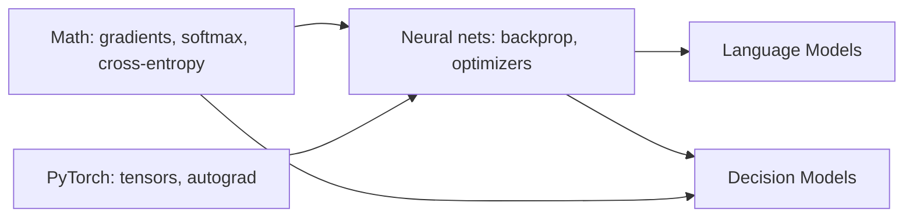

# Foundations

Every model on this site, from a 500M-parameter language model to a game-playing policy, is the same thing underneath: a function with millions of adjustable numbers, a measure of how wrong it is, and a procedure that nudges those numbers to make it less wrong. This section teaches that machinery once, properly, so that later sections can focus on what is new.

!!! abstract "What you'll learn in this section"
    - The handful of math ideas that deep learning actually uses: vectors and matrices, gradients and the chain rule, probability, softmax, cross-entropy, KL divergence
    - How to work fluently in PyTorch: tensors, shapes, autograd, modules, data loading, the training loop, devices and dtypes
    - How neural networks learn: backpropagation derived by hand and implemented from scratch, initialization, normalization, regularization, and the optimizers (SGD, momentum, Adam, AdamW) used to train every modern LLM

## Why bother with foundations?

You can fine-tune a model with a library call and never think about gradients. The problem shows up when something goes wrong, which it will: the loss goes to `nan`, it plateaus at exactly $\ln(\text{vocab size})$, validation loss climbs while training loss falls, or memory runs out on step 300. Diagnosing these needs a working model of what the code is computing. That model is what this section builds.

The bar is practical. You will not prove theorems. You will:

- Compute softmax and cross-entropy by hand and in numpy, and understand why the numerically stable version matters.
- Derive the gradient of a two-layer network on paper, then implement it and check it against PyTorch.
- Build a tiny automatic differentiation engine in about 100 lines, so `loss.backward()` stops being magic.
- Write AdamW's update rule yourself and see what each term does.

## Pages in this section

-   **[Math You Actually Need](math.md)**

    Linear algebra, derivatives and the chain rule, gradients, probability, softmax, cross-entropy, KL divergence, and just enough information theory. Every idea has a numpy example.

-   **[Python & PyTorch](pytorch.md)**

    Tensors, broadcasting, `einsum`, autograd, `nn.Module`, `Dataset` and `DataLoader`, the canonical training loop, devices and dtypes, and the shape bugs you will hit.

-   **[Neural Networks & Backprop](neural-networks.md)**

    From a single perceptron to an MLP. Backpropagation derived and implemented in numpy, a micrograd-style autograd engine, initialization, normalization, regularization, optimizers, and learning-rate schedules.

## How the pieces connect

The math page gives you the vocabulary, the PyTorch page gives you the tool, and the neural networks page puts them together. Both [Language Models](../llm/index.md) and [Decision Models](../decision/index.md) build directly on this section.

## If you already know some of this

- **Comfortable with calculus and probability?** Skim the math page, but read the sections on softmax, cross-entropy, and KL divergence. They come up on almost every later page.
- **Used PyTorch before?** Do the "Common shape bugs" section and the `einsum` exercises on the PyTorch page. They pay off on the attention pages.
- **Trained networks before but never implemented backprop?** Do the from-scratch numpy implementation and the micrograd engine. It takes an afternoon and removes a lot of mystery.

!!! tip "Do the exercises"
    The "Check your understanding" questions at the end of each page are short. Answer them before you open them. If you cannot, re-read the relevant section; the later material assumes it.

## Further reading

- 3Blue1Brown, [Neural Networks](https://www.3blue1brown.com/topics/neural-networks) and [Linear Algebra](https://www.3blue1brown.com/topics/linear-algebra) video series: excellent visual intuition
- Andrej Karpathy, [Neural Networks: Zero to Hero](https://karpathy.ai/zero-to-hero.html): the first lecture builds micrograd live
- Goodfellow, Bengio, Courville, [Deep Learning](https://www.deeplearningbook.org/): the standard reference text, free online

## Next

Next: [Math You Actually Need](math.md)
