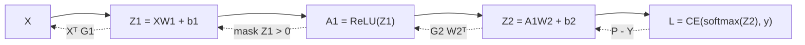

# Neural Networks & Backprop

A neural network is a stack of simple functions: multiply by a matrix, add a bias, apply a nonlinearity, repeat. Training it means computing how the loss changes with respect to every weight (backpropagation) and nudging the weights downhill (an optimizer). On this page you build both from scratch: a two-layer network in numpy with a hand-derived backward pass, then a tiny automatic differentiation engine. After that, the details that make deep networks actually train: initialization, normalization, regularization, optimizers, and learning-rate schedules.

!!! abstract "What you'll learn"
    - From a single perceptron to a multi-layer perceptron (MLP), and why nonlinearities are essential
    - The common activation functions (ReLU, GELU, SiLU, tanh, sigmoid) and when each is used
    - Backpropagation derived on paper and implemented in numpy, verified with a gradient check
    - A micrograd-style scalar autograd engine in about 100 lines
    - Weight initialization (Xavier, He) and why it matters
    - Normalization (BatchNorm, LayerNorm, RMSNorm) and residual connections
    - Regularization: weight decay, dropout, early stopping
    - Optimizers SGD, momentum, Adam, AdamW, with their update equations, and learning-rate warmup and cosine decay

```python
import numpy as np
rng = np.random.default_rng(0)
```

## From perceptron to MLP

### The perceptron

A single artificial neuron takes an input vector $x$, computes a weighted sum plus a bias, and passes it through an activation function $\phi$:

$$
y = \phi(w \cdot x + b)
$$

The original perceptron used a step function for $\phi$ and could only learn **linearly separable** problems: ones where a straight line (or hyperplane) separates the classes. The classic counterexample is XOR: no single line separates $\{(0,1), (1,0)\}$ from $\{(0,0), (1,1)\}$.

### Stacking layers

An **MLP** stacks layers of neurons. A two-layer MLP is:

$$
h = \phi(x W_1 + b_1), \qquad \hat{y} = h W_2 + b_2
$$

The hidden layer $h$ learns new features of the input, and the output layer combines them. With enough hidden units, an MLP can approximate any reasonable function (the universal approximation theorem), though "enough" may be very large; depth makes this far more efficient in practice.

### Why the nonlinearity matters

Without $\phi$, two layers collapse into one: $(x W_1) W_2 = x (W_1 W_2)$, a single linear map. Stacking any number of linear layers gives a linear model. The nonlinearity is what lets depth add expressive power.

In a transformer, every block contains exactly this MLP (called the **feed-forward network**, FFN), applied independently at each position. See [The Transformer, Line by Line](../llm/transformer.md).

## Activation functions

| Name | Formula | Where you will see it |
|------|---------|-----------------------|
| Sigmoid | $\sigma(x) = \frac{1}{1 + e^{-x}}$ | Binary outputs, gates (LSTMs, GLU variants). Saturates, so rarely used in hidden layers. |
| Tanh | $\tanh(x)$ | Older RNNs, some RL policy networks. Zero-centered but saturates. |
| ReLU | $\max(0, x)$ | The default for CNNs and many MLPs. Cheap, does not saturate for $x > 0$. |
| GELU | $x \, \Phi(x)$, with $\Phi$ the Gaussian CDF | GPT-2, BERT. A smooth ReLU. |
| SiLU / Swish | $x \, \sigma(x)$ | Inside SwiGLU, used by Llama, Qwen, Mistral and most modern LLMs. |

**Saturation** is the problem with sigmoid and tanh: for large $|x|$ their derivative is nearly zero, so gradients flowing back through many such layers shrink toward zero (**vanishing gradients**). ReLU avoids this for positive inputs, but a unit whose input is always negative gets zero gradient forever (a "dead ReLU"). GELU and SiLU are smooth, have small nonzero gradients for negative inputs, and tend to train slightly better in transformers.

```python
x = np.linspace(-4, 4, 9)
relu = np.maximum(0, x)
silu = x / (1 + np.exp(-x))
gelu = 0.5 * x * (1 + np.tanh(np.sqrt(2 / np.pi) * (x + 0.044715 * x**3)))  # tanh approx
print(np.c_[x, relu, silu, gelu])
```

**SwiGLU** (Shazeer, 2020) replaces the FFN's single activation with a gated product: $\text{FFN}(x) = (\text{SiLU}(x W_1) \odot x W_3) W_2$. It uses three weight matrices instead of two; [Modern Architectures](../llm/modern-architectures.md) covers why it is now the default.

## Backpropagation, derived

We will derive gradients for a two-layer MLP doing classification with softmax and cross-entropy. This uses only the chain rule and the two matrix-gradient rules from [Math You Actually Need](math.md#gradients-of-matrix-expressions).

### Forward pass

For a batch $X$ of shape $(N, D)$ with integer labels $y$:

$$
\begin{aligned}
Z_1 &= X W_1 + b_1 &\quad& (N, H) \\
A_1 &= \text{ReLU}(Z_1) && (N, H) \\
Z_2 &= A_1 W_2 + b_2 && (N, C) \quad \text{logits} \\
P &= \text{softmax}(Z_2) && (N, C) \\
L &= -\frac{1}{N} \sum_{n} \log P_{n, y_n} && \text{scalar}
\end{aligned}
$$

### Backward pass

Work from the loss back toward the input. At each step, the gradient of the loss with respect to a tensor has the same shape as that tensor.

**1. Logits.** From the softmax-cross-entropy result, including the $1/N$ from the mean:

$$
G_2 \equiv \frac{\partial L}{\partial Z_2} = \frac{1}{N}(P - Y_\text{onehot}) \qquad (N, C)
$$

**2. Second layer weights and bias.** $Z_2 = A_1 W_2 + b_2$ is a linear layer, so:

$$
\frac{\partial L}{\partial W_2} = A_1^\top G_2 \quad (H, C), \qquad \frac{\partial L}{\partial b_2} = \sum_n G_{2,n} \quad (C)
$$

The bias gradient sums over the batch because $b_2$ is broadcast to every row: each row's use of $b_2$ is a separate path, and the chain rule sums over paths.

**3. Back into the hidden layer.**

$$
\frac{\partial L}{\partial A_1} = G_2 W_2^\top \qquad (N, H)
$$

**4. Through the ReLU.** ReLU's derivative is 1 where $Z_1 > 0$ and 0 elsewhere, applied elementwise:

$$
G_1 \equiv \frac{\partial L}{\partial Z_1} = \frac{\partial L}{\partial A_1} \odot \mathbb{1}[Z_1 > 0] \qquad (N, H)
$$

**5. First layer.**

$$
\frac{\partial L}{\partial W_1} = X^\top G_1 \quad (D, H), \qquad \frac{\partial L}{\partial b_1} = \sum_n G_{1,n} \quad (H)
$$

That is all of backpropagation: for each operation, take the gradient arriving from above and multiply by the local derivative. Each step reuses the result of the previous one, which is why backprop costs only about twice the forward pass instead of one forward pass per parameter.



## A two-layer MLP in numpy

Now the derivation as code, trained on a dataset a linear model cannot solve: two interleaved spirals.

```python title="mlp_numpy.py"
import numpy as np
rng = np.random.default_rng(0)

def make_spirals(n_per_class=200, classes=3):
    X, y = [], []
    for c in range(classes):
        r = np.linspace(0.0, 1.0, n_per_class)
        t = np.linspace(c * 4, (c + 1) * 4, n_per_class) + rng.normal(0, 0.2, n_per_class)
        X.append(np.c_[r * np.sin(t), r * np.cos(t)])
        y.append(np.full(n_per_class, c))
    return np.vstack(X), np.concatenate(y)

def softmax(z):
    z = z - z.max(axis=1, keepdims=True)
    e = np.exp(z)
    return e / e.sum(axis=1, keepdims=True)

class MLP:
    def __init__(self, d_in, d_hidden, d_out):
        # He initialization for the ReLU layer (see "Initialization" below)
        self.W1 = rng.normal(0, np.sqrt(2.0 / d_in), (d_in, d_hidden))
        self.b1 = np.zeros(d_hidden)
        self.W2 = rng.normal(0, np.sqrt(1.0 / d_hidden), (d_hidden, d_out))
        self.b2 = np.zeros(d_out)

    def forward(self, X):
        self.X = X
        self.Z1 = X @ self.W1 + self.b1
        self.A1 = np.maximum(0, self.Z1)
        self.Z2 = self.A1 @ self.W2 + self.b2
        return self.Z2

    def loss(self, logits, y):
        self.P = softmax(logits)
        self.y = y
        N = len(y)
        return -np.log(self.P[np.arange(N), y] + 1e-12).mean()

    def backward(self):
        N = len(self.y)
        G2 = self.P.copy()
        G2[np.arange(N), self.y] -= 1
        G2 /= N                                   # dL/dZ2
        self.dW2 = self.A1.T @ G2
        self.db2 = G2.sum(axis=0)
        dA1 = G2 @ self.W2.T
        G1 = dA1 * (self.Z1 > 0)                  # through ReLU
        self.dW1 = self.X.T @ G1
        self.db1 = G1.sum(axis=0)

    def params_and_grads(self):
        return [(self.W1, self.dW1), (self.b1, self.db1),
                (self.W2, self.dW2), (self.b2, self.db2)]

X, y = make_spirals()
model = MLP(2, 64, 3)
lr = 1.0
for step in range(3000):
    loss = model.loss(model.forward(X), y)
    model.backward()
    for p, g in model.params_and_grads():
        p -= lr * g                               # in-place SGD update
    if step % 500 == 0:
        acc = (model.Z2.argmax(1) == y).mean()
        print(f"step {step:4d} loss {loss:.4f} acc {acc:.3f}")
```

A linear classifier tops out well below perfect on spirals. This MLP should reach high training accuracy. Try `d_hidden=4` and see it struggle; try removing the ReLU (`self.A1 = self.Z1`) and watch it fall back to linear performance.

### Gradient checking

Never trust a hand-written backward pass until you have compared it against finite differences:

```python title="gradcheck.py"
def grad_check(model, X, y, eps=1e-5, n_checks=5):
    model.loss(model.forward(X), y); model.backward()
    for name in ["W1", "b1", "W2", "b2"]:
        P = getattr(model, name); G = getattr(model, "d" + name)
        for _ in range(n_checks):
            idx = tuple(rng.integers(0, s) for s in P.shape)
            old = P[idx]
            P[idx] = old + eps; lp = model.loss(model.forward(X), y)
            P[idx] = old - eps; lm = model.loss(model.forward(X), y)
            P[idx] = old
            num = (lp - lm) / (2 * eps)
            rel = abs(num - G[idx]) / max(1e-8, abs(num) + abs(G[idx]))
            print(f"{name}{idx}: analytic {G[idx]:+.6f} numeric {num:+.6f} rel_err {rel:.1e}")

# Random inputs: avoids points that sit exactly on ReLU's kink at zero
Xc = rng.normal(size=(50, 2)); yc = rng.integers(0, 3, 50)
grad_check(MLP(2, 16, 3), Xc, yc)
```

Relative errors around `1e-7` or smaller mean the gradients are right. Errors around `1e-2` or larger mean a bug. (ReLU's kink at zero can occasionally produce a larger error for one entry; that is harmless.)

## A micrograd-style autograd engine

Writing backward passes by hand does not scale. Automatic differentiation records each operation as it runs, along with how to compute its local derivative, then walks the graph backward applying the chain rule. Here is a scalar version, in the spirit of Karpathy's [micrograd](https://github.com/karpathy/micrograd). PyTorch does the same thing with tensors instead of scalars.

```python title="tiny_autograd.py"
import math, random

class Value:
    def __init__(self, data, _children=(), _op=""):
        self.data = data
        self.grad = 0.0
        self._backward = lambda: None
        self._prev = set(_children)
        self._op = _op

    def __add__(self, other):
        other = other if isinstance(other, Value) else Value(other)
        out = Value(self.data + other.data, (self, other), "+")
        def _backward():
            self.grad += out.grad            # d(a+b)/da = 1
            other.grad += out.grad
        out._backward = _backward
        return out

    def __mul__(self, other):
        other = other if isinstance(other, Value) else Value(other)
        out = Value(self.data * other.data, (self, other), "*")
        def _backward():
            self.grad += other.data * out.grad   # d(ab)/da = b
            other.grad += self.data * out.grad
        out._backward = _backward
        return out

    def __pow__(self, k):
        assert isinstance(k, (int, float))
        out = Value(self.data ** k, (self,), f"**{k}")
        def _backward():
            self.grad += k * self.data ** (k - 1) * out.grad
        out._backward = _backward
        return out

    def exp(self):
        out = Value(math.exp(self.data), (self,), "exp")
        def _backward():
            self.grad += out.data * out.grad
        out._backward = _backward
        return out

    def log(self):
        out = Value(math.log(self.data), (self,), "log")
        def _backward():
            self.grad += (1.0 / self.data) * out.grad
        out._backward = _backward
        return out

    def tanh(self):
        t = math.tanh(self.data)
        out = Value(t, (self,), "tanh")
        def _backward():
            self.grad += (1 - t * t) * out.grad
        out._backward = _backward
        return out

    def relu(self):
        out = Value(max(0.0, self.data), (self,), "relu")
        def _backward():
            self.grad += (out.data > 0) * out.grad
        out._backward = _backward
        return out

    def backward(self):
        # Topological order: each node after all nodes it depends on
        topo, seen = [], set()
        def build(v):
            if v not in seen:
                seen.add(v)
                for c in v._prev:
                    build(c)
                topo.append(v)
        build(self)
        self.grad = 1.0                       # dL/dL = 1
        for v in reversed(topo):
            v._backward()

    # Conveniences so expressions read naturally
    def __neg__(self): return self * -1
    def __sub__(self, other): return self + (-other)
    def __radd__(self, other): return self + other
    def __rmul__(self, other): return self * other
    def __truediv__(self, other): return self * other ** -1
    def __repr__(self): return f"Value(data={self.data:.4f}, grad={self.grad:.4f})"
```

Note the `+=` in every `_backward`. When a value is used in more than one place, gradients from each use are summed: the multi-path chain rule. This is exactly why PyTorch accumulates into `.grad`.

Check it against the hand calculation from the math page:

```python
w, x, b, y = Value(2.0), Value(3.0), Value(1.0), Value(5.0)
loss = (w * x + b - y) ** 2
loss.backward()
print(w.grad, b.grad)    # 12.0 4.0
```

Now a tiny neural network built from `Value`s, trained on a toy problem:

```python title="tiny_mlp.py"
random.seed(0)

class Neuron:
    def __init__(self, n_in, act=True):
        self.w = [Value(random.uniform(-1, 1) / math.sqrt(n_in)) for _ in range(n_in)]
        self.b = Value(0.0)
        self.act = act
    def __call__(self, x):
        s = sum((wi * xi for wi, xi in zip(self.w, x)), self.b)
        return s.tanh() if self.act else s
    def parameters(self):
        return self.w + [self.b]

class Layer:
    def __init__(self, n_in, n_out, act=True):
        self.neurons = [Neuron(n_in, act) for _ in range(n_out)]
    def __call__(self, x):
        out = [n(x) for n in self.neurons]
        return out[0] if len(out) == 1 else out
    def parameters(self):
        return [p for n in self.neurons for p in n.parameters()]

class TinyMLP:
    def __init__(self, n_in, hidden, n_out):
        sizes = [n_in] + hidden + [n_out]
        self.layers = [Layer(sizes[i], sizes[i + 1], act=(i < len(hidden)))
                       for i in range(len(sizes) - 1)]
    def __call__(self, x):
        for layer in self.layers:
            x = layer(x)
            x = x if isinstance(x, list) else [x]
        return x[0]
    def parameters(self):
        return [p for l in self.layers for p in l.parameters()]

# XOR: not linearly separable
data = [([0.0, 0.0], -1.0), ([0.0, 1.0], 1.0), ([1.0, 0.0], 1.0), ([1.0, 1.0], -1.0)]
net = TinyMLP(2, [8], 1)
for step in range(300):
    loss = sum(((net(x) - t) ** 2 for x, t in data), Value(0.0)) * (1 / len(data))
    for p in net.parameters():
        p.grad = 0.0                         # zero_grad
    loss.backward()
    for p in net.parameters():
        p.data -= 0.1 * p.grad               # SGD step
    if step % 50 == 0:
        print(step, round(loss.data, 4))
print([round(net(x).data, 2) for x, _ in data])   # close to [-1, 1, 1, -1]
```

This is the whole idea behind `loss.backward()`. PyTorch adds tensors (so one node represents millions of numbers), GPU kernels, and hundreds of operations, but the algorithm is the same.

## Initialization

If initial weights are too large, activations and gradients grow layer by layer and explode. Too small, and they shrink to nothing. The goal of initialization is to keep the variance of activations roughly constant from layer to layer.

For a linear layer with $n_\text{in}$ inputs and weights of variance $\text{Var}(w)$, each output is a sum of $n_\text{in}$ terms, so its variance is roughly $n_\text{in} \cdot \text{Var}(w) \cdot \text{Var}(x)$. Keeping that equal to $\text{Var}(x)$ means:

- **Xavier/Glorot** (for tanh, linear): $\text{Var}(w) = 1/n_\text{in}$ (or $2/(n_\text{in} + n_\text{out})$).
- **He/Kaiming** (for ReLU): $\text{Var}(w) = 2/n_\text{in}$. The factor 2 compensates for ReLU zeroing half its inputs.

```python
def forward_stats(init_std_fn, depth=20, width=512):
    x = rng.normal(size=(256, width))
    for _ in range(depth):
        W = rng.normal(0, init_std_fn(width), (width, width))
        x = np.maximum(0, x @ W)
    return x.std()

print("std 1.0   :", forward_stats(lambda n: 1.0))              # explodes
print("std 0.01  :", forward_stats(lambda n: 0.01))             # vanishes to ~0
print("He init   :", forward_stats(lambda n: np.sqrt(2 / n)))   # stays order 1
```

Transformers usually initialize linear layers from a normal distribution with a small standard deviation (GPT-2 used 0.02) and scale down the output projections of residual branches by a factor depending on depth, so that the residual stream does not grow as layers are added. PyTorch's `nn.Linear` defaults to a Kaiming-uniform variant, which is why model code often overrides initialization explicitly.

## Normalization and residual connections

Even with good initialization, activation statistics drift during training. **Normalization** layers re-standardize activations, which makes training much less sensitive to learning rate and initialization.

**BatchNorm** normalizes each feature over the batch dimension. It works well for CNNs but behaves differently in training and inference, and depends on batch statistics, which is awkward for variable-length sequences.

**LayerNorm** normalizes each example over its feature dimension, independently of the batch:

$$
\text{LayerNorm}(x) = \gamma \odot \frac{x - \mu}{\sqrt{\sigma^2 + \epsilon}} + \beta, \qquad \mu, \sigma^2 \text{ over the last dim}
$$

**RMSNorm** drops the mean subtraction and the bias, dividing only by the root mean square:

$$
\text{RMSNorm}(x) = \gamma \odot \frac{x}{\sqrt{\frac{1}{d}\sum_i x_i^2 + \epsilon}}
$$

It is cheaper and works about as well, and is used by Llama, Qwen, Gemma, and most modern LLMs.

```python
def layernorm(x, gamma, beta, eps=1e-5):
    mu = x.mean(-1, keepdims=True); var = x.var(-1, keepdims=True)
    return gamma * (x - mu) / np.sqrt(var + eps) + beta

def rmsnorm(x, gamma, eps=1e-6):
    return gamma * x / np.sqrt((x ** 2).mean(-1, keepdims=True) + eps)

x = rng.normal(3.0, 5.0, size=(2, 8))
print(layernorm(x, 1.0, 0.0).mean(-1), layernorm(x, 1.0, 0.0).std(-1))  # ~0, ~1
```

**Residual connections** add a layer's input to its output: $x_{l+1} = x_l + f(x_l)$. During backprop, the gradient flows through the identity path unchanged, so even very deep networks get useful gradients at early layers (He et al., 2015). Every transformer block is two residual branches, one for attention and one for the MLP, with normalization applied to the input of each branch ("pre-norm"):

$$
x \leftarrow x + \text{Attn}(\text{Norm}(x)), \qquad x \leftarrow x + \text{MLP}(\text{Norm}(x))
$$

## Regularization

Regularization reduces **overfitting**: fitting the training set so closely that the model does worse on new data. The signal is validation loss rising while training loss keeps falling.

- **Weight decay** shrinks weights toward zero each step, penalizing large weights. In AdamW it is applied directly to the weights (see below). Typical LLM values are around 0.1. Biases and normalization gains are usually excluded.
- **Dropout** randomly zeroes a fraction $p$ of activations during training and scales the rest by $1/(1-p)$, so the expected value is unchanged. At evaluation time it is off. Large-scale LLM pretraining often uses no dropout, because the model sees each token roughly once and overfitting is not the bottleneck; dropout is more useful in fine-tuning on small datasets.
- **Early stopping**: keep the checkpoint with the best validation loss.
- **More data** and **data augmentation** are the most reliable regularizers of all.

```python
def dropout(x, p, training):
    if not training or p == 0:
        return x
    mask = (rng.random(x.shape) > p) / (1 - p)   # inverted dropout
    return x * mask
```

## Optimizers

Every optimizer below uses the gradient $g_t = \nabla_\theta L(\theta_t)$ on a mini-batch at step $t$. They differ in how they turn that gradient into an update.

### SGD

$$
\theta_{t+1} = \theta_t - \eta \, g_t
$$

Simple, but sensitive to the learning rate, slow along shallow directions, and oscillates along steep ones.

### SGD with momentum

Keep a running velocity, an exponential moving average of past gradients, and step along it:

$$
v_t = \mu \, v_{t-1} + g_t, \qquad \theta_{t+1} = \theta_t - \eta \, v_t
$$

with $\mu$ typically 0.9. Oscillations across steep directions cancel out, while consistent directions build speed, like a ball rolling downhill.

### Adam

Adam keeps two moving averages per parameter: of the gradient ($m$, the first moment) and of the squared gradient ($v$, the second moment), and divides one by the square root of the other:

$$
\begin{aligned}
m_t &= \beta_1 m_{t-1} + (1 - \beta_1) g_t \\
v_t &= \beta_2 v_{t-1} + (1 - \beta_2) g_t^2 \\
\hat{m}_t &= \frac{m_t}{1 - \beta_1^t}, \qquad \hat{v}_t = \frac{v_t}{1 - \beta_2^t} \\
\theta_{t+1} &= \theta_t - \eta \, \frac{\hat{m}_t}{\sqrt{\hat{v}_t} + \epsilon}
\end{aligned}
$$

Intuition: each parameter gets its own effective step size. Parameters with consistently large gradients get smaller steps; rarely-updated parameters (such as embeddings of rare tokens) get relatively larger ones. The **bias correction** terms $1 - \beta^t$ fix the fact that $m$ and $v$ start at zero and are biased toward zero for the first steps. Typical values: $\beta_1 = 0.9$, $\beta_2 = 0.95$ to $0.999$ (LLM pretraining usually uses 0.95), $\epsilon = 10^{-8}$.

Adam stores $m$ and $v$ for every parameter, which is why optimizer state dominates training memory (see [Setup](../start/setup.md#training-memory)).

### AdamW

Classic "L2 regularization" adds $\lambda \theta$ to the gradient. Inside Adam, that term gets divided by $\sqrt{\hat{v}}$ like everything else, so parameters with large gradients are barely regularized. **AdamW** (Loshchilov and Hutter) *decouples* weight decay and applies it directly to the weights:

$$
\theta_{t+1} = \theta_t - \eta \left( \frac{\hat{m}_t}{\sqrt{\hat{v}_t} + \epsilon} + \lambda \, \theta_t \right)
$$

AdamW is the default optimizer for essentially every LLM in this site.

Here is AdamW written out, checked against PyTorch:

```python title="adamw_from_scratch.py"
import torch

class MyAdamW:
    def __init__(self, params, lr=1e-3, betas=(0.9, 0.999), eps=1e-8, weight_decay=0.01):
        self.params = list(params)
        self.lr, self.b1, self.b2, self.eps, self.wd = lr, *betas, eps, weight_decay
        self.m = [torch.zeros_like(p) for p in self.params]
        self.v = [torch.zeros_like(p) for p in self.params]
        self.t = 0

    @torch.no_grad()
    def step(self):
        self.t += 1
        for p, m, v in zip(self.params, self.m, self.v):
            if p.grad is None:
                continue
            g = p.grad
            p.mul_(1 - self.lr * self.wd)                  # decoupled weight decay
            m.mul_(self.b1).add_(g, alpha=1 - self.b1)
            v.mul_(self.b2).addcmul_(g, g, value=1 - self.b2)
            m_hat = m / (1 - self.b1 ** self.t)
            v_hat = v / (1 - self.b2 ** self.t)
            p.add_(-self.lr * m_hat / (v_hat.sqrt() + self.eps))

torch.manual_seed(0)
w1 = torch.randn(5, 3, requires_grad=True)
w2 = w1.detach().clone().requires_grad_(True)
mine = MyAdamW([w1], lr=1e-2, weight_decay=0.1)
ref = torch.optim.AdamW([w2], lr=1e-2, weight_decay=0.1)
x = torch.randn(16, 5)
for _ in range(10):
    for w, opt in [(w1, mine), (w2, ref)]:
        w.grad = None
        ((x @ w) ** 2).mean().backward()
        opt.step()
print(torch.allclose(w1, w2, atol=1e-6))   # True
```

(PyTorch applies weight decay as $\theta \leftarrow \theta(1 - \eta\lambda)$ before the Adam step, which is what the code does.)

## Learning-rate schedules

The learning rate is the most important hyperparameter. A fixed value is rarely best: early on, Adam's moment estimates are noisy and large steps can destabilize training; late in training, smaller steps let the model settle into a better minimum.

The standard LLM schedule is **linear warmup then cosine decay**:

$$
\eta_t =
\begin{cases}
\eta_\text{max} \cdot \dfrac{t}{T_\text{warm}} & t < T_\text{warm} \\[2ex]
\eta_\text{min} + \tfrac{1}{2}(\eta_\text{max} - \eta_\text{min})\left(1 + \cos\left(\pi \dfrac{t - T_\text{warm}}{T - T_\text{warm}}\right)\right) & t \geq T_\text{warm}
\end{cases}
$$

```python title="lr_schedule.py"
import math

def lr_at(step, max_lr=3e-4, min_lr=3e-5, warmup=1000, total=20000):
    if step < warmup:
        return max_lr * (step + 1) / warmup
    if step >= total:
        return min_lr
    progress = (step - warmup) / (total - warmup)
    return min_lr + 0.5 * (max_lr - min_lr) * (1 + math.cos(math.pi * progress))

for s in [0, 500, 1000, 5000, 10000, 20000]:
    print(s, f"{lr_at(s):.2e}")

# Use it in a PyTorch loop by setting the LR each step:
# for g in opt.param_groups: g["lr"] = lr_at(step)
```

Common variants: a final LR of about 10% of the peak, and **warmup-stable-decay (WSD)** schedules that hold the peak constant for most of training and decay quickly at the end, which makes it easy to continue training from a mid-run checkpoint. [The Training Loop](../pretraining/training.md) shows how to choose these values for Project 1.

!!! tip "Finding a learning rate"
    For a new setup, try a short run at a few learning rates spaced by about 3x (for example 1e-4, 3e-4, 1e-3). Pick the largest that trains smoothly. If loss spikes or goes to `nan`, lower the LR or lengthen warmup and check that gradient clipping is on.

!!! warning "Common pitfalls"
    - **Skipping the gradient check.** A backward pass with a sign error still "trains" a little, which is worse than crashing.
    - **No nonlinearity, or a saturating one in a deep stack.** Linear-only stacks are linear models; deep sigmoid stacks barely train.
    - **Default initialization for deep or residual networks.** Activations or the residual stream grow with depth. Initialize deliberately.
    - **Applying weight decay to biases, norm gains, and sometimes embeddings.** Use separate parameter groups with `weight_decay=0` for these.
    - **Adam instead of AdamW with weight decay.** `torch.optim.Adam(weight_decay=...)` is L2 regularization, not decoupled decay.
    - **No warmup with Adam at a high learning rate.** The first steps are the most unstable; warmup prevents early divergence.

## Check your understanding

??? question "Why do two linear layers without an activation equal one linear layer?"
    $(xW_1 + b_1)W_2 + b_2 = x(W_1 W_2) + (b_1 W_2 + b_2)$, which is a single linear map with weight $W_1W_2$ and bias $b_1W_2 + b_2$.

??? question "Why is the bias gradient a sum over the batch?"
    The same bias vector is added to every row in the batch, so each row is a separate path from the bias to the loss. The chain rule sums contributions from all paths.

??? question "In the autograd engine, what breaks if `_backward` uses `=` instead of `+=`?"
    Any value used more than once (for example `x * x`, or a weight shared across the batch) would keep only the gradient from the last path processed instead of the sum, giving wrong gradients.

??? question "What problem does Adam's bias correction solve?"
    $m$ and $v$ start at zero, so in early steps they underestimate the true moments. Dividing by $1-\beta^t$ rescales them; the correction fades to 1 as $t$ grows.

??? question "Why does He initialization use variance $2/n_\text{in}$ rather than $1/n_\text{in}$?"
    ReLU zeros roughly half its inputs, which halves the variance of its outputs. Doubling the weight variance compensates, keeping activation scale stable across layers.

## Further reading

- Kingma and Ba, [Adam: A Method for Stochastic Optimization](https://arxiv.org/abs/1412.6980)
- Loshchilov and Hutter, [Decoupled Weight Decay Regularization](https://arxiv.org/abs/1711.05101) (AdamW)
- He et al., [Delving Deep into Rectifiers](https://arxiv.org/abs/1502.01852) (He initialization) and [Deep Residual Learning for Image Recognition](https://arxiv.org/abs/1512.03385)
- Ba, Kiros, Hinton, [Layer Normalization](https://arxiv.org/abs/1607.06450); Zhang and Sennrich, [Root Mean Square Layer Normalization](https://arxiv.org/abs/1910.07467)
- Ioffe and Szegedy, [Batch Normalization](https://arxiv.org/abs/1502.03167)
- Hendrycks and Gimpel, [Gaussian Error Linear Units (GELUs)](https://arxiv.org/abs/1606.08415); Shazeer, [GLU Variants Improve Transformer](https://arxiv.org/abs/2002.05202)
- Karpathy, [micrograd](https://github.com/karpathy/micrograd) and the first lecture of [Neural Networks: Zero to Hero](https://karpathy.ai/zero-to-hero.html)
- [CS231n notes on backpropagation](https://cs231n.github.io/optimization-2/)

## Next

Next: [Language Models](../llm/index.md)
