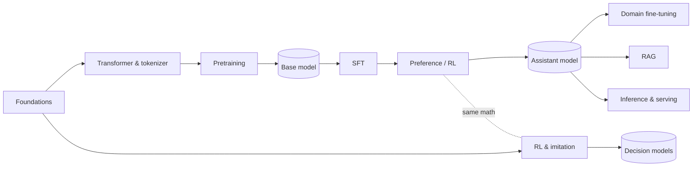

---
hide:
  - navigation
  - toc
---

# LLM From Scratch

A hands-on path from "what is a gradient?" to training your own 500M-parameter language model, post-training it into an assistant, fine-tuning open-weight models for real industry work, building production RAG, and training decision models that act in real time.

[Start the roadmap :material-arrow-right:](start/roadmap.md){ .md-button .md-button--primary }
[Jump to projects](projects/index.md){ .md-button }

## What you will be able to do

-   :material-function-variant:{ .lg .middle } **Understand the math & code**

    ---

    Linear algebra, gradients, backprop and PyTorch: only what you need, implemented by hand.

    [:octicons-arrow-right-24: Foundations](foundations/index.md)

-   :material-transit-connection-variant:{ .lg .middle } **Build a transformer**

    ---

    Tokenizers, attention, RoPE, GQA, SwiGLU, MoE, and how to design a *small* language model.

    [:octicons-arrow-right-24: Language Models](llm/index.md)

-   :material-database-cog:{ .lg .middle } **Pretrain it**

    ---

    Data pipelines, dedup, the training loop, mixed precision, distributed training, scaling laws.

    [:octicons-arrow-right-24: Pretraining](pretraining/index.md)

-   :material-account-voice:{ .lg .middle } **Post-train it**

    ---

    SFT, reward models, RLHF, DPO, GRPO and RL with verifiable rewards for reasoning.

    [:octicons-arrow-right-24: Post-training](post-training/index.md)

-   :material-tune-variant:{ .lg .middle } **Fine-tune open weights**

    ---

    LoRA and QLoRA on a single GPU, plus when fine-tuning is the wrong answer.

    [:octicons-arrow-right-24: Fine-tuning](finetuning/index.md)

-   :material-rocket-launch:{ .lg .middle } **Serve it fast**

    ---

    KV cache, sampling, quantization, distillation, vLLM, llama.cpp and on-device inference.

    [:octicons-arrow-right-24: Inference](inference/index.md)

-   :material-book-search:{ .lg .middle } **Ground it with RAG**

    ---

    Embeddings, hybrid search, reranking, citations, permissions and evaluation.

    [:octicons-arrow-right-24: RAG](rag/index.md)

-   :material-gamepad-variant:{ .lg .middle } **Make it decide & act**

    ---

    Bandits, RL, PPO, imitation learning, System 1 vs System 2 models, and decision/routing models.

    [:octicons-arrow-right-24: Decision Models](decision/index.md)

## Four capstone projects

| # | Project | What you build | Hardware |
|---|---------|----------------|----------|
| 1 | [Build a 500M SLM from scratch](projects/p1-500m-model.md) | Tokenizer, data pipeline, Llama-style model, pretraining, SFT, eval, Hub release | 1-8 rented GPUs (tiny mode runs on a laptop) |
| 2 | [Fine-tune an open-weight model](projects/p2-finetune.md) | An IT-operations **Incident Triage Copilot**: alerts + logs in, strict triage JSON out | One 24 GB GPU (QLoRA) |
| 3 | [Build a production RAG system](projects/p3-rag.md) | A **Support Engineer Copilot** over product docs and resolved tickets, with citations and access control | Laptop + any LLM endpoint |
| 4 | [A decision model that plays](projects/p4-decision-model.md) | A neural policy that controls an on-screen character: imitation learning, then PPO, then real-time export | Laptop |

## How the pieces fit

!!! tip "How to use this site"
    Read a concept page, run its code, answer the *Check your understanding* questions, then move on. Every section feeds into one of the four projects. If you already know a topic, skip it; the projects link back to the pages they rely on.
