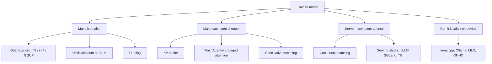

# Inference & Deployment

Training a model happens once. Running it happens millions of times. Inference is where most of the cost of a deployed language model goes, and it has a completely different performance profile from training: generation is sequential, memory-bandwidth bound, and latency-sensitive. A model that trained fine can still be too slow, too large, or too expensive to serve. This section covers how generation actually works and the techniques that make it fast and cheap: sampling, KV caching, batching, quantization, compression into small models, and the serving stacks that put it all together.

!!! abstract "What you'll learn"
    - Why inference is a different engineering problem from training
    - The main levers: memory, latency, throughput, and quality
    - A map of the techniques, and where to go to learn each

## Why inference is different

| | Training | Inference (generation) |
|---|---|---|
| Work per step | Whole sequences in parallel | One new token per sequence per step |
| Bottleneck | Compute (FLOPs) | Memory bandwidth (reading weights + KV cache) |
| Memory | Weights + grads + optimizer + activations | Weights + KV cache |
| Metric | Tokens/sec, MFU | Time to first token, time per output token, throughput, cost per token |
| Precision | bf16 (fp32 master weights) | bf16, int8, int4, fp8 |

The key fact: to produce **one** token, the model must read **all** its weights from GPU memory. A 7B model in bf16 is 14 GB; at roughly 2 TB/s of memory bandwidth, that's a floor of about 7 ms per token for a single sequence, no matter how many FLOPs the GPU has. Almost every inference optimization either reads fewer bytes (quantization, smaller models), reads them less often (batching), or avoids recomputation (KV cache).

## The landscape

## Choosing a deployment target

| Goal | Typical choice |
|---|---|
| Prototype on your laptop | Ollama or llama.cpp with a 4-bit GGUF; MLX on Apple Silicon |
| High-throughput API on GPUs | vLLM or SGLang, bf16 or fp8, continuous batching |
| Single GPU, model slightly too big | 4-bit AWQ/GPTQ in vLLM, or bitsandbytes for experimentation |
| Mobile / browser / edge | A 0.5B-3B SLM, int4, via llama.cpp, MLX, ONNX Runtime, or ExecuTorch |
| Lowest latency for one user | Small model, speculative decoding, keep batch small |

Small language models (SLMs, roughly under 4B parameters) like SmolLM2/3, Qwen2.5/Qwen3 small variants, Gemma 3 1B/4B, Llama 3.2 1B/3B and Phi models make many of these targets practical. They are often distilled from larger models and run comfortably quantized on a laptop or phone.

## In this section

-   **[Sampling, KV Cache & Quantization](inference.md)**

    ---

    Decoding and sampling strategies with code, the KV cache implemented in a small GPT, prefill vs decode, batching and paged attention, speculative decoding, quantization with memory math, distillation and pruning, serving stacks, on-device runtimes, and latency metrics.

Related pages: [LoRA & QLoRA](../finetuning/lora-qlora.md) covers 4-bit quantization for fine-tuning; [Modern Architectures & SLM Design](../llm/modern-architectures.md) covers architecture choices (GQA, MQA) that shrink the KV cache; [RAG](../rag/index.md) covers serving models with retrieval.

!!! warning "Common pitfalls"
    - **Benchmarking with batch size 1 and concluding a GPU is slow.** Decode at batch 1 uses a tiny fraction of available compute; throughput grows almost linearly with batch size until memory or compute limits.
    - **Forgetting the KV cache in memory planning.** At long contexts and large batches it can exceed the weights.
    - **Quantizing without evaluating.** Always rerun your evals after quantization; some tasks (math, code) degrade more than others.
    - **Mismatched chat templates** between training and serving. Silent quality loss.

## Check your understanding

??? question "Why is single-sequence generation memory-bandwidth bound rather than compute bound?"
    Each new token requires reading every weight once but does only about 2 FLOPs per weight. GPUs can do hundreds of FLOPs per byte read, so the arithmetic units sit idle waiting on memory.

??? question "Give one technique each for: reading fewer bytes, reading them less often, and avoiding recomputation."
    Fewer bytes: quantization (or a smaller model). Less often: batching many sequences so one weight read serves many tokens. Avoid recomputation: the KV cache.

??? question "What's a sensible stack for running a 3B model on a MacBook?"
    A 4-bit quantized version via Ollama or llama.cpp (GGUF), or MLX with an MLX-quantized model. All use Apple Silicon's unified memory and Metal GPU.

## Further reading

- Pope et al., *Efficiently Scaling Transformer Inference* - [arXiv:2211.05102](https://arxiv.org/abs/2211.05102)
- Kwon et al., *Efficient Memory Management for Large Language Model Serving with PagedAttention* (vLLM) - [arXiv:2309.06180](https://arxiv.org/abs/2309.06180)
- vLLM docs - [docs.vllm.ai](https://docs.vllm.ai/)
- llama.cpp - [github.com/ggml-org/llama.cpp](https://github.com/ggml-org/llama.cpp)

**Next:** [Sampling, KV Cache & Quantization](inference.md)
