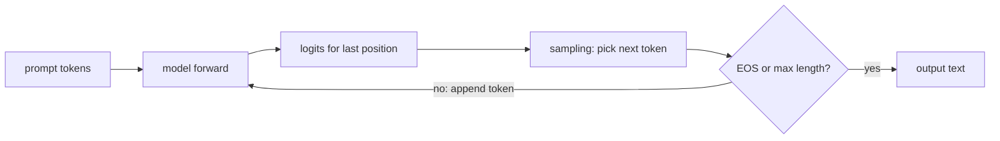
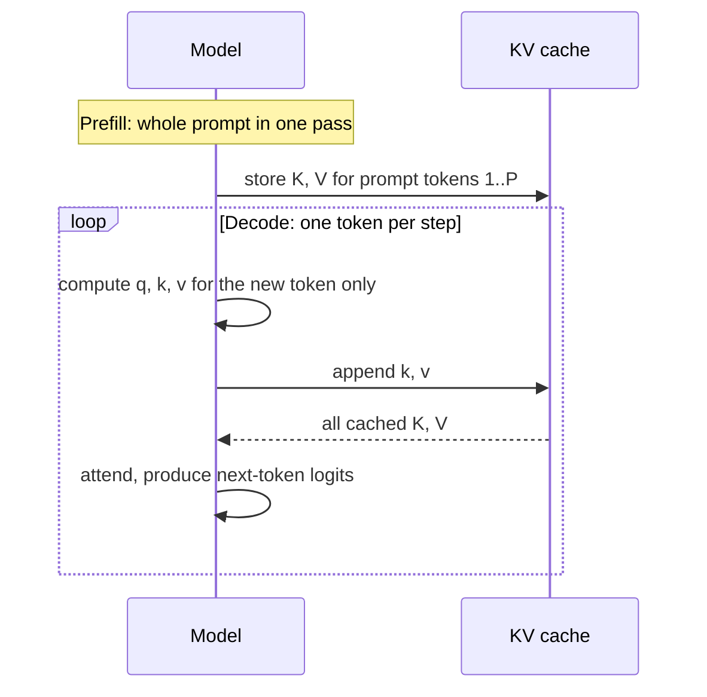

# Decoding: Sampling, KV Cache & Batching

A language model gives you a probability distribution over the next token. Turning that into fast, good text is the job of decoding: choosing tokens (sampling), not recomputing the past (the KV cache), and keeping the GPU busy (batching, paged attention, speculative decoding). This page builds each piece in PyTorch. [Quantization & Serving](serving.md) then shrinks the model and puts it behind an API.

!!! abstract "What you'll learn"
    - Autoregressive decoding, and sampling: greedy, temperature, top-k, top-p, min-p, repetition penalty
    - The KV cache, implemented in a small GPT, and its memory cost
    - Prefill vs decode, and why decode is memory-bound
    - Static vs continuous batching, and paged attention
    - Speculative decoding, with a greedy implementation you can test

## Autoregressive decoding

Generation is a loop: run the model on the tokens so far, get logits for the last position, pick a token, append it, repeat until an end-of-sequence token or a length limit.



The model defines $p(x_t \mid x_{<t})$. The decoding strategy decides how to pick $x_t$ from it.

## Sampling strategies

### Greedy

Always take the most likely token: $x_t = \arg\max p(x_t\mid x_{<t})$. Deterministic and good for short factual answers or code with a single correct output, but prone to repetitive loops in long open-ended text.

### Temperature

Divide logits $z$ by temperature $\tau$ before softmax:

$$
p_i = \frac{\exp(z_i/\tau)}{\sum_j \exp(z_j/\tau)}
$$

$\tau < 1$ sharpens the distribution (more conservative), $\tau > 1$ flattens it (more random), $\tau \to 0$ is greedy.

### Top-k

Keep only the $k$ most likely tokens, renormalize, sample. Cuts off the long tail of nonsense tokens. The weakness: a fixed $k$ is too many when the model is confident and too few when many continuations are fine.

### Top-p (nucleus)

Keep the smallest set of tokens whose cumulative probability reaches $p$ (e.g. 0.9). Adapts to the shape of the distribution: few tokens when confident, many when uncertain.

### Min-p

Keep tokens with probability at least $p_{\min} \times p_{\max}$, where $p_{\max}$ is the top token's probability. With `min_p=0.05` and a top token at 0.6, the cutoff is 0.03. It scales with confidence and holds up better than top-p at high temperatures. Supported in vLLM, llama.cpp and `transformers`.

### Repetition penalty

Discourage tokens already generated. The common form (from CTRL, used in `transformers` and llama.cpp) divides positive logits and multiplies negative logits of previously seen tokens by a penalty $r > 1$. OpenAI-style APIs use additive **presence** and **frequency** penalties instead. Use gently (1.05-1.2); strong penalties break text that legitimately repeats words, like code.

### All of it in one function

```python title="sampling.py"
import torch
import torch.nn.functional as F

def sample_next(logits: torch.Tensor, prev_ids: torch.Tensor | None = None,
                temperature: float = 1.0, top_k: int = 0, top_p: float = 1.0,
                min_p: float = 0.0, repetition_penalty: float = 1.0) -> torch.Tensor:
    """logits: (B, V) for the last position. prev_ids: (B, T) tokens so far. Returns (B, 1)."""
    logits = logits.float().clone()

    if repetition_penalty != 1.0 and prev_ids is not None:
        seen = torch.gather(logits, 1, prev_ids)
        seen = torch.where(seen > 0, seen / repetition_penalty, seen * repetition_penalty)
        logits.scatter_(1, prev_ids, seen)

    if temperature == 0.0:                                   # greedy
        return logits.argmax(dim=-1, keepdim=True)
    logits = logits / temperature

    if top_k > 0:
        kth = torch.topk(logits, min(top_k, logits.size(-1))).values[:, [-1]]
        logits = logits.masked_fill(logits < kth, float("-inf"))

    probs = F.softmax(logits, dim=-1)

    if min_p > 0.0:
        cutoff = min_p * probs.max(dim=-1, keepdim=True).values
        probs = probs.masked_fill(probs < cutoff, 0.0)

    if top_p < 1.0:
        sorted_p, sorted_idx = torch.sort(probs, descending=True, dim=-1)
        cum = sorted_p.cumsum(dim=-1)
        remove = cum - sorted_p > top_p                      # keep the token that crosses top_p
        sorted_p = sorted_p.masked_fill(remove, 0.0)
        probs = torch.zeros_like(probs).scatter_(1, sorted_idx, sorted_p)

    probs = probs / probs.sum(dim=-1, keepdim=True)
    return torch.multinomial(probs, num_samples=1)

if __name__ == "__main__":                                    # quick check
    torch.manual_seed(0)
    logits = torch.tensor([[4.0, 3.0, 1.0, -2.0, -5.0]])
    print(sample_next(logits, temperature=0.0))                   # tensor([[0]])
    print(sample_next(logits, temperature=0.8, top_p=0.9, min_p=0.05))
```

Order matters: penalties apply to raw logits, temperature next, then truncation (top-k, min-p, top-p). Libraries differ slightly in the order; check the docs if you're matching outputs.

| Use case | Reasonable settings |
|---|---|
| Code, extraction, math final answers | greedy, or `temperature=0.2` |
| Chat assistant | `temperature=0.7`, `top_p=0.9` (or the model card's recommendation) |
| Creative writing | `temperature=0.9-1.1`, `min_p=0.05` |
| Reasoning models | Follow the model card; several recommend roughly `temperature=0.6` and warn against greedy |

**Beam search** keeps the $b$ best partial sequences by total log-probability. It helps translation and constrained tasks, but for open-ended LM text it produces bland, repetitive output and is rarely used for chat.

## The KV cache

Look at the naive loop: at step $t$ you run the model on all $t$ tokens, even though the first $t-1$ haven't changed. In attention, each position's **key** and **value** vectors depend only on that position and earlier ones (causal masking). So you can compute them once and **cache** them. Each new step then only processes the one new token: compute its $q, k, v$, append $k, v$ to the cache, attend over the full cache.

$$
\text{Attn}(q_t, K_{\le t}, V_{\le t}) = \operatorname{softmax}\left(\frac{q_t K_{\le t}^\top}{\sqrt{d}}\right) V_{\le t}
$$

Without a cache, generating $n$ tokens costs $O(n^2)$ token-forwards; with it, $O(n)$ (the attention itself is still linear in context length per step).



### Implementation in a small GPT

This is a minimal GPT-2-style model (learned positions, so the cache logic is easy to see) with a KV cache. The test at the bottom checks that cached generation gives exactly the same logits as the full forward pass.

```python title="gpt_kvcache.py"
import math
import torch
import torch.nn as nn
import torch.nn.functional as F

class KVCache:
    """Preallocated per-layer cache: k, v of shape (B, H, max_len, head_dim)."""
    def __init__(self, n_layer, B, H, max_len, hd, device, dtype):
        self.k = torch.zeros(n_layer, B, H, max_len, hd, device=device, dtype=dtype)
        self.v = torch.zeros_like(self.k)
        self.pos = 0                                   # number of positions filled

    def update(self, layer, k_new, v_new):
        T = k_new.size(2)
        self.k[layer, :, :, self.pos:self.pos + T] = k_new
        self.v[layer, :, :, self.pos:self.pos + T] = v_new
        end = self.pos + T
        return self.k[layer, :, :, :end], self.v[layer, :, :, :end]

class Attention(nn.Module):
    def __init__(self, d, h):
        super().__init__()
        self.h, self.hd = h, d // h
        self.qkv, self.proj = nn.Linear(d, 3 * d), nn.Linear(d, d)

    def forward(self, x, layer, cache: KVCache | None):
        B, T, C = x.shape
        q, k, v = self.qkv(x).split(C, dim=2)
        q, k, v = (t.view(B, T, self.h, self.hd).transpose(1, 2) for t in (q, k, v))
        if cache is None:
            y = F.scaled_dot_product_attention(q, k, v, is_causal=True)
        else:
            past = cache.pos
            k, v = cache.update(layer, k, v)           # k, v now cover positions 0..past+T-1
            if T == 1:
                y = F.scaled_dot_product_attention(q, k, v)   # one query sees everything cached
            else:
                # prefill (or chunk): query i at absolute position past+i sees keys <= past+i
                mask = torch.ones(T, past + T, dtype=torch.bool, device=x.device).tril(diagonal=past)
                y = F.scaled_dot_product_attention(q, k, v, attn_mask=mask)
        return self.proj(y.transpose(1, 2).contiguous().view(B, T, C))

class Block(nn.Module):
    def __init__(self, d, h):
        super().__init__()
        self.ln1, self.attn, self.ln2 = nn.LayerNorm(d), Attention(d, h), nn.LayerNorm(d)
        self.mlp = nn.Sequential(nn.Linear(d, 4 * d), nn.GELU(), nn.Linear(4 * d, d))

    def forward(self, x, layer, cache):
        x = x + self.attn(self.ln1(x), layer, cache)
        return x + self.mlp(self.ln2(x))

class GPT(nn.Module):
    def __init__(self, vocab=1000, d=128, h=4, n_layer=4, max_len=256):
        super().__init__()
        self.cfg = dict(h=h, hd=d // h, n_layer=n_layer, max_len=max_len)
        self.tok, self.pos = nn.Embedding(vocab, d), nn.Embedding(max_len, d)
        self.blocks = nn.ModuleList(Block(d, h) for _ in range(n_layer))
        self.ln_f, self.head = nn.LayerNorm(d), nn.Linear(d, vocab, bias=False)

    def forward(self, idx, cache: KVCache | None = None):
        B, T = idx.shape
        start = cache.pos if cache is not None else 0
        pos = torch.arange(start, start + T, device=idx.device)
        x = self.tok(idx) + self.pos(pos)
        for i, b in enumerate(self.blocks):
            x = b(x, i, cache)
        if cache is not None:
            cache.pos += T                             # advance once, after all layers
        return self.head(self.ln_f(x))

    def new_cache(self, B, device, dtype=torch.float32):
        c = self.cfg
        return KVCache(c["n_layer"], B, c["h"], c["max_len"], c["hd"], device, dtype)

    @torch.no_grad()
    def generate(self, idx, max_new_tokens, use_cache=True, **sampling):
        from sampling import sample_next              # the function defined above
        cache = self.new_cache(idx.size(0), idx.device) if use_cache else None
        logits = self(idx, cache)[:, -1]               # prefill
        out = idx
        for _ in range(max_new_tokens):
            nxt = sample_next(logits, out, **sampling)
            out = torch.cat([out, nxt], dim=1)
            if use_cache:
                logits = self(nxt, cache)[:, -1]       # decode: one token
            else:
                logits = self(out)[:, -1]              # recompute everything
        return out

if __name__ == "__main__":
    torch.manual_seed(0)
    m = GPT().eval()
    prompt = torch.randint(0, 1000, (2, 10))
    a = m.generate(prompt, 30, use_cache=True, temperature=0.0)
    b = m.generate(prompt, 30, use_cache=False, temperature=0.0)
    assert torch.equal(a, b), "cache changed the output"
    # logits check: full forward vs prefill + one cached step
    full = m(a[:, :12])[:, -1]
    cache = m.new_cache(2, a.device)
    m(a[:, :11], cache)
    step = m(a[:, 11:12], cache)[:, -1]
    print("max abs diff:", (full - step).abs().max().item())   # ~1e-6
```

Save the sampling function as `sampling.py` next to this file and run it. In production code the cache usually lives in a contiguous preallocated buffer like this (static cache, friendly to `torch.compile` and CUDA graphs) or in paged blocks (see [Paged attention](#paged-attention)). Hugging Face `transformers` handles all of this for you via `past_key_values` / `DynamicCache` when you call `model.generate`.

### KV cache memory

Per token, each layer stores a key and a value vector for each **KV head**:

$$
\text{KV bytes} = 2 \times n_{\text{layers}} \times n_{\text{kv\_heads}} \times d_{\text{head}} \times \text{bytes per element} \times \text{tokens} \times \text{batch}
$$

Worked example, Llama 3 8B: 32 layers, 8 KV heads (grouped-query attention), head dim 128, bf16 (2 bytes):

$$
2 \times 32 \times 8 \times 128 \times 2 = 131{,}072 \text{ bytes} = 128 \text{ KiB per token}
$$

At 8K context that's 1 GiB per sequence; a batch of 32 such sequences needs 32 GiB of cache, double the 16 GB of weights. Without GQA (32 KV heads), it would be 4x larger. This is why GQA, MQA and DeepSeek's MLA (multi-head latent attention) exist; see [Modern Architectures & SLM Design](../llm/modern-architectures.md). KV caches can also be quantized to fp8 or int8 in most serving stacks. The [cheat sheet](../cheatsheet.md#memory) has the formula next to the other memory rules.

## Prefill vs decode

Inference has two phases with opposite characteristics:

| | Prefill | Decode |
|---|---|---|
| Input | Whole prompt (hundreds-thousands of tokens) at once | One new token per sequence |
| Work | Large matrix-matrix multiplies | Matrix-vector multiplies |
| Bound by | **Compute** | **Memory bandwidth** |
| Determines | Time to first token (TTFT) | Time per output token (TPOT) |

### Why decode is memory-bound

The **arithmetic intensity** of an operation is FLOPs per byte moved. In decode with batch size $B$, each weight (2 bytes in bf16) is read once and used for $2B$ FLOPs (one multiply-add per sequence). Intensity is about $B$ FLOPs/byte.

An H100 does roughly 989 TFLOP/s (dense bf16) and has about 3.35 TB/s of HBM bandwidth: a ratio of around 300 FLOPs/byte. Below that intensity you're waiting on memory. At $B=1$, intensity is ~1, so the GPU's compute is >99% idle. The time per token is approximately:

$$
t_{\text{token}} \approx \frac{\text{bytes of weights} + \text{bytes of KV cache read}}{\text{memory bandwidth}}
$$

For an 8B model in bf16 (16 GB) on 3.35 TB/s: about 5 ms per token, so at most ~200 tokens/sec for a single user. Two consequences follow: **batching** is nearly free throughput until $B$ approaches a few hundred (the rest of this page), and **quantization** speeds up decode almost proportionally to bytes saved ([Quantization & Serving](serving.md#quantization)).

## Batching

### Static batching

Group requests and run them together until all finish. Problem: sequences finish at different times. A batch where one request generates 1,000 tokens and the rest generate 20 keeps the GPU slots of the short ones idle for 980 steps. New requests wait for the whole batch.

### Continuous (in-flight) batching

Schedule at the **iteration** level: after every decode step, remove finished sequences and insert waiting ones (running their prefill, often in chunks mixed with others' decode steps). The batch stays full, throughput rises several-fold, and queueing latency drops. Every modern server (vLLM, SGLang, TGI, TensorRT-LLM) does this. With a plain `model.generate` call you get static batching, and you have to pad the prompts yourself: see [Batched generation and left-padding](serving.md#batched-generation-and-left-padding).


## Paged attention

Continuous batching needs flexible KV memory: sequences grow unpredictably and leave at different times. Preallocating `max_len` per sequence wastes most of it; contiguous variable allocation fragments memory.

**PagedAttention** (vLLM) borrows virtual memory from operating systems. The KV cache is split into fixed-size **blocks** (e.g. 16 tokens). Each sequence has a **block table** mapping logical blocks to physical blocks anywhere in GPU memory. The attention kernel follows the table. Benefits:

- Near-zero fragmentation: waste is at most one partial block per sequence.
- More sequences fit, so larger batches and higher throughput.
- **Sharing**: sequences with a common prefix (same system prompt, parallel samples of one prompt) point at the same physical blocks, copy-on-write. **Prefix caching** reuses KV blocks across requests with identical prefixes, skipping their prefill. SGLang's RadixAttention generalizes this with a radix tree of cached prefixes.

## Speculative decoding

Decode is memory-bound, so verifying several tokens costs about the same as generating one: one weight read either way. **Speculative decoding** exploits this:

1. A cheap **draft** model (a small model from the same family, or extra prediction heads like Medusa/EAGLE, or n-gram lookup from the prompt) proposes $k$ tokens.
2. The big **target** model scores all $k$ in **one** forward pass.
3. Accept the longest prefix of draft tokens that the target agrees with; at the first disagreement, take the target's token instead.

With the rejection-sampling acceptance rule (accept draft token $x$ with probability $\min(1, p_{\text{target}}(x)/p_{\text{draft}}(x))$, resample from the normalized residual on rejection), the output distribution is **exactly** the target model's. It's a pure speedup, typically 2-3x when the draft agrees often (code, structured output, predictable text).

A greedy version is short enough to show:

```python title="speculative_greedy.py"
import torch

@torch.no_grad()
def speculative_greedy(target, draft, idx, max_new_tokens, k=4):
    """Greedy speculative decoding without KV cache, for clarity. Output == greedy(target)."""
    out = idx
    while out.size(1) - idx.size(1) < max_new_tokens:
        # 1) draft proposes k tokens greedily
        d = out
        for _ in range(k):
            d = torch.cat([d, draft(d)[:, -1:].argmax(-1)], dim=1)
        proposal = d[:, out.size(1):]                          # (1, k)
        # 2) target scores prompt + proposal in one pass
        tgt_pred = target(d)[:, out.size(1) - 1:].argmax(-1)   # (1, k+1): target's choice at each spot
        # 3) accept matching prefix, then add target's own next token
        match = (tgt_pred[:, :k] == proposal).int().cumprod(dim=1).sum().item()
        out = torch.cat([out, proposal[:, :match], tgt_pred[:, match:match + 1]], dim=1)
    return out[:, : idx.size(1) + max_new_tokens]

# Check with the GPT from gpt_kvcache.py (batch size 1):
# from gpt_kvcache import GPT
# torch.manual_seed(0); target = GPT(n_layer=6).eval(); draft = GPT(n_layer=2).eval()
# p = torch.randint(0, 1000, (1, 8))
# assert torch.equal(speculative_greedy(target, draft, p, 20),
#                    target.generate(p, 20, temperature=0.0))
```

Each loop iteration produces between 1 and $k+1$ tokens for one target forward. In vLLM you enable it with a speculative config (draft model, EAGLE heads, or n-gram); `transformers` supports it via `model.generate(..., assistant_model=draft)`.

With decoding covered, [Quantization & Serving](serving.md) makes the model smaller, puts it behind an API, and measures it under load.

!!! warning "Common pitfalls"
    - **Position bug with a KV cache.** Positions (learned or RoPE) must start at `cache.pos`, not 0, for decode steps. Output silently degrades otherwise.
    - **Advancing the cache pointer per layer** instead of once per forward pass.
    - **Comparing sampling outputs across libraries** without matching the order of penalty, temperature and truncation.
    - **Strong repetition penalty on code.** Code repeats identifiers legitimately.
    - **Greedy decoding for long open-ended text.** It loops. Use a little temperature with top-p or min-p.
    - **Ignoring the KV cache in memory planning.** Context length and batch size decide whether a model "fits" in serving, not just the weight size.
    - **Timing generation without separating prefill from decode.** A long prompt and a long answer stress different limits (compute vs memory bandwidth).

## Build it

Start from the three files on this page: `sampling.py`, `gpt_kvcache.py` and `speculative_greedy.py`, saved in one directory. All three tasks run on a laptop CPU in seconds.

**1. Measure what the KV cache buys.** Build `GPT(d=256, h=4, n_layer=6, max_len=512)`, generate 400 tokens greedily from a 16-token prompt with `use_cache=False` and again with `use_cache=True`, and time both. Expected result: identical token ids, and the cached run several times faster (about 6x on a laptop CPU: roughly 0.5 s against 3 s). The gap widens as the sequence gets longer, because the uncached loop is quadratic.

**2. Check top-p empirically.** Call `sample_next` 20,000 times on logits `log([0.5, 0.3, 0.15, 0.05])` with `top_p=0.9` and count how often each token is drawn. Expected result: the fourth token is never drawn, and the other three appear with frequencies close to 0.526, 0.316 and 0.158 (the kept probabilities renormalized by 0.95).

**3. Count target forward passes in speculative decoding.** Add a counter to the `while` loop of `speculative_greedy`. Generate 20 tokens with `k=4`, once with the draft set to the target model itself and once with a different randomly initialized 2-layer draft. Expected result: 4 loop iterations when the draft always agrees (each target pass yields $k+1 = 5$ tokens), 20 iterations when it never agrees, and the same output as `target.generate(..., temperature=0.0)` both times.

??? success "Solution sketch"
    ```python title="build_it.py"
    import time, torch
    from gpt_kvcache import GPT
    from sampling import sample_next
    from speculative_greedy import speculative_greedy   # with `steps += 1` in the loop, returned alongside `out`

    # 1. cached vs uncached
    torch.manual_seed(0)
    m = GPT(d=256, h=4, n_layer=6, max_len=512).eval()
    p = torch.randint(0, 1000, (1, 16))
    outs = []
    for use in (False, True):
        t = time.perf_counter()
        outs.append(m.generate(p, 400, use_cache=use, temperature=0.0))
        print(f"use_cache={use}: {time.perf_counter() - t:.2f} s")
    assert torch.equal(*outs)

    # 2. top-p frequencies
    logits = torch.tensor([[0.5, 0.3, 0.15, 0.05]]).log()
    draws = torch.cat([sample_next(logits, top_p=0.9) for _ in range(20000)]).flatten()
    print(torch.bincount(draws, minlength=4) / 20000)     # ~[0.53, 0.31, 0.16, 0.00]

    # 3. speculative decoding iterations
    torch.manual_seed(0)
    target, draft = GPT(n_layer=6).eval(), GPT(n_layer=2).eval()
    p = torch.randint(0, 1000, (1, 8))
    ref = target.generate(p, 20, temperature=0.0)
    for d in (target, draft):
        out, steps = speculative_greedy(target, d, p, 20, k=4)
        assert torch.equal(out, ref)
        print(steps)                                      # 4, then 20
    ```

    A random draft never matches the target, so every iteration falls back to the single token the target chose: correct output, no speedup, plus the wasted draft passes. Real speedups need a draft that agrees most of the time.

## Check your understanding

??? question "With top_p = 0.9 and token probabilities [0.5, 0.3, 0.15, 0.05], which tokens remain?"
    Cumulative sums are 0.5, 0.8, 0.95, 1.0. The first three are kept: the third is the token that crosses 0.9. The 0.05 token is removed.

??? question "Compute the KV cache size for a model with 28 layers, 4 KV heads, head dim 128, bf16, 32K context, batch 1."
    $2 \times 28 \times 4 \times 128 \times 2 = 57{,}344$ bytes/token. Times 32,768 tokens is about 1.88 GB (1.75 GiB).

??? question "Why is decode at batch size 1 memory-bound while prefill is compute-bound?"
    Decode reads every weight to do one multiply-add per weight: about 1 FLOP per byte, far below the roughly 300 FLOPs per byte an H100 can sustain, so the GPU waits on memory. Prefill processes hundreds or thousands of positions per weight read, which pushes the intensity above that ratio and makes the arithmetic the limit.

??? question "Why does speculative decoding not change the output distribution?"
    The target model verifies every token. With the rejection-sampling acceptance rule (accept with probability min(1, p_target/p_draft), else resample from the normalized residual), the accepted tokens are distributed exactly as if sampled from the target alone. The draft only affects speed.

??? question "A static batch holds one 1,000-token generation and seven 20-token ones. What does continuous batching change?"
    With static batching the seven short requests finish after 20 steps but their slots sit idle for 980 more, and queued requests wait for the whole batch. Continuous batching frees a slot (and its KV blocks) the step a sequence finishes and admits a waiting request into it, so the batch stays full and queueing time drops.

## Further reading

- Holtzman et al., *The Curious Case of Neural Text Degeneration* (nucleus sampling) - [arXiv:1904.09751](https://arxiv.org/abs/1904.09751)
- Nguyen et al., *Turning Up the Heat: Min-p Sampling for Creative and Coherent LLM Outputs* - [arXiv:2407.01082](https://arxiv.org/abs/2407.01082)
- Pope et al., *Efficiently Scaling Transformer Inference* - [arXiv:2211.05102](https://arxiv.org/abs/2211.05102)
- Kwon et al., *Efficient Memory Management for Large Language Model Serving with PagedAttention* - [arXiv:2309.06180](https://arxiv.org/abs/2309.06180)
- Leviathan et al., *Fast Inference from Transformers via Speculative Decoding* - [arXiv:2211.17192](https://arxiv.org/abs/2211.17192); Chen et al., *Accelerating LLM Decoding with Speculative Sampling* - [arXiv:2302.01318](https://arxiv.org/abs/2302.01318)
- Zheng et al., *SGLang: Efficient Execution of Structured Language Model Programs* (RadixAttention) - [arXiv:2312.07104](https://arxiv.org/abs/2312.07104)
- Hugging Face `transformers` docs: [Generation strategies](https://huggingface.co/docs/transformers/generation_strategies)
