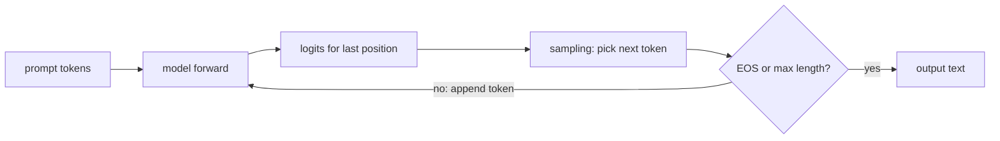
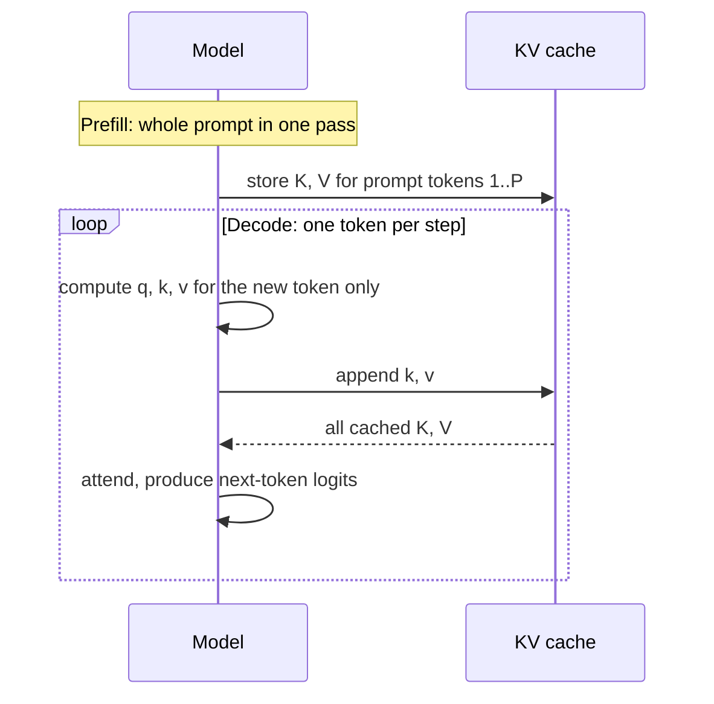

# Sampling, KV Cache & Quantization

A language model gives you a probability distribution over the next token. Turning that into fast, good text is the job of inference: choosing tokens (sampling), not recomputing the past (KV cache), keeping the GPU busy (batching, paged attention, speculative decoding), and making the model small enough to fit and fast enough to afford (quantization, distillation, pruning). This page builds each piece in PyTorch, then maps it to the serving tools you'd use in practice.

!!! abstract "What you'll learn"
    - Autoregressive decoding, and sampling: greedy, temperature, top-k, top-p, min-p, repetition penalty
    - The KV cache, implemented in a small GPT, and its memory cost
    - Prefill vs decode, and why decode is memory-bound
    - Static vs continuous batching, paged attention, speculative decoding
    - Quantization (int8/int4, GPTQ, AWQ, GGUF, bitsandbytes) with memory math
    - Distillation and pruning for small models
    - Serving stacks, on-device runtimes, and latency/throughput metrics (TTFT, TPOT)

## Autoregressive decoding

Generation is a loop: run the model on the tokens so far, get logits for the last position, pick a token, append it, repeat until an end-of-sequence token or a length limit.



The model defines $p(x_t \mid x_{<t})$. The decoding strategy decides how to pick $x_t$ from it.

## Sampling strategies

### Greedy

Always take the most likely token: $x_t = \arg\max p(x_t\mid x_{<t})$. Deterministic and good for short factual answers or code with a single correct output, but prone to repetitive loops in long open-ended text.

### Temperature

Divide logits $z$ by temperature $\tau$ before softmax:

$$
p_i = \frac{\exp(z_i/\tau)}{\sum_j \exp(z_j/\tau)}
$$

$\tau < 1$ sharpens the distribution (more conservative), $\tau > 1$ flattens it (more random), $\tau \to 0$ is greedy.

### Top-k

Keep only the $k$ most likely tokens, renormalize, sample. Cuts off the long tail of nonsense tokens. The weakness: a fixed $k$ is too many when the model is confident and too few when many continuations are fine.

### Top-p (nucleus)

Keep the smallest set of tokens whose cumulative probability reaches $p$ (e.g. 0.9). Adapts to the shape of the distribution: few tokens when confident, many when uncertain.

### Min-p

Keep tokens with probability at least $p_{\min} \times p_{\max}$, where $p_{\max}$ is the top token's probability. With `min_p=0.05` and a top token at 0.6, the cutoff is 0.03. It scales with confidence and holds up better than top-p at high temperatures. Supported in vLLM, llama.cpp and `transformers`.

### Repetition penalty

Discourage tokens already generated. The common form (from CTRL, used in `transformers` and llama.cpp) divides positive logits and multiplies negative logits of previously seen tokens by a penalty $r > 1$. OpenAI-style APIs use additive **presence** and **frequency** penalties instead. Use gently (1.05-1.2); strong penalties break text that legitimately repeats words, like code.

### All of it in one function

```python title="sampling.py"
import torch
import torch.nn.functional as F

def sample_next(logits: torch.Tensor, prev_ids: torch.Tensor | None = None,
                temperature: float = 1.0, top_k: int = 0, top_p: float = 1.0,
                min_p: float = 0.0, repetition_penalty: float = 1.0) -> torch.Tensor:
    """logits: (B, V) for the last position. prev_ids: (B, T) tokens so far. Returns (B, 1)."""
    logits = logits.float().clone()

    if repetition_penalty != 1.0 and prev_ids is not None:
        seen = torch.gather(logits, 1, prev_ids)
        seen = torch.where(seen > 0, seen / repetition_penalty, seen * repetition_penalty)
        logits.scatter_(1, prev_ids, seen)

    if temperature == 0.0:                                   # greedy
        return logits.argmax(dim=-1, keepdim=True)
    logits = logits / temperature

    if top_k > 0:
        kth = torch.topk(logits, min(top_k, logits.size(-1))).values[:, [-1]]
        logits = logits.masked_fill(logits < kth, float("-inf"))

    probs = F.softmax(logits, dim=-1)

    if min_p > 0.0:
        cutoff = min_p * probs.max(dim=-1, keepdim=True).values
        probs = probs.masked_fill(probs < cutoff, 0.0)

    if top_p < 1.0:
        sorted_p, sorted_idx = torch.sort(probs, descending=True, dim=-1)
        cum = sorted_p.cumsum(dim=-1)
        remove = cum - sorted_p > top_p                      # keep the token that crosses top_p
        sorted_p = sorted_p.masked_fill(remove, 0.0)
        probs = torch.zeros_like(probs).scatter_(1, sorted_idx, sorted_p)

    probs = probs / probs.sum(dim=-1, keepdim=True)
    return torch.multinomial(probs, num_samples=1)

if __name__ == "__main__":                                    # quick check
    torch.manual_seed(0)
    logits = torch.tensor([[4.0, 3.0, 1.0, -2.0, -5.0]])
    print(sample_next(logits, temperature=0.0))                   # tensor([[0]])
    print(sample_next(logits, temperature=0.8, top_p=0.9, min_p=0.05))
```

Order matters: penalties apply to raw logits, temperature next, then truncation (top-k, min-p, top-p). Libraries differ slightly in the order; check the docs if you're matching outputs.

| Use case | Reasonable settings |
|---|---|
| Code, extraction, math final answers | greedy, or `temperature=0.2` |
| Chat assistant | `temperature=0.7`, `top_p=0.9` (or the model card's recommendation) |
| Creative writing | `temperature=0.9-1.1`, `min_p=0.05` |
| Reasoning models | Follow the model card; several recommend roughly `temperature=0.6` and warn against greedy |

**Beam search** keeps the $b$ best partial sequences by total log-probability. It helps translation and constrained tasks, but for open-ended LM text it produces bland, repetitive output and is rarely used for chat.

## The KV cache

Look at the naive loop: at step $t$ you run the model on all $t$ tokens, even though the first $t-1$ haven't changed. In attention, each position's **key** and **value** vectors depend only on that position and earlier ones (causal masking). So you can compute them once and **cache** them. Each new step then only processes the one new token: compute its $q, k, v$, append $k, v$ to the cache, attend over the full cache.

$$
\text{Attn}(q_t, K_{\le t}, V_{\le t}) = \operatorname{softmax}\left(\frac{q_t K_{\le t}^\top}{\sqrt{d}}\right) V_{\le t}
$$

Without a cache, generating $n$ tokens costs $O(n^2)$ token-forwards; with it, $O(n)$ (the attention itself is still linear in context length per step).



### Implementation in a small GPT

This is a minimal GPT-2-style model (learned positions, so the cache logic is easy to see) with a KV cache. The test at the bottom checks that cached generation gives exactly the same logits as the full forward pass.

```python title="gpt_kvcache.py"
import math
import torch
import torch.nn as nn
import torch.nn.functional as F

class KVCache:
    """Preallocated per-layer cache: k, v of shape (B, H, max_len, head_dim)."""
    def __init__(self, n_layer, B, H, max_len, hd, device, dtype):
        self.k = torch.zeros(n_layer, B, H, max_len, hd, device=device, dtype=dtype)
        self.v = torch.zeros_like(self.k)
        self.pos = 0                                   # number of positions filled

    def update(self, layer, k_new, v_new):
        T = k_new.size(2)
        self.k[layer, :, :, self.pos:self.pos + T] = k_new
        self.v[layer, :, :, self.pos:self.pos + T] = v_new
        end = self.pos + T
        return self.k[layer, :, :, :end], self.v[layer, :, :, :end]

class Attention(nn.Module):
    def __init__(self, d, h):
        super().__init__()
        self.h, self.hd = h, d // h
        self.qkv, self.proj = nn.Linear(d, 3 * d), nn.Linear(d, d)

    def forward(self, x, layer, cache: KVCache | None):
        B, T, C = x.shape
        q, k, v = self.qkv(x).split(C, dim=2)
        q, k, v = (t.view(B, T, self.h, self.hd).transpose(1, 2) for t in (q, k, v))
        if cache is None:
            y = F.scaled_dot_product_attention(q, k, v, is_causal=True)
        else:
            past = cache.pos
            k, v = cache.update(layer, k, v)           # k, v now cover positions 0..past+T-1
            if T == 1:
                y = F.scaled_dot_product_attention(q, k, v)   # one query sees everything cached
            else:
                # prefill (or chunk): query i at absolute position past+i sees keys <= past+i
                mask = torch.ones(T, past + T, dtype=torch.bool, device=x.device).tril(diagonal=past)
                y = F.scaled_dot_product_attention(q, k, v, attn_mask=mask)
        return self.proj(y.transpose(1, 2).contiguous().view(B, T, C))

class Block(nn.Module):
    def __init__(self, d, h):
        super().__init__()
        self.ln1, self.attn, self.ln2 = nn.LayerNorm(d), Attention(d, h), nn.LayerNorm(d)
        self.mlp = nn.Sequential(nn.Linear(d, 4 * d), nn.GELU(), nn.Linear(4 * d, d))

    def forward(self, x, layer, cache):
        x = x + self.attn(self.ln1(x), layer, cache)
        return x + self.mlp(self.ln2(x))

class GPT(nn.Module):
    def __init__(self, vocab=1000, d=128, h=4, n_layer=4, max_len=256):
        super().__init__()
        self.cfg = dict(h=h, hd=d // h, n_layer=n_layer, max_len=max_len)
        self.tok, self.pos = nn.Embedding(vocab, d), nn.Embedding(max_len, d)
        self.blocks = nn.ModuleList(Block(d, h) for _ in range(n_layer))
        self.ln_f, self.head = nn.LayerNorm(d), nn.Linear(d, vocab, bias=False)

    def forward(self, idx, cache: KVCache | None = None):
        B, T = idx.shape
        start = cache.pos if cache is not None else 0
        pos = torch.arange(start, start + T, device=idx.device)
        x = self.tok(idx) + self.pos(pos)
        for i, b in enumerate(self.blocks):
            x = b(x, i, cache)
        if cache is not None:
            cache.pos += T                             # advance once, after all layers
        return self.head(self.ln_f(x))

    def new_cache(self, B, device, dtype=torch.float32):
        c = self.cfg
        return KVCache(c["n_layer"], B, c["h"], c["max_len"], c["hd"], device, dtype)

    @torch.no_grad()
    def generate(self, idx, max_new_tokens, use_cache=True, **sampling):
        from sampling import sample_next              # the function defined above
        cache = self.new_cache(idx.size(0), idx.device) if use_cache else None
        logits = self(idx, cache)[:, -1]               # prefill
        out = idx
        for _ in range(max_new_tokens):
            nxt = sample_next(logits, out, **sampling)
            out = torch.cat([out, nxt], dim=1)
            if use_cache:
                logits = self(nxt, cache)[:, -1]       # decode: one token
            else:
                logits = self(out)[:, -1]              # recompute everything
        return out

if __name__ == "__main__":
    torch.manual_seed(0)
    m = GPT().eval()
    prompt = torch.randint(0, 1000, (2, 10))
    a = m.generate(prompt, 30, use_cache=True, temperature=0.0)
    b = m.generate(prompt, 30, use_cache=False, temperature=0.0)
    assert torch.equal(a, b), "cache changed the output"
    # logits check: full forward vs prefill + one cached step
    full = m(a[:, :12])[:, -1]
    cache = m.new_cache(2, a.device)
    m(a[:, :11], cache)
    step = m(a[:, 11:12], cache)[:, -1]
    print("max abs diff:", (full - step).abs().max().item())   # ~1e-6
```

Save the sampling function as `sampling.py` next to this file and run it. In production code the cache usually lives in a contiguous preallocated buffer like this (static cache, friendly to `torch.compile` and CUDA graphs) or in paged blocks (see [Paged attention](#paged-attention)). Hugging Face `transformers` handles all of this for you via `past_key_values` / `DynamicCache` when you call `model.generate`.

### KV cache memory

Per token, each layer stores a key and a value vector for each **KV head**:

$$
\text{KV bytes} = 2 \times n_{\text{layers}} \times n_{\text{kv\_heads}} \times d_{\text{head}} \times \text{bytes per element} \times \text{tokens} \times \text{batch}
$$

Worked example, Llama 3 8B: 32 layers, 8 KV heads (grouped-query attention), head dim 128, bf16 (2 bytes):

$$
2 \times 32 \times 8 \times 128 \times 2 = 131{,}072 \text{ bytes} = 128 \text{ KiB per token}
$$

At 8K context that's 1 GiB per sequence; a batch of 32 such sequences needs 32 GiB of cache, double the 16 GB of weights. Without GQA (32 KV heads), it would be 4x larger. This is why GQA, MQA and DeepSeek's MLA (multi-head latent attention) exist; see [Modern Architectures & SLM Design](../llm/modern-architectures.md). KV caches can also be quantized to fp8 or int8 in most serving stacks.

## Prefill vs decode

Inference has two phases with opposite characteristics:

| | Prefill | Decode |
|---|---|---|
| Input | Whole prompt (hundreds-thousands of tokens) at once | One new token per sequence |
| Work | Large matrix-matrix multiplies | Matrix-vector multiplies |
| Bound by | **Compute** | **Memory bandwidth** |
| Determines | Time to first token (TTFT) | Time per output token (TPOT) |

### Why decode is memory-bound

The **arithmetic intensity** of an operation is FLOPs per byte moved. In decode with batch size $B$, each weight (2 bytes in bf16) is read once and used for $2B$ FLOPs (one multiply-add per sequence). Intensity is about $B$ FLOPs/byte.

An H100 does roughly 989 TFLOPs (dense bf16) and has about 3.35 TB/s of HBM bandwidth: a ratio of around 300 FLOPs/byte. Below that intensity you're waiting on memory. At $B=1$, intensity is ~1, so the GPU's compute is >99% idle. The time per token is approximately:

$$
t_{\text{token}} \approx \frac{\text{bytes of weights} + \text{bytes of KV cache read}}{\text{memory bandwidth}}
$$

For an 8B model in bf16 (16 GB) on 3.35 TB/s: about 5 ms per token, so at most ~200 tokens/sec for a single user. Two consequences drive everything below: **batching** is nearly free throughput until $B$ approaches a few hundred, and **quantization** speeds up decode almost proportionally to bytes saved.

## Batching

### Static batching

Group requests and run them together until all finish. Problem: sequences finish at different times. A batch where one request generates 1,000 tokens and the rest generate 20 keeps the GPU slots of the short ones idle for 980 steps. New requests wait for the whole batch.

### Continuous (in-flight) batching

Schedule at the **iteration** level: after every decode step, remove finished sequences and insert waiting ones (running their prefill, often in chunks mixed with others' decode steps). The batch stays full, throughput rises several-fold, and queueing latency drops. Every modern server (vLLM, SGLang, TGI, TensorRT-LLM) does this.


## Paged attention

Continuous batching needs flexible KV memory: sequences grow unpredictably and leave at different times. Preallocating `max_len` per sequence wastes most of it; contiguous variable allocation fragments memory.

**PagedAttention** (vLLM) borrows virtual memory from operating systems. The KV cache is split into fixed-size **blocks** (e.g. 16 tokens). Each sequence has a **block table** mapping logical blocks to physical blocks anywhere in GPU memory. The attention kernel follows the table. Benefits:

- Near-zero fragmentation: waste is at most one partial block per sequence.
- More sequences fit, so larger batches and higher throughput.
- **Sharing**: sequences with a common prefix (same system prompt, parallel samples of one prompt) point at the same physical blocks, copy-on-write. **Prefix caching** reuses KV blocks across requests with identical prefixes, skipping their prefill. SGLang's RadixAttention generalizes this with a radix tree of cached prefixes.

## Speculative decoding

Decode is memory-bound, so verifying several tokens costs about the same as generating one: one weight read either way. **Speculative decoding** exploits this:

1. A cheap **draft** model (a small model from the same family, or extra prediction heads like Medusa/EAGLE, or n-gram lookup from the prompt) proposes $k$ tokens.
2. The big **target** model scores all $k$ in **one** forward pass.
3. Accept the longest prefix of draft tokens that the target agrees with; at the first disagreement, take the target's token instead.

With the rejection-sampling acceptance rule (accept draft token $x$ with probability $\min(1, p_{\text{target}}(x)/p_{\text{draft}}(x))$, resample from the normalized residual on rejection), the output distribution is **exactly** the target model's. It's a pure speedup, typically 2-3x when the draft agrees often (code, structured output, predictable text).

A greedy version is short enough to show:

```python title="speculative_greedy.py"
import torch

@torch.no_grad()
def speculative_greedy(target, draft, idx, max_new_tokens, k=4):
    """Greedy speculative decoding without KV cache, for clarity. Output == greedy(target)."""
    out = idx
    while out.size(1) - idx.size(1) < max_new_tokens:
        # 1) draft proposes k tokens greedily
        d = out
        for _ in range(k):
            d = torch.cat([d, draft(d)[:, -1:].argmax(-1)], dim=1)
        proposal = d[:, out.size(1):]                          # (1, k)
        # 2) target scores prompt + proposal in one pass
        tgt_pred = target(d)[:, out.size(1) - 1:].argmax(-1)   # (1, k+1): target's choice at each spot
        # 3) accept matching prefix, then add target's own next token
        match = (tgt_pred[:, :k] == proposal).int().cumprod(dim=1).sum().item()
        out = torch.cat([out, proposal[:, :match], tgt_pred[:, match:match + 1]], dim=1)
    return out[:, : idx.size(1) + max_new_tokens]

# Check with the GPT from gpt_kvcache.py (batch size 1):
# from gpt_kvcache import GPT
# torch.manual_seed(0); target = GPT(n_layer=6).eval(); draft = GPT(n_layer=2).eval()
# p = torch.randint(0, 1000, (1, 8))
# assert torch.equal(speculative_greedy(target, draft, p, 20),
#                    target.generate(p, 20, temperature=0.0))
```

Each loop iteration produces between 1 and $k+1$ tokens for one target forward. In vLLM you enable it with a speculative config (draft model, EAGLE heads, or n-gram); `transformers` supports it via `model.generate(..., assistant_model=draft)`.

## Quantization

Quantization stores weights (and sometimes activations and KV cache) in fewer bits. It's the biggest single lever for fitting a model on smaller hardware and for faster decode.

### The basic idea

Symmetric absmax int8 quantization of a weight row: pick a scale so the largest magnitude maps to 127.

$$
s = \frac{\max_i |w_i|}{127}, \qquad q_i = \operatorname{round}\!\left(\frac{w_i}{s}\right) \in [-127, 127], \qquad \hat w_i = s\,q_i
$$

One outlier makes $s$ large and crushes precision for everything else, so real schemes use **per-channel** or **per-group** scales (a scale per 32-128 weights). Group-wise int4 is the standard for weight-only quantization.

```python title="quant_demo.py"
import torch

def quantize_groupwise(w: torch.Tensor, bits: int = 4, group: int = 128):
    """Symmetric per-group quantization. w: (out, in) with in % group == 0."""
    qmax = 2 ** (bits - 1) - 1                                # 7 for int4, 127 for int8
    wg = w.reshape(w.size(0), -1, group)
    scale = wg.abs().amax(dim=-1, keepdim=True).clamp(min=1e-8) / qmax
    q = torch.clamp(torch.round(wg / scale), -qmax - 1, qmax).to(torch.int8)
    return q, scale

def dequantize(q, scale, shape):
    return (q.float() * scale).reshape(shape)

torch.manual_seed(0)
w = torch.randn(4096, 4096) * 0.02
x = torch.randn(8, 4096)
for bits in (8, 4):
    q, s = quantize_groupwise(w, bits)
    w_hat = dequantize(q, s, w.shape)
    rel = ((x @ w_hat.T - x @ w.T).norm() / (x @ w.T).norm()).item()
    print(f"int{bits}: relative output error {rel:.4f}")
```

(Real int4 kernels pack two 4-bit values per byte and dequantize on the fly inside the matmul; this demo stores them in `int8` for clarity.)

### Memory math

$$
\text{weight memory} \approx N_{\text{params}} \times \frac{\text{bits}}{8} \times (1 + \text{overhead})
$$

where overhead covers scales/zero-points (e.g. one fp16 scale per 128 int4 weights adds about 0.125 bits per weight). For weights alone:

| Model | bf16 (16-bit) | int8 | int4 (~4.5 bits effective) |
|---|---|---|---|
| 1B | 2 GB | 1 GB | ~0.6 GB |
| 8B | 16 GB | 8 GB | ~4.5 GB |
| 70B | 140 GB | 70 GB | ~40 GB |

Add the KV cache and roughly 10-20% for activations and runtime buffers. So an 8B model at int4 runs on a 8-12 GB consumer GPU or a 16 GB laptop; 70B at int4 needs about 48 GB.

### Methods

| Method | What it does | Typical use |
|---|---|---|
| **Round-to-nearest (RTN)** | Quantize each group directly, as above | Baseline; fine at int8, loses quality at int4 |
| **LLM.int8()** (bitsandbytes) | int8 matmul, with outlier feature dimensions kept in fp16 | Load big models in less memory; slower than bf16 |
| **NF4** (bitsandbytes) | 4-bit "normal float" levels matched to Gaussian-distributed weights; double quantization of scales | QLoRA fine-tuning; see [LoRA & QLoRA](../finetuning/lora-qlora.md) |
| **GPTQ** | Quantize column by column, updating remaining weights to compensate for error using second-order (Hessian) info from calibration data | int4/int3 weight-only for GPU serving |
| **AWQ** | Find the ~1% of salient weight channels (by activation magnitude) and scale them up before quantizing to protect them | int4 weight-only for GPU serving; fast kernels in vLLM |
| **GGUF k-quants** (llama.cpp) | Block-wise quantization formats (Q8_0, Q6_K, Q5_K_M, Q4_K_M, ...) with super-block scales; optional importance matrix | CPU / Apple Silicon / consumer GPU local inference |
| **FP8** (E4M3) | 8-bit floating point weights and activations, per-tensor or per-block scales | Hopper/Blackwell GPU serving; near-lossless, real speedups |

Rules of thumb: int8 and fp8 are nearly lossless for most models; int4 with a good method (AWQ, GPTQ, Q4_K_M) loses a little, usually acceptable; below 4 bits, quality drops quickly, especially for small models. Smaller models are more sensitive to quantization than larger ones.

```python title="load_quantized.py"
# pip install transformers accelerate bitsandbytes
import torch
from transformers import AutoModelForCausalLM, AutoTokenizer, BitsAndBytesConfig

name = "Qwen/Qwen2.5-1.5B-Instruct"
bnb = BitsAndBytesConfig(load_in_4bit=True, bnb_4bit_quant_type="nf4",
                         bnb_4bit_compute_dtype=torch.bfloat16, bnb_4bit_use_double_quant=True)
model = AutoModelForCausalLM.from_pretrained(name, quantization_config=bnb, device_map="auto")
tok = AutoTokenizer.from_pretrained(name)
print(f"{model.get_memory_footprint() / 1e9:.2f} GB")

msgs = [{"role": "user", "content": "Explain the KV cache in two sentences."}]
inputs = tok.apply_chat_template(msgs, add_generation_prompt=True, return_tensors="pt",
                                return_dict=True).to(model.device)   # explicit: v4 and v5 defaults differ
out = model.generate(**inputs, max_new_tokens=100, do_sample=True, temperature=0.7, top_p=0.9)
print(tok.decode(out[0, inputs["input_ids"].shape[1]:], skip_special_tokens=True))
```

For GGUF, llama.cpp ships the converter and quantizer:

```bash
# From a llama.cpp checkout (build with cmake first)
python convert_hf_to_gguf.py ./my-hf-model --outfile model-f16.gguf --outtype f16
./build/bin/llama-quantize model-f16.gguf model-Q4_K_M.gguf Q4_K_M
./build/bin/llama-cli -m model-Q4_K_M.gguf -p "The KV cache is" -n 64
```

## Compressing into small models: distillation and pruning

### Knowledge distillation

Train a small **student** to match a large **teacher**. The teacher's full output distribution carries far more information per token than a one-hot label ("dark knowledge": which wrong answers are nearly right). The classic loss mixes the usual cross-entropy with a KL term at temperature $T$:

$$
\mathcal{L} = \alpha\, \mathrm{CE}(y, p_s) + (1-\alpha)\, T^2\, \mathrm{KL}\!\left(p_t^{(T)} \,\|\, p_s^{(T)}\right)
$$

```python title="distill_loss.py"
import torch.nn.functional as F

def distill_loss(student_logits, teacher_logits, targets, T=2.0, alpha=0.5):
    V = student_logits.size(-1)
    s, t = student_logits.view(-1, V).float(), teacher_logits.view(-1, V).float()
    ce = F.cross_entropy(s, targets.view(-1))
    kl = F.kl_div(F.log_softmax(s / T, -1), F.log_softmax(t / T, -1),
                  log_target=True, reduction="batchmean") * T * T
    return alpha * ce + (1 - alpha) * kl
```

Logit distillation requires the teacher and student to share a tokenizer. Gemma 2/3's smaller models and Llama 3.2 1B/3B used logit-level distillation from larger models during pretraining. The other form is **sequence-level** distillation: generate text (answers, reasoning traces) with the teacher and fine-tune the student on it. That's how DeepSeek-R1's distilled Qwen and Llama models were made, and it works across tokenizers.

### Pruning

Remove parts of the network that matter least.

- **Unstructured** (individual weights, e.g. magnitude, SparseGPT, Wanda): high sparsity possible, but speedups need special sparse kernels. 2:4 semi-structured sparsity (2 of every 4 weights zero) is accelerated on NVIDIA Ampere and later.
- **Structured** (whole layers, attention heads, MLP channels, embedding dims): the result is a smaller dense model, so it's fast everywhere. NVIDIA's Minitron work pruned width and depth from larger Llama/Mistral models, then recovered quality with distillation, at a fraction of the cost of training from scratch.

The practical recipe for a strong SLM from a larger model: **prune structurally, then distill**, then quantize for deployment.

## Serving stacks

| Stack | Best for | Notes |
|---|---|---|
| **vLLM** | High-throughput GPU serving | PagedAttention, continuous batching, prefix caching, speculative decoding, AWQ/GPTQ/FP8, OpenAI-compatible API, tensor/pipeline parallel |
| **SGLang** | High-throughput serving, structured / multi-call programs | RadixAttention prefix cache, fast constrained decoding, strong for agents and many-turn workloads |
| **TGI** (Hugging Face) | HF-ecosystem deployments | Continuous batching, OpenAI-compatible Messages API; development has slowed and Hugging Face now points many users to vLLM/SGLang, so check its current status before adopting |
| **TensorRT-LLM** | Maximum NVIDIA performance | Compiled engines, more setup |
| **llama.cpp** | CPU, Apple Silicon, consumer GPUs, edge | GGUF, `llama-server` gives an OpenAI-compatible endpoint |
| **Ollama** | Easiest local setup | Wraps llama.cpp with a model registry and simple CLI/API |

```bash
# vLLM: OpenAI-compatible server
pip install vllm
vllm serve Qwen/Qwen2.5-1.5B-Instruct --max-model-len 8192 --gpu-memory-utilization 0.9

curl http://localhost:8000/v1/chat/completions -H "Content-Type: application/json" -d '{
  "model": "Qwen/Qwen2.5-1.5B-Instruct",
  "messages": [{"role": "user", "content": "What is paged attention?"}],
  "temperature": 0.7, "max_tokens": 200}'

# SGLang
pip install "sglang[all]"
python -m sglang.launch_server --model-path Qwen/Qwen2.5-1.5B-Instruct --port 30000

# Ollama
ollama run qwen2.5:1.5b
```

vLLM also has an offline Python API for batch jobs (evals, synthetic data):

```python
from vllm import LLM, SamplingParams

llm = LLM(model="Qwen/Qwen2.5-1.5B-Instruct")
params = SamplingParams(temperature=0.7, top_p=0.9, max_tokens=128)
outs = llm.chat([[{"role": "user", "content": f"Give one fact about the number {i}."}] for i in range(100)], params)
print(outs[0].outputs[0].text)
```

## On-device and edge

- **MLX** (Apple): array framework for Apple Silicon using unified memory. `mlx-lm` loads and quantizes Hugging Face models: `pip install mlx-lm` then `mlx_lm.generate --model mlx-community/Qwen2.5-1.5B-Instruct-4bit --prompt "Hello"`. Also supports LoRA fine-tuning on a Mac.
- **llama.cpp / GGUF**: runs on nearly anything (x86, ARM, Android, iOS, Raspberry Pi), with CPU SIMD, Metal, CUDA, Vulkan backends.
- **ONNX Runtime**: export to ONNX (e.g. with Hugging Face Optimum) and run across CPUs, GPUs, NPUs and the browser (onnxruntime-web, also used by Transformers.js). The `onnxruntime-genai` package adds a generation loop with KV cache.
- **ExecuTorch** (PyTorch): on-device runtime for mobile and embedded, with quantization and hardware delegates.

On device the budget is a few GB of RAM and a few watts, so SLMs (0.5B-3B) at 4-bit are the norm. Memory bandwidth (roughly 50-400 GB/s on laptops and phones, versus TB/s on datacenter GPUs) sets decode speed: by the formula above, a 1.5B model at ~1 GB int4 on a 100 GB/s device peaks around 100 tokens/sec.

## Latency and throughput metrics

| Metric | Meaning | Dominated by |
|---|---|---|
| **TTFT** (time to first token) | Request arrival to first output token | Queueing + prefill (prompt length) |
| **TPOT** / ITL (time per output token / inter-token latency) | Average gap between output tokens | Decode: model bytes, KV cache, batch size |
| **E2E latency** | Total request time | $\text{TTFT} + \text{TPOT} \times (n_{\text{out}} - 1)$ |
| **Throughput** | Output tokens/sec across all users (or requests/sec) | Batch size, memory available for KV cache |
| **Goodput** | Throughput of requests meeting latency SLOs | The real business metric |

Throughput and latency trade off: larger batches raise total tokens/sec but increase each user's TPOT and TTFT. Human reading speed is roughly 5-10 tokens/sec, so for chat a TPOT under ~50-100 ms feels fluent; TTFT under about a second feels responsive. Always report percentiles (p50, p99), not just means.

```python title="measure_latency.py"
# Measure TTFT and TPOT against any OpenAI-compatible server (vLLM, SGLang, llama-server, Ollama)
# pip install openai
import time
from openai import OpenAI

client = OpenAI(base_url="http://localhost:8000/v1", api_key="none")
t0 = time.perf_counter()
stream = client.chat.completions.create(
    model="Qwen/Qwen2.5-1.5B-Instruct",
    messages=[{"role": "user", "content": "Write a paragraph about rivers."}],
    max_tokens=200, stream=True)
times = []
for chunk in stream:
    if chunk.choices and chunk.choices[0].delta.content:
        times.append(time.perf_counter())
ttft = times[0] - t0
tpot = (times[-1] - times[0]) / max(1, len(times) - 1)
print(f"TTFT {ttft * 1000:.0f} ms, TPOT {tpot * 1000:.1f} ms, chunks {len(times)}")
```

(Streamed chunks are usually one token each but not always; for exact counts, use the server's own benchmark tools, such as `vllm bench serve`.)

!!! warning "Common pitfalls"
    - **Position bug with a KV cache.** Positions (learned or RoPE) must start at `cache.pos`, not 0, for decode steps. Output silently degrades otherwise.
    - **Advancing the cache pointer per layer** instead of once per forward pass.
    - **Comparing sampling outputs across libraries** without matching the order of penalty, temperature and truncation.
    - **Strong repetition penalty on code.** Code repeats identifiers legitimately.
    - **Ignoring KV cache in memory planning.** `--max-model-len` and batch size determine whether a model "fits" in serving, not just weight size.
    - **Quantizing a small model to 3 bits** and not evaluating it. Small models degrade fastest.
    - **Measuring only mean latency** or only at batch size 1.

## Check your understanding

??? question "With top_p = 0.9 and token probabilities [0.5, 0.3, 0.15, 0.05], which tokens remain?"
    Cumulative sums are 0.5, 0.8, 0.95, 1.0. The first three are kept: the third is the token that crosses 0.9. The 0.05 token is removed.

??? question "Compute the KV cache size for a model with 28 layers, 4 KV heads, head dim 128, bf16, 32K context, batch 1."
    $2 \times 28 \times 4 \times 128 \times 2 = 57{,}344$ bytes/token. Times 32,768 tokens is about 1.88 GB (1.75 GiB).

??? question "Why does int4 quantization speed up decode, even though the GPU computes in bf16 after dequantizing?"
    Decode is memory-bandwidth bound: time is dominated by reading weights. int4 weights are about a quarter of the bytes of bf16, so reading them is up to ~4x faster; the dequantize arithmetic is cheap relative to the GPU's spare compute.

??? question "Why does speculative decoding not change the output distribution?"
    The target model verifies every token. With the rejection-sampling acceptance rule (accept with probability min(1, p_target/p_draft), else resample from the normalized residual), the accepted tokens are distributed exactly as if sampled from the target alone. The draft only affects speed.

??? question "Your service has great throughput but users complain responses take 4 seconds to start. Which metric and which knobs?"
    TTFT. Causes: queueing behind a full batch, or long prefills. Knobs: cap batch size / max concurrent sequences, enable chunked prefill so prefills interleave with decode, enable prefix caching for shared system prompts, or add replicas.

## Further reading

- Holtzman et al., *The Curious Case of Neural Text Degeneration* (nucleus sampling) - [arXiv:1904.09751](https://arxiv.org/abs/1904.09751)
- Nguyen et al., *Turning Up the Heat: Min-p Sampling for Creative and Coherent LLM Outputs* - [arXiv:2407.01082](https://arxiv.org/abs/2407.01082)
- Kwon et al., *Efficient Memory Management for Large Language Model Serving with PagedAttention* - [arXiv:2309.06180](https://arxiv.org/abs/2309.06180)
- Leviathan et al., *Fast Inference from Transformers via Speculative Decoding* - [arXiv:2211.17192](https://arxiv.org/abs/2211.17192); Chen et al., *Accelerating LLM Decoding with Speculative Sampling* - [arXiv:2302.01318](https://arxiv.org/abs/2302.01318)
- Dettmers et al., *LLM.int8()* - [arXiv:2208.07339](https://arxiv.org/abs/2208.07339)
- Frantar et al., *GPTQ* - [arXiv:2210.17323](https://arxiv.org/abs/2210.17323)
- Lin et al., *AWQ: Activation-aware Weight Quantization* - [arXiv:2306.00978](https://arxiv.org/abs/2306.00978)
- Hinton et al., *Distilling the Knowledge in a Neural Network* - [arXiv:1503.02531](https://arxiv.org/abs/1503.02531)
- Muralidharan et al., *Compact Language Models via Pruning and Knowledge Distillation* (Minitron) - [arXiv:2407.14679](https://arxiv.org/abs/2407.14679)
- Zheng et al., *SGLang: Efficient Execution of Structured Language Model Programs* - [arXiv:2312.07104](https://arxiv.org/abs/2312.07104)
- Docs: [vLLM](https://docs.vllm.ai/), [SGLang](https://docs.sglang.ai/), [llama.cpp](https://github.com/ggml-org/llama.cpp), [Ollama](https://ollama.com/), [MLX LM](https://github.com/ml-explore/mlx-lm), [ONNX Runtime GenAI](https://github.com/microsoft/onnxruntime-genai)
