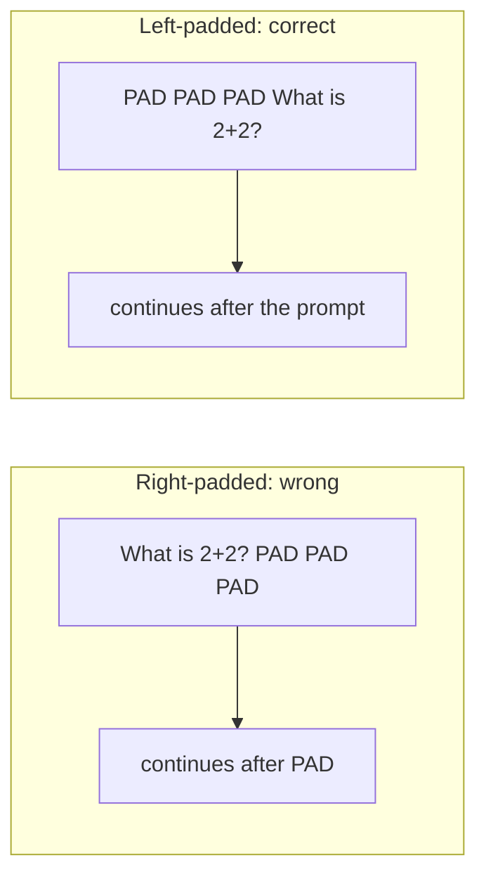

# Quantization & Serving

[Decoding](inference.md) showed that generation speed is set by how many bytes the GPU reads per token and how many sequences share each read. This page works on both: quantization cuts the bytes, a serving stack keeps the batch full, and a load test tells you what users will actually get. It ends with one model served three ways and a script that measures each of them.

!!! abstract "What you'll learn"
    - Quantization (int8/int4, GPTQ, AWQ, GGUF, bitsandbytes, FP8) with memory math
    - How to check quality before and after quantization
    - Distillation and pruning as ways to get a smaller model, with pointers to the full treatment
    - Serving one model three ways: vLLM (with LoRA adapters), llama.cpp with GGUF, and Ollama
    - Batched generation with `transformers`, and why decoder-only models need left-padding
    - Latency and throughput metrics (TTFT, TPOT, goodput) and a load-test script that reports them

## Quantization

Quantization stores weights (and sometimes activations and the KV cache) in fewer bits. It's the biggest single lever for fitting a model on smaller hardware and for faster decode.

### The basic idea

Symmetric absmax int8 quantization of a weight row: pick a scale so the largest magnitude maps to 127.

$$
s = \frac{\max_i |w_i|}{127}, \qquad q_i = \operatorname{round}\!\left(\frac{w_i}{s}\right) \in [-127, 127], \qquad \hat w_i = s\,q_i
$$

One outlier makes $s$ large and crushes precision for everything else, so real schemes use **per-channel** or **per-group** scales (a scale per 32-128 weights). Group-wise int4 is the standard for weight-only quantization.

```python title="quant_demo.py"
import torch

def quantize_groupwise(w: torch.Tensor, bits: int = 4, group: int = 128):
    """Symmetric per-group quantization. w: (out, in) with in % group == 0."""
    qmax = 2 ** (bits - 1) - 1                                # 7 for int4, 127 for int8
    wg = w.reshape(w.size(0), -1, group)
    scale = wg.abs().amax(dim=-1, keepdim=True).clamp(min=1e-8) / qmax
    q = torch.clamp(torch.round(wg / scale), -qmax - 1, qmax).to(torch.int8)
    return q, scale

def dequantize(q, scale, shape):
    return (q.float() * scale).reshape(shape)

torch.manual_seed(0)
w = torch.randn(4096, 4096) * 0.02
x = torch.randn(8, 4096)
for bits in (8, 4):
    q, s = quantize_groupwise(w, bits)
    w_hat = dequantize(q, s, w.shape)
    rel = ((x @ w_hat.T - x @ w.T).norm() / (x @ w.T).norm()).item()
    print(f"int{bits}: relative output error {rel:.4f}")
```

```text
int8: relative output error 0.0065
int4: relative output error 0.1174
```

(Real int4 kernels pack two 4-bit values per byte and dequantize on the fly inside the matmul; this demo stores them in `int8` for clarity.)

### Memory math

$$
\text{weight memory} \approx N_{\text{params}} \times \frac{\text{bits}}{8} \times (1 + \text{overhead})
$$

where overhead covers scales/zero-points (e.g. one fp16 scale per 128 int4 weights adds about 0.125 bits per weight). For weights alone:

| Model | bf16 (16-bit) | int8 | int4 (~4.5 bits effective) |
|---|---|---|---|
| 1B | 2 GB | 1 GB | ~0.6 GB |
| 8B | 16 GB | 8 GB | ~4.5 GB |
| 70B | 140 GB | 70 GB | ~40 GB |

Add the [KV cache](inference.md#kv-cache-memory) and roughly 10-20% for activations and runtime buffers. So an 8B model at int4 runs on a 8-12 GB consumer GPU or a 16 GB laptop; 70B at int4 needs about 48 GB.

Quantization also speeds up decode. Decode is [memory-bandwidth bound](inference.md#why-decode-is-memory-bound), so int4 weights, at about a quarter of the bytes of bf16, can be read up to about 4x faster; the dequantize arithmetic is cheap next to the GPU's idle compute.

### Methods

| Method | What it does | Typical use |
|---|---|---|
| **Round-to-nearest (RTN)** | Quantize each group directly, as above | Baseline; fine at int8, loses quality at int4 |
| **LLM.int8()** (bitsandbytes) | int8 matmul, with outlier feature dimensions kept in fp16 | Load big models in less memory; slower than bf16 |
| **NF4** (bitsandbytes) | 4-bit "normal float" levels matched to Gaussian-distributed weights; double quantization of scales | QLoRA fine-tuning; see [LoRA & QLoRA](../finetuning/lora-qlora.md) |
| **GPTQ** | Quantize column by column, updating remaining weights to compensate for error using second-order (Hessian) info from calibration data | int4/int3 weight-only for GPU serving |
| **AWQ** | Find the ~1% of salient weight channels (by activation magnitude) and scale them up before quantizing to protect them | int4 weight-only for GPU serving; fast kernels in vLLM |
| **GGUF k-quants** (llama.cpp) | Block-wise quantization formats (Q8_0, Q6_K, Q5_K_M, Q4_K_M, ...) with super-block scales; optional importance matrix | CPU / Apple Silicon / consumer GPU local inference |
| **FP8** (E4M3) | 8-bit floating point weights and activations, per-tensor or per-block scales | Hopper/Blackwell GPU serving; near-lossless, real speedups |

Rules of thumb: int8 and fp8 are nearly lossless for most models; int4 with a good method (AWQ, GPTQ, Q4_K_M) loses a little, usually acceptable; below 4 bits, quality drops quickly, especially for small models. Smaller models are more sensitive to quantization than larger ones.

```python title="load_quantized.py"
# pip install transformers accelerate bitsandbytes   (needs a CUDA GPU; not run for this page)
import torch
from transformers import AutoModelForCausalLM, AutoTokenizer, BitsAndBytesConfig

name = "Qwen/Qwen2.5-1.5B-Instruct"
bnb = BitsAndBytesConfig(load_in_4bit=True, bnb_4bit_quant_type="nf4",
                         bnb_4bit_compute_dtype=torch.bfloat16, bnb_4bit_use_double_quant=True)
model = AutoModelForCausalLM.from_pretrained(name, quantization_config=bnb, device_map="auto")
tok = AutoTokenizer.from_pretrained(name)
print(f"{model.get_memory_footprint() / 1e9:.2f} GB")

msgs = [{"role": "user", "content": "Explain the KV cache in two sentences."}]
inputs = tok.apply_chat_template(msgs, add_generation_prompt=True, return_tensors="pt",
                                return_dict=True).to(model.device)   # explicit: v4 and v5 defaults differ
out = model.generate(**inputs, max_new_tokens=100, do_sample=True, temperature=0.7, top_p=0.9)
print(tok.decode(out[0, inputs["input_ids"].shape[1]:], skip_special_tokens=True))
```

### Comparing quality before and after quantization

A quantized model is a different model. Measure it the same way you measured the original, on the artifact you will ship. Three checks, cheapest first:

1. **Perplexity on held-out text.** Fast and sensitive. A rise of a few percent is normal for a good 4-bit method; a rise of 20% or more means the method or bit width is wrong for this model.
2. **Agreement with the original.** On the same inputs, how often is the top-1 next token the same? This catches damage that perplexity averages away, and needs no labels.
3. **Your task eval.** The number that decides. Rerun the benchmark or task-success metric from [Evaluation](../pretraining/evaluation.md) and compare with a paired test ([How big must an eval set be?](../pretraining/evaluation.md#how-big-must-an-eval-set-be)), because the two models answer the same items. Math, code and strict-format tasks degrade first.

The script below runs checks 1 and 2 on a laptop CPU. It applies round-to-nearest quantization (the baseline method from the table) to every `Linear` weight of SmolLM2-135M, including the tied embedding, and compares against fp32.

```python title="quant_compare.py"
# pip install torch transformers   (CPU, about a minute including the 270 MB download)
import argparse, contextlib, copy, io, math
import torch
from transformers import AutoModelForCausalLM, AutoTokenizer

name = "HuggingFaceTB/SmolLM2-135M-Instruct"
tok = AutoTokenizer.from_pretrained(name)
base = AutoModelForCausalLM.from_pretrained(name, dtype=torch.float32).eval()

with contextlib.redirect_stdout(io.StringIO()) as buf:
    import this                                                # the Zen of Python, as eval text
text = buf.getvalue() + "\n" + argparse.__doc__
ids = tok(text, return_tensors="pt")["input_ids"][:, :1024]

def rtn_(model, bits, group=64):
    """Round-to-nearest, symmetric, one scale per `group` weights, on every 2-D Linear weight."""
    qmax = 2 ** (bits - 1) - 1
    for m in model.modules():
        if isinstance(m, torch.nn.Linear) and m.weight.shape[1] % group == 0:
            w = m.weight.data
            wg = w.reshape(w.size(0), -1, group)
            scale = wg.abs().amax(dim=-1, keepdim=True).clamp(min=1e-8) / qmax
            m.weight.data = (torch.clamp(torch.round(wg / scale), -qmax - 1, qmax) * scale).reshape(w.shape)

@torch.no_grad()
def evaluate(model):
    out = model(ids, labels=ids)
    return math.exp(out.loss.item()), out.logits[0, :-1].argmax(-1)

ppl0, top0 = evaluate(base)
print(f"fp32   perplexity {ppl0:7.2f}   top-1 agreement with fp32 100.0%")
for bits in (8, 6, 4, 3):
    m = copy.deepcopy(base)
    rtn_(m, bits)
    ppl, top = evaluate(m)
    agree = (top == top0).float().mean().item() * 100
    print(f"int{bits}   perplexity {ppl:7.2f}   top-1 agreement with fp32 {agree:5.1f}%")
```

```text
fp32   perplexity    8.99   top-1 agreement with fp32 100.0%
int8   perplexity    9.06   top-1 agreement with fp32  97.1%
int6   perplexity    9.26   top-1 agreement with fp32  89.6%
int4   perplexity   17.95   top-1 agreement with fp32  59.0%
int3   perplexity  586.66   top-1 agreement with fp32  19.0%
```

Read the table as a warning about the baseline, not about 4-bit models in general. int8 is close to free. Naive round-to-nearest at 4 bits doubles the perplexity of this 135M model, and 3 bits destroys it. That gap is what GPTQ, AWQ and the GGUF k-quants exist to close, and it is widest for small models: a 7B model loses far less at the same bit width. The absolute perplexities are low because the eval text (the Zen of Python and a standard-library docstring) is text the model has seen; use your own held-out data for a real comparison.

For a served model, run the same comparison through the API: send the eval prompts to the bf16 server and the quantized server with `temperature=0`, score both, and compare. That tests the whole artifact, including the chat template and the runtime's kernels.

## Compressing into small models: distillation and pruning

Quantization keeps the architecture and shrinks each number. The other route is a smaller architecture.

### Knowledge distillation

Train a small **student** to match a large **teacher**. The teacher's full output distribution carries far more information per token than a one-hot label ("dark knowledge": which wrong answers are nearly right). The classic loss mixes the usual cross-entropy with a KL term at temperature $T$:

$$
\mathcal{L} = \alpha\, \mathrm{CE}(y, p_s) + (1-\alpha)\, T^2\, \mathrm{KL}\!\left(p_t^{(T)} \,\|\, p_s^{(T)}\right)
$$

Logit distillation requires the teacher and student to share a tokenizer. The other form is **sequence-level** distillation: generate text (answers, reasoning traces) with the teacher and fine-tune the student on it, which works across tokenizers. That's how DeepSeek-R1's distilled Qwen and Llama models were made. [Distillation & Synthetic Data](../post-training/distillation-synthetic-data.md#knowledge-distillation) has the loss in code, on-policy variants and a full data-generation pipeline.

### Pruning

Remove parts of the network that matter least.

- **Unstructured** (individual weights, e.g. magnitude, SparseGPT, Wanda): high sparsity possible, but speedups need special sparse kernels. 2:4 semi-structured sparsity (2 of every 4 weights zero) is accelerated on NVIDIA Ampere and later.
- **Structured** (whole layers, attention heads, MLP channels, embedding dims): the result is a smaller dense model, so it's fast everywhere. NVIDIA's Minitron work pruned width and depth from larger Llama/Mistral models, then recovered quality with distillation, at a fraction of the cost of training from scratch.

The practical recipe for a strong SLM from a larger model: **prune structurally, then distill**, then quantize for deployment. The distillation page goes deeper in [Pruning + distillation (Minitron-style)](../post-training/distillation-synthetic-data.md#pruning-distillation-minitron-style).

## Serving stacks

| Stack | Best for | Notes |
|---|---|---|
| **vLLM** | High-throughput GPU serving | PagedAttention, continuous batching, prefix caching, speculative decoding, AWQ/GPTQ/FP8, OpenAI-compatible API, tensor/pipeline parallel |
| **SGLang** | High-throughput serving, structured / multi-call programs | RadixAttention prefix cache, fast constrained decoding, strong for agents and many-turn workloads |
| **TGI** (Hugging Face) | HF-ecosystem deployments | Continuous batching, OpenAI-compatible Messages API; development has slowed and Hugging Face now points many users to vLLM/SGLang, so check its current status before adopting |
| **TensorRT-LLM** | Maximum NVIDIA performance | Compiled engines, more setup |
| **llama.cpp** | CPU, Apple Silicon, consumer GPUs, edge | GGUF, `llama-server` gives an OpenAI-compatible endpoint |
| **Ollama** | Easiest local setup | Wraps llama.cpp with a model registry and simple CLI/API |

All of them expose the same OpenAI-compatible HTTP API (`/v1/chat/completions`), so client code, evals and the load test below work against any of them by changing the base URL.

## Serving one model three ways

The walkthrough uses `Qwen/Qwen2.5-1.5B-Instruct` and a LoRA adapter directory `./my-adapter` (for example the output of [Project 2](../projects/p2-finetune.md)). Swap in your own model. Each route ends with the same check: a `curl` to the chat endpoint.

!!! note "Not run for this page"
    The vLLM commands need a CUDA GPU, and the llama.cpp and Ollama commands need those tools installed. They follow each tool's documented interface but were not executed here; flags do change between releases, so check `--help` if one is rejected. The Python snippets later on this page were run.

=== "vLLM (GPU, highest throughput)"

    ```bash
    pip install vllm
    vllm serve Qwen/Qwen2.5-1.5B-Instruct \
        --max-model-len 8192 --gpu-memory-utilization 0.9 \
        --enable-lora --max-lora-rank 16 \
        --lora-modules my-adapter=./my-adapter          # (1)!

    curl http://localhost:8000/v1/chat/completions -H "Content-Type: application/json" -d '{
      "model": "my-adapter",
      "messages": [{"role": "user", "content": "What is paged attention?"}],
      "temperature": 0.7, "max_tokens": 200}'
    ```

    1. `name=path`. Requests with `"model": "my-adapter"` use the adapter; requests with the base model's name skip it. Repeat `name=path` pairs to serve several adapters on one copy of the base weights. `--max-lora-rank` must be at least the adapter's rank.

    What the flags control: `--max-model-len` caps prompt plus output tokens and therefore the KV cache each sequence can claim; `--gpu-memory-utilization` is the fraction of GPU memory vLLM takes at startup, and whatever the weights do not use becomes KV-cache blocks. More KV blocks means more sequences in the batch. For a model that does not fit, serve a pre-quantized AWQ or GPTQ checkpoint the same way.

    vLLM also has an offline Python API for batch jobs (evals, synthetic data):

    ```python
    from vllm import LLM, SamplingParams

    llm = LLM(model="Qwen/Qwen2.5-1.5B-Instruct")
    params = SamplingParams(temperature=0.7, top_p=0.9, max_tokens=128)
    outs = llm.chat([[{"role": "user", "content": f"Give one fact about the number {i}."}] for i in range(100)], params)
    print(outs[0].outputs[0].text)
    ```

=== "llama.cpp + GGUF (CPU, Mac, small GPUs)"

    llama.cpp loads one file format, GGUF, which holds the weights, tokenizer and chat template. Convert, quantize, serve:

    ```bash
    # From a llama.cpp checkout (build with cmake first). LoRA: merge the adapter into the
    # base weights first (merge_and_unload in peft), then convert the merged directory.
    python convert_hf_to_gguf.py ./my-merged-model --outfile model-f16.gguf --outtype f16
    ./build/bin/llama-quantize model-f16.gguf model-Q4_K_M.gguf Q4_K_M
    ./build/bin/llama-cli -m model-Q4_K_M.gguf -p "The KV cache is" -n 64     # smoke test

    ./build/bin/llama-server -m model-Q4_K_M.gguf -c 8192 -ngl 99 --port 8080 # (1)!

    curl http://localhost:8080/v1/chat/completions -H "Content-Type: application/json" -d '{
      "messages": [{"role": "user", "content": "What is paged attention?"}], "max_tokens": 200}'
    ```

    1. `-c` is the context size in tokens, shared across the server's parallel slots (`-np`). `-ngl` is the number of layers to offload to the GPU (Metal, CUDA or Vulkan); 99 means all, 0 means CPU only.

    `Q4_K_M` is the usual default: about 4.8 bits per weight. Use `Q5_K_M` or `Q6_K` when you have the memory and `Q8_0` as a near-lossless reference for the quality comparison above.

=== "Ollama (easiest local setup)"

    Ollama wraps llama.cpp with a model registry and a background server on port 11434.

    ```bash
    ollama run qwen2.5:1.5b                       # pull a ready-made 4-bit build and chat

    # Your own GGUF: describe it in a Modelfile, then register it
    printf 'FROM ./model-Q4_K_M.gguf\nPARAMETER temperature 0.7\n' > Modelfile
    ollama create my-model -f Modelfile
    ollama run my-model "What is paged attention?"

    curl http://localhost:11434/v1/chat/completions -H "Content-Type: application/json" -d '{
      "model": "my-model",
      "messages": [{"role": "user", "content": "What is paged attention?"}]}'
    ```

    Check `ollama show my-model --modelfile` after importing: if the chat template was not picked up from the GGUF, the model sees raw text and answers like a base model. Add a `TEMPLATE` block that matches the model's training format.

Whichever route you take, three things must match what the model was trained with, or quality drops without an error: the **chat template**, the **stop tokens**, and the **sampling settings** your eval used. Send one request you know the answer to before load testing.

## Batched generation and left-padding

Servers batch for you. With plain `transformers` (an eval script, a synthetic-data job) you batch by hand: tokenize several prompts, pad them to one length, and call `generate` once. The padding side matters. A decoder-only model continues from the **last** position of each row. Pad on the right and the last position of every short row is a pad token, so the model continues from padding. Pad on the **left** and every row ends with its real final token; the attention mask hides the pads.



```python title="batched_generate.py"
# pip install torch transformers   (CPU, a few seconds after the 270 MB download)
import torch
from transformers import AutoModelForCausalLM, AutoTokenizer

name = "HuggingFaceTB/SmolLM2-135M-Instruct"
tok = AutoTokenizer.from_pretrained(name)
model = AutoModelForCausalLM.from_pretrained(name, dtype=torch.float32).eval()
if tok.pad_token is None:
    tok.pad_token = tok.eos_token

questions = ["What is the capital of France?",
             "Name a primary color.",
             "Give one word that rhymes with 'cat', then explain in a sentence why rhymes are easy to remember."]
prompts = [tok.apply_chat_template([{"role": "user", "content": q}], tokenize=False,
                                   add_generation_prompt=True) for q in questions]

def generate(side):
    tok.padding_side = side
    enc = tok(prompts, return_tensors="pt", padding=True)        # pads to the longest prompt
    with torch.no_grad():
        out = model.generate(**enc, max_new_tokens=12, do_sample=False)
    return tok.batch_decode(out[:, enc["input_ids"].shape[1]:], skip_special_tokens=True)

single = []
for p in prompts:                                                # reference: one prompt at a time
    enc = tok(p, return_tensors="pt")
    with torch.no_grad():
        out = model.generate(**enc, max_new_tokens=12, do_sample=False)
    single.append(tok.decode(out[0, enc["input_ids"].shape[1]:], skip_special_tokens=True))

for side in ("left", "right"):
    batch = generate(side)
    print(f"--- padding_side={side}")
    for s, b in zip(single, batch):
        print(f"{'same     ' if s == b else 'DIFFERENT'} | {b!r}")
```

```text
--- padding_side=left
same      | 'The capital of France is Paris.'
same      | 'The primary color is often referred to as the "primary"'
same      | 'The word "cat" is often considered a difficult word to'
--- padding_side=right
DIFFERENT | '\n'
DIFFERENT | '\n'
same      | 'The word "cat" is often considered a difficult word to'
```

With left-padding the batch reproduces the one-at-a-time outputs. With right-padding the two shorter prompts produce a newline and nothing useful; only the longest row, which has no padding, survives. `transformers` prints a warning when it detects right-padding in `generate`, and it is easy to miss in a log. (The answers themselves are what a 135M model gives; the point is that batching did not change them.)

Three more rules for hand-rolled batching:

- Pass the `attention_mask` (it is in `enc`). Without it the pads are attended to.
- Slice the output at `enc["input_ids"].shape[1]`, the padded length, not at each prompt's own length.
- Sort prompts by length before batching. Padding is wasted compute, and this is static batching: the batch runs until its longest generation finishes.

Training is the opposite: pad on the right (or pack sequences), because the loss masks pad positions and there is no "last position" to continue from.

## On-device and edge

- **MLX** (Apple): array framework for Apple Silicon using unified memory. `mlx-lm` loads and quantizes Hugging Face models: `pip install mlx-lm` then `mlx_lm.generate --model mlx-community/Qwen2.5-1.5B-Instruct-4bit --prompt "Hello"`. Also supports LoRA fine-tuning on a Mac.
- **llama.cpp / GGUF**: runs on nearly anything (x86, ARM, Android, iOS, Raspberry Pi), with CPU SIMD, Metal, CUDA, Vulkan backends.
- **ONNX Runtime**: export to ONNX (e.g. with Hugging Face Optimum) and run across CPUs, GPUs, NPUs and the browser (onnxruntime-web, also used by Transformers.js). The `onnxruntime-genai` package adds a generation loop with KV cache.
- **ExecuTorch** (PyTorch): on-device runtime for mobile and embedded, with quantization and hardware delegates.

On device the budget is a few GB of RAM and a few watts, so SLMs (0.5B-3B) at 4-bit are the norm. Memory bandwidth (roughly 50-400 GB/s on laptops and phones, versus TB/s on datacenter GPUs) sets decode speed: by the [bytes-over-bandwidth rule](inference.md#why-decode-is-memory-bound), a 1.5B model at ~1 GB int4 on a 100 GB/s device peaks around 100 tokens/sec.

## Latency and throughput metrics

| Metric | Meaning | Dominated by |
|---|---|---|
| **TTFT** (time to first token) | Request arrival to first output token | Queueing + prefill (prompt length) |
| **TPOT** / ITL (time per output token / inter-token latency) | Average gap between output tokens | Decode: model bytes, KV cache, batch size |
| **E2E latency** | Total request time | $\text{TTFT} + \text{TPOT} \times (n_{\text{out}} - 1)$ |
| **Throughput** | Output tokens/sec across all users (or requests/sec) | Batch size, memory available for KV cache |
| **Goodput** | Throughput of requests meeting latency SLOs | The real business metric |

Throughput and latency trade off: larger batches raise total tokens/sec but increase each user's TPOT and TTFT. Human reading speed is roughly 5-10 tokens/sec, so for chat a TPOT under ~50-100 ms feels fluent; TTFT under about a second feels responsive. Always report percentiles (p50, p99), not just means.

## Load testing

One request tells you TTFT and TPOT for an idle server. What matters is how they move as concurrency rises. This script holds a fixed number of streaming requests in flight against any OpenAI-compatible endpoint and reports the three numbers. It is in the repo as [`code/lessons/serving/loadtest.py`](https://github.com/vivek-rm-14286/llm-from-scratch/tree/main/code/lessons/serving).

```python title="loadtest.py"
import argparse, asyncio, statistics, time
from openai import AsyncOpenAI

p = argparse.ArgumentParser()
p.add_argument("--base-url", default="http://localhost:8000/v1")
p.add_argument("--model", required=True)
p.add_argument("--concurrency", type=int, default=8)
p.add_argument("--requests", type=int, default=32)
p.add_argument("--max-tokens", type=int, default=128)
p.add_argument("--prompt", default="Write a short paragraph about rivers.")
args = p.parse_args()
client = AsyncOpenAI(base_url=args.base_url, api_key="none")
sem = asyncio.Semaphore(args.concurrency)

async def one_request():
    async with sem:                                   # at most --concurrency requests in flight
        t0, first, last, chunks, usage = time.perf_counter(), None, None, 0, None
        stream = await client.chat.completions.create(
            model=args.model, messages=[{"role": "user", "content": args.prompt}],
            max_tokens=args.max_tokens, stream=True, stream_options={"include_usage": True})
        async for chunk in stream:
            usage = chunk.usage or usage              # final chunk carries exact token counts
            if chunk.choices and chunk.choices[0].delta.content:
                last = time.perf_counter()
                first = first or last
                chunks += 1
        n = usage.completion_tokens if usage else chunks
        return first - t0, (last - first) / max(1, n - 1), n

def pct(xs, q):
    return sorted(xs)[min(len(xs) - 1, int(q * len(xs)))] * 1000

async def main():
    t0 = time.perf_counter()
    res = await asyncio.gather(*[one_request() for _ in range(args.requests)])
    wall = time.perf_counter() - t0
    ttft, tpot, toks = zip(*res)
    print(f"requests {len(res)}  concurrency {args.concurrency}  wall {wall:.1f} s")
    print(f"TTFT  p50 {pct(ttft, .5):.0f} ms  p99 {pct(ttft, .99):.0f} ms")
    print(f"TPOT  p50 {pct(tpot, .5):.1f} ms  p99 {pct(tpot, .99):.1f} ms  (mean {statistics.mean(tpot) * 1000:.1f})")
    print(f"throughput {sum(toks) / wall:.0f} output tokens/s  {len(res) / wall:.2f} requests/s")

asyncio.run(main())
```

Streamed chunks are usually one token each but not always, so the script asks for the usage record (`stream_options`) and divides by the server's own token count when it gets one.

You can try it without a GPU. `fake_server.py` in the same directory is a standard-library stand-in that speaks the same streaming protocol: each request waits a fixed TTFT, then emits a token every fixed interval, and only `--slots` requests run at once while the rest queue.

```bash
pip install openai
python fake_server.py --port 8001 --ttft 0.2 --tpot 0.02 --slots 4 &
python loadtest.py --base-url http://localhost:8001/v1 --model fake --concurrency 4  --requests 16 --max-tokens 64
python loadtest.py --base-url http://localhost:8001/v1 --model fake --concurrency 16 --requests 16 --max-tokens 64
```

```text
requests 16  concurrency 4  wall 7.0 s
TTFT  p50 212 ms  p99 418 ms
TPOT  p50 23.8 ms  p99 24.2 ms  (mean 23.5)
throughput 147 output tokens/s  2.29 requests/s

requests 16  concurrency 16  wall 6.8 s
TTFT  p50 3633 ms  p99 5282 ms
TPOT  p50 22.8 ms  p99 23.6 ms  (mean 22.9)
throughput 151 output tokens/s  2.36 requests/s
```

The fake server has four slots, so at concurrency 16 nothing gets faster: throughput stays near 150 tokens/s and the extra requests wait, which shows up as TTFT (0.2 s to 3.6 s at p50) while TPOT is unchanged. A real server behaves the same way once its batch or KV memory is full. Below that point it differs: raising concurrency raises throughput almost for free, and TPOT creeps up as the batch grows.

To size a deployment, sweep concurrency (1, 2, 4, 8, 16, 32, ...) with prompts and output lengths that look like your traffic, plot throughput and p99 TTFT against concurrency, and pick the highest concurrency that still meets your latency targets. That throughput, not the peak, is the capacity of one replica. For exact server-side numbers use the stack's own tools as well, such as `vllm bench serve` and the Prometheus metrics vLLM exports; [LLMOps](../production/llmops.md) covers monitoring in production.

!!! warning "Common pitfalls"
    - **Quantizing a small model to 3 bits** and not evaluating it. Small models degrade fastest.
    - **Evaluating the bf16 model and shipping the GGUF.** Evaluate the artifact you serve.
    - **Right-padding a decoder-only model for batched generation.** Short prompts continue from pad tokens.
    - **Chat template or stop-token mismatch** between training and the serving stack. Output runs on, or reads like a base model, with no error.
    - **Ignoring the KV cache in memory planning.** `--max-model-len` and batch size determine whether a model "fits" in serving, not just weight size.
    - **Measuring only mean latency** or only at concurrency 1.
    - **Load testing with one short prompt** when production prompts are long. TTFT scales with prompt length, and identical prompts hit the prefix cache, which flatters the result.

## Build it

**1. Find the knee of a server.** Start `fake_server.py` with `--ttft 0.2 --tpot 0.02 --slots 4` and run `loadtest.py` with `--requests 16 --max-tokens 64` at concurrency 1, 4 and 16. Expected result: throughput rises from about 37 to about 150 output tokens/s between concurrency 1 and 4 and then stops, while p50 TTFT stays near 0.2 s up to concurrency 4 and jumps to several seconds at 16. If you have a real endpoint (Ollama on a laptop is enough), repeat the sweep against it and find the concurrency where p99 TTFT passes one second.

**2. Reproduce the quantization table.** Run `quant_compare.py`, then change `group` from 64 to 16. Expected result: int4 perplexity falls from about 18 to about 14 and int3 from about 590 to about 66, because each scale now covers fewer weights, at the cost of four times as many scales to store. Neither gets close to fp32's 9.0: finer scales help, and a better method helps more.

??? success "Solution sketch"
    Task 1 needs no code beyond the commands in [Load testing](#load-testing). At concurrency 1 each request takes $0.2 + 63 \times 0.02 \approx 1.5$ s for 64 tokens, so throughput is about 43 tokens/s in theory and about 37 measured (the sleep-based fake server overshoots its 20 ms interval, as the 24 ms TPOT shows); four slots give four times that. Beyond four, requests queue, and queueing time is counted in TTFT because the clock starts when the client sends the request.

    For task 2, pass `group=16` in the call `rtn_(m, bits)`. With one fp16 scale per 16 weights the overhead is 1 bit per weight, so "int4" costs 5 bits. Whether that trade is worth it is exactly the kind of question the comparison script answers.

## Check your understanding

??? question "Why does int4 quantization speed up decode, even though the GPU computes in bf16 after dequantizing?"
    Decode is memory-bandwidth bound: time is dominated by reading weights. int4 weights are about a quarter of the bytes of bf16, so reading them is up to ~4x faster; the dequantize arithmetic is cheap relative to the GPU's spare compute.

??? question "How much memory do the weights of a 3B model need at bf16, int8 and 4-bit (about 4.5 bits effective)?"
    $3\text{B} \times 2$ bytes = 6 GB at bf16, 3 GB at int8, and $3\text{B} \times 4.5 / 8 \approx 1.7$ GB at 4-bit. Add the KV cache and 10-20% runtime overhead.

??? question "Batched generation gives good answers for the longest prompt in each batch and garbage for the rest. What is wrong?"
    The tokenizer pads on the right, so every shorter row ends in pad tokens and the model continues from padding. Set `tokenizer.padding_side = "left"` (and pass the attention mask) for decoder-only generation.

??? question "Your service has great throughput but users complain responses take 4 seconds to start. Which metric and which knobs?"
    TTFT. Causes: queueing behind a full batch, or long prefills. Knobs: cap batch size / max concurrent sequences, enable chunked prefill so prefills interleave with decode, enable prefix caching for shared system prompts, or add replicas.

??? question "You have one base model and five LoRA adapters for five teams. How do you serve them on one GPU?"
    Load the base once and attach the adapters at runtime: in vLLM, `--enable-lora --lora-modules a=path_a b=path_b ...`, and each request selects an adapter with the `model` field. Merging would need five full copies of the weights.

## Further reading

- Dettmers et al., *LLM.int8()* - [arXiv:2208.07339](https://arxiv.org/abs/2208.07339)
- Frantar et al., *GPTQ* - [arXiv:2210.17323](https://arxiv.org/abs/2210.17323)
- Lin et al., *AWQ: Activation-aware Weight Quantization* - [arXiv:2306.00978](https://arxiv.org/abs/2306.00978)
- Hinton et al., *Distilling the Knowledge in a Neural Network* - [arXiv:1503.02531](https://arxiv.org/abs/1503.02531)
- Muralidharan et al., *Compact Language Models via Pruning and Knowledge Distillation* (Minitron) - [arXiv:2407.14679](https://arxiv.org/abs/2407.14679)
- Kwon et al., *Efficient Memory Management for Large Language Model Serving with PagedAttention* (vLLM) - [arXiv:2309.06180](https://arxiv.org/abs/2309.06180)
- Docs: [vLLM](https://docs.vllm.ai/), [SGLang](https://docs.sglang.ai/), [llama.cpp](https://github.com/ggml-org/llama.cpp), [Ollama](https://ollama.com/), [MLX LM](https://github.com/ml-explore/mlx-lm), [ONNX Runtime GenAI](https://github.com/microsoft/onnxruntime-genai)
