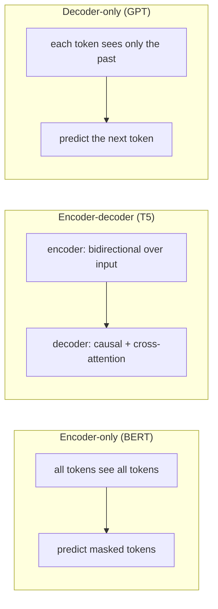

# Architecture Families & Beyond Transformers

The GPT you built in [The Transformer, Line by Line](transformer.md) is one member of a larger family. The same attention block, arranged differently, gives you BERT (an encoder that reads text both ways), T5 (an encoder that reads plus a decoder that writes), and the decoder-only models that dominate today. Past the transformer there is a second family: state space models, linear attention and RNN revivals that process a sequence in linear time with a fixed-size memory, plus hybrids that mix both, and diffusion language models that write many tokens at once. This page explains what each design is good at, why decoder-only won the scaling race, and where the alternatives still pay off. You will write a masked-LM loss, a selective SSM, a linear attention layer and a masked diffusion sampler from scratch.

!!! abstract "What you'll learn"
    - Encoder-only, encoder-decoder, decoder-only and prefix-LM: what changes (the mask and the objective) and what each is good for
    - The BERT masked-LM objective, implemented from scratch, and why encoders still win for classification, embeddings and reranking
    - T5 span corruption and cross-attention, and why encoder-decoder lost favour at scale
    - State space models: the S4 intuition and Mamba's selective scan, with a from-scratch PyTorch implementation
    - Linear attention, RWKV and RetNet: attention rewritten as a recurrence
    - Hybrid models that interleave attention with SSM or linear layers
    - Masked diffusion language models and parallel decoding
    - A trade-off table to decide which family fits a problem

## The three transformer families

All three families use the same block (attention + MLP + norms + residuals). What differs is **which tokens may attend to which** (the attention mask) and **what the model is trained to predict** (the objective).



| Family | Attention mask | Objective | Typical use |
|---|---|---|---|
| Encoder-only | Bidirectional (none) | Masked LM | Classification, embeddings, reranking, NER |
| Encoder-decoder | Bidirectional encoder, causal decoder, cross-attention | Span corruption / seq2seq | Translation, summarization, speech recognition |
| Decoder-only | Causal | Next-token prediction | General generation, chat, reasoning, code |
| Prefix-LM | Bidirectional over prefix, causal over the rest | Next-token on the suffix | Conditional generation in a single stack |

## Encoder-only: BERT and masked language modelling

A causal model cannot use the right-hand context: when it encodes the word "bank" in "the bank of the river", it has not seen "river" yet. An encoder removes the causal mask, so every token's representation is built from the whole sentence. That is ideal for *understanding* tasks, but it breaks next-token prediction: if every position can see every other, predicting token $t$ is trivial because token $t$ is in the input.

BERT's fix is the **masked language model** (MLM) objective. Pick about 15% of positions, corrupt them, and train the model to recover the originals from the bidirectional context. Of the selected positions, 80% become `[MASK]`, 10% become a random token, and 10% are left unchanged. The random and unchanged cases matter because `[MASK]` never appears at fine-tuning time; without them the model would only learn useful representations at masked positions.

The loss is ordinary cross-entropy, computed only on the selected positions:

$$
\mathcal{L}_{\text{MLM}} = -\frac{1}{|M|}\sum_{i \in M} \log p_\theta(x_i \mid \tilde{x})
$$

where $M$ is the set of selected positions and $\tilde{x}$ is the corrupted sequence.

```python title="mlm.py"
import torch
import torch.nn as nn
import torch.nn.functional as F


def mask_tokens(ids, mask_id, vocab_size, mask_prob=0.15, special_mask=None):
    """BERT-style corruption. Returns (inputs, labels); labels are -100 where no loss."""
    labels = ids.clone()
    prob = torch.full(ids.shape, mask_prob, device=ids.device)
    if special_mask is not None:                       # never mask [CLS], [SEP], padding
        prob.masked_fill_(special_mask, 0.0)
    selected = torch.bernoulli(prob).bool()
    labels[~selected] = -100                           # loss only on selected positions

    inputs = ids.clone()
    # 80% of selected -> [MASK]
    to_mask = torch.bernoulli(torch.full(ids.shape, 0.8, device=ids.device)).bool() & selected
    inputs[to_mask] = mask_id
    # 10% of selected -> random token (half of the remaining 20%)
    to_rand = torch.bernoulli(torch.full(ids.shape, 0.5, device=ids.device)).bool() & selected & ~to_mask
    inputs[to_rand] = torch.randint(vocab_size, ids.shape, device=ids.device)[to_rand]
    # remaining 10% of selected: left unchanged, but still predicted
    return inputs, labels


class TinyEncoder(nn.Module):
    """Bidirectional transformer: no causal mask, every token sees every token."""
    def __init__(self, vocab_size, d_model=128, n_head=4, n_layer=2, max_len=128):
        super().__init__()
        self.tok_emb = nn.Embedding(vocab_size, d_model)
        self.pos_emb = nn.Embedding(max_len, d_model)
        layer = nn.TransformerEncoderLayer(d_model, n_head, 4 * d_model, dropout=0.0,
                                           activation="gelu", batch_first=True, norm_first=True)
        self.encoder = nn.TransformerEncoder(layer, n_layer, enable_nested_tensor=False)
        self.ln_f = nn.LayerNorm(d_model)
        self.mlm_head = nn.Linear(d_model, vocab_size)

    def forward(self, idx):
        pos = torch.arange(idx.size(1), device=idx.device)
        x = self.encoder(self.tok_emb(idx) + self.pos_emb(pos))   # no mask -> bidirectional
        return self.mlm_head(self.ln_f(x))                        # (B, T, V)


if __name__ == "__main__":
    vocab_size, mask_id = 1000, 999                   # reserve the last id for [MASK]
    model = TinyEncoder(vocab_size)
    ids = torch.randint(0, 998, (8, 64))              # pretend batch of token ids
    inputs, labels = mask_tokens(ids, mask_id, vocab_size)
    logits = model(inputs)
    loss = F.cross_entropy(logits.view(-1, vocab_size), labels.view(-1), ignore_index=-100)
    print(f"masked positions: {(labels != -100).sum().item()} / {labels.numel()}")
    print(f"loss: {loss.item():.2f}  (ln V = {torch.log(torch.tensor(vocab_size)).item():.2f})")
```

Running it prints about 77 masked positions out of 512 and an initial loss near $\ln 1000 \approx 6.9$, the same sanity check as for a GPT. The only differences from the GPT training step are the missing causal mask and the `ignore_index=-100` labels. Note the cost: **only 15% of tokens produce a gradient signal**, whereas a causal LM learns from every position. This is one of the reasons encoders are less compute-efficient as general pretrainers.

### From BERT to ModernBERT

BERT (2018) also had a next-sentence prediction objective; RoBERTa showed it was unnecessary and that BERT was undertrained, and fixed it with more data, larger batches and dynamic masking (re-sampling the mask every epoch, as `mask_tokens` does on every call). ModernBERT (2024) brings the encoder up to date with the same changes you saw in [Modern Architectures](modern-architectures.md): RoPE, GeGLU MLPs, no biases, alternating local (sliding window) and global attention, an 8k-token context, unpadded sequences with FlashAttention, and training on trillions of tokens including code. It is a drop-in replacement for BERT in most fine-tuning pipelines.

### When encoders still win

Encoders are not obsolete. For tasks where you read text and output a label, a score or a vector, they are often the best quality per FLOP:

- **Classification and tagging.** Sentiment, intent, toxicity, NER. A 150M-parameter fine-tuned encoder is cheap to serve, has no decoding loop, and is often as accurate as a much larger prompted LLM for a fixed label set.
- **Embeddings.** Bi-encoders that map a query and a document to vectors, compared by cosine similarity, are the backbone of [RAG retrieval](../rag/fundamentals.md). Most popular embedding models are encoders fine-tuned with a contrastive loss (the same idea as the CLIP loss on the [Multimodal](multimodal.md) page). Decoder-based embedders exist too, but encoders dominate at small sizes.
- **Rerankers (cross-encoders).** Concatenate query and document, run them through one encoder with full bidirectional attention, and output a relevance score. Much more accurate than comparing two separate vectors, used to reorder the top-k results from retrieval. See [Advanced RAG](../rag/advanced.md).
- **Routing and guardrails.** Small, fast classifiers in front of an LLM, as in [Decision Models for Routing](../decision/routing-models.md).

## Encoder-decoder: T5 and cross-attention

An encoder-decoder splits the job in two. The **encoder** reads the input with bidirectional attention and produces a sequence of vectors. The **decoder** generates the output causally, and in each block it has an extra **cross-attention** sublayer whose queries come from the decoder and whose keys and values come from the encoder output:

$$
\text{CrossAttn}(H_{\text{dec}}, H_{\text{enc}}) = \text{softmax}\!\left(\frac{(H_{\text{dec}}W_Q)(H_{\text{enc}}W_K)^\top}{\sqrt{d_k}}\right) H_{\text{enc}}W_V
$$

In code this is the same attention you already wrote, with `q` from one tensor and `k, v` from another, and no causal mask (the whole input is known):

```python
# inside a decoder block, after causal self-attention
q = self.q_proj(dec_x)                     # (B, T_dec, d)
k, v = self.kv_proj(enc_out).chunk(2, -1)  # (B, T_enc, d) each
y = F.scaled_dot_product_attention(split_heads(q), split_heads(k), split_heads(v))
```

T5 (2019) framed every task as text-to-text ("translate English to German: ..." becomes the input, the translation becomes the target) and pretrained with **span corruption**: replace random spans (about 15% of tokens, mean span length 3) with sentinel tokens, and train the decoder to output the missing spans.

```text
input : Thank you <X> me to your party <Y> week.
target: <X> for inviting <Y> last <Z>
```

The input to the encoder is shorter than the original, and the target is short, so pretraining is cheap per example.

**Where encoder-decoders shine.** When input and output are clearly different sequences and the input is fully known up front: translation, summarization, and speech recognition. Whisper is an encoder-decoder (audio encoder, text decoder), and so are many dedicated translation models. The encoder runs once over the input; only the decoder runs per output token, and its self-attention cache covers only the output.

**Why it lost favour at scale.**

- **Two stacks, awkward parameter split.** You must decide how many parameters go to each side, and for chat, the "input" and "output" are interleaved over many turns, so the boundary is artificial.
- **Less training signal per token.** Span corruption only supervises the corrupted spans. A causal LM supervises every token.
- **Prompting and in-context learning.** GPT-3 showed that a large decoder-only model, trained only on next-token prediction, can do new tasks from a prompt. Wang et al. (2022) compared architectures and objectives head to head and found that causal decoder-only models trained on next-token prediction gave the best zero-shot generalization straight after pretraining, while encoder-decoders did best only after multitask fine-tuning.
- **Ecosystem gravity.** Once the largest models, inference engines (KV caching, paged attention, speculative decoding) and post-training recipes were all built for decoder-only, the alternatives had to be much better, not just as good.

Encoder-decoders have not disappeared: Google's T5Gemma work adapts pretrained decoder-only weights into an encoder-decoder, which suggests the design is still attractive where input understanding dominates.

## Decoder-only: why it dominates

The decoder-only design wins on simplicity and efficiency at scale:

1. **Every token is a training example.** One forward pass over $T$ tokens yields $T$ next-token losses. Nothing is wasted.
2. **One stack, one objective.** Understanding and generation share the same weights, and any task (classification, translation, code, chat) can be posed as "continue this text".
3. **Generation is natural.** The causal mask at training matches the left-to-right process at inference, and the KV cache (see [Inference](../inference/inference.md)) makes each new token cheap.
4. **It scales predictably.** The [scaling laws](scaling-laws.md) were established on decoder-only models, and every major open-weight family (Llama, Qwen, Gemma, Mistral, DeepSeek, OLMo, SmolLM) is decoder-only.

Its weakness is the one this page's second half addresses: **attention is quadratic in sequence length during training, and the KV cache grows linearly with context during inference.** At 128k tokens the cache can dwarf the model weights. GQA, sliding windows and MLA (see [Modern Architectures](modern-architectures.md)) shrink the constant; the families below change the asymptotics.

### Prefix-LM, briefly

A prefix-LM is a decoder-only model with a mixed mask: tokens in the prefix (the prompt) attend bidirectionally to each other, and tokens after it attend causally. The loss is only on the suffix. You get encoder-style understanding of the prompt with a single stack. UL2 and PaLI-style vision-language models used prefix-LM masks, and Gemma 3 uses bidirectional attention over image tokens inside an otherwise causal model. The mask is a few lines:

```python
def prefix_lm_mask(T, prefix_len, device=None):
    """True = may attend. Bidirectional over the prefix, causal elsewhere."""
    mask = torch.ones(T, T, dtype=torch.bool, device=device).tril()
    mask[:prefix_len, :prefix_len] = True
    return mask   # pass as attn_mask to F.scaled_dot_product_attention
```

## Beyond transformers: recurrence returns

A recurrent model keeps a fixed-size state $h_t$ and updates it with each token: $h_t = f(h_{t-1}, x_t)$. Inference costs $O(1)$ memory and $O(1)$ compute per token, regardless of how long the context is. Classic RNNs and LSTMs lost to transformers because their nonlinear recurrence cannot be parallelized across time during training, and because they struggled to retain information over long distances. The modern families keep the recurrence but make it **linear in the state**, which makes it parallelizable, and add mechanisms to control what the state remembers.

### State space models: the S4 intuition

A state space model comes from control theory. In continuous time, a hidden state $h(t) \in \mathbb{R}^N$ evolves under a linear ODE driven by an input signal $x(t)$:

$$
h'(t) = A\,h(t) + B\,x(t), \qquad y(t) = C\,h(t)
$$

To run it on tokens you discretize with a step size $\Delta$. With zero-order hold, $\bar{A} = e^{\Delta A}$ and (approximately) $\bar{B} = \Delta B$, giving a linear recurrence:

$$
h_t = \bar{A}\,h_{t-1} + \bar{B}\,x_t, \qquad y_t = C\,h_t
$$

Two properties made S4 (2021) work. First, because the recurrence is linear and time-invariant, you can unroll it: $y_t = \sum_{k} C\bar{A}^{k}\bar{B}\,x_{t-k}$, which is a long **convolution** of the input with a kernel $K = (C\bar{B}, C\bar{A}\bar{B}, C\bar{A}^2\bar{B}, \dots)$. Training uses the convolution (parallel, computed with FFTs); inference uses the recurrence (constant memory). Second, $A$ is initialized with a special structure (HiPPO) designed so that the state holds a compressed summary of the input history, which fixed the long-range memory problem of plain RNNs.

The limitation: $\bar{A}, \bar{B}, C$ are the same for every token. The model cannot decide to remember an important token and ignore filler. That is fine for audio and other smooth signals, but weak on language, where what to keep depends on content.

### Mamba: the selective scan

Mamba (2023) makes the SSM **selective**: $\Delta$, $B$ and $C$ become functions of the current input token. A large $\Delta_t$ means "reset and write this token into the state"; a small $\Delta_t$ means "ignore this token and keep the state". This is the same role a gate plays in an LSTM, but the recurrence stays linear in $h$:

$$
\Delta_t = \text{softplus}(W_\Delta x_t), \quad B_t = W_B x_t, \quad C_t = W_C x_t
$$

$$
h_t = e^{\Delta_t A} \odot h_{t-1} + \Delta_t B_t x_t, \qquad y_t = C_t^\top h_t + D\,x_t
$$

Input-dependent parameters break the convolution trick (the kernel now changes per position), so Mamba computes the recurrence with a **parallel scan**: a linear recurrence $h_t = a_t h_{t-1} + b_t$ is associative, so it can be evaluated in $O(\log T)$ parallel steps, like a prefix sum. Mamba fuses this into a hardware-aware CUDA kernel that keeps the expanded state in fast on-chip SRAM. Mamba-2 later reformulated the layer so most of the work becomes matrix multiplications, and showed a formal connection between SSMs and linear attention.

Here is the selective SSM from scratch, using a plain Python loop over time instead of the parallel scan. It is slow but shows exactly what is computed, and it wraps the SSM in a Mamba-style block (expand, short causal convolution, SSM, SiLU gate, project back).

```python title="selective_ssm.py"
import torch
import torch.nn as nn
import torch.nn.functional as F


class SelectiveSSM(nn.Module):
    """A minimal Mamba-style selective state space layer (sequential scan, no CUDA kernel)."""
    def __init__(self, d_model, d_state=16):
        super().__init__()
        # A is fixed per (channel, state) and kept negative so exp(delta * A) is in (0, 1)
        A = torch.arange(1, d_state + 1, dtype=torch.float32).repeat(d_model, 1)  # (D, N)
        self.A_log = nn.Parameter(torch.log(A))
        self.D = nn.Parameter(torch.ones(d_model))          # skip connection
        # selectivity: delta, B, C are functions of the input token
        self.to_delta = nn.Linear(d_model, d_model)
        self.to_B = nn.Linear(d_model, d_state, bias=False)
        self.to_C = nn.Linear(d_model, d_state, bias=False)

    def forward(self, x):                                   # x: (B, T, D)
        Bsz, T, D = x.shape
        A = -torch.exp(self.A_log)                          # (D, N), negative
        delta = F.softplus(self.to_delta(x))                # (B, T, D), positive step size
        Bt, Ct = self.to_B(x), self.to_C(x)                 # (B, T, N) each

        # discretize (zero-order hold for A, simple Euler for B as in Mamba)
        A_bar = torch.exp(delta.unsqueeze(-1) * A)          # (B, T, D, N)
        Bx = delta.unsqueeze(-1) * Bt.unsqueeze(2) * x.unsqueeze(-1)   # (B, T, D, N)

        h = x.new_zeros(Bsz, D, A.size(1))                  # fixed-size state: (B, D, N)
        ys = []
        for t in range(T):                                  # linear-time recurrence
            h = A_bar[:, t] * h + Bx[:, t]                  # forget a bit, write a bit
            ys.append((h * Ct[:, t].unsqueeze(1)).sum(-1))  # read out: (B, D)
        y = torch.stack(ys, dim=1)                          # (B, T, D)
        return y + x * self.D


class MambaBlock(nn.Module):
    """Expand, short causal conv, selective SSM, gate, project back."""
    def __init__(self, d_model, expand=2, d_state=16, d_conv=4):
        super().__init__()
        d_inner = expand * d_model
        self.norm = nn.RMSNorm(d_model)
        self.in_proj = nn.Linear(d_model, 2 * d_inner, bias=False)
        self.conv = nn.Conv1d(d_inner, d_inner, d_conv, groups=d_inner, padding=d_conv - 1)
        self.ssm = SelectiveSSM(d_inner, d_state)
        self.out_proj = nn.Linear(d_inner, d_model, bias=False)

    def forward(self, x):
        T = x.size(1)
        u, gate = self.in_proj(self.norm(x)).chunk(2, dim=-1)
        u = self.conv(u.transpose(1, 2))[..., :T].transpose(1, 2)   # trim right pad -> causal
        y = self.ssm(F.silu(u)) * F.silu(gate)
        return x + self.out_proj(y)


if __name__ == "__main__":
    torch.manual_seed(0)
    block = MambaBlock(d_model=32)
    x = torch.randn(2, 50, 32)
    y = block(x)
    print(y.shape)                                          # torch.Size([2, 50, 32])

    # causality check: changing the future must not change the past
    x2 = x.clone(); x2[:, 30:] = torch.randn(2, 20, 32)
    print("past unchanged:", torch.allclose(block(x2)[:, :30], y[:, :30], atol=1e-5))  # True
```

Things to notice:

- **The state is `(B, D, N)` no matter how long the sequence is.** For generation you would keep `h` (and the last `d_conv - 1` conv inputs) between steps; there is no KV cache that grows with context.
- **`A_log` and the negative sign.** Parameterizing $A = -e^{A_{\log}}$ guarantees $0 < e^{\Delta A} < 1$, so the state decays rather than explodes. The initialization $A_n = -n$ gives each state dimension a different decay rate, from long memory to short.
- **The block has no attention and no separate MLP.** A Mamba language model is just `MambaBlock`s stacked, with an embedding at the bottom and an LM head on top. The `nn.RMSNorm` needs PyTorch 2.4 or newer.
- **The loop is for teaching.** Real implementations (the `mamba-ssm` package) use the fused parallel scan. Use them for anything beyond toy sizes.

The price of a fixed-size state is **recall**. Attention can look up any earlier token exactly; an SSM must have decided to store it. Pure SSMs are noticeably weaker at tasks like copying a long string, retrieving a phone number from a long document, or many-shot in-context learning. That observation motivates hybrids.

### Linear attention, RWKV and RetNet

Softmax attention computes $y_t = \sum_{s \le t} \text{softmax}(q_t^\top k_s)\, v_s$. If you replace the softmax similarity with a kernel that factorizes, $\text{sim}(q, k) = \phi(q)^\top \phi(k)$, the sum rearranges:

$$
y_t = \frac{\phi(q_t)^\top \sum_{s \le t} \phi(k_s) v_s^\top}{\phi(q_t)^\top \sum_{s \le t} \phi(k_s)} = \frac{\phi(q_t)^\top S_t}{\phi(q_t)^\top z_t}
$$

with $S_t = S_{t-1} + \phi(k_t) v_t^\top$ a $d \times d$ matrix state. That is an RNN: attention without softmax is a recurrence with a matrix-valued state ("Transformers are RNNs", 2020). You can train it in the parallel form and run inference in the recurrent form, and they give identical outputs:

```python title="linear_attention.py"
import torch
import torch.nn.functional as F

torch.manual_seed(0)
B, T, d = 2, 10, 8
q, k, v = torch.randn(B, T, d), torch.randn(B, T, d), torch.randn(B, T, d)
phi = lambda x: F.elu(x) + 1                      # positive feature map

# parallel (training) form: causal mask on phi(Q) phi(K)^T, no softmax
scores = phi(q) @ phi(k).transpose(1, 2)          # (B, T, T)
scores = scores.tril()                            # causal
y_par = (scores @ v) / scores.sum(-1, keepdim=True)

# recurrent (inference) form: a (d x d) state, constant memory per token
S = torch.zeros(B, d, d)                          # running sum of phi(k) v^T
z = torch.zeros(B, d)                             # running sum of phi(k) for normalization
outs = []
for t in range(T):
    S = S + phi(k[:, t]).unsqueeze(-1) * v[:, t].unsqueeze(1)
    z = z + phi(k[:, t])
    num = (phi(q[:, t]).unsqueeze(1) @ S).squeeze(1)
    den = (phi(q[:, t]) * z).sum(-1, keepdim=True)
    outs.append(num / den)
y_rec = torch.stack(outs, 1)
print("same output:", torch.allclose(y_par, y_rec, atol=1e-5))   # True
```

Plain linear attention never forgets: $S_t$ is a sum over all history, so it fills up with noise. The successful variants add **decay** and **gating**, which brings them very close to selective SSMs:

- **RetNet** (2023) multiplies the state by a fixed decay per head, $S_t = \gamma S_{t-1} + k_t v_t^\top$, and supports parallel, recurrent and chunked computation.
- **RWKV** (2023 onward) is an RNN with a time-mixing block using learned per-channel decays and a channel-mixing block in place of the MLP. Later versions make the decay data-dependent. It trains in parallel like a transformer and runs like an RNN.
- **Gated linear attention, DeltaNet and Gated DeltaNet** make the decay input-dependent (like Mamba's $\Delta_t$) and use a "delta rule" update that overwrites the value stored for a key instead of only adding to it, which improves recall. Gated DeltaNet layers appear in recent production hybrids such as Qwen3-Next.

Conceptually, Mamba-2, gated linear attention and RetNet are variations on one recurrence, $S_t = a_t \odot S_{t-1} + k_t v_t^\top$, $y_t = S_t^\top q_t$, differing in how the decay $a_t$ is computed and how big the state is.

### Hybrids: a little attention goes a long way

Experiments with hybrids have repeatedly found that you do not need attention in every layer. A model built mostly from SSM or linear-attention layers, with a small fraction of full attention layers, recovers most of the recall ability of a transformer while keeping most of the memory savings. Because only the attention layers keep a KV cache, the cache shrinks by roughly the fraction of layers that are not attention.

- **Jamba** (AI21, 2024) interleaves Mamba and attention layers, roughly one attention layer per seven Mamba layers, with MoE MLPs in some layers, and supports very long contexts on a single GPU.
- **Samba** (Microsoft) alternates Mamba layers with sliding window attention, so no layer has a cache that grows with the full context.
- **Hymba** (NVIDIA) puts attention heads and SSM heads side by side *within* the same layer, aimed at small models.
- **Falcon-H1**, **NVIDIA Nemotron-H** and **IBM Granite 4.0** ship hybrid attention + Mamba-2 models, including small ones, and **Qwen3-Next** mixes Gated DeltaNet layers with gated full attention.
- **LFM2** (Liquid AI) is an on-device-focused SLM family that combines short gated convolutions with a minority of attention layers.

The exact ratios and placements differ and are still being explored. For an SLM targeting phones or long documents, a hybrid is a reasonable design; for a general-purpose model at moderate context lengths, a standard transformer with GQA and sliding window layers remains the safe default because the tooling is far more mature.

## Diffusion language models

All the models above generate **one token at a time, left to right**. Diffusion LMs generate by iterative refinement: start from a fully masked sequence and, over a number of steps, fill in tokens anywhere in the sequence, many per step.

The most successful discrete version is **masked diffusion** (MDLM, LLaDA). The forward ("noising") process replaces each token with `[MASK]` independently with probability $t \in [0, 1]$; at $t = 1$ everything is masked. The model is a bidirectional transformer (an encoder, no causal mask) trained to predict the original tokens at masked positions. If that sounds like BERT, it is: masked diffusion is MLM with a **random masking rate per example**, from 0% to 100%, and a weighting of $1/t$ that makes the loss a bound on the log-likelihood:

$$
\mathcal{L} = \mathbb{E}_{t,\,x_t}\left[\frac{1}{t}\sum_{i:\,x_t^i = \texttt{[MASK]}} -\log p_\theta(x_0^i \mid x_t)\right]
$$

To generate, you start fully masked, predict all positions, commit the most confident predictions, and repeat with fewer masks. Here is the training loss and a simple confidence-based sampler, reusing `TinyEncoder` from `mlm.py` above:

```python title="masked_diffusion.py"
import torch
import torch.nn.functional as F
from mlm import TinyEncoder


def masked_diffusion_loss(model, ids, mask_id):
    """One training step of a masked diffusion LM (absorbing-state, LLaDA/MDLM style)."""
    B, T = ids.shape
    t = torch.rand(B, 1, device=ids.device).clamp(min=1e-3)     # noise level per sequence
    masked = torch.rand(B, T, device=ids.device) < t             # mask each token w.p. t
    inputs = ids.masked_fill(masked, mask_id)
    logits = model(inputs)                                       # bidirectional model
    ce = F.cross_entropy(logits.transpose(1, 2), ids, reduction="none")   # (B, T)
    # loss only on masked tokens, weighted by 1/t (the ELBO weighting)
    return ((ce * masked) / t).sum() / (B * T)


@torch.no_grad()
def diffusion_generate(model, prompt, gen_len, mask_id, steps=8):
    """Start fully masked; each step commit the most confident predictions in parallel."""
    B = prompt.size(0)
    x = torch.cat([prompt, torch.full((B, gen_len), mask_id, device=prompt.device)], dim=1)
    per_step = -(-gen_len // steps)                              # ceil division
    for _ in range(steps):
        still_masked = x == mask_id
        if not still_masked.any():
            break
        logits = model(x)
        logits[..., mask_id] = -float("inf")                     # never predict [MASK]
        conf, pred = logits.softmax(-1).max(-1)                  # (B, T)
        conf = conf.masked_fill(~still_masked, -1.0)             # only fill masked slots
        k = min(per_step, int(still_masked.sum(1).min()))
        top = conf.topk(k, dim=1).indices
        x.scatter_(1, top, pred.gather(1, top))
    return x


if __name__ == "__main__":
    vocab_size, mask_id = 1000, 999
    model = TinyEncoder(vocab_size)
    ids = torch.randint(0, 998, (8, 64))
    print("loss:", masked_diffusion_loss(model, ids, mask_id).item())
    out = diffusion_generate(model, ids[:2, :16], gen_len=32, mask_id=mask_id, steps=8)
    print(out.shape, "masks left:", (out == mask_id).sum().item())   # (2, 48), 0
```

32 tokens in 8 forward passes: 4 tokens per step. That is the appeal. **Parallel decoding** turns generation from memory-bound (one token per weight read) into something closer to compute-bound, so a diffusion LM can produce text several times faster than an autoregressive model of similar quality, which is why commercial diffusion LMs (Inception's Mercury, Google's Gemini Diffusion demo) emphasize speed. They can also edit or infill anywhere, not just append.

The costs are real. Bidirectional attention means no standard KV cache (each step reprocesses the whole sequence, though block-wise and cached variants exist), quality drops when you commit too many tokens per step because tokens committed together are predicted independently, and variable-length output is awkward. LLaDA showed an 8B masked diffusion model can be competitive with autoregressive models of similar size; whether diffusion overtakes autoregression at the frontier is an open question as of late 2026.

## Trade-offs at a glance

For sequence length $T$, the qualitative picture:

| Family | Training parallelism | Inference memory per sequence | Long context | Quality / recall today |
|---|---|---|---|---|
| Encoder-only (BERT) | Full | No generation; $O(T)$ activations | Limited (512 to 8k typical) | Best for classification, embeddings, reranking |
| Encoder-decoder (T5) | Full | Encoder output + decoder KV cache | Moderate | Strong for seq2seq; less used for general chat |
| Decoder-only transformer | Full, $O(T^2)$ attention | KV cache, grows $O(T)$ | Good with RoPE scaling, GQA, sliding windows | Strongest general models; exact recall |
| SSM (Mamba) | Parallel scan, $O(T)$ | Fixed-size state, $O(1)$ in $T$ | Cheap, but recall degrades | Competitive on language modelling; weaker at copy and lookup |
| Linear attention / RWKV / RetNet | Parallel or chunked, $O(T)$ | Fixed-size matrix state | Cheap, recall limited by state size | Close to SSMs; improving with gating and delta rules |
| Hybrid (attention + SSM) | Full | Small KV cache (attention layers only) + state | Strong and memory-efficient | Close to transformers, growing adoption |
| Masked diffusion | Full (bidirectional) | Reprocess sequence each step (no standard KV cache) | Moderate | Competitive at moderate scale; fastest decoding |

!!! tip "How to choose"
    Building a general chat or reasoning model: decoder-only transformer, possibly with hybrid layers if you need long context on small hardware. Building a classifier, embedder or reranker: fine-tune an encoder such as ModernBERT. Building translation or speech-to-text: encoder-decoder is still a strong choice. Exploring the research frontier on a budget: train a small Mamba or hybrid and compare it to your GPT at equal FLOPs.

!!! warning "Common pitfalls"
    - **Using a causal LM's hidden states as sentence embeddings without fine-tuning.** The last token's state is tuned to predict the next token, not to summarize meaning. Use a contrastively trained embedding model.
    - **Forgetting `ignore_index` in the MLM loss.** If unselected positions keep their labels, the model learns to copy its input and the loss collapses for the wrong reason.
    - **Masking special tokens.** Do not select `[CLS]`, `[SEP]` or padding for MLM; pass a `special_mask`.
    - **Benchmarking a naive SSM loop against FlashAttention.** The Python loop above is orders of magnitude slower than the fused scan kernel. Compare architectures with optimized kernels, at equal parameters and tokens.
    - **Judging SSMs only on perplexity.** Pure SSMs can match transformer perplexity yet fail at long-context retrieval. Always include recall tasks (needle-in-a-haystack, copying, multi-key lookup) in evaluation.
    - **Unstable SSM decay.** If $A$ is not constrained negative, $e^{\Delta A}$ can exceed 1 and the state explodes over long sequences. Keep the $A = -e^{A_{\log}}$ parameterization and run the scan in fp32.
    - **Committing too many tokens per diffusion step.** Tokens unmasked in the same step are sampled independently and can be mutually inconsistent ("the the"). Fewer, more confident tokens per step trade speed for quality.

## Check your understanding

??? question "Why can't you train a bidirectional encoder with next-token prediction?"
    With no causal mask, position $t$ can attend to position $t+1$, so predicting token $t+1$ from the representation at $t$ is trivial: the answer is in the input. MLM hides the target tokens from the input, so the model must infer them from context.

??? question "A causal LM and an MLM are trained on the same 1B tokens. Which receives more supervised predictions, and roughly by how much?"
    The causal LM gets one prediction per token, about 1B. The MLM with 15% masking gets about 150M, so the causal LM receives roughly 6-7x more training signal from the same data. That is part of why decoder-only pretraining is more compute-efficient for general capability.

??? question "In cross-attention, where do the queries, keys and values come from?"
    Queries come from the decoder's hidden states (what the decoder is currently trying to produce). Keys and values come from the encoder's output (the input being read). There is no causal mask, since the whole input is available.

??? question "What does Mamba's input-dependent Δ let the model do that S4 cannot?"
    It lets the model choose, per token, how much to update the state. Large $\Delta_t$ makes $e^{\Delta_t A}$ small (forget the old state) and the write term large (store this token); small $\Delta_t$ keeps the state and ignores the token. S4's fixed parameters treat every token identically, so it cannot skip filler or latch onto important content.

??? question "A hybrid model has 32 layers, 4 of which are full attention and the rest Mamba. Roughly how does its KV cache compare to a 32-layer transformer with the same attention config?"
    Only the 4 attention layers keep a KV cache, so the cache is about 4/32 = 1/8 the size. The 28 Mamba layers add a fixed-size state each, which does not grow with context. At long context the hybrid needs far less memory per sequence.

## Further reading

- Devlin et al., [BERT: Pre-training of Deep Bidirectional Transformers for Language Understanding](https://arxiv.org/abs/1810.04805), 2018
- Liu et al., [RoBERTa: A Robustly Optimized BERT Pretraining Approach](https://arxiv.org/abs/1907.11692), 2019
- Warner et al., [Smarter, Better, Faster, Longer: A Modern Bidirectional Encoder (ModernBERT)](https://arxiv.org/abs/2412.13663), 2024
- Raffel et al., [Exploring the Limits of Transfer Learning with a Unified Text-to-Text Transformer (T5)](https://arxiv.org/abs/1910.10683), 2019
- Wang et al., [What Language Model Architecture and Pretraining Objective Work Best for Zero-Shot Generalization?](https://arxiv.org/abs/2204.05832), 2022
- Tay et al., [UL2: Unifying Language Learning Paradigms](https://arxiv.org/abs/2205.05131), 2022
- Gu, Goel, Ré, [Efficiently Modeling Long Sequences with Structured State Spaces (S4)](https://arxiv.org/abs/2111.00396), 2021
- Gu & Dao, [Mamba: Linear-Time Sequence Modeling with Selective State Spaces](https://arxiv.org/abs/2312.00752), 2023
- Dao & Gu, [Transformers are SSMs: Generalized Models and Efficient Algorithms Through Structured State Space Duality (Mamba-2)](https://arxiv.org/abs/2405.21060), 2024
- Katharopoulos et al., [Transformers are RNNs: Fast Autoregressive Transformers with Linear Attention](https://arxiv.org/abs/2006.16236), 2020
- Peng et al., [RWKV: Reinventing RNNs for the Transformer Era](https://arxiv.org/abs/2305.13048), 2023
- Sun et al., [Retentive Network: A Successor to Transformer for Large Language Models](https://arxiv.org/abs/2307.08621), 2023
- Yang et al., [Gated Delta Networks: Improving Mamba2 with Delta Rule](https://arxiv.org/abs/2412.06464), 2024
- Lieber et al., [Jamba: A Hybrid Transformer-Mamba Language Model](https://arxiv.org/abs/2403.19887), 2024
- Sahoo et al., [Simple and Effective Masked Diffusion Language Models (MDLM)](https://arxiv.org/abs/2406.07524), 2024
- Nie et al., [Large Language Diffusion Models (LLaDA)](https://arxiv.org/abs/2502.09992), 2025
