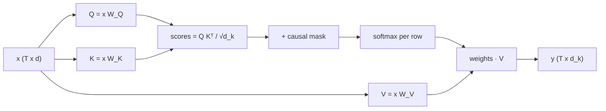
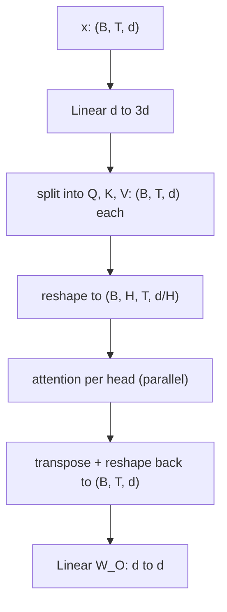

# Embeddings & Attention

Attention is the one genuinely new idea in the transformer. Everything else (embeddings, MLPs, normalization, residuals) existed before 2017. Attention lets every token look at every earlier token and decide, based on content, which ones matter right now. In this page you derive it from scratch, see why each piece (the $\sqrt{d}$, the mask, the softmax) is there, and implement multi-head attention in PyTorch two ways: by hand and with the fused kernel you will use in practice.

!!! abstract "What you'll learn"
    - How token ids become vectors (embeddings) and how position information gets in
    - Queries, keys, and values: what they are and why attention is "soft dictionary lookup"
    - Scaled dot-product attention, including why we divide by $\sqrt{d_k}$
    - Causal masking for language models
    - Multi-head attention, implemented from scratch and verified against `F.scaled_dot_product_attention`
    - Why attention is $O(n^2)$ and what FlashAttention does about it

## From token ids to vectors

The tokenizer gives you integers. The first layer of the model is a lookup table, the **embedding matrix** $E \in \mathbb{R}^{|V| \times d}$, where $d$ (`d_model`) is the model's hidden size. Token id $i$ maps to row $E_i$.

```python
import torch
import torch.nn as nn

vocab_size, d_model = 50_257, 768
tok_emb = nn.Embedding(vocab_size, d_model)

ids = torch.tensor([[15496, 995]])   # (batch=1, seq=2)
x = tok_emb(ids)                     # (1, 2, 768)
```

`nn.Embedding` is mathematically identical to multiplying a one-hot vector by $E$, just without materializing the one-hot. The rows start random and are learned by backprop like any other weight. After training, tokens used in similar contexts end up with similar vectors.

### Position information

Attention without a mask, as you will see, is **permutation-equivariant**: shuffle the input tokens and each output just gets shuffled the same way. But "dog bites man" and "man bites dog" must differ. So position has to be injected somehow:

| Method | How | Used in |
|---|---|---|
| Sinusoidal | Add fixed sin/cos waves of different frequencies to the embeddings | Original Transformer (2017) |
| Learned absolute | A second embedding table `pos_emb[t]`, added to `tok_emb` | GPT-2, BERT |
| **RoPE** (rotary) | Rotate query and key vectors by a position-dependent angle inside attention | Llama, Qwen, Gemma, Mistral, SmolLM, most modern LLMs |
| ALiBi | Add a distance-proportional penalty to attention scores | BLOOM, MPT |

The original sinusoidal encoding, for position $t$ and dimension pair $i$:

$$
PE_{t, 2i} = \sin\!\left(\frac{t}{10000^{2i/d}}\right), \qquad PE_{t, 2i+1} = \cos\!\left(\frac{t}{10000^{2i/d}}\right)
$$

We will use learned absolute positions in the [GPT implementation](transformer.md) because it is simplest, and switch to RoPE in [Modern Architectures](modern-architectures.md#rope-rotary-position-embeddings).

## Deriving attention

### The problem attention solves

Consider predicting the next word in "The animal didn't cross the street because **it** was too tired." To process "it", the model needs information from "animal", several tokens back. An MLP applied to each position independently cannot do that. We need an operation that, for each position, **mixes in information from other positions**, with the mixing weights depending on content.

The simplest version: make the output at position $t$ a weighted average of all earlier token vectors,

$$
y_t = \sum_{s \le t} \alpha_{ts}\, x_s, \qquad \sum_s \alpha_{ts} = 1
$$

The question is how to choose $\alpha_{ts}$. Attention's answer: compute them from a similarity score between position $t$ and position $s$, then normalize with softmax.

### Queries, keys, and values

Using raw $x_t \cdot x_s$ as the similarity is too rigid: a token would mostly attend to copies of itself, and what a token *looks for* would be the same as what it *offers*. So each token produces three different vectors via learned linear maps:

- **Query** $q_t = x_t W_Q$: "what am I looking for?"
- **Key** $k_s = x_s W_K$: "what do I contain, for matching purposes?"
- **Value** $v_s = x_s W_V$: "what do I hand over if selected?"

This is a **soft dictionary lookup**. A Python dict returns the value whose key exactly matches the query. Attention returns a *blend* of all values, weighted by how well each key matches the query.

$$
\alpha_{ts} = \mathrm{softmax}_s\!\left(\frac{q_t \cdot k_s}{\sqrt{d_k}}\right), \qquad y_t = \sum_s \alpha_{ts}\, v_s
$$

Stacking all positions into matrices $Q, K, V \in \mathbb{R}^{T \times d_k}$, the whole thing is two matrix multiplies and a softmax:

$$
\mathrm{Attention}(Q, K, V) = \mathrm{softmax}\!\left(\frac{QK^\top}{\sqrt{d_k}} + M\right) V
$$

where $M$ is the causal mask (below).



### Why divide by $\sqrt{d_k}$?

Suppose the entries of $q$ and $k$ are independent with mean 0 and variance 1. Their dot product $q \cdot k = \sum_{i=1}^{d_k} q_i k_i$ is a sum of $d_k$ terms each with variance 1, so

$$
\mathrm{Var}(q \cdot k) = d_k
$$

With $d_k = 128$, scores have a standard deviation around 11. Softmax of numbers that spread is nearly one-hot: one weight close to 1, the rest close to 0. In that regime the softmax gradient is tiny almost everywhere, and training stalls. Dividing by $\sqrt{d_k}$ brings the variance back to 1 regardless of head size. You can check it empirically:

```python
import torch
for d in [16, 64, 256, 1024]:
    q, k = torch.randn(10_000, d), torch.randn(10_000, d)
    s = (q * k).sum(-1)
    print(d, s.var().item(), (s / d**0.5).var().item())
# 16   ~16   ~1.0
# 64   ~64   ~1.0
# 256  ~256  ~1.0
# 1024 ~1024 ~1.0
```

### Why softmax?

Softmax turns arbitrary real scores into positive weights that sum to 1, it is differentiable, and it is "soft max": large scores dominate but every position still gets some gradient. The exponent also makes it scale-sensitive, which is exactly why the $\sqrt{d_k}$ scaling matters.

### The causal mask

A language model predicts token $t+1$ from tokens $1..t$. During training we process the whole sequence at once, so we must stop position $t$ from peeking at later positions. We do it by setting scores for $s > t$ to $-\infty$ before the softmax; $e^{-\infty} = 0$, so those positions get exactly zero weight.

$$
M_{ts} = \begin{cases} 0 & s \le t \\ -\infty & s > t \end{cases}
$$

For $T = 4$ the attention weight matrix has this shape (rows are queries, columns keys):

$$
\begin{pmatrix}
1 & 0 & 0 & 0 \\
\alpha_{21} & \alpha_{22} & 0 & 0 \\
\alpha_{31} & \alpha_{32} & \alpha_{33} & 0 \\
\alpha_{41} & \alpha_{42} & \alpha_{43} & \alpha_{44}
\end{pmatrix}
$$

This is what lets one forward pass train on all $T$ next-token predictions simultaneously without cheating. Encoder models like BERT omit the mask and see in both directions.

### Single-head attention in code

```python title="attention.py"
import math
import torch


def attention(q, k, v, causal: bool = True):
    """q, k, v: (B, H, T, Dh). Returns (B, H, T, Dh)."""
    T, Dh = q.size(-2), q.size(-1)
    scores = q @ k.transpose(-2, -1) / math.sqrt(Dh)          # (B, H, T, T)
    if causal:
        mask = torch.triu(torch.ones(T, T, dtype=torch.bool, device=q.device), diagonal=1)
        scores = scores.masked_fill(mask, float("-inf"))      # hide the future
    weights = torch.softmax(scores, dim=-1)                   # rows sum to 1
    return weights @ v
```

`torch.triu(..., diagonal=1)` is `True` strictly above the diagonal, i.e. exactly the future positions.

## Multi-head attention

One attention operation computes one set of mixing weights per position. But a token may need several kinds of information at once: the subject of the sentence, the previous token, the matching open bracket. **Multi-head attention** runs $H$ attention operations in parallel, each on its own lower-dimensional projection ($d_{\text{head}} = d / H$), then concatenates the results and mixes them with an output projection $W_O$:

$$
\mathrm{head}_h = \mathrm{Attention}(x W_Q^{(h)}, x W_K^{(h)}, x W_V^{(h)}), \qquad
\mathrm{MHA}(x) = [\mathrm{head}_1; \dots; \mathrm{head}_H]\, W_O
$$

The total compute is about the same as a single head of full width, because each head is $H$ times narrower. In code you do not loop over heads: you compute one big $Q, K, V$ of width $d$ and *reshape* it into $H$ heads.



### Full implementation

```python title="mha.py"
import math
import torch
import torch.nn as nn
import torch.nn.functional as F

from attention import attention   # the manual version above


class MultiHeadAttention(nn.Module):
    def __init__(self, d_model: int, n_heads: int, dropout: float = 0.0, use_sdpa: bool = True):
        super().__init__()
        assert d_model % n_heads == 0
        self.n_heads, self.d_head = n_heads, d_model // n_heads
        self.qkv = nn.Linear(d_model, 3 * d_model)    # W_Q, W_K, W_V fused into one matmul
        self.proj = nn.Linear(d_model, d_model)       # W_O
        self.dropout = dropout
        self.use_sdpa = use_sdpa

    def forward(self, x):                              # x: (B, T, d_model)
        B, T, C = x.shape
        q, k, v = self.qkv(x).split(C, dim=-1)         # each (B, T, C)
        # (B, T, C) -> (B, T, H, Dh) -> (B, H, T, Dh)
        q = q.view(B, T, self.n_heads, self.d_head).transpose(1, 2)
        k = k.view(B, T, self.n_heads, self.d_head).transpose(1, 2)
        v = v.view(B, T, self.n_heads, self.d_head).transpose(1, 2)
        if self.use_sdpa:
            y = F.scaled_dot_product_attention(        # fused kernel (FlashAttention etc.)
                q, k, v, is_causal=True,
                dropout_p=self.dropout if self.training else 0.0)
        else:
            y = attention(q, k, v, causal=True)       # the manual version above
        y = y.transpose(1, 2).contiguous().view(B, T, C)   # concatenate heads
        return self.proj(y)
```

Verify that the two paths agree and that the model really is causal:

```python
torch.manual_seed(0)
mha = MultiHeadAttention(d_model=64, n_heads=4).eval()
x = torch.randn(2, 10, 64)

a = mha(x)
mha.use_sdpa = False
b = mha(x)
print(torch.allclose(a, b, atol=1e-5))          # True

# Changing future tokens must not change earlier outputs.
x2 = x.clone()
x2[:, 5:] = torch.randn(2, 5, 64)
print(torch.allclose(mha(x)[:, :5], mha(x2)[:, :5], atol=1e-6))   # True
```

That second test is worth keeping in your own codebase. A leaky mask produces a model with suspiciously low training loss that generates nonsense.

### Shapes at a glance

| Tensor | Shape | Notes |
|---|---|---|
| `x` | `(B, T, d)` | input hidden states |
| `qkv(x)` | `(B, T, 3d)` | one fused projection |
| `q, k, v` after reshape | `(B, H, T, d/H)` | heads become a batch dimension |
| `scores` | `(B, H, T, T)` | the $O(T^2)$ part |
| `y` before proj | `(B, T, d)` | heads concatenated |

## Complexity: why long context is expensive

The score matrix $QK^\top$ is $T \times T$ per head. So for sequence length $T$:

- **Compute**: $O(T^2 d)$ for scores and for weights $\cdot V$, versus $O(T d^2)$ for the linear layers.
- **Memory**: a naive implementation materializes $B \cdot H \cdot T^2$ scores. At $T = 8192$, $H = 32$, fp16, that is $32 \times 8192^2 \times 2$ bytes $\approx 4.3$ GB *per sequence per layer*, just for scores, and it must be kept for the backward pass.

For short contexts the linear layers dominate ($d > T$). Once $T$ exceeds a few times $d$, attention dominates. This quadratic cost is the core reason long context is hard, and motivates sliding-window attention, sparse attention, and linear-attention or state-space alternatives (see [Modern Architectures](modern-architectures.md)).

## FlashAttention and `scaled_dot_product_attention`

FlashAttention (Dao et al., 2022) does not change the math; it produces exactly the same output (up to floating point rounding). It changes **where the data lives**. GPU compute is much faster than reads/writes to its main memory (HBM). The naive implementation writes the full $T \times T$ score matrix to HBM, reads it back for softmax, writes again, and reads again for the multiply with $V$. FlashAttention instead:

1. Splits $Q$, $K$, $V$ into blocks that fit in fast on-chip SRAM.
2. For each query block, streams over key/value blocks, computing scores, a running ("online") softmax, and the weighted sum of values in one fused kernel.
3. Never materializes the full $T \times T$ matrix; memory is $O(T)$ instead of $O(T^2)$.
4. Recomputes the scores in the backward pass rather than storing them (cheaper than the memory traffic).

The online softmax trick is what makes step 2 possible: you can compute $\mathrm{softmax}$ incrementally by tracking the running max $m$ and running sum $\ell$, and rescaling the partial output whenever a new block raises the max.

In PyTorch 2.x you get this for free via `F.scaled_dot_product_attention`, which dispatches to a FlashAttention kernel, a memory-efficient kernel, or a plain math fallback depending on hardware, dtype, and arguments:

```python
import torch.nn.functional as F

# q, k, v: (B, H, T, Dh). Use bf16/fp16 on GPU for the flash kernel.
y = F.scaled_dot_product_attention(q, k, v, is_causal=True)

# Custom masks are allowed but may force a slower kernel:
# y = F.scaled_dot_product_attention(q, k, v, attn_mask=bool_mask)   # True = attend
```

!!! tip "Always use SDPA in real training"
    The manual implementation is for understanding. SDPA is typically several times faster and uses far less memory at long sequence lengths. Note the mask convention: in `attn_mask`, a boolean `True` means *allowed to attend*, the opposite of `masked_fill`.

!!! warning "Common pitfalls"
    - **Mask convention mix-ups.** `masked_fill(mask, -inf)` wants `True` = blocked; SDPA's boolean `attn_mask` wants `True` = allowed. Getting this backwards silently breaks causality.
    - **Passing both `attn_mask` and `is_causal=True`** to SDPA raises an error. Pick one.
    - **Forgetting `.contiguous()`** after `transpose` before `.view`. PyTorch will raise an error; `.reshape` also works.
    - **Fully masked rows.** If a row of scores is all $-\infty$ (e.g. padding on the left with a bad mask), softmax returns NaN. Make sure every query can see at least itself.
    - **Scaling twice.** SDPA already divides by $\sqrt{d_k}$. Don't pre-scale $q$ unless you pass `scale=` accordingly.
    - **Dropout at eval time.** SDPA's `dropout_p` is applied regardless of `model.eval()`; gate it with `self.training` as above.

## Check your understanding

??? question "Why does attention need separate W_Q and W_K instead of using x_t · x_s directly?"
    With raw dot products a token's similarity to itself is usually highest, and the notion of "what I'm looking for" would be identical to "what I offer". Separate projections let a token search for something different from what it is (e.g. a pronoun's query matching a noun's key), and the similarity becomes a learned bilinear form $x_t W_Q W_K^\top x_s^\top$.

??? question "If d_k = 256 and you forget the √d_k scaling, what happens to training?"
    Score standard deviation is about 16, so softmax outputs are nearly one-hot. Gradients through the softmax become tiny for most positions, attention gets "stuck" on whichever key happened to win early, and training is slow or unstable.

??? question "Why is multi-head attention not more expensive than single-head attention of the same total width?"
    Each of the $H$ heads works in dimension $d/H$. The projections are the same total size ($d \times d$ each), and the score computation is $H \times T^2 \times (d/H) = T^2 d$, the same as one full-width head.

??? question "Does FlashAttention approximate attention?"
    No. It computes exact attention, reorganizing the computation into tiles with an online softmax so the $T \times T$ matrix never hits slow GPU memory. The speedup comes from reduced memory traffic, not from skipping work.

??? question "Why is attention permutation-equivariant, and why does that matter?"
    The scores depend only on the vectors, not their indices, so permuting inputs permutes outputs identically. Without positional information the model could not distinguish word order, so positions must be injected via embeddings or RoPE.

## Further reading

- Vaswani et al., [Attention Is All You Need](https://arxiv.org/abs/1706.03762), 2017
- Bahdanau, Cho, Bengio, [Neural Machine Translation by Jointly Learning to Align and Translate](https://arxiv.org/abs/1409.0473), 2014 (the original attention)
- Dao et al., [FlashAttention](https://arxiv.org/abs/2205.14135), 2022, and [FlashAttention-2](https://arxiv.org/abs/2307.08691), 2023
- Jay Alammar, [The Illustrated Transformer](https://jalammar.github.io/illustrated-transformer/)
- [PyTorch `scaled_dot_product_attention` docs](https://pytorch.org/docs/stable/generated/torch.nn.functional.scaled_dot_product_attention.html)
