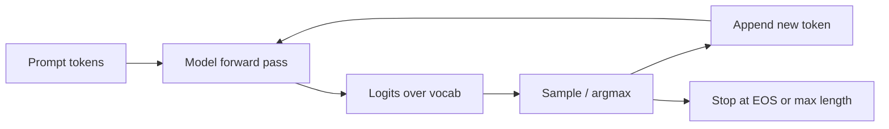
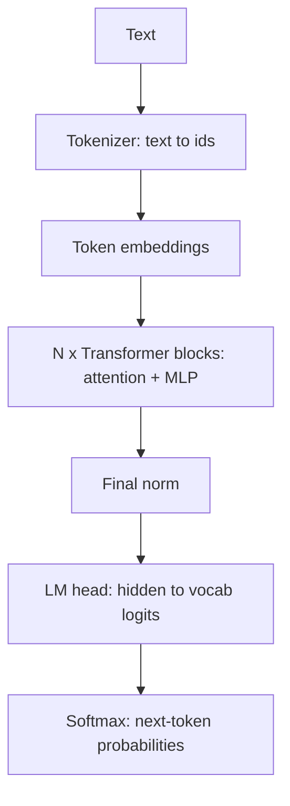

# Language Models

A language model is a program that, given some text, tells you how likely every possible next piece of text is. That is the whole trick. Chat assistants, code completion, reasoning models, and the tiny model running on your phone's keyboard are all the same idea scaled, shaped, and post-trained differently. This section takes you from raw text to a working modern transformer, and explains what changes when you deliberately build a *small* one.

!!! abstract "What you'll learn"
    - What a language model actually computes: next-token probabilities and the autoregressive factorization
    - How a model turns text into numbers (tokenization) and numbers back into text (sampling)
    - What separates an LLM from an SLM, and why "small" is a design target rather than a compromise
    - Which small open-weight models are worth studying and what they have in common
    - The map of this section and the order to read it in

## What a language model computes

Pick a fixed vocabulary of **tokens**: pieces of text such as `"the"`, `" cat"`, `"ing"`, or single bytes. A language model is a function that takes a sequence of tokens $x_1, \dots, x_{t}$ and returns a probability distribution over the vocabulary for the next token:

$$
p_\theta(x_{t+1} \mid x_1, \dots, x_t)
$$

$\theta$ is the set of learned parameters (weights). The output is a vector of size $|V|$ (vocabulary size, typically 32k to 260k entries) that sums to 1.

### The autoregressive factorization

Why is "predict the next token" enough to model *all* of language? Because of the chain rule of probability. Any joint distribution over a sequence can be written exactly as a product of conditionals:

$$
p(x_1, x_2, \dots, x_T) = \prod_{t=1}^{T} p(x_t \mid x_1, \dots, x_{t-1})
$$

No approximation is involved. If you can predict each token given everything before it, you have a full model of the probability of any text. This is called **autoregressive** modeling: each output is fed back in as input for the next step.

Training maximizes the probability the model assigns to real text, which in practice means minimizing the average **cross-entropy** (negative log-likelihood) over every position:

$$
\mathcal{L}(\theta) = -\frac{1}{T}\sum_{t=1}^{T} \log p_\theta(x_t \mid x_{<t})
$$

You will see this loss reported as a number around 2-4 for a decent model on web text. Its exponential, $e^{\mathcal{L}}$, is the **perplexity**: roughly "how many tokens the model is choosing between, on average". A perplexity of 10 means the model is about as uncertain as a fair 10-sided die at each step.

!!! tip "One forward pass, T training examples"
    A transformer with a causal mask predicts the next token at *every* position in parallel. A single 2048-token sequence gives you 2048 prediction targets in one forward pass. This parallelism is the main reason transformers replaced RNNs for language modeling.

### Generation is just a loop

At inference time you run the model, pick a token from the output distribution, append it, and repeat:



```python title="the core loop (pseudocode-level PyTorch)"
import torch

@torch.no_grad()
def generate(model, ids, max_new_tokens, temperature=1.0):
    # ids: (batch, seq) tensor of token ids
    for _ in range(max_new_tokens):
        logits = model(ids)[:, -1, :]          # logits for the last position only
        probs = torch.softmax(logits / temperature, dim=-1)
        next_id = torch.multinomial(probs, 1)  # sample one token per batch row
        ids = torch.cat([ids, next_id], dim=1)
    return ids
```

Everything about "chatting", "reasoning", or "following instructions" lives on top of this loop: in the training data, the post-training, and the prompt format. The mechanics never change. Decoding strategies (top-k, top-p, KV cache) are covered in [Inference](../inference/inference.md).

### What the model is made of



Each box gets its own page in this section.

## LLM vs SLM: what "small" means

There is no official cutoff, but in 2026 practice the terms are used roughly like this:

| Term | Rough parameter range | Where it runs | Typical examples |
|---|---|---|---|
| Tiny / toy | under 100M | Your laptop, for learning | nanoGPT Shakespeare, GPT-2 small (124M) |
| **SLM** (small language model) | ~100M to ~10B | Phones, laptops, single consumer GPU, edge devices | SmolLM2 (135M, 360M, 1.7B), SmolLM3 (3B), Llama 3.2 (1B, 3B), Gemma 3 (270M, 1B, 4B), Qwen2.5 / Qwen3 small variants (0.5B-8B), Phi-3/Phi-4-mini (3.8B) |
| LLM | ~10B and up | Multi-GPU servers, cloud APIs | Llama 3.1 70B/405B, Qwen3 large and MoE variants, DeepSeek-V3 (671B total MoE) |

"Small" is about **deployment constraints**, not about being a worse version of a big model:

- **Memory.** A model's weights take `params x bytes-per-param`. A 1B model in bf16 is about 2 GB; quantized to 4 bits it is about 0.5-0.6 GB and fits comfortably on a phone. A 70B model in bf16 is about 140 GB and needs multiple datacenter GPUs.
- **Latency.** Token-by-token generation is usually memory-bandwidth bound: each new token requires reading all the weights once. Fewer bytes of weights means more tokens per second on the same hardware.
- **Cost.** Serving cost scales with active parameters. If a 3B model solves your narrow task as well as a 70B one, you pay roughly 20x less compute per token.
- **Privacy and offline use.** On-device models keep data local and work without a network.
- **Fine-tunability.** You can fully fine-tune a 1B model on one GPU in hours. That makes SLMs the natural target for domain specialization (see [Fine-tuning](../finetuning/index.md)).

### How modern SLMs get good

A 2026-era 1B model is far stronger than GPT-2 at 1.5B. Three things explain most of the gap:

1. **Far more training data than "compute-optimal".** SmolLM2-1.7B was trained on roughly 11 trillion tokens; Llama 3.2 1B/3B on up to about 9 trillion. That is hundreds to thousands of tokens per parameter, versus the ~20 that the Chinchilla scaling law calls compute-optimal. Spending extra training compute buys a smaller, cheaper-to-serve model. The [Scaling Laws](scaling-laws.md) page explains why this is rational.
2. **Better data.** Heavy filtering, deduplication, synthetic textbook-style data (the Phi series popularized this), curated math and code mixtures.
3. **Distillation.** A large "teacher" model's outputs supervise the small "student". Instead of training only on the one-hot next token, the student matches the teacher's full probability distribution, which carries far more signal per token. Llama 3.2 1B/3B used logits from Llama 3.1 8B and 70B during pretraining; Gemma's small models are also distilled.

$$
\mathcal{L}_{\text{KD}} = \mathrm{KL}\big(p_{\text{teacher}}(\cdot \mid x_{<t}) \,\|\, p_{\text{student}}(\cdot \mid x_{<t})\big)
$$

Architecturally, SLMs also make deliberate choices that matter less at large scale: tied input/output embeddings, deep-and-thin shapes, grouped-query attention, and careful vocabulary sizing. These are covered in [Modern Architectures & SLM Design](modern-architectures.md).

!!! note "SLMs are a sweet spot for learning"
    Everything that matters about LLMs (tokenization, attention, scaling, data quality, post-training) shows up at the 100M-1B scale, and you can actually afford to train one. [Project 9](../projects/slm-500m.md) builds a 500M model from scratch.

## Section map

Read these in order. Each page builds on the code of the previous one.

<div class="grid cards" markdown>

-   **[Tokenization](tokenization.md)**

    ---

    Characters vs words vs subwords. Byte-level BPE implemented from scratch, then the production tools (tiktoken, HF `tokenizers`), special tokens, chat templates, and pitfalls.

-   **[Embeddings & Attention](attention.md)**

    ---

    From token ids to vectors, positional information, and scaled dot-product attention derived step by step. Multi-head attention in PyTorch, causal masks, and FlashAttention.

-   **[The Transformer, Line by Line](transformer.md)**

    ---

    A complete GPT-style decoder in about 200 lines of PyTorch, parameter counting with a worked example, and a tiny Shakespeare training run.

-   **[Modern Architectures & SLM Design](modern-architectures.md)**

    ---

    RMSNorm, RoPE, SwiGLU, GQA, QK-norm, sliding windows, Mixture-of-Experts, and how to choose depth, width, and vocabulary for a small model.

-   **[Scaling Laws & Compute](scaling-laws.md)**

    ---

    Kaplan vs Chinchilla, the 6ND rule, why SLMs are "overtrained", and how to estimate GPU hours and cost before you start.

</div>

Two more pages build on this section but are **electives**: they sit in the "Beyond the Core" module after Fine-tuning, and nothing on the way to the projects depends on them. Read them when you are curious, or skip them.

- **[Architecture Families & Beyond Transformers](architecture-families.md)**: encoders (BERT), encoder-decoders (T5), state space models such as Mamba, linear attention, hybrids, and diffusion language models, and why decoder-only won.
- **[Multimodal Models](multimodal.md)**: vision transformers, CLIP, projectors, and a toy vision-language model built on the GPT from this section. Its last part fine-tunes a real VLM, which assumes [SFT](../post-training/sft.md) and [LoRA](../finetuning/lora-qlora.md).

!!! warning "Common pitfalls"
    - **Thinking "the model knows facts" is separate from next-token prediction.** It is not. Everything the model "knows" is encoded in how it shifts next-token probabilities.
    - **Comparing loss across tokenizers.** Per-token loss depends on the tokenizer: a tokenizer with bigger tokens has fewer, harder predictions. Compare bits-per-byte or downstream evals instead.
    - **Equating parameter count with capability.** Training tokens, data quality, and post-training matter as much as size at the small end.
    - **Ignoring the embedding table.** At 100M-1B scale, embeddings can be 20-30% of all parameters. "Small" models can be surprisingly embedding-heavy.

## Check your understanding

??? question "Why is next-token prediction not an approximation of the full probability of a sequence?"
    By the chain rule of probability, $p(x_1,\dots,x_T) = \prod_t p(x_t \mid x_{<t})$ holds exactly for any distribution. A perfect next-token predictor is a perfect sequence model. The approximation comes only from the model being imperfect, not from the factorization.

??? question "A model has a cross-entropy loss of 2.3 nats per token. What is its perplexity, and what does that mean intuitively?"
    $e^{2.3} \approx 10$. On average the model is as uncertain as if it were choosing uniformly among about 10 tokens at each step.

??? question "Why does a smaller model generate tokens faster on the same hardware, even with batch size 1?"
    Autoregressive decoding at small batch sizes is memory-bandwidth bound: every new token requires reading all weights from memory once. Fewer bytes of weights means less data movement per token, so more tokens per second.

??? question "What extra signal does distillation give a student model compared to normal next-token training?"
    Normal training uses a one-hot target (the single actual next token). Distillation uses the teacher's full probability distribution, which also tells the student how plausible the *other* tokens were. That "dark knowledge" is a much richer training signal per token.

## Further reading

- Radford et al., [Language Models are Unsupervised Multitask Learners (GPT-2)](https://cdn.openai.com/better-language-models/language_models_are_unsupervised_multitask_learners.pdf), 2019
- Brown et al., [Language Models are Few-Shot Learners (GPT-3)](https://arxiv.org/abs/2005.14165), 2020
- Hinton, Vinyals, Dean, [Distilling the Knowledge in a Neural Network](https://arxiv.org/abs/1503.02531), 2015
- Allal et al., [SmolLM2: When Smol Goes Big](https://arxiv.org/abs/2502.02737), 2025
- Gemma Team, [Gemma 3 Technical Report](https://arxiv.org/abs/2503.19786), 2025
- Meta, [The Llama 3 Herd of Models](https://arxiv.org/abs/2407.21783), 2024
- Abdin et al., [Phi-3 Technical Report](https://arxiv.org/abs/2404.14219), 2024
