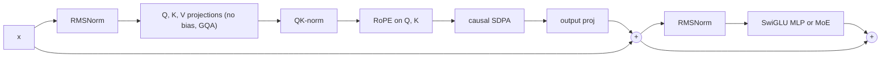
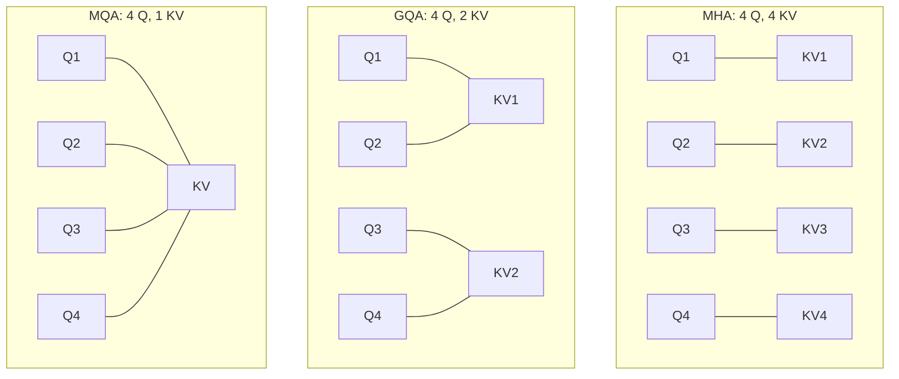
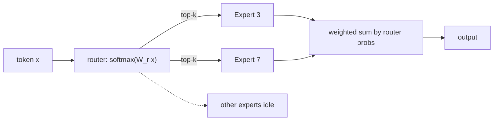

# Modern Architectures & SLM Design

The GPT you built on the previous page is essentially 2019 technology. A 2026 model like Llama 3.2, Qwen3, Gemma 3, or SmolLM3 looks almost the same from a distance: token embeddings, a stack of pre-norm blocks with attention and an MLP, a final norm, an LM head. The differences are a dozen targeted upgrades, each of which buys stability, speed, memory, or longer context. This page walks through each one with math and code, then turns to the question that matters most for this site: how do you *shape* a small model?

!!! abstract "What you'll learn"
    - RMSNorm, RoPE (with derivation and code), SwiGLU, and why biases disappeared
    - Grouped-query and multi-query attention, and their effect on the KV cache
    - QK-norm, sliding window attention, and long-context techniques
    - Mixture-of-Experts: routing, load balancing, and DeepSeek/Mixtral-style designs
    - Multi-head latent attention, briefly
    - Designing an SLM: depth vs width, the embedding budget, vocabulary size, and real configs

## What changed since GPT-2

| Component | GPT-2 (2019) | Typical 2024-2026 model |
|---|---|---|
| Normalization | LayerNorm | **RMSNorm** |
| Positions | Learned absolute table | **RoPE** (rotary) |
| MLP | GELU, $4d$ hidden | **SwiGLU**, about $\frac{8}{3}d$ hidden (often more) |
| Attention heads | Multi-head (MHA) | **Grouped-query (GQA)** |
| Biases | Everywhere | **None** (mostly) |
| Attention stability | none | **QK-norm** in several recent families |
| Context | 1024 | 8k-128k+, sometimes with **sliding window** layers |
| FFN | Dense | Dense for SLMs, **Mixture-of-Experts** for many large models |



## RMSNorm

LayerNorm subtracts the mean and divides by the standard deviation. Zhang & Sennrich (2019) found that the re-centering contributes little; re-scaling alone is enough. **RMSNorm** divides by the root-mean-square and applies a learned gain, with no bias:

$$
\mathrm{RMSNorm}(x) = \gamma \odot \frac{x}{\sqrt{\frac{1}{d}\sum_{i=1}^d x_i^2 + \epsilon}}
$$

It is slightly cheaper (one reduction instead of two), has fewer parameters, and is equally stable.

```python title="RMSNorm"
class RMSNorm(nn.Module):
    def __init__(self, dim: int, eps: float = 1e-6):
        super().__init__()
        self.eps = eps
        self.weight = nn.Parameter(torch.ones(dim))

    def forward(self, x):
        # compute in fp32 for stability, cast back to input dtype
        xf = x.float()
        xf = xf * torch.rsqrt(xf.pow(2).mean(-1, keepdim=True) + self.eps)
        return self.weight * xf.type_as(x)
```

PyTorch 2.4+ also ships `torch.nn.RMSNorm`. (Gemma's implementation parameterizes the gain as $1 + \gamma$ with $\gamma$ initialized to zero; same function, different storage. This matters when porting weights.)

## RoPE: rotary position embeddings

Learned absolute positions have two problems: the model cannot handle positions beyond the table, and attention has to *learn* that relative distance matters. **RoPE** (Su et al., 2021) encodes position by **rotating** query and key vectors by an angle proportional to their position. The dot product of two rotated vectors then depends only on their *relative* offset.

### The math in two dimensions

Take a 2D query $q$ at position $m$ and a key $k$ at position $n$. Rotate each by its position times a frequency $\theta$:

$$
R(\phi) = \begin{pmatrix}\cos\phi & -\sin\phi \\ \sin\phi & \cos\phi\end{pmatrix}, \qquad
\tilde q_m = R(m\theta)\, q, \quad \tilde k_n = R(n\theta)\, k
$$

Rotation matrices satisfy $R(a)^\top R(b) = R(b - a)$, so

$$
\tilde q_m^\top \tilde k_n = q^\top R(m\theta)^\top R(n\theta)\, k = q^\top R\big((n-m)\theta\big)\, k
$$

The score depends on content ($q$, $k$) and on the offset $n - m$, never on absolute positions. That is exactly the inductive bias we want.

### Many dimensions, many frequencies

For head dimension $d_h$, split the vector into $d_h/2$ pairs and rotate pair $i$ with its own frequency

$$
\theta_i = b^{-2i/d_h}, \qquad i = 0, 1, \dots, \tfrac{d_h}{2} - 1
$$

with base $b = 10{,}000$ originally (Llama 3 uses $500{,}000$). Early pairs rotate fast and capture fine local position; late pairs rotate slowly and capture coarse long-range position, like the hands of a clock.

### Code

The common "rotate-half" implementation (used by Llama and Hugging Face) pairs dimension $i$ with dimension $i + d_h/2$ rather than adjacent dimensions. It is the same math with a different memory layout, and it is fully vectorized:

```python title="rope.py"
def rope_cache(seq_len: int, head_dim: int, base: float = 10000.0, device=None):
    """Precompute cos/sin tables of shape (seq_len, head_dim)."""
    inv_freq = 1.0 / (base ** (torch.arange(0, head_dim, 2, device=device).float() / head_dim))
    t = torch.arange(seq_len, device=device).float()
    freqs = torch.outer(t, inv_freq)               # (T, head_dim/2): angle = pos * theta_i
    emb = torch.cat([freqs, freqs], dim=-1)        # (T, head_dim)
    return emb.cos(), emb.sin()


def rotate_half(x):
    x1, x2 = x.chunk(2, dim=-1)
    return torch.cat([-x2, x1], dim=-1)


def apply_rope(x, cos, sin):
    """x: (B, H, T, Dh); cos/sin: (T, Dh). Rotates each (x_i, x_{i+Dh/2}) pair."""
    return x * cos + rotate_half(x) * sin
```

Verify the relative-position property: the same $q$, $k$ at offsets (10, 3), (50, 43), and (90, 83) all give the same score.

```python
Dh = 64
cos, sin = rope_cache(100, Dh)
q, k = torch.randn(1, 1, 1, Dh), torch.randn(1, 1, 1, Dh)
Q = apply_rope(q.expand(1, 1, 100, Dh), cos, sin)[0, 0]   # q placed at every position
K = apply_rope(k.expand(1, 1, 100, Dh), cos, sin)[0, 0]
print(Q[10] @ K[3], Q[50] @ K[43], Q[90] @ K[83])          # all equal (up to float error)
```

RoPE is applied to $Q$ and $K$ only (not $V$), inside every attention layer, and adds no parameters. You can drop the `pos_emb` table from the GPT entirely.

!!! warning "RoPE layout must match the checkpoint"
    Meta's original Llama code rotates *adjacent* pairs (complex-number formulation); HF's Llama uses rotate-half and permutes the Q/K weights at conversion time. If you load weights from one convention into code using the other, the model runs but produces garbage.

## SwiGLU

A **gated linear unit** multiplies two linear projections, one passed through a nonlinearity acting as a "gate". Shazeer (2020) tested variants; SwiGLU (with the SiLU / Swish activation $\mathrm{SiLU}(x) = x \cdot \sigma(x)$) became the default:

$$
\mathrm{SwiGLU}(x) = W_{\text{down}}\big(\mathrm{SiLU}(W_{\text{gate}}\, x) \odot W_{\text{up}}\, x\big)
$$

There are now three matrices instead of two. To keep the parameter count equal to a $4d$ GELU MLP ($8d^2$), the hidden size is set to $\frac{2}{3} \cdot 4d = \frac{8}{3}d$, since $3 \cdot d \cdot \frac{8}{3}d = 8d^2$. In practice many models round up or go wider (Llama 3.2 1B uses $d = 2048$ with hidden 8192, i.e. $4d$).

```python title="SwiGLU"
class SwiGLU(nn.Module):
    def __init__(self, d_model: int, hidden: int):
        super().__init__()
        self.gate = nn.Linear(d_model, hidden, bias=False)
        self.up = nn.Linear(d_model, hidden, bias=False)
        self.down = nn.Linear(hidden, d_model, bias=False)

    def forward(self, x):
        return self.down(F.silu(self.gate(x)) * self.up(x))
```

Why does gating help? Nobody has a fully satisfying theory; empirically it gives lower loss at equal parameters and compute. Many implementations fuse `gate` and `up` into one matmul.

## No biases

Llama dropped bias terms from all linear layers and norms. They add few parameters but provide almost no benefit, and removing them simplifies sharding and slightly improves training stability. Most modern models follow suit, with exceptions (Qwen2 and Qwen2.5 keep a bias on the Q/K/V projections; Qwen3 removed it).

## GQA and MQA: shrinking the KV cache

During generation you cache every past token's keys and values (the **KV cache**), so each new token only computes its own Q, K, V. The cache size is

$$
\text{KV bytes} = 2 \times L \times n_{kv} \times d_h \times T \times B \times \text{bytes per value}
$$

With standard multi-head attention, $n_{kv} = n_{\text{heads}}$, and the cache often exceeds the weights at long context. Two fixes:

- **Multi-query attention (MQA)** (Shazeer, 2019): all query heads share a *single* K/V head. Cache shrinks by $n_{\text{heads}}\times$; quality drops a bit.
- **Grouped-query attention (GQA)** (Ainslie et al., 2023): query heads are split into $n_{kv}$ groups, each sharing one K/V head. With 32 query heads and 8 KV heads, the cache is 4x smaller with quality very close to MHA.



GQA also cuts parameters in the K/V projections, which matters for SLMs. Implementation: compute fewer K/V heads, then repeat each one to match the query heads before attention.

## QK-norm

At large learning rates or long training runs, attention logits $q \cdot k$ can grow without bound, saturating the softmax and producing loss spikes. **QK-norm** applies an RMSNorm (or LayerNorm) to each head's $q$ and $k$ *before* RoPE and the dot product, which bounds their scale. It was used for training stability in large vision transformers (Dehghani et al., 2023) and appears in OLMo 2, Qwen3, and Gemma 3 among others. It costs two tiny norms per layer.

### A modern attention layer and block

Putting GQA, QK-norm, RoPE, no biases, RMSNorm, and SwiGLU together:

```python title="modern_block.py"
import torch
import torch.nn as nn
import torch.nn.functional as F

# assumes RMSNorm, SwiGLU, rope_cache, apply_rope from above


class GQAttention(nn.Module):
    def __init__(self, d_model, n_heads, n_kv_heads, qk_norm=True):
        super().__init__()
        assert n_heads % n_kv_heads == 0
        self.h, self.kv, self.dh = n_heads, n_kv_heads, d_model // n_heads
        self.q = nn.Linear(d_model, n_heads * self.dh, bias=False)
        self.k = nn.Linear(d_model, n_kv_heads * self.dh, bias=False)
        self.v = nn.Linear(d_model, n_kv_heads * self.dh, bias=False)
        self.o = nn.Linear(n_heads * self.dh, d_model, bias=False)
        self.q_norm = RMSNorm(self.dh) if qk_norm else nn.Identity()
        self.k_norm = RMSNorm(self.dh) if qk_norm else nn.Identity()

    def forward(self, x, cos, sin):
        B, T, _ = x.shape
        q = self.q(x).view(B, T, self.h, self.dh).transpose(1, 2)    # (B, H,   T, Dh)
        k = self.k(x).view(B, T, self.kv, self.dh).transpose(1, 2)   # (B, KV,  T, Dh)
        v = self.v(x).view(B, T, self.kv, self.dh).transpose(1, 2)
        q, k = self.q_norm(q), self.k_norm(k)                        # QK-norm (per head)
        q, k = apply_rope(q, cos[:T], sin[:T]), apply_rope(k, cos[:T], sin[:T])
        # each KV head serves h/kv query heads
        k = k.repeat_interleave(self.h // self.kv, dim=1)
        v = v.repeat_interleave(self.h // self.kv, dim=1)
        y = F.scaled_dot_product_attention(q, k, v, is_causal=True)
        return self.o(y.transpose(1, 2).reshape(B, T, -1))


class Block(nn.Module):
    def __init__(self, d_model, n_heads, n_kv_heads, ffn_hidden):
        super().__init__()
        self.norm1, self.norm2 = RMSNorm(d_model), RMSNorm(d_model)
        self.attn = GQAttention(d_model, n_heads, n_kv_heads)
        self.mlp = SwiGLU(d_model, ffn_hidden)

    def forward(self, x, cos, sin):
        x = x + self.attn(self.norm1(x), cos, sin)
        return x + self.mlp(self.norm2(x))


# usage
block = Block(d_model=256, n_heads=8, n_kv_heads=2, ffn_hidden=688)
cos, sin = rope_cache(seq_len=1024, head_dim=256 // 8)
x = torch.randn(2, 16, 256)
print(block(x, cos, sin).shape)        # torch.Size([2, 16, 256])
```

Since PyTorch 2.5, `F.scaled_dot_product_attention(..., enable_gqa=True)` accepts fewer K/V heads directly, avoiding the explicit `repeat_interleave` copy.

## Sliding window attention

Instead of every token attending to all previous tokens, each token attends only to the last $W$ tokens. Compute and KV cache become $O(T W)$ instead of $O(T^2)$. Information can still travel farther than $W$ by hopping across layers (layer $\ell$ can indirectly see about $\ell \times W$ tokens back), but less reliably.

Pure sliding-window models (Mistral 7B v0.1 used a 4096 window) can lose long-range recall, so recent designs **interleave** local and global layers. Gemma 2 alternated them 1:1; Gemma 3 uses five local layers (1024-token window) per global layer, which cuts the KV cache at long context dramatically while keeping full-context layers for retrieval.

With SDPA you implement a window by passing a boolean mask that is both causal and banded:

```python
i = torch.arange(T)[:, None]
j = torch.arange(T)[None, :]
allowed = (j <= i) & (j > i - W)                  # True = may attend
y = F.scaled_dot_product_attention(q, k, v, attn_mask=allowed)
```

(Custom masks fall back to slower kernels; production code uses FlashAttention's window support or PyTorch's FlexAttention.)

## Long context techniques

Training at 128k tokens from the start is wasteful because attention cost is quadratic and most data is short. The standard recipe:

1. **Pretrain at a short context** (2k-8k).
2. **Extend** in a final phase on long documents, while adjusting RoPE so positions beyond the training range don't produce unseen rotation angles:
    - *Raise the RoPE base* (e.g. from 10k to 500k or more), so the slowest frequencies rotate less over the long range ("NTK-aware" scaling builds on this).
    - *Position interpolation* (Chen et al., 2023): compress positions by a factor $s$ so a 32k sequence maps into the trained 4k range.
    - *YaRN* (Peng et al., 2023): scale different frequency bands differently, plus an attention temperature tweak. Used by Qwen and others for context extension.
3. **Make it affordable**: FlashAttention, GQA, sliding-window layers, and sequence/context parallelism across GPUs.

Claimed context length and *usable* context length differ. Test with needle-in-a-haystack and multi-hop retrieval benchmarks such as RULER rather than trusting the config.

## Mixture-of-Experts

A **Mixture-of-Experts (MoE)** layer replaces the single MLP with $E$ expert MLPs and a **router** that sends each token to only $k$ of them. Total parameters grow with $E$, but compute per token grows only with $k$. You get the knowledge capacity of a big model at the per-token FLOPs of a small one.



$$
y = \sum_{e \in \text{TopK}(p(x))} \frac{p_e(x)}{\sum_{e' \in \text{TopK}} p_{e'}(x)}\, \mathrm{Expert}_e(x), \qquad p(x) = \mathrm{softmax}(W_r x)
$$

### Load balancing

Left alone, the router collapses: a few experts get most tokens, get better, get chosen more. The classic fix (Switch Transformer, Fedus et al., 2021) is an **auxiliary loss**:

$$
\mathcal{L}_{\text{aux}} = \alpha \cdot E \sum_{e=1}^{E} f_e \, P_e
$$

where $f_e$ is the fraction of tokens routed to expert $e$ and $P_e$ is the mean router probability for $e$. It is minimized (value 1, before $\alpha$) when routing is uniform. $\alpha$ is small, around $10^{-2}$ to $10^{-3}$. Experts also have a **capacity** limit in many implementations; overflow tokens are dropped or passed through the residual.

```python title="moe.py"
import torch
import torch.nn as nn
import torch.nn.functional as F

# assumes SwiGLU from above


class MoE(nn.Module):
    """Token-choice top-k Mixture-of-Experts with a Switch-style load-balancing loss."""

    def __init__(self, d_model, ffn_hidden, n_experts=8, top_k=2):
        super().__init__()
        self.n_experts, self.top_k = n_experts, top_k
        self.router = nn.Linear(d_model, n_experts, bias=False)
        self.experts = nn.ModuleList([SwiGLU(d_model, ffn_hidden) for _ in range(n_experts)])

    def forward(self, x):
        B, T, C = x.shape
        x = x.reshape(-1, C)                                  # (N, C), N = B*T tokens
        probs = F.softmax(self.router(x), dim=-1)             # (N, E)
        topk_p, topk_idx = probs.topk(self.top_k, dim=-1)     # (N, k)
        topk_p = topk_p / topk_p.sum(-1, keepdim=True)        # renormalize over chosen experts

        out = torch.zeros_like(x)
        for e, expert in enumerate(self.experts):
            token_idx, slot = (topk_idx == e).nonzero(as_tuple=True)
            if token_idx.numel() == 0:
                continue
            out.index_add_(0, token_idx, expert(x[token_idx]) * topk_p[token_idx, slot, None])

        # load balancing: f_e = fraction of routing slots sent to e, P_e = mean router prob
        f = torch.zeros(self.n_experts, device=x.device)
        f.scatter_add_(0, topk_idx.flatten(), torch.ones(topk_idx.numel(), device=x.device))
        f = f / topk_idx.numel()
        P = probs.mean(0)
        aux_loss = self.n_experts * (f * P).sum()             # ~1.0 when perfectly balanced
        return out.view(B, T, C), aux_loss


moe = MoE(d_model=256, ffn_hidden=512, n_experts=8, top_k=2)
y, aux = moe(torch.randn(2, 16, 256))
print(y.shape, aux.item())             # torch.Size([2, 16, 256]) ~1.0
```

Add `aux_alpha * aux_loss` (summed over MoE layers) to the language modeling loss. The per-expert Python loop is fine for learning; real systems use grouped GEMM kernels and **expert parallelism** (different experts on different GPUs, with all-to-all communication).

### Real designs

- **Mixtral 8x7B** (Mistral AI, 2024): 8 experts per layer, top-2 routing; about 47B total parameters, about 13B active per token.
- **DeepSeek-V3** (2024): **fine-grained** experts (256 small routed experts, 8 active per token) plus a **shared expert** every token passes through, 671B total and 37B active. It replaces the auxiliary loss with **auxiliary-loss-free balancing**: a per-expert bias added to router scores for top-k *selection only*, nudged up or down after each step depending on whether that expert was under- or over-loaded.
- **Qwen3 MoE** variants (e.g. 30B total with about 3B active) bring MoE to sizes that run on a single GPU.

MoE is less common at SLM scale: it saves compute, not memory. On a phone, memory is the binding constraint, so all experts still need to fit, and a dense model with the same total parameters is usually better per byte.

## Multi-head latent attention (briefly)

DeepSeek-V2 introduced **MLA** to shrink the KV cache further than GQA. Instead of caching per-head keys and values, each token's hidden state is down-projected to a small **latent vector** $c_t$ (a few hundred dimensions), and only $c_t$ is cached. Keys and values for all heads are reconstructed by up-projections at attention time, and those up-projections can be algebraically folded into the query and output projections. Because RoPE does not commute with that folding, MLA carries a small separate "decoupled" RoPE key. The result is a cache comparable to or smaller than aggressive GQA, with quality reported to match full MHA. It is used in DeepSeek-V2/V3 and R1.

## Designing an SLM

At 7B+ scale most architecture choices are settled conventions. Below 1B they are not, because two costs that are negligible at scale become dominant: **the embedding table** and **the per-layer width**.

### Depth vs width

For a fixed parameter budget $N \approx 12 L d^2$, you can be wide and shallow (few layers, large $d$) or deep and thin. The MobileLLM paper (Liu et al., 2024) studied this specifically for sub-billion models and found that **depth matters more than width at this scale**: deep-and-thin models (around 30 layers for a ~125M model) outperformed shallower, wider ones of the same size on reasoning and QA benchmarks. This contradicted the earlier belief (from Kaplan et al.) that shape barely matters when parameter count is fixed. MobileLLM also recommended embedding sharing, GQA, and SwiGLU, and SmolLM's smallest models adopted the same deep-and-thin shape.

Trade-offs to keep in mind:

- **Deep** models do more sequential computation per token: more layers means more kernel launches and higher latency at batch size 1, and slightly more activation memory in training.
- **Wide** models use GPU matmuls more efficiently (bigger matrices, better utilization).
- Keep $d$ a multiple of 64 (ideally 128) and head dim at 64 or 128 for kernel efficiency.

### The embedding share

The embedding table costs $|V| \cdot d$ parameters, and it does almost no computation (a lookup). At small scale it is a large fraction of the model:

| Model | $|V|$ | $d$ | Embedding params | Approx. share of total |
|---|---|---|---|---|
| SmolLM2-135M | 49,152 | 576 | 28.3M | ~21% |
| SmolLM2-360M | 49,152 | 960 | 47.2M | ~13% |
| Qwen2.5-0.5B | 151,936 | 896 | 136M | ~28% |
| Llama 3.2 1B | 128,256 | 2,048 | 263M | ~21% |
| GPT-2 small | 50,257 | 768 | 38.6M | ~31% (incl. positions) |

(All of these tie input and output embeddings; without tying the share would nearly double.) Gemma 3 270M is an extreme example: roughly 170M embedding parameters and 100M transformer parameters, a deliberate choice of a huge 262k multilingual vocabulary for fine-tuning flexibility.

**Design rules of thumb:**

1. **Tie embeddings** below a few billion parameters. It is nearly free in quality and saves $|V| d$ parameters.
2. **Size the vocabulary to the job.** English and code at 100-500M: 32k-50k is a good range. Multilingual: you need more, and should budget the parameters explicitly.
3. **Report non-embedding parameters** when comparing shapes and in scaling law fits; embeddings do not scale compute the same way.

### Example SLM configurations

These are the models' published configs (all use RMSNorm, RoPE, SwiGLU, no MLP biases, tied embeddings). Always check the model's `config.json` before relying on exact values.

| Model | Layers | $d$ | Q heads / KV heads | FFN hidden | Vocab | Notes |
|---|---|---|---|---|---|---|
| SmolLM2-135M | 30 | 576 | 9 / 3 | 1536 | 49,152 | Deep and thin, MobileLLM-style |
| SmolLM2-360M | 32 | 960 | 15 / 5 | 2560 | 49,152 | |
| Qwen2.5-0.5B | 24 | 896 | 14 / 2 | 4864 | 151,936 | QKV bias |
| Qwen3-0.6B | 28 | 1024 | 16 / 8 | 3072 | 151,936 | QK-norm, head dim 128 |
| Llama 3.2 1B | 16 | 2048 | 32 / 8 | 8192 | 128,256 | Wider and shallower; distilled |
| SmolLM2-1.7B | 24 | 2048 | 32 / 32 | 8192 | 49,152 | Plain MHA |
| Llama 3.2 3B | 28 | 3072 | 24 / 8 | 8192 | 128,256 | |

Notice the spread: Llama 3.2 1B is relatively shallow and wide (good GPU efficiency, lots of embedding parameters from the 128k vocab), while SmolLM2-135M goes deep and thin. Both work; what they share is GQA, tying, and very long training runs. For the 500M model in [Project 1](../projects/p1-500m-model.md), a reasonable starting point is about 24-32 layers, $d$ around 1024-1280, GQA with 4:1 or so, a 32k-50k vocabulary, and tied embeddings.

!!! warning "Common pitfalls"
    - **Applying RoPE to V** or after the attention softmax. It goes on Q and K only, before the dot product.
    - **Forgetting to offset RoPE positions during cached generation.** The new token at position $t$ must use `cos[t]`, `sin[t]`, not position 0.
    - **Mismatched RoPE conventions** (interleaved vs rotate-half) when loading checkpoints.
    - **MoE without load balancing.** Routing collapses within a few hundred steps; half your experts become dead weight.
    - **Picking a huge vocabulary for a tiny model** because a big model used it. Do the $|V| \cdot d$ arithmetic first.
    - **Using QK-norm but initializing its gains to zero** (as you might for Gemma-style $1+\gamma$ norms in ordinary code). Gains should start at 1 in the plain formulation.

## Check your understanding

??? question "Why does RoPE make attention scores depend only on relative position?"
    Queries and keys are rotated by angles proportional to their positions. The dot product of two rotated vectors equals $q^\top R((n-m)\theta) k$ because $R(a)^\top R(b) = R(b-a)$, so absolute positions cancel and only the offset remains.

??? question "A model has 32 layers, 32 query heads, 8 KV heads, head dim 64, and runs at 32k context in bf16, batch 1. How big is the KV cache, and what would it be with full MHA?"
    $2 \times 32 \times 8 \times 64 \times 32768 \times 2$ bytes $= 2^{31}$ bytes $\approx 2.1$ GB. With MHA ($n_{kv} = 32$) it would be 4x larger, about 8.6 GB.

??? question "Why is the SwiGLU hidden size often 8/3 d rather than 4d?"
    SwiGLU has three weight matrices instead of two. Using hidden size $\frac{8}{3}d$ makes the total $3 \cdot d \cdot \frac{8}{3}d = 8d^2$, matching the $4d$ GELU MLP's parameter count, so comparisons are fair.

??? question "Why is MoE less attractive for on-device SLMs than for datacenter LLMs?"
    MoE reduces compute per token but not the memory needed to store all experts. On phones and laptops, memory capacity and bandwidth are the main constraints, so a dense model with the same total parameter count usually gives more quality per byte.

??? question "For a 125M-parameter model, what did MobileLLM find about depth vs width?"
    Deeper, thinner models (around 30 layers) beat shallower, wider ones at the same parameter count at sub-billion scale, contradicting the idea that shape doesn't matter when parameters are fixed.

## Further reading

- Zhang & Sennrich, [Root Mean Square Layer Normalization](https://arxiv.org/abs/1910.07467), 2019
- Su et al., [RoFormer: Enhanced Transformer with Rotary Position Embedding](https://arxiv.org/abs/2104.09864), 2021
- Shazeer, [GLU Variants Improve Transformer](https://arxiv.org/abs/2002.05202), 2020
- Shazeer, [Fast Transformer Decoding: One Write-Head is All You Need (MQA)](https://arxiv.org/abs/1911.02150), 2019
- Ainslie et al., [GQA: Training Generalized Multi-Query Transformer Models](https://arxiv.org/abs/2305.13245), 2023
- Dehghani et al., [Scaling Vision Transformers to 22 Billion Parameters](https://arxiv.org/abs/2302.05442), 2023 (QK-norm)
- Jiang et al., [Mistral 7B](https://arxiv.org/abs/2310.06825), 2023 (sliding window)
- Chen et al., [Extending Context Window via Positional Interpolation](https://arxiv.org/abs/2306.15595), 2023; Peng et al., [YaRN](https://arxiv.org/abs/2309.00071), 2023
- Fedus, Zoph, Shazeer, [Switch Transformers](https://arxiv.org/abs/2101.03961), 2021
- Jiang et al., [Mixtral of Experts](https://arxiv.org/abs/2401.04088), 2024
- DeepSeek-AI, [DeepSeek-V2 (MLA)](https://arxiv.org/abs/2405.04434), 2024, and [DeepSeek-V3 Technical Report](https://arxiv.org/abs/2412.19437), 2024
- Liu et al., [MobileLLM: Optimizing Sub-billion Parameter Language Models for On-Device Use Cases](https://arxiv.org/abs/2402.14905), 2024
- Gemma Team, [Gemma 3 Technical Report](https://arxiv.org/abs/2503.19786), 2025
- Team OLMo, [2 OLMo 2 Furious](https://arxiv.org/abs/2501.00656), 2025
