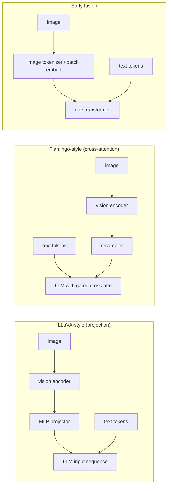

# Multimodal Models

A language model only sees token embeddings: vectors of size $d$ arranged in a sequence. It does not care where those vectors came from. If you can turn an image or a clip of audio into a short sequence of vectors in the same space as the text embeddings, the transformer you already built can read it. That is the whole idea behind modern vision-language models (VLMs): a vision encoder turns pixels into vectors, a small projector maps them into the LLM's embedding space, and the LLM does the rest. In this page you build each piece (a Vision Transformer, the CLIP contrastive loss, a projector) and wire them into the GPT from [The Transformer, Line by Line](transformer.md) to make a working toy VLM.

!!! abstract "What you'll learn"
    - How a Vision Transformer turns an image into tokens, with a from-scratch patch embedding
    - CLIP contrastive training and its loss, in code
    - The three VLM designs: LLaVA-style projection, Flamingo-style cross-attention, and early fusion
    - How many tokens an image costs, and how models compress them
    - The standard training stages: projector alignment, then visual instruction tuning
    - Audio models: Whisper-style encoder-decoders and audio tokens
    - Which open VLMs to study
    - A minimal, trainable toy VLM in PyTorch, and how to LoRA fine-tune a real one

## Images as tokens: the Vision Transformer

A ViT treats an image the way an LLM treats text. Cut a $224 \times 224$ image into non-overlapping $16 \times 16$ patches; that gives $14 \times 14 = 196$ patches. Flatten each patch ($16 \cdot 16 \cdot 3 = 768$ numbers) and multiply by a learned matrix to get a $d$-dimensional vector. Those vectors are the "tokens". Add learned position embeddings, optionally prepend a `[CLS]` token, and run a standard **bidirectional** transformer encoder (no causal mask: there is no natural left-to-right order in an image).

A `Conv2d` with `kernel_size = stride = patch` does exactly "flatten each patch and multiply by $W$", in one efficient call:

```python title="vit.py"
import torch
import torch.nn as nn
import torch.nn.functional as F


class PatchEmbed(nn.Module):
    """Cut the image into P x P patches and linearly project each to d_model.
    A Conv2d with kernel_size = stride = P is exactly 'flatten patch, multiply by W'."""
    def __init__(self, img_size=224, patch=16, in_ch=3, d_model=768):
        super().__init__()
        self.n_patches = (img_size // patch) ** 2
        self.proj = nn.Conv2d(in_ch, d_model, kernel_size=patch, stride=patch)

    def forward(self, img):                    # (B, 3, H, W)
        x = self.proj(img)                     # (B, d, H/P, W/P)
        return x.flatten(2).transpose(1, 2)    # (B, N, d), N = (H/P) * (W/P)


class ViT(nn.Module):
    def __init__(self, img_size=224, patch=16, d_model=768, n_layer=12, n_head=12, n_classes=None):
        super().__init__()
        self.patch = PatchEmbed(img_size, patch, 3, d_model)
        self.cls = nn.Parameter(torch.zeros(1, 1, d_model))
        self.pos = nn.Parameter(torch.randn(1, self.patch.n_patches + 1, d_model) * 0.02)
        layer = nn.TransformerEncoderLayer(d_model, n_head, 4 * d_model, dropout=0.0,
                                           activation="gelu", batch_first=True, norm_first=True)
        self.encoder = nn.TransformerEncoder(layer, n_layer, enable_nested_tensor=False)
        self.ln = nn.LayerNorm(d_model)
        self.head = nn.Linear(d_model, n_classes) if n_classes else None

    def forward(self, img, return_tokens=False):
        x = self.patch(img)                                     # (B, N, d)
        x = torch.cat([self.cls.expand(x.size(0), -1, -1), x], dim=1) + self.pos
        x = self.ln(self.encoder(x))                            # bidirectional
        if return_tokens:
            return x[:, 1:]                                     # patch tokens for a VLM
        return self.head(x[:, 0]) if self.head else x[:, 0]     # [CLS] summary


def clip_loss(img_emb, txt_emb, logit_scale):
    """Symmetric InfoNCE. img_emb, txt_emb: (B, d); row i of each is a matching pair."""
    img = F.normalize(img_emb, dim=-1)
    txt = F.normalize(txt_emb, dim=-1)
    logits = logit_scale.exp() * img @ txt.T                    # (B, B) cosine sims
    labels = torch.arange(img.size(0), device=img.device)       # diagonal = positives
    return (F.cross_entropy(logits, labels) + F.cross_entropy(logits.T, labels)) / 2


if __name__ == "__main__":
    vit = ViT(img_size=224, patch=16, d_model=192, n_layer=2, n_head=3)
    img = torch.randn(4, 3, 224, 224)
    print(vit.patch(img).shape, vit(img).shape, vit(img, return_tokens=True).shape)
    # torch.Size([4, 196, 192]) torch.Size([4, 192]) torch.Size([4, 196, 192])
    logit_scale = nn.Parameter(torch.tensor(1 / 0.07).log())    # learnable temperature
    print("clip loss, random pairs:", clip_loss(torch.randn(8, 64), torch.randn(8, 64), logit_scale).item())
    e = torch.randn(8, 64)
    print("clip loss, perfect pairs:", clip_loss(e, e, logit_scale).item())   # ~0
```

The ViT has weaker built-in assumptions than a CNN (no locality or translation equivariance), so it needs more data to train from scratch; on large datasets it matches or beats CNNs. For a VLM you almost never train the vision encoder yourself: you take a pretrained one, usually trained with CLIP or SigLIP, and use its **patch tokens** (`return_tokens=True`), not just the `[CLS]` vector, because the LLM needs spatial detail.

## CLIP: teaching images and text to share a space

A ViT trained to classify ImageNet learns 1000 categories. CLIP (2021) learns open-ended visual concepts from roughly 400M image-caption pairs scraped from the web, with a simple idea: train an image encoder and a text encoder together so that a matching image and caption map to nearby vectors and non-matching ones map far apart.

In a batch of $B$ pairs, compute the $B \times B$ matrix of cosine similarities between every image and every caption. The diagonal entries are the correct pairs; every off-diagonal entry is a negative. The loss is cross-entropy in both directions, image-to-text (each row should pick its diagonal) and text-to-image (each column should):

$$
\mathcal{L} = \frac{1}{2}\left[\text{CE}\big(\tau^{-1} I T^\top,\ \text{diag}\big) + \text{CE}\big(\tau^{-1} T I^\top,\ \text{diag}\big)\right]
$$

where $I$ and $T$ are the L2-normalized embeddings and $\tau$ is a learned temperature. That is `clip_loss` above. Running the demo, random embeddings give a loss well above $\ln 8 \approx 2.08$ (the temperature amplifies random similarities), and identical embeddings give a loss near zero.

Details that matter in practice:

- **The temperature is learned**, parameterized as `logit_scale = log(1/τ)` and initialized to $1/0.07$. CLIP clips it at 100 to keep training stable.
- **Batch size is the number of negatives.** CLIP used very large batches (tens of thousands), because more negatives make the task harder and the embeddings better. That is why contrastive training is expensive.
- **SigLIP** replaces the softmax with an independent sigmoid per pair (is this image-text pair a match, yes or no). It removes the need for a global normalization across the batch, works well at smaller batch sizes, and SigLIP encoders are now the most common vision towers in open VLMs.
- The same loss, applied to two text encoders (query and passage), trains the embedding models used in [RAG](../rag/fundamentals.md).

A trained CLIP gives you zero-shot classification for free: embed the prompts "a photo of a {label}" for each label, embed the image, and pick the label with the highest cosine similarity. More importantly for this page, its image encoder produces patch features that are already aligned with language, which makes the next step much easier.

## Three ways to build a VLM



### LLaVA-style: encoder + projector + LLM

The design most open VLMs use. A pretrained vision encoder (CLIP or SigLIP ViT) produces patch tokens; a small **projector** (LLaVA-1.5 used a two-layer MLP) maps each patch token from the vision dimension to the LLM's $d_{\text{model}}$; the projected tokens are placed into the LLM's input sequence where an `<image>` placeholder sits in the prompt. The LLM is an ordinary decoder-only model that now sees some "words" that came from pixels.

It is simple, reuses strong pretrained parts, and every LLM technique (KV caching, LoRA, quantization, inference engines) works unchanged. The cost is sequence length: every image adds hundreds or thousands of tokens.

### Flamingo-style: cross-attention into a frozen LLM

Flamingo (2022) keeps the LLM frozen and inserts new **gated cross-attention** layers between its blocks. Text tokens attend to visual features through these layers, exactly like the decoder of an encoder-decoder (see [Architecture Families](architecture-families.md)). Each new layer's output is multiplied by $\tanh(\alpha)$ with $\alpha$ initialized to 0, so at the start of training the model is exactly the original LLM and visual information is blended in gradually. A **Perceiver resampler** compresses a variable number of image features into a fixed small set (64 in Flamingo) using learned queries that cross-attend to the features.

Images do not consume LLM context positions, which helps with many images or video. But you add new layers inside the LLM, which complicates training and serving, and the projection approach has proven simpler to scale, so most recent open VLMs use projection. Llama 3.2 Vision is a notable cross-attention design.

### Early fusion: one model, one token stream

Early fusion drops the separate vision tower. Either images are converted into **discrete tokens** by a learned image tokenizer (a VQ-VAE style codebook, as in Chameleon), so the vocabulary contains both text and image codes and the model can also *generate* images token by token; or raw patches are linearly embedded directly into the decoder (as in Fuyu), with no pretrained encoder at all. It is the most uniform design and the natural route to "any-to-any" models, but it usually requires training from scratch on mixed data, which is expensive, and discrete image tokenization loses detail.

## How many tokens is an image?

For a ViT with patch size $P$ at resolution $H \times W$, the number of patch tokens is

$$
N = \frac{H}{P} \cdot \frac{W}{P}
$$

A CLIP ViT-L/14 at 336 px gives $24 \times 24 = 576$ tokens per image (the LLaVA-1.5 setup). A $1024 \times 1024$ document at $P = 14$ would be about 5,300 tokens: as long as a short story. Since attention cost grows with sequence length, VLMs work hard to cut this down:

- **Pixel shuffle / token merging.** Concatenate each $r \times r$ block of neighbouring patch tokens into one token with $r^2 \times$ the channels, then project. With $r = 2$ that is 4x fewer tokens. Qwen2-VL and later merge $2 \times 2$ patches this way; SmolVLM uses a more aggressive shuffle to keep token counts small for a tiny LLM.
- **Resamplers.** A fixed set of learned queries cross-attend to the patch features and output a fixed number of tokens (Flamingo's Perceiver resampler, BLIP-2's Q-Former).
- **Pooling.** Average-pool the patch grid. Gemma 3 represents each image with a fixed budget of 256 tokens.
- **Tiling / dynamic resolution.** For high-resolution inputs, split the image into crops at the encoder's native resolution, encode each, and add a downscaled global view. Qwen2-VL and Qwen2.5-VL instead process images at (near) native resolution with a variable number of tokens, so token count scales with image size.

Pixel shuffle is just a reshape:

```python title="pixel_shuffle.py"
import torch

def pixel_shuffle_tokens(x, r=2):
    """(B, N, d) patch tokens on a sqrt(N) x sqrt(N) grid -> (B, N / r^2, d * r^2).
    Each output token concatenates an r x r neighbourhood of input tokens."""
    B, N, d = x.shape
    s = int(N ** 0.5)
    x = x.view(B, s // r, r, s // r, r, d)        # split rows and cols into blocks
    x = x.permute(0, 1, 3, 2, 4, 5)               # (B, s/r, s/r, r, r, d)
    return x.reshape(B, (s // r) ** 2, r * r * d)

x = torch.randn(1, 576, 1024)                     # e.g. 24 x 24 grid of ViT tokens
print(pixel_shuffle_tokens(x, 2).shape)           # torch.Size([1, 144, 4096])
```

The projector then maps $4096 \to d_{\text{model}}$. The information is not thrown away; it is packed into wider vectors, and the projector learns what to keep.

## Training stages

A typical LLaVA-style recipe starts from a pretrained vision encoder and a pretrained (often instruction-tuned) LLM and trains in stages:

1. **Projector alignment (pretraining).** Freeze the vision encoder and the LLM; train only the projector on image-caption pairs (LLaVA used roughly half a million). The loss is ordinary next-token cross-entropy on the caption, with no loss on the image positions. This teaches the projector to map visual features to something the LLM can read. It is cheap because very few parameters train.
2. **Visual instruction tuning.** Unfreeze the LLM (fully or with LoRA) and keep training the projector on multimodal conversations: questions about images, OCR, charts, documents, multi-turn dialogue, with loss only on the assistant's answers. This is [SFT](../post-training/sft.md) with images in the prompt. Many recipes also unfreeze the vision encoder at a lower learning rate here, especially for high-resolution or document tasks.
3. **Optional further stages.** Larger interleaved image-text pretraining, video, grounding (outputting boxes or points), and preference optimization or RL to reduce hallucination about image contents, as in [Preference Optimization](../post-training/preference.md).

Mix in text-only data during stage 2. Without it, the LLM's text abilities degrade (a form of catastrophic forgetting).

## Audio

Audio follows the same pattern with different front-ends.

**Whisper-style encoder-decoder.** Whisper converts 30-second audio chunks into a log-Mel spectrogram (a 2D time-frequency image, 80 or 128 frequency bins with a frame every 10 ms), passes it through two 1D convolutions (the second with stride 2, halving the frame rate), and runs a transformer encoder over the resulting 1,500 frames. A text decoder with cross-attention generates the transcript, with special tokens selecting the language and task (transcribe or translate) and optional timestamps. It was trained on a very large weakly supervised dataset (680k hours in the original release). Speech recognition is a classic encoder-decoder task: the input is fully known up front and much longer than the output.

**Audio encoder + projector + LLM.** Exactly the LLaVA recipe with a Whisper encoder in place of the ViT: project the encoder's frames (usually downsampled further) into the LLM's embedding space. Qwen2-Audio and many speech-understanding models work this way.

**Discrete audio tokens.** To *generate* speech, models use neural audio codecs (SoundStream, EnCodec, Mimi) that compress audio into a few streams of discrete codes via residual vector quantization: the first codebook captures coarse content, later ones add detail. Each stream runs at a low frame rate (tens of frames per second), and the LLM predicts these codes like text tokens. Speech-to-speech models and modern TTS systems are built this way.

## Open VLMs worth studying

Read the model cards and technical reports of these; each makes different, instructive choices.

- **SmolVLM** (Hugging Face). A SigLIP encoder with a SmolLM2 language model, from roughly 256M parameters up. Aggressive pixel shuffle and image splitting to keep token counts low. A good model to fine-tune on a single consumer GPU, and the one used in the LoRA example below.
- **Qwen2.5-VL** (Alibaba). Native dynamic resolution with a ViT using window attention, $2 \times 2$ token merging, multimodal RoPE that encodes the time, height and width position of each visual token, strong document parsing, grounding and video understanding.
- **Gemma 3** (Google). A SigLIP vision encoder with a fixed 256-token budget per image, a "pan and scan" mode for high-resolution or non-square images, and bidirectional attention among image tokens inside an otherwise causal LLM.
- **LLaVA / LLaVA-1.5 / LLaVA-OneVision.** The reference implementations of the projection design, with fully open data and training code.
- **Idefics** and **Molmo** for open training data and detailed ablations; **Llama 3.2 Vision** for a cross-attention design.

## A toy VLM, from scratch

Time to wire it together. The `ToyVLM` below takes a small ViT and the `GPT` from [gpt.py](transformer.md), adds an MLP projector, and **prepends the projected image tokens to the text embeddings**. It reuses the GPT's own modules (`tok_emb`, `pos_emb`, `blocks`, `ln_f`, `lm_head`), so the GPT code is unchanged. The interface extends the GPT's: `forward(idx, images=None, targets=None)` returns logits for the **text positions only**, so targets line up with `idx` exactly as they do for a text-only GPT.

The task is synthetic so it trains in under a minute on a CPU: each $32 \times 32$ image contains a coloured rectangle on the left or right, and the model must caption it ("red left", "blue right").

```python title="toy_vlm.py"
import torch
import torch.nn as nn
import torch.nn.functional as F

from gpt import GPT, GPTConfig      # from "The Transformer, Line by Line"
from vit import ViT                 # from the top of this page


class ToyVLM(nn.Module):
    """ViT patch tokens -> MLP projector -> prepended to GPT token embeddings."""
    def __init__(self, vit: ViT, gpt: GPT, vit_dim: int):
        super().__init__()
        self.vit, self.gpt = vit, gpt
        d = gpt.cfg.d_model
        self.projector = nn.Sequential(nn.Linear(vit_dim, d), nn.GELU(), nn.Linear(d, d))
        self.n_img = vit.patch.n_patches

    def forward(self, idx, images=None, targets=None):
        g = self.gpt
        x = g.tok_emb(idx)                                        # (B, T, d)
        if images is not None:
            img_tok = self.projector(self.vit(images, return_tokens=True))   # (B, N, d)
            x = torch.cat([img_tok, x], dim=1)                    # (B, N + T, d)
        L = x.size(1)
        assert L <= g.cfg.block_size
        x = g.drop(x + g.pos_emb(torch.arange(L, device=idx.device)))
        for block in g.blocks:
            x = block(x)                                          # causal over image + text
        logits = g.lm_head(g.ln_f(x))
        if images is not None:
            logits = logits[:, self.n_img:]                       # keep text positions only
        if targets is None:
            return logits
        loss = F.cross_entropy(logits.reshape(-1, logits.size(-1)), targets.reshape(-1),
                               ignore_index=-100)
        return logits, loss

    @torch.no_grad()
    def generate(self, images, idx, max_new_tokens):
        for _ in range(max_new_tokens):
            next_id = self(idx, images)[:, -1].argmax(-1, keepdim=True)   # greedy
            idx = torch.cat([idx, next_id], dim=1)
        return idx


# ---- synthetic data: a coloured rectangle on the left or right of a black 32x32 image ----
COLORS = {"red": (1, 0, 0), "green": (0, 1, 0), "blue": (0, 0, 1), "yellow": (1, 1, 0)}
SIDES = ["left", "right"]
chars = sorted(set("".join(COLORS) + "".join(SIDES) + " .>"))
stoi = {c: i for i, c in enumerate(chars)}
encode = lambda s: [stoi[c] for c in s]
decode = lambda ids: "".join(chars[i] for i in ids)


def make_batch(B, T=16):
    imgs = torch.zeros(B, 3, 32, 32)
    idx = torch.zeros(B, T, dtype=torch.long)
    tgt = torch.full((B, T), -100, dtype=torch.long)
    for b in range(B):
        name = list(COLORS)[torch.randint(4, ()).item()]
        side = SIDES[torch.randint(2, ()).item()]
        x0 = torch.randint(0, 8, ()).item() + (0 if side == "left" else 16)
        y0 = torch.randint(0, 20, ()).item()
        imgs[b, :, y0:y0 + 12, x0:x0 + 8] = torch.tensor(COLORS[name]).view(3, 1, 1)
        text = encode(">" + name + " " + side + ".")          # ">" acts as BOS / prompt
        text = text + [stoi["."]] * (T + 1 - len(text))       # pad with '.'
        idx[b] = torch.tensor(text[:T])
        n = len(name) + len(side) + 2                         # supervise caption + first '.'
        tgt[b, :n] = torch.tensor(text[1:n + 1])
    return imgs, idx, tgt


if __name__ == "__main__":
    torch.manual_seed(0)
    vit = ViT(img_size=32, patch=8, d_model=64, n_layer=2, n_head=4)      # 16 image tokens
    gpt = GPT(GPTConfig(vocab_size=len(chars), block_size=64, n_layer=2, n_head=4,
                        d_model=128, bias=False))
    vlm = ToyVLM(vit, gpt, vit_dim=64)
    opt = torch.optim.AdamW(vlm.parameters(), lr=1e-3)
    for step in range(600):
        imgs, idx, tgt = make_batch(32)
        _, loss = vlm(idx, imgs, tgt)
        opt.zero_grad(); loss.backward(); opt.step()
        if step % 100 == 0:
            print(step, round(loss.item(), 3))

    vlm.eval()
    imgs, idx, _ = make_batch(6)
    out = vlm.generate(imgs, idx[:, :1], max_new_tokens=12)
    for truth, pred in zip(idx, out):
        print("truth:", decode(truth.tolist()).split(".")[0],
              "| pred:", decode(pred.tolist()).split(".")[0])
```

Save `gpt.py` from the transformer page and `vit.py` from above next to it and run `python toy_vlm.py`. The loss starts near $\ln 18 \approx 2.9$ (18 characters in the vocabulary) and drops below 0.1 within a few hundred steps, and the greedy captions match the images:

```text
truth: >green right | pred: >green right
truth: >green left | pred: >green left
truth: >yellow right | pred: >yellow right
```

Walking through the important parts:

- **Prepending as embeddings.** Image tokens never pass through `tok_emb`; they enter the residual stream directly, after the projector. From the transformer blocks' point of view, they are just 16 more positions.
- **Positions cover the whole sequence.** `pos_emb` is applied to all $N + T$ positions, so `block_size` must be at least $N + T$ (16 + 16 here). Real VLMs with RoPE do the same, and some (Qwen2-VL's M-RoPE) give image tokens 2D positions.
- **Causal mask over images too.** The GPT's attention is causal, so image patch $i$ only sees patches before it in raster order. Text tokens, which come after, see the whole image, which is what matters. Some models (Gemma 3) make image tokens attend to each other bidirectionally with a prefix-LM mask.
- **No loss on image positions.** Logits at image positions are sliced away, and padded text positions carry `-100`. Only the caption is supervised.
- **Everything trains here.** With a pretrained encoder and LLM you would follow the stages above: freeze both and train `vlm.projector` first, then unfreeze the LLM.

A quick ablation shows the model really uses the image: pass `torch.zeros_like(imgs)` to `generate` and every example gets the same caption, whatever the real image showed.

## Fine-tuning a real VLM with LoRA

Fine-tuning an open VLM for your domain (invoices, medical images, screenshots of your UI) uses the same [LoRA](../finetuning/lora-qlora.md) recipe as for text. The usual choice is to adapt the **language model** and train the **projector** fully, while keeping the vision encoder frozen unless your images are very different from natural photos. Here with SmolVLM and PEFT (tested with transformers 5.x and peft 0.21; `AutoModelForImageTextToText` is also available in recent 4.x releases; the processor needs `pillow` and `torchvision` installed):

```python title="lora_vlm.py"
import torch
import torch.nn as nn
from transformers import AutoModelForImageTextToText, AutoProcessor
from peft import LoraConfig, get_peft_model

model_id = "HuggingFaceTB/SmolVLM-256M-Instruct"
processor = AutoProcessor.from_pretrained(model_id)
model = AutoModelForImageTextToText.from_pretrained(model_id, dtype=torch.bfloat16)

# LoRA on the language model's attention + MLP projections; vision tower stays frozen
wanted = {"q_proj", "k_proj", "v_proj", "o_proj", "gate_proj", "up_proj", "down_proj"}
targets = [name for name, m in model.named_modules()
           if isinstance(m, nn.Linear) and name.split(".")[-1] in wanted and "vision" not in name]
cfg = LoraConfig(r=16, lora_alpha=32, lora_dropout=0.05, target_modules=targets,
                 modules_to_save=["connector"])   # train the projector fully
model = get_peft_model(model, cfg)
model.print_trainable_parameters()               # roughly 4-5% of ~270M
```

Selecting target modules by name, excluding anything under the vision tower, avoids accidentally adapting the ViT's identically named projections. The data side is where VLM fine-tuning differs from text: build chat-formatted examples with an image placeholder, run them through `processor.apply_chat_template` and the processor (which handles resizing, splitting and inserting the right number of image tokens), and **mask the labels** so loss is computed only on the assistant's answer, never on the image tokens or the prompt. In older transformers versions the dtype argument is `torch_dtype` instead of `dtype`.

!!! warning "Common pitfalls"
    - **Using the `[CLS]` vector instead of patch tokens.** One pooled vector discards spatial layout; the LLM cannot read text or count objects from it. Feed the patch tokens.
    - **Mismatched preprocessing.** A pretrained vision encoder expects a specific resolution and normalization mean/std. Use its processor; feeding unnormalized `[0, 255]` pixels silently ruins features.
    - **Exceeding the context window.** High-resolution images and multi-image prompts can cost thousands of tokens each. Count image tokens before setting `max_length`, and do not truncate in the middle of an image's tokens.
    - **Computing loss on image and prompt positions.** Mask them with `-100`. Otherwise the model wastes capacity on predicting projector outputs and the system prompt.
    - **Skipping projector alignment.** Unfreezing a pretrained LLM while the projector is still random sends garbage into it and can damage its language abilities. Align the projector first.
    - **Forgetting text-only data.** Pure multimodal instruction tuning degrades the model's text skills. Mix text-only examples in.
    - **Small CLIP batches.** The contrastive loss gets its negatives from the batch; tiny batches make the task too easy. Use the largest batch you can, or a sigmoid (SigLIP) loss.

## Check your understanding

??? question "How many patch tokens does a ViT with patch size 14 produce for a 448 × 448 image? What about after 2 × 2 pixel shuffle?"
    $448 / 14 = 32$, so $32 \times 32 = 1024$ tokens. A $2 \times 2$ shuffle reduces this by 4x to 256 tokens, each with 4x the channel dimension before the projector.

??? question "In the CLIP loss, where do the negatives come from, and why does batch size matter?"
    Every other caption in the batch is a negative for a given image, and vice versa: a batch of $B$ pairs gives each example $B - 1$ negatives. Larger batches make the discrimination task harder and produce better embeddings, which is why CLIP used very large batches and why SigLIP's per-pair sigmoid loss is attractive when you cannot.

??? question "What is the difference between a LLaVA-style and a Flamingo-style VLM in terms of the LLM's context window?"
    LLaVA-style models put projected image tokens into the LLM's input sequence, so each image consumes context positions and attention compute. Flamingo-style models feed visual features through separate cross-attention layers, so images do not occupy positions in the text sequence; the cost is new layers inside the LLM.

??? question "In ToyVLM, why are the logits for image positions sliced off before the loss?"
    There is no meaningful next-token target for an image patch position (the next "token" is another patch embedding, not a vocabulary item). Slicing makes the output align with `idx`, so the usual shifted-target convention works unchanged, and the loss only trains caption prediction.

??? question "Why is projector alignment usually done with both the vision encoder and LLM frozen?"
    The projector starts random, so its outputs are noise. If the LLM were trainable, the large gradients from that noise would push the LLM's weights around and damage its language abilities. Freezing both and training only the small projector cheaply learns a mapping into the space the LLM already understands; only then is it safe to fine-tune the LLM.

## Further reading

- Dosovitskiy et al., [An Image is Worth 16x16 Words: Transformers for Image Recognition at Scale (ViT)](https://arxiv.org/abs/2010.11929), 2020
- Radford et al., [Learning Transferable Visual Models From Natural Language Supervision (CLIP)](https://arxiv.org/abs/2103.00020), 2021
- Zhai et al., [Sigmoid Loss for Language Image Pre-Training (SigLIP)](https://arxiv.org/abs/2303.15343), 2023
- Alayrac et al., [Flamingo: a Visual Language Model for Few-Shot Learning](https://arxiv.org/abs/2204.14198), 2022
- Li et al., [BLIP-2: Bootstrapping Language-Image Pre-training with Frozen Image Encoders and Large Language Models](https://arxiv.org/abs/2301.12597), 2023
- Liu et al., [Visual Instruction Tuning (LLaVA)](https://arxiv.org/abs/2304.08485), 2023
- Liu et al., [Improved Baselines with Visual Instruction Tuning (LLaVA-1.5)](https://arxiv.org/abs/2310.03744), 2023
- Chameleon Team, [Chameleon: Mixed-Modal Early-Fusion Foundation Models](https://arxiv.org/abs/2405.09818), 2024
- Qwen Team, [Qwen2.5-VL Technical Report](https://arxiv.org/abs/2502.13923), 2025
- Marafioti et al., [SmolVLM: Redefining small and efficient multimodal models](https://arxiv.org/abs/2504.05299), 2025
- Radford et al., [Robust Speech Recognition via Large-Scale Weak Supervision (Whisper)](https://arxiv.org/abs/2212.04356), 2022
- Hugging Face [Transformers image-text-to-text docs](https://huggingface.co/docs/transformers/tasks/image_text_to_text)
