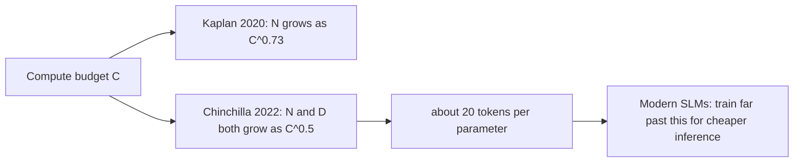

# Scaling Laws & Compute

Before you rent a single GPU, you can predict, surprisingly accurately, how much compute a training run needs, how long it will take, and roughly how good the result will be. Language model loss follows smooth power laws in model size, data, and compute across many orders of magnitude. This page explains those laws, the famous disagreement between the Kaplan and Chinchilla papers, why every modern SLM deliberately ignores the "compute-optimal" answer, and how to turn a model size and token count into GPU-hours and a budget.

!!! abstract "What you'll learn"
    - What a scaling law is and what the Kaplan (2020) and Chinchilla (2022) papers found
    - The $C \approx 6ND$ rule for training FLOPs, and where it comes from
    - Compute-optimal training (~20 tokens per parameter), and why SLMs train on 100-1000x more
    - How to estimate wall-clock time and cost from GPU peak FLOPs and MFU, with worked examples
    - What muP is for, and why "emergent abilities" deserve skepticism

## Power laws in one paragraph

Train a family of models of different sizes on different amounts of data and plot the final loss on log-log axes. You get nearly straight lines. A straight line on a log-log plot is a power law:

$$
L(x) \approx \left(\frac{x_c}{x}\right)^{\alpha}
$$

Each 10x in model size, data, or compute buys a roughly constant *fractional* reduction in (reducible) loss. That regularity is what lets labs fit curves on cheap small runs and extrapolate to a run that costs millions.

## Counting training compute: $C \approx 6ND$

Let $N$ be the number of parameters and $D$ the number of training tokens. A dense transformer spends about

$$
C \approx 6\, N\, D \quad \text{FLOPs}
$$

on training. The derivation is short:

- **Forward pass: $2N$ FLOPs per token.** Almost all parameters sit in matrix multiplies, and each weight participates in one multiply and one add per token.
- **Backward pass: $4N$ FLOPs per token.** You compute gradients with respect to both the activations (to keep backpropagating) and the weights, each costing about as much as the forward pass.
- Total: $6N$ per token, times $D$ tokens.

The rule ignores attention's score computation, which adds roughly $12 \cdot L \cdot d \cdot T$ FLOPs per token for sequence length $T$ (the accounting used in the PaLM paper). For large models this is small, but for small models with long context it is not: a 500M model with $L = 24$, $d = 1280$ at $T = 2048$ adds about 0.75 GFLOPs per token on top of $6N = 3$ GFLOPs, roughly 25% more. Use $6N$ for back-of-envelope work and add the attention term when budgeting a real SLM run.

!!! note "Which N?"
    Use parameters that do matmul work. Embedding lookups cost nothing, but a tied embedding matrix *is* used as the LM head matmul, so it counts once. Kaplan et al. used non-embedding parameters; Chinchilla used total parameters. This difference is one of the reasons their conclusions differ.

## Kaplan et al. (2020): bigger models first

OpenAI's *Scaling Laws for Neural Language Models* fit loss as a function of non-embedding parameters $N$, data $D$, and compute $C$, and found clean power laws in each, for example $L(N) \propto N^{-0.076}$ when data is not a bottleneck. Their compute-optimal recommendation: as compute grows, grow the model much faster than the data, roughly

$$
N_{\text{opt}} \propto C^{0.73}, \qquad D_{\text{opt}} \propto C^{0.27}
$$

That is, given 10x more compute, make the model about 5x bigger and train on only about 2x more data. They also reported that model *shape* (depth vs width) matters little at fixed $N$. GPT-3 (175B parameters, ~300B tokens) reflects this "big model, modest data" philosophy.

## Chinchilla (2022): scale both equally

DeepMind's Hoffmann et al. re-ran the analysis with three different methods and a key fix: they tuned the learning rate schedule (cosine decay length) to each run's actual length. Kaplan's runs used schedules that did not match the token budget, which made smaller-data runs look worse than they really were. With that corrected, the optimum shifted dramatically:

$$
N_{\text{opt}} \propto C^{0.5}, \qquad D_{\text{opt}} \propto C^{0.5}
$$

Parameters and tokens should grow **in equal proportion**. The resulting rule of thumb is about **20 tokens per parameter** at the compute-optimal point. To demonstrate it, they trained **Chinchilla** (70B parameters, 1.4T tokens) with the same compute as their earlier Gopher (280B, 300B tokens), and Chinchilla was better across the board.

They also fit a parametric loss model you can use for rough intuition:

$$
L(N, D) = E + \frac{A}{N^{\alpha}} + \frac{B}{D^{\beta}}
$$

with fitted values $E \approx 1.69$, $A \approx 406.4$, $B \approx 410.7$, $\alpha \approx 0.34$, $\beta \approx 0.28$. $E$ is the irreducible loss (the entropy of text itself); the other two terms are the penalties for a finite model and finite data.



!!! warning "The constants are not universal"
    The $E, A, B$ values are tied to Chinchilla's dataset, tokenizer, and architecture. Use the functional form and the ratios, not the absolute loss predictions, for your own model. A later analysis (Porian et al., 2024) traced most of the Kaplan-Chinchilla gap to concrete differences such as embedding counting, warmup, and LR schedule tuning.

## Why modern SLMs are "overtrained"

Chinchilla answers one specific question: *for a fixed training compute budget, which (N, D) gives the lowest loss?* But nobody deploys a model once. If you serve it for billions of tokens, inference cost (proportional to $N$) dominates the lifetime bill. The better question is: *for a target quality, what is the cheapest model to train **and** serve?*

The answer is to pick a smaller model and train it far longer. Loss keeps going down past 20 tokens/parameter; it just goes down more slowly per FLOP. You pay extra training compute once to get a model that is cheaper on every request. Sardana et al. (2023) formalized this as inference-adjusted scaling laws.

| Model | Params | Training tokens | Tokens per param |
|---|---|---|---|
| Chinchilla (compute-optimal reference) | 70B | 1.4T | 20 |
| Llama 3 8B | 8B | ~15T | ~1,900 |
| Llama 3.2 1B | 1.2B | up to ~9T | ~7,000 |
| SmolLM2-135M | 135M | ~2T | ~15,000 |
| SmolLM2-1.7B | 1.7B | ~11T | ~6,500 |
| Qwen3 (dense family) | 0.6B-32B | ~36T | up to ~60,000 for the smallest |

(Token counts are as reported in the respective papers and model cards, rounded.) Llama 3's 8B and 70B models were reported to still be improving log-linearly at 15T tokens. For an SLM, "train on as much good data as you can afford" is the operating principle, and data quality becomes the limiting factor long before the scaling curve flattens. Distillation from a larger teacher (see [the overview](index.md)) is another way to squeeze more out of each token.

!!! tip "Practical consequence for you"
    For a learning project, the compute-optimal point is a good *minimum*: a 500M model on 10B tokens will be coherent. Every additional multiple of data will keep helping. Budget data and time first, then pick the model size that you can train on at least ~20x its parameter count in tokens, and preferably 100x or more.

## Estimating training time and cost

Wall-clock time is total FLOPs divided by the FLOPs your hardware *actually* delivers:

$$
\text{time} = \frac{6ND}{n_{\text{GPU}} \times \text{peak FLOP/s} \times \text{MFU}}
$$

**MFU (model FLOPs utilization)** is the fraction of the GPU's peak throughput that goes into useful model math. Data loading, communication, memory-bound ops (norms, softmax, elementwise), and kernel launch overhead all eat into it. Realistic values:

| Setup | Typical MFU |
|---|---|
| Naive PyTorch, small model, no compile | 10-25% |
| Well-tuned: bf16, FlashAttention / SDPA, `torch.compile`, good batch size | 35-50% |
| Heavily optimized large-scale runs | 40-60% |

Dense bf16 peak throughput (no sparsity): about **312 TFLOP/s for an A100** and about **989 TFLOP/s for an H100 SXM**. Vendor datasheets often headline a number twice as large that assumes 2:4 structured sparsity; do not use that one.

### Worked example 1: 500M parameters, 10B tokens

This is exactly Chinchilla-optimal (20 tokens/param).

$$
C = 6 \times (5 \times 10^{8}) \times (10^{10}) = 3 \times 10^{19} \text{ FLOPs}
$$

One H100 at 40% MFU delivers $0.4 \times 989 \times 10^{12} \approx 3.96 \times 10^{14}$ FLOP/s:

$$
\frac{3 \times 10^{19}}{3.96 \times 10^{14}} \approx 7.6 \times 10^{4} \text{ s} \approx 21 \text{ hours}
$$

On 8 H100s with near-linear scaling: about **2.6 hours**, still about **21 GPU-hours** total. At a rental price in the range of USD 2-3 per H100-hour, that is roughly USD 40-65 of compute. (Add the ~25% attention overhead discussed above for a long-context small model, plus time for evaluation and restarts.)

### Worked example 2: 500M parameters, 50B tokens on 8x H100

Now 100 tokens/param, a modest "overtraining" factor.

$$
C = 6 \times (5 \times 10^{8}) \times (5 \times 10^{10}) = 1.5 \times 10^{20} \text{ FLOPs}
$$

$$
\frac{1.5 \times 10^{20}}{8 \times 3.96 \times 10^{14}} \approx 4.7 \times 10^{4} \text{ s} \approx 13 \text{ hours}
$$

About **105 GPU-hours**, roughly USD 210-320 at the same rental range. This is the scale of [Project 1](../projects/p1-500m-model.md): a weekend on one 8-GPU node.

### Worked example 3: 1B parameters, 1T tokens on 64x H100

$C = 6 \times 10^{9} \times 10^{12} = 6 \times 10^{21}$ FLOPs. At 40% MFU on 64 GPUs: about 66 hours of wall-clock time and about 4,200 GPU-hours, on the order of USD 10,000. Real SLMs trained on 10T+ tokens cost ten times that, which is why most people fine-tune open weights instead of pretraining.

### A reusable estimator

```python title="estimate.py"
def chinchilla_loss(N, D, E=1.69, A=406.4, B=410.7, alpha=0.34, beta=0.28):
    """Parametric fit from Hoffmann et al. (2022). Only meaningful as a relative guide."""
    return E + A / N**alpha + B / D**beta


def train_time(N, D, n_gpus, peak_flops=989e12, mfu=0.40, usd_per_gpu_hour=2.5):
    flops = 6 * N * D
    seconds = flops / (n_gpus * peak_flops * mfu)
    gpu_hours = seconds * n_gpus / 3600
    return flops, seconds / 3600, gpu_hours, gpu_hours * usd_per_gpu_hour


for N, D, g in [(500e6, 10e9, 1), (500e6, 10e9, 8), (500e6, 50e9, 8), (1e9, 1e12, 64)]:
    flops, hours, gpuh, usd = train_time(N, D, g)
    print(f"N={N/1e6:.0f}M D={D/1e9:.0f}B gpus={g}: {flops:.2e} FLOPs, "
          f"{hours:.1f} h wall, {gpuh:.0f} GPU-h, ~USD {usd:,.0f}, "
          f"tokens/param={D/N:.0f}, loss~{chinchilla_loss(N, D):.2f}")
```

```text
N=500M D=10B gpus=1: 3.00e+19 FLOPs, 21.1 h wall, 21 GPU-h, ~USD 53, tokens/param=20, loss~2.79
N=500M D=10B gpus=8: 3.00e+19 FLOPs, 2.6 h wall, 21 GPU-h, ~USD 53, tokens/param=20, loss~2.79
N=500M D=50B gpus=8: 1.50e+20 FLOPs, 13.2 h wall, 105 GPU-h, ~USD 263, tokens/param=100, loss~2.55
N=1000M D=1000B gpus=64: 6.00e+21 FLOPs, 65.8 h wall, 4213 GPU-h, ~USD 10,533, tokens/param=1000, loss~2.22
```

Read the loss column as "5x more data on the same model buys a meaningful drop; 2x the model and 20x the data buys more", not as a prediction of the number you will see on your own tokenizer and data.

### Measuring your real MFU

Do not guess; measure it after a few hundred steps:

```python
tokens_per_step = batch_size * seq_len * grad_accum_steps * world_size
achieved_flops = 6 * n_params * tokens_per_step / step_time_seconds
mfu = achieved_flops / (world_size * 989e12)   # use your GPU's dense bf16 peak
```

Then re-run the time estimate with your measured MFU. If MFU is below ~30%, check that you are using bf16 autocast, SDPA, `torch.compile`, a large enough micro-batch, and that the data loader is not the bottleneck. These are covered in [The Training Loop](../pretraining/training.md) and [Distributed Training](../pretraining/distributed.md).

!!! info "Memory is a separate budget"
    FLOPs tell you time; memory tells you whether it fits. Mixed-precision training with AdamW needs about 16 bytes per parameter for weights, gradients, fp32 master weights, and two optimizer moments (500M parameters: about 8 GB), plus activations, which grow with batch size, sequence length, and depth.

## muP: hyperparameters that transfer

A practical problem with scaling: the best learning rate for a 50M model is not the best for a 500M model, and you cannot afford to sweep at 500M. **Maximal Update Parametrization (muP)** (Yang et al., 2022) changes how initialization and per-layer learning rates scale with width so that the optimal hyperparameters stay approximately *constant* as the model gets wider. You tune on a small proxy and transfer to the large model ("muTransfer"). Several open model efforts have used muP or variants of it; for a single 500M run, a short LR sweep at small scale plus standard values from similar models is usually enough.

## Emergent abilities: a caveat

Wei et al. (2022) reported "emergent abilities": tasks where small models score near zero and, past some scale, performance jumps sharply. This seemed to contradict smooth scaling laws. Schaeffer et al. (2023) showed that many such jumps are an artifact of the **metric**: exact-match accuracy on a multi-step answer is near zero until every step is right, so it looks discontinuous, while a continuous metric (per-token log-likelihood, partial credit) on the same models improves smoothly. The takeaway is not that nothing changes with scale, but that:

- the underlying loss improves predictably,
- discontinuous metrics can hide that progress, and
- you should track smooth metrics (validation loss, log-likelihood of correct answers) alongside accuracy when evaluating small models. See [Evaluation](../pretraining/evaluation.md).

!!! warning "Common pitfalls"
    - **Using sparsity-inflated peak FLOPs** from datasheets. Use dense bf16 numbers.
    - **Assuming 100% MFU** or perfect multi-GPU scaling. Plan for 30-45% and some communication overhead.
    - **Treating Chinchilla's 20 tokens/param as an upper bound.** It is the compute-optimal point for training only; for deployed models, more tokens is almost always better.
    - **Extrapolating loss constants across datasets or tokenizers.** Fit your own small-scale curves if you need real predictions.
    - **Forgetting non-training compute:** evaluation, failed runs, restarts, and hyperparameter sweeps often add 20-50% to the total.
    - **Ignoring the attention FLOPs term** for small, long-context models, where it can add 20%+ to the bill.

## Check your understanding

??? question "Where does the 6 in 6ND come from?"
    Each parameter does a multiply-add (2 FLOPs) per token in the forward pass. The backward pass computes gradients for activations and for weights, each about the same cost as the forward pass, so 4 more FLOPs. Total 6 FLOPs per parameter per token.

??? question "Chinchilla-optimal for 100M parameters is about how many tokens? How many FLOPs?"
    About $20 \times 10^8 = 2 \times 10^9$ tokens. FLOPs: $6 \times 10^8 \times 2 \times 10^9 = 1.2 \times 10^{18}$.

??? question "Why did Kaplan et al. conclude models should grow faster than data?"
    Largely because their learning rate schedules were not adjusted to each run's token budget, which penalized runs trained on less data relative to their potential, plus differences in parameter counting and model size range. Chinchilla tuned schedules per run and found parameters and data should scale equally.

??? question "Why would anyone deliberately train a 1B model on 9T tokens instead of a compute-optimal larger model?"
    Inference cost scales with model size and is paid on every request. Spending more on training once to get a smaller model of the same quality minimizes the total cost of training plus serving, and lets the model run on cheaper hardware or on-device.

??? question "You measure 120 TFLOP/s achieved per H100 on your run. What is your MFU and what should you check?"
    $120 / 989 \approx 12\%$. Check bf16 autocast, SDPA/FlashAttention, `torch.compile`, micro-batch size (too small underutilizes the GPU), data loader throughput, and excessive synchronization (e.g. calling `.item()` every step).

## Further reading

- Kaplan et al., [Scaling Laws for Neural Language Models](https://arxiv.org/abs/2001.08361), 2020
- Hoffmann et al., [Training Compute-Optimal Large Language Models (Chinchilla)](https://arxiv.org/abs/2203.15556), 2022
- Sardana et al., [Beyond Chinchilla-Optimal: Accounting for Inference in Language Model Scaling Laws](https://arxiv.org/abs/2401.00448), 2023
- Porian et al., [Resolving Discrepancies in Compute-Optimal Scaling of Language Models](https://arxiv.org/abs/2406.19146), 2024
- Chowdhery et al., [PaLM: Scaling Language Modeling with Pathways](https://arxiv.org/abs/2204.02311), 2022 (MFU definition)
- Yang et al., [Tensor Programs V: Tuning Large Neural Networks via Zero-Shot Hyperparameter Transfer (muP)](https://arxiv.org/abs/2203.03466), 2022
- Wei et al., [Emergent Abilities of Large Language Models](https://arxiv.org/abs/2206.07682), 2022
- Schaeffer, Miranda, Koyejo, [Are Emergent Abilities of Large Language Models a Mirage?](https://arxiv.org/abs/2304.15004), 2023
- Meta, [The Llama 3 Herd of Models](https://arxiv.org/abs/2407.21783), 2024

**Next:** [Architecture Families & Beyond Transformers](architecture-families.md)
