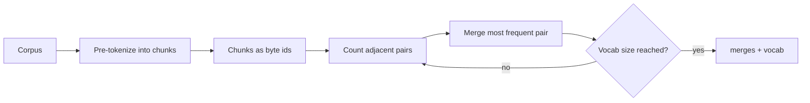

# Tokenization

A neural network cannot read text. It reads integers. Tokenization is the step that turns `"Hello world"` into something like `[13225, 2375]` and back again, and it quietly shapes almost everything downstream: how long your context really is, how well the model does arithmetic, how expensive non-English text is, and which bugs you will spend a day chasing. In this page you build a byte-level BPE tokenizer from scratch, then learn to use and train the production tools.

!!! abstract "What you'll learn"
    - Why subword tokenization beats characters and words
    - The Byte Pair Encoding (BPE) algorithm, step by step, and a complete byte-level implementation (train, encode, decode)
    - How WordPiece, Unigram, and SentencePiece differ
    - How to use `tiktoken` and Hugging Face `tokenizers`, and how to train your own tokenizer on a corpus
    - How to choose a vocabulary size, and how special tokens and chat templates work
    - The classic tokenization pitfalls: numbers, whitespace, multilingual text

## Characters, words, or subwords?

There are three natural ways to chop text into units:

| Unit | Vocab size | Sequence length | Problem |
|---|---|---|---|
| Characters (or bytes) | ~256 | Very long | Model wastes capacity and context assembling letters into words; attention cost grows with $n^2$ |
| Words | 100k-1M+ | Short | Huge embedding table; any unseen word becomes `<unk>`; `run`, `runs`, `running` share nothing |
| **Subwords** | 32k-260k | Medium | Some quirks (covered below), but the best trade-off in practice |

Subword tokenizers keep common words as single tokens (`" the"`, `" model"`) and split rare words into reusable pieces (`" token" + "ization"`). With a **byte-level** fallback, *any* string, including emoji, code, and binary junk, can be encoded with no `<unk>` token at all.

!!! tip "Rule of thumb"
    For English prose, modern tokenizers produce roughly 0.75 words per token, or about 4 characters per token. Code and non-Latin scripts are usually less efficient.

## Byte Pair Encoding (BPE)

BPE was originally a compression algorithm. Sennrich et al. (2015) adapted it for neural machine translation, and GPT-2 made the **byte-level** variant the default for language models. The idea fits in one sentence: *start from bytes and repeatedly merge the most frequent adjacent pair into a new token.*

### The algorithm

**Training:**

1. Pre-tokenize the corpus into chunks (roughly words, with their leading space), so merges never cross chunk boundaries.
2. Represent each chunk as a sequence of byte ids (0-255).
3. Count every adjacent pair of ids across the corpus.
4. Take the most frequent pair `(a, b)`, assign it a new id, and record the merge rule `(a, b) -> new_id`.
5. Replace every occurrence of `(a, b)` with `new_id`.
6. Repeat 3-5 until the vocabulary reaches the target size.

**Encoding** new text replays the merges in the order they were learned. **Decoding** looks up the bytes for each id, concatenates them, and decodes UTF-8.



### A worked example

Train on the tiny corpus `"low lower lowest newer wider new new"`. The pre-tokenizer yields chunks `low`, ` lower`, ` lowest`, ` newer`, ` wider`, ` new`, ` new` (note the leading spaces). The first six merges our implementation learns are:

```text
merge 256: b'l' + b'o' -> b'lo' (count 3)
merge 257: b'lo' + b'w' -> b'low' (count 3)
merge 258: b'e' + b'r' -> b'er' (count 3)
merge 259: b' ' + b'n' -> b' n' (count 3)
merge 260: b' n' + b'e' -> b' ne' (count 3)
merge 261: b' ne' + b'w' -> b' new' (count 3)
```

With those six merges, ` new` encodes as a single token, ` newest` as `[' new', 'e', 's', 't']`, and ` lowest` as `[' ', 'low', 'e', 's', 't']` (the pair `' ' + 'low'` occurs only twice, so it lost to the count-3 pairs and was never merged). Frequent strings get short encodings; rare strings degrade gracefully to bytes.

### Implementation from scratch

This is a complete, dependency-free byte-level BPE. It uses a simplified GPT-2-style pre-tokenization regex with the standard library `re` module.

```python title="bpe.py"
import re
from collections import Counter

# GPT-2-style pre-tokenization, simplified to the stdlib `re` module.
# Splits text into chunks so merges never cross word/number/punctuation boundaries.
PAT = re.compile(r"""'(?:s|t|re|ve|m|ll|d)| ?[^\W\d_]+| ?\d{1,3}| ?[^\s\w]+|\s+(?!\S)|\s+""")  # (1)!


def get_pair_counts(chunks: dict[tuple[int, ...], int]) -> Counter:
    """Count adjacent id pairs across all chunks, weighted by chunk frequency."""
    counts = Counter()
    for ids, freq in chunks.items():
        for pair in zip(ids, ids[1:]):
            counts[pair] += freq
    return counts


def merge(ids: tuple[int, ...], pair: tuple[int, int], new_id: int) -> tuple[int, ...]:
    """Replace every occurrence of `pair` in `ids` with `new_id`."""
    out, i = [], 0
    while i < len(ids):
        if i < len(ids) - 1 and ids[i] == pair[0] and ids[i + 1] == pair[1]:
            out.append(new_id)
            i += 2
        else:
            out.append(ids[i])
            i += 1
    return tuple(out)


class ByteBPE:
    def __init__(self):
        self.merges: dict[tuple[int, int], int] = {}             # (a, b) -> new id
        self.vocab: dict[int, bytes] = {i: bytes([i]) for i in range(256)}
        self.special: dict[str, int] = {}

    def train(self, text: str, vocab_size: int, verbose: bool = False):
        assert vocab_size >= 256
        # 1. Pre-tokenize, convert each chunk to UTF-8 bytes, count duplicates once.
        chunks = Counter(tuple(c.encode("utf-8")) for c in PAT.findall(text))  # (2)!
        # 2. Repeatedly merge the most frequent adjacent pair.
        for new_id in range(256, vocab_size):
            counts = get_pair_counts(chunks)
            if not counts:
                break
            pair = max(counts, key=counts.get)
            self.merges[pair] = new_id
            self.vocab[new_id] = self.vocab[pair[0]] + self.vocab[pair[1]]
            chunks = Counter({merge(ids, pair, new_id): f for ids, f in chunks.items()})
            if verbose:
                print(f"merge {new_id}: {self.vocab[pair[0]]!r} + {self.vocab[pair[1]]!r}"
                      f" -> {self.vocab[new_id]!r} (count {counts[pair]})")

    def add_special_tokens(self, tokens: list[str]):
        for t in tokens:
            if t not in self.special:
                new_id = len(self.vocab)
                self.special[t] = new_id
                self.vocab[new_id] = t.encode("utf-8")

    def _encode_chunk(self, ids: list[int]) -> list[int]:
        # Apply merges in the order they were learned (lowest new id first).
        while len(ids) >= 2:  # (3)!
            pairs = set(zip(ids, ids[1:]))
            pair = min(pairs, key=lambda p: self.merges.get(p, float("inf")))
            if pair not in self.merges:
                break
            ids = list(merge(tuple(ids), pair, self.merges[pair]))
        return ids

    def encode(self, text: str) -> list[int]:
        out = []
        # Split out special tokens first so they are never broken into pieces.
        if self.special:
            sp = "(" + "|".join(re.escape(s) for s in self.special) + ")"
            parts = re.split(sp, text)
        else:
            parts = [text]
        for part in parts:
            if part in self.special:
                out.append(self.special[part])
                continue
            for chunk in PAT.findall(part):
                out.extend(self._encode_chunk(list(chunk.encode("utf-8"))))
        return out

    def decode(self, ids: list[int]) -> str:
        data = b"".join(self.vocab[i] for i in ids)
        return data.decode("utf-8", errors="replace")  # (4)!
```

1. Contractions, letter runs (with an optional leading space), numbers in groups of up to 3 digits, punctuation runs, and whitespace. GPT-2's real pattern uses the third-party `regex` module with Unicode classes like `\p{L}`; this stdlib version behaves similarly.
2. Identical chunks (e.g. every `" the"`) are stored once with a count. This makes training much faster than operating on the raw text.
3. Merges must be applied in training order, because later merges were learned on text where earlier merges had already been applied.
4. A single token can hold part of a multi-byte UTF-8 character (e.g. half of `é`). Decoding a partial sequence can produce invalid UTF-8, so we replace bad bytes rather than crash.

Try it:

```python
from bpe import ByteBPE

text = open("bpe.py").read() * 3 + "The cat sat on the mat. naïve café 東京 1234567 " * 50
tok = ByteBPE()
tok.train(text, vocab_size=300)
tok.add_special_tokens(["<|endoftext|>"])

s = "The cat sat. naïve 東京 12345<|endoftext|>hello"
ids = tok.encode(s)
assert tok.decode(ids) == s          # lossless round trip
print(len(s.encode()), "bytes ->", len(ids), "tokens")   # 50 bytes -> 23 tokens
```

This version is quadratic-ish and fine for a few megabytes. Production trainers (Rust in HF `tokenizers`, or `minbpe`-style optimized Python) maintain pair counts incrementally instead of recounting after each merge.

!!! example "Exercise"
    Train on a few MB of text with `vocab_size=1024` and print the 20 longest tokens in `tok.vocab`. You will see whole common words with leading spaces, like `b' the'` and `b' and'`.

## Other subword algorithms

**WordPiece** (BERT). Like BPE, but instead of merging the most *frequent* pair it merges the pair that most increases the training data likelihood, roughly $\frac{\text{count}(ab)}{\text{count}(a)\,\text{count}(b)}$. Non-initial pieces are marked with `##` (`token`, `##ization`). Encoding uses greedy longest-match.

**Unigram LM** (Kudo, 2018). Works in the opposite direction: start with a large candidate vocabulary and *prune* tokens whose removal hurts the corpus likelihood least, under a model where each token has an independent probability. A string can have many segmentations; encoding picks the most probable one (Viterbi), and training can sample alternatives as regularization.

**SentencePiece** is a library, not an algorithm. It implements BPE and Unigram, treats the input as a raw stream (including spaces, which become `▁`), and needs no language-specific pre-tokenizer. Llama 1/2, T5, and Gemma use SentencePiece models; Llama 3 switched to a tiktoken-style byte-level BPE with a ~128k vocabulary.

| Algorithm | Builds vocab by | Used in |
|---|---|---|
| Byte-level BPE | Merging frequent pairs bottom-up | GPT-2/3/4, Llama 3, Qwen, SmolLM, Mistral (newer) |
| WordPiece | Merging by likelihood gain | BERT, DistilBERT |
| Unigram | Pruning a large vocab top-down | T5, ALBERT, many SentencePiece models |

## Using production tokenizers

### tiktoken

OpenAI's `tiktoken` is a fast, encode/decode-only BPE library (you cannot train with it).

```python
import tiktoken

enc = tiktoken.get_encoding("o200k_base")      # GPT-4o family; "cl100k_base" for GPT-4
ids = enc.encode("Hello world! 12345 tokenization")
print(ids)                                     # [13225, 2375, 0, 220, 7633, 2548, 6602, 2860]
print([enc.decode([i]) for i in ids])          # ['Hello', ' world', '!', ' ', '123', '45', ' token', 'ization']
print(enc.n_vocab)                             # 200019
```

Notice `12345` becomes `'123', '45'` and the space before it is a separate token: that is the pre-tokenization regex at work.

### Hugging Face tokenizers (via transformers)

Every model on the Hub ships its tokenizer. Load it with `AutoTokenizer`:

```python
from transformers import AutoTokenizer

tok = AutoTokenizer.from_pretrained("HuggingFaceTB/SmolLM2-135M")
ids = tok("Tokenization is fun")["input_ids"]
print(ids, tok.convert_ids_to_tokens(ids))
print(tok.decode(ids))
print(len(tok))   # vocabulary size (49152 for SmolLM2)
```

`Ġ` in byte-level token strings represents a leading space (GPT-2 maps raw bytes to printable unicode characters so that vocab files are readable).

## Training your own tokenizer

If you pretrain a model from scratch on a specific domain or language mix, training your own tokenizer is cheap (minutes on a CPU) and often worth it. The HF `tokenizers` library (Rust under the hood) does it like this:

```python title="train_tokenizer.py"
from tokenizers import Tokenizer, models, trainers, pre_tokenizers, decoders, processors

tokenizer = Tokenizer(models.BPE())
tokenizer.pre_tokenizer = pre_tokenizers.ByteLevel(add_prefix_space=False)
tokenizer.decoder = decoders.ByteLevel()

special_tokens = ["<|endoftext|>", "<|im_start|>", "<|im_end|>", "<|pad|>"]
trainer = trainers.BpeTrainer(
    vocab_size=32_000,
    min_frequency=2,
    special_tokens=special_tokens,                         # get ids 0..3
    initial_alphabet=pre_tokenizers.ByteLevel.alphabet(),  # all 256 bytes: no <unk> ever
)

def batch_iterator(path, batch_size=1000):
    with open(path, encoding="utf-8") as f:
        batch = []
        for line in f:
            batch.append(line)
            if len(batch) == batch_size:
                yield batch
                batch = []
        if batch:
            yield batch

tokenizer.train_from_iterator(batch_iterator("corpus.txt"), trainer=trainer)

# Append <|endoftext|> to every encoded document (optional).
eot = tokenizer.token_to_id("<|endoftext|>")
tokenizer.post_processor = processors.TemplateProcessing(
    single="$A <|endoftext|>", special_tokens=[("<|endoftext|>", eot)]
)
tokenizer.save("tokenizer.json")

enc = tokenizer.encode("Hello world, café!")
print(enc.tokens)
print(tokenizer.decode(enc.ids))   # special tokens are skipped by default
```

To stream from a Hub dataset instead of a file, pass a generator over `dataset["text"]` batches (`datasets.load_dataset(..., streaming=True)`). To use the result with `transformers`:

```python
from transformers import PreTrainedTokenizerFast

hf_tok = PreTrainedTokenizerFast(
    tokenizer_file="tokenizer.json",
    eos_token="<|endoftext|>", bos_token="<|endoftext|>", pad_token="<|pad|>",
)
hf_tok.save_pretrained("my-tokenizer")
```

!!! tip "Train on a representative sample"
    The tokenizer's training data should match the pretraining mixture (same proportion of code, math, and languages). A few GB of text is plenty; the merges stabilize long before that.

## Choosing a vocabulary size

A bigger vocabulary means fewer tokens per document (more text per context window, fewer forward passes), but a bigger embedding table and output layer, and rarer tokens that each get fewer training updates.

| Vocab size | Typical user |
|---|---|
| ~32k | Llama 1/2, Mistral 7B (original) |
| ~49k | SmolLM / SmolLM2 |
| ~128k | Llama 3.x |
| ~150k | Qwen2.5 / Qwen3 |
| ~200k | GPT-4o (`o200k_base`) |
| ~256k-262k | Gemma 3 (strongly multilingual) |

The cost is in parameters: embeddings cost $|V| \times d_{\text{model}}$. For a large model that is negligible; for a small one it dominates. Llama 3.2 1B has $128{,}256 \times 2048 \approx 263\text{M}$ embedding parameters, about a fifth of the model. A 135M model with a 128k vocab would be mostly embedding table. That is why small English-centric models like SmolLM2 chose ~49k. See [SLM design](modern-architectures.md#designing-an-slm).

## Special tokens and chat templates

**Special tokens** are reserved ids that never come from normal text: end-of-text (`<|endoftext|>`, `</s>`), beginning-of-sequence, padding, and role markers. They are added to the vocabulary as atomic units and must be split out *before* BPE runs (as our `encode` does), otherwise `"<|endoftext|>"` typed by a user would be a dangerous control signal or be shredded into pieces.

**Chat templates** define how a conversation becomes one token sequence. A ChatML-style template (used by Qwen and SmolLM2-Instruct) looks like:

```text
<|im_start|>system
You are a helpful assistant.<|im_end|>
<|im_start|>user
What is BPE?<|im_end|>
<|im_start|>assistant
```

You should never hand-format this. The template is stored (as Jinja) in the tokenizer config and applied with:

```python
messages = [
    {"role": "system", "content": "You are a helpful assistant."},
    {"role": "user", "content": "What is BPE?"},
]
prompt = tok.apply_chat_template(messages, tokenize=False, add_generation_prompt=True)
ids = tok.apply_chat_template(messages, add_generation_prompt=True, return_tensors="pt")
```

`add_generation_prompt=True` appends the `<|im_start|>assistant\n` header so the model knows it should speak next. Using the wrong template for a model, or forgetting the generation prompt, is one of the most common causes of "my fine-tuned model outputs garbage". Chat formatting for training is covered in [SFT](../post-training/sft.md).

## Tokenization pitfalls

**Numbers.** Depending on the tokenizer, `"2025"` may be one token, `"20"+"25"`, or `"202"+"5"`. Inconsistent chunking makes digit-level arithmetic harder to learn. Mitigations: split digits into groups of 3 (GPT-4-style, as in our regex), or into single digits (Llama 1/2 and several other models split numbers into individual digits).

**Whitespace.** `"hello"` and `" hello"` are different tokens. A prompt ending in a trailing space forces the model to generate a token *without* its usual leading space, which is out of distribution ("token healing" problems). Python indentation also varies in efficiency: GPT-2's tokenizer wasted many tokens on runs of spaces, which later tokenizers fixed by learning whitespace-run tokens.

**Multilingual cost.** A tokenizer trained mostly on English splits other scripts into many more tokens per word. The same sentence in Hindi or Thai can cost several times more tokens than English, which means higher API cost, shorter effective context, and less training signal per character. Large multilingual vocabularies (Gemma, Qwen) reduce this.

**Glitch tokens.** Tokens that appeared in tokenizer training data but almost never in model training data (famously, some Reddit usernames in GPT-2's vocab) get poorly trained embeddings and can trigger bizarre behavior. Train your tokenizer on the same distribution as your model.

**Spelling and counting characters.** The model sees `" strawberry"` as one or two opaque ids, not letters. Questions about character counts are hard for that reason.

!!! warning "Common pitfalls"
    - Changing the tokenizer after pretraining. The embedding table is tied to the exact id assignment; you cannot swap tokenizers without retraining (or careful surgery).
    - Mismatched special tokens between pretraining, SFT, and inference (e.g. model never saw `<|im_end|>` as a stop token, so it never stops).
    - Setting `pad_token = eos_token` and then masking all EOS tokens out of the loss, so the model never learns to stop.
    - Comparing per-token loss between models with different tokenizers. Use bits-per-byte instead.
    - Decoding token-by-token while streaming and printing each piece separately. A multi-byte character split across tokens will print as garbage; buffer bytes until they form valid UTF-8.

## Check your understanding

??? question "Why does byte-level BPE never need an `<unk>` token?"
    The base vocabulary contains all 256 byte values, and any string is a sequence of UTF-8 bytes. In the worst case a string is encoded byte-by-byte, so every input is representable.

??? question "Why must encoding apply merges in the order they were learned?"
    Each merge was learned on data where all earlier merges had already been applied. A later merge like `(' ne', 'w')` only makes sense once `(' n', 'e')` has produced the `' ne'` token. Applying merges in a different order gives a different (and inconsistent) segmentation.

??? question "What does pre-tokenization buy you?"
    It prevents merges across word, number, and punctuation boundaries (so you don't get tokens like `"dog."` and `"dog!"` and `"dog?"` as separate vocab entries), keeps tokens semantically cleaner, and makes training faster because identical chunks are counted once.

??? question "You are designing a 150M-parameter English model with d_model = 768. What do vocab sizes of 32k vs 128k cost in embedding parameters?"
    $32{,}000 \times 768 \approx 24.6\text{M}$ vs $128{,}000 \times 768 \approx 98.3\text{M}$. With 128k, about two thirds of your 150M budget would be the embedding table (with tied input/output weights), leaving little for the transformer blocks.

??? question "Why does `add_generation_prompt=True` matter at inference?"
    It appends the assistant header (e.g. `<|im_start|>assistant\n`). Without it the model may continue the user's message or emit the header itself, because the prompt does not match the format seen during fine-tuning.

## Further reading

- Sennrich, Haddow, Birch, [Neural Machine Translation of Rare Words with Subword Units](https://arxiv.org/abs/1508.07909), 2015 (BPE for NLP)
- Kudo, [Subword Regularization (Unigram LM)](https://arxiv.org/abs/1804.10959), 2018
- Kudo & Richardson, [SentencePiece](https://arxiv.org/abs/1808.06226), 2018
- Andrej Karpathy, [minbpe](https://github.com/karpathy/minbpe) and the "Let's build the GPT Tokenizer" lecture
- [Hugging Face `tokenizers` documentation](https://huggingface.co/docs/tokenizers)
- [tiktoken on GitHub](https://github.com/openai/tiktoken)
- [Chat templates in transformers](https://huggingface.co/docs/transformers/chat_templating)

**Next:** [Embeddings & Attention](attention.md)
