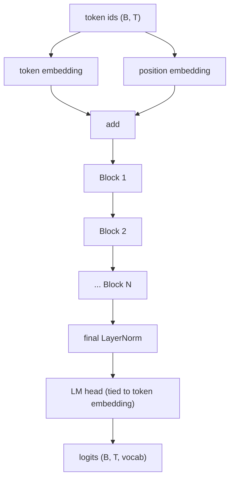
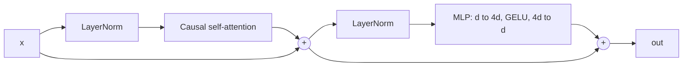
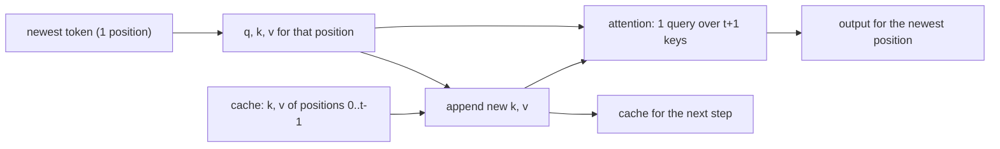

# The Transformer, Line by Line

You now have tokens and attention. A GPT-style language model is those two pieces plus a handful of standard parts: an MLP, normalization, residual connections, and an output layer, stacked $N$ times. In this page you write the whole thing, about 130 lines of PyTorch, check that it reproduces GPT-2 small's exact parameter count, and train a small version on Shakespeare until it writes plausible fake Elizabethan dialogue.

!!! abstract "What you'll learn"
    - The structure of a decoder-only transformer and what each component is for
    - Pre-norm vs post-norm, residual streams, and the GELU MLP
    - Weight tying between the token embedding and the LM head
    - A complete, runnable GPT implementation with `generate()`
    - Why generation without a KV cache repeats work, and what one cached attention step looks like
    - How to count parameters by hand: the $12 L d^2$ rule with a worked GPT-2 example
    - The shape of every tensor in a forward pass
    - A character-level training demo on tiny Shakespeare

## The architecture



Each block is:



### The residual stream

The most useful mental model: there is a single vector per position, the **residual stream** $x \in \mathbb{R}^d$, flowing from the embeddings to the output. Every sublayer *reads* from it (through a norm), computes something, and *adds* its result back:

$$
x \leftarrow x + \mathrm{Attn}(\mathrm{LN}(x)), \qquad x \leftarrow x + \mathrm{MLP}(\mathrm{LN}(x))
$$

Attention moves information **between** positions. The MLP processes information **within** each position (and is where much of the model's factual "storage" appears to live). The additive structure means gradients flow straight from the loss to early layers through the identity path, which is why you can stack dozens of blocks.

### Pre-norm vs post-norm

The original 2017 transformer normalized *after* adding: $x = \mathrm{LN}(x + \mathrm{Sublayer}(x))$. That "post-norm" layout puts a normalization on the main gradient path and needs careful learning-rate warmup to train deep models. GPT-2 and every major LLM since use **pre-norm**: normalize only the sublayer's input, leave the residual path untouched, and add one final LayerNorm before the output head. It trains stably with far less tuning.

### LayerNorm

For a vector $x \in \mathbb{R}^d$, LayerNorm subtracts the mean and divides by the standard deviation across features, then applies a learned scale $\gamma$ and shift $\beta$:

$$
\mathrm{LN}(x) = \gamma \odot \frac{x - \mu}{\sqrt{\sigma^2 + \epsilon}} + \beta
$$

Modern models use RMSNorm instead (no mean subtraction, no $\beta$); see [Modern Architectures](modern-architectures.md#rmsnorm).

### The MLP

A two-layer feed-forward network applied independently at each position, expanding to $4d$ and back:

$$
\mathrm{MLP}(x) = W_2\, \mathrm{GELU}(W_1 x + b_1) + b_2, \quad W_1 \in \mathbb{R}^{4d \times d},\; W_2 \in \mathbb{R}^{d \times 4d}
$$

GELU is a smooth ReLU: $\mathrm{GELU}(x) = x\,\Phi(x)$ where $\Phi$ is the standard normal CDF. GPT-2 uses the tanh approximation, which we match.

### The LM head and weight tying

The final layer maps $d$ back to vocabulary logits with a matrix of shape $|V| \times d$. That is the same shape as the token embedding matrix, and **weight tying** (Press & Wolf, 2016) simply uses the same matrix for both. Intuitively, the embedding maps "token to meaning vector" and the head scores "how well does this hidden state match each token's vector". Tying saves $|V| \cdot d$ parameters (38.6M for GPT-2 small, nearly a third of the model) and usually costs little or nothing in quality at small scale. Many SLMs (SmolLM2, Llama 3.2 1B/3B, Qwen2.5 small sizes, Gemma) tie embeddings; large models often don't.

## The complete model

```python title="gpt.py"
"""A minimal GPT-2-style decoder-only transformer."""
import math
from dataclasses import dataclass

import torch
import torch.nn as nn
import torch.nn.functional as F


@dataclass
class GPTConfig:
    vocab_size: int = 50257   # GPT-2 BPE vocabulary
    block_size: int = 1024    # maximum context length
    n_layer: int = 12
    n_head: int = 12
    d_model: int = 768
    dropout: float = 0.0
    bias: bool = True         # GPT-2 uses biases in Linear and LayerNorm


class CausalSelfAttention(nn.Module):
    def __init__(self, cfg: GPTConfig):
        super().__init__()
        assert cfg.d_model % cfg.n_head == 0
        self.n_head = cfg.n_head
        self.qkv = nn.Linear(cfg.d_model, 3 * cfg.d_model, bias=cfg.bias)
        self.proj = nn.Linear(cfg.d_model, cfg.d_model, bias=cfg.bias)
        self.proj.RESIDUAL_SCALE = True          # marker for scaled init (see _init_weights)
        self.dropout = cfg.dropout
        self.resid_drop = nn.Dropout(cfg.dropout)

    def forward(self, x):
        B, T, C = x.shape
        q, k, v = self.qkv(x).split(C, dim=2)
        q = q.view(B, T, self.n_head, C // self.n_head).transpose(1, 2)  # (B, H, T, Dh)
        k = k.view(B, T, self.n_head, C // self.n_head).transpose(1, 2)
        v = v.view(B, T, self.n_head, C // self.n_head).transpose(1, 2)
        y = F.scaled_dot_product_attention(
            q, k, v, is_causal=True, dropout_p=self.dropout if self.training else 0.0
        )
        y = y.transpose(1, 2).contiguous().view(B, T, C)
        return self.resid_drop(self.proj(y))


class MLP(nn.Module):
    def __init__(self, cfg: GPTConfig):
        super().__init__()
        self.fc = nn.Linear(cfg.d_model, 4 * cfg.d_model, bias=cfg.bias)
        self.proj = nn.Linear(4 * cfg.d_model, cfg.d_model, bias=cfg.bias)
        self.proj.RESIDUAL_SCALE = True
        self.drop = nn.Dropout(cfg.dropout)

    def forward(self, x):
        return self.drop(self.proj(F.gelu(self.fc(x), approximate="tanh")))


class Block(nn.Module):
    def __init__(self, cfg: GPTConfig):
        super().__init__()
        self.ln1 = nn.LayerNorm(cfg.d_model, bias=cfg.bias)
        self.attn = CausalSelfAttention(cfg)
        self.ln2 = nn.LayerNorm(cfg.d_model, bias=cfg.bias)
        self.mlp = MLP(cfg)

    def forward(self, x):
        x = x + self.attn(self.ln1(x))   # pre-norm: normalize, transform, add back
        x = x + self.mlp(self.ln2(x))
        return x


class GPT(nn.Module):
    def __init__(self, cfg: GPTConfig):
        super().__init__()
        self.cfg = cfg
        self.tok_emb = nn.Embedding(cfg.vocab_size, cfg.d_model)
        self.pos_emb = nn.Embedding(cfg.block_size, cfg.d_model)
        self.drop = nn.Dropout(cfg.dropout)
        self.blocks = nn.ModuleList([Block(cfg) for _ in range(cfg.n_layer)])
        self.ln_f = nn.LayerNorm(cfg.d_model, bias=cfg.bias)
        self.lm_head = nn.Linear(cfg.d_model, cfg.vocab_size, bias=False)
        self.lm_head.weight = self.tok_emb.weight   # weight tying
        self.apply(self._init_weights)

    def _init_weights(self, module):
        if isinstance(module, nn.Linear):
            std = 0.02
            if getattr(module, "RESIDUAL_SCALE", False):
                std *= (2 * self.cfg.n_layer) ** -0.5   # keep residual stream variance stable
            nn.init.normal_(module.weight, mean=0.0, std=std)
            if module.bias is not None:
                nn.init.zeros_(module.bias)
        elif isinstance(module, nn.Embedding):
            nn.init.normal_(module.weight, mean=0.0, std=0.02)

    def num_params(self, non_embedding: bool = False) -> int:
        n = sum(p.numel() for p in self.parameters())   # tied weights counted once
        if non_embedding:
            n -= self.pos_emb.weight.numel() + self.tok_emb.weight.numel()
        return n

    def forward(self, idx, targets=None):
        """targets=None -> logits (B, T, vocab). targets given -> (logits, loss)."""
        B, T = idx.shape
        assert T <= self.cfg.block_size, f"sequence length {T} > block_size"
        pos = torch.arange(T, device=idx.device)
        x = self.drop(self.tok_emb(idx) + self.pos_emb(pos))   # (B, T, d)
        for block in self.blocks:
            x = block(x)
        x = self.ln_f(x)
        logits = self.lm_head(x)                                # (B, T, vocab)
        if targets is None:
            return logits
        loss = F.cross_entropy(logits.view(-1, logits.size(-1)), targets.reshape(-1))
        return logits, loss

    @torch.no_grad()
    def generate(self, idx, max_new_tokens, temperature=1.0, top_k=None):
        for _ in range(max_new_tokens):
            idx_cond = idx[:, -self.cfg.block_size:]           # crop to context window
            logits = self(idx_cond)[:, -1, :] / max(temperature, 1e-6)  # last position
            if top_k is not None:
                v, _ = torch.topk(logits, min(top_k, logits.size(-1)))
                logits[logits < v[:, [-1]]] = -float("inf")
            probs = F.softmax(logits, dim=-1)
            next_id = torch.multinomial(probs, num_samples=1)
            idx = torch.cat([idx, next_id], dim=1)
        return idx
```

### Walking through the important lines

**`GPTConfig`.** Defaults are GPT-2 small. `block_size` is the maximum context (because positions are a learned table, the model literally cannot see position 1024 or beyond). `bias=False` is a common modern choice; we keep `True` by default to match GPT-2's parameter count exactly.

**`CausalSelfAttention`.** Exactly the multi-head attention from [Embeddings & Attention](attention.md), with the fused QKV projection and `F.scaled_dot_product_attention(is_causal=True)`.

**`RESIDUAL_SCALE` init.** Each block adds two outputs to the residual stream. With $L$ blocks, that is $2L$ random contributions summed together, so the stream's variance grows with depth. GPT-2 scales the init of the *output* projections of attention and the MLP by $1/\sqrt{2L}$ to keep the residual stream at roughly unit scale at initialization.

**`self.lm_head.weight = self.tok_emb.weight`.** Weight tying is literally one assignment: both modules now hold a reference to the same `Parameter`. `model.parameters()` de-duplicates shared parameters, so `num_params()` counts it once. Note that `_init_weights` runs after tying; the tied matrix gets initialized twice (once as `Linear`, once as `Embedding`, both with std 0.02), which is harmless.

**`forward(idx, targets=None)`.** Embeddings of tokens and positions are summed (broadcasting `(T, d)` over the batch), run through the blocks and the final norm, and projected by `lm_head` to logits at every position. The interface is deliberately simple, and later pages (SFT, DPO, RL) rely on it:

- `model(idx)` returns `logits` of shape `(B, T, V)`.
- `model(idx, targets)` returns `(logits, loss)`, where `loss` is the mean cross-entropy against `targets`. The caller is responsible for shifting: `targets[:, t] = idx[:, t+1]`.

Production code often skips projecting all positions at inference and only computes the last one; we keep full logits because post-training needs per-token log-probabilities.

**`generate()`.** The autoregressive loop: crop to the context window, run the model, take the last position's logits, apply temperature and optional top-k filtering, sample, append. There is no KV cache here, so each step recomputes attention over the whole context. That is $O(T^2)$ per token and fine for demos; the [next section](#a-first-look-at-the-kv-cache) shows the idea of caching and [Inference](../inference/inference.md) builds the full version.

!!! tip "Sanity check before training"
    At initialization the model should predict roughly uniformly, so the loss should be about $\ln |V|$. For GPT-2's vocab that is $\ln 50257 \approx 10.8$; for 65 characters it is $\ln 65 \approx 4.17$. If your first loss is far above that, your init or your logits are wrong.

### A first look at the KV cache

`generate()` above re-runs the whole model on the whole context for every new token. Most of that work is repeated: with a causal mask, the hidden states of positions $0..t-1$ cannot change when token $t$ arrives, so neither can their attention keys and values. A **KV cache** stores each layer's keys and values for the past positions. A decoding step then feeds only the newest token, computes one query, key and value per layer, appends the key and value to the cache, and attends over the cache.



Here is one cached attention step for the `CausalSelfAttention` above:

```python title="kv_cache.py"
@torch.no_grad()
def attn_step(attn, x_new, cache):
    """x_new: (B, 1, C), the newest position only. cache: dict holding past k and v."""
    B, _, C = x_new.shape
    q, k, v = attn.qkv(x_new).split(C, dim=2)
    q, k, v = (t.view(B, 1, attn.n_head, C // attn.n_head).transpose(1, 2) for t in (q, k, v))
    if cache:                                        # append this position's k, v to the past
        k = torch.cat([cache["k"], k], dim=2)
        v = torch.cat([cache["v"], v], dim=2)
    cache["k"], cache["v"] = k, v                    # (B, H, t+1, Dh)
    y = F.scaled_dot_product_attention(q, k, v)      # no mask: the cache holds only the past
    return attn.proj(y.transpose(1, 2).reshape(B, 1, C))
```

The result is the same as the full forward pass, not an approximation: on the 6-layer Shakespeare config, logits computed one token at a time through this function match `model(idx)` to about `2e-6`. The per-token cost drops from re-processing $t$ positions to processing one, and the price is memory: every layer keeps a `(B, H, T, Dh)` tensor of keys and one of values. That memory is what grouped-query attention shrinks in [Modern Architectures](modern-architectures.md#gqa-and-mqa-shrinking-the-kv-cache). The full version, with batching, context overflow and sampling, is in [Inference](../inference/inference.md); wiring this step into a complete `generate_cached()` is one of the [Build it](#build-it) tasks below.

## Shapes table

For batch size $B$, sequence length $T$, hidden size $d$, $H$ heads, vocabulary $V$:

| Step | Tensor | Shape |
|---|---|---|
| Input | `idx` | `(B, T)` |
| Token embedding | `tok_emb(idx)` | `(B, T, d)` |
| Position embedding | `pos_emb(arange(T))` | `(T, d)`, broadcast |
| Block input/output | `x` | `(B, T, d)` |
| Fused QKV | `qkv(x)` | `(B, T, 3d)` |
| Per-head Q, K, V | `q, k, v` | `(B, H, T, d/H)` |
| Attention scores (inside SDPA) | `q @ k.T` | `(B, H, T, T)` |
| Attention output | `y` | `(B, T, d)` |
| MLP hidden | `fc(x)` | `(B, T, 4d)` |
| Final norm | `ln_f(x)` | `(B, T, d)` |
| Logits | `lm_head(x)` | `(B, T, V)` |
| Next-token logits in `generate()` | `logits[:, -1, :]` | `(B, V)` |
| Loss | `cross_entropy` | scalar |

The logits tensor is often the single biggest activation: with $B=32$, $T=1024$, $V=50257$ in fp32 it is about 6.6 GB. Fused cross-entropy kernels that never materialize the full logits exist for exactly this reason.

## Counting parameters

You should be able to estimate a transformer's size in your head. Per block, ignoring the small bias and norm terms:

| Component | Weights |
|---|---|
| Attention QKV | $d \times 3d = 3d^2$ |
| Attention output | $d \times d = d^2$ |
| MLP up | $d \times 4d = 4d^2$ |
| MLP down | $4d \times d = 4d^2$ |
| **Per block** | $12 d^2$ |

So the non-embedding parameter count is approximately

$$
N \approx 12\, L\, d^2
$$

and the embeddings add $|V| \cdot d$ (tied) plus $T_{\max} \cdot d$ for learned positions.

Including biases and LayerNorms exactly, each block has:

- attention: $3d^2 + 3d$ (QKV with bias) $+ d^2 + d$ (output) $= 4d^2 + 4d$
- MLP: $4d^2 + 4d$ (up) $+ 4d^2 + d$ (down) $= 8d^2 + 5d$
- two LayerNorms: $2 \times 2d = 4d$
- **total per block: $12d^2 + 13d$**

### Worked example: GPT-2 small

$L = 12$, $d = 768$, $|V| = 50{,}257$, $T_{\max} = 1024$.

| Part | Formula | Count |
|---|---|---|
| Blocks | $12 \times (12 \cdot 768^2 + 13 \cdot 768)$ | 85,054,464 |
| Token embedding (tied with head) | $50{,}257 \times 768$ | 38,597,376 |
| Position embedding | $1024 \times 768$ | 786,432 |
| Final LayerNorm | $2 \times 768$ | 1,536 |
| **Total** | | **124,439,808** |

That is GPT-2's famous "124M", and it is exactly what our code reports:

```python
from gpt import GPT, GPTConfig
model = GPT(GPTConfig())
print(model.num_params())                      # 124439808
print(model.num_params(non_embedding=True))    # 85056000
```

Note how much the embedding contributes: 31% of the parameters. The shortcut $12Ld^2 = 84.9$M gets the non-embedding part almost exactly. At larger scale the embedding fraction shrinks quickly because $12Ld^2$ grows quadratically in $d$ while $|V| d$ grows linearly.

!!! example "Exercise"
    GPT-2 medium is $L=24$, $d=1024$. Estimate its parameter count by hand, then check with `GPTConfig(n_layer=24, n_head=16, d_model=1024)`. (Answer: about 355M.)

## Training a tiny Shakespeare model

Let's train a character-level model so you can see the whole pipeline work end to end in minutes. The dataset is the ~1.1 MB "tiny Shakespeare" text from Karpathy's char-rnn; the "tokenizer" is just the 65 distinct characters.

```bash
curl -O https://raw.githubusercontent.com/karpathy/char-rnn/master/data/tinyshakespeare/input.txt
```

```python title="train_char.py"
import time
import torch
from gpt import GPT, GPTConfig

torch.manual_seed(1337)
device = "cuda" if torch.cuda.is_available() else ("mps" if torch.backends.mps.is_available() else "cpu")

# ---- data: character-level tokenizer ----
text = open("input.txt", encoding="utf-8").read()
chars = sorted(set(text))
stoi = {c: i for i, c in enumerate(chars)}
itos = {i: c for c, i in stoi.items()}
encode = lambda s: [stoi[c] for c in s]
decode = lambda ids: "".join(itos[i] for i in ids)

data = torch.tensor(encode(text), dtype=torch.long)
n = int(0.9 * len(data))
train_data, val_data = data[:n], data[n:]

# ---- model ----
cfg = GPTConfig(vocab_size=len(chars), block_size=256, n_layer=6, n_head=6,
                d_model=384, dropout=0.2, bias=False)
model = GPT(cfg).to(device)
print(f"{model.num_params() / 1e6:.2f}M parameters, vocab={len(chars)}, device={device}")

batch_size, max_iters, eval_every, lr = 64, 3000, 250, 1e-3

def get_batch(split):
    d = train_data if split == "train" else val_data
    ix = torch.randint(len(d) - cfg.block_size - 1, (batch_size,))
    x = torch.stack([d[i : i + cfg.block_size] for i in ix])
    y = torch.stack([d[i + 1 : i + 1 + cfg.block_size] for i in ix])  # shifted by one
    return x.to(device), y.to(device)

@torch.no_grad()
def estimate_loss(iters=50):
    model.eval()
    out = {}
    for split in ("train", "val"):
        losses = torch.stack([model(*get_batch(split))[1] for _ in range(iters)])
        out[split] = losses.mean().item()
    model.train()
    return out

opt = torch.optim.AdamW(model.parameters(), lr=lr, betas=(0.9, 0.99), weight_decay=0.1)
sched = torch.optim.lr_scheduler.OneCycleLR(opt, max_lr=lr, total_steps=max_iters, pct_start=0.05)

t0 = time.time()
for it in range(max_iters + 1):
    if it % eval_every == 0:
        l = estimate_loss()
        print(f"step {it:5d} | train {l['train']:.3f} | val {l['val']:.3f} | {time.time() - t0:.0f}s")
    if it == max_iters:
        break
    x, y = get_batch("train")
    _, loss = model(x, y)
    opt.zero_grad(set_to_none=True)
    loss.backward()
    torch.nn.utils.clip_grad_norm_(model.parameters(), 1.0)
    opt.step()
    sched.step()

model.eval()
start = torch.tensor([encode("ROMEO:")], device=device)
print(decode(model.generate(start, max_new_tokens=300, temperature=0.8, top_k=50)[0].tolist()))
```

The configuration (6 layers, 6 heads, $d = 384$, context 256) gives about 10.7M parameters. What to expect:

- **Step 0:** loss about 4.17 ($\ln 65$), i.e. uniform guessing. If you see this, initialization is right.
- **First few hundred steps:** loss drops quickly to about 2.5 as the model learns character frequencies and common bigrams. Samples look like `"The yotove thithe peramano hen is than th yo"`: word-shaped noise with the right spacing and punctuation.
- **End of training:** validation loss around 1.5 (nanoGPT reports about 1.47 for a very similar setup). Samples now have character names, line breaks in the right places, and mostly real words in Shakespearean cadence, though without meaning.

On a single modern GPU this runs in a few minutes; on a laptop (Apple MPS or CPU) expect tens of minutes. Reduce `max_iters`, `n_layer`, or `batch_size` if it is too slow. If validation loss starts rising while training loss keeps falling, the model is overfitting this tiny dataset; that is what `dropout=0.2` is fighting.

!!! note "From here to a real model"
    Swap the character tokenizer for a BPE tokenizer, the 1 MB text for billions of tokens, and add mixed precision, a proper LR schedule, gradient accumulation, and checkpointing. The model code does not need to change. That is the path in [Pretraining](../pretraining/index.md) and [Project 9](../projects/slm-500m.md).

!!! warning "Common pitfalls"
    - **Forgetting to shift targets.** If `y == x`, the model learns to copy its input (loss drops to near zero instantly, generation is garbage). Targets are inputs shifted left by one.
    - **Calling `generate()` in training mode.** Dropout stays on and outputs get noticeably worse. Call `model.eval()` first.
    - **Tying weights after moving to device or creating the optimizer.** Tie in `__init__`, before `.to(device)` and before building the optimizer, or you end up with two separate copies.
    - **Exceeding `block_size`.** With learned positions there is no embedding for position `block_size`; the assert catches this, and `generate()` crops the context.
    - **Weight-decaying everything.** Production code usually excludes biases, norm gains, and often embeddings from weight decay. It barely matters for this demo but does matter at scale.
    - **Evaluating on a single batch.** Loss is noisy; average over many batches as `estimate_loss` does.

## Build it

Starting point: `gpt.py` from this page. Everything runs on a laptop CPU.

1. **Overfit one batch.** Build `GPTConfig(vocab_size=65, block_size=64, n_layer=2, n_head=4, d_model=128, bias=False)` (410,368 parameters). Draw one fixed batch `x = torch.randint(0, 65, (8, 65))`, use `x[:, :-1]` as input and `x[:, 1:].contiguous()` as targets, and run 300 AdamW steps at `lr=1e-3` on that same batch. Done when the loss starts near $\ln 65 \approx 4.17$ (about 4.2 in practice), is below 0.1 by step 100 (about 0.04) and below 0.02 by step 300. A model that cannot do this has a bug, not a tuning problem.
2. **Top-p sampling.** Add a `top_p=None` argument to `generate()`: keep the smallest set of most-likely tokens whose probability reaches `top_p` and sample from that set. Done when, on a model in `eval()` mode:
    - `top_p=1e-9` returns exactly the greedy (argmax) continuation, and so does the existing `top_k=1`;
    - `top_p=1.0` returns the same tokens as plain sampling under the same `torch.manual_seed`;
    - for probabilities `[0.5, 0.3, 0.15, 0.05]` your filter keeps 3 tokens at `top_p=0.9`, 2 at `0.8` and 1 at `0.5`.
3. **Cached generation.** Using `attn_step` from [A first look at the KV cache](#a-first-look-at-the-kv-cache), write `step(model, tok, t, caches)` (one new token through the whole model) and a greedy `generate_cached(model, idx, max_new_tokens)`. Done when, for the 10.7M Shakespeare config with random weights:
    - logits collected by feeding 32 tokens one at a time match `model(idx)` at every position (`torch.allclose(..., atol=1e-5)`);
    - 200 greedy tokens are identical with and without the cache (`torch.equal`);
    - the cached version is clearly faster: about 0.9 s against 2.8 s on a laptop CPU.

??? success "Solution sketch"
    Top-p, inserted after the top-k block in `generate()`:

    ```python
    if top_p is not None:
        sorted_logits, sorted_idx = torch.sort(logits, descending=True)
        probs = F.softmax(sorted_logits, dim=-1)
        before = probs.cumsum(-1) - probs                 # mass strictly before each token
        sorted_logits[before >= top_p] = -float("inf")    # the top token is always kept
        logits = torch.full_like(logits, -float("inf")).scatter(1, sorted_idx, sorted_logits)
    ```

    Cached generation (valid while the total length stays within `block_size`):

    ```python
    @torch.no_grad()
    def step(model, tok, t, caches):
        """tok: (B, 1), the token at position t. Returns next-token logits (B, V)."""
        x = model.tok_emb(tok) + model.pos_emb(torch.tensor([t], device=tok.device))
        for block, cache in zip(model.blocks, caches):
            x = x + attn_step(block.attn, block.ln1(x), cache)
            x = x + block.mlp(block.ln2(x))
        return model.lm_head(model.ln_f(x))[:, -1]

    @torch.no_grad()
    def generate_cached(model, idx, max_new_tokens):
        caches = [{} for _ in model.blocks]
        for t in range(idx.size(1)):                      # prefill with the prompt
            logits = step(model, idx[:, t:t + 1], t, caches)
        for _ in range(max_new_tokens):
            nxt = logits.argmax(-1, keepdim=True)
            idx = torch.cat([idx, nxt], dim=1)
            logits = step(model, nxt, idx.size(1) - 1, caches)
        return idx
    ```

    The position passed to `pos_emb` must be the token's real position `t`, not 0; forgetting that is the most common cache bug.

## Check your understanding

??? question "What would happen if you removed the residual connections?"
    The gradient would have to pass through every sublayer's Jacobian on the way back, so with dozens of layers it tends to vanish or explode, and deep models become very hard to train. The residual path gives an identity route for gradients and lets each block learn a small update to the stream instead of a full transformation.

??? question "Why does pre-norm add an extra LayerNorm at the very end?"
    In pre-norm, the residual stream itself is never normalized; blocks only normalize their inputs. The stream's scale can grow with depth, so a final LayerNorm normalizes it before the LM head computes logits.

??? question "Estimate the parameters of a model with L = 24, d = 2048, vocab 50k, tied embeddings."
    $12 \times 24 \times 2048^2 \approx 1.21$B non-embedding, plus $50{,}000 \times 2048 \approx 0.10$B embedding, so about 1.3B total.

??? question "generate() only uses logits[:, -1, :]. Why compute logits at every position at all?"
    For generation alone, only the last position matters, and an inference-optimized model would project just that one. But training needs every position's logits (one next-token target per position), and post-training methods like DPO need per-token log-probabilities of a whole response. Keeping `forward` uniform makes the model reusable for all of these.

??? question "Your initial loss on a 32k-vocab model is 25. What is wrong?"
    Expected initial loss is $\ln 32000 \approx 10.4$. A much higher value means logits are far too large at init: usually a missing or wrong weight init (e.g. default init on the LM head with large fan-in), a missing final norm, or an embedding scaled up incorrectly.

## Further reading

- Radford et al., [Language Models are Unsupervised Multitask Learners (GPT-2)](https://cdn.openai.com/better-language-models/language_models_are_unsupervised_multitask_learners.pdf), 2019
- Xiong et al., [On Layer Normalization in the Transformer Architecture](https://arxiv.org/abs/2002.04745), 2020 (pre-norm vs post-norm)
- Press & Wolf, [Using the Output Embedding to Improve Language Models](https://arxiv.org/abs/1608.05859), 2016 (weight tying)
- Hendrycks & Gimpel, [Gaussian Error Linear Units (GELUs)](https://arxiv.org/abs/1606.08415), 2016
- Andrej Karpathy, [nanoGPT](https://github.com/karpathy/nanoGPT) and "Let's build GPT: from scratch, in code, spelled out"
- Elhage et al., [A Mathematical Framework for Transformer Circuits](https://transformer-circuits.pub/2021/framework/index.html), 2021 (the residual stream view)
