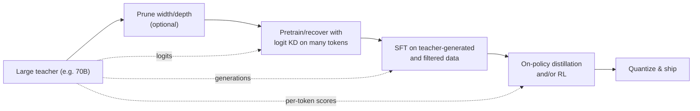

# Distillation & Synthetic Data

Most strong small models are not trained alone. They learn from a bigger model, either by matching its output distribution token by token, or by training on text it wrote. The same is true of most open instruction datasets: they're largely generated by models, then filtered. This page covers both halves of that story. First **knowledge distillation**: soft targets, temperature, which KL divergence to use, logit, sequence-level, on-policy and feature distillation, and how pruning plus distillation builds a small model from a big one. Then **synthetic data**: Self-Instruct, Evol-Instruct, persona-driven generation, textbook-style pretraining data, rejection sampling with verifiers, LLM-as-judge filtering, deduplication, diversity, model collapse, and the licence questions. It ends with a runnable pipeline that generates and filters instruction data against any OpenAI-compatible endpoint.

!!! abstract "What you'll learn"
    - Why soft targets carry more information than labels, and what temperature does
    - Forward vs. reverse KL: mean-seeking vs. mode-seeking, shown with a toy you can run
    - Logit distillation from scratch, with a teacher/student pair on a laptop CPU
    - Sequence-level, on-policy and hidden-state distillation, and when to use each
    - Pruning + distillation (Minitron-style) and how SLMs are built from larger models
    - Synthetic data methods: Self-Instruct, Evol-Instruct, personas, textbook-style data, rejection sampling, LLM judges
    - Deduplication, diversity metrics, model collapse, and licence/ToS issues
    - A complete generate-and-filter pipeline script with a dry-run mode

This page goes deeper than the overview in [Where distillation fits](index.md#where-distillation-fits) and the short section in [Inference](../inference/inference.md#knowledge-distillation). Reasoning-trace distillation specifically is in [Reasoning & RL](reasoning-rl.md#distilling-reasoning-yourself).

## Knowledge distillation

### Soft targets and "dark knowledge"

Train a model on the sentence "The ___ sat on the mat" and the label is one token: `cat`. A trained teacher model gives much more: maybe 0.9 for `cat`, 0.05 `kitten`, 0.03 `dog`, and almost nothing for `spoon`. That distribution tells the student that `kitten` is a near miss and `spoon` is absurd. Hinton called the information in the small probabilities **dark knowledge**. A one-hot label gives one bit of direction per token; a full distribution gives a gradient on every vocabulary entry.

**Temperature** controls how much of that you can see. Dividing logits by $T > 1$ before the softmax flattens the distribution, so the small probabilities become visible to the loss:

```python title="temperature.py"
import torch
logits = torch.tensor([9.0, 6.0, 5.5, 1.0, -2.0])   # teacher: "cat", "kitten", "dog", "car", "spoon"
for T in [1.0, 2.0, 4.0]:
    print(T, torch.softmax(logits / T, -1).numpy().round(3))
```

```text
1.0 [0.926 0.046 0.028 0.    0.   ]
2.0 [0.705 0.157 0.122 0.013 0.003]
4.0 [0.479 0.226 0.2   0.065 0.031]
```

The classic loss mixes cross-entropy on the true label with a KL term between the temperature-softened teacher and student:

$$
\mathcal{L} = \alpha\, \mathrm{CE}(y, p_s) + (1-\alpha)\, T^2\, \mathrm{KL}\!\left(p_t^{(T)} \,\big\|\, p_s^{(T)}\right)
$$

The $T^2$ factor is there because softening by $T$ shrinks the gradients of the KL term by about $1/T^2$; multiplying back keeps the two terms balanced as you change $T$. For LLMs, $T$ between 1 and 2 is typical; pretraining-scale distillation often just uses $T = 1$ and $\alpha = 0$ (pure KL).

### Forward vs. reverse KL

KL divergence is asymmetric, and the direction changes what the student learns when it's too small to match the teacher exactly (which is always).

- **Forward KL**, $\mathrm{KL}(p_t \,\|\, p_s) = \sum_x p_t(x) \log \frac{p_t(x)}{p_s(x)}$. Weighted by the teacher. It punishes the student heavily for putting near-zero probability anywhere the teacher puts mass. Result: **mean-seeking** or mode-covering. The student spreads out to cover everything the teacher might say, including putting mass in between modes.
- **Reverse KL**, $\mathrm{KL}(p_s \,\|\, p_t) = \sum_x p_s(x) \log \frac{p_s(x)}{p_t(x)}$. Weighted by the student. It punishes the student for putting mass where the teacher puts almost none, and doesn't care if it ignores some of the teacher's modes. Result: **mode-seeking**. The student commits to one good answer.

Here a unimodal student (a single bump) is fitted to a bimodal teacher in each direction:

```python title="forward_vs_reverse_kl.py"
import torch

# Teacher: a bimodal distribution over 100 "tokens"
x = torch.arange(100).float()
p = 0.5 * torch.exp(-0.5 * ((x - 25) / 5) ** 2) + 0.5 * torch.exp(-0.5 * ((x - 75) / 5) ** 2)
p = p / p.sum()

def fit(direction, steps=4000):
    # Student: a single "bump" (unimodal), parameterized by mean and log-std
    mu = torch.tensor(35.0, requires_grad=True)
    log_s = torch.tensor(1.6, requires_grad=True)
    opt = torch.optim.Adam([mu, log_s], lr=0.05)
    for _ in range(steps):
        logq = -0.5 * ((x - mu) / log_s.exp()) ** 2
        logq = logq - torch.logsumexp(logq, 0)
        q = logq.exp()
        if direction == "forward":   # KL(p || q): penalizes q ~ 0 where p > 0
            loss = (p * (p.clamp_min(1e-12).log() - logq)).sum()
        else:                        # KL(q || p): penalizes q > 0 where p ~ 0
            loss = (q * (logq - p.clamp_min(1e-12).log())).sum()
        opt.zero_grad(); loss.backward(); opt.step()
    return mu.item(), log_s.exp().item()

print("forward KL (mean-seeking): mu=%.1f sigma=%.1f" % fit("forward"))
print("reverse KL (mode-seeking): mu=%.1f sigma=%.1f" % fit("reverse"))
```

```text
forward KL (mean-seeking): mu=50.2 sigma=37.0
reverse KL (mode-seeking): mu=25.0 sigma=5.0
```

Forward KL puts the student's centre at 50, between the two modes, and makes it wide: it covers both modes but puts a lot of probability where the teacher puts almost none. Reverse KL locks onto one mode (the nearer one, given where it started) and matches it exactly.

For generation, putting mass where the teacher wouldn't means sampling text the teacher considers unlikely: hallucination-like, low-quality outputs. That's why reverse KL (or a mix, such as the generalized Jensen-Shannon divergence) is often preferred for distilling generative models, particularly with on-policy distillation below. Forward KL is the default for offline logit distillation, where it's simple and stable. In practice, with a decent student both work; the difference grows as the capacity gap grows.

### Logit distillation from scratch

To make this concrete without a GPU, here's a tiny "language model" over a 64-token vocabulary that sees the last four tokens. A large randomly-initialized network acts as the teacher (its output distribution *is* the language), and a ~10x smaller network is the student:

```python title="tinylm.py"
import torch
import torch.nn as nn
import torch.nn.functional as F

V, CTX = 64, 4          # vocab size, context window (tokens the model looks at)

class TinyLM(nn.Module):
    """Next-token model over the last CTX tokens. Small enough to train on a laptop CPU."""
    def __init__(self, d=32, hidden=64):
        super().__init__()
        self.emb = nn.Embedding(V, d)
        self.mlp = nn.Sequential(nn.Linear(CTX * d, hidden), nn.GELU(), nn.Linear(hidden, hidden))
        self.head = nn.Linear(hidden, V)

    def features(self, ctx):                       # ctx: (B, CTX) token ids
        return self.mlp(self.emb(ctx).flatten(1))  # (B, hidden)

    def forward(self, ctx):
        return self.head(self.features(ctx))       # (B, V) logits

@torch.no_grad()
def sample(model, n_seqs, length, temperature=1.0, generator=None):
    """Autoregressive sampling. Returns (n_seqs, CTX + length) token ids."""
    seqs = torch.randint(0, V, (n_seqs, CTX), generator=generator)
    for _ in range(length):
        probs = F.softmax(model(seqs[:, -CTX:]) / temperature, -1)
        seqs = torch.cat([seqs, torch.multinomial(probs, 1, generator=generator)], 1)
    return seqs

def windows(seqs):
    """Turn sequences into (context, next-token) training pairs."""
    ctx = seqs.unfold(1, CTX, 1)[:, :-1]           # (N, L, CTX)
    nxt = seqs[:, CTX:]                            # (N, L)
    return ctx.reshape(-1, CTX), nxt.reshape(-1)

def make_teacher(seed=0):
    torch.manual_seed(seed)
    teacher = TinyLM(d=64, hidden=512)
    with torch.no_grad():
        teacher.head.weight.mul_(30.0)             # make it confident: random init is near-uniform
    return teacher.eval().requires_grad_(False)
```

Now train the student on the same ~2,000 (context, next token) pairs in three ways: hard labels only (the sampled next token, which is just ordinary next-token training on teacher-generated text) and soft targets at two temperatures:

```python title="distill_logits.py"
import torch
import torch.nn.functional as F
from tinylm import TinyLM, sample, windows, make_teacher

def kd_loss(student_logits, teacher_logits, T=2.0):
    """Hinton KD: KL(teacher_T || student_T), scaled by T^2 to keep gradient size stable."""
    log_p_s = F.log_softmax(student_logits / T, -1)
    log_p_t = F.log_softmax(teacher_logits / T, -1)
    return F.kl_div(log_p_s, log_p_t, log_target=True, reduction="batchmean") * T * T

teacher = make_teacher()
g = torch.Generator().manual_seed(1)
train_ctx, train_y = windows(sample(teacher, 64, 32, generator=g))    # ~2k pairs: a small budget
eval_ctx, _ = windows(sample(teacher, 256, 32, generator=g))

@torch.no_grad()
def eval_kl(student):   # KL(teacher || student) on held-out teacher-distribution contexts
    return F.kl_div(F.log_softmax(student(eval_ctx), -1), F.log_softmax(teacher(eval_ctx), -1),
                    log_target=True, reduction="batchmean").item()

def train(mode, steps=1500, alpha=0.1, T=2.0):
    torch.manual_seed(0)
    student = TinyLM(d=32, hidden=64)                   # ~10x fewer params than the teacher
    opt = torch.optim.AdamW(student.parameters(), lr=3e-3, weight_decay=0.01)
    with torch.no_grad():
        t_logits = teacher(train_ctx)                   # precompute once (offline distillation)
    for step in range(steps):
        idx = torch.randint(0, len(train_ctx), (256,))
        s_logits = student(train_ctx[idx])
        ce = F.cross_entropy(s_logits, train_y[idx])    # hard label = the sampled token
        if mode == "hard":
            loss = ce
        else:
            loss = alpha * ce + (1 - alpha) * kd_loss(s_logits, t_logits[idx], T)
        opt.zero_grad(); loss.backward(); opt.step()
    return eval_kl(student)

print(f"hard labels only     : eval KL(teacher||student) = {train('hard'):.3f}")
print(f"soft targets (T=2)   : eval KL(teacher||student) = {train('soft'):.3f}")
print(f"soft targets (T=1)   : eval KL(teacher||student) = {train('soft', T=1.0):.3f}")
```

```text
hard labels only     : eval KL(teacher||student) = 7.315
soft targets (T=2)   : eval KL(teacher||student) = 0.757
soft targets (T=1)   : eval KL(teacher||student) = 1.074
```

With the same small data budget, the soft-target students end up close to the teacher's distribution, while the hard-label student badly overfits the 2,000 samples it saw and is confidently wrong on new contexts. Each soft target is like seeing many samples from the teacher at that context at once. This is why distillation is so sample-efficient, and why Gemma 2's smaller models were trained with logit distillation from a larger teacher on more tokens than would be compute-optimal from scratch.

Practical details at LLM scale:

- **Same tokenizer required.** The KL is over vocabulary entries, so teacher and student must share a vocabulary (or you need a token-alignment scheme, which is lossy). This is one reason model families (Llama 3.x, Qwen, Gemma) distill within the family.
- **Storing logits is expensive.** A 128k-vocab distribution per token is far bigger than the token itself. Either run the teacher online alongside the student (costly in GPU memory and FLOPs), or store only the **top-k** teacher logits (k around 20-100) per position and renormalize. Top-k loses only a little because most mass sits in a few tokens.
- **Compute the softmax in fp32**, and mask padding and prompt positions just as you would in SFT.

### Sequence-level distillation

Instead of matching distributions, generate outputs from the teacher and train the student on them with ordinary cross-entropy. This is **sequence-level distillation** (Kim & Rush): the student learns the teacher's *mode* (beam search or low-temperature output) rather than its whole distribution.

It's the workhorse of LLM distillation because:

- It **works across tokenizers and architectures**. You only need text.
- It **works with API-only teachers**. You don't need logits.
- It's **just SFT**: same code, same tooling (see [SFT](sft.md)).

DeepSeek's R1-Distill models (Qwen2.5 and Llama checkpoints trained on roughly 800k R1-generated samples) are sequence-level distillation. So is most of what's called "synthetic SFT data". The downside is that the student only sees one sample per prompt: it's the hard-label row of the experiment above, at scale. You compensate with lots of prompts, multiple samples per prompt, and filtering.

### On-policy distillation

Both methods above are **off-policy**: the student trains on contexts produced by the teacher (or by the dataset). At inference, the student conditions on *its own* previous tokens. Once it makes a mistake the teacher would never make, it's in a state it never saw in training, and errors compound. This is the same **exposure bias** problem that motivates DAgger in [Imitation Learning](../decision/imitation.md).

**On-policy distillation** fixes it: the student generates, and the teacher grades every token the student produced, by giving its distribution at each of the student's prefixes. The loss is typically the per-token reverse KL, $\mathrm{KL}(p_s \,\|\, p_t)$, at student-visited states. It's like RL with a dense reward (the teacher's log-probability for every token) instead of one scalar at the end, which makes it far more sample-efficient than RL. GKD (generalized knowledge distillation) and MiniLLM formalized it; Qwen3's smaller models were post-trained with a mix of off-policy and on-policy distillation from larger Qwen3 models.

```python title="on_policy.py"
import torch
import torch.nn.functional as F
from tinylm import TinyLM, sample, windows, make_teacher

teacher = make_teacher()

def reverse_kl_per_token(student, ctx):
    """KL(student || teacher) at each context, summed over the full vocab."""
    s_logp = F.log_softmax(student(ctx), -1)
    with torch.no_grad():
        t_logp = F.log_softmax(teacher(ctx), -1)
    return (s_logp.exp() * (s_logp - t_logp)).sum(-1)

@torch.no_grad()
def on_policy_eval(student, n=256, L=32):
    """How bad are the student's own generations, judged token by token by the teacher?"""
    ctx, _ = windows(sample(student, n, L, generator=torch.Generator().manual_seed(123)))
    return reverse_kl_per_token(student, ctx).mean().item()

def train(mode, steps=600):
    torch.manual_seed(0)
    student = TinyLM(d=32, hidden=64)
    opt = torch.optim.AdamW(student.parameters(), lr=3e-3)
    for step in range(steps):
        if mode == "off-policy":          # contexts come from the teacher
            ctx, _ = windows(sample(teacher, 16, 32))
            s_logp = F.log_softmax(student(ctx), -1)
            t_logp = F.log_softmax(teacher(ctx), -1)
            loss = F.kl_div(s_logp, t_logp, log_target=True, reduction="batchmean")  # forward KL
        else:                             # contexts come from the student itself
            ctx, _ = windows(sample(student, 16, 32))  # (1)!
            loss = reverse_kl_per_token(student, ctx).mean()  # (2)!
        opt.zero_grad(); loss.backward(); opt.step()
    return student

for mode in ["off-policy", "on-policy"]:
    s = train(mode)
    print(f"{mode:10s}: reverse KL on student's own samples = {on_policy_eval(s):.3f}")
```

1.  The student's samples are treated as fixed data. Gradients flow through the student's log-probs at those contexts, not through the sampling itself. Most practical implementations do the same.
2.  Full-vocabulary reverse KL at each visited context. If you only have teacher log-probs for the sampled token (for example from an inference server), use the single-sample estimate $\log p_s(x_t) - \log p_t(x_t)$ as a per-token penalty in a policy-gradient loss.

```text
off-policy: reverse KL on student's own samples = 0.736
on-policy : reverse KL on student's own samples = 0.551
```

The on-policy student is better judged by the teacher on the text it actually generates, which is the distribution that matters at inference time. The cost: you generate from the student every step (slow, like RL) and must run the teacher on those samples. A common recipe is off-policy first (cheap, gets the student in the right region), then a shorter on-policy phase. TRL ships a `GKDTrainer` that implements this, with a parameter mixing on- and off-policy data and a choice of divergence (its import path has moved between TRL releases, so check the docs for your version).

### Hidden-state (feature) distillation

You can also match intermediate representations: the student's hidden states should be predictable from (or mapped onto) the teacher's. Because widths differ, a learned projection maps student features into teacher space. This idea goes back to FitNets ("hints") and was used by DistilBERT and TinyBERT, which also matched attention maps.

```python title="feature_distill.py"
import torch
import torch.nn as nn
import torch.nn.functional as F
from tinylm import TinyLM, sample, windows, make_teacher

teacher = make_teacher()                      # hidden size 512
student = TinyLM(d=32, hidden=64)             # hidden size 64
proj = nn.Linear(64, 512)                     # learned map from student space to teacher space
opt = torch.optim.AdamW(list(student.parameters()) + list(proj.parameters()), lr=3e-3)

for step in range(200):
    ctx, _ = windows(sample(teacher, 16, 32))
    with torch.no_grad():
        t_h, t_logits = teacher.features(ctx), teacher(ctx)
    s_h = student.features(ctx)
    s_logits = student.head(s_h)
    logit_kd = F.kl_div(F.log_softmax(s_logits, -1), F.log_softmax(t_logits, -1),
                        log_target=True, reduction="batchmean")
    feat_kd = 1 - F.cosine_similarity(proj(s_h), t_h, dim=-1).mean()   # or MSE on normalized states
    loss = logit_kd + 1.0 * feat_kd
    opt.zero_grad(); loss.backward(); opt.step()
print(f"logit KD {logit_kd.item():.3f}  feature cos-distance {feat_kd.item():.3f}")
```

Feature losses give extra signal per token and help when the student is initialized from the teacher (for example after pruning), where layers correspond naturally. When architectures differ a lot, which layers to match is a guess, and feature losses can over-constrain the student. For decoder LLMs, logit (and sequence-level) distillation is the main tool; feature losses are an occasional add-on.

### Pruning + distillation (Minitron-style)

Training a 4B model from scratch on trillions of tokens is expensive. If you have a good 8B model, a cheaper route is:

1. **Estimate importance** of each structural unit (layers, attention heads, MLP neurons, embedding channels) by running a small calibration set through the model and measuring activation magnitudes, or the effect on loss of removing each unit.
2. **Prune structurally**: remove the least important neurons, heads, embedding channels (width) and/or whole layers (depth) to hit a target size. The result is a smaller *dense* model, so it runs fast everywhere.
3. **Distill** the pruned model from the original as teacher, with logit KL on a modest amount of data (NVIDIA reported using a small fraction of the original pretraining tokens). The pruned model starts far closer to the teacher than a random init does, so it recovers quickly.
4. Optionally iterate (prune a bit, distill, prune more).

NVIDIA's Minitron work found width pruning generally recovered better than depth pruning at the same size, and that distillation beat plain fine-tuning for the recovery step. Llama 3.2 1B and 3B were also built using pruning and distillation from larger Llama 3.1 models.

### How SLMs are built by distillation

Put together, the modern recipe for a small model from a family that already has a big one:



The teacher shows up at every stage: logits during pretraining, generations during SFT, per-token scores during on-policy distillation. If you only have API access to a teacher, you're limited to the generations path, which is where synthetic data comes in.

## Synthetic data

Synthetic data means training data written by a model. It's used for instruction tuning (prompts and responses), preference data (responses ranked by a judge; see [Preference Optimization](preference.md)), reasoning traces (filtered by a verifier) and even pretraining (textbook-style documents). Generation is easy. **Filtering** is where the quality comes from, and most of this section is about filtering.

### Self-Instruct

Self-Instruct bootstraps instructions from a small seed set:

1. Start with ~175 human-written seed tasks.
2. Prompt a model with a few seeds plus a few previously generated tasks, and ask for a new one.
3. Filter: drop instructions too similar to existing ones (the paper used ROUGE-L overlap above 0.7), drop ones the model can't do (mentions of images, for a text-only model), drop malformed ones.
4. Generate a response for each surviving instruction.
5. Add new instructions to the pool and repeat.

Alpaca used this recipe with a stronger model to make 52k examples. Its weakness is diversity: the model tends to generate the same few kinds of tasks, and similarity filtering only removes near-copies, not same-shaped tasks.

### Evol-Instruct

Evol-Instruct (WizardLM) takes existing instructions and **rewrites them** with a set of evolution prompts:

- **In-depth evolution**: add constraints, require more reasoning steps, make the input more complex, replace general concepts with specific ones.
- **In-breadth evolution**: write a new instruction in the same domain but rarer.

Each round makes instructions harder or more varied; a filter removes evolutions that failed (the response is empty or just repeats the prompt, or the "evolved" instruction is the same as before). It reliably produces harder data than Self-Instruct, which matters because hard examples teach more per sample.

### Persona-driven generation

To get diversity, change *who* is asking. Persona Hub built a very large set of synthetic personas ("a nurse working night shifts", "a game designer balancing an RPG economy") and conditioned generation on them: "Write a math problem this person would encounter". Different personas pull out different vocabularies, domains and difficulty levels from the same model. It's cheap, it composes with Self-Instruct and Evol-Instruct, and it's the diversity lever in the pipeline script below.

**Magpie** is another trick worth knowing: give an aligned chat model only the chat-template prefix for a user turn and let it complete; it generates a plausible user query on its own. No seed prompts needed.

### Textbook-style pretraining data

The Phi series (starting with *Textbooks Are All You Need*) showed that small models trained on carefully generated "textbook quality" data plus heavily filtered web data can punch well above their size on reasoning and code benchmarks. Hugging Face's **Cosmopedia** is an open reproduction: tens of millions of synthetic textbooks, blog posts and stories, generated by prompting an open model with seed topics drawn from web pages and curated sources, with explicit audience targets ("for young children", "for college students") for variety. SmolLM models used Cosmopedia in their pretraining mix.

Lessons from that work: seed with real topics so coverage is broad; vary format and audience explicitly; and decontaminate against benchmarks (generated textbooks can easily contain benchmark-like questions). See [Data Pipelines](../pretraining/data.md) for mixing synthetic data into a pretraining corpus.

### Rejection sampling and verification

When answers can be checked, generate several candidates and keep only those that pass. This is **rejection sampling**, and for math and code it's by far the most reliable filter:

- **Math**: extract the final answer and compare to ground truth, with numeric equivalence (`0.75` = `3/4` = `\frac{3}{4}`).
- **Code**: run the candidate against unit tests in a sandbox.
- **Structured output**: validate against the schema.

```python title="rejection_sampling.py"
import re
from fractions import Fraction

def extract_boxed(text):
    """Return the content of the last \\boxed{...}, handling nested braces."""
    start = text.rfind("\\boxed{")
    if start == -1:
        return None
    i, depth = start + len("\\boxed{"), 1
    for j in range(i, len(text)):
        depth += {"{": 1, "}": -1}.get(text[j], 0)
        if depth == 0:
            return text[i:j].strip()
    return None

def same_number(a, b):
    """Numeric equivalence: '0.5' == '1/2' == '\\frac{1}{2}'."""
    def to_frac(s):
        s = s.replace(",", "").replace("$", "").strip()
        m = re.fullmatch(r"\\d?frac\{(-?\d+)\}\{(-?\d+)\}", s)
        return Fraction(int(m[1]), int(m[2])) if m else Fraction(s)
    try:
        return to_frac(a) == to_frac(b)
    except (ValueError, ZeroDivisionError, TypeError):
        return a.strip() == b.strip()

def rejection_sample(problem, answer, generate, k=8, keep=2):
    """Sample k solutions; keep up to `keep` distinct ones whose final answer verifies."""
    samples = generate(problem, n=k)
    correct = [s for s in samples if (p := extract_boxed(s)) is not None and same_number(p, answer)]
    pass_rate = len(correct) / k             # doubles as a difficulty estimate
    return list(dict.fromkeys(correct))[:keep], pass_rate

# Stand-in for an LLM call (replace with your endpoint, temperature ~0.8-1.0)
def fake_generate(problem, n):
    outs = ["... so the answer is \\boxed{\\frac{3}{4}}", "... \\boxed{0.75}", "... \\boxed{0.7}",
            "I think it's 3/4", "... \\boxed{3/4}", "... \\boxed{\\frac{3}{4}}"]
    return (outs * 2)[:n]

print(rejection_sample("What is 3 divided by 4?", "0.75", fake_generate, k=6, keep=3))
```

```text
(['... so the answer is \\boxed{\\frac{3}{4}}', '... \\boxed{0.75}', '... \\boxed{3/4}'], 0.6666666666666666)
```

The pass rate is a free difficulty signal. Problems with pass rate 1.0 are too easy to teach much; problems with 0 have no usable trace (and may have a wrong reference answer). The most valuable training data often sits in between. STaR used this loop iteratively (generate, keep correct rationales, fine-tune, repeat), and it's the backbone of reasoning distillation and of RL with verifiable rewards ([Reasoning & RL](reasoning-rl.md)).

### LLM-as-judge filtering

For open-ended tasks with no verifier, use a model to grade. Ask a strong judge for a score against a short rubric (helpfulness, correctness, clarity) and keep only high scores. Make it robust:

- **Ask for JSON** (`{"score": 8, "reason": "..."}`) and drop anything unparsable.
- **Temperature 0** for the judge, and a fixed rubric.
- **Known biases**: judges prefer longer answers, answers in their own style (self-preference, so avoid judging a model's outputs with the same model if you can), and in pairwise mode, the first or second position. Swap positions and average for pairwise judging.
- **Calibrate on a small human-labelled set.** Check that the judge's scores actually agree with yours before trusting them at scale.

### Deduplication and diversity

Synthetic generators repeat themselves. Two levels of dedup:

- **Exact and near-exact**: normalize (lowercase, strip whitespace) and hash; then n-gram shingle sets with Jaccard similarity for near-duplicates. At scale, **MinHash + LSH** approximates Jaccard so you don't compare every pair. This is the same machinery as pretraining dedup in [Data Pipelines](../pretraining/data.md).
- **Semantic**: embed instructions with a sentence-embedding model and drop items whose cosine similarity to an existing item is above a threshold (for example 0.9-0.95), or cluster and sample evenly across clusters.

Measure diversity rather than guessing:

- **distinct-n**: unique n-grams / total n-grams across the dataset. Higher is more varied.
- **Mean pairwise similarity** (n-gram Jaccard or embedding cosine) over a random sample of pairs. Lower is more varied.
- **Coverage**: cluster embeddings and look at the cluster size distribution. One huge cluster ("write a Python function that...") is a red flag.
- **Read 50 random samples.** Every time.

### Model collapse

If models are trained on model-generated data, and their outputs train the next generation, and so on, the distribution narrows: rare events (the tails) disappear first, then outputs converge to bland, repetitive text. This **model collapse** has been demonstrated for recursive training on purely synthetic data. The practical guards:

- **Keep real data in the mix.** Collapse is mainly a problem when synthetic data *replaces* real data across generations; accumulating synthetic data alongside the original real data is much more stable.
- **Filter with external signals** (verifiers, human-calibrated judges), not just the generator's own likelihood. Filtering for "what the model finds likely" accelerates the narrowing.
- **Inject diversity deliberately**: personas, seed topics from real documents, varied formats.
- **Track diversity metrics** across iterations of any self-training loop.

### Licence and terms of service

Teacher outputs come with strings attached:

- Many commercial API **terms of service restrict using outputs to develop competing models**. Read the current terms of the provider you use; they change.
- **Open-weight licences** vary. Some are permissive (Apache 2.0, MIT: for example many Qwen and DeepSeek releases). Others attach conditions to models trained on outputs; for example, the Llama 3.x licences have naming and attribution requirements for derived models. Check the specific licence version.
- **Datasets inherit constraints.** A dataset's licence doesn't override the terms under which its content was generated. Dataset cards usually say which model generated the data.
- Record provenance in every row (generator model, judge model, date), as the pipeline below does, so you can filter later if a licence question comes up.

This isn't legal advice; for anything commercial, ask someone who can give it.

## A generate-and-filter pipeline

This script ties the section together: persona-conditioned Self-Instruct generation, rule filters, n-gram near-duplicate filtering, response generation, LLM-as-judge filtering, provenance metadata, and diversity metrics. It uses only the Python standard library, and it talks to any **OpenAI-compatible** chat completions endpoint: vLLM, SGLang, llama.cpp server, Ollama, or a hosted API. `--dry-run` swaps in a fake model so you can run every stage offline.

```python title="synth_pipeline.py"
"""Generate and filter synthetic instruction data with any OpenAI-compatible endpoint.

Environment:
  OPENAI_BASE_URL   e.g. http://localhost:8000/v1 (vLLM, SGLang, llama.cpp, Ollama) or a hosted API
  OPENAI_API_KEY    API key ("EMPTY" is fine for most local servers)
  GEN_MODEL         model that writes instructions and responses
  JUDGE_MODEL       model that grades them (defaults to GEN_MODEL)

Usage:
  python synth_pipeline.py --dry-run --n 50          # no network: fake model, exercises every stage
  python synth_pipeline.py --n 500 --out data.jsonl  # real run
"""
import argparse, json, os, random, re, sys, time, urllib.request

SEED_TASKS = [
    "Explain the difference between a process and a thread to a junior developer.",
    "Write a Python function that merges two sorted lists in linear time.",
    "Summarize the main causes of the 2008 financial crisis in five bullet points.",
    "Draft a polite email declining a meeting invitation because of a schedule conflict.",
    "A train travels 180 km in 2.5 hours. What is its average speed in m/s? Show your work.",
    "What are the trade-offs between SQL and NoSQL databases for a social media app?",
    "Rewrite this sentence to be more concise: 'Due to the fact that it was raining, we stayed in.'",
    "Give three ideas for a beginner-friendly weekend electronics project.",
]
PERSONAS = [
    "a high-school chemistry teacher", "a backend engineer debugging a production outage",
    "a nurse working night shifts", "a small bakery owner doing their own accounting",
    "a PhD student in linguistics", "a retired person learning to use a smartphone",
    "a data analyst preparing a quarterly report", "a game designer balancing an RPG economy",
    "a hiking guide planning a multi-day trek", "a lawyer reviewing a software licence",
]
BANNED = re.compile(r"\b(image|picture|photo|video|draw|diagram|audio|url|link)\b", re.I)  # text-only model

# ---------------------------------------------------------------- model client
class Client:
    def __init__(self, base_url, api_key, timeout=120):
        self.base_url, self.api_key, self.timeout = base_url.rstrip("/"), api_key, timeout

    def chat(self, model, messages, temperature=0.7, max_tokens=1024, retries=4):
        body = json.dumps({"model": model, "messages": messages,
                           "temperature": temperature, "max_tokens": max_tokens}).encode()
        req = urllib.request.Request(f"{self.base_url}/chat/completions", data=body, headers={
            "Content-Type": "application/json", "Authorization": f"Bearer {self.api_key}"})
        for attempt in range(retries):
            try:
                with urllib.request.urlopen(req, timeout=self.timeout) as r:
                    return json.load(r)["choices"][0]["message"]["content"] or ""
            except Exception as e:                    # rate limits, timeouts: back off and retry
                if attempt == retries - 1:
                    raise
                wait = 2 ** attempt
                print(f"  request failed ({e}); retrying in {wait}s", file=sys.stderr)
                time.sleep(wait)

class FakeClient:
    """Deterministic stand-in for --dry-run. Produces some junk on purpose so filters have work."""
    def __init__(self, seed=0):
        self.rng = random.Random(seed)
    def chat(self, model, messages, **_):
        prompt = messages[-1]["content"]
        r = self.rng
        if "Write ONE new instruction" in prompt:
            persona = re.search(r"written by (.+?)\.", prompt).group(1)
            topics = ["budgeting", "SQL indexes", "sleep schedules", "unit tests", "sourdough",
                      "contract clauses", "trail safety", "pivot tables", "loot tables", "titration"]
            kind = r.choice(["Explain", "Write a checklist for", "Compare two approaches to",
                             "Give a worked example of", "Draw a picture of"])   # 'Draw' gets filtered
            if r.random() < 0.2:
                return "Explain budgeting to a colleague who is new to it."    # near-duplicates
            return f"As {persona}, {kind.lower()} {r.choice(topics)} for a colleague who is new to it."
        if "Rate the response" in prompt:
            return json.dumps({"score": r.choice([3, 6, 7, 8, 9, 9]), "reason": "dry-run score"})
        return "Here is a careful, step-by-step answer. " + " ".join(["Point."] * r.randint(1, 40))

# ---------------------------------------------------------------- prompts
def instruction_prompt(examples, persona):
    shots = "\n".join(f"- {e}" for e in examples)
    return (f"Here are some example tasks a user might give an AI assistant:\n{shots}\n\n"
            f"Write ONE new instruction that could be written by {persona}. It must be different in "
            "topic and form from the examples, self-contained, answerable in text, and realistic. "
            "Output only the instruction.")

JUDGE_PROMPT = """You are grading training data for an AI assistant.
Instruction:
{instruction}

Response:
{response}

Rate the response from 1 to 10 for helpfulness, correctness and clarity. A 10 is an answer an expert
would be proud of; below 7 means it should not be used for training. Reply with JSON only:
{{"score": <int>, "reason": "<one sentence>"}}"""

def parse_score(text):
    m = re.search(r"\{.*\}", text, re.S)
    try:
        return int(json.loads(m.group(0))["score"]) if m else None
    except (ValueError, KeyError, TypeError):
        return None

# ---------------------------------------------------------------- filters & metrics
def shingles(text, n=3):
    words = re.findall(r"\w+", text.lower())
    return {tuple(words[i:i + n]) for i in range(max(1, len(words) - n + 1))}

def jaccard(a, b):
    return len(a & b) / max(1, len(a | b))

def is_near_duplicate(text, pool, threshold=0.5):
    s = shingles(text)
    return any(jaccard(s, p) >= threshold for p in pool)   # O(n) per item; use MinHash/LSH at scale

def instruction_ok(text):
    n = len(text.split())
    return 4 <= n <= 150 and not BANNED.search(text) and not text.endswith(":")

def response_ok(text):
    return 5 <= len(text.split()) <= 1500 and "as an ai language model" not in text.lower()

def distinct_n(texts, n):
    grams = [g for t in texts for g in shingles(t, n)]
    return len(set(grams)) / max(1, len(grams))

def mean_pairwise_jaccard(texts, max_pairs=5000, seed=0):
    rng, sh = random.Random(seed), [shingles(t) for t in texts]
    if len(sh) < 2:
        return 0.0
    pairs = [rng.sample(range(len(sh)), 2) for _ in range(max_pairs)]
    return sum(jaccard(sh[i], sh[j]) for i, j in pairs) / len(pairs)

# ---------------------------------------------------------------- pipeline
def main():
    ap = argparse.ArgumentParser()
    ap.add_argument("--n", type=int, default=100, help="target number of kept examples")
    ap.add_argument("--out", default="synthetic.jsonl")
    ap.add_argument("--min-score", type=int, default=7)
    ap.add_argument("--max-attempts", type=int, default=0, help="default: 6 x n")
    ap.add_argument("--seed", type=int, default=0)
    ap.add_argument("--dry-run", action="store_true")
    args = ap.parse_args()

    rng = random.Random(args.seed)
    gen_model = os.environ.get("GEN_MODEL", "dry-run")
    judge_model = os.environ.get("JUDGE_MODEL", gen_model)
    if args.dry_run:
        client = FakeClient(args.seed)
    else:
        if "GEN_MODEL" not in os.environ:
            sys.exit("Set GEN_MODEL (and OPENAI_BASE_URL / OPENAI_API_KEY), or pass --dry-run.")
        client = Client(os.environ.get("OPENAI_BASE_URL", "https://api.openai.com/v1"),
                        os.environ.get("OPENAI_API_KEY", "EMPTY"))

    pool = list(SEED_TASKS)                       # instructions seen so far (seeds + generated)
    pool_shingles = [shingles(t) for t in pool]
    kept, stats = [], dict(generated=0, bad_instruction=0, duplicate=0, bad_response=0,
                           low_score=0, unparsable_score=0)
    max_attempts = args.max_attempts or 6 * args.n

    with open(args.out, "w") as f:
        for attempt in range(max_attempts):
            if len(kept) >= args.n:
                break
            persona = rng.choice(PERSONAS)
            # Self-Instruct: mix human seeds with model-generated tasks as in-context examples
            examples = rng.sample(SEED_TASKS, 2) + rng.sample(pool, min(2, len(pool)))
            instruction = client.chat(gen_model, [{"role": "user",
                          "content": instruction_prompt(examples, persona)}], temperature=1.0,
                          max_tokens=200).strip().strip('"')
            stats["generated"] += 1
            if not instruction_ok(instruction):
                stats["bad_instruction"] += 1; continue
            if is_near_duplicate(instruction, pool_shingles):
                stats["duplicate"] += 1; continue
            pool.append(instruction); pool_shingles.append(shingles(instruction))

            response = client.chat(gen_model, [{"role": "user", "content": instruction}],
                                   temperature=0.7).strip()
            if not response_ok(response):
                stats["bad_response"] += 1; continue

            verdict = client.chat(judge_model, [{"role": "user", "content": JUDGE_PROMPT.format(
                      instruction=instruction, response=response)}], temperature=0.0, max_tokens=200)
            score = parse_score(verdict)
            if score is None:
                stats["unparsable_score"] += 1; continue
            if score < args.min_score:
                stats["low_score"] += 1; continue

            row = {"messages": [{"role": "user", "content": instruction},
                                {"role": "assistant", "content": response}],
                   "meta": {"persona": persona, "judge_score": score, "gen_model": gen_model,
                            "judge_model": judge_model}}
            f.write(json.dumps(row, ensure_ascii=False) + "\n")
            kept.append(instruction)
            print(f"[{len(kept)}/{args.n}] score={score} {instruction[:70]}")

    print("\nfunnel:", json.dumps(stats))
    print(f"kept {len(kept)} examples -> {args.out}")
    if kept:
        print(f"distinct-1 {distinct_n(kept, 1):.3f}  distinct-2 {distinct_n(kept, 2):.3f}  "
              f"mean pairwise 3-gram Jaccard {mean_pairwise_jaccard(kept):.3f} (lower = more diverse)")

if __name__ == "__main__":
    main()
```

Run it offline first:

```bash
python synth_pipeline.py --dry-run --n 20 --out dry.jsonl
```

The fake model deliberately produces bad and duplicate instructions, so you can see the funnel:

```text
funnel: {"generated": 105, "bad_instruction": 15, "duplicate": 63, "bad_response": 0, "low_score": 7, "unparsable_score": 0}
kept 20 examples -> dry.jsonl
```

Then point it at a real model, for example a local vLLM server:

```bash
vllm serve Qwen/Qwen2.5-7B-Instruct --port 8000            # in another terminal
export OPENAI_BASE_URL=http://localhost:8000/v1
export OPENAI_API_KEY=EMPTY
export GEN_MODEL=Qwen/Qwen2.5-7B-Instruct
python synth_pipeline.py --n 500 --out synthetic.jsonl
```

The output rows use the `messages` format that TRL's `SFTTrainer` accepts directly (see [SFT](sft.md)). To scale it up: send requests concurrently (a thread pool, since the server batches them), replace the O(n) near-duplicate scan with MinHash-LSH or embedding search, add Evol-Instruct rewriting as a second stage, and use a different, stronger model as `JUDGE_MODEL`.

!!! warning "Common pitfalls"
    - **Mismatched tokenizers in logit distillation.** KL over vocabularies only makes sense if the vocabularies match. Otherwise use sequence-level distillation.
    - **Forgetting the $T^2$ factor** when you change temperature, which silently rebalances the CE and KL terms.
    - **Distilling a teacher's mistakes.** Unfiltered teacher outputs include wrong answers stated confidently. Verify where you can, judge where you can't.
    - **Benchmark contamination.** Generators reproduce benchmark questions they've seen. Decontaminate synthetic data against your eval sets with n-gram overlap checks.
    - **Diversity collapse.** Thousands of instructions that all start "Write a Python function" or "Explain". Track distinct-n and cluster sizes, and vary personas, seeds and formats.
    - **Judge bias.** Length and self-preference biases leak into your data and then into your model. Calibrate against human labels and prefer a judge from a different model family than the generator.
    - **Ignoring licences** until launch day. Record provenance from the start.

## Check your understanding

??? question "Why does a soft-target student learn more from the same number of examples than a hard-label student?"
    Each soft target is the teacher's full distribution at that context, which gives a gradient signal on every vocabulary entry: which alternatives are plausible and which are absurd. A hard label is a single sample from that distribution. Learning a distribution from single samples needs many samples per context; the soft target supplies the distribution directly.

??? question "You distill a 7B teacher into a 500M student for open-ended chat. Why might reverse KL give better samples than forward KL?"
    The student can't represent everything the teacher does. Forward KL forces it to cover all of the teacher's modes, so it puts mass between them, which means generating tokens the teacher thinks are unlikely. Reverse KL lets it drop some modes and concentrate on outputs the teacher rates highly. For sampling quality, being precise matters more than covering everything.

??? question "What problem does on-policy distillation solve, and what does it cost?"
    Off-policy training only shows the student teacher-generated prefixes. At inference the student conditions on its own outputs, reaches states it never trained on after its first mistake, and errors compound (exposure bias). On-policy distillation trains on the student's own samples, with the teacher grading each token. The cost is generating from the student during training and running the teacher on those samples, which is much slower per step than offline distillation.

??? question "A math rejection-sampling run shows a pass rate of 0/16 on 30% of problems. What do you do with them?"
    Don't train on them directly; there's no correct trace. Check a sample for wrong reference answers or broken answer extraction first. Then either drop them, try a stronger teacher or more samples for those problems, or keep them for later RL once the model has improved. Also look at the 16/16 problems: they're probably too easy to teach much and can be downsampled.

??? question "Why is model collapse less of a concern when you mix synthetic data with real data than when you replace it?"
    Collapse comes from each generation losing the tails of the distribution and the next generation learning only from the narrowed version. If real data stays in the training mix, the tails are continually re-supplied, and synthetic data adds to the distribution instead of becoming all of it.

## Further reading

- Hinton, Vinyals & Dean, *Distilling the Knowledge in a Neural Network* - [arXiv:1503.02531](https://arxiv.org/abs/1503.02531)
- Kim & Rush, *Sequence-Level Knowledge Distillation* - [arXiv:1606.07947](https://arxiv.org/abs/1606.07947)
- Agarwal et al., *On-Policy Distillation of Language Models: Learning from Self-Generated Mistakes* (GKD) - [arXiv:2306.13649](https://arxiv.org/abs/2306.13649)
- Gu et al., *MiniLLM: Knowledge Distillation of Large Language Models* - [arXiv:2306.08543](https://arxiv.org/abs/2306.08543)
- Romero et al., *FitNets: Hints for Thin Deep Nets* - [arXiv:1412.6550](https://arxiv.org/abs/1412.6550); Sanh et al., *DistilBERT* - [arXiv:1910.01108](https://arxiv.org/abs/1910.01108)
- Muralidharan et al., *Compact Language Models via Pruning and Knowledge Distillation* (Minitron) - [arXiv:2407.14679](https://arxiv.org/abs/2407.14679); Sreenivas et al., *LLM Pruning and Distillation in Practice: The Minitron Approach* - [arXiv:2408.11796](https://arxiv.org/abs/2408.11796)
- Gemma Team, *Gemma 2* - [arXiv:2408.00118](https://arxiv.org/abs/2408.00118); Qwen Team, *Qwen3 Technical Report* - [arXiv:2505.09388](https://arxiv.org/abs/2505.09388)
- Wang et al., *Self-Instruct* - [arXiv:2212.10560](https://arxiv.org/abs/2212.10560); Xu et al., *WizardLM* (Evol-Instruct) - [arXiv:2304.12244](https://arxiv.org/abs/2304.12244)
- Ge et al., *Scaling Synthetic Data Creation with 1,000,000,000 Personas* - [arXiv:2406.20094](https://arxiv.org/abs/2406.20094); Xu et al., *Magpie* - [arXiv:2406.08464](https://arxiv.org/abs/2406.08464)
- Gunasekar et al., *Textbooks Are All You Need* - [arXiv:2306.11644](https://arxiv.org/abs/2306.11644); Hugging Face, *Cosmopedia* - [huggingface.co/blog/cosmopedia](https://huggingface.co/blog/cosmopedia)
- Zelikman et al., *STaR: Bootstrapping Reasoning With Reasoning* - [arXiv:2203.14465](https://arxiv.org/abs/2203.14465)
- Zheng et al., *Judging LLM-as-a-Judge with MT-Bench and Chatbot Arena* - [arXiv:2306.05685](https://arxiv.org/abs/2306.05685)
- Lee et al., *Deduplicating Training Data Makes Language Models Better* - [arXiv:2107.06499](https://arxiv.org/abs/2107.06499)
- Shumailov et al., *The Curse of Recursion: Training on Generated Data Makes Models Forget* - [arXiv:2305.17493](https://arxiv.org/abs/2305.17493)
- TRL docs: [GKDTrainer](https://huggingface.co/docs/trl/gkd_trainer), [SFTTrainer](https://huggingface.co/docs/trl/sft_trainer)

**Next:** [Fine-tuning](../finetuning/index.md)
