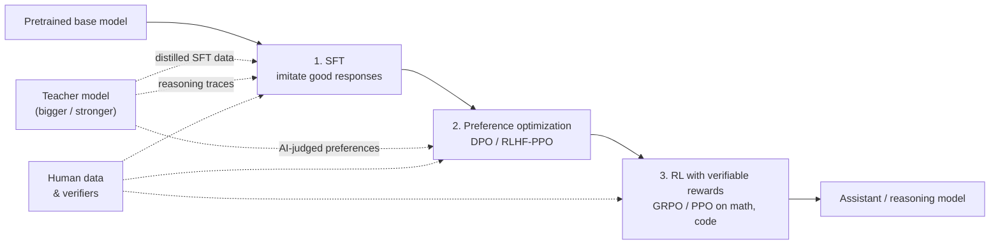
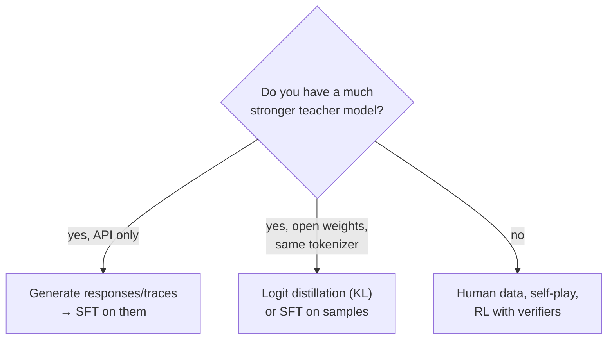
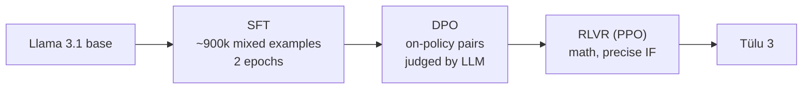
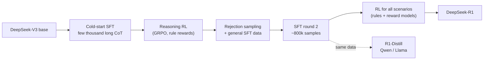

# Post-training: From Base Model to Assistant

A freshly pretrained model is a superb autocompleter and a terrible assistant. Ask it "What is the capital of France?" and it may answer, or it may continue with "What is the capital of Germany? What is the capital of Spain?" because a list of quiz questions is a perfectly likely continuation of web text. *Post-training* is everything you do after pretraining to turn that raw next-token predictor into something that follows instructions, holds a conversation, refuses the right things, and (lately) reasons through hard problems before answering. It uses a tiny fraction of pretraining compute and decides most of what users actually experience.

!!! abstract "What you'll learn"
    - Why a base model doesn't behave like an assistant, and what "alignment" means in engineering terms
    - The modern three-stage pipeline: **SFT → preference optimization → RL with verifiable rewards**
    - What each stage fixes, what it can't fix, and roughly what data it needs
    - Where **distillation** from bigger models fits (spoiler: almost everywhere)
    - Which open recipes (Tülu 3, SmolLM2/3, OLMo 2, DeepSeek-R1) to copy from

## Base model vs. assistant

Pretraining optimizes one objective: predict the next token of internet-scale text. The resulting model has absorbed grammar, facts, code, and a lot of reasoning patterns. But it has no notion of *a user* and *a turn*. It models the distribution of documents, and "helpful answer to a question" is only one small corner of that distribution.

Here's a concrete way to see the gap. Give a base model this prompt:

```text
How do I reverse a list in Python?
```

Plausible continuations from a base model include another question (it looks like a forum title), a StackOverflow-style page header, or an answer, followed by more forum chatter. All are reasonable documents. An assistant has to produce exactly one thing: a direct, correct, well-formatted answer, followed by a stop.

Post-training narrows the model's distribution onto that corner. In practice it teaches:

| Behavior | Learned mainly in |
|---|---|
| Turn structure, chat template, when to stop | SFT |
| Instruction following, formatting, tone, persona | SFT, refined by preference tuning |
| Helpfulness vs. harmlessness tradeoffs, refusals | SFT + preference tuning |
| "Which of two decent answers is better" | Preference tuning |
| Long, self-correcting reasoning on checkable tasks | RL with verifiable rewards |
| Tool calling, structured output | SFT (+ RL in newer recipes) |

!!! note "Post-training mostly *elicits*, it rarely *adds*"
    The capabilities are mostly already in the base model. The LIMA paper showed that about 1,000 carefully curated examples could produce a surprisingly good chat model from a strong base. The general lesson holds up: post-training reshapes *which* behaviors come out, while knowledge comes from pretraining. If your base model doesn't know organic chemistry, SFT on 5,000 chemistry chats won't fix it. It will teach the model to sound confident about organic chemistry.

## The modern pipeline

The InstructGPT paper (2022) set up the classic three steps: supervised fine-tuning, reward model training, then PPO. Recipes since then have changed the middle and the end, but the shape is the same:



### Stage 1: Supervised fine-tuning (SFT)

You train on (prompt, ideal response) pairs with the ordinary cross-entropy loss, but **only on the response tokens**. That's it. Same loss as pretraining, different data, and a mask.

- **Fixes:** turn-taking, the chat template, stopping, following the instruction at all, output format, persona, basic safety behavior.
- **Doesn't fix:** subtle quality differences. SFT teaches "produce something like this", so it imitates everything in the data, including its mistakes and verbosity. It also never shows the model what a *bad* answer looks like.
- **Data scale:** roughly 10k to 1M examples. Tülu 3's SFT mix is just under a million; quality matters far more than count.

Details in [Supervised Fine-Tuning](sft.md).

### Stage 2: Preference optimization

You show the model pairs of responses to the same prompt, one preferred ("chosen") and one not ("rejected"), and push probability toward the chosen. Two families:

- **RLHF with PPO:** train a reward model on the preference pairs, then optimize the policy against it with reinforcement learning plus a KL penalty to stay near the SFT model. Powerful, but you juggle four models (policy, reference, reward, value) and lots of hyperparameters.
- **Direct preference optimization (DPO) and friends:** a closed-form rearrangement of the RLHF objective that turns it into a simple classification-style loss on the pairs. There's no reward model, no sampling, and no RL loop. This is the default in most open recipes.

- **Fixes:** helpfulness ranking, tone, reducing obviously bad patterns, better refusal calibration, "chat feel". Preference tuning reliably improves human and LLM-judge win rates.
- **Doesn't fix:** knowledge, hard reasoning. It also introduces new failure modes: **length bias** (judges like long answers, so models get wordy) and **reward hacking**.
- **Data scale:** tens to hundreds of thousands of pairs. Tülu 3 used a few hundred thousand, mostly on-policy pairs judged by an LLM.

Details in [Preference Optimization](preference.md).

### Stage 3: RL with verifiable rewards (RLVR)

For tasks where you can *check* the answer (a math problem with a known number, code with unit tests, an instruction like "answer in exactly three bullet points"), you skip learned reward models entirely. Sample several answers, score them with a program, and reinforce the ones that pass. GRPO, introduced in DeepSeekMath and made famous by DeepSeek-R1, is the workhorse algorithm here.

- **Fixes:** multi-step reasoning, self-verification, "thinking longer" on hard problems. This is what produces reasoning models.
- **Doesn't fix:** open-ended quality (no verifier for "write a nice poem"). It can also make the model worse at chat if you overdo it.
- **Data scale:** thousands to hundreds of thousands of prompts with checkable answers. No reference responses needed.

Details in [Reasoning & RL with Verifiable Rewards](reasoning-rl.md).

!!! tip "The order matters"
    Each stage assumes the previous one worked. Preference optimization on a base model (no SFT) is unstable because the model can't produce well-formed responses to compare. RL on a model that never gets a single answer right has zero reward signal. SFT gets you into the right region, preference tuning polishes, and RL sharpens what's verifiable.

## What each stage optimizes, side by side

If you squint, all three stages are tweaks to one loss. Let $\pi_\theta$ be the model, $x$ a prompt, $y$ a response.

$$
\text{SFT:}\quad \max_\theta \; \mathbb{E}_{(x,y)\sim\mathcal{D}} \big[\log \pi_\theta(y \mid x)\big]
$$

$$
\text{RLHF / RLVR:}\quad \max_\theta \; \mathbb{E}_{x,\; y\sim\pi_\theta(\cdot\mid x)} \big[r(x,y)\big] \;-\; \beta\, \mathrm{KL}\big(\pi_\theta \,\|\, \pi_{\text{ref}}\big)
$$

$$
\text{DPO:}\quad \max_\theta \; \mathbb{E}_{(x,y_w,y_l)} \Big[\log\sigma\Big(\beta \log\tfrac{\pi_\theta(y_w\mid x)}{\pi_{\text{ref}}(y_w\mid x)} - \beta\log\tfrac{\pi_\theta(y_l\mid x)}{\pi_{\text{ref}}(y_l\mid x)}\Big)\Big]
$$

The key distinction is **where the responses come from**:

- SFT and DPO are *offline*. The responses are fixed in a dataset.
- RL is *online / on-policy*. The model generates its own responses and learns from their scores. That's more expensive (generation is slow) but lets the model discover strategies nobody wrote down, which is exactly what happened with long chain-of-thought in R1-Zero.

### Policy gradients in 150 words

Stages 2 and 3 use reinforcement learning before the Decision Models track derives it, so here is the minimum. The model is a **policy** $\pi_\theta$: it samples a response $y$ token by token and then receives a scalar **reward** $r$. The **policy gradient** (REINFORCE) says how to raise the expected reward:

$$
\nabla_\theta J = \mathbb{E}_{y\sim\pi_\theta}\Big[\sum_t \nabla_\theta \log \pi_\theta(y_t \mid x, y_{<t})\,\hat{A}_t\Big]
$$

In code this is the SFT loss on the model's own samples, with each token's log-probability weighted by an **advantage** $\hat{A}_t$: the reward minus a **baseline** (what was expected anyway). A positive advantage makes those tokens more likely, a negative one less likely. The baseline comes from a learned value network (a **critic**; **GAE** is the standard way to turn its predictions into advantages) or, in GRPO, from the mean reward of several samples for the same prompt. **PPO** reuses each batch of samples for several gradient steps and clips the probability ratio $\pi_\theta / \pi_{\text{old}}$ to roughly $[0.8, 1.2]$ so the policy cannot move far from the one that generated the data.

The derivations are in [DQN & PPO](../decision/policy-methods.md#policy-gradients): [REINFORCE](../decision/policy-methods.md#deriving-reinforce), [baselines and advantages](../decision/policy-methods.md#baselines-advantages-and-actor-critic), [GAE](../decision/policy-methods.md#generalized-advantage-estimation-gae) and [the clipped objective](../decision/policy-methods.md#the-clipped-surrogate-objective).

## Where distillation fits

**Distillation** means training a smaller "student" model on outputs from a bigger "teacher". In post-training it's everywhere, often without being called that:

1. **Synthetic SFT data.** Most open SFT datasets (OpenHermes, much of smoltalk, large parts of the Tülu 3 mix) are responses generated by strong models like GPT-4-class APIs or large open-weight models, sometimes with prompts generated too (Self-Instruct, Magpie-style).
2. **AI feedback for preferences.** UltraFeedback-style pipelines sample responses from many models and ask a strong LLM judge to rate them. This is "RLAIF": RL from AI feedback.
3. **Reasoning distillation.** DeepSeek released R1-Distill models: Qwen2.5 and Llama checkpoints SFT'd on roughly 800k samples generated by R1. These small models reason far better than the same small models trained with RL directly. For models under ~10B parameters, distilling from a strong reasoner is usually the cheapest way to get reasoning.
4. **Logit distillation.** If you have the teacher's weights (same tokenizer), you can match the full next-token distribution with a KL loss rather than just its sampled text. Gemma 2/3 and some SmolLM3 work use variants of this. It's more informative per token but requires running the teacher.



The [Distillation & Synthetic Data](distillation-synthetic-data.md) page covers all four, with the losses, a data-generation pipeline and the filtering that makes synthetic data usable.

!!! warning "Check the license"
    Many API terms of service restrict using outputs to train competing models, and some open-weight licenses (e.g. Llama's) attach conditions to derived models. Dataset cards usually say which model generated the data. Read them before you ship.

## Open recipes worth copying

You don't need to invent a post-training pipeline. Several groups have published full recipes, data, and code:

| Recipe | What's open | Why read it |
|---|---|---|
| **Tülu 3** (AI2, 2024) | SFT mix, DPO data, RLVR prompts, code (open-instruct), all checkpoints | The clearest full SFT → DPO → RLVR recipe at 8B/70B. Coined "RLVR". Includes decontamination and an eval suite. |
| **OLMo 2** (AI2) | Fully open: pretraining data, code, and the Tülu 3 post-training applied to OLMo | See post-training on a model whose *pretraining* is also fully transparent. |
| **SmolLM2 / SmolLM3** (Hugging Face) | smoltalk SFT data, preference data, training configs | Post-training at small scale (135M to 3B). Directly relevant if you're building an SLM. SmolLM3 adds a hybrid thinking/non-thinking mode. |
| **DeepSeek-R1** (2025) | Paper, weights, distilled models (not the training data) | The R1-Zero (pure RL from base) and R1 (cold-start SFT → RL → SFT → RL) pipelines; GRPO at scale. |
| **Zephyr** (Hugging Face, 2023) | alignment-handbook recipes | The earliest widely copied "SFT on distilled data + DPO on UltraFeedback" recipe. Simple and still a great first project. |

A typical Tülu 3-style recipe looks like this:



And R1 is more elaborate, alternating SFT and RL:



## A practical budget view

For a small model (say 0.5B to 3B) on a single GPU:

- **SFT:** hours on one 24 GB GPU for tens of thousands of examples, especially with [LoRA](../finetuning/lora-qlora.md).
- **DPO:** similar cost to SFT per example, times about 2 (chosen and rejected), plus a forward pass of the frozen reference model.
- **GRPO:** dominated by *generation*. Eight samples of 512 tokens per prompt is 8× the tokens of an SFT step, generated autoregressively. Use vLLM for generation if you're doing more than a toy run.

!!! warning "Common pitfalls"
    - **Skipping evaluation between stages.** Measure after every stage; preference tuning and RL both regress some skills while improving others.
    - **Chat template mismatches.** Training with one template and serving with another silently ruins outputs. See [SFT](sft.md#chat-templates).
    - **Expecting post-training to add knowledge.** If the base model doesn't know it, use [RAG](../rag/fundamentals.md) or continued pretraining.
    - **Benchmark contamination.** Synthetic datasets often contain near-copies of benchmark questions. Tülu 3 published its decontamination procedure for a reason.
    - **Over-optimizing a judge.** Win rates against an LLM judge go up long after real quality has plateaued, usually because answers just get longer.

## Check your understanding

??? question "Why can't you just do preference optimization on a base model and skip SFT?"
    Preference methods compare responses the model can already produce. A base model doesn't reliably produce well-formed, turn-terminated answers, so the chosen/rejected pairs are far from its distribution, the reference model is a poor anchor, and training is unstable. SFT first moves the model into "assistant space", where preference tuning only has to rank reasonable answers.

??? question "What's the essential difference between SFT/DPO and RLVR in terms of data?"
    SFT and DPO are offline: they learn from fixed, pre-written responses. RLVR is on-policy: the model generates responses during training and is scored by a verifier. It needs only prompts with checkable answers, not reference solutions, and it can discover behaviors (like long self-correcting reasoning) that aren't in any dataset.

??? question "You want a 1.5B model that's good at math word problems. What's the cheapest effective plan?"
    Distill: SFT the model on reasoning traces from a strong reasoning model (as the R1-Distill models did), filtered for correct final answers. Optionally follow with a short GRPO run on math problems with answer-checking rewards. Running RL from scratch on a small model is far less sample-efficient than distillation.

??? question "Why does the RLHF objective include a KL penalty to a reference model?"
    Without it, the policy drifts wherever the reward is highest, including into regions where the reward model is wrong (reward hacking) or where language degrades. The KL term keeps the policy close to the SFT model, which is known to produce fluent text, and makes the objective well-posed. It's also exactly the term that makes the DPO derivation work.

## Further reading

- Ouyang et al., *Training language models to follow instructions with human feedback* (InstructGPT) - [arXiv:2203.02155](https://arxiv.org/abs/2203.02155)
- Zhou et al., *LIMA: Less Is More for Alignment* - [arXiv:2305.11206](https://arxiv.org/abs/2305.11206)
- Lambert et al., *Tülu 3: Pushing Frontiers in Open Language Model Post-Training* - [arXiv:2411.15124](https://arxiv.org/abs/2411.15124)
- OLMo Team, *2 OLMo 2 Furious* - [arXiv:2501.00656](https://arxiv.org/abs/2501.00656)
- Allal et al., *SmolLM2: When Smol Goes Big* - [arXiv:2502.02737](https://arxiv.org/abs/2502.02737)
- DeepSeek-AI, *DeepSeek-R1: Incentivizing Reasoning Capability in LLMs via Reinforcement Learning* - [arXiv:2501.12948](https://arxiv.org/abs/2501.12948)
- Tunstall et al., *Zephyr: Direct Distillation of LM Alignment* - [arXiv:2310.16944](https://arxiv.org/abs/2310.16944)
- Nathan Lambert, *RLHF Book* - [rlhfbook.com](https://rlhfbook.com)
- Hugging Face TRL docs - [huggingface.co/docs/trl](https://huggingface.co/docs/trl)
