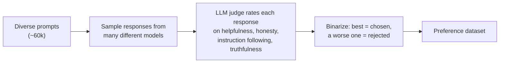
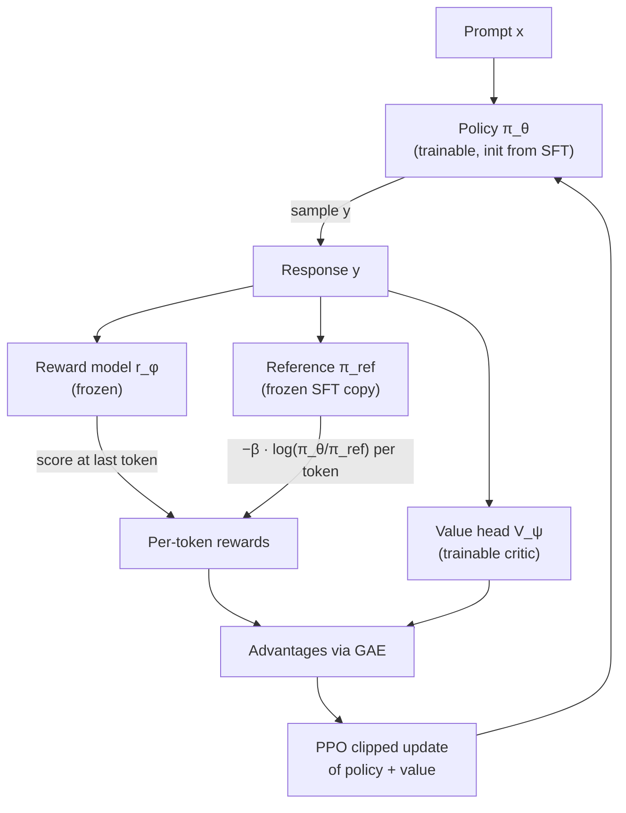

# Preference Optimization (RLHF, DPO)

SFT teaches the model to imitate good answers. But "good" is a matter of degree, and it's much easier for a person (or a judge model) to say *which of two answers is better* than to write the perfect one. Preference optimization turns those comparisons into a training signal. It's how you get from "follows instructions" to "pleasant, careful, and helpful", and it's the stage where most alignment work happens. This page builds it from the ground up: a reward model from a classic 1950s statistics model of paired comparisons, RLHF with PPO, and then the clever algebra that lets DPO skip the RL entirely.

!!! abstract "What you'll learn"
    - The Bradley-Terry model of preferences, and how to train a reward model with it (derivation + code)
    - RLHF with PPO for language models: policy, reference model, reward model, value head, and the KL penalty
    - The full derivation from the KL-regularized RLHF objective to the DPO loss
    - DPO from scratch: computing masked sequence log-probs of chosen and rejected responses
    - DPO with TRL's `DPOTrainer`
    - IPO, KTO, ORPO, SimPO in one paragraph each
    - How preference data is collected (UltraFeedback-style), and the two classic failure modes: reward hacking and length bias

## Preference data

A preference example is a triple: a prompt $x$, a preferred ("chosen", "winning") response $y_w$, and a dispreferred ("rejected", "losing") response $y_l$.

```json
{
  "prompt":   [{"role": "user", "content": "Explain recursion to a 10-year-old."}],
  "chosen":   [{"role": "assistant", "content": "Imagine you're standing in a line..."}],
  "rejected": [{"role": "assistant", "content": "Recursion is when a function calls itself. It is used in computer science."}]
}
```

Both responses answer the same prompt. Neither needs to be perfect; only the *ordering* matters.

### How it's collected

The InstructGPT approach: sample several responses from the SFT model, have trained human labelers rank them. Expensive, slow, high quality.

The open-source approach, popularized by **UltraFeedback**:



Tülu 3 refined this: include responses from *your own* SFT model (on-policy) alongside other models, so the pairs reflect mistakes your model actually makes. On-policy data consistently helps DPO.

## Reward models and the Bradley-Terry model

Suppose each response has a hidden scalar "quality" $r(x, y)$. The Bradley-Terry model (1952, originally for paired-comparison experiments, and closely related to the Elo rating system) says the probability that $y_w$ beats $y_l$ is:

$$
P(y_w \succ y_l \mid x) = \frac{e^{r(x,y_w)}}{e^{r(x,y_w)} + e^{r(x,y_l)}} = \sigma\big(r(x,y_w) - r(x,y_l)\big)
$$

The second form follows by dividing top and bottom by $e^{r(x,y_w)}$: you get $1 / (1 + e^{-(r_w - r_l)})$, the sigmoid $\sigma$. Only the *difference* in rewards matters, so rewards are defined up to an additive constant per prompt.

### Deriving the loss

We parameterize $r_\phi(x,y)$ with a neural network and fit it by maximum likelihood on the observed preferences. The likelihood of the dataset is $\prod \sigma(r_\phi(x,y_w) - r_\phi(x,y_l))$; take the negative log and average:

$$
\mathcal{L}_{\text{RM}}(\phi) = -\mathbb{E}_{(x,y_w,y_l)}\Big[\log \sigma\big(r_\phi(x,y_w) - r_\phi(x,y_l)\big)\Big]
$$

Write $\Delta = r_w - r_l$. Since $\frac{d}{d\Delta}\log\sigma(\Delta) = 1 - \sigma(\Delta)$, the gradient is

$$
\nabla_\phi \mathcal{L}_{\text{RM}} = -\big(1 - \sigma(\Delta)\big)\,\big(\nabla_\phi r_w - \nabla_\phi r_l\big)
$$

Read it as: push the chosen reward up and the rejected reward down, weighted by how *wrong* the model currently is. If the model already ranks the pair correctly by a wide margin, $\sigma(\Delta) \approx 1$ and the gradient vanishes. This is just logistic regression on reward differences.

### Reward model code

A reward model is an LM with the vocabulary head replaced by a single scalar head. We read the score off the **last non-padding token**, since in a causal model that's the only position that has seen the whole response.

```python title="reward_model.py"
import torch
import torch.nn as nn
import torch.nn.functional as F

class RewardModel(nn.Module):
    """Wrap a GPT whose forward(idx) returns logits. We swap lm_head for Identity
    so forward returns final hidden states (B, T, d_model)."""
    def __init__(self, gpt, d_model):
        super().__init__()
        gpt.lm_head = nn.Identity()          # (1)!
        self.backbone = gpt
        self.score = nn.Linear(d_model, 1)

    def forward(self, ids, lengths):
        h = self.backbone(ids)                               # (B, T, d)
        last = h[torch.arange(ids.size(0)), lengths - 1]     # (B, d)
        return self.score(last).squeeze(-1)                  # (B,)

def bradley_terry_loss(r_chosen, r_rejected):
    # -log sigmoid(r_w - r_l); logsigmoid is numerically stable
    return -F.logsigmoid(r_chosen - r_rejected).mean()

def rm_step(rm, opt, chosen_ids, chosen_len, rejected_ids, rejected_len):
    r_w = rm(chosen_ids, chosen_len)
    r_l = rm(rejected_ids, rejected_len)
    loss = bradley_terry_loss(r_w, r_l)
    opt.zero_grad(); loss.backward(); opt.step()
    acc = (r_w > r_l).float().mean()   # the metric to watch
    return loss.item(), acc.item()
```

1. Assumes your GPT from [The Transformer, Line by Line](../llm/transformer.md) ends with `self.lm_head`. If weights are tied with the embedding, swapping the module out doesn't affect the embedding.

Here `chosen_ids` is the full prompt + chosen response (rendered with the chat template), and `chosen_len` is its unpadded length. Initialize the backbone from your SFT model. Train for about one epoch at a low learning rate (around 1e-5 for full fine-tuning); reward models overfit quickly. Held-out **pairwise accuracy** is the main metric. Good RMs on clean data reach roughly 70-80%; human annotators themselves often agree only around that level.

With TRL, the equivalent is `RewardTrainer` + `RewardConfig` with an `AutoModelForSequenceClassification(num_labels=1)` model and a dataset with `chosen`/`rejected` columns.

## RLHF with PPO

With a reward model in hand, the RLHF objective is:

$$
\max_{\pi_\theta}\; \mathbb{E}_{x\sim\mathcal{D},\; y\sim\pi_\theta(\cdot\mid x)}\big[r_\phi(x,y)\big] \;-\; \beta\,\mathbb{D}_{\mathrm{KL}}\big[\pi_\theta(\cdot\mid x)\,\|\,\pi_{\text{ref}}(\cdot\mid x)\big]
$$

The first term says "produce responses the RM likes". The second keeps the policy close to $\pi_{\text{ref}}$, the frozen SFT model. Without it, the policy finds outputs the RM scores highly but that are nonsense (the RM was only trained on reasonable responses and is unreliable far from them).

PPO (from [DQN & PPO](../decision/policy-methods.md)) treats generation as an episode: the state is the prompt plus tokens so far, each action is a token, and the episode ends at the end-of-turn token. Four models are in play:



The pieces:

- **Per-token reward.** The RM gives one score for the whole response. PPO implementations place it on the final token and add a KL penalty at *every* token: $r_t = -\beta \log\frac{\pi_\theta(y_t\mid s_t)}{\pi_{\text{ref}}(y_t\mid s_t)}$, plus $r_\phi(x,y)$ on the last token.
- **Value head.** A scalar head (often on a copy of the policy or RM) estimating expected future reward from each token position. It's the critic used to compute advantages with GAE and reduce variance.
- **Clipped objective.** The standard PPO surrogate, where $\rho_t = \pi_\theta(y_t|s_t)/\pi_{\text{old}}(y_t|s_t)$:
  $$
  \mathcal{L}^{\text{CLIP}} = -\mathbb{E}_t\big[\min(\rho_t A_t,\; \mathrm{clip}(\rho_t, 1-\epsilon, 1+\epsilon)A_t)\big]
  $$
- **The loop:** sample a batch of responses, score them, compute advantages, do a few epochs of minibatch PPO updates on that batch, repeat.

PPO works (it produced InstructGPT and early ChatGPT) but it's heavy: four models in memory, generation inside the training loop, and many sensitive hyperparameters ($\beta$, clip range, GAE $\lambda$, value loss weight, number of PPO epochs). That pain is what DPO removes.

## DPO: from the RLHF objective to a simple loss

Direct Preference Optimization (Rafailov et al., 2023) starts from the same KL-regularized objective and observes that its optimal policy has a closed form. Then it substitutes that closed form back into the Bradley-Terry loss so the reward model disappears.

### Step 1: the optimal policy

For a fixed prompt $x$, write the objective as a sum over responses:

$$
J(\pi) = \sum_y \pi(y\mid x)\Big[r(x,y) - \beta\log\frac{\pi(y\mid x)}{\pi_{\text{ref}}(y\mid x)}\Big]
$$

Define the partition function $Z(x) = \sum_y \pi_{\text{ref}}(y\mid x)\, e^{r(x,y)/\beta}$ and the distribution

$$
\pi^*(y\mid x) = \frac{1}{Z(x)}\,\pi_{\text{ref}}(y\mid x)\,\exp\!\Big(\frac{r(x,y)}{\beta}\Big)
$$

Since $r(x,y) = \beta \log\frac{\pi^*(y\mid x)}{\pi_{\text{ref}}(y\mid x)} + \beta\log Z(x)$, substitute into $J$:

$$
J(\pi) = \sum_y \pi(y\mid x)\Big[\beta\log\frac{\pi^*(y\mid x)}{\pi(y\mid x)} + \beta\log Z(x)\Big] = -\beta\,\mathbb{D}_{\mathrm{KL}}\big[\pi \,\|\, \pi^*\big] + \beta\log Z(x)
$$

$Z(x)$ doesn't depend on $\pi$, and KL is minimized (at zero) exactly when $\pi = \pi^*$. So $\pi^*$ is the optimal policy. It's the reference model reweighted by exponentiated reward. We can't use it directly ($Z$ sums over all possible strings), but we can invert it.

### Step 2: reward in terms of policy

Rearranging the same identity:

$$
r(x,y) = \beta\log\frac{\pi^*(y\mid x)}{\pi_{\text{ref}}(y\mid x)} + \beta\log Z(x)
$$

Every reward function corresponds to an optimal policy, and vice versa. The policy *implicitly defines* a reward.

### Step 3: plug into Bradley-Terry

The Bradley-Terry probability only depends on reward *differences* for the same prompt, so $\beta\log Z(x)$ cancels:

$$
P(y_w \succ y_l \mid x) = \sigma\Big(\beta\log\frac{\pi^*(y_w\mid x)}{\pi_{\text{ref}}(y_w\mid x)} - \beta\log\frac{\pi^*(y_l\mid x)}{\pi_{\text{ref}}(y_l\mid x)}\Big)
$$

Now replace $\pi^*$ with our trainable $\pi_\theta$ and maximize the likelihood of the preference data:

$$
\boxed{\mathcal{L}_{\text{DPO}}(\theta) = -\mathbb{E}_{(x,y_w,y_l)}\Big[\log\sigma\Big(\beta\log\frac{\pi_\theta(y_w\mid x)}{\pi_{\text{ref}}(y_w\mid x)} - \beta\log\frac{\pi_\theta(y_l\mid x)}{\pi_{\text{ref}}(y_l\mid x)}\Big)\Big]}
$$

That's the whole algorithm: a binary classification loss on log-probability ratios. No reward model, no sampling, no value function. You need the policy and a frozen copy of the SFT model (or precomputed reference log-probs).

### What the gradient does

Define the implicit reward $\hat r_\theta(x,y) = \beta\log\frac{\pi_\theta(y\mid x)}{\pi_{\text{ref}}(y\mid x)}$. Then

$$
\nabla_\theta\mathcal{L}_{\text{DPO}} = -\beta\,\mathbb{E}\Big[\underbrace{\sigma\big(\hat r_\theta(x,y_l) - \hat r_\theta(x,y_w)\big)}_{\text{high when ranked wrong}}\Big(\nabla_\theta\log\pi_\theta(y_w\mid x) - \nabla_\theta\log\pi_\theta(y_l\mid x)\Big)\Big]
$$

Increase the likelihood of the chosen response, decrease the rejected one, weighted by how badly the implicit reward misorders them. $\beta$ (typically 0.01 to 0.5, default 0.1) plays the role of the KL strength: smaller $\beta$ lets the policy drift further from the reference.

!!! note "A known quirk"
    DPO only constrains the *difference*. In practice both $\log\pi(y_w)$ and $\log\pi(y_l)$ often go *down* during training, with $y_l$ just going down faster. Watch both, not only the margin.

## DPO from scratch

The core primitive is the summed log-probability of the response tokens given the prompt. We reuse the label-masking convention from [SFT](sft.md#loss-masking-train-on-answers-not-questions): prompt and padding positions are `-100`.

```python title="dpo.py"
import torch
import torch.nn.functional as F

def sequence_logprobs(model, input_ids, labels):
    """Sum of log p(token) over positions where labels != -100.

    input_ids, labels: (B, T). labels = input_ids with prompt/pad set to -100.
    Returns (B,) summed log-probs.
    """
    logits = model(input_ids)[:, :-1, :]          # predict t+1 from <= t
    targets = labels[:, 1:]
    mask = targets != -100
    safe_targets = targets.masked_fill(~mask, 0)  # gather needs valid indices
    logp = torch.log_softmax(logits.float(), dim=-1)  # (1)!
    tok_logp = logp.gather(-1, safe_targets.unsqueeze(-1)).squeeze(-1)
    return (tok_logp * mask).sum(-1)

def dpo_loss(pi_w, pi_l, ref_w, ref_l, beta=0.1):
    """All inputs (B,) summed log-probs. Returns loss and diagnostics."""
    chosen_reward = beta * (pi_w - ref_w)
    rejected_reward = beta * (pi_l - ref_l)
    margin = chosen_reward - rejected_reward
    loss = -F.logsigmoid(margin).mean()
    return loss, {
        "reward_acc": (margin > 0).float().mean().item(),
        "margin": margin.mean().item(),
        "chosen_reward": chosen_reward.mean().item(),
        "rejected_reward": rejected_reward.mean().item(),
    }

def dpo_step(policy, ref_model, opt, batch, beta=0.1):
    """batch: chosen_ids, chosen_labels, rejected_ids, rejected_labels, each (B, T),
    all padded to the same T so we can run one concatenated forward pass."""
    ids = torch.cat([batch["chosen_ids"], batch["rejected_ids"]], dim=0)
    labels = torch.cat([batch["chosen_labels"], batch["rejected_labels"]], dim=0)
    B = batch["chosen_ids"].size(0)

    with torch.no_grad():
        ref_lp = sequence_logprobs(ref_model, ids, labels)
    pi_lp = sequence_logprobs(policy, ids, labels)

    loss, stats = dpo_loss(pi_lp[:B], pi_lp[B:], ref_lp[:B], ref_lp[B:], beta)
    opt.zero_grad(set_to_none=True)
    loss.backward()
    torch.nn.utils.clip_grad_norm_(policy.parameters(), 1.0)
    opt.step()
    stats["loss"] = loss.item()
    return stats
```

1. Do log-softmax in float32. In bf16, summing hundreds of slightly imprecise token log-probs makes the chosen/rejected difference noisy.

Building the batch reuses the SFT renderer: render `prompt + chosen` and `prompt + rejected` with the chat template, mask everything except the response tokens, and pad both to the same length.

```python title="setup.py"
import copy, torch

policy = sft_model                          # your SFT'd GPT
ref_model = copy.deepcopy(sft_model).eval() # frozen reference
for p in ref_model.parameters():
    p.requires_grad_(False)

opt = torch.optim.AdamW(policy.parameters(), lr=5e-7)  # (1)!
```

1. DPO learning rates are tiny: roughly 5e-7 to 5e-6 for full fine-tuning (Zephyr used 5e-7; Tülu 3 used values of the same order). With LoRA, around 5e-6 to 5e-5.

!!! tip "Save memory: precompute reference log-probs"
    The reference model never changes, so you can run one pass over the dataset, store `ref_w` and `ref_l` per example, and drop the reference model from memory during training. TRL supports this with `precompute_ref_log_probs=True`. With LoRA, the reference is just the base model with adapters disabled, so no second copy is needed at all.

## DPO with TRL

The TRL version, written for **TRL ≥ 0.20** (`pip install "trl>=0.20"`):

```python title="trl_dpo.py"
from datasets import load_dataset
from transformers import AutoModelForCausalLM, AutoTokenizer
from trl import DPOConfig, DPOTrainer

model_id = "Qwen/Qwen2.5-0.5B-Instruct"   # start from an SFT/instruct model
model = AutoModelForCausalLM.from_pretrained(model_id, dtype="bfloat16")
tokenizer = AutoTokenizer.from_pretrained(model_id)

# Conversational preference data with "chosen" and "rejected" columns
ds = load_dataset("trl-lib/ultrafeedback_binarized")

config = DPOConfig(
    output_dir="qwen2.5-0.5b-dpo",
    beta=0.1,
    loss_type="sigmoid",          # standard DPO; "ipo" etc. also available
    learning_rate=5e-7,
    lr_scheduler_type="cosine",
    warmup_ratio=0.1,
    num_train_epochs=1,
    per_device_train_batch_size=4,
    gradient_accumulation_steps=8,
    max_length=1024,
    bf16=True,
    logging_steps=10,
    report_to="none",
)

trainer = DPOTrainer(
    model=model,
    ref_model=None,               # None -> TRL makes a frozen copy (or disables LoRA)
    args=config,
    train_dataset=ds["train"],
    eval_dataset=ds["test"],
    processing_class=tokenizer,
)
trainer.train()
```

TRL logs `rewards/chosen`, `rewards/rejected`, `rewards/accuracies`, and `rewards/margins`: the same diagnostics as our from-scratch `dpo_loss`. Healthy runs show accuracy climbing well above 0.5 and margins growing steadily, not exploding.

## Variants in brief

DPO spawned a zoo. The ones worth knowing (TRL implements all of them; in recent releases `ORPOTrainer` and `CPOTrainer` live in `trl.experimental`, so check the import path for your version):

**IPO** (Identity Preference Optimization, Azar et al.). DPO can overfit when preferences are near-deterministic: it keeps pushing the margin toward infinity. IPO replaces the log-sigmoid with a squared loss that regresses the log-ratio margin $h$ to a fixed target: $\big(h - \tfrac{1}{2\beta}\big)^2$. Use `loss_type="ipo"` in `DPOConfig`.

**KTO** (Kahneman-Tversky Optimization, Ethayarajh et al.). Doesn't need pairs: each example is a single response labeled desirable or undesirable (thumbs up/down). The loss is inspired by prospect theory, comparing each response's implicit reward against a reference point. Great when your feedback data is unpaired, like production thumbs ratings. `KTOTrainer`.

**ORPO** (Odds Ratio Preference Optimization, Hong et al.). Merges SFT and preference tuning into one stage with **no reference model**: the loss is the SFT NLL on the chosen response plus a term $-\lambda\log\sigma\big(\log\frac{\text{odds}(y_w)}{\text{odds}(y_l)}\big)$, where $\text{odds}(y) = \frac{p(y)}{1-p(y)}$ uses length-normalized likelihood. One stage, one model. `ORPOTrainer`.

**SimPO** (Simple Preference Optimization, Meng et al.). Also reference-free. Uses the *average* per-token log-prob as the implicit reward (which directly counters length bias) and adds a target margin $\gamma$:
$$
\mathcal{L}_{\text{SimPO}} = -\log\sigma\Big(\tfrac{\beta}{|y_w|}\log\pi_\theta(y_w\mid x) - \tfrac{\beta}{|y_l|}\log\pi_\theta(y_l\mid x) - \gamma\Big)
$$
In TRL it's `CPOTrainer` with `loss_type="simpo"`.

| Method | Needs ref model? | Needs pairs? | Separate SFT stage? |
|---|---|---|---|
| PPO-RLHF | yes | for the RM | yes |
| DPO / IPO | yes | yes | yes |
| KTO | yes | no | yes |
| ORPO | no | yes | no |
| SimPO | no | yes | yes |

Plain DPO with a well-chosen $\beta$ and good on-policy data remains a strong default; the variants differ more on paper than in most practical results.

## Reward hacking and length bias

Any time you optimize against a proxy, the optimizer finds the proxy's blind spots. This is Goodhart's law, and in RLHF it's called **reward hacking** or reward over-optimization.

- **With PPO**, the policy learns whatever the RM rewards spuriously: excessive hedging, flattery ("Great question!"), certain formatting, repeating the prompt. True quality (measured by humans) rises, peaks, and then *falls* while RM score keeps rising. The KL penalty and early stopping are your defenses.
- **With DPO**, there's no explicit RM to hack, but the same pathology shows up as over-optimization: the policy drifts far from the reference on spurious features of the chosen responses.

**Length bias** is the most common spurious feature. Human raters and LLM judges both tend to prefer longer, more detailed answers, so chosen responses are on average longer than rejected ones. Preference optimization learns "longer = better", and response lengths creep up run after run. Mitigations:

- Length-controlled evaluation (AlpacaEval 2's LC win rate) so you notice.
- Length-normalized objectives (SimPO), or a length penalty in the reward.
- Balance the data: include pairs where the shorter answer wins.
- Track mean response length on your fixed eval prompts as a first-class metric.

!!! warning "Common pitfalls"
    - **Learning rate too high.** DPO at SFT-like rates (1e-5 for full fine-tuning) quickly degenerates. Start around 5e-7.
    - **Reference model ≠ starting policy.** The reference must be the exact model you initialize the policy from, or the log-ratios start nonzero and the loss is meaningless.
    - **Mismatched tokenization of chosen vs. rejected.** Render both with the same template and the same prompt tokens; only the response part should differ.
    - **Summing log-probs in bf16.** Compute log-softmax in fp32.
    - **Off-policy data from a much stronger model.** If chosen responses are things your model would never produce, DPO mostly learns to lower rejected log-probs. On-policy pairs work better.
    - **Ignoring length.** Always report average response length next to win rates.

## Check your understanding

??? question "Why does only the reward *difference* matter in Bradley-Terry, and why is that essential for DPO?"
    $P(y_w\succ y_l) = \sigma(r_w - r_l)$, so adding any function of $x$ alone to the reward changes nothing. In DPO the implicit reward is $\beta\log\frac{\pi}{\pi_{\text{ref}}} + \beta\log Z(x)$. The intractable $\beta\log Z(x)$ depends only on $x$, so it cancels in the difference. Without that cancellation DPO would require computing a sum over all strings.

??? question "In the DPO gradient, what does the weight σ(r̂_l − r̂_w) do?"
    It's close to 1 when the implicit reward ranks the rejected response above the chosen one (the model is wrong) and close to 0 when the pair is already correctly ranked with a wide margin. So DPO focuses gradient on pairs it currently gets wrong, like logistic regression. Without this weight (just maximizing $\log\pi(y_w) - \log\pi(y_l)$) the model degenerates.

??? question "PPO-RLHF needs four models. Name them and say which are trained."
    The policy (trained), the reference model (frozen SFT copy for the KL penalty), the reward model (frozen, trained beforehand with the Bradley-Terry loss), and the value function/critic (trained, estimates expected return for advantages). DPO needs only the policy and the reference, and the reference can be replaced with precomputed log-probs.

??? question "Your DPO run shows reward accuracy 0.95 and margins rising, but outputs got twice as long and win rate against the SFT model is flat on a length-controlled judge. What happened?"
    The model learned length (and probably style) as a proxy for preference. The preference data likely has longer chosen responses. Rebalance the data, try a length-normalized method like SimPO, lower the number of steps, or increase $\beta$ to stay closer to the reference.

## Further reading

- Christiano et al., *Deep reinforcement learning from human preferences* - [arXiv:1706.03741](https://arxiv.org/abs/1706.03741)
- Stiennon et al., *Learning to summarize from human feedback* - [arXiv:2009.01325](https://arxiv.org/abs/2009.01325)
- Ouyang et al., *Training language models to follow instructions with human feedback* - [arXiv:2203.02155](https://arxiv.org/abs/2203.02155)
- Schulman et al., *Proximal Policy Optimization Algorithms* - [arXiv:1707.06347](https://arxiv.org/abs/1707.06347)
- Rafailov et al., *Direct Preference Optimization: Your Language Model is Secretly a Reward Model* - [arXiv:2305.18290](https://arxiv.org/abs/2305.18290)
- Azar et al., *A General Theoretical Paradigm to Understand Learning from Human Preferences* (IPO) - [arXiv:2310.12036](https://arxiv.org/abs/2310.12036)
- Ethayarajh et al., *KTO: Model Alignment as Prospect Theoretic Optimization* - [arXiv:2402.01306](https://arxiv.org/abs/2402.01306)
- Hong et al., *ORPO: Monolithic Preference Optimization without Reference Model* - [arXiv:2403.07691](https://arxiv.org/abs/2403.07691)
- Meng et al., *SimPO: Simple Preference Optimization with a Reference-Free Reward* - [arXiv:2405.14734](https://arxiv.org/abs/2405.14734)
- Cui et al., *UltraFeedback* - [arXiv:2310.01377](https://arxiv.org/abs/2310.01377)
- Dubois et al., *Length-Controlled AlpacaEval* - [arXiv:2404.04475](https://arxiv.org/abs/2404.04475)
- TRL `DPOTrainer` docs - [huggingface.co/docs/trl/dpo_trainer](https://huggingface.co/docs/trl/dpo_trainer)

**Next:** [Reasoning & RL with Verifiable Rewards](reasoning-rl.md)
