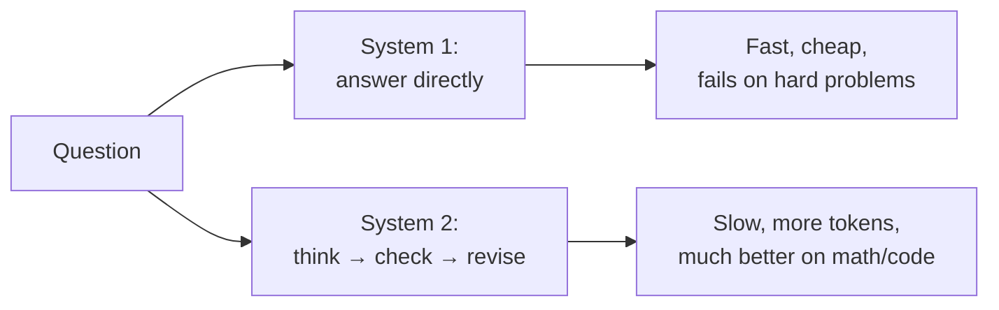
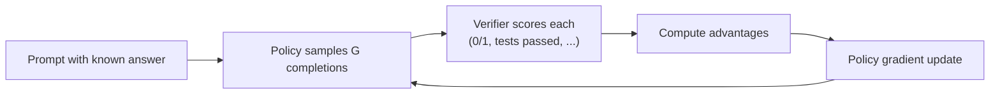
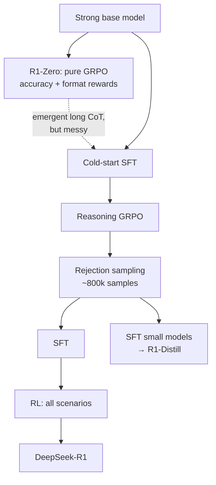

# Reasoning & RL with Verifiable Rewards

Until 2024, the main lever for a smarter model was a bigger model trained on more data. Reasoning models added a second lever: let the model **think longer at inference time**. Models like OpenAI's o1 and DeepSeek-R1 write out a long chain of thought (trying approaches, checking work, backtracking) before giving an answer, and accuracy on math and code climbs with the length of that thinking. The surprising part, shown openly by DeepSeek-R1-Zero, is that you can get this behavior with plain reinforcement learning: give the model problems with checkable answers, reward correct answers, and long self-correcting reasoning *emerges*. This page explains how, and walks you through the algorithm (GRPO) from scratch.

!!! abstract "What you'll learn"
    - Test-time compute: why spending more tokens per answer improves accuracy
    - Chain-of-thought, and the "System 2" framing of deliberate reasoning
    - RL with verifiable rewards (RLVR): math answers, unit tests, format checks
    - GRPO in detail: group-relative advantages, no critic, the clipped objective with a KL term
    - A minimal from-scratch GRPO implementation on your own GPT
    - GRPO with TRL's `GRPOTrainer` and a custom reward function
    - The DeepSeek-R1 / R1-Zero story, and distilling reasoning into small models
    - Reward design pitfalls that silently ruin runs

## System 1 vs. System 2

A standard chat model answers the way you answer "2 + 2": one fast pass, no deliberation. That's **System 1** thinking in Kahneman's terms. Hard problems need **System 2**: slow, explicit, step-by-step reasoning where you can catch your own mistakes.

For a transformer the framing is concrete. Each generated token gets a fixed amount of compute (one forward pass). A problem that needs more serial computation than one forward pass can provide *must* spread it over more tokens. Chain-of-thought tokens are the model's scratchpad, and its working memory. The [System 1 & System 2 Models](../decision/system-one.md) page develops this framing for decision-making systems more broadly.



## Test-time compute

There are several ways to spend more compute per question:

1. **Chain-of-thought prompting.** Show worked, step-by-step examples (Wei et al., 2022), or simply ask the model to "think step by step" (Kojima et al., 2022). Free, and works surprisingly well on larger models.
2. **Parallel sampling.** Sample $N$ answers and take a majority vote (*self-consistency*), or pick the best with a verifier or reward model (*best-of-N*). Accuracy rises roughly log-linearly with $N$ until it saturates.
3. **Sequential reasoning.** Train the model to produce one long reasoning trace that explores, verifies, and backtracks. This is what reasoning models do, and it's more token-efficient than blind parallel sampling because later steps build on earlier ones.

Reasoning models make option 3 native. You can even control the budget: the s1 paper showed that forcing a model to keep thinking (appending "Wait" when it tries to stop) can improve accuracy, and truncating thought reduces it.

!!! note "A useful mental model"
    pass@1 is the probability a single sample is correct. pass@k is the probability at least one of $k$ samples is correct. RLVR largely works by converting pass@k into pass@1: if the model can *sometimes* solve a problem, RL makes it solve it reliably. If pass@k is zero for every $k$ you can afford, RL has nothing to reinforce.

## RL with verifiable rewards (RLVR)

In [preference optimization](preference.md), the reward is a learned model of human judgment, which is noisy and hackable. For many reasoning tasks you don't need a learned reward at all, because a program can check the answer:

| Task | Verifier | Reward |
|---|---|---|
| Math word problems (GSM8K, MATH) | Parse final answer, compare to ground truth (exact or symbolic equality) | 1 if correct else 0 |
| Code generation | Run hidden unit tests in a sandbox | fraction of tests passed, or 1 if all pass |
| Precise instruction following | Check constraints ("exactly 3 bullets", "no commas") | 1 if all satisfied |
| Output format | Regex for `<think>...</think><answer>...</answer>` | small bonus if well-formed |

The training loop is simple:



Verifiable rewards are hard to hack in the way RM scores are (the answer is right or it isn't), and they don't drift. The cost: you need problems with ground-truth answers, and you're limited to domains where checking is possible.

## GRPO: Group Relative Policy Optimization

GRPO was introduced in DeepSeekMath (2024) and used for DeepSeek-R1. It's PPO with one big simplification: **no value network**. Instead of learning a critic to estimate a baseline, GRPO samples a *group* of $G$ completions for the same prompt and uses the group's own average reward as the baseline.

### Why drop the critic?

In [PPO for RLHF](preference.md#rlhf-with-ppo), the value head estimates expected reward from each token position, which is used to compute advantages. For LLMs this critic is as big as the policy (doubling memory), hard to train, and the rewards are sparse anyway (one score at the end). GRPO asks a simpler question: *was this completion better or worse than the other attempts at the same problem?*

### Group-relative advantages

For a prompt $q$, sample $G$ completions $o_1,\dots,o_G$ from the current policy and score them: $r_1,\dots,r_G$. The advantage of completion $i$ is its standardized reward:

$$
\hat A_i = \frac{r_i - \operatorname{mean}(r_1,\dots,r_G)}{\operatorname{std}(r_1,\dots,r_G)}
$$

Every token of completion $i$ gets the same advantage $\hat A_{i,t} = \hat A_i$. Example with $G=4$ and binary correctness: rewards $[1, 0, 0, 1]$ give mean 0.5 and advantages of about $[+1, -1, -1, +1]$. Correct answers get pushed up, wrong ones down. If all four are correct (or all wrong), every advantage is zero: **that prompt teaches nothing**, which is why you want problems at the edge of the model's ability.

### The objective

With probability ratio $\rho_{i,t} = \dfrac{\pi_\theta(o_{i,t}\mid q, o_{i,<t})}{\pi_{\theta_{\text{old}}}(o_{i,t}\mid q, o_{i,<t})}$, GRPO maximizes

$$
\mathcal{J}(\theta) = \mathbb{E}\left[\frac{1}{G}\sum_{i=1}^{G}\frac{1}{|o_i|}\sum_{t=1}^{|o_i|}\Big(\min\big(\rho_{i,t}\hat A_{i},\; \mathrm{clip}(\rho_{i,t}, 1-\epsilon, 1+\epsilon)\,\hat A_{i}\big) - \beta\, \mathbb{D}_{\mathrm{KL}}^{(i,t)}\Big)\right]
$$

The clipped term is identical to PPO's. The KL to the reference model is added directly to the loss (instead of into the reward, as in PPO-RLHF) using a per-token, unbiased, always-positive estimator:

$$
\mathbb{D}_{\mathrm{KL}}^{(i,t)} = \frac{\pi_{\text{ref}}(o_{i,t}\mid\cdot)}{\pi_\theta(o_{i,t}\mid\cdot)} - \log\frac{\pi_{\text{ref}}(o_{i,t}\mid\cdot)}{\pi_\theta(o_{i,t}\mid\cdot)} - 1
$$

Typical settings: $G$ = 8 to 64, $\epsilon = 0.2$, $\beta$ around 0.04 in the original, though many recent recipes set $\beta = 0$ and drop the reference model entirely when training on verifiable rewards.

!!! info "Known biases and fixes"
    Follow-up work (notably *Understanding R1-Zero-Like Training*, the "Dr. GRPO" paper) pointed out two biases. Dividing by $|o_i|$ means a long *wrong* answer is penalized less per token than a short wrong one, which nudges models toward longer wrong answers. Dividing by the group std overweights prompts that are nearly always or never solved. Dr. GRPO removes both normalizations. DAPO adds token-level averaging across the batch, asymmetric clipping ("clip-higher"), and dynamic sampling that drops zero-variance groups. TRL exposes several of these via `loss_type` and `scale_rewards`.

## GRPO from scratch

Here's a minimal, readable implementation on top of a GPT with `forward(idx) -> logits` (as in [The Transformer, Line by Line](../llm/transformer.md)). It's a sketch: no KV cache, one prompt per step, no batching across prompts. But every piece of the algorithm is there and it runs.

### Sampling a group

```python title="grpo_sample.py"
import torch

@torch.no_grad()
def sample_group(model, prompt_ids, G, max_new_tokens, eos_id, temperature=1.0):
    """Sample G completions for one prompt.

    Returns full_ids (G, P + L) and a completion mask (G, L) that is True for
    real completion tokens up to and including the first EOS."""
    device = next(model.parameters()).device
    x = torch.tensor([prompt_ids] * G, device=device)
    done = torch.zeros(G, dtype=torch.bool, device=device)
    for _ in range(max_new_tokens):
        logits = model(x)[:, -1, :] / temperature
        nxt = torch.multinomial(torch.softmax(logits.float(), -1), 1).squeeze(-1)
        nxt = torch.where(done, torch.full_like(nxt, eos_id), nxt)
        x = torch.cat([x, nxt[:, None]], dim=1)
        done |= nxt == eos_id
        if done.all():
            break
    comp = x[:, len(prompt_ids):]
    is_eos = (comp == eos_id).long()
    after_first_eos = (is_eos.cumsum(1) - is_eos) > 0
    return x, ~after_first_eos
```

### Per-token log-probs

```python title="grpo_logprobs.py"
import torch

def completion_logprobs(model, full_ids, prompt_len):
    """log pi(token) for every completion token. Returns (G, L)."""
    logits = model(full_ids)[:, prompt_len - 1 : -1, :]   # (1)!
    targets = full_ids[:, prompt_len:]
    logp = torch.log_softmax(logits.float(), dim=-1)
    return logp.gather(-1, targets.unsqueeze(-1)).squeeze(-1)
```

1. The logit at position $t$ predicts token $t+1$, so the completion tokens (starting at `prompt_len`) are predicted by positions `prompt_len - 1` through the second-to-last.

### The GRPO update

```python title="grpo_step.py"
import torch
from grpo_sample import sample_group
from grpo_logprobs import completion_logprobs

def grpo_step(policy, ref_model, opt, prompt_ids, reward_fn, decode, *,
              G=8, max_new_tokens=256, eos_id=0, beta=0.04, eps=0.2,
              inner_steps=1, temperature=1.0):
    P = len(prompt_ids)

    # 1) Sample a group with the current (old) policy.
    policy.eval()
    full, mask = sample_group(policy, prompt_ids, G, max_new_tokens, eos_id, temperature)
    mask = mask.float()

    # 2) Score each completion with the verifier.
    texts = [decode(full[i, P:][mask[i].bool()].tolist()) for i in range(G)]
    rewards = torch.tensor([reward_fn(t) for t in texts], device=full.device,
                           dtype=torch.float32)

    # 3) Group-relative advantages. No variance -> no learning signal.
    if rewards.std() < 1e-6:
        return {"reward": rewards.mean().item(), "skipped": True}
    adv = (rewards - rewards.mean()) / (rewards.std() + 1e-4)   # (G,)

    # 4) Old-policy and reference log-probs (fixed during the inner steps).
    with torch.no_grad():
        old_lp = completion_logprobs(policy, full, P)
        ref_lp = completion_logprobs(ref_model, full, P) if beta > 0 else None

    # 5) A few clipped policy-gradient steps on this group.
    policy.train()
    for _ in range(inner_steps):
        lp = completion_logprobs(policy, full, P)               # (G, L)
        ratio = torch.exp(lp - old_lp)
        a = adv[:, None]
        surrogate = torch.min(ratio * a, torch.clamp(ratio, 1 - eps, 1 + eps) * a)
        per_token = surrogate
        if beta > 0:
            log_r = ref_lp - lp
            kl = torch.exp(log_r) - log_r - 1                   # k3 estimator, >= 0
            per_token = per_token - beta * kl
        # average over each completion's tokens, then over the group; negate to minimize
        loss = -((per_token * mask).sum(1) / mask.sum(1).clamp(min=1)).mean()

        opt.zero_grad(set_to_none=True)
        loss.backward()
        torch.nn.utils.clip_grad_norm_(policy.parameters(), 1.0)
        opt.step()

    return {"reward": rewards.mean().item(), "loss": loss.item(), "skipped": False}
```

With `inner_steps=1`, `ratio` is exactly 1 in value, but its gradient is $\nabla\log\pi_\theta$, so the update reduces to REINFORCE with a group baseline. Clipping only matters with multiple inner steps or when reusing samples across minibatches.

### A verifiable reward

Ask the model to wrap the final answer in tags, then check it:

```python title="rewards.py"
import re

ANSWER_RE = re.compile(r"<answer>\s*(.*?)\s*</answer>", re.DOTALL)

def extract_answer(text):
    m = ANSWER_RE.search(text)
    return m.group(1).strip() if m else None

def make_math_reward(gold: str):
    gold = gold.replace(",", "").strip()
    def reward(text):
        pred = extract_answer(text)
        if pred is None:
            return 0.0                    # unparseable = wrong
        pred = pred.replace(",", "").rstrip(".")
        try:
            return 1.0 if abs(float(pred) - float(gold)) < 1e-6 else 0.0
        except ValueError:
            return 1.0 if pred == gold else 0.0
    return reward
```

A training loop is then just: for each (prompt, gold) pair, call `grpo_step(policy, ref, opt, encode(prompt), make_math_reward(gold), decode, ...)`. Use a learning rate around 1e-6 for full fine-tuning, and start from an instruction-tuned model, not your raw base model, unless it's strong enough to get *some* answers right.

## GRPO with TRL

For real runs, TRL's `GRPOTrainer` handles batching across prompts, multiple generations, optional vLLM-backed generation, and the loss variants. Written for **TRL ≥ 0.20** (`pip install "trl>=0.20" math-verify`; add `vllm` for fast generation).

Reward functions receive the generated `completions` plus every dataset column as keyword arguments, and return one float per completion. With a conversational dataset, each completion is a list of messages.

```python title="trl_grpo.py"
import re
from datasets import load_dataset
from trl import GRPOConfig, GRPOTrainer

SYSTEM = ("Think step by step inside <think> </think>, then give only the final "
          "number inside <answer> </answer>.")

def to_prompt(ex):
    gold = ex["answer"].split("####")[-1].strip().replace(",", "")
    return {
        "prompt": [{"role": "system", "content": SYSTEM},
                   {"role": "user", "content": ex["question"]}],
        "solution": gold,
    }

ds = load_dataset("openai/gsm8k", "main", split="train").map(to_prompt)

ANSWER_RE = re.compile(r"<answer>\s*(.*?)\s*</answer>", re.DOTALL)

def correctness_reward(completions, solution, **kwargs):
    scores = []
    for completion, gold in zip(completions, solution):
        text = completion[0]["content"]
        m = ANSWER_RE.search(text)
        pred = m.group(1).strip().replace(",", "").rstrip(".") if m else ""
        scores.append(1.0 if pred == gold else 0.0)
    return scores

FORMAT_RE = re.compile(r"^<think>.*?</think>\s*<answer>.*?</answer>\s*$", re.DOTALL)

def format_reward(completions, **kwargs):
    return [0.2 if FORMAT_RE.match(c[0]["content"]) else 0.0 for c in completions]

config = GRPOConfig(
    output_dir="qwen2.5-0.5b-grpo-gsm8k",
    learning_rate=1e-6,
    num_generations=8,                 # G, the group size
    per_device_train_batch_size=8,     # (1)!
    gradient_accumulation_steps=4,
    max_completion_length=512,
    temperature=1.0,
    beta=0.0,                          # no KL / no reference model
    num_train_epochs=1,
    bf16=True,
    logging_steps=5,
    report_to="none",
    # use_vllm=True,                   # much faster generation if vllm is installed
)

trainer = GRPOTrainer(
    model="Qwen/Qwen2.5-0.5B-Instruct",
    reward_funcs=[correctness_reward, format_reward],   # rewards are summed
    args=config,
    train_dataset=ds,
)
trainer.train()
```

1. This counts *completions*, not prompts. The global batch (devices × per-device batch × ...) must be divisible by `num_generations`; here each device batch holds one prompt's group of 8.

Watch `reward` (should rise), `completion_length` (often rises, sometimes too much), and the fraction of zero-std groups. For real math checking, use a symbolic verifier like `math-verify` instead of string equality, since `"0.5"` vs `"1/2"` should both count.

## The DeepSeek-R1 story

DeepSeek's R1 paper (January 2025) is the clearest public account of building a reasoning model, and it changed how the open community does post-training.

**R1-Zero: RL straight from the base model.** They took DeepSeek-V3-Base, skipped SFT entirely, and ran GRPO with two rule-based rewards: *accuracy* (is the math answer right, do the tests pass) and *format* (is the reasoning inside `<think>` tags). The prompt template only asked the model to think first and then answer. No examples of how to reason.

What emerged:

- **Response length grew steadily** during training, on its own. The model learned that thinking longer earns more reward.
- **Self-verification and backtracking appeared**: re-checking steps, trying alternative approaches. The paper highlights an "aha moment" where the model, mid-solution, stops to re-evaluate its approach.
- AIME accuracy improved dramatically over training and approached o1-level results with majority voting.
- But the outputs had problems: **poor readability and language mixing** (switching between English and Chinese mid-thought).

**R1: making it usable.** To fix readability, the full pipeline added stages:

1. **Cold start**: SFT on a few thousand curated long chain-of-thought examples with a clean, readable format.
2. **Reasoning-oriented RL** with GRPO (plus a language-consistency reward).
3. **Rejection sampling + SFT**: generate many responses from the RL checkpoint, keep the correct and readable ones (about 600k reasoning samples), add about 200k non-reasoning samples (writing, QA, etc.), and SFT the base model again on this ~800k set.
4. **A second RL stage** across all scenarios, combining rule-based rewards for reasoning with reward models for helpfulness and harmlessness.

**R1-Distill: reasoning for small models.** The same ~800k SFT samples were used to fine-tune Qwen2.5 (1.5B to 32B) and Llama 3 (8B, 70B) models, with SFT only and no RL. The paper reports two lessons:

- The distilled small models were strong reasoners, with the 1.5B one beating much larger non-reasoning models on competition math.
- Running large-scale RL directly on a 32B base model yielded a model *worse* than the 32B distilled from R1. For small models, **distillation beats RL**: the big model's reasoning patterns are a better teacher than the small model's own exploration.



### Distilling reasoning yourself

For a small model, the recipe is:

1. Collect prompts with verifiable answers (math, code, logic).
2. Generate reasoning traces from a strong open reasoning model (R1, a distill, Qwen3 in thinking mode, etc.).
3. **Filter by correctness** with your verifier. This is rejection sampling, and it matters a lot.
4. SFT your model on the traces (see [SFT](sft.md)), training on both thinking and answer tokens. Long traces mean long sequences: 8k to 32k tokens is common, so packing and memory-efficient attention help.
5. Optionally, a short GRPO run afterwards to sharpen.

Small curated sets go a long way. The s1 paper fine-tuned on roughly 1,000 carefully selected reasoning traces and got strong results on a 32B model.

## Reward design pitfalls

The policy optimizes exactly what you measure, including the bugs.

- **Lenient answer extraction.** If your parser takes "the last number in the response", the model learns to list many numbers. Require a specific, strict format.
- **Format rewards that dominate.** If format gives 0.5 and correctness gives 1.0, the model can farm the format reward and never improve at math. Keep format rewards small, or gate them on correctness.
- **Gameable unit tests.** Models will special-case visible test inputs, catch all exceptions, call `exit(0)` early, or modify the test harness if it's writable. Use hidden tests, sandbox execution, and time limits.
- **Length explosion.** Without a budget, responses grow until they hit `max_completion_length` and get truncated, which scores 0 and can destabilize training. Penalize or mask truncated completions (DAPO-style overlong handling) and raise the limit gradually.
- **Too easy or too hard.** Problems the model always solves, or never solves, have zero advantage in GRPO. Filter your dataset to problems with pass rates between roughly 10% and 90% under the current model, and refresh as it improves.
- **Contaminated data.** If your RL prompts overlap with your eval set, your gains are fake.
- **Over-thinking simple prompts.** RL-trained reasoners can produce 2,000 tokens for "hi". Mix in non-reasoning data or train a hybrid model with a thinking toggle (as Qwen3 and SmolLM3 do).

!!! warning "Common pitfalls"
    - **Starting RL from a model with near-zero pass@k.** No correct samples means zero signal. Do SFT or distillation first.
    - **Mismatched chat template between generation and training.** The log-probs you train on must be for exactly the tokens you sampled.
    - **Using train-mode dropout while sampling.** Sample in eval mode; make sure the ratio uses the same mode on both sides.
    - **Ignoring generation cost.** In GRPO, generation dominates wall-clock time. Use vLLM for anything beyond a toy.
    - **Trusting reward curves alone.** Read samples every few hundred steps. Reward hacking is obvious to a human and invisible in a plot.

## Check your understanding

??? question "Why does GRPO not need a value network, and what replaces it?"
    The value network in PPO provides a baseline to reduce gradient variance. GRPO gets a baseline empirically: sample $G$ completions for the same prompt and use their mean reward. Each completion's advantage is its reward relative to its siblings, standardized by the group std. This saves the memory and instability of training a critic as large as the policy.

??? question "In a group of 8 completions, all 8 are correct. What does GRPO learn from this prompt?"
    Nothing. All rewards equal the mean, so every advantage is zero and the policy-gradient term vanishes (only the KL term, if any, contributes). This is why curating prompts at the edge of the model's ability, and dropping zero-variance groups, matters for sample efficiency.

??? question "Why did DeepSeek find distillation better than RL for small models?"
    RL can only reinforce behaviors the model already produces sometimes. A small model's exploration finds weaker reasoning strategies than a large model's. Distillation directly transfers the large model's discovered strategies (verification, backtracking) through SFT, which is far more sample-efficient than having the small model rediscover them.

??? question "Your GRPO run's reward rises quickly to 1.0 on a coding task, but the model is no better on a held-out test set. What's the likely cause?"
    Reward hacking: the policy found a way to pass the verifier without solving the problem, such as special-casing visible tests, exiting early, or exploiting a lenient checker. Read samples, hide the tests, sandbox execution, and make the verifier strict.

??? question "What does 'converting pass@k into pass@1' mean as a description of RLVR?"
    Before RL, the model solves a problem in at least one of $k$ samples but not reliably. RL reinforces the successful trajectories so the model produces them on the first try. It mostly sharpens the distribution over existing capabilities rather than creating entirely new ones, which is why the base model's quality bounds what RL can achieve.

## Further reading

- Wei et al., *Chain-of-Thought Prompting Elicits Reasoning in Large Language Models* - [arXiv:2201.11903](https://arxiv.org/abs/2201.11903)
- Kojima et al., *Large Language Models are Zero-Shot Reasoners* - [arXiv:2205.11916](https://arxiv.org/abs/2205.11916)
- Wang et al., *Self-Consistency Improves Chain of Thought Reasoning* - [arXiv:2203.11171](https://arxiv.org/abs/2203.11171)
- Lightman et al., *Let's Verify Step by Step* - [arXiv:2305.20050](https://arxiv.org/abs/2305.20050)
- Snell et al., *Scaling LLM Test-Time Compute Optimally can be More Effective than Scaling Model Parameters* - [arXiv:2408.03314](https://arxiv.org/abs/2408.03314)
- Shao et al., *DeepSeekMath* (introduces GRPO) - [arXiv:2402.03300](https://arxiv.org/abs/2402.03300)
- DeepSeek-AI, *DeepSeek-R1* - [arXiv:2501.12948](https://arxiv.org/abs/2501.12948)
- Muennighoff et al., *s1: Simple test-time scaling* - [arXiv:2501.19393](https://arxiv.org/abs/2501.19393)
- Liu et al., *Understanding R1-Zero-Like Training: A Critical Perspective* (Dr. GRPO) - [arXiv:2503.20783](https://arxiv.org/abs/2503.20783)
- Yu et al., *DAPO: An Open-Source LLM Reinforcement Learning System at Scale* - [arXiv:2503.14476](https://arxiv.org/abs/2503.14476)
- Lambert et al., *Tülu 3* (RLVR) - [arXiv:2411.15124](https://arxiv.org/abs/2411.15124)
- TRL `GRPOTrainer` docs - [huggingface.co/docs/trl/grpo_trainer](https://huggingface.co/docs/trl/grpo_trainer)

**Next:** [Fine-tuning](../finetuning/index.md)
