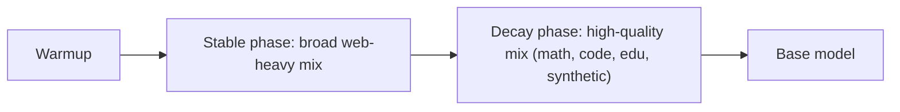

# Data Pipelines

Your model is a compressed copy of its training data. Every quirk of the corpus (boilerplate, spam, duplicated pages, leaked benchmark answers) shows up in the weights. The difference between a mediocre and a strong small model is mostly the data pipeline: where text comes from, what you throw away, how you remove duplicates, and how you mix sources. This page walks through each stage and ends with working code to tokenize a dataset into binary shards your training loop can read at full speed.

!!! abstract "What you'll learn"
    - The main pretraining data sources and what each contributes
    - Heuristic and classifier-based quality filtering (FineWeb, FineWeb-Edu)
    - Exact and fuzzy deduplication, with MinHash LSH code using `datasketch`
    - PII, toxicity and benchmark decontamination
    - Data mixtures, curriculum and annealing
    - Streaming with Hugging Face `datasets`, tokenizing at scale, and packing into `uint16`/`uint32` shards read with `numpy.memmap`
    - Synthetic data: Cosmopedia and Phi-style textbooks

## The shape of a pipeline

```mermaid
flowchart LR
    A["WARC / HTML"] --> B["Extract text (trafilatura)"]
    B --> C["Language ID (fastText)"]
    C --> D["Heuristic filters"]
    D --> E["Quality classifier"]
    E --> F["Dedup: exact + MinHash"]
    F --> G["PII + toxicity"]
    G --> H["Decontaminate vs evals"]
    H --> I["Mix + tokenize + shard"]
```



Each step removes data. A typical web pipeline keeps only a small fraction of raw Common Crawl. That is fine: the web is enormous and most of it is junk.

## Data sources

| Source | What it gives the model | Notes |
|---|---|---|
| **Common Crawl** | Breadth: every topic, style and register | Petabytes of raw HTML snapshots since 2008. Needs heavy cleaning. |
| **FineWeb** (Hugging Face) | Cleaned, deduplicated Common Crawl, ~15T tokens | Strong default English web set with a documented pipeline. |
| **FineWeb-Edu** | FineWeb filtered by an "educational value" classifier | Much smaller, much higher quality per token; big wins on knowledge/reasoning benchmarks. |
| **DCLM** | Another curated Common Crawl subset, classifier-filtered | Used in several open models. |
| **The Stack v2 / StarCoder data** | Source code in hundreds of languages | License-filtered GitHub code; also improves reasoning. |
| **Wikipedia** | Dense, factual, well-edited | Small but high value; often up-weighted. |
| **Books** (Project Gutenberg, etc.) | Long-range coherence, narrative | Copyright constraints; public-domain sets are small. |
| **arXiv / papers** | Technical and scientific writing, LaTeX math | |
| **Math** (OpenWebMath, FineMath, proof-pile) | Math reasoning and notation | Essential for GSM8K/MATH-style ability. |
| **Synthetic** (Cosmopedia, etc.) | Textbook-style explanations generated by an LLM | See [Synthetic data](#synthetic-data). |

For a from-scratch learning project, start with **FineWeb-Edu** (sample subsets like `sample-10BT` exist), plus a slice of code and math. That gets you a long way without building a crawler.

## Text extraction and language ID

Common Crawl ships WARC files (raw HTTP responses) and WET files (naive text extraction). WET text includes menus, cookie banners and footers. Better pipelines re-extract from HTML with a tool like `trafilatura`, which keeps main content and drops boilerplate. FineWeb did exactly this and found it worth the compute.

Then run a language identifier (fastText `lid.176` is the classic) and keep documents above a confidence threshold for the languages you want.

## Quality filtering

### Heuristic filters

Cheap rules catch most garbage. These come from Gopher (DeepMind), C4 and FineWeb:

- Document length between, say, 50 and 100,000 words.
- Mean word length within a sane range (e.g. 3 to 10 characters).
- Fraction of lines ending in punctuation; fraction of lines that are bullet points.
- Symbol-to-word ratio (too many `#` or `...` means spam or code dumps).
- Repetition: fraction of duplicated lines, paragraphs, and n-grams within the document.
- Stop-word presence: real English prose contains words like "the", "and", "of".
- Blocklists of URLs/domains (adult content, known spam).

```python title="heuristics.py"
import re

STOP = {"the", "be", "to", "of", "and", "that", "have", "with"}

def gopher_like_filter(text: str) -> bool:
    words = text.split()
    n = len(words)
    if n < 50 or n > 100_000:
        return False
    mean_len = sum(len(w) for w in words) / n
    if not 3 <= mean_len <= 10:
        return False
    if sum(w.lower() in STOP for w in words) < 2:
        return False
    lines = [l for l in text.splitlines() if l.strip()]
    if lines:
        bullets = sum(l.lstrip().startswith(("-", "*", "•")) for l in lines) / len(lines)
        if bullets > 0.9:
            return False
        dup_lines = 1 - len(set(lines)) / len(lines)
        if dup_lines > 0.3:
            return False
    symbols = len(re.findall(r"#|\.\.\.|…", text))
    if symbols / n > 0.1:
        return False
    return True
```

### Classifier-based filtering

Heuristics remove obvious junk but can't tell a shallow listicle from a careful explanation. For that you train a classifier.

**FineWeb-Edu's recipe** is a good template:

1. Take a sample of web documents (hundreds of thousands).
2. Ask a strong LLM to score each from 0 to 5 for educational value with a fixed rubric.
3. Train a small, fast classifier (a linear head on a BERT-style embedding model) to predict that score.
4. Run the classifier over the full corpus; keep documents scoring 3 or higher.

The LLM is too slow to run on trillions of tokens; the small classifier is not. This pattern (expensive judge labels a sample, cheap model scales it out) is now standard. DCLM used a fastText classifier trained to separate high-quality reference text from random web text.

```python title="score_edu.py"
# The FineWeb-Edu classifier is public on the Hugging Face Hub.
import torch
from transformers import AutoTokenizer, AutoModelForSequenceClassification

name = "HuggingFaceFW/fineweb-edu-classifier"
tok = AutoTokenizer.from_pretrained(name)
clf = AutoModelForSequenceClassification.from_pretrained(name).eval()

@torch.no_grad()
def edu_score(texts: list[str]) -> list[float]:
    batch = tok(texts, return_tensors="pt", padding=True, truncation=True, max_length=512)
    return clf(**batch).logits.squeeze(-1).tolist()  # regression output, roughly 0-5

print(edu_score(["Photosynthesis converts light energy into chemical energy stored in glucose.",
                 "BUY CHEAP WATCHES NOW!!! best price click here"]))
```

!!! note "Filtering is a trade-off"
    Aggressive quality filtering raises benchmark scores per token but shrinks the dataset and narrows its diversity. If you need many trillions of tokens, you can't keep only the top few percent. Small models trained for a fixed budget benefit most from aggressive filtering.

## Deduplication

The web is full of copies: mirrored sites, syndicated news, templated pages, license texts. Duplicates waste compute, increase memorization (and privacy risk), and can hurt quality.

### Exact dedup

Hash each document (or each normalized paragraph/line) and drop repeats.

```python
import hashlib

def exact_dedup(docs):
    seen = set()
    for d in docs:
        h = hashlib.sha1(" ".join(d.lower().split()).encode()).digest()
        if h not in seen:
            seen.add(h)
            yield d
```

At scale, you shard by hash prefix so each worker owns a slice of the hash space. Line-level or substring-level exact dedup (suffix arrays, as in the "Deduplicating Training Data" paper) also removes repeated boilerplate inside otherwise-unique pages.

### Fuzzy dedup with MinHash LSH

Near-duplicates differ by a date, an ad block or a few words. Exact hashing misses them. **MinHash** estimates the Jaccard similarity between sets of n-grams ("shingles") cheaply:

$$
J(A, B) = \frac{|A \cap B|}{|A \cup B|}
$$

For a random hash function $h$, the probability that $\min_{a \in A} h(a) = \min_{b \in B} h(b)$ equals $J(A,B)$. Use $k$ hash functions and the fraction of matching minimums estimates $J$. Each document becomes a signature of $k$ integers.

Comparing every pair is still $O(N^2)$. **Locality-Sensitive Hashing (LSH)** splits the signature into $b$ bands of $r$ rows. Two documents become candidates if any band matches exactly. The probability of becoming a candidate is $1-(1-s^r)^b$ for similarity $s$, an S-curve whose threshold is roughly $(1/b)^{1/r}$. You only compare documents that share a bucket.

```python title="minhash_dedup.py"
# pip install datasketch
from datasketch import MinHash, MinHashLSH

def shingles(text: str, n: int = 5):
    words = text.lower().split()
    return {" ".join(words[i:i + n]) for i in range(max(1, len(words) - n + 1))}

def minhash(text: str, num_perm: int = 128) -> MinHash:
    m = MinHash(num_perm=num_perm)
    for s in shingles(text):
        m.update(s.encode("utf8"))
    return m

def fuzzy_dedup(docs: list[str], threshold: float = 0.8, num_perm: int = 128) -> list[int]:
    """Return indices of documents to keep."""
    lsh = MinHashLSH(threshold=threshold, num_perm=num_perm)
    keep = []
    for i, d in enumerate(docs):
        m = minhash(d, num_perm)
        if lsh.query(m):          # a near-duplicate is already indexed
            continue
        lsh.insert(str(i), m)
        keep.append(i)
    return keep

docs = [
    "The quick brown fox jumps over the lazy dog near the river bank today.",
    "The quick brown fox jumps over the lazy dog near the river bank today!",
    "Gradient descent updates parameters in the direction of the negative gradient.",
]
print(fuzzy_dedup(docs, threshold=0.7))  # [0, 2]
```

This in-memory version is fine for millions of documents. For billions, tools like `datatrove` (Hugging Face) or NeMo Curator run the same algorithm as a multi-stage distributed job: compute signatures, bucket by band, find connected components of duplicates, then keep one per cluster.

!!! tip "Dedup per snapshot vs globally"
    FineWeb found that deduplicating each Common Crawl snapshot independently worked better than one global dedup across all snapshots. Global dedup removed too much and disproportionately kept low-quality unique pages. Measure on your own data rather than assuming "more dedup is better".

## PII and toxicity filtering

- **PII**: regex-replace email addresses, phone numbers and IP addresses with placeholders. Names are harder and usually left alone in web data. For code, scan for secrets (API keys, private keys).
- **Toxicity / adult content**: URL blocklists catch most of it. Some pipelines add a toxicity classifier, but be careful: aggressive toxicity filters disproportionately remove dialects and discussions of identity. Many labs filter lightly and handle safety in post-training.

```python
import re
EMAIL = re.compile(r"[\w.+-]+@[\w-]+\.[\w.-]+")
IPV4 = re.compile(r"\b(?:\d{1,3}\.){3}\d{1,3}\b")

def scrub_pii(text: str) -> str:
    return IPV4.sub("<IP>", EMAIL.sub("<EMAIL>", text))
```

## Decontamination

If test questions from MMLU or GSM8K are in your training data, your benchmark scores measure memorization, not ability. Decontamination removes training documents that overlap with eval sets.

The standard method is **n-gram overlap**: build a set of all 13-grams (GPT-3 used 13; some use 8-50) from every eval example, then drop or redact training documents that contain any of them.

```python title="decontaminate.py"
def ngrams(text: str, n: int = 13):
    w = text.lower().split()
    return {tuple(w[i:i + n]) for i in range(len(w) - n + 1)}

def build_eval_index(eval_texts: list[str], n: int = 13) -> set:
    idx = set()
    for t in eval_texts:
        idx |= ngrams(t, n)
    return idx

def is_contaminated(doc: str, eval_index: set, n: int = 13) -> bool:
    return not eval_index.isdisjoint(ngrams(doc, n))
```

Do this for every benchmark you plan to report. Note it only catches near-verbatim leaks; paraphrased or translated test data slips through. See [Evaluation](evaluation.md#contamination).

## Mixtures, curriculum and annealing

You rarely train on one source. You choose **mixture weights**: what fraction of training tokens comes from each source. Weights don't have to match natural sizes; you can repeat small high-quality sources (Wikipedia, math) for a few epochs and under-sample huge web data.

An illustrative small-model mixture (not any specific model's recipe):

| Source | Share of tokens |
|---|---|
| Filtered web (FineWeb-Edu / DCLM) | 60-75% |
| Code | 10-20% |
| Math | 5-10% |
| Wikipedia, books, papers | 5% |
| Synthetic textbooks | 0-10% |

How do you pick weights? Train several small proxy models (tens of millions of params, a few billion tokens) on different mixtures and compare their validation losses and benchmark scores. Methods like DoReMi and RegMix automate this.

**Curriculum** means changing the mixture over time. The most consistent win is **annealing**: during the final learning-rate decay (the last ~10-20% of training, often with a [WSD schedule](training.md#warmup-stable-decay-wsd)), up-weight the best data: curated math, code, textbook-quality text, and sometimes instruction-style data. Llama 3, OLMo 2 and SmolLM2 all describe variants of this. Because WSD lets you branch a decay phase from any stable checkpoint, you can test several annealing mixtures cheaply.



!!! warning "Repetition limits"
    Repeating data a few epochs is nearly as good as fresh data; after roughly 4 epochs the returns fall off fast (see Muennighoff et al., *Scaling Data-Constrained Language Models*). Don't up-weight a 1B-token source to 30% of a 1T-token run.

## Tokenizing at scale and packing into shards

The training loop should never touch text. You tokenize once, offline, and write token IDs to flat binary files. At training time you `memmap` the file and slice random windows. This is what nanoGPT and many production loaders do.

**Why binary?** A `numpy.memmap` gives you a zero-copy view of a file on disk. The OS page cache handles reading. Sampling a window is a pointer offset, so data loading costs almost nothing.

**dtype choice**: token IDs must fit. `uint16` holds IDs up to 65,535 (GPT-2's 50,257 vocab fits). Llama 3 (128,256) and Qwen (~151k) vocabularies need `uint32`. Halving bytes per token matters when the dataset is hundreds of GB.

**Packing**: rather than padding each document to the context length, concatenate all documents separated by an end-of-text token and cut fixed-length windows. No padding, no wasted compute. The model sees document boundaries via the EOS token. (Optionally, use document masking so attention doesn't cross boundaries; FlashAttention variable-length kernels support this. For small runs, plain packing is fine.)

```python title="prepare_shards.py"
# pip install datasets transformers numpy
import os
import numpy as np
from datasets import load_dataset
from transformers import AutoTokenizer

OUT_DIR = "data/fineweb_edu"
SHARD_TOKENS = 100_000_000          # 100M tokens per shard
os.makedirs(OUT_DIR, exist_ok=True)

tok = AutoTokenizer.from_pretrained("gpt2")       # vocab 50257
EOS = tok.eos_token_id
DTYPE = np.uint16 if len(tok) < 2**16 else np.uint32

def tokenize(batch):
    ids = tok(batch["text"], add_special_tokens=False)["input_ids"]
    return {"ids": [x + [EOS] for x in ids]}      # EOS separates documents

# Streaming: nothing is downloaded up front; rows arrive as you iterate.
ds = load_dataset("HuggingFaceFW/fineweb-edu", name="sample-10BT",
                  split="train", streaming=True)
ds = ds.map(tokenize, batched=True, batch_size=1000, remove_columns=ds.column_names)

def write_shard(buf: np.ndarray, idx: int):
    split = "val" if idx == 0 else "train"        # first shard = validation
    path = os.path.join(OUT_DIR, f"{split}_{idx:05d}.bin")
    buf.tofile(path)
    print(f"wrote {path} ({len(buf):,} tokens)")

buf = np.empty(SHARD_TOKENS, dtype=DTYPE)
pos, shard = 0, 0
for row in ds:
    ids = np.asarray(row["ids"], dtype=DTYPE)
    while len(ids):
        take = min(len(ids), SHARD_TOKENS - pos)
        buf[pos:pos + take] = ids[:take]
        pos += take
        ids = ids[take:]
        if pos == SHARD_TOKENS:
            write_shard(buf, shard)
            shard, pos = shard + 1, 0
if pos:
    write_shard(buf[:pos], shard)
```

For big corpora, parallelize tokenization: either use non-streaming `ds.map(..., num_proc=N)` on a downloaded dataset, or run one process per input file with `multiprocessing.Pool`. Fast tokenizers (Rust-backed, used by `AutoTokenizer` by default) process millions of tokens per second per core.

### Reading shards in the training loop

```python title="data_loader.py"
import glob
import numpy as np
import torch

class ShardLoader:
    def __init__(self, pattern: str, batch_size: int, seq_len: int, dtype=np.uint16, seed: int = 0):
        self.files = sorted(glob.glob(pattern))
        assert self.files, f"no files match {pattern}"
        self.B, self.T, self.dtype = batch_size, seq_len, dtype
        self.rng = np.random.default_rng(seed)

    def next_batch(self, device: str = "cuda"):
        # memmap per call: cheap, and avoids holding stale file handles
        f = self.files[self.rng.integers(len(self.files))]
        data = np.memmap(f, dtype=self.dtype, mode="r")
        ix = self.rng.integers(0, len(data) - self.T - 1, size=self.B)
        x = np.stack([data[i:i + self.T] for i in ix]).astype(np.int64)
        y = np.stack([data[i + 1:i + 1 + self.T] for i in ix]).astype(np.int64)
        x, y = torch.from_numpy(x), torch.from_numpy(y)
        if device.startswith("cuda"):
            return x.pin_memory().to(device, non_blocking=True), y.pin_memory().to(device, non_blocking=True)
        return x.to(device), y.to(device)

loader = ShardLoader("data/fineweb_edu/train_*.bin", batch_size=8, seq_len=1024)
```

Project 1's [`prepare_data.py`](../projects/p1-500m-model.md) follows the same layout with different names: it writes `<prefix>_train_00000.bin`, `<prefix>_train_00001.bin`, ... plus a single `<prefix>_val.bin` per source (the first tokens of each source, not a whole shard), and a `meta.json` that records the dtype, vocabulary size, end-of-text id, tokenizer path and token count per source so `train.py` does not have to guess them. The sketch here keeps one flat `train_*.bin` / `val_*.bin` scheme and no metadata file to stay short.

Random-window sampling is simple and works well. Production loaders instead iterate deterministically through a pre-shuffled index so they can resume exactly and guarantee each token is seen once per epoch; the resume logic in [The Training Loop](training.md#checkpointing-and-resume) covers saving the RNG state either way.

## Streaming with Hugging Face datasets

`streaming=True` returns an `IterableDataset`. Useful operations:

```python
from datasets import load_dataset, interleave_datasets

web = load_dataset("HuggingFaceFW/fineweb-edu", name="sample-10BT", split="train", streaming=True)
code = load_dataset("bigcode/the-stack-smol", data_dir="data/python", split="train", streaming=True)
code = code.rename_column("content", "text")

web = web.select_columns(["text"])
code = code.select_columns(["text"])

# Mixture by sampling probability
mixed = interleave_datasets([web, code], probabilities=[0.85, 0.15], seed=42,
                            stopping_strategy="all_exhausted")
mixed = mixed.shuffle(buffer_size=10_000, seed=42)   # approximate shuffle via a buffer

for i, ex in enumerate(mixed.take(3)):
    print(ex["text"][:80])
```

Streaming avoids multi-TB downloads, but for a real training run you still want local pre-tokenized shards: network hiccups mid-run are painful, and streaming shuffles are only approximate. Dataset names and configs on the Hub change occasionally; check the dataset card if a config name fails.

## Synthetic data

When high-quality human text runs out, you can generate it. This section covers synthetic text for *pretraining*; [Distillation & Synthetic Data](../post-training/distillation-synthetic-data.md#synthetic-data) covers the generation methods, filtering and deduplication in depth, along with synthetic instruction data for post-training.

- **Phi** (Microsoft, *Textbooks Are All You Need*): trained small models largely on LLM-generated "textbook-quality" text and exercises plus heavily filtered web data, and got surprisingly strong coding and reasoning for their size.
- **Cosmopedia** (Hugging Face): an open replication, tens of millions of synthetic textbooks, blog posts and stories generated by an open model. Prompts are seeded from web pages and curated topic lists to keep diversity high. Used in SmolLM training.

Synthetic data works best for dense, explanatory content and reasoning traces. Two risks:

1. **Diversity collapse.** If every prompt is "Write a textbook chapter about X", outputs converge on one style. Vary audience, format and seed material.
2. **Model collapse.** Training repeatedly on a model's own outputs, with no fresh human data, degrades the distribution over generations. Keep synthetic data a minority of the mix, mixed with real data.

```python title="synth_prompt.py"
SEED = "...a web page excerpt about tidal forces..."
prompt = f"""Here is an extract from a web page:
<extract>{SEED}</extract>
Write a clear, self-contained textbook section for high-school students on the
main concept in the extract. Use one worked example. Do not mention the extract."""
# Send to any capable open model (e.g. via vLLM) and collect outputs at scale.
```

!!! warning "Common pitfalls"
    - **Wrong dtype.** Writing Llama-3 token IDs (vocab > 65,535) into `uint16` silently wraps them. Assert `max(ids) < np.iinfo(DTYPE).max`.
    - **Validation leaks.** If your val shard overlaps train (duplicates across splits), val loss looks great and means nothing. Dedup before splitting.
    - **No EOS between documents.** The model learns to blend unrelated documents and never learns where text ends.
    - **Skipping decontamination** and then reporting benchmark numbers.
    - **Tokenizer mismatch.** Shards tokenized with one tokenizer and a model configured with another vocab size train without errors and produce garbage.
    - **Streaming in the hot loop.** Network stalls show up as GPU idle time. Pre-tokenize.

## Check your understanding

??? question "Why does FineWeb-Edu use an LLM to label only a sample, then train a small classifier?"
    Running a large LLM over trillions of tokens is far too expensive. The LLM provides high-quality labels for a few hundred thousand documents; a small classifier learns to imitate it and scales to the whole corpus cheaply.

??? question "Two documents have MinHash signatures with 100 of 128 positions matching. What is their estimated Jaccard similarity?"
    About $100/128 \approx 0.78$. Each position matches with probability equal to the Jaccard similarity, so the match fraction is an unbiased estimate.

??? question "Your vocabulary has 151,000 tokens. Which dtype do you use for shards and why?"
    `uint32`. `uint16` only represents values up to 65,535, so larger token IDs would overflow and silently corrupt the data.

??? question "Why pack documents with EOS separators instead of padding each one?"
    Padding wastes compute on tokens that contribute no loss. Packing fills every position with real tokens; the EOS token tells the model where one document ends and another begins.

??? question "What is annealing and why use WSD with it?"
    Shifting the data mix toward the highest-quality sources during the final LR decay. With WSD, you can branch several decay runs from a single stable-phase checkpoint, so you can test different annealing mixtures without retraining from scratch.

## Further reading

- Penedo et al., *The FineWeb Datasets: Decanting the Web for the Finest Text Data at Scale* - [arXiv:2406.17557](https://arxiv.org/abs/2406.17557)
- Li et al., *DataComp-LM (DCLM)* - [arXiv:2406.11794](https://arxiv.org/abs/2406.11794)
- Rae et al., *Scaling Language Models: Methods, Analysis & Insights from Training Gopher* (quality heuristics) - [arXiv:2112.11446](https://arxiv.org/abs/2112.11446)
- Lee et al., *Deduplicating Training Data Makes Language Models Better* - [arXiv:2107.06499](https://arxiv.org/abs/2107.06499)
- Muennighoff et al., *Scaling Data-Constrained Language Models* - [arXiv:2305.16264](https://arxiv.org/abs/2305.16264)
- Gunasekar et al., *Textbooks Are All You Need* (Phi-1) - [arXiv:2306.11644](https://arxiv.org/abs/2306.11644)
- Xie et al., *DoReMi: Optimizing Data Mixtures Speeds Up Language Model Pretraining* - [arXiv:2305.10429](https://arxiv.org/abs/2305.10429)
- Hugging Face `datatrove` - [github.com/huggingface/datatrove](https://github.com/huggingface/datatrove)
- `datasketch` docs - [ekzhu.com/datasketch](https://ekzhu.com/datasketch/)
