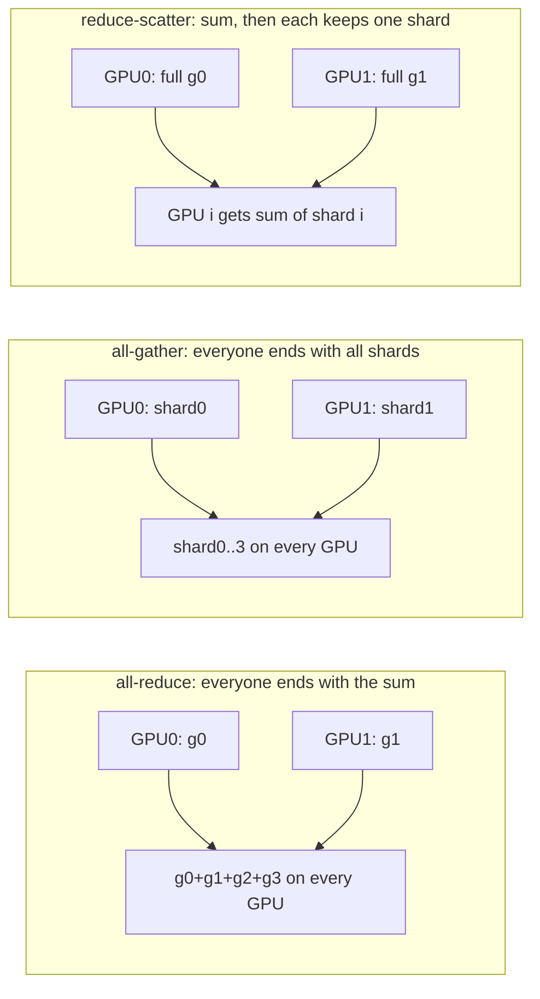
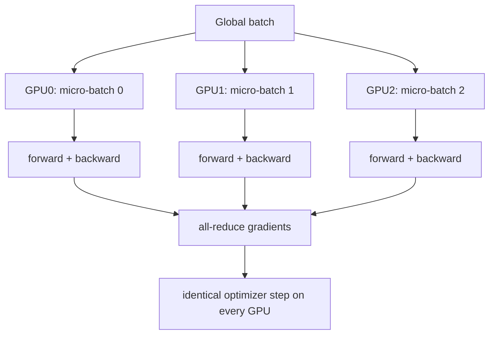
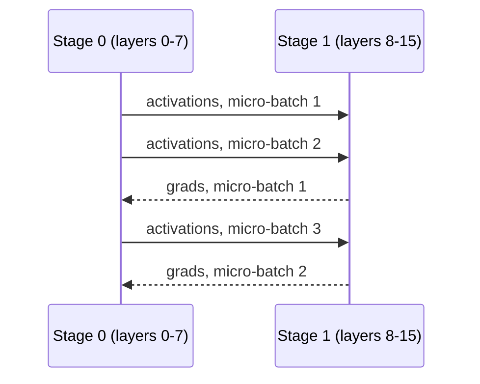

# Distributed Training

A single GPU runs out of two things: memory and time. A 7B model in mixed precision with AdamW needs over 100 GB just for weights, gradients and optimizer state, more than any single GPU has. And even a 500M model trained on 50B tokens takes days on one GPU. Distributed training splits the work across many GPUs. There are a handful of ways to split it (by data, by parameters, by layers, by sequence) and real systems combine them. This page explains each, shows the code for the ones you will actually use, and gives you a table for choosing.

!!! abstract "What you'll learn"
    - Where GPU memory goes during training, and why it runs out
    - Communication primitives: all-reduce, all-gather, reduce-scatter
    - Data parallel (DDP) with `torchrun`, with complete code
    - ZeRO stages and FSDP / FSDP2 (`fully_shard`)
    - Tensor, pipeline, and sequence/context parallelism
    - A decision table for which to use, multi-node basics, and common failures

## Where the memory goes

For a model with $N$ parameters trained with AdamW in bf16 mixed precision, the per-parameter cost of the **model states** is roughly:

| Item | Bytes/param |
|---|---|
| bf16 weights (used in forward/backward) | 2 |
| bf16 gradients | 2 |
| fp32 master weights | 4 |
| fp32 Adam $m$ | 4 |
| fp32 Adam $v$ | 4 |
| **Total** | **~16** |

So a 7B model needs about $7\times10^9 \times 16 \approx 112$ GB before any activations. (PyTorch autocast keeps fp32 weights and grads, so in a plain DDP setup it's 4+4+4+4 = 16 bytes too, just split differently.) Activations come on top and scale with batch size, sequence length and depth.

Two consequences: (1) if the model states fit on one GPU, you can replicate the model and split the data; (2) if they don't, you must split the model states themselves.

## Communication primitives

Every parallelism strategy is built on a few collective operations, implemented by NCCL on NVIDIA GPUs.



| Primitive | Input on each of $P$ GPUs | Output on each GPU | Used by |
|---|---|---|---|
| **all-reduce** | full tensor | full tensor, summed (or averaged) | DDP gradient sync, TP |
| **all-gather** | one shard | full tensor (concatenated) | FSDP forward/backward, TP |
| **reduce-scatter** | full tensor | one shard of the sum | FSDP gradient sync |
| **broadcast** | tensor on rank 0 | same tensor everywhere | initial weights |
| **send / recv** | point-to-point | | pipeline parallel |

Key identity: **all-reduce = reduce-scatter + all-gather**. A ring all-reduce sends about $2\frac{P-1}{P}$ times the tensor size per GPU, nearly independent of $P$. That's why data parallelism scales well.

```python title="collectives_demo.py"
# torchrun --nproc_per_node=2 collectives_demo.py   (use backend="gloo" to try on CPU)
import torch, torch.distributed as dist

dist.init_process_group(backend="nccl" if torch.cuda.is_available() else "gloo")
rank, world = dist.get_rank(), dist.get_world_size()
dev = torch.device(f"cuda:{rank}") if torch.cuda.is_available() else torch.device("cpu")

x = torch.full((4,), float(rank), device=dev)
dist.all_reduce(x, op=dist.ReduceOp.SUM)
print(rank, "all_reduce:", x.tolist())

shard = torch.full((2,), float(rank), device=dev)
full = torch.empty(2 * world, device=dev)
dist.all_gather_into_tensor(full, shard)
print(rank, "all_gather:", full.tolist())

inp = torch.arange(2 * world, dtype=torch.float32, device=dev)
out = torch.empty(2, device=dev)
dist.reduce_scatter_tensor(out, inp)
print(rank, "reduce_scatter:", out.tolist())
dist.destroy_process_group()
```

## Data parallel (DDP)

Every GPU holds a full copy of the model. Each processes a different slice of the batch. After backward, gradients are **all-reduced** (averaged) so every replica applies the identical update and stays in sync.



PyTorch's `DistributedDataParallel` buckets gradients and overlaps the all-reduce with the rest of backward, so communication is mostly hidden.

```python title="train_ddp.py"
# Launch: torchrun --standalone --nproc_per_node=8 train_ddp.py
import os
import torch
import torch.distributed as dist
import torch.nn.functional as F
from torch.nn.parallel import DistributedDataParallel as DDP
from contextlib import nullcontext

from train import GPT, GPTConfig, ShardLoader   # from the single-GPU script

def main():
    dist.init_process_group(backend="nccl")
    rank = int(os.environ["RANK"])
    local_rank = int(os.environ["LOCAL_RANK"])
    world = int(os.environ["WORLD_SIZE"])
    torch.cuda.set_device(local_rank)
    device = f"cuda:{local_rank}"
    master = rank == 0

    torch.manual_seed(1337)                      # same init on every rank (DDP also broadcasts)
    cfg = GPTConfig()
    model = GPT(cfg).to(device)
    model = torch.compile(model)
    model = DDP(model, device_ids=[local_rank])

    micro_bs, total_tokens = 16, 524_288
    grad_accum = total_tokens // (micro_bs * cfg.seq_len * world)   # (1)!
    # different seed per rank -> different data per rank
    loader = ShardLoader("data/fineweb_edu/train_*.bin", micro_bs, cfg.seq_len, seed=1000 + rank)
    opt = torch.optim.AdamW(model.parameters(), lr=6e-4, betas=(0.9, 0.95), weight_decay=0.1, fused=True)

    for step in range(1000):
        opt.zero_grad(set_to_none=True)
        for micro in range(grad_accum):
            x, y = loader.next_batch("cuda")
            x, y = x.to(device), y.to(device)
            # only sync gradients on the last micro-step
            sync = micro == grad_accum - 1
            with (nullcontext() if sync else model.no_sync()):   # (2)!
                with torch.autocast("cuda", dtype=torch.bfloat16):
                    logits = model(x)
                loss = F.cross_entropy(logits.float().view(-1, logits.size(-1)), y.view(-1))
                (loss / grad_accum).backward()
        torch.nn.utils.clip_grad_norm_(model.parameters(), 1.0)
        opt.step()
        if step % 10 == 0:
            l = loss.detach()
            dist.all_reduce(l, op=dist.ReduceOp.AVG)     # (3)!
            if master:
                print(f"step {step} loss {l.item():.4f}")

    if master:
        torch.save(model.module._orig_mod.state_dict(), "ckpt_ddp.pt")  # (4)!
    dist.destroy_process_group()

if __name__ == "__main__":
    main()
```

1. Divide accumulation steps by `world` so the global batch in tokens stays the same as on one GPU.
2. `no_sync()` skips the all-reduce on intermediate micro-batches; gradients accumulate locally and are synced once.
3. Collectives must be called by **every** rank, which is why non-master ranks also call `all_reduce`. A collective called on only some ranks hangs forever.
4. Unwrap DDP (`.module`) and `torch.compile` (`._orig_mod`). Only rank 0 writes.

`torchrun` sets `RANK`, `LOCAL_RANK`, `WORLD_SIZE`, `MASTER_ADDR` and `MASTER_PORT` for each process. DDP is the right choice whenever the model states (~16 bytes/param) plus activations fit on one GPU: on an 80 GB GPU, that's up to roughly 1-2B parameters with activation checkpointing.

## ZeRO: stop replicating optimizer state

DDP stores identical optimizer states, gradients and weights on every GPU. That's wasteful. **ZeRO** (from DeepSpeed) shards them across the $P$ data-parallel ranks:

| Stage | What is sharded | Per-GPU model-state memory | Extra communication vs DDP |
|---|---|---|---|
| DDP | nothing | $16N$ | baseline (all-reduce) |
| ZeRO-1 | optimizer states | $4N + 12N/P$ | ~none |
| ZeRO-2 | + gradients | $2N + 14N/P$ | ~none (reduce-scatter instead of all-reduce) |
| ZeRO-3 | + parameters | $16N/P$ | ~1.5x (all-gather params in forward and backward) |

(The table uses the classic accounting of 2-byte weights, 2-byte grads and 12 bytes of fp32 optimizer state.) With ZeRO-3 on 64 GPUs, a 7B model's states take $112/64 \approx 1.75$ GB per GPU. ZeRO-3 is what PyTorch calls **FSDP** (Fully Sharded Data Parallel).

## FSDP and FSDP2

FSDP shards every parameter across ranks. For each layer (or "unit"):

1. **Forward**: all-gather the full layer weights, compute, free the non-local shards.
2. **Backward**: all-gather again, compute gradients, then **reduce-scatter** so each rank keeps only the gradient shard it owns.
3. **Optimizer step**: each rank updates only its shard.

Communication is overlapped with compute by prefetching the next layer's all-gather.

**FSDP2** (`torch.distributed.fsdp.fully_shard`, PyTorch 2.4+; import path stable from 2.6) is the current API. It shards each parameter as a `DTensor` along dim 0, composes with tensor parallel and `torch.compile`, and is simpler than FSDP1's `FullyShardedDataParallel` wrapper.

```python title="train_fsdp2.py"
# torchrun --nproc_per_node=8 train_fsdp2.py     (PyTorch >= 2.6)
import os
import torch
import torch.distributed as dist
import torch.nn.functional as F
from torch.distributed.fsdp import fully_shard, MixedPrecisionPolicy
from torch.distributed.checkpoint.state_dict import get_model_state_dict, StateDictOptions
import torch.distributed.checkpoint as dcp

from train import GPT, GPTConfig, ShardLoader

dist.init_process_group("nccl")
rank, local_rank = dist.get_rank(), int(os.environ["LOCAL_RANK"])
torch.cuda.set_device(local_rank)

cfg = GPTConfig(n_layer=24, n_head=16, d_model=2048)        # ~1.3B params
with torch.device("meta"):                                   # (1)!
    model = GPT(cfg)

mp = MixedPrecisionPolicy(param_dtype=torch.bfloat16, reduce_dtype=torch.float32)  # (2)!
for block in model.blocks:
    fully_shard(block, mp_policy=mp)                         # each block is one FSDP unit
fully_shard(model, mp_policy=mp)                             # root: embeddings, final norm, head

model.to_empty(device="cuda")                                # allocate local shards only
with torch.no_grad():                                        # re-run init on real memory
    model.apply(model._init)
    for n, p in model.named_parameters():
        if n.endswith("proj.weight"):
            p.normal_(0, 0.02 / (2 * cfg.n_layer) ** 0.5)
    from train import rope_cache
    cos, sin = rope_cache(cfg.seq_len, cfg.d_model // cfg.n_head)
    model.cos.copy_(cos); model.sin.copy_(sin)

opt = torch.optim.AdamW(model.parameters(), lr=3e-4, betas=(0.9, 0.95), weight_decay=0.1)
loader = ShardLoader("data/fineweb_edu/train_*.bin", 8, cfg.seq_len, seed=rank)

for step in range(100):
    x, y = loader.next_batch("cuda")
    logits = model(x)                                        # all-gathers happen inside
    loss = F.cross_entropy(logits.float().view(-1, logits.size(-1)), y.view(-1))
    loss.backward()                                          # reduce-scatter happens inside
    torch.nn.utils.clip_grad_norm_(model.parameters(), 1.0)  # works on DTensor grads
    opt.step(); opt.zero_grad()
    if rank == 0 and step % 10 == 0:
        print(step, loss.item())

# Sharded checkpoint: every rank writes its own shard in parallel
dcp.save({"model": get_model_state_dict(model)}, checkpoint_id="ckpt_fsdp/step_100")
dist.destroy_process_group()
```

1. Building on the `meta` device creates parameter shapes without allocating memory, so you can construct models larger than one GPU's memory.
2. Parameters are all-gathered in bf16 for compute; gradients are reduced in fp32 for accuracy. Sharded master weights and optimizer state stay fp32.

!!! note "Weight tying under FSDP"
    The script ties `head.weight` to `tok.weight`. Both live in the root FSDP unit here, which is fine. If you wrap the embedding and head as separate units, tying breaks; keep tied parameters in the same unit.

For sharded checkpoints, use `torch.distributed.checkpoint` (DCP): each rank saves its shard, and DCP can reload onto a different number of GPUs. To get a single-file checkpoint for inference, gather with `StateDictOptions(full_state_dict=True, cpu_offload=True)`.

**HSDP** (hybrid sharding) shards within a node and replicates across nodes: you get FSDP's memory savings over fast NVLink while doing only cheap all-reduces over the slower inter-node network. Use a 2D device mesh: `fully_shard(..., mesh=init_device_mesh("cuda", (nodes, gpus_per_node), mesh_dim_names=("replicate", "shard")))`.

## Tensor parallel (TP)

Instead of sharding parameters only for storage, **tensor parallelism** splits the matrix multiplications themselves across GPUs (Megatron-LM style). In the MLP:

- The first linear layer $W_1$ is split by **columns**: GPU $i$ computes $X W_1^{(i)}$, an independent slice of the hidden activations. No communication needed.
- The second linear $W_2$ is split by **rows**: GPU $i$ computes $H^{(i)} W_2^{(i)}$, a partial sum. One **all-reduce** produces the output.

$$
Y = \sum_i \operatorname{GeLU}(X W_1^{(i)})\, W_2^{(i)}
$$

Attention is split by heads the same way. That's two all-reduces per transformer block in forward and two in backward, on the critical path. TP needs very fast interconnect, so keep it **within a node** (NVLink), typically TP degree 2-8.

```python title="tp_sketch.py"
from torch.distributed.device_mesh import init_device_mesh
from torch.distributed.tensor.parallel import (
    parallelize_module, ColwiseParallel, RowwiseParallel)

tp_mesh = init_device_mesh("cuda", (8,))
for block in model.blocks:
    parallelize_module(block, tp_mesh, {
        "attn.qkv": ColwiseParallel(),    # split heads across GPUs
        "attn.proj": RowwiseParallel(),   # all-reduce partial outputs
        "mlp.gate": ColwiseParallel(),
        "mlp.up": ColwiseParallel(),
        "mlp.proj": RowwiseParallel(),
    })
# Notes: the attention forward must use the *local* number of heads (n_head // tp_size)
# when reshaping, since each GPU now holds only a slice of q, k, v. Also, ColwiseParallel
# splits a *fused* qkv weight into contiguous chunks (GPU 0 would get mostly Q), so in
# practice use separate q, k, v Linear layers (each ColwiseParallel) or reorder the weight.
```

## Pipeline parallel (PP)

Split the model **by layers**: GPU 0 holds layers 0-7, GPU 1 holds 8-15, and so on. Activations are passed forward with send/recv, gradients backward. Communication is small (one activation tensor per micro-batch at each boundary), so PP works across nodes.

The problem is the **bubble**: with one batch, only one stage works at a time. Splitting the batch into $m$ micro-batches and pipelining them (GPipe, 1F1B schedules) shrinks idle time. With $p$ stages, the bubble fraction is roughly:

$$
\text{bubble} \approx \frac{p-1}{m + p - 1}
$$

So you need $m \gg p$ micro-batches. Interleaved and zero-bubble schedules reduce it further. PyTorch provides `torch.distributed.pipelining`; Megatron-LM and DeepSpeed have mature implementations. PP is complicated to get right; you only need it at large scale.



## Sequence and context parallel

With long contexts (32K-1M tokens), activations for a single sequence exceed one GPU's memory.

- **Sequence parallel** (Megatron): in regions outside attention/MLP matmuls (layer norms, dropout), shard activations along the sequence dimension across the TP group. Pairs with TP; saves activation memory.
- **Context parallel / Ring Attention**: shard the sequence across GPUs for attention too. Each GPU holds a chunk of queries and passes key/value chunks around a ring, accumulating attention with the online-softmax trick from FlashAttention. PyTorch has an experimental `context_parallel` API; Megatron and others implement it for long-context training.

You need these only for long-context pretraining or context extension.

## When to use which

| Situation | Use | Why |
|---|---|---|
| Model states fit on one GPU (<~1-2B on 80 GB) | **DDP** | Simplest, fastest, communication hidden behind backward |
| Fits, but tight memory / want bigger micro-batches | DDP + activation checkpointing, or **ZeRO-1/2** | Free memory with little extra comm |
| ~2B-30B params, one or a few nodes | **FSDP2** (ZeRO-3) | Shards everything; scales to models far larger than one GPU |
| FSDP across many nodes, slow inter-node links | **HSDP** | Shard within node, replicate across nodes |
| 30B+ params, or FSDP all-gathers too slow / per-GPU batch too small | **FSDP + TP** (TP within node) | TP reduces per-GPU params and activations |
| 100B+ params, hundreds+ of GPUs | **3D/4D: DP x TP x PP (+ CP)** | PP across nodes, TP within node, DP for the rest |
| Very long sequences (32K+) | add **context parallel** | Activations for one sequence don't fit |
| MoE models | add **expert parallel** | Experts sharded across GPUs, tokens routed with all-to-all |

For this site's projects (125M-500M), DDP is all you need. Learn FSDP2 next; reach for TP/PP only when you're on large clusters, and use a framework (TorchTitan, Megatron-LM, NeMo, DeepSpeed) instead of hand-rolling them.

## Multi-node basics

Launch the same command on every node, pointing at one rendezvous host:

```bash
# On every node (node_rank 0..N-1). 2 nodes x 8 GPUs = 16 ranks.
torchrun \
  --nnodes=2 --nproc_per_node=8 \
  --rdzv_backend=c10d --rdzv_endpoint=node0.example:29500 \
  --rdzv_id=job42 \
  train_ddp.py
```

On SLURM clusters, wrap this in `srun`, and derive the endpoint from `scontrol show hostnames`. Things that matter:

- **Network**: inter-node bandwidth is usually InfiniBand or RoCE at 200-400 Gb/s per GPU, versus hundreds of GB/s over NVLink within a node. This gap is why TP stays in-node.
- **Shared filesystem** for data and checkpoints, or per-node local copies of data.
- **Environment**: identical PyTorch/NCCL/CUDA versions on all nodes.
- Useful env vars: `NCCL_DEBUG=INFO` (diagnostics), `NCCL_SOCKET_IFNAME=eth0` (pick the right NIC), `NCCL_IB_HCA` (pick InfiniBand adapters), `TORCH_NCCL_ASYNC_ERROR_HANDLING=1` (fail instead of hanging).

## Common failures

| Symptom | Likely cause | Fix |
|---|---|---|
| Hangs forever at start | Ranks can't reach rendezvous; firewall; wrong NIC | Check `MASTER_ADDR`/port, `NCCL_SOCKET_IFNAME`, run with `NCCL_DEBUG=INFO` |
| Hangs mid-training | One rank skipped a collective (e.g. a `print` path that calls `all_reduce` only on rank 0), or ranks have different numbers of batches | Every rank must call every collective in the same order; give each rank the same number of steps |
| NCCL timeout after 10-30 min | Same as above, or one rank is much slower (data loading, checkpoint writing) | Set `timeout=` in `init_process_group` sensibly; use `dist.barrier()` around rank-0-only work |
| OOM on rank 0 only | Rank 0 does extra work: eval, gathering full state dict, logging tensors | Use sharded checkpoints; offload full-state gather to CPU |
| OOM everywhere at first step | Activations | Smaller micro-batch, activation checkpointing, shorter seq_len |
| OOM after many steps | Fragmentation or a leak (keeping loss tensors in a list) | `.item()` or `.detach()` what you log; `PYTORCH_CUDA_ALLOC_CONF=expandable_segments:True` |
| Loss differs from single-GPU run | Every rank reads the same data; forgot to scale `grad_accum` | Different seed / shard per rank; keep global batch tokens fixed |
| Slow scaling | Small per-GPU batch, slow inter-node network, no comm/compute overlap | Bigger micro-batch, HSDP, check bandwidth with `nccl-tests` |

!!! warning "Common pitfalls"
    - **Conditional collectives.** Any `all_reduce` inside `if rank == 0:` will hang.
    - **Same data on every rank.** You get N times the compute for 1x the learning.
    - **Saving from every rank** to the same path in DDP: corrupt files. Save from rank 0 only (DDP) or use DCP (FSDP).
    - **Using FSDP when DDP fits.** FSDP adds communication; for small models DDP is faster.
    - **Forgetting `torch.cuda.set_device(local_rank)`.** All processes pile onto GPU 0.

## Check your understanding

??? question "Why does DDP's communication cost barely grow with the number of GPUs?"
    A ring all-reduce sends about $2(P-1)/P$ times the gradient size per GPU, which approaches 2x the gradient size regardless of $P$. Plus DDP overlaps it with backward.

??? question "A 3B model, AdamW, bf16 mixed precision, 8 GPUs with 40 GB each. Can you use DDP? What about FSDP?"
    DDP model states: $3\times10^9 \times 16 = 48$ GB per GPU, more than 40 GB before activations. No. FSDP (ZeRO-3): $48/8 = 6$ GB per GPU plus activations and temporary gathered layers. Yes.

??? question "Why is tensor parallelism usually kept within a single node?"
    TP needs all-reduces inside every transformer block, on the critical path of forward and backward. That requires NVLink-class bandwidth; inter-node links are an order of magnitude slower.

??? question "With 4 pipeline stages and 4 micro-batches, roughly what fraction of time is bubble? With 32 micro-batches?"
    $(4-1)/(4+4-1) = 3/7 \approx 43\%$. With 32: $3/35 \approx 9\%$.

??? question "Training hangs at step 500 on 16 GPUs, every time. What do you check?"
    A code path that calls a collective on some ranks but not others (e.g. eval or checkpoint logic at step 500 gated by rank), or ranks running out of data at different times. Run with `NCCL_DEBUG=INFO` and dump stack traces (`py-spy dump`) on each rank to see which collective each is waiting in.

## Further reading

- Rajbhandari et al., *ZeRO: Memory Optimizations Toward Training Trillion Parameter Models* - [arXiv:1910.02054](https://arxiv.org/abs/1910.02054)
- Zhao et al., *PyTorch FSDP: Experiences on Scaling Fully Sharded Data Parallel* - [arXiv:2304.11277](https://arxiv.org/abs/2304.11277)
- Shoeybi et al., *Megatron-LM: Training Multi-Billion Parameter Language Models Using Model Parallelism* - [arXiv:1909.08053](https://arxiv.org/abs/1909.08053)
- Narayanan et al., *Efficient Large-Scale Language Model Training on GPU Clusters Using Megatron-LM* - [arXiv:2104.04473](https://arxiv.org/abs/2104.04473)
- Huang et al., *GPipe* - [arXiv:1811.06965](https://arxiv.org/abs/1811.06965)
- Liu et al., *Ring Attention with Blockwise Transformers* - [arXiv:2310.01889](https://arxiv.org/abs/2310.01889)
- Liang et al., *TorchTitan* - [arXiv:2410.06511](https://arxiv.org/abs/2410.06511)
- PyTorch docs: [DDP tutorial](https://pytorch.org/tutorials/intermediate/ddp_tutorial.html), [FSDP2 tutorial](https://pytorch.org/tutorials/intermediate/FSDP_tutorial.html), [torchrun](https://pytorch.org/docs/stable/elastic/run.html)
- Hugging Face, *The Ultra-Scale Playbook* - [huggingface.co/spaces/nanotron/ultrascale-playbook](https://huggingface.co/spaces/nanotron/ultrascale-playbook)
