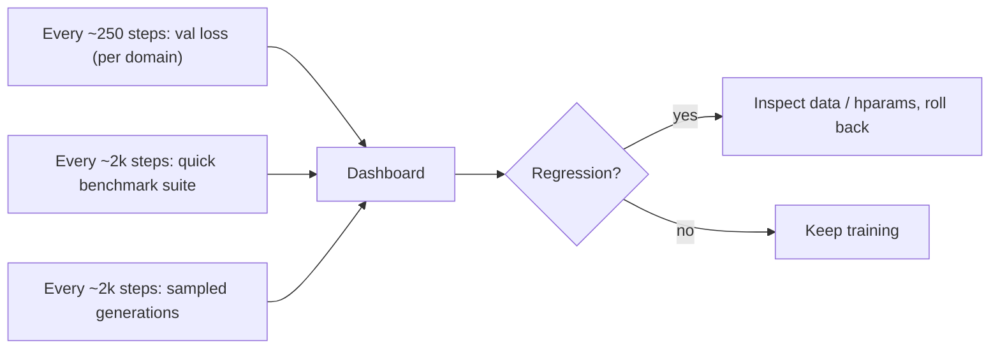

# Evaluation

Training loss tells you the optimizer is doing its job. It does not tell you whether the model is any good at anything you care about. Evaluation connects the two: validation loss for fast, cheap, continuous feedback; benchmarks to measure specific abilities; and reading the model's outputs to catch what numbers miss. Evaluation is also where it's easiest to fool yourself, through contamination, bad prompts, or noisy small benchmarks. This page covers how to evaluate a pretrained model honestly.

!!! abstract "What you'll learn"
    - Validation loss, perplexity and bits-per-byte, and when each is comparable
    - What the standard benchmarks (HellaSwag, ARC, MMLU, PIQA, Winogrande, GSM8K, HumanEval) measure
    - How multiple-choice evals are scored with log-likelihoods
    - Running `lm-evaluation-harness` and LightEval
    - Evaluating base vs chat models, contamination, and building your own eval sets
    - LLM-as-judge pitfalls, and why you should always read samples

## Validation loss and perplexity

Hold out a fixed set of tokens from the same distribution as training (and deduplicated against it). Every few hundred steps, compute the mean cross-entropy on it. Perplexity is just the exponential:

$$
\text{PPL} = \exp\left(-\frac{1}{N}\sum_{i=1}^{N}\log p_\theta(x_i\mid x_{<i})\right)
$$

Val loss is the single best signal during pretraining: it's smooth, cheap, and strongly correlated with downstream performance at a given data mixture.

**Comparability.** Loss per token depends on the tokenizer: a tokenizer with bigger tokens has fewer, harder predictions per document. To compare across tokenizers use **bits per byte (BPB)**:

$$
\text{BPB} = \frac{\sum_i -\log_2 p(x_i\mid x_{<i})}{\text{number of UTF-8 bytes in the text}} = \frac{\mathcal{L}_{\text{nats/token}} \cdot N_{\text{tokens}}}{\ln 2 \cdot N_{\text{bytes}}}
$$

```python title="val_loss.py"
import math, torch, torch.nn.functional as F

@torch.no_grad()
def eval_bpb(model, tok, texts, device="cuda", seq_len=1024):
    model.eval()
    nll_sum, n_bytes = 0.0, 0
    for text in texts:
        ids = tok(text, return_tensors="pt").input_ids[:, : seq_len + 1].to(device)
        if ids.size(1) < 2:
            continue
        logits = model(ids[:, :-1])
        logits = getattr(logits, "logits", logits)           # works for HF models and raw GPTs
        nll_sum += F.cross_entropy(logits.float().view(-1, logits.size(-1)),
                                   ids[:, 1:].reshape(-1), reduction="sum").item()
        n_bytes += len(tok.decode(ids[0, 1:]).encode("utf-8"))
    return nll_sum / (math.log(2) * n_bytes)
```

Also track val loss on a few *separate* domains (code, math, Wikipedia, a non-English slice). A mixture change can improve the average while hurting one domain.

## Downstream benchmarks

Benchmarks probe specific capabilities. For base models, most are **multiple choice scored by log-likelihood**, which works even when the model can't follow instructions.

| Benchmark | Measures | Format | Notes |
|---|---|---|---|
| **HellaSwag** | Commonsense: pick the plausible continuation of a scene | 4-way MC completion | Good early signal; small models climb above chance (25%) early |
| **ARC-Easy / ARC-Challenge** | Grade-school science questions | 4-way MC | Challenge set filtered to be hard for retrieval and co-occurrence |
| **PIQA** | Physical commonsense ("how to open a jar") | 2-way MC | Chance is 50% |
| **Winogrande** | Pronoun/coreference resolution needing commonsense | 2-way fill-in | Chance is 50%; noisy for small models |
| **MMLU** | Knowledge across 57 subjects (law, medicine, math...) | 4-way MC, usually 5-shot | Small models sit near 25% for a long time; the cloze formulation (scoring the answer text instead of a letter) gives signal earlier |
| **GSM8K** | Grade-school math word problems | Generative, exact-match on final number | Needs multi-step reasoning; few-shot chain-of-thought |
| **HumanEval** | Python function synthesis | Generative, run unit tests, pass@k | Executes model code: sandbox it |

!!! tip "Pick benchmarks that move at your scale"
    For a 125M-500M model, HellaSwag, ARC-Easy, PIQA and the cloze form of MMLU/ARC show signal. MMLU in letter-choice form, GSM8K and HumanEval will sit near chance or zero; reporting them tells you little. The FineWeb and SmolLM teams chose their ablation suites specifically for "early signal".

### How log-likelihood scoring works

For a question with choices, compute the model's log-probability of each choice's text given the context, and pick the highest:

$$
\hat{c} = \arg\max_{c} \sum_{t \in c} \log p_\theta(t \mid \text{context}, c_{<t})
$$

Longer choices accumulate more negative log-prob, so harnesses also report a **length-normalized** accuracy (`acc_norm`), dividing by the number of characters or tokens. HellaSwag results are usually quoted as `acc_norm`.

```python title="mc_score.py"
import torch, torch.nn.functional as F

@torch.no_grad()
def score_choices(model, tok, context: str, choices: list[str], device="cuda"):
    ctx_ids = tok(context).input_ids
    scores = []
    for c in choices:
        c_ids = tok(c).input_ids                     # choice usually starts with a space: " Paris"
        ids = torch.tensor([ctx_ids + c_ids], device=device)
        logits = model(ids).logits[0, :-1].float()
        logp = F.log_softmax(logits, -1)
        tgt = ids[0, 1:]
        lp = logp[torch.arange(len(tgt)), tgt][-len(c_ids):].sum().item()  # only choice tokens
        scores.append((lp, lp / len(c)))             # raw and char-normalized
    return scores

# Example with any HF causal LM:
# from transformers import AutoModelForCausalLM, AutoTokenizer
# m = AutoModelForCausalLM.from_pretrained("HuggingFaceTB/SmolLM2-135M").cuda().eval()
# t = AutoTokenizer.from_pretrained("HuggingFaceTB/SmolLM2-135M")
# print(score_choices(m, t, "The capital of France is", [" Paris", " Berlin", " a banana"]))
```

Tokenize context and choice carefully: tokenizing them jointly can merge tokens across the boundary. Harnesses handle this; your own code should too.

## lm-evaluation-harness

EleutherAI's `lm-evaluation-harness` is the standard tool. It implements hundreds of tasks with fixed prompts, so your numbers are comparable to published ones.

```bash
pip install "lm_eval[hf]"

# Base model, zero-shot commonsense suite
lm_eval --model hf \
  --model_args pretrained=HuggingFaceTB/SmolLM2-135M,dtype=bfloat16 \
  --tasks hellaswag,arc_easy,arc_challenge,piqa,winogrande \
  --device cuda:0 --batch_size auto \
  --output_path results/

# MMLU, 5-shot
lm_eval --model hf --model_args pretrained=./my-model,dtype=bfloat16 \
  --tasks mmlu --num_fewshot 5 --batch_size 16

# GSM8K (generative)
lm_eval --model hf --model_args pretrained=./my-model --tasks gsm8k --batch_size 8

# Faster generation-heavy tasks with a vLLM backend
pip install "lm_eval[vllm]"
lm_eval --model vllm --model_args pretrained=./my-model,tensor_parallel_size=1 --tasks gsm8k

# HumanEval runs model-written code: you must opt in explicitly
HF_ALLOW_CODE_EVAL=1 lm_eval --model hf --model_args pretrained=./my-model \
  --tasks humaneval --confirm_run_unsafe_code

lm_eval --tasks list   # see all tasks
```

To evaluate your own checkpoint, export it in Hugging Face format (a `config.json` + `model.safetensors` for a supported architecture like `LlamaForCausalLM`), or write a small `lm_eval` model wrapper implementing `loglikelihood` and `generate_until`.

**LightEval** (Hugging Face) is an alternative used for the FineWeb and SmolLM ablations, with good support for evaluating many checkpoints and for vLLM/accelerate backends. Both are fine; pick one and keep the version fixed across a project. Task definitions and prompts change between versions, which moves scores.

## Evaluating base vs chat models

| | Base model | Chat / instruct model |
|---|---|---|
| Prompt | Raw few-shot text | Chat template (`apply_chat_template`) |
| Scoring | Log-likelihood MC, few-shot generation | Generative: parse an answer letter or final answer |
| Typical evals | HellaSwag, ARC, MMLU (5-shot), GSM8K (few-shot) | MMLU-Pro, GSM8K/MATH (0-shot CoT), IFEval, MT-Bench, Arena-style |
| Pitfall | Expecting instruction following | Forgetting the chat template; scores collapse |

With `lm_eval`, pass `--apply_chat_template` (and often `--fewshot_as_multiturn`) for chat models. Chat models can score lower than their base on log-likelihood MC tasks because post-training shifts probability mass; that's not necessarily a regression in usefulness.

## Contamination

If benchmark questions are in your training data, scores are inflated, sometimes massively. Contamination is common because benchmarks are posted all over the web.

- **Prevent**: n-gram decontaminate your training data against every benchmark you report (see [Data Pipelines](data.md#decontamination)).
- **Detect**: compare performance on the original test set vs a freshly written or perturbed version (rephrased questions, shuffled choices, changed numbers as in GSM-Symbolic-style variants). A large gap suggests memorization.
- **Probe**: check if the model can complete benchmark questions verbatim from a prefix, or assigns unusually low perplexity to test examples relative to similar text.
- **Report**: say what you decontaminated against and how.

Also beware **indirect** contamination: training on outputs from a model that was itself trained on the test set, or synthetic data generated from benchmark-like seeds.

## Building your own eval sets

Public benchmarks measure general ability. If you're training for a domain or task, you need your own eval, and it's often the most valuable thing you build.

1. **Define the behavior** precisely: what input, what counts as correct.
2. **Collect 100-500 examples** from real usage or hand-written by experts. Variety beats volume.
3. **Make scoring automatic** where possible: exact match, regex on a final answer, unit tests, JSON schema validity, or log-likelihood MC.
4. **Split**: a dev set you iterate on, and a held-out test set you look at rarely.
5. **Freeze it** and version it. Never train on it, and keep it out of any data you scrape.
6. **Estimate noise**: with $n$ examples and accuracy $p$, the standard error is $\sqrt{p(1-p)/n}$. At $n=200$ and $p=0.5$, that's about 3.5 points, so a 2-point difference is not meaningful.

```python
import math
def stderr(acc, n): return math.sqrt(acc * (1 - acc) / n)
print(f"±{1.96 * stderr(0.5, 200):.3f} (95% CI)")   # about ±0.069
```

## LLM-as-judge pitfalls

For open-ended outputs, people ask a strong model to grade or compare responses. It scales, but it's a measuring instrument with known biases:

- **Position bias**: prefers the first (or second) answer in pairwise comparisons. Evaluate both orders and average.
- **Verbosity bias**: prefers longer answers. Control for length or use length-controlled win rates.
- **Self-preference**: judges favor outputs from their own model family.
- **Style over substance**: confident formatting beats correct content; judges miss subtle factual and math errors.
- **Prompt sensitivity**: small rubric wording changes move scores.

Mitigations: specific rubrics with reference answers, pairwise rather than absolute scores, multiple judges, and **validating the judge against human labels** on a sample before trusting it. For base models, LLM-as-judge is rarely the right tool; log-likelihood evals are cheaper and more reliable.

## Vibes-check generation

Numbers hide failures you'd spot in seconds by reading. During training, generate from a fixed set of prompts every few thousand steps and log the text:

```python title="vibes.py"
import torch

PROMPTS = [
    "The capital of France is",
    "def fibonacci(n):",
    "In 1905, Albert Einstein",
    "Photosynthesis is the process by which",
    "Once upon a time,",
]

@torch.no_grad()
def vibes(model, tok, device="cuda", max_new=60, temperature=0.8, top_k=50):
    model.eval()
    for p in PROMPTS:
        ids = torch.tensor([tok.encode(p)], device=device)
        for _ in range(max_new):
            logits = model(ids)[:, -1, :].float() / temperature
            v, _ = torch.topk(logits, top_k)
            logits[logits < v[:, [-1]]] = -float("inf")
            nxt = torch.multinomial(torch.softmax(logits, -1), 1)
            ids = torch.cat([ids, nxt], dim=1)
        print(repr(tok.decode(ids[0].tolist())), "\n")
    model.train()
```

What to look for, roughly in the order a model learns it: real words instead of fragments; grammatical sentences; staying on topic; plausible facts; correct code syntax; coherent multi-sentence structure. Repetition loops, a single token repeated, or junk that looks like HTML/boilerplate point to data problems. See [Sampling, KV Cache & Quantization](../inference/inference.md) for the sampling methods used here.



!!! warning "Common pitfalls"
    - **Comparing perplexity across tokenizers.** Use bits-per-byte.
    - **Over-reading small differences.** A 1-point change on a 1,000-example benchmark is usually noise. Compute standard errors.
    - **Reporting benchmarks at chance.** If a 135M model scores 26% on MMLU, that is chance, not "26%".
    - **Mismatched harness versions or prompts** when comparing to published numbers.
    - **Forgetting the chat template** when evaluating chat models.
    - **Running HumanEval-style code unsandboxed.**
    - **Never reading outputs.**

## Check your understanding

??? question "Model A (32K vocab) has val loss 3.2; model B (128K vocab) has 3.5 on the same text. Which is better?"
    You can't tell from token-level loss: B's tokens cover more bytes each, so each prediction is harder. Convert both to bits-per-byte using each tokenizer's token count and the shared byte count, then compare.

??? question "Why can log-likelihood multiple-choice benchmarks evaluate a base model that can't follow instructions?"
    They never ask the model to produce an answer. They only compare the probabilities the model assigns to each candidate continuation, which any language model can compute.

??? question "Your 300M model scores 25.4% on 4-choice MMLU. What does that tell you?"
    Essentially nothing beyond "at chance". Use benchmarks or variants (cloze-form MMLU, ARC-Easy, HellaSwag) that show signal at this scale.

??? question "Your model scores 80% on GSM8K but 45% on a version with the numbers changed. Likely explanation?"
    Contamination or memorization: it has seen the original test problems (or close variants) in training. The perturbed version measures actual reasoning ability more faithfully.

??? question "Name two biases of LLM-as-judge and a mitigation for each."
    Position bias: evaluate both orderings and average. Verbosity bias: length-controlled comparisons or rubrics penalizing padding. (Also self-preference: use a judge from a different family; style bias: reference answers.)

## Further reading

- Gao et al., EleutherAI `lm-evaluation-harness` - [github.com/EleutherAI/lm-evaluation-harness](https://github.com/EleutherAI/lm-evaluation-harness)
- Hugging Face LightEval - [github.com/huggingface/lighteval](https://github.com/huggingface/lighteval)
- Zellers et al., *HellaSwag* - [arXiv:1905.07830](https://arxiv.org/abs/1905.07830)
- Hendrycks et al., *Measuring Massive Multitask Language Understanding* (MMLU) - [arXiv:2009.03300](https://arxiv.org/abs/2009.03300)
- Cobbe et al., *Training Verifiers to Solve Math Word Problems* (GSM8K) - [arXiv:2110.14168](https://arxiv.org/abs/2110.14168)
- Chen et al., *Evaluating Large Language Models Trained on Code* (HumanEval) - [arXiv:2107.03374](https://arxiv.org/abs/2107.03374)
- Zheng et al., *Judging LLM-as-a-Judge with MT-Bench and Chatbot Arena* - [arXiv:2306.05685](https://arxiv.org/abs/2306.05685)
- Mirzadeh et al., *GSM-Symbolic* - [arXiv:2410.05229](https://arxiv.org/abs/2410.05229)
