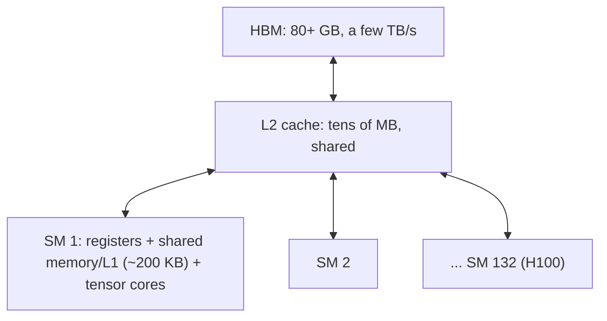

# GPU Performance Engineering

Two training runs with the same model, the same data and the same GPU can differ in speed by 3x. The difference is rarely clever math. It is whether the GPU spends its time doing arithmetic or waiting for data to arrive from memory. This page gives you the mental model ML performance engineers use: how a GPU is built, how to tell if an operation is limited by compute or by memory bandwidth, why fusing operations helps, why FlashAttention is fast, how to write your own fused kernel in Triton, which number formats to use, and how to read a profiler trace. It ends with a checklist you can run against any training script.

!!! abstract "What you'll learn"
    - GPU architecture as an ML engineer needs it: SMs, tensor cores, HBM, SRAM, the memory hierarchy
    - Arithmetic intensity and the roofline model, with worked numbers for matmul, LayerNorm and decode attention
    - Kernel fusion, and what `torch.compile` fuses for you
    - Why FlashAttention is fast: tiling plus online softmax, implemented and verified in PyTorch
    - A fused RMSNorm kernel in Triton
    - Precision formats (fp32, tf32, bf16, fp16, fp8 e4m3/e5m2), mixed precision, loss scaling, FP8 training
    - Profiling with `torch.profiler` and reading the trace
    - A practical throughput-tuning checklist

This page builds on [The Training Loop](training.md), which already shows *how* to turn on bf16, `torch.compile` and SDPA and how to compute MFU. Here you learn *why* they work and what to do when they are not enough.

## A GPU, as an ML engineer sees it

A modern datacenter GPU (A100, H100, B200) is a large array of identical processors called **streaming multiprocessors (SMs)**, attached to a big but comparatively slow pool of memory.



- **SMs.** An H100 SXM has 132 of them (an A100 has 108). Each SM runs many threads at once, grouped into **warps** of 32 threads that execute the same instruction in lockstep. Your kernel is launched as a grid of **thread blocks**; each block lands on one SM.
- **Tensor cores.** Each SM has a few tensor cores: units that do small matrix multiply-accumulates (for example a 16x8x16 tile) in one instruction. They are where almost all of the GPU's advertised FLOPs live. An H100's dense bf16 peak is roughly 989 TFLOP/s from tensor cores, versus roughly 67 TFLOP/s for ordinary fp32 arithmetic on the CUDA cores. If an operation isn't a matmul, it can't use tensor cores, and it gets a small fraction of the chip's compute.
- **HBM** (high-bandwidth memory) is the "GPU memory" you see in `nvidia-smi`: 80 GB on an H100, with roughly 3.35 TB/s of bandwidth. Every tensor you create lives here.
- **SRAM: shared memory and registers.** Each SM has a small amount of very fast on-chip memory: a register file (about 256 KB per SM) and a configurable shared memory/L1 (up to roughly 228 KB per SM on H100). Total on-chip SRAM across the chip is in the tens of MB, and its aggregate bandwidth is an order of magnitude higher than HBM.
- **L2 cache** sits between them: tens of MB, shared by all SMs.

The qualitative hierarchy is what matters:

| Level | Size (H100, roughly) | Speed | Who manages it |
|---|---|---|---|
| Registers | ~256 KB per SM | fastest | compiler |
| Shared memory / L1 | ~228 KB per SM | ~10x HBM bandwidth | you (CUDA/Triton) |
| L2 | ~50 MB total | between | hardware |
| HBM | 80 GB | ~3.35 TB/s | you (PyTorch tensors) |
| Host RAM over PCIe | hundreds of GB | ~tens of GB/s | you (`.to("cuda")`) |

A PyTorch op like `y = x * 2` launches a kernel that reads `x` from HBM into registers, multiplies, and writes `y` back to HBM. Every eager op is a full round trip to HBM. Remember that sentence; most of this page follows from it.

## Arithmetic intensity and the roofline

The **arithmetic intensity** (AI) of a kernel is

$$
\text{AI} = \frac{\text{FLOPs performed}}{\text{bytes moved to/from HBM}}
$$

The GPU can do at most $P$ FLOP/s (peak compute) and move at most $B$ bytes/s (peak bandwidth). So the best throughput a kernel can achieve is

$$
\text{attainable FLOP/s} = \min(P,\ \text{AI} \times B)
$$

Plot that against AI on log-log axes and you get a "roofline": a sloped line (memory-bound region) that meets a flat line (compute-bound region) at the **ridge point** $P/B$. For an H100 in bf16, $P/B \approx 989\text{e}12 / 3.35\text{e}12 \approx 295$ FLOPs per byte. A kernel with AI below ~295 is **memory-bound**: the tensor cores sit idle waiting for data. Above it, the kernel is **compute-bound**.

```python title="roofline.py"
def roofline(name, flops, bytes_moved, peak_flops=989e12, peak_bw=3.35e12):
    """Print arithmetic intensity, the bound, and the best-case time on the roofline."""
    ai = flops / bytes_moved                     # FLOPs per byte
    ridge = peak_flops / peak_bw                 # ~295 FLOPs/byte for H100 SXM bf16
    attainable = min(peak_flops, ai * peak_bw)   # the roofline
    t_us = max(flops / peak_flops, bytes_moved / peak_bw) * 1e6
    bound = "compute" if ai >= ridge else "memory"
    print(f"{name:28s} AI={ai:8.1f} FLOP/B  {bound + '-bound':14s} "
          f"<= {attainable / 1e12:6.1f} TFLOP/s  >= {t_us:8.1f} us")

E = 2  # bytes per bf16 element

M = K = N = 4096                                   # big square matmul
roofline("matmul 4096^3", 2 * M * N * K, E * (M * K + K * N + M * N))

M, K, N = 16, 4096, 4096                           # 16 tokens through a 4096x4096 layer
roofline("matmul 16x4096x4096", 2 * M * N * K, E * (M * K + K * N + M * N))

T, d = 8192, 4096                                  # LayerNorm: read x, write y, ~8 FLOPs/elem
roofline("layernorm 8192x4096", 8 * T * d, E * 2 * T * d)

S, d = 8192, 4096                                  # decode attention: 1 query vs S cached keys
roofline("attention decode S=8192", 4 * S * d, E * 2 * S * d)   # QK^T + PV; read K and V
```

Output:

```text
matmul 4096^3                AI=  1365.3 FLOP/B  compute-bound  <=  989.0 TFLOP/s  >=    139.0 us
matmul 16x4096x4096          AI=    15.9 FLOP/B  memory-bound   <=   53.2 TFLOP/s  >=     10.1 us
layernorm 8192x4096          AI=     2.0 FLOP/B  memory-bound   <=    6.7 TFLOP/s  >=     40.1 us
attention decode S=8192      AI=     1.0 FLOP/B  memory-bound   <=    3.4 TFLOP/s  >=     40.1 us
```

Read the four cases:

1. **Large matmul.** $2MNK$ FLOPs, but only $MK + KN + MN$ elements moved. AI grows with matrix size, so big matmuls are compute-bound. This is the one operation a GPU is built for.
2. **Skinny matmul.** The same weight matrix with only 16 rows of input: you still read all 16M weights but do 256x less work. AI is roughly the number of rows (tokens), so it's memory-bound. This is why tiny micro-batches waste the GPU, and why inference decode at batch 1 is slow.
3. **LayerNorm / RMSNorm / GELU / residual add.** A handful of FLOPs per element, every element read and written once. AI of 1-3. These are always memory-bound, no matter the size. On the H100 the LayerNorm above takes at least ~40 us, about a third of the time of a 4096-cube matmul that does about 500x more FLOPs.
4. **Attention during decode.** One new query against $S$ cached keys and values: you read the whole KV cache to do 2 FLOPs per element. AI ~1. This is covered in depth in [Inference](../inference/inference.md#why-decode-is-memory-bound); grouped-query attention helps exactly because several query heads share each K/V read, multiplying AI by the group size.

The lesson for training: **matmuls are compute-bound and everything else is memory-bound.** In a transformer the matmuls are most of the FLOPs, but the elementwise and normalization ops can easily be a third of the wall-clock time if each one is a separate trip to HBM. Kernel fusion attacks that.

!!! note "Rule of thumb"
    To know which regime you're in, compute the ratio of FLOPs to bytes for the op and compare to your GPU's peak FLOP/s divided by peak bandwidth (roughly 150-300 for recent datacenter GPUs in bf16). Below it, the only ways to go faster are to move fewer bytes (fusion, lower precision) or reuse each byte more (bigger batches, tiling).

## Kernel fusion

Consider RMSNorm written in eager PyTorch:

```python
def rmsnorm(x, w, eps=1e-6):
    return x * torch.rsqrt(x.pow(2).mean(-1, keepdim=True) + eps) * w
```

That's about five kernels: `pow`, `mean`, `add`, `rsqrt`, two `mul`s. Each reads its inputs from HBM and writes its output back. For an input of $n$ elements, you move something like $8n$-$10n$ elements of traffic, plus temporaries that cost memory too. A **fused** kernel loads each row of `x` once into registers, computes the mean of squares, normalizes, multiplies by `w`, and writes `y` once: about $2n$ elements of traffic. Since the op is memory-bound, a 4-5x reduction in bytes is close to a 4-5x speedup.

Fusion also saves **kernel launch overhead**. Each kernel launch costs a few microseconds of CPU time. A small model running thousands of tiny kernels per step can become **CPU-bound**: the GPU finishes each kernel before the CPU has launched the next one. You'll see this in a profiler as gaps between kernels.

The three ways to get fused kernels, from least to most effort:

1. Use library ops that are already fused: `F.scaled_dot_product_attention`, `torch.optim.AdamW(fused=True)`, `F.cross_entropy` (fuses log-softmax and NLL), and fused kernels from libraries like Liger Kernel or Transformer Engine.
2. Let `torch.compile` generate them.
3. Write them yourself in Triton (or CUDA).

## torch.compile: what it actually does

`torch.compile` has three parts:

- **TorchDynamo** traces your Python function into an FX graph of PyTorch ops, by intercepting bytecode. When it hits something it can't trace (data-dependent Python control flow, a print of a tensor value, an unsupported library call), it inserts a **graph break**: the graph is split and that bit runs in eager Python.
- **AOTAutograd** traces the backward pass ahead of time, so the backward graph gets optimized too.
- **TorchInductor** compiles the graph into kernels. On GPU, it generates **Triton** kernels for fused elementwise, reduction and normalization ops, and calls cuBLAS/cuDNN (or its own templates) for matmuls and SDPA for attention. On CPU it generates C++/OpenMP.

What it fuses well: chains of pointwise ops (GELU, SiLU, residual adds, scaling, dropout), reductions with their surrounding pointwise ops (norms, softmax), and the "epilogue" of some matmuls (bias + activation). What it doesn't do: change your algorithm. It won't turn naive $O(T^2)$ attention into FlashAttention; you call SDPA for that.

You can try it on a laptop:

```python title="compile_rmsnorm.py"
import time, torch

def rmsnorm(x, w, eps=1e-6):
    # eager: pow, mean, add, rsqrt, mul, mul -> several kernels, several memory round trips
    return x * torch.rsqrt(x.pow(2).mean(-1, keepdim=True) + eps) * w

rmsnorm_c = torch.compile(rmsnorm)

x = torch.randn(4096, 4096)
w = torch.randn(4096)
torch.testing.assert_close(rmsnorm_c(x, w), rmsnorm(x, w))   # first call compiles

def bench(f, n=20):
    f(x, w)
    t = time.perf_counter()
    for _ in range(n):
        f(x, w)
    return (time.perf_counter() - t) / n * 1e3

print(f"eager {bench(rmsnorm):.2f} ms   compiled {bench(rmsnorm_c):.2f} ms")
```

On a laptop CPU this gave roughly a 2x speedup; on a GPU the gap for memory-bound chains is usually larger. To see the generated code, run with `TORCH_LOGS=output_code`. To find graph breaks, use `TORCH_LOGS=graph_breaks` or `torch._dynamo.explain(fn)(*args)`.

Practical notes:

- **Compile the whole model**, not tiny pieces, so Inductor sees long chains to fuse. `model = torch.compile(model)` once, after moving to the device.
- **Static shapes.** A new input shape triggers a recompile (and after a couple, Dynamo switches to "dynamic" kernels that may be slower). Fix your sequence length and batch size; pad or pack to a constant length.
- **`mode="max-autotune"`** benchmarks several kernel configs (including matmul templates) at compile time. Slower to compile, sometimes a few percent faster. **`mode="reduce-overhead"`** uses CUDA graphs (below).
- **Graph breaks cost speed**, not correctness. Common causes in training code: `.item()`, `print(tensor)`, Python `if` on tensor values, and calling non-PyTorch libraries inside `forward`.

## Why FlashAttention is fast

Naive attention for one head:

$$
S = QK^\top/\sqrt{d},\qquad P = \mathrm{softmax}(S),\qquad O = PV
$$

with $Q, K, V \in \mathbb{R}^{T\times d}$. The matrices $S$ and $P$ are $T\times T$. In eager PyTorch each step is a separate kernel, so you write $S$ to HBM, read it back for softmax, write $P$, read it again for $PV$. For $T = 8192$ that is 64M elements per head per step, read and written several times. Attention FLOPs are fine; the HBM traffic of the $T\times T$ intermediates is what kills it. It's also $O(T^2)$ memory, saved again for the backward pass.

FlashAttention computes exactly the same $O$ without ever writing $S$ or $P$ to HBM:

- **Tiling.** Split $Q$ into blocks of rows, and $K, V$ into blocks. Load a $Q$ block into SRAM. Loop over $K, V$ blocks: load each into SRAM, compute the small score tile $Q_i K_j^\top$, use it, and discard it. Only $O$ is written to HBM.
- **Online softmax.** The catch is that softmax over a row needs the max and the sum over *all* columns, but you see the columns one block at a time. The fix is to keep a running max $m$ and running sum $\ell$ and rescale earlier partial results whenever the max increases.
- **Recompute in backward.** Instead of storing $P$ for the backward pass, it stores only $O$ and the per-row statistics ($m$, $\ell$), and recomputes score tiles during backward. Recomputing FLOPs is cheaper than reading HBM.

The result is $O(T)$ memory and far fewer HBM bytes. The FLOPs are the same (slightly more, due to recompute); the speedup is entirely from data movement.

### Online softmax, from scratch

Softmax normally takes three passes: find the max, sum the exponentials, normalize. The **online** version keeps a running max $m$ and sum $\ell$ in a single pass. When a new block arrives with a larger max $m'$, every exponential in the old sum was computed relative to the wrong max; multiply the old sum by $e^{m - m'}$ to fix it:

$$
m' = \max(m, \max_j x_j),\qquad \ell' = \ell\, e^{m - m'} + \sum_j e^{x_j - m'}
$$

```python title="online_softmax.py"
import numpy as np

def softmax_3pass(x):
    m = x.max()                      # pass 1: max
    e = np.exp(x - m)
    return e / e.sum()               # pass 2: sum, pass 3: normalize

def online_softmax_stats(x, block=4):
    """One pass over x in blocks, keeping a running max m and running sum l."""
    m, l = -np.inf, 0.0
    for i in range(0, len(x), block):
        xb = x[i:i + block]
        m_new = max(m, xb.max())
        # rescale the old sum to the new max, then add this block
        l = l * np.exp(m - m_new) + np.exp(xb - m_new).sum()
        m = m_new
    return m, l

rng = np.random.default_rng(0)
x = rng.normal(size=37) * 10
m, l = online_softmax_stats(x)
p = np.exp(x - m) / l
print(np.allclose(p, softmax_3pass(x)), abs(p.sum() - 1) < 1e-12)   # True True
```

### FlashAttention forward, in plain PyTorch

Now apply the same trick to the output. Alongside $m$ and $\ell$, keep an un-normalized output accumulator; when the max changes, rescale it by the same factor. Divide by $\ell$ once at the end. This is the FlashAttention forward pass, written with PyTorch ops so you can read and test it (a real kernel runs each Q block on its own SM, with tiles in shared memory):

```python title="flash_ref.py"
import torch
import torch.nn.functional as F

def flash_attention_ref(q, k, v, block_q=64, block_k=64, causal=True):
    """FlashAttention forward, in plain PyTorch. q,k,v: (T, d). Never builds T x T."""
    T, d = q.shape
    scale = d ** -0.5
    out = torch.empty_like(q)
    for qs in range(0, T, block_q):
        qb = q[qs:qs + block_q] * scale                    # (Bq, d)   "load Q tile to SRAM"
        m = torch.full((qb.shape[0],), float("-inf"))     # running row max
        l = torch.zeros(qb.shape[0])                       # running row sum
        acc = torch.zeros_like(qb)                         # running un-normalized output
        k_end = min(T, qs + block_q) if causal else T      # causal: skip tiles above the diagonal
        for ks in range(0, k_end, block_k):
            kb, vb = k[ks:ks + block_k], v[ks:ks + block_k]  # "load K,V tile"
            s = qb @ kb.T                                  # (Bq, Bk) scores, tile only
            if causal:
                qi = torch.arange(qs, qs + qb.shape[0])[:, None]
                ki = torch.arange(ks, ks + kb.shape[0])[None, :]
                s = s.masked_fill(ki > qi, float("-inf"))
            m_new = torch.maximum(m, s.max(dim=1).values)
            p = torch.exp(s - m_new[:, None])
            alpha = torch.exp(m - m_new)                   # rescale factor for old stats
            l = alpha * l + p.sum(dim=1)
            acc = alpha[:, None] * acc + p @ vb
            m = m_new
        out[qs:qs + block_q] = acc / l[:, None]            # normalize once at the end
    return out

torch.manual_seed(0)
T, d = 300, 64
q, k, v = (torch.randn(T, d) for _ in range(3))
ref = F.scaled_dot_product_attention(q[None], k[None], v[None], is_causal=True)[0]
print("causal max err:", (flash_attention_ref(q, k, v) - ref).abs().max().item())
ref2 = F.scaled_dot_product_attention(q[None], k[None], v[None])[0]
print("full   max err:", (flash_attention_ref(q, k, v, causal=False) - ref2).abs().max().item())
```

Both errors come out around `3e-7`: the tiled version matches PyTorch's attention to fp32 rounding. Note the causal shortcut: tiles entirely above the diagonal are skipped, which is why causal attention costs about half of full attention.

FlashAttention-2 reorganized the loops for better parallelism (parallelizing over the sequence, fewer non-matmul FLOPs); FlashAttention-3 targets Hopper-specific hardware (asynchronous tensor-core instructions and the tensor memory accelerator, plus FP8). You don't call these directly in most code: `F.scaled_dot_product_attention` dispatches to a flash kernel when it can (see [The Training Loop](training.md#flashattention-via-sdpa)).

## Writing a fused kernel in Triton

**Triton** is a Python-embedded language for GPU kernels. Instead of programming individual threads (CUDA), you program **blocks**: each kernel instance (a "program") loads a block of data as a vector, does vector math, and stores the result. Triton handles the thread layout, shared memory and vectorized loads. It is what TorchInductor generates, and it's the easiest way to write custom fused kernels that reach near-peak bandwidth.

Here is a fused RMSNorm forward. One program handles one row: load the row once, compute everything in registers, store once.

!!! warning "Needs a CUDA GPU"
    Triton kernels run on NVIDIA GPUs (and some AMD GPUs via ROCm). This code will not run on a Mac or CPU-only machine. Linux PyTorch CUDA wheels install Triton as a dependency, so there's usually nothing extra to install.

```python title="triton_rmsnorm.py"
import torch
import triton
import triton.language as tl

@triton.jit
def rmsnorm_fwd_kernel(X, W, Y, stride_x, stride_y, N, eps, BLOCK_N: tl.constexpr):
    row = tl.program_id(0)                         # one program per row
    cols = tl.arange(0, BLOCK_N)                   # BLOCK_N >= N, a power of 2
    mask = cols < N
    x = tl.load(X + row * stride_x + cols, mask=mask, other=0.0).to(tl.float32)
    w = tl.load(W + cols, mask=mask, other=0.0).to(tl.float32)
    ms = tl.sum(x * x, axis=0) / N                 # mean of squares, in fp32
    rstd = tl.rsqrt(ms + eps)
    y = x * rstd * w
    tl.store(Y + row * stride_y + cols, y.to(Y.dtype.element_ty), mask=mask)

def rmsnorm_triton(x, w, eps=1e-6):
    shape = x.shape
    x2 = x.reshape(-1, shape[-1])
    if x2.stride(-1) != 1:
        x2 = x2.contiguous()
    M, N = x2.shape
    y = torch.empty_like(x2)
    BLOCK_N = triton.next_power_of_2(N)
    num_warps = min(max(BLOCK_N // 256, 1), 16)    # more warps for wider rows
    rmsnorm_fwd_kernel[(M,)](x2, w, y, x2.stride(0), y.stride(0), N, eps,
                             BLOCK_N=BLOCK_N, num_warps=num_warps)
    return y.view(shape)

def rmsnorm_torch(x, w, eps=1e-6):
    xf = x.float()
    return (xf * torch.rsqrt(xf.pow(2).mean(-1, keepdim=True) + eps) * w.float()).to(x.dtype)

if __name__ == "__main__":
    x = torch.randn(8192, 4096, device="cuda", dtype=torch.bfloat16)
    w = torch.randn(4096, device="cuda", dtype=torch.bfloat16)
    torch.testing.assert_close(rmsnorm_triton(x, w), rmsnorm_torch(x, w), atol=2e-2, rtol=2e-2)

    ms_triton = triton.testing.do_bench(lambda: rmsnorm_triton(x, w))
    ms_torch = triton.testing.do_bench(lambda: rmsnorm_torch(x, w))
    gbps = lambda ms: 2 * x.numel() * x.element_size() / (ms * 1e-3) / 1e9   # read x + write y
    print(f"triton {ms_triton:.3f} ms ({gbps(ms_triton):.0f} GB/s)   "
          f"eager {ms_torch:.3f} ms ({gbps(ms_torch):.0f} GB/s)")
```

What to notice:

- **Masking.** `BLOCK_N` must be a compile-time power of two; `mask = cols < N` handles widths that aren't (and `other=0.0` makes padded lanes contribute nothing to the sum).
- **Accumulate in fp32**, store in the input dtype. Reductions in bf16 lose precision fast.
- **Measure in GB/s**, not FLOP/s. For a memory-bound kernel, success means getting close to the GPU's HBM bandwidth. A good Triton norm kernel reaches a large fraction of peak bandwidth; eager PyTorch won't.
- **This is forward only.** For training you also need a backward kernel (gradients for `x` and `w`) and a `torch.autograd.Function` that calls both. Libraries like Liger Kernel provide tested fused RMSNorm, SwiGLU, RoPE and cross-entropy kernels in Triton; use those before writing your own, and read their source to learn.

When is a custom kernel worth it? When the profiler shows a memory-bound op (or chain of ops) taking a meaningful fraction of step time, and `torch.compile` either can't fuse it (because of a graph break or a custom op) or fuses it poorly. A classic example is the final **LM head + cross-entropy**: with a 128k vocabulary, the logits tensor is huge; fused kernels compute the loss in chunks without materializing all the logits at once.

## Precision formats

A floating-point number has a sign, an **exponent** (sets the range) and a **mantissa** (sets the precision). Fewer bits move fewer bytes and run on faster tensor-core paths.

| Format | Bits (sign/exp/mantissa) | Max | Precision (eps) | Use |
|---|---|---|---|---|
| fp32 | 1 / 8 / 23 | ~3.4e38 | ~1.2e-7 | master weights, optimizer state, reductions |
| tf32 | 1 / 8 / 10 (in 32-bit storage) | ~3.4e38 | ~1e-3 | fp32 matmuls on tensor cores |
| bf16 | 1 / 8 / 7 | ~3.4e38 | ~7.8e-3 | default training/inference compute |
| fp16 | 1 / 5 / 10 | 65504 | ~9.8e-4 | older GPUs; needs loss scaling for training |
| fp8 e4m3 | 1 / 4 / 3 | 448 | 0.125 | weights and activations in FP8 training/inference |
| fp8 e5m2 | 1 / 5 / 2 | 57344 | 0.25 | gradients (needs range more than precision) |

You can check these yourself, and see what each format does to a few values:

```python title="formats.py"
import torch
for dt in [torch.float32, torch.bfloat16, torch.float16, torch.float8_e4m3fn, torch.float8_e5m2]:
    fi = torch.finfo(dt)
    print(f"{str(dt):22s} bits={fi.bits:2d} max={fi.max:.3e} smallest_normal={fi.tiny:.3e} eps={fi.eps:.3e}")

x = torch.tensor([1e-8, 1e-3, 1.0001, 300.0, 70000.0])
for dt in [torch.bfloat16, torch.float16, torch.float8_e4m3fn, torch.float8_e5m2]:
    print(str(dt), x.to(dt).float().tolist())
```

```text
torch.bfloat16 [1.0011717677116394e-08, 0.00099945068359375, 1.0, 300.0, 70144.0]
torch.float16 [0.0, 0.0010004043579101562, 1.0, 300.0, inf]
torch.float8_e4m3fn [0.0, 0.001953125, 1.0, 288.0, 448.0]
torch.float8_e5m2 [0.0, 0.0009765625, 1.0, 320.0, inf]
```

bf16 keeps tiny and huge values (same exponent range as fp32) but rounds `1.0001` to `1.0`. fp16 is more precise but flushes `1e-8` to zero and overflows `70000` to `inf`. FP8 is coarse: `300` becomes `288` or `320`, and out-of-range values saturate or overflow depending on the conversion. That's why FP8 always comes with **scaling factors**.

### Mixed precision

**Mixed precision** means: keep a master copy of weights (and Adam state) in fp32, run matmuls in bf16/fp16, and keep numerically sensitive ops (softmax, norms, loss, reductions) in fp32. `torch.autocast` does the op-level choice for you; the setup is in [The Training Loop](training.md#mixed-precision-with-bf16). Why fp32 master weights: an update like `lr * grad` is often thousands of times smaller than the weight. In bf16, with ~3 significant decimal digits, `w + tiny_update` rounds back to `w`, and training silently stalls.

**TF32** is a tensor-core mode that runs fp32 matmuls with a 10-bit mantissa. It's on for cuDNN convolutions by default but off for matmuls in PyTorch; `torch.set_float32_matmul_precision("high")` turns it on. Free speed for any fp32 matmuls left in your code.

### Loss scaling (fp16 only)

With fp16, small gradients (below ~6e-5, or ~6e-8 counting subnormals) underflow to zero. **Loss scaling** multiplies the loss by a large factor $S$ before backward so gradients land in fp16's representable range, then divides the gradients by $S$ before the optimizer step. **Dynamic** loss scaling starts with a large $S$, halves it whenever gradients contain `inf`/`nan` (and skips that step), and slowly grows it back. `torch.amp.GradScaler("cuda")` implements this. bf16 has fp32's range, so it doesn't need loss scaling: one of the main reasons everyone switched.

### FP8 training, in overview

Hopper (H100/H200) and Blackwell GPUs have FP8 tensor cores with roughly twice the bf16 FLOP/s. FP8 training as practiced today:

- Matmul **inputs** are cast to FP8 (e4m3 for weights and activations; e5m2 is sometimes used for gradients), multiplied on FP8 tensor cores, and **accumulated in higher precision**. Outputs return in bf16. Master weights, optimizer state, norms, softmax and the loss stay in higher precision.
- Each tensor gets a **scale factor** so its values use FP8's narrow range well. **Per-tensor** scaling with "delayed" scales (based on recent max values) was the original approach in NVIDIA's Transformer Engine. **Fine-grained** scaling (per small block of values) is more robust to outliers; DeepSeek-V3 was trained largely in FP8 using tile/block-wise scaling. Blackwell adds hardware support for block-scaled "microscaling" formats (MXFP8, and 4-bit formats).
- Gains are real but smaller than 2x end to end, because only the matmuls get faster and casting/scaling adds overhead. Gains grow with model size (bigger matmuls).
- Tools: NVIDIA Transformer Engine, and PyTorch's `torchao.float8` (which works with `torch.compile` and FSDP2).

For your first runs, bf16 is the right answer. Consider FP8 when you're training models in the billions of parameters on H100-class hardware and have a bf16 baseline to compare loss curves against.

## Profiling with torch.profiler

Never optimize without a profile. Your intuition about where the time goes will be wrong at least once. `torch.profiler` records CPU ops, CUDA kernels, memory and shapes:

```python title="profile_step.py"
import torch
import torch.nn as nn
from torch.profiler import profile, ProfilerActivity, schedule, record_function

device = "cuda" if torch.cuda.is_available() else "cpu"
model = nn.Sequential(nn.Linear(1024, 4096), nn.GELU(), nn.Linear(4096, 1024)).to(device)
opt = torch.optim.AdamW(model.parameters(), lr=1e-3)
x = torch.randn(64, 1024, device=device)

activities = [ProfilerActivity.CPU] + ([ProfilerActivity.CUDA] if device == "cuda" else [])
with profile(
    activities=activities,
    schedule=schedule(wait=1, warmup=2, active=3, repeat=1),   # skip warm-up steps
    on_trace_ready=lambda p: p.export_chrome_trace("trace.json"),
    record_shapes=True,
    profile_memory=True,
) as prof:
    for step in range(6):
        with record_function("forward"):
            loss = model(x).pow(2).mean()
        with record_function("backward"):
            loss.backward()
        with record_function("optimizer"):
            opt.step(); opt.zero_grad(set_to_none=True)
        prof.step()                                             # advance the schedule

sort_key = "cuda_time_total" if device == "cuda" else "cpu_time_total"
print(prof.key_averages().table(sort_by=sort_key, row_limit=12))
```

This runs on CPU too, so you can learn the tool on a laptop. Even there the table tells a story: in a CPU run of this toy, the unfused AdamW step took more time than the forward pass, which is exactly what `fused=True` fixes on GPU.

### Reading the trace

Open `trace.json` in [Perfetto](https://ui.perfetto.dev) (or `chrome://tracing`). You'll see CPU threads on top and CUDA streams below. What to look for:

- **Gaps in the GPU stream.** If kernels on the GPU row have white space between them, the GPU is idle waiting for the CPU to launch work. Causes: too many tiny kernels (fix with compile/fusion, larger batch, CUDA graphs), Python overhead, or a sync.
- **Syncs.** `cudaStreamSynchronize`, `cudaDeviceSynchronize` or `cudaMemcpy` DtoH on the CPU row mean the CPU stopped and waited for the GPU to finish everything. Usually caused by `.item()`, `.cpu()`, `print(loss)` or data-dependent shapes (boolean mask indexing, `torch.nonzero`).
- **The top kernels.** In the table, sort by CUDA time. Matmul kernels (names containing `gemm`, `xmma`, `cutlass`) should dominate. If elementwise kernels (`elementwise`, `vectorized_elementwise_kernel`, `reduce_kernel`) are a big share, you have fusion opportunities. Triton kernels from Inductor are named like `triton_poi_fused_...` (pointwise) or `triton_red_fused_...` (reduction).
- **Communication.** In distributed runs, `nccl` kernels should overlap with compute on a separate stream. If compute waits on them, see the overlap settings in [Distributed Training](distributed.md).
- **Dataloader.** Long gaps at the start of each step, with the main process in `__next__`, mean the input pipeline is the bottleneck.

For memory problems, PyTorch can record allocation history: call `torch.cuda.memory._record_memory_history()` before a few steps and `torch.cuda.memory._dump_snapshot("mem.pickle")` after, then drag the file into [pytorch.org/memory_viz](https://pytorch.org/memory_viz) to see exactly which tensors are live at peak.

## A practical throughput-tuning checklist

Measure **tokens/sec and MFU** (formula in [The Training Loop](training.md#mfu-are-you-using-the-gpu)) before and after each change. Change one thing at a time.

- [ ] **bf16 autocast** on, TF32 enabled for leftover fp32 matmuls.
- [ ] **SDPA / FlashAttention** for attention, with `is_causal=True` rather than a dense mask.
- [ ] **`torch.compile(model)`**, with static shapes. Check for graph breaks.
- [ ] **Largest micro-batch that fits.** Bigger matmuls means higher arithmetic intensity. If memory is the limit, try activation checkpointing (trade ~30% recompute for a much bigger batch) and compare tokens/sec. Use gradient accumulation to reach your target global batch.
- [ ] **Sequence packing.** Concatenate documents into fixed-length sequences instead of padding, so no FLOPs go to pad tokens. With document masking if cross-document attention matters. See [Packing](../post-training/sft.md#packing).
- [ ] **Shapes that suit tensor cores.** Hidden sizes, head dims and especially the vocabulary should be multiples of 64 (128 is better). Padding GPT-2's 50257 vocab to 50304 is a well-known free speedup.
- [ ] **Fused AdamW**: `torch.optim.AdamW(params, lr=..., fused=True)`. One kernel updates all parameters instead of several kernels per parameter tensor.
- [ ] **Dataloader never blocks.** Pre-tokenize offline. Use `num_workers > 0`, `pin_memory=True`, `persistent_workers=True`, and `x.to("cuda", non_blocking=True)`. A memory-mapped token file read with random offsets (as in [the training script](training.md#a-complete-single-gpu-training-script)) is often fastest of all.
- [ ] **No host syncs in the hot loop.** No `.item()`, `.cpu()`, `print(tensor)` or `float(loss)` every step; do it only on logging steps. Avoid data-dependent shapes. `torch.cuda.set_sync_debug_mode("warn")` makes PyTorch warn on every synchronizing call.
- [ ] **`zero_grad(set_to_none=True)`** (the default in recent PyTorch) rather than writing zeros.
- [ ] **CUDA graphs** for small models or inference, where launch overhead dominates. A CUDA graph records a whole sequence of kernel launches once and replays it with a single launch. `torch.compile(model, mode="reduce-overhead")` does it for you; it requires static shapes and static memory addresses, so inputs are copied into fixed buffers.
- [ ] **Fused kernels for the remaining hot spots**: fused cross-entropy for large vocabularies, fused RMSNorm/SwiGLU/RoPE (Liger Kernel), or your own Triton.
- [ ] **Distributed**: overlap communication with compute, and keep the all-reduce bucket sizes sensible. See [Distributed Training](distributed.md).

Rough targets: a well-tuned dense transformer on a single A100/H100 reaches roughly 40-55% MFU. Under ~25%, something on this list is wrong.

!!! warning "Common pitfalls"
    - **Timing without synchronizing.** CUDA launches are asynchronous. `time.time()` around a GPU op measures the launch, not the work. Call `torch.cuda.synchronize()` before reading the clock, or use `triton.testing.do_bench` / `torch.utils.benchmark`.
    - **Benchmarking the first iterations.** The first steps include compilation, cuDNN autotuning and allocator warm-up. Skip them (the profiler `schedule` does this).
    - **Optimizing a non-bottleneck.** A 10x faster LayerNorm doesn't matter if the dataloader is the limit. Profile first.
    - **Recompile storms.** Variable sequence lengths with `torch.compile` cause repeated recompiles. Pad/pack to fixed lengths or bucket into a few sizes.
    - **Reductions in low precision.** Summing many bf16 values in bf16 loses accuracy. Accumulate in fp32 (autocast and good kernels already do).
    - **FP8 without a baseline.** FP8 issues show up as slightly worse loss curves or late divergence, not crashes. Always compare against a bf16 run.

## Check your understanding

??? question "An op reads and writes 1 GB in total and does 2 GFLOPs. On an H100 (989 TFLOP/s bf16, 3.35 TB/s), is it compute- or memory-bound, and what's its minimum time?"
    Arithmetic intensity is 2e9 / 1e9 = 2 FLOPs/byte, far below the ridge point of ~295. It's memory-bound. Minimum time is set by bandwidth: 1e9 / 3.35e12 ≈ 0.3 ms. The compute alone would take 2 microseconds.

??? question "Why does fusing GELU into the preceding matmul's epilogue help, even though GELU is cheap?"
    Unfused, the matmul writes its output to HBM, and the GELU kernel reads it back and writes a new tensor: two extra full passes over a large activation, for an op with an arithmetic intensity of ~1. Fused, GELU is applied in registers before the matmul output is written once. The FLOPs saved are negligible; the bytes saved are large.

??? question "FlashAttention does slightly *more* FLOPs than naive attention. Why is it faster?"
    Attention's cost in practice is dominated by HBM traffic for the $T\times T$ score and probability matrices, not by FLOPs. FlashAttention keeps those tiles in on-chip SRAM and never writes them to HBM, and in backward recomputes them rather than reading them. Trading cheap recompute for expensive memory traffic is a net win on a memory-starved GPU.

??? question "In online softmax, why multiply the running sum by $e^{m - m'}$?"
    The running sum was accumulated as $\sum e^{x_j - m}$ relative to the old max $m$. To express it relative to the new max $m'$, each term needs to become $e^{x_j - m'} = e^{x_j - m}\, e^{m - m'}$. Since the factor is the same for every term, you can apply it to the sum at once. FlashAttention applies the same factor to its running output accumulator.

??? question "Why does fp16 training need loss scaling but bf16 doesn't?"
    fp16 has only 5 exponent bits, so its smallest normal value is about 6e-5. Many gradient values are smaller and underflow to zero. Scaling the loss shifts gradients up into range. bf16 has 8 exponent bits, the same range as fp32, so gradients don't underflow; it trades away mantissa precision instead, which fp32 master weights compensate for.

## Further reading

- Dao et al., *FlashAttention: Fast and Memory-Efficient Exact Attention with IO-Awareness* - [arXiv:2205.14135](https://arxiv.org/abs/2205.14135)
- Dao, *FlashAttention-2* - [arXiv:2307.08691](https://arxiv.org/abs/2307.08691); Shah et al., *FlashAttention-3* - [arXiv:2407.08608](https://arxiv.org/abs/2407.08608)
- Milakov & Gimelshein, *Online normalizer calculation for softmax* - [arXiv:1805.02867](https://arxiv.org/abs/1805.02867)
- Micikevicius et al., *Mixed Precision Training* - [arXiv:1710.03740](https://arxiv.org/abs/1710.03740)
- Micikevicius et al., *FP8 Formats for Deep Learning* - [arXiv:2209.05433](https://arxiv.org/abs/2209.05433)
- DeepSeek-AI, *DeepSeek-V3 Technical Report* (FP8 training at scale) - [arXiv:2412.19437](https://arxiv.org/abs/2412.19437)
- Hsu et al., *Liger Kernel: Efficient Triton Kernels for LLM Training* - [arXiv:2410.10989](https://arxiv.org/abs/2410.10989)
- Horace He, *Making Deep Learning Go Brrrr From First Principles* - [horace.io/brrr_intro.html](https://horace.io/brrr_intro.html)
- Triton tutorials (vector add, fused softmax, layer norm, matmul) - [triton-lang.org](https://triton-lang.org/main/getting-started/tutorials/index.html)
- PyTorch docs: [torch.compile](https://pytorch.org/docs/stable/torch.compiler.html), [torch.profiler](https://pytorch.org/docs/stable/profiler.html), [CUDA semantics](https://pytorch.org/docs/stable/notes/cuda.html)
- Hugging Face, *The Ultra-Scale Playbook* - [huggingface.co/spaces/nanotron/ultrascale-playbook](https://huggingface.co/spaces/nanotron/ultrascale-playbook)
