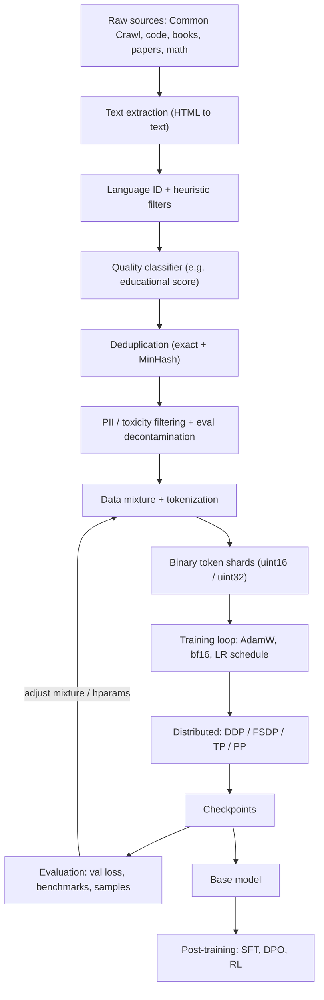
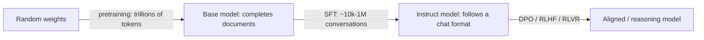

# Pretraining

Pretraining is where a language model gets almost all of its knowledge and ability. You take a randomly initialized transformer, show it trillions of tokens of text, and train it on one objective: predict the next token. Nothing else. No instructions, no human preferences, no reward model. Everything that comes later (chat, tool use, reasoning) is built on what the model learned here. Post-training shapes behavior; pretraining sets the ceiling.

!!! abstract "What you'll learn"
    - What pretraining is, and why "predict the next token" is enough to learn grammar, facts and some reasoning
    - The end-to-end pipeline from raw web crawl to a trained checkpoint
    - What a base model can and cannot do
    - How this section is organized, and what each page answers

## The one objective

Given a sequence of tokens $x_1, \dots, x_T$, the model outputs a probability distribution over the vocabulary at every position. You train it to put high probability on the token that actually came next:

$$
\mathcal{L}(\theta) = -\frac{1}{T}\sum_{t=1}^{T} \log p_\theta(x_t \mid x_{<t})
$$

That is plain cross-entropy, averaged over every position in every sequence in the batch. It is self-supervised: the labels are the input shifted by one, so any text is training data.

Why does this work so well? To predict the next token of "The capital of France is", the model needs a fact. To predict the next token of a Python function, it needs to track variable names and syntax. To predict the next line of a proof, it needs to follow the argument. Minimizing next-token loss over a large, diverse corpus forces the model to compress the regularities of language, knowledge and reasoning into its weights.

## The pipeline end to end

The stages map onto the pages in this section:

| Stage | Page | Key question |
|---|---|---|
| Sources, filtering, dedup, mixing, sharding | [Data Pipelines](data.md) | What tokens does the model see, and in what proportions? |
| Loss, optimizer, schedule, precision, stability | [The Training Loop](training.md) | How do you turn tokens into a good model without diverging? |
| Sanity checks, leaks, NaNs, loader bugs | [Debugging a Training Run](debugging.md) | The loss looks wrong (or too good). Where is the bug? |
| Multi-GPU and multi-node | [Distributed Training](distributed.md) | How do you fit the model and go fast enough? |
| Kernels, memory bandwidth, profiling, MFU | [GPU Performance Engineering](gpu-performance.md) | Is each GPU doing as much work as it can? |
| Val loss, benchmarks, contamination | [Evaluation](evaluation.md) | Is it actually getting better? |

A useful mental split: **data quality decides how good the model can be; the training loop decides whether you get there; distributed training and GPU performance decide how long it takes and what it costs.** Most teams that train strong small models (SmolLM2/3, OLMo 2, Phi, Qwen) credit data work more than architecture tweaks.

## How big is "pretraining"?

Scale varies enormously, but the shape of the job is the same:

| Model | Rough params | Rough training tokens |
|---|---|---|
| GPT-2 (2019) | 124M - 1.5B | tens of billions |
| Your first toy run | 10M - 125M | 1B - 10B |
| Project 1 in this site | ~500M | ~10B - 50B |
| SmolLM2 | 135M - 1.7B | roughly 2T - 11T |
| Llama 3 8B | 8B | roughly 15T |

The Chinchilla scaling result suggests about 20 tokens per parameter is compute-optimal for *training*. Modern small models train far past that (hundreds or thousands of tokens per parameter) because the cost that matters at deployment is *inference*, and a smaller model trained longer is cheaper to serve. See [Scaling Laws & Compute](../llm/scaling-laws.md).

## What you get: a base model

A base model is a very good document completer. Given a prefix, it continues in the style and distribution of its training data. That gives it real abilities:

- **Knowledge**: it will complete "Water boils at sea level at" with "100 degrees Celsius".
- **Few-shot learning**: give it three examples of a pattern (translation, classification, format conversion) and it continues the pattern.
- **Code completion**: give it a function signature and docstring and it writes the body.
- **A strong starting point**: fine-tuning a base model is far cheaper than training from scratch.

## What you don't get

A base model does not follow instructions. Ask it "Write a haiku about rust" and it might:

- continue with more questions ("Write a haiku about iron. Write a haiku about..."), because that looks like a list of prompts from a worksheet;
- start a forum thread reply;
- write the haiku, then keep going with unrelated text and never stop.

It has no notion of turns, no end-of-answer behavior, no refusal policy, and no preference for helpful over merely plausible. Those come from [post-training](../post-training/index.md): supervised fine-tuning on conversations, then preference optimization and RL.

!!! tip "Prompting a base model"
    Write the start of the document you want, not an instruction. Instead of "Summarize this article", write the article followed by `TL;DR:`. Instead of "Translate to French", write two English/French pairs then a third English line.

## Mid-training and continued pretraining

The line between pretraining and post-training has blurred. Two terms you will see:

- **Annealing / mid-training**: near the end of pretraining, while the learning rate decays, the mixture is shifted toward high-quality data (curated math, code, textbook-style text, some instruction-like data). This gives an outsized boost on benchmarks. See [Data Pipelines](data.md#mixtures-curriculum-and-annealing).
- **Continued pretraining**: taking an existing base model and pretraining further on a new domain (medical text, a new language, long documents for context extension). Same loop, smaller learning rate, usually with some original-distribution data mixed in to avoid forgetting. [Continued Pretraining & Model Merging](../finetuning/merging-continued-pretraining.md) covers it in detail.

!!! warning "Common pitfalls"
    - **Treating pretraining as an architecture problem.** At small scale, data quality and the number of tokens matter far more than clever layers.
    - **Expecting a base model to chat.** Judge a base model with completion-style prompts and few-shot benchmarks, not instructions.
    - **Skipping evaluation until the end.** Track validation loss and a few cheap benchmarks throughout; a bad run should be killed early.
    - **Under-budgeting data work.** Filtering, dedup and tokenizing a multi-hundred-GB corpus takes real engineering time and disk.

## Check your understanding

??? question "Why is next-token prediction called self-supervised?"
    The targets come from the data itself: the label at position $t$ is just the input token at position $t+1$. No human labeling is needed, so any text corpus is usable training data.

??? question "Your base model answers 'What is 2+2?' with 'What is 3+3? What is 4+4?'. Is it broken?"
    No. It is completing a document that looks like a list of questions, which is a plausible continuation. Base models don't follow instructions. Use a completion-style prompt ("Q: What is 2+2?\nA:") or post-train it.

??? question "Why do modern small models train on far more than 20 tokens per parameter?"
    Chinchilla's ~20 tokens/param is compute-optimal for a fixed *training* budget. If you will serve the model a lot, a smaller model trained longer gives better quality per unit of inference cost, so teams over-train small models.

??? question "What is annealing in the data sense?"
    Shifting the data mixture toward the highest-quality sources during the final learning-rate decay phase, which tends to improve downstream benchmark scores more than the same data seen earlier.

## Further reading

- Radford et al., *Language Models are Unsupervised Multitask Learners* (GPT-2), 2019 - [PDF](https://cdn.openai.com/better-language-models/language_models_are_unsupervised_multitask_learners.pdf)
- Brown et al., *Language Models are Few-Shot Learners* (GPT-3) - [arXiv:2005.14165](https://arxiv.org/abs/2005.14165)
- Hoffmann et al., *Training Compute-Optimal Large Language Models* (Chinchilla) - [arXiv:2203.15556](https://arxiv.org/abs/2203.15556)
- Grattafiori et al., *The Llama 3 Herd of Models* - [arXiv:2407.21783](https://arxiv.org/abs/2407.21783)
- Allal et al., *SmolLM2: When Smol Goes Big* - [arXiv:2502.02737](https://arxiv.org/abs/2502.02737)
- OLMo team, *2 OLMo 2 Furious* - [arXiv:2501.00656](https://arxiv.org/abs/2501.00656)
