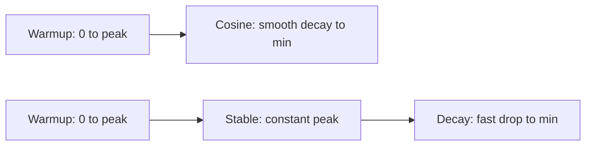
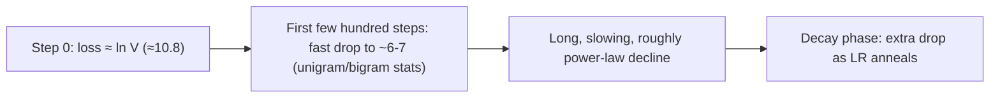
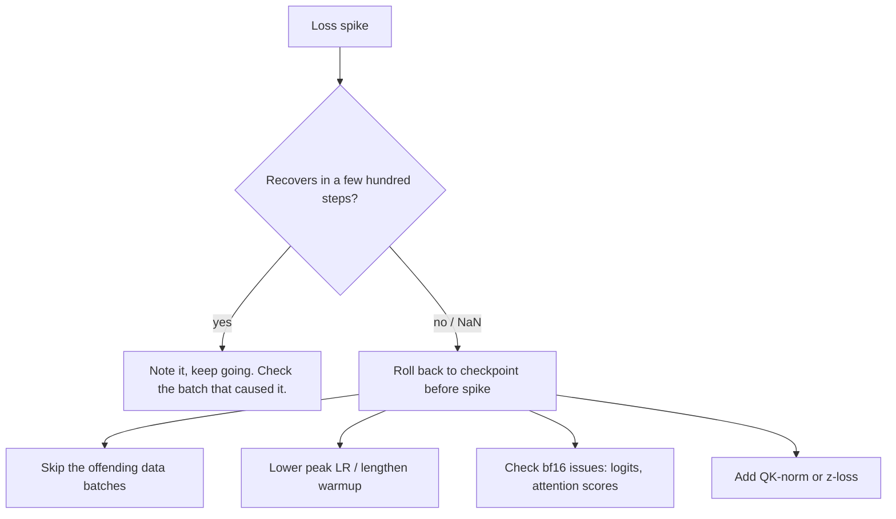

# The Training Loop

The pretraining loop is short: sample a batch, compute next-token loss, backprop, step the optimizer, repeat a few hundred thousand times. The details are where runs succeed or fail. The learning rate schedule, the optimizer's betas, gradient clipping, numeric precision, and how you checkpoint all decide whether you get a good model, a diverged one, or a run that silently wasted half its compute. This page builds the loop piece by piece and ends with a complete single-GPU training script.

!!! abstract "What you'll learn"
    - Next-token cross-entropy and how to read the loss number
    - Batch size measured in tokens, and gradient accumulation
    - AdamW hyperparameters that work for LMs, and why
    - Warmup + cosine and warmup-stable-decay (WSD) schedules, with code
    - Gradient clipping, bf16 autocast, `torch.compile`, FlashAttention via SDPA, activation checkpointing
    - Checkpointing and exact resume, logging, and MFU
    - What healthy loss curves look like, how to debug spikes, and z-loss

## Next-token cross-entropy

The model outputs logits of shape `(B, T, V)`: batch, sequence, vocabulary. Targets are the inputs shifted left by one. Flatten and use cross-entropy:

$$
\mathcal{L} = -\frac{1}{BT}\sum_{b=1}^{B}\sum_{t=1}^{T}\log \operatorname{softmax}(z_{b,t})_{y_{b,t}}
$$

```python
import torch.nn.functional as F
loss = F.cross_entropy(logits.view(-1, logits.size(-1)), targets.reshape(-1))
```

**Reading the number.** Loss is in nats per token. At initialization the model should be roughly uniform over the vocabulary, so the loss should be about $\ln V$. For GPT-2's 50,257 tokens, $\ln 50257 \approx 10.8$. If your initial loss is 30, your initialization is broken. Perplexity is $e^{\mathcal{L}}$: a loss of 3.0 means perplexity about 20, "as uncertain as choosing among 20 tokens".

Rough reference points with a GPT-2 tokenizer on web text: a 124M model trained on ~10B FineWeb tokens lands somewhere near 3.0-3.3 val loss. Losses are only comparable across runs with the **same tokenizer and same validation set**.

## Batch size in tokens

LM batch size is quoted in **tokens**, not sequences: `batch_tokens = micro_batch * seq_len * grad_accum_steps * world_size`. GPT-3 used about 0.5M tokens per batch for small models and up to several million for 175B. For a 100M-500M model, 0.25M-1M tokens per step is a reasonable range.

Bigger batches give less noisy gradients, but past the "critical batch size" you waste compute: doubling batch size no longer halves the number of steps needed. Small models have smaller critical batch sizes.

### Gradient accumulation

Your GPU might fit only 8 sequences of 1024 tokens (8K tokens). To reach 512K tokens per step, run 64 micro-batches, summing gradients, then step once:

```python
optimizer.zero_grad(set_to_none=True)
for micro in range(grad_accum):
    x, y = loader.next_batch()
    with torch.autocast("cuda", dtype=torch.bfloat16):
        logits = model(x)
        loss = F.cross_entropy(logits.view(-1, logits.size(-1)), y.view(-1))
    (loss / grad_accum).backward()   # (1)!
torch.nn.utils.clip_grad_norm_(model.parameters(), 1.0)
optimizer.step()
```

1. Dividing by `grad_accum` makes the accumulated gradient equal to the gradient of the *mean* loss over the full batch. Forget this and your effective learning rate is `grad_accum` times larger.

Mathematically this is identical to a large batch (except for BatchNorm, which transformers don't use).

## AdamW for language models

AdamW keeps running averages of the gradient $m$ and squared gradient $v$, and decouples weight decay from the gradient update:

$$
\begin{aligned}
m_t &= \beta_1 m_{t-1} + (1-\beta_1) g_t \\
v_t &= \beta_2 v_{t-1} + (1-\beta_2) g_t^2 \\
\theta_t &= \theta_{t-1} - \eta_t\left(\frac{\hat m_t}{\sqrt{\hat v_t}+\epsilon} + \lambda\,\theta_{t-1}\right)
\end{aligned}
$$

where $\hat m, \hat v$ are bias-corrected. Values that almost every LM recipe (GPT-3, Llama, OLMo, SmolLM) uses:

| Hyperparameter | Typical value | Why |
|---|---|---|
| $\beta_1$ | 0.9 | Standard momentum. |
| $\beta_2$ | **0.95** | Lower than the default 0.999. $v$ adapts faster to sudden gradient changes, which reduces loss spikes. |
| $\epsilon$ | 1e-8 | Some use 1e-5 at very large scale; tiny values can amplify updates for parameters with near-zero $v$. |
| Weight decay $\lambda$ | 0.1 | Applied to matrices only, **not** biases, norm gains, or (often) embeddings. |
| Peak LR | ~6e-4 to 1.5e-3 for 125M-500M models at 0.25M-1M tokens per step (Project 1 uses 8e-4), falling to ~1.5e-4 to 3e-4 at multi-billion scale | Smaller models tolerate larger LRs. Sweep on a short run. |

```python
def configure_optimizer(model, lr, weight_decay=0.1, betas=(0.9, 0.95), eps=1e-8):
    decay, no_decay = [], []
    for n, p in model.named_parameters():
        if not p.requires_grad:
            continue
        (decay if p.dim() >= 2 else no_decay).append(p)   # matrices decay; biases/norms don't
    groups = [{"params": decay, "weight_decay": weight_decay},
              {"params": no_decay, "weight_decay": 0.0}]
    return torch.optim.AdamW(groups, lr=lr, betas=betas, eps=eps, fused=torch.cuda.is_available())
```

!!! note "Beyond AdamW"
    Newer optimizers like Muon (orthogonalized momentum for matrix parameters) have shown speedups in speedrun settings and some production models. AdamW remains the safe, well-understood default; learn it first.

## Learning rate schedules

### Warmup + cosine

At step 0, Adam's second-moment estimates are poor and the network is fragile; a full LR immediately often diverges. **Warmup** ramps the LR linearly from ~0 to peak over the first few hundred to few thousand steps. Then **cosine decay** smoothly lowers it to a minimum (often 10% of peak):

$$
\eta_t =
\begin{cases}
\eta_{\max}\,\dfrac{t+1}{T_w} & t < T_w \\[2mm]
\eta_{\min} + \tfrac{1}{2}(\eta_{\max}-\eta_{\min})\left(1+\cos\left(\pi\,\dfrac{t-T_w}{T-T_w}\right)\right) & t \ge T_w
\end{cases}
$$

The catch: cosine needs the total step count $T$ up front. If you want to train longer, you can't just continue.

### Warmup-stable-decay (WSD)

WSD (used by MiniCPM, SmolLM2/3, DeepSeek and others) holds the LR **constant** after warmup, then decays quickly (linear or `1 - sqrt`) over the last ~10-20% of steps. Advantages:

- You can keep training from any stable-phase checkpoint and decay later, so the total length need not be fixed.
- You can branch several short decay runs from one stable checkpoint to compare data mixtures (annealing) or pick a stopping point.
- Final loss is typically on par with a well-tuned cosine.

During the stable phase the loss plateaus higher; it drops sharply during the decay. Don't panic when the stable-phase loss looks worse than a cosine run at the same step.

```python title="schedules.py"
import math

def cosine_lr(step, max_lr, min_lr, warmup, total):
    if step < warmup:
        return max_lr * (step + 1) / warmup
    if step >= total:
        return min_lr
    progress = (step - warmup) / (total - warmup)
    return min_lr + 0.5 * (max_lr - min_lr) * (1 + math.cos(math.pi * progress))

def wsd_lr(step, max_lr, min_lr, warmup, total, decay_frac=0.2):
    decay_start = int(total * (1 - decay_frac))
    if step < warmup:
        return max_lr * (step + 1) / warmup
    if step < decay_start:
        return max_lr
    progress = min(1.0, (step - decay_start) / max(1, total - decay_start))
    return min_lr + (max_lr - min_lr) * (1 - math.sqrt(progress))   # "1-sqrt" cooldown

# apply each step:
# for g in optimizer.param_groups: g["lr"] = wsd_lr(step, ...)
```



## Gradient clipping

Clip the global gradient norm to 1.0 before each optimizer step:

```python
grad_norm = torch.nn.utils.clip_grad_norm_(model.parameters(), max_norm=1.0)
```

It rescales the whole gradient vector if its L2 norm exceeds 1.0. It's cheap insurance against a single bad batch blowing up the weights. **Log the returned norm**: it is one of your best health signals. Healthy runs show the norm settling into a band; a rising trend often precedes a loss spike.

## Mixed precision with bf16

Training in fp32 is slow and memory-hungry. Modern GPUs (A100, H100, RTX 30/40/50 series) support **bfloat16**: same 8-bit exponent as fp32 (same range, so no overflow and no loss scaling needed) with a 7-bit mantissa (less precision).

Use `torch.autocast`: weights and optimizer state stay fp32, matmuls run in bf16, and numerically sensitive ops (softmax, norms, losses) are kept in fp32 automatically.

```python
with torch.autocast(device_type="cuda", dtype=torch.bfloat16):
    logits = model(x)
    loss = F.cross_entropy(logits.float().view(-1, logits.size(-1)), y.view(-1))
loss.backward()   # outside autocast
```

fp16 has a narrow range and needs `torch.amp.GradScaler`; prefer bf16 whenever the hardware has it. Also enable TF32 for any remaining fp32 matmuls:

```python
torch.backends.cuda.matmul.allow_tf32 = True
torch.backends.cudnn.allow_tf32 = True
```

FP8 training (H100 and newer, via Transformer Engine or `torchao`) is used at large scale but adds complexity; skip it for your first runs.

## torch.compile

`model = torch.compile(model)` traces the model and fuses ops (layer norms, activations, residual adds) into fewer, faster kernels. Typical speedups for a GPT are 1.3x-2x. The first steps are slow while it compiles. Compile the model *after* moving it to the device; keep shapes static (fixed `seq_len`) to avoid recompiles. [GPU Performance Engineering](gpu-performance.md) covers compile modes and how to profile what is left.

## FlashAttention via SDPA

Naive attention materializes a $T \times T$ score matrix per head: memory $O(T^2)$, and lots of slow reads/writes to GPU HBM. FlashAttention computes attention in tiles held in fast on-chip SRAM, never storing the full matrix. Same math, much faster, $O(T)$ memory.

In PyTorch 2.x you get it through one call:

```python
y = F.scaled_dot_product_attention(q, k, v, is_causal=True)   # (B, H, T, d)
```

PyTorch picks the FlashAttention kernel automatically when inputs are fp16/bf16 on a supported GPU. Don't pass an explicit mask with `is_causal=True`; passing a dense mask can force the slower path. [GPU Performance Engineering](gpu-performance.md) explains why the tiled kernel is faster.

## Activation checkpointing

During the forward pass, PyTorch stores intermediate activations for backward. For a transformer, activation memory scales with `batch * seq_len * d_model * n_layers` and often dominates. **Activation (gradient) checkpointing** discards a block's activations in forward and recomputes them in backward: roughly 30% more compute for a large memory saving.

```python
from torch.utils.checkpoint import checkpoint

for block in self.blocks:
    if self.training and self.grad_ckpt:
        x = checkpoint(block, x, use_reentrant=False)
    else:
        x = block(x)
```

Use it when you can't fit the micro-batch you want. Larger micro-batches with checkpointing are often faster overall than tiny micro-batches without.

## Checkpointing and resume

A long run will be interrupted: preemption, a node failure, a bug. Save everything needed to continue **exactly**:

```python
def save_ckpt(path, model, optimizer, step, loader, config):
    raw = getattr(model, "_orig_mod", model)          # unwrap torch.compile
    torch.save({
        "model": raw.state_dict(),
        "optimizer": optimizer.state_dict(),          # Adam m and v: as big as 2x the model
        "step": step,
        "config": config,
        "rng": {"torch": torch.get_rng_state(), "cuda": torch.cuda.get_rng_state_all(),
                "loader": loader.rng.bit_generator.state},
    }, path + ".tmp")
    os.replace(path + ".tmp", path)                   # atomic: never leave a half-written file
```

Rules: write to a temp file and rename; keep the last 2-3 checkpoints (a corrupt latest checkpoint should not end the run); save the optimizer state (resuming with fresh Adam moments causes a spike); save the data position or RNG so you don't re-see or skip data. For multi-GPU checkpointing see [Distributed Training](distributed.md).

## Logging

Log every N steps to Weights & Biases, TensorBoard or plain JSON lines: train loss, val loss (every few hundred steps), learning rate, grad norm, tokens/sec, MFU, and periodically a couple of sampled generations. Plain text samples are a surprisingly good early signal (see [Evaluation](evaluation.md#vibes-check-generation)).

## MFU: are you using the GPU?

**Model FLOPs Utilization** is the fraction of the GPU's peak FLOPs your training actually achieves. Training a dense transformer costs roughly $6N$ FLOPs per token ($2N$ forward, $4N$ backward) for $N$ parameters, plus an attention term:

$$
\text{FLOPs/token} \approx 6N + 12\,L\,d\,T
$$

where $L$ is layers, $d$ model width, $T$ sequence length. Then:

$$
\text{MFU} = \frac{\text{tokens/sec} \times \text{FLOPs/token}}{\text{peak FLOPs/sec}}
$$

```python
def mfu(n_params, n_layer, d_model, seq_len, tokens_per_sec, peak_flops=989e12):
    # 989e12: H100 SXM dense bf16 peak; A100 is 312e12. Check your GPU's spec sheet.
    flops_per_token = 6 * n_params + 12 * n_layer * d_model * seq_len
    return tokens_per_sec * flops_per_token / peak_flops
```

Expect roughly 35-50% MFU when well tuned; below ~25% means something is wrong: data loading, small micro-batch, no `torch.compile`, no FlashAttention, or CPU-GPU sync points (calling `.item()` every step forces a sync; only do it when you log). [GPU Performance Engineering](gpu-performance.md) walks through finding and fixing each of these.

## What a healthy loss curve looks like



- **Initial**: near $\ln V$. Much higher means bad init (e.g. output layer too large).
- **Fast early drop**: the model learns token frequencies, then common bigrams.
- **Steady decline** that looks roughly linear on a log-x axis. Small noise is normal.
- **Val tracks train closely.** In single-epoch pretraining, train and val loss should be nearly identical. A widening gap means data repetition or a train/val distribution mismatch.
- **Grad norm** drops early then settles; a slow upward creep late in training is common and fine, sharp rises are not.

## Loss spikes and divergence

A spike is a sudden jump in loss. Some recover in a few hundred steps; some explode to NaN.



Common causes and fixes:

| Symptom | Likely cause | Fix |
|---|---|---|
| NaN at the very start | LR too high, no warmup, bad init | Warmup, lower LR, check init std (~0.02, scaled for residual projections) |
| Spike right after resume | Optimizer state not restored | Save/load optimizer state |
| Spikes growing in frequency | LR too high for the scale, attention logit growth | Lower LR, QK-norm, $\beta_2 = 0.95$ |
| Spike at a specific step every run | Bad data (huge repeated token sequences, binary junk) | Inspect that batch, filter it |
| Loss plateaus at ~7-8 | Bug: LR way too low, gradients not reaching the weights, inputs and targets misaligned | Overfit a single batch first |
| Loss drops suspiciously close to zero | Targets not shifted or causal mask missing: the model can see the answer | Check `y = x` shifted by one and test causality |

!!! tip "Overfit one batch first"
    Before any long run, train on one fixed batch for 200 steps. Loss should go near zero. If it doesn't, you have a bug, not a hyperparameter problem.

### z-loss

Large output logits make softmax numerically unstable, especially in bf16. **z-loss** (from PaLM) adds a small penalty on the log-partition function $\log Z = \operatorname{logsumexp}(z)$, pushing it toward 0:

$$
\mathcal{L}_{z} = 10^{-4}\cdot(\log Z)^2
$$

```python
log_z = torch.logsumexp(logits.float(), dim=-1)
loss = ce_loss + 1e-4 * (log_z ** 2).mean()
```

It costs nothing and is used in several stable large-scale recipes (OLMo 2, for example). QK-norm (normalizing queries and keys before the dot product) addresses the same problem inside attention.

## A complete single-GPU training script

This script trains a GPT-style model on the shards from [Data Pipelines](data.md#tokenizing-at-scale-and-packing-into-shards). It includes everything on this page: bf16 autocast, `torch.compile`, SDPA/FlashAttention, gradient accumulation, AdamW with decay groups, WSD or cosine schedule, clipping, z-loss, eval, checkpointing with resume, and MFU logging. The model is a compact Llama-style architecture (RMSNorm, RoPE, SwiGLU); see [The Transformer, Line by Line](../llm/transformer.md) for a walk-through.

```python title="train_gpt.py"
"""Single-GPU GPT pretraining. Usage:
    python train_gpt.py                   # train / resume
    python train_gpt.py --tiny            # CPU smoke test on random data
"""
import argparse, glob, json, math, os, time
from dataclasses import dataclass, asdict

import numpy as np
import torch
import torch.nn as nn
import torch.nn.functional as F
from torch.utils.checkpoint import checkpoint

# ----------------------------------------------------------------------------- model
@dataclass
class GPTConfig:
    vocab_size: int = 50304      # 50257 padded up to a multiple of 64 for speed
    n_layer: int = 12
    n_head: int = 12
    d_model: int = 768
    seq_len: int = 1024
    grad_ckpt: bool = False

class RMSNorm(nn.Module):
    def __init__(self, d, eps=1e-6):
        super().__init__()
        self.eps, self.weight = eps, nn.Parameter(torch.ones(d))
    def forward(self, x):
        return self.weight * x * torch.rsqrt(x.float().pow(2).mean(-1, keepdim=True) + self.eps).type_as(x)

def rope_cache(seq_len, head_dim, base=10000.0):
    inv = 1.0 / (base ** (torch.arange(0, head_dim, 2).float() / head_dim))
    freqs = torch.outer(torch.arange(seq_len).float(), inv)       # (T, hd/2)
    return torch.cos(freqs), torch.sin(freqs)

def apply_rope(x, cos, sin):                                        # x: (B, H, T, hd)
    x1, x2 = x[..., 0::2], x[..., 1::2]
    cos, sin = cos[: x.size(2)], sin[: x.size(2)]
    out = torch.stack([x1 * cos - x2 * sin, x1 * sin + x2 * cos], dim=-1)
    return out.flatten(-2).type_as(x)

class Attention(nn.Module):
    def __init__(self, c):
        super().__init__()
        self.h, self.hd = c.n_head, c.d_model // c.n_head
        self.qkv = nn.Linear(c.d_model, 3 * c.d_model, bias=False)
        self.proj = nn.Linear(c.d_model, c.d_model, bias=False)
    def forward(self, x, cos, sin):
        B, T, C = x.shape
        q, k, v = self.qkv(x).split(C, dim=2)
        q, k, v = (t.view(B, T, self.h, self.hd).transpose(1, 2) for t in (q, k, v))
        q, k = apply_rope(q, cos, sin), apply_rope(k, cos, sin)
        y = F.scaled_dot_product_attention(q, k, v, is_causal=True)  # FlashAttention when available
        return self.proj(y.transpose(1, 2).contiguous().view(B, T, C))

class MLP(nn.Module):
    def __init__(self, c):
        super().__init__()
        hidden = int(8 * c.d_model / 3 / 64 + 1) * 64                 # SwiGLU width, multiple of 64
        self.gate = nn.Linear(c.d_model, hidden, bias=False)
        self.up = nn.Linear(c.d_model, hidden, bias=False)
        self.proj = nn.Linear(hidden, c.d_model, bias=False)
    def forward(self, x):
        return self.proj(F.silu(self.gate(x)) * self.up(x))

class Block(nn.Module):
    def __init__(self, c):
        super().__init__()
        self.n1, self.attn, self.n2, self.mlp = RMSNorm(c.d_model), Attention(c), RMSNorm(c.d_model), MLP(c)
    def forward(self, x, cos, sin):
        x = x + self.attn(self.n1(x), cos, sin)
        return x + self.mlp(self.n2(x))

class GPT(nn.Module):
    def __init__(self, c: GPTConfig):
        super().__init__()
        self.c = c
        self.tok = nn.Embedding(c.vocab_size, c.d_model)
        self.blocks = nn.ModuleList(Block(c) for _ in range(c.n_layer))
        self.norm = RMSNorm(c.d_model)
        self.head = nn.Linear(c.d_model, c.vocab_size, bias=False)
        self.head.weight = self.tok.weight                            # weight tying
        cos, sin = rope_cache(c.seq_len, c.d_model // c.n_head)
        self.register_buffer("cos", cos, persistent=False)
        self.register_buffer("sin", sin, persistent=False)
        self.apply(self._init)
        for n, p in self.named_parameters():                          # scaled init for residual projections
            if n.endswith("proj.weight"):
                nn.init.normal_(p, std=0.02 / math.sqrt(2 * c.n_layer))

    def _init(self, m):
        if isinstance(m, (nn.Linear, nn.Embedding)):
            nn.init.normal_(m.weight, std=0.02)

    def forward(self, idx):
        x = self.tok(idx)
        for b in self.blocks:
            if self.training and self.c.grad_ckpt:
                x = checkpoint(b, x, self.cos, self.sin, use_reentrant=False)
            else:
                x = b(x, self.cos, self.sin)
        return self.head(self.norm(x))

# ----------------------------------------------------------------------------- data
class ShardLoader:
    def __init__(self, pattern, B, T, dtype=np.uint16, seed=0, synthetic_vocab=None):
        self.files = sorted(glob.glob(pattern))
        self.B, self.T, self.dtype, self.synth = B, T, dtype, synthetic_vocab
        self.rng = np.random.default_rng(seed)
        assert self.files or synthetic_vocab, f"no shards match {pattern}"
    def next_batch(self, device):
        if self.synth:                                                # random data for smoke tests
            data = self.rng.integers(0, self.synth, size=self.B * (self.T + 1) * 4).astype(np.int64)
        else:
            data = np.memmap(self.files[self.rng.integers(len(self.files))], dtype=self.dtype, mode="r")
        ix = self.rng.integers(0, len(data) - self.T - 1, size=self.B)
        x = torch.from_numpy(np.stack([data[i:i + self.T] for i in ix]).astype(np.int64))
        y = torch.from_numpy(np.stack([data[i + 1:i + 1 + self.T] for i in ix]).astype(np.int64))
        if device == "cuda":
            return x.pin_memory().to(device, non_blocking=True), y.pin_memory().to(device, non_blocking=True)
        return x.to(device), y.to(device)

# ----------------------------------------------------------------------------- helpers
def lr_at(step, a):
    if step < a.warmup:
        return a.lr * (step + 1) / a.warmup
    if a.schedule == "cosine":
        p = min(1.0, (step - a.warmup) / max(1, a.steps - a.warmup))
        return a.min_lr + 0.5 * (a.lr - a.min_lr) * (1 + math.cos(math.pi * p))
    decay_start = int(a.steps * (1 - a.decay_frac))                  # WSD
    if step < decay_start:
        return a.lr
    p = min(1.0, (step - decay_start) / max(1, a.steps - decay_start))
    return a.min_lr + (a.lr - a.min_lr) * (1 - math.sqrt(p))

def loss_fn(logits, y, z_coef):
    logits = logits.float()
    ce = F.cross_entropy(logits.view(-1, logits.size(-1)), y.view(-1))
    if z_coef:
        return ce + z_coef * torch.logsumexp(logits, -1).pow(2).mean(), ce
    return ce, ce

@torch.no_grad()
def evaluate(model, loader, device, ctx, iters):
    model.eval()
    losses = []
    for _ in range(iters):
        x, y = loader.next_batch(device)
        with ctx:
            losses.append(loss_fn(model(x), y, 0.0)[1].item())
    model.train()
    return sum(losses) / len(losses)

# ----------------------------------------------------------------------------- main
def main():
    p = argparse.ArgumentParser()
    p.add_argument("--data", default="data/fineweb_edu")
    p.add_argument("--out", default="ckpt")
    p.add_argument("--micro_bs", type=int, default=16)
    p.add_argument("--grad_accum", type=int, default=32)               # 16*1024*32 = 524K tokens/step
    p.add_argument("--steps", type=int, default=20000)
    p.add_argument("--lr", type=float, default=6e-4)
    p.add_argument("--min_lr", type=float, default=6e-5)
    p.add_argument("--warmup", type=int, default=700)
    p.add_argument("--schedule", choices=["wsd", "cosine"], default="wsd")
    p.add_argument("--decay_frac", type=float, default=0.2)
    p.add_argument("--wd", type=float, default=0.1)
    p.add_argument("--z_loss", type=float, default=1e-4)
    p.add_argument("--eval_every", type=int, default=250)
    p.add_argument("--ckpt_every", type=int, default=1000)
    p.add_argument("--grad_ckpt", action="store_true")
    p.add_argument("--no_compile", action="store_true")
    p.add_argument("--tiny", action="store_true")
    a = p.parse_args()

    device = "cuda" if torch.cuda.is_available() else "cpu"
    torch.manual_seed(1337)
    torch.backends.cuda.matmul.allow_tf32 = True
    torch.backends.cudnn.allow_tf32 = True

    cfg = GPTConfig(grad_ckpt=a.grad_ckpt)
    synth = None
    if a.tiny:                                                         # small enough for a laptop CPU
        cfg = GPTConfig(vocab_size=512, n_layer=2, n_head=4, d_model=128, seq_len=64)
        a.micro_bs, a.grad_accum, a.steps, a.warmup = 8, 2, 30, 5
        a.eval_every, a.ckpt_every, a.no_compile, synth = 10, 20, True, cfg.vocab_size

    train = ShardLoader(os.path.join(a.data, "train_*.bin"), a.micro_bs, cfg.seq_len, seed=1, synthetic_vocab=synth)
    val = ShardLoader(os.path.join(a.data, "val_*.bin"), a.micro_bs, cfg.seq_len, seed=2, synthetic_vocab=synth)

    model = GPT(cfg).to(device)
    n_params = sum(p.numel() for p in model.parameters())
    print(f"params: {n_params / 1e6:.1f}M")

    decay = [p for p in model.parameters() if p.dim() >= 2]
    no_decay = [p for p in model.parameters() if p.dim() < 2]
    opt = torch.optim.AdamW([{"params": decay, "weight_decay": a.wd},
                             {"params": no_decay, "weight_decay": 0.0}],
                            lr=a.lr, betas=(0.9, 0.95), eps=1e-8, fused=(device == "cuda"))

    os.makedirs(a.out, exist_ok=True)
    ckpt_path = os.path.join(a.out, "latest.pt")
    step = 0
    if os.path.exists(ckpt_path):                                      # resume
        ck = torch.load(ckpt_path, map_location=device, weights_only=False)
        model.load_state_dict(ck["model"])
        opt.load_state_dict(ck["optimizer"])
        step = ck["step"]
        train.rng.bit_generator.state = ck["loader_rng"]
        print(f"resumed from step {step}")

    raw_model = model
    if not a.no_compile and device == "cuda":
        model = torch.compile(model)

    ctx = (torch.autocast("cuda", dtype=torch.bfloat16) if device == "cuda"
           else torch.autocast("cpu", dtype=torch.bfloat16, enabled=False))
    tokens_per_step = a.micro_bs * cfg.seq_len * a.grad_accum
    flops_per_token = 6 * n_params + 12 * cfg.n_layer * cfg.d_model * cfg.seq_len
    peak = 989e12 if device == "cuda" else 1e12                        # set to your GPU's bf16 peak
    log = open(os.path.join(a.out, "log.jsonl"), "a")

    def save():
        torch.save({"model": raw_model.state_dict(), "optimizer": opt.state_dict(), "step": step,
                    "config": asdict(cfg), "loader_rng": train.rng.bit_generator.state}, ckpt_path + ".tmp")
        os.replace(ckpt_path + ".tmp", ckpt_path)

    model.train()
    while step < a.steps:
        t0 = time.time()
        lr = lr_at(step, a)
        for g in opt.param_groups:
            g["lr"] = lr

        opt.zero_grad(set_to_none=True)
        ce_accum = torch.zeros((), device=device)
        for _ in range(a.grad_accum):
            x, y = train.next_batch(device)
            with ctx:
                logits = model(x)
            loss, ce = loss_fn(logits, y, a.z_loss)
            (loss / a.grad_accum).backward()
            ce_accum += ce.detach() / a.grad_accum
        grad_norm = torch.nn.utils.clip_grad_norm_(model.parameters(), 1.0)
        opt.step()
        step += 1

        if step % 10 == 0 or step == 1:
            if device == "cuda":
                torch.cuda.synchronize()
            dt = time.time() - t0
            tps = tokens_per_step / dt
            rec = {"step": step, "loss": round(ce_accum.item(), 4), "lr": lr,
                   "grad_norm": round(grad_norm.item(), 3), "tok_per_s": int(tps),
                   "mfu": round(tps * flops_per_token / peak, 3)}
            print(rec)
            log.write(json.dumps(rec) + "\n"); log.flush()
            if not math.isfinite(rec["loss"]):
                raise RuntimeError("loss is not finite; roll back to the last checkpoint")
        if step % a.eval_every == 0 or step == a.steps:
            vl = evaluate(model, val, device, ctx, iters=5 if a.tiny else 50)
            print(f"step {step} val_loss {vl:.4f}")
            log.write(json.dumps({"step": step, "val_loss": vl}) + "\n"); log.flush()
        if step % a.ckpt_every == 0 or step == a.steps:
            save()

if __name__ == "__main__":
    main()
```

The default config is a ~124M-parameter model at 524K tokens per step. On a single H100, expect on the order of a few hundred thousand tokens per second with compile and bf16; 20,000 steps is about 10B tokens. Run `python train_gpt.py --tiny` first to check everything works on CPU in seconds. The [500M project](../projects/p1-500m-model.md) scales this up; Project 1 uses a separate, fuller script (its own `train.py`) with different flag names.

!!! warning "Common pitfalls"
    - **Forgetting to divide the loss by `grad_accum`.** Your effective LR silently scales with accumulation steps.
    - **Weight-decaying norms and biases.** Use two parameter groups.
    - **`.item()` every micro-step.** Forces a GPU sync and kills throughput. Accumulate on device; sync only when logging.
    - **Saving `model.state_dict()` from a compiled model.** Keys get an `_orig_mod.` prefix. Save the unwrapped model.
    - **Not saving optimizer state.** Resume causes a loss spike.
    - **Comparing loss across tokenizers.** A lower loss with a bigger vocab is not necessarily a better model; compare bits-per-byte or benchmarks instead.
    - **Not padding vocab size.** 50257 is an awkward size for GPU kernels; 50304 (multiple of 64) is measurably faster.

## Build it

Starting point: `train_gpt.py` and `schedules.py` from this page. Both tasks run on a laptop CPU.

1. **An overfit mode.** First run `python train_gpt.py --tiny` and confirm the baseline: the loss starts at about 6.28 (a little above $\ln 512 \approx 6.24$) and stays there, because the smoke-test data is random; a second run prints `resumed from step 30`. Then add an `--overfit` flag that draws one batch and returns that same batch for every training and validation call, with 200 steps, `grad_accum=1` and z-loss off. Run `python train_gpt.py --tiny --overfit --out ckpt_overfit`. Done when the logged loss falls from about 6.28 at step 1 to below 0.5 by step 100 and below 0.05 by step 200 (a reference run logs 5.21 at step 10, 0.22 at step 100 and 0.017 at step 200, with the final `val_loss` matching the training loss). This is the "overfit one batch first" check as a permanent switch.
2. **Compare the two schedules.** With `max_lr=6e-4`, `min_lr=6e-5`, `warmup=100`, `total=1000`, print `cosine_lr` and `wsd_lr` at steps 0, 99, 500, 900 and 999, then the mean learning rate over all 1000 steps. Expected:

    | Step | Cosine | WSD |
    |---|---|---|
    | 0 | 6.00e-06 | 6.00e-06 |
    | 99 | 6.00e-04 | 6.00e-04 |
    | 500 | 3.77e-04 | 6.00e-04 |
    | 900 | 7.63e-05 | 2.18e-04 |
    | 999 | 6.00e-05 | 6.14e-05 |
    | mean | 3.28e-04 | 4.99e-04 |

    WSD spends about 1.5 times more total learning rate for the same peak, which is one reason its stable-phase loss looks worse and its final drop looks sharper than cosine's.

??? success "Solution sketch"
    Add the flag next to `--tiny`, then, just before `model = GPT(cfg).to(device)`:

    ```python
    if a.overfit:                                    # one fixed batch, reused forever
        fixed = train.next_batch(device)
        train.next_batch = val.next_batch = lambda device: fixed
        a.steps, a.grad_accum, a.z_loss = 200, 1, 0.0
        a.eval_every = a.ckpt_every = 10**9          # only evaluate and save at the end
    ```

    Placing it after the `--tiny` block matters, because `--tiny` sets `a.steps = 30`. Use a separate `--out` directory so the run does not resume from the earlier smoke-test checkpoint.

    ```python
    from schedules import cosine_lr, wsd_lr

    kw = dict(max_lr=6e-4, min_lr=6e-5, warmup=100, total=1000)
    for s in (0, 99, 500, 900, 999):
        print(s, f"{cosine_lr(s, **kw):.2e}", f"{wsd_lr(s, **kw):.2e}")
    for fn in (cosine_lr, wsd_lr):
        print(fn.__name__, f"{sum(fn(s, **kw) for s in range(1000)) / 1000:.2e}")
    ```

## Check your understanding

??? question "Your initial loss with a 32,000-token vocab is 10.4. Good or bad?"
    $\ln 32000 \approx 10.37$, so 10.4 is exactly what a near-uniform initial distribution should give. Good.

??? question "Why use beta2 = 0.95 instead of Adam's default 0.999?"
    With 0.999 the second-moment estimate averages over ~1000 steps and reacts slowly when gradient magnitudes change suddenly. Updates can then be too large, causing spikes. 0.95 averages over ~20 steps, adapting faster and improving stability.

??? question "You train with micro-batch 8, seq_len 2048, grad_accum 16, on 4 GPUs. What is the batch size in tokens?"
    $8 \times 2048 \times 16 \times 4 = 1{,}048{,}576$ tokens, about 1M tokens per optimizer step.

??? question "What advantage does WSD have over cosine when you don't know how long you'll train?"
    Cosine needs the total step count to define the decay. WSD holds LR constant, so you can keep training from any stable-phase checkpoint and run a short decay only when you decide to stop, or branch several decay runs to compare.

??? question "A 350M model processes 60,000 tokens/sec on an A100 (312 TFLOP/s bf16 peak). Ignoring attention FLOPs, what's the MFU?"
    $60{,}000 \times 6 \times 350\times10^6 = 1.26\times10^{14}$ FLOPs/sec. Divided by $3.12\times10^{14}$, that is about 40%: a reasonable, healthy number. If you ever compute something above ~70%, suspect your throughput measurement.

## Further reading

- Loshchilov & Hutter, *Decoupled Weight Decay Regularization* (AdamW) - [arXiv:1711.05101](https://arxiv.org/abs/1711.05101)
- Dao et al., *FlashAttention* - [arXiv:2205.14135](https://arxiv.org/abs/2205.14135); Dao, *FlashAttention-2* - [arXiv:2307.08691](https://arxiv.org/abs/2307.08691)
- Hu et al., *MiniCPM* (WSD schedule) - [arXiv:2404.06395](https://arxiv.org/abs/2404.06395)
- Hägele et al., *Scaling Laws and Compute-Optimal Training Beyond Fixed Training Durations* (WSD analysis) - [arXiv:2405.18392](https://arxiv.org/abs/2405.18392)
- Chowdhery et al., *PaLM* (z-loss, MFU definition) - [arXiv:2204.02311](https://arxiv.org/abs/2204.02311)
- Wortsman et al., *Small-scale proxies for large-scale Transformer training instabilities* - [arXiv:2309.14322](https://arxiv.org/abs/2309.14322)
- Karpathy, nanoGPT - [github.com/karpathy/nanoGPT](https://github.com/karpathy/nanoGPT)
- PyTorch docs: [torch.compile](https://pytorch.org/docs/stable/generated/torch.compile.html), [scaled_dot_product_attention](https://pytorch.org/docs/stable/generated/torch.nn.functional.scaled_dot_product_attention.html)
