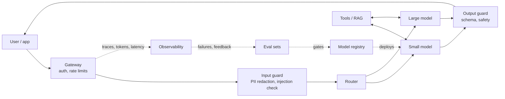

# Safety & Production

At this point you can build a model, post-train it, fine-tune it, serve it fast and wrap it in retrieval and tools. That gives you a demo. A product is something people rely on, something an attacker will poke at, that drifts as traffic changes, that costs money every second it runs, and that you have to be able to explain when it goes wrong. This section covers the work between "it runs on my GPU" and "we are comfortable putting our name on it": making the system safe, understanding what is going on inside the model, and operating it like any other production service.

!!! abstract "What you'll learn in this section"
    - The threat model for LLM systems: harmful content, jailbreaks, prompt injection, data leakage, poisoning, and hallucination as a safety failure
    - Layered defenses: safety post-training, guard classifiers, a from-scratch guardrail pipeline, privilege separation for agents, red-teaming and safety evals
    - Interpretability you can run on a laptop: linear probes, the logit lens, activation patching, sparse autoencoders and steering vectors
    - LLMOps: versioning every artifact, eval-gated releases, canary and shadow deployments, tracing, cost modeling, caching, fallbacks, licensing and incident response
    - A production readiness checklist you can copy into your own repo

## From model to product

A trained checkpoint is only one component of what you ship. The system that users actually interact with looks more like this:

Each box is a place where things can go wrong and a place where you can put a defense. The model itself is often the *least* controllable part: you cannot unit-test a distribution over strings. So production LLM work is mostly about building deterministic scaffolding around a probabilistic core, and about measurement, because you only find out how the system behaves by watching it.

## Three lenses

-   **Safety, Red-Teaming & Guardrails**

    ---

    Who might misuse the system, and how? How do you make the model refuse what it should, follow instructions only from the right parties, and fail safely? How do you measure whether your defenses work?

    [Read: Safety](safety.md)

-   **Interpretability**

    ---

    Opening the black box: reading concepts out of hidden states, tracing which components cause a behavior, and decomposing activations into human-readable features. Useful for debugging and increasingly for safety.

    [Read: Interpretability](interpretability.md)

-   **LLMOps**

    ---

    Shipping and running the system: versioning, eval-driven releases, deployment strategies, observability, cost, caching, fallbacks, licensing and incident response.

    [Read: LLMOps](llmops.md)

## How this connects to earlier sections

You have already met many of the building blocks. This section assumes them and links back rather than repeating them:

| You need | Where it was covered |
|---|---|
| Benchmarks, custom eval sets, LLM-as-judge pitfalls | [Evaluation](../pretraining/evaluation.md) |
| Preference data and DPO (used for harmlessness training) | [Preference Optimization](../post-training/preference.md) |
| KV cache, batching, quantization, TTFT/TPOT | [Sampling, KV Cache & Quantization](../inference/inference.md) |
| Guard classifiers, routers, calibration, cost-aware thresholds | [Decision Models for Routing & Classification](../decision/routing-models.md) |
| Retrieval pipelines (a major prompt-injection surface) | [RAG Fundamentals](../rag/fundamentals.md) |

## A mindset for this section

- **Defense in depth.** No single layer (training, classifiers, prompts, permissions) is reliable on its own. Assume each will be bypassed sometimes and stack them so that a failure in one is caught by another.
- **Measure, then claim.** "We added a guardrail" means nothing without an attack success rate before and after, and a false-positive rate on benign traffic.
- **Treat everything as a versioned artifact.** Weights, tokenizer, chat template, system prompt, guard thresholds and eval sets all change behavior. If you cannot say which version of each served a given request, you cannot debug it.
- **Proportionate effort.** An internal summarizer for your own notes and a public medical chatbot need very different levels of rigor. Scale the work to the harm a failure could cause.

!!! tip "Suggested order"
    Read [Safety](safety.md) first, since it defines the threats the other pages respond to. [Interpretability](interpretability.md) is the most research-flavored page and can be skimmed on a first pass. [LLMOps](llmops.md) is the most immediately practical if you are about to ship something.

## Check your understanding

??? question "Why is 'the model is aligned' not a sufficient safety story for a deployed system?"
    Post-training shifts the model's behavior statistically, but it can be bypassed (jailbreaks), it cannot tell trusted instructions from untrusted text that ends up in the context (prompt injection), and it does nothing about the permissions of the tools the model can call. You need system-level defenses (guards, privilege separation, monitoring) on top of model-level ones.

??? question "Name four artifacts besides the weights that can change a deployed model's behavior."
    The tokenizer, the chat template, the system prompt and few-shot examples, sampling parameters, retrieval index contents, guard model versions and thresholds, and the tool definitions exposed to the model. Any of them can cause a regression.

??? question "What does 'defense in depth' mean for an LLM system?"
    Stacking independent layers (safety training, input and output classifiers, schema validation, least-privilege tool access, human confirmation for risky actions, monitoring) so that an attack or failure has to get past all of them. Each layer is imperfect; together they reduce the probability and impact of a failure.

## Further reading

- Weidinger et al., [Ethical and social risks of harm from Language Models](https://arxiv.org/abs/2112.04359) (2021). A broad taxonomy of LLM risks.
- Sculley et al., *Hidden Technical Debt in Machine Learning Systems* (NeurIPS 2015). Why the model is a small part of an ML system.
- [OWASP Top 10 for LLM Applications](https://owasp.org/www-project-top-10-for-large-language-model-applications/).
- [NIST AI Risk Management Framework](https://www.nist.gov/itl/ai-risk-management-framework).

**Next:** [Safety, Red-Teaming & Guardrails](safety.md)
