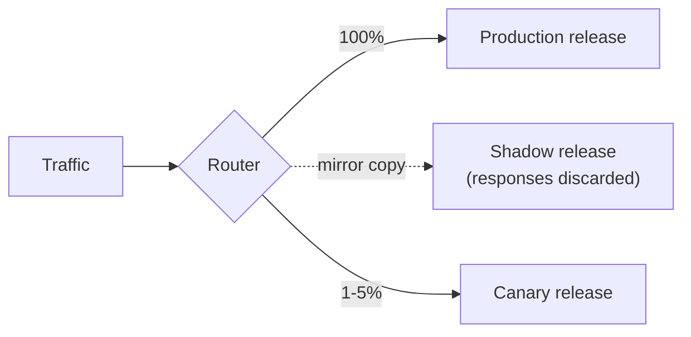

# LLMOps: Shipping & Operating Models

Getting a model to produce good answers in a notebook is the start of the work, not the end. Once real traffic arrives, you need to know which version of everything served each request, whether today's change made things worse, what each request costs, why latency spiked at 3 a.m., and what to do when the model starts confidently giving wrong answers to one customer segment. LLMOps is MLOps plus some LLM-specific twists: behavior depends on prompts and templates as much as weights, outputs are open-ended text that is hard to score, and cost scales with tokens rather than requests. This page walks through the lifecycle and ends with a checklist you can adopt.

!!! abstract "What you'll learn"
    - Versioning weights, tokenizers, chat templates and prompts as one release unit
    - Eval-driven development: golden sets, offline evals in CI, regression gates
    - Deployment patterns: shadow, canary, A/B
    - Observability: traces, token usage, TTFT/TPOT, error rates, drift
    - Feedback loops and the data flywheel
    - Cost modeling with a worked calculator; prefix and semantic caching; rate limits and fallbacks
    - Privacy, data retention, licensing, incident response, and a readiness checklist

## The release unit: version everything that changes behavior

A model's behavior is determined by much more than its weights. Any of these can cause a regression on its own:

| Artifact | Why it matters |
|---|---|
| Weights (base + adapters, quantization) | Obvious. A 4-bit and a 16-bit build of the same checkpoint are different models. |
| Tokenizer | A changed tokenizer silently remaps every token ID. |
| Chat template | A wrong or missing template is one of the most common causes of "the fine-tuned model got worse" (see [SFT](../post-training/sft.md)). |
| System prompt, few-shot examples, tool schemas | Small wording changes move eval scores by several points. |
| Sampling config | Temperature, top-p, max tokens, stop sequences. |
| Guard models and thresholds | Change what gets blocked (see [Safety](safety.md)). |
| Retrieval config and index snapshot | Embedding model, chunking, top-k, index build date. |
| Serving engine and version | Kernels, batching and numerics differ between engines and versions. |

Bundle them into one immutable **release** with an ID, and log that ID on every request. A model registry (MLflow, Weights & Biases, the Hugging Face Hub with pinned revisions, or simply an object-store bucket plus a manifest) stores the large files; the manifest ties them together:

```yaml title="release.yaml"
release: support-bot-2026-11-14.2
model:
  weights: s3://models/support-sft-v7/        # sha256 recorded by the registry
  base: Qwen/Qwen2.5-7B-Instruct@<commit-sha>
  adapter: s3://models/support-lora-v7/
  quantization: awq-int4
tokenizer: Qwen/Qwen2.5-7B-Instruct@<commit-sha>
chat_template: templates/qwen2.5.jinja@<git-sha>
prompt: prompts/support_system.md@<git-sha>
sampling: { temperature: 0.3, top_p: 0.9, max_tokens: 512 }
guards: { input: guard-v3, output: guard-v3, thresholds: guards/thresholds-v3.json }
retrieval: { embedder: bge-small-v1.5, index_snapshot: idx-2026-11-10 }
serving: { engine: vllm, version: <pinned> }
evals: { suite: evals/support-v12, report: reports/support-bot-2026-11-14.2.json }
```

Keep prompts in git as files, not as strings in application code or a database you edit by hand. Prompt changes then get code review, diffs and evals like any other change.

## Eval-driven development

The rule: **no change ships without an eval run**, and the eval decides, not the demo. The mechanics of building eval sets are on the [Evaluation page](../pretraining/evaluation.md#building-your-own-eval-sets). Here is how they fit into a release process.

**Golden sets.** A few hundred curated inputs with reference outputs or rubrics, covering your main use cases, known past failures and safety cases. Version them. Grow them from production: every incident and every interesting thumbs-down becomes a new case.

**Layers of eval, from cheap to expensive:**

1. **Deterministic checks**: schema validity, refusal or no-refusal on known cases, regex on required content, latency and token budgets. Run on every PR.
2. **Reference-based scores**: exact match, F1, unit tests for code, citation correctness for RAG.
3. **LLM-as-judge** with a fixed rubric and a judge validated against humans.
4. **Human review** of a sample before major releases.

**Regression gates in CI.** Compare the candidate to the current production release on the same suite, and fail the build on meaningful regressions:

```python title="gate.py"
import json, math, sys

def gate(baseline: dict, candidate: dict, max_drop: dict, n: dict) -> list[str]:
    """baseline/candidate: {metric: score in [0,1]}. max_drop: allowed absolute drop per metric.
    n: number of eval examples per metric, used to ignore drops within noise."""
    failures = []
    for metric, allowed in max_drop.items():
        b, c = baseline[metric], candidate[metric]
        se = math.sqrt(b * (1 - b) / n[metric] + c * (1 - c) / n[metric])   # std error of the difference
        drop = b - c
        if drop > allowed and drop > 2 * se:
            failures.append(f"{metric}: {b:.3f} -> {c:.3f} (drop {drop:.3f}, 2se {2 * se:.3f})")
    return failures

if __name__ == "__main__":
    base = {"task_acc": 0.86, "schema_valid": 0.995, "safety_refusal": 0.97, "over_refusal_ok": 0.94}
    cand = {"task_acc": 0.88, "schema_valid": 0.990, "safety_refusal": 0.91, "over_refusal_ok": 0.95}
    fails = gate(base, cand,
                 max_drop={"task_acc": 0.01, "schema_valid": 0.005, "safety_refusal": 0.01, "over_refusal_ok": 0.02},
                 n={"task_acc": 500, "schema_valid": 500, "safety_refusal": 300, "over_refusal_ok": 300})
    print("\n".join(fails) or "PASS")
    sys.exit(1 if fails else 0)
```

Here task accuracy improved, but the safety refusal rate dropped by 6 points, well outside noise, so the gate fails. This is the pattern you want: a single headline metric going up must not hide a regression elsewhere. Gate on **every** metric you care about, including safety and over-refusal, and include cost and latency budgets.

## Lab: an eval gate for Project 5

[Project 5](../projects/support-rag.md) has what a gate needs: a versioned golden set, an evaluation that is deterministic and needs no LLM, and one metric with a hard limit of zero. Its retrieval evaluation reports recall@5 and MRR for four retrieval modes and counts **ACL leaks**, retrieved chunks above the asking user's access level. Setup is described in [the project's setup section](../projects/support-rag.md#0-setup-and-the-one-minute-smoke-test).

**Step 1. Record a baseline.**

```bash
cd code/support_rag
python eval.py --reingest --write-baseline ci/baseline.json
```

The baseline file holds the metrics of the release you accept, per mode. It is committed with the code, so a pull request that changes behavior on purpose updates the baseline in the same diff and a reviewer sees both.

**Step 2. Gate a change.**

```bash
python eval.py --reingest --baseline ci/baseline.json --max-drop 0.02
echo $?
```

Unchanged code prints `GATE PASSED` and exits 0. The gate fails on any ACL leak, with no tolerance, and on a drop of more than 0.02 in recall@5 or MRR in any mode. Because retrieval here has no randomness, the tolerance is not a noise allowance as in `gate.py` above; it is the size of regression you are willing to accept without discussion. With 78 scored questions, 0.02 is between one and two questions.

**Step 3. Break something and watch the gate.** Make each of these changes in turn, re-run step 2, then revert. The outcomes listed are from one run:

| Change | Outcome |
|---|---|
| `retrieve.py`: in `bm25_tokenize`, remove the line that adds the parts of an identifier (`out.extend(...)`) | `GATE FAILED: sparse: mrr 0.744 -> 0.691`. Recall@5 barely moves; the ranking got worse, and only MRR sees it. |
| `retrieve.py`: delete the `query_filter=...` argument of the dense search | The run aborts with `RuntimeError: ACL violation: ticket:T-1007#0 returned for access=public` and a non-zero exit. The retriever's own assertion fires before the leak counter is reached. |
| `ingest.py`: in `load_documents`, replace `access = meta.get("access", "internal")` with `access = "public"` | `GATE FAILED` on MRR for `dense` and `hybrid_rerank`, with **0 ACL leaks reported**. Every internal and restricted doc is now labeled public, so the leak check, which compares against the label, sees nothing wrong. The gate caught it only through a side effect on ranking. |
| `ingest.py`: change the default `max_chars` of `chunk_document` from 1000 to 300 | `GATE PASSED`. The index grows from 316 to 325 chunks and `hybrid_rerank` MRR falls from 0.838 to 0.818, a drop of exactly the tolerance. |

The last two rows are the instructive ones. A gate catches what its metrics can see and what its tolerance lets through. A wrong access label at the source is invisible to a check that trusts labels, so it needs its own test (for example: every file under an `internal` path must be indexed with `access_level >= 1`). And a tolerance wide enough to ignore noise also lets small real regressions accumulate, which is why the baseline is updated only deliberately.

**Step 4. Put it in CI.** [`ci/eval-gate.yml`](https://github.com/vivek-rm-14286/llm-from-scratch/tree/main/code/support_rag/ci/eval-gate.yml) is a sample GitHub Actions workflow with three checks: the golden set is consistent with the corpus, the retrieval gate from step 2, and the red-team run from the [safety lab](safety.md#lab-red-team-the-project-5-copilot) with a ceiling on attack success rate. It installs CPU-only PyTorch, caches the two small models, and uploads both reports as artifacts. Copy it to `.github/workflows/` in a fork, open a pull request with one of the changes from step 3, and confirm the check goes red.

```yaml title="ci/eval-gate.yml (excerpt)"
      - name: Retrieval eval gate (ACL leaks, recall and MRR vs baseline)
        run: python eval.py --reingest --baseline ci/baseline.json --max-drop 0.02
      - name: Red-team gate (fake model)
        run: python redteam.py --fake-llm --max-asr 0.10
```

**Step 5. Decide what is not in the gate.** Generation quality (`python eval.py --generate`) needs an LLM and a judge, costs money and varies between runs, so it does not belong on every pull request. Write down where it runs instead (nightly, or before a release, against the pinned production model) and which of its metrics would block a release.

What this lab leaves out on purpose: the gate compares against a stored file, not against a fresh run of the production release, so a change in a dependency or a model revision shows up as a failure in an unrelated pull request. That is usually what you want to know, and pinning the versions in `requirements.txt` is the fix.

## Deployment patterns

Offline evals never fully match production traffic. Roll out gradually and compare on real requests.



- **Shadow.** Send a copy of production requests to the new release and discard its responses. You get real latency, error rates, guard block rates and offline-judged quality with zero user impact. It costs extra compute, and it cannot measure user reactions. Do not shadow tool-calling agents that take real actions, unless the tools are stubbed.
- **Canary.** Route a small slice of traffic (1-5%) to the new release. Watch the same dashboards with automatic rollback triggers (error rate, latency p99, block rate, thumbs-down rate). Then increase the slice in steps.
- **A/B test.** Split users randomly and compare a business metric (task completion, retention, escalations to humans) over days, with a proper significance test. Assign by user rather than by request so each person sees a consistent experience. You need a lot of traffic to detect small effects.
- **Instant rollback.** Keep the previous release warm, or at least quick to restore. Because a release is one manifest, rolling back is a config change.

## Observability

You cannot debug what you did not record. For every request, emit a **trace**: a tree of spans covering the gateway, guards, retrieval, each model call and each tool call.

**Per model call, log at least:** release ID, model and prompt version, input tokens (and cached tokens), output tokens, TTFT, TPOT and total latency (definitions on the [inference page](../inference/serving.md#latency-and-throughput-metrics)), finish reason (stop, length, tool call, content filter), guard verdicts, errors and retries, and a user or tenant ID (hashed if needed).

**Dashboards and alerts:**

| Signal | Watch for |
|---|---|
| Latency p50/p99 (TTFT, TPOT, end-to-end) | Queueing under load, long-prompt outliers |
| Error rate, timeouts, retries | Provider outages, OOMs, malformed outputs |
| Tokens per request (in/out) and cost per request | Prompt bloat, runaway generation, a retrieval change tripling context |
| `finish_reason = length` rate | Truncated answers |
| Schema-validation failure rate | Template or model regressions |
| Guard block rate by category | Attacks, or an over-eager guard after a threshold change |
| User feedback (thumbs, edits, escalations) | Quality regressions that metrics miss |
| Input drift | New topics, languages or customers your evals do not cover |

**Drift** is the slow version of an incident. Embed incoming prompts with a small embedding model, cluster them weekly, and compare the cluster distribution with the one your eval set represents. A new cluster that grows quickly (a new product launch, a new language) means your evals are out of date before any metric moves.

Tools such as Langfuse, Arize Phoenix and LangSmith, or plain OpenTelemetry spans sent to your existing tracing stack, all work. The important decision is the schema, not the vendor.

## Feedback loops and the data flywheel

Production traffic is the best source of training and eval data you will ever have, *if* you collect it deliberately and with consent:

1. **Capture signals**: explicit (thumbs up/down, ratings), implicit (user edited the answer, copied it, retried, escalated to a human), and outcome (ticket resolved, code compiled).
2. **Triage**: sample failures, cluster them, and label the important clusters.
3. **Turn them into assets**: failures become golden-set cases; corrected answers become SFT data; pairs of (bad answer, corrected answer) become [preference data](../post-training/preference.md).
4. **Retrain or re-prompt**, evaluate against the grown suite, ship through the gates, and repeat.

Implicit signals are biased: users who are happy rarely click anything, and thumbs-down mixes "wrong" with "I didn't like the policy". Treat feedback as a way to *find* examples worth labeling, not as labels.

## Cost modeling

Know your cost per request before launch, not after the first invoice. Two regimes:

- **API models** charge per token, with separate input, output and often cheaper cached-input prices.
- **Self-hosted models** cost GPU-hours, whether or not they are busy. Cost per request depends on throughput at your latency SLO and on **utilization**.

```python title="cost.py"
from dataclasses import dataclass

@dataclass
class Workload:
    in_tokens: float          # mean prompt tokens per request
    out_tokens: float         # mean completion tokens per request
    cached_frac: float = 0.0  # fraction of prompt tokens served from a prefix cache

@dataclass
class ApiPrice:               # prices in USD per 1M tokens
    input: float
    output: float
    cached_input: float | None = None

def api_cost_per_1k(w: Workload, p: ApiPrice) -> float:
    cached_price = p.cached_input if p.cached_input is not None else p.input
    in_cost = w.in_tokens * ((1 - w.cached_frac) * p.input + w.cached_frac * cached_price)
    out_cost = w.out_tokens * p.output
    return 1000 * (in_cost + out_cost) / 1e6

@dataclass
class SelfHosted:
    gpu_hour_usd: float        # price of one GPU for one hour
    n_gpus: int                # GPUs per replica
    decode_tok_s: float        # aggregate output tokens/s per replica at your batch size + SLO
    prefill_tok_s: float       # aggregate prompt tokens/s per replica
    utilization: float = 0.5   # fraction of paid hours doing useful work (traffic is bursty)

def selfhost_cost_per_1k(w: Workload, h: SelfHosted) -> float:
    # replica-seconds per request, treating prefill and decode as sharing the replica
    prefill_s = w.in_tokens * (1 - w.cached_frac) / h.prefill_tok_s
    decode_s = w.out_tokens / h.decode_tok_s
    replica_hours = 1000 * (prefill_s + decode_s) / 3600
    return replica_hours * h.n_gpus * h.gpu_hour_usd / h.utilization

if __name__ == "__main__":
    # Illustrative numbers only: plug in your own measured throughput and current prices.
    rag_chat = Workload(in_tokens=3000, out_tokens=300, cached_frac=0.6)
    api = ApiPrice(input=0.50, output=1.50, cached_input=0.05)
    gpu = SelfHosted(gpu_hour_usd=2.0, n_gpus=1, decode_tok_s=1500, prefill_tok_s=20000, utilization=0.4)
    print(f"API:         USD {api_cost_per_1k(rag_chat, api):.3f} per 1K requests")
    print(f"Self-hosted: USD {selfhost_cost_per_1k(rag_chat, gpu):.3f} per 1K requests")
    for util in (0.1, 0.4, 0.8):
        gpu.utilization = util
        print(f"  utilization {util:.0%}: USD {selfhost_cost_per_1k(rag_chat, gpu):.3f}")
```

```text
API:         USD 1.140 per 1K requests
Self-hosted: USD 0.361 per 1K requests
  utilization 10%: USD 1.444
  utilization 40%: USD 0.361
  utilization 80%: USD 0.181
```

The numbers are made up, but the lessons generalize:

- **Utilization dominates self-hosting economics.** The same GPU is 8× more expensive per request at 10% utilization than at 80%. Low or spiky traffic usually favors APIs or serverless GPU platforms; steady, high traffic favors self-hosting.
- **Input tokens often dominate RAG and agent workloads.** 3,000 prompt tokens per request is normal once retrieval and tool definitions are included. Prefix caching and trimming context are your biggest levers.
- **Measure `decode_tok_s` at your latency SLO.** Throughput at batch size 256 with a 2-second TPOT is useless if users need 50 ms TPOT. Use your serving engine's benchmark tool on your real prompt-length distribution.
- **Include everything**: guard model calls, LLM-judge evals, embeddings, retries, idle replicas kept for failover, and engineering time.

## Caching

**Prefix (KV) caching.** Requests that share a prefix (system prompt, tool definitions, few-shot examples, a long document) can reuse the KV cache for that prefix and skip its prefill. vLLM and SGLang do this automatically, and many APIs discount cached input tokens. To benefit, **put stable content first and variable content last**: system prompt, then tools, then retrieved documents, then the user turn. A timestamp at the top of the system prompt defeats the cache for every request. The mechanics of the KV cache are on the [inference page](../inference/inference.md#the-kv-cache).

**Exact-match response caching.** Hash (release ID, normalized prompt, sampling params) and return the stored response. This is safe for deterministic, non-personalized requests such as classification or extraction over identical inputs.

**Semantic caching.** Embed the query and return a cached answer if a previous query is within a similarity threshold. It can cut cost a lot for FAQ-style traffic, but it is risky:

- "How do I cancel my order?" and "How do I *not* cancel my order?" can be very close in embedding space. Pick the threshold on labeled pairs, and prefer high precision.
- Never share cached answers across users when answers depend on user data or permissions. Scope cache keys by tenant, or do not cache personalized answers at all.
- Invalidate the cache when the release changes or the underlying documents change.

## Rate limiting, fallbacks and routing

- **Rate limits** per user, per tenant and globally, on both requests and **tokens** (one request can cost 100× another). Enforce maximum input length and `max_tokens` on every call.
- **Timeouts and retries** with exponential backoff and jitter, retrying only idempotent calls. Set a total deadline so retries cannot pile up.
- **Fallbacks.** If the primary model is down or slow, fall back to a secondary (another provider, a smaller self-hosted model) or to a graceful degraded mode such as "search results only". Evaluate the fallback too, since it serves real users when things are already going wrong.
- **Circuit breakers.** After N consecutive failures, stop calling a backend for a cool-down period instead of hammering it.
- **Cost-aware routing.** Send easy queries to a small model and hard ones to a large one. Training and thresholding a router is covered in [Routers: the same machinery](../decision/routing-models.md#routers-the-same-machinery).

## Privacy and data retention

Prompts, completions, retrieved documents and traces are user data. Treat them as you would a production database:

- **Minimize.** Redact PII before logging (the pipeline on the [safety page](safety.md#a-guardrail-pipeline-from-scratch) does this). Log token counts and hashes where you do not need the text.
- **Retention limits.** Set explicit TTLs for raw prompt and completion logs, and delete on schedule. Keep aggregated metrics longer.
- **Access control and audit.** Not every engineer needs to read customer conversations. Log who accessed what.
- **Consent for training.** Using production conversations to train models requires a legal basis and usually explicit terms. Keep a per-record flag, and honor deletion requests in training sets and eval sets too.
- **Third-party providers.** Know each provider's data retention and training-use terms, and which region the data is processed in.
- **Regulation.** Depending on where you operate and what the system does, laws such as GDPR, sector rules (health, finance) and AI-specific regulation such as the EU AI Act may apply. Involve your legal or compliance team early; this page is not legal advice.

## Data and model licensing

Licenses decide what you are allowed to do with a model or dataset, and they vary a lot. Broadly:

**Open-weight model licenses:**

- **Permissive open-source licenses** (Apache-2.0, MIT). Commercial use, modification and redistribution are allowed with attribution and license notices. Apache-2.0 also includes an explicit patent grant. Many SmolLM, OLMo, Qwen, Mistral and Phi releases use one of these, but check each model and each size: licenses can differ within a family.
- **Custom community licenses** (for example the Llama licenses and the Gemma terms). These allow broad use but add conditions: an acceptable-use or prohibited-use policy, attribution or naming requirements for derivatives, and in some cases extra terms for very large companies or restrictions on using outputs to improve other models. They are not OSI-approved open-source licenses.
- **Research or non-commercial licenses.** Some checkpoints may only be used for research.

**Derivatives inherit obligations.** A LoRA adapter, a merged model, a quantized build or a distilled student trained on a model's outputs can all carry the original license's conditions. A model fine-tuned from a custom-licensed base generally stays under that license.

**Dataset licenses.** Common ones include CC-BY (attribution), CC-BY-SA (share-alike), CC-BY-NC (non-commercial), ODC-By, and assorted custom terms. Web crawls contain content under many different terms. Synthetic data generated by an API model is subject to that provider's terms of service, some of which restrict using outputs to train competing models.

The practical rule: **read the actual license and terms for every model and dataset you use, record them in your release manifest and model card, and ask a lawyer when the use is commercial and the terms are unclear.** This section describes the landscape in general terms, and licenses change between versions.

## Incident response for model regressions

Model incidents look different from server outages: the service is up, but answers are wrong, unsafe or expensive. Prepare before they happen.

1. **Detect.** Alerts on the dashboard signals above, user reports, and a channel for safety reports.
2. **Triage severity.** Is it a safety or privacy issue (highest priority), a correctness issue for a segment, or a cost or latency issue? How many users are affected?
3. **Mitigate first, diagnose second.** Roll back to the previous release (one config change if you version releases properly), tighten a guard threshold, disable a tool, or route the affected segment to a fallback.
4. **Diagnose with traces.** Pull affected request IDs, diff release manifests, and replay the requests against the old and new releases. Common culprits: a prompt edit, a template mismatch, an index rebuild, a provider-side model update, an engine upgrade that changed numerics, or a traffic shift.
5. **Fix and add a regression test.** The failing inputs go into the golden set, so the gate catches this class of failure next time.
6. **Write a blameless post-mortem**: timeline, root cause, why the evals missed it, and action items.

!!! warning "Common pitfalls"
    - **Using an unpinned provider alias** (`latest`) in production. The model under you changes without a deploy. Pin versions and test upgrades.
    - **Prompts edited in a UI** with no version history, so nobody knows what changed.
    - **One headline eval metric.** Improvements on the main task hide safety, format or latency regressions.
    - **Evals that never grow.** If production failures do not flow back into the golden set, the gate goes stale.
    - **Cost estimates that assume full utilization**, or that ignore retries, guards and judge calls.
    - **Semantic caches shared across tenants.**
    - **Logging everything forever** "for training later", with no consent or retention policy.
    - **No warm rollback path.**

## Production readiness checklist

Copy this into your repo and check it off before launch.

**Versioning**

- [ ] Every release is an immutable manifest: weights, tokenizer, chat template, prompts, sampling, guards, retrieval, engine
- [ ] The release ID is logged on every request
- [ ] Provider model versions are pinned

**Evals**

- [ ] A golden set covers main tasks, past failures, safety and over-refusal
- [ ] Offline evals run in CI with regression gates on every metric
- [ ] The LLM judge has been validated against human labels
- [ ] Latency and cost budgets are part of the gate

**Safety**

- [ ] A written content policy exists
- [ ] Input and output guards are calibrated, with thresholds chosen by cost
- [ ] Agents run with least privilege; consequential actions need confirmation
- [ ] The system has been red-teamed; ASR and over-refusal are recorded
- [ ] No secrets are in prompts

**Deployment and operations**

- [ ] Shadow or canary rollout with automatic rollback triggers
- [ ] The previous release stays warm for instant rollback
- [ ] Traces include tokens, TTFT/TPOT, finish reason and guard verdicts
- [ ] Alerts exist for errors, latency, cost, block rate and feedback
- [ ] Rate limits on requests and tokens; timeouts, retries, fallbacks, circuit breakers

**Cost**

- [ ] Cost per 1K requests modeled from measured tokens and throughput
- [ ] Prompts ordered for prefix-cache hits; caches scoped per tenant

**Data and legal**

- [ ] PII redacted before logging; retention TTLs enforced
- [ ] Consent and a deletion path exist for any data used in training
- [ ] Licenses for every model and dataset recorded in the model card
- [ ] An incident runbook and on-call owner exist

## Check your understanding

??? question "Your fine-tuned model scores well offline but users complain it got worse after deploy. Name three things to check first."
    Whether the served chat template and tokenizer match those used in training and evals; whether the served system prompt and sampling parameters match the eval configuration (diff the release manifests); and whether production traffic differs from the eval set (drift: new topics, longer inputs, other languages). Also check quantization and engine differences between the eval and serving builds.

??? question "Why does a regression gate need a noise estimate?"
    Eval scores on a few hundred examples have standard errors of several points. Without accounting for noise, the gate either fails randomly on harmless changes (and people learn to ignore it) or uses thresholds so loose that it misses real regressions. Comparing the drop with about two standard errors of the difference separates signal from noise.

??? question "When is shadow deployment not appropriate?"
    When the release takes real-world actions (sending emails, writing to databases, calling payment APIs), because shadow traffic would execute them twice. Stub the tools, or use a canary instead. Shadowing also cannot measure user behavior, since users never see the shadow responses.

??? question "Self-hosting looks 3× cheaper than an API in your spreadsheet. What assumptions should you challenge?"
    Utilization (real traffic is bursty and you pay for idle GPUs and failover replicas), throughput measured at your actual latency SLO and prompt-length mix, the cost of guards, evals and embeddings, engineering and on-call time, and whether the API's cached-input pricing would close the gap.

??? question "How can a prompt template change defeat prefix caching?"
    Prefix caching only reuses the KV cache for an identical token prefix. Putting anything variable (a timestamp, the user's name, a request ID, shuffled tool order) before the stable content changes the prefix for every request, so nothing is reused. Keep stable content first and variable content last.

## Further reading

- Sculley et al., *Hidden Technical Debt in Machine Learning Systems* (NeurIPS 2015).
- Kwon et al., [Efficient Memory Management for Large Language Model Serving with PagedAttention](https://arxiv.org/abs/2309.06180) (2023). The vLLM paper; background for prefix caching.
- Zheng et al., [SGLang: Efficient Execution of Structured Language Model Programs](https://arxiv.org/abs/2312.07104) (2023). RadixAttention for prefix sharing.
- Ong et al., [RouteLLM](https://arxiv.org/abs/2406.18665) (2024).
- Mitchell et al., [Model Cards for Model Reporting](https://arxiv.org/abs/1810.03993) (2019).
- [OpenTelemetry documentation](https://opentelemetry.io/docs/).
- [Google SRE Book: Postmortem Culture](https://sre.google/sre-book/postmortem-culture/).
- [Choose a License](https://choosealicense.com/) and the [Open Source Initiative license list](https://opensource.org/licenses).
