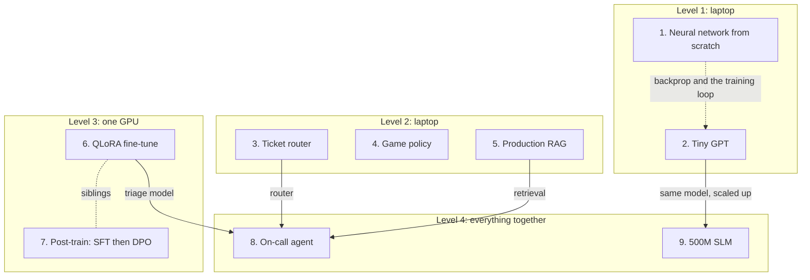

# Projects

Reading only gets you so far. These nine projects make you build each part of the stack yourself, and they are ordered as a ladder: each one is harder than the one before, and the later ones reuse what the earlier ones produced. Levels 1 and 2 run on a laptop, level 3 wants one consumer GPU, and level 4 ties everything together.

Every project has a design walkthrough, runnable code in the [repository](https://github.com/vivek-rm-14286/llm-from-scratch/tree/main/code), a list of milestones that defines "done", and stretch goals. Projects 1, 2, 3, 7 and 8 ship starter code with TODOs, a reference solution and pytest tests: fill in the TODOs until the tests pass, then compare with the reference. Projects 4, 5, 6 and 9 ship complete code that you can run and modify, or rebuild file by file and compare; Projects 6 and 9 list the checks that tell you when a rebuilt file is right.

## The ladder

Solid arrows mean "feeds into". Project 2 is the small version of Project 9: the same tokenizer-plus-decoder design, written by hand at about 10M parameters before it is scaled to about 500M. Project 8 integrates three earlier builds: the router from Project 3, the RAG service from Project 5 and the fine-tuned triage model from Project 6. Projects 6 and 7 are siblings: both change the weights of an existing model, Project 6 with a library stack (QLoRA) and Project 7 with training loops written by hand (SFT, then DPO). Project 4 stands alone and needs only Foundations and the Decision Models pages.

### Level 1: laptop

- **[1. Neural Network From Scratch](nn-from-scratch.md).** Write a small autograd engine, then a numpy MLP that classifies handwritten digits. No deep learning library does the work.
- **[2. Tiny GPT](tiny-gpt.md).** Write a BPE tokenizer and a GPT of about 10M parameters by hand, and train it on a laptop until it generates text.

### Level 2: laptop

- **[3. Ticket Router: a Calibrated Decision Model](ticket-router.md).** Route support tickets three ways (a classifier, a fine-tuned encoder and a decision language model), calibrate the probabilities, and add an abstain option for tickets the model should not decide.
- **[4. A Decision Model That Plays](game-agent.md).** Design an original 2D game, record demonstrations, train a policy by behavior cloning, improve it with your own PPO, then export it to ONNX as a real-time System 1 controller. There is also an in-browser demo you can train live.
- **[5. Production RAG: Support Engineer Copilot](support-rag.md).** Answer support questions from product docs and past resolved tickets, with citations, hybrid search, reranking and per-document access levels, served by a FastAPI service and checked by an evaluation harness.

### Level 3: one GPU

- **[6. Fine-tune an Open-Weight Model: Incident Triage Copilot](incident-triage-finetune.md).** An on-call engineer pastes raw alerts, log lines and metrics. The model returns strict JSON with severity, category, probable root cause, next steps and escalation target. You measure a prompted baseline, generate and review training data, run QLoRA, evaluate field by field, then serve the model.
- **[7. Post-train a Small Model: SFT, Then DPO](post-train-assistant.md).** Turn a small base model into an assistant with supervised fine-tuning, then improve it with preference pairs and DPO. Both training loops are written by hand.

### Level 4: everything together

- **[8. On-Call Agent: Tools, MCP, Guardrails](oncall-agent.md).** An agent that handles an incident by calling tools, including the router from Project 3, the RAG service from Project 5 and the triage model from Project 6. It exposes tools over MCP, runs behind guardrails, and has to pass an evaluation gate.
- **[9. Build a 500M SLM From Scratch](slm-500m.md).** A laptop warm-up first: a 31M model on TinyStories. **Part A:** train a byte-level BPE tokenizer, stream and shard FineWeb-Edu, write a Llama-style model (RMSNorm, RoPE, SwiGLU, GQA), pretrain it with DDP and bf16, and evaluate it. **Part B:** run SFT to make it a chat model, convert it to Hugging Face format and publish it.

## The projects side by side

Costs and times are estimates, and no GPU run was measured for these tables. "Your time" is hands-on work at the [roadmap's](../start/roadmap.md) pace, and excludes the reading. For Projects 1, 2, 3, 7 and 8 the figures are first estimates; where a project page states its own numbers, the project page is right.

### Hardware, cost and time

| | Level | Hardware | Rough compute cost | Compute time | Your time |
|---|---|---|---|---|---|
| **1** | 1 | Laptop CPU | USD 0 | Minutes | 6-8 hours |
| **2** | 1 | Laptop (an Apple Silicon GPU or any CUDA GPU shortens the run) | USD 0 | A laptop training run of roughly an hour or two | 8-12 hours |
| **3** | 2 | Laptop CPU | USD 0 | Minutes to tens of minutes | 8-10 hours |
| **4** | 2 | Laptop CPU | USD 0 | Minutes | 10-14 hours |
| **5** | 2 | Laptop. No GPU. An LLM through Ollama or any OpenAI-compatible API for generation | USD 0 locally | Minutes | 12-16 hours |
| **6** | 3 | One 24 GB GPU for the 7B model (a 16 GB card such as an RTX 5070 Ti works at batch 1), or a Colab T4 with the 1.5B model. Baseline also runs on a Mac | A few USD of rented 24 GB GPU time, or USD 0 on Colab | Training: an hour or less | 12-16 hours |
| **7** | 3 | Laptop for the small model, or one GPU for a larger one | USD 0 on a laptop; a few USD if you rent a GPU | Roughly an hour or two on a laptop for the small model | 10-14 hours |
| **8** | 4 | Laptop. No GPU. An LLM through Ollama or any OpenAI-compatible API | USD 0 locally | Minutes | 14-20 hours |
| **9, Part 0** | 4 | Laptop (Apple Silicon) or free Colab GPU | USD 0 | About 2.5 hours on an M1 Pro for 50M tokens | 3-4 hours |
| **9, Part A** | 4 | CPU machine for data; 8x H100 node (or 1 H100) rented for the run | Roughly USD 80-155 for the 10B-token run, including a 1.5x safety factor | About 3.5 hours on 8x H100, about 26 hours on one | 25-35 hours over 4 weeks |
| **9, Part B** | 4 | One rented data-center GPU | Roughly USD 6-20 | 3-5 hours | 6-8 hours |

The cheap path for Project 9 Part A is the `p125m` preset on one 24 GB GPU: about 12 hours on an RTX 4090 for 2.5B tokens. On a 16 GB RTX 5070 Ti the same run is about 23 hours, and Project 6's 7B QLoRA run is roughly 2-3 hours; see [what a 16 GB card can do](../start/setup.md#what-a-16-gb-card-can-do-rtx-5070-ti).

### What you end up with, and what to read first

| | What you end up with | Prerequisite modules | Skip if |
|---|---|---|---|
| **1** | An autograd engine and a numpy MLP that classifies digits, with passing tests | [Foundations](../foundations/index.md) | You have already written backpropagation by hand and checked it against a framework |
| **2** | A BPE tokenizer and a GPT of about 10M parameters that generates text | [Foundations](../foundations/index.md), [Language Models](../llm/index.md) | You have written and trained a GPT yourself. Do not skip it on the way to Project 9 |
| **3** | A ticket router with calibrated probabilities, an abstain threshold, and a comparison of three model types | [Language Models](../llm/index.md) (tokenization and attention), [Decision Models](../decision/index.md) (the routing page) | Nothing you build chooses among a fixed set of options. Project 8 uses the router |
| **4** | A PPO-tuned policy exported to ONNX, with a held-out evaluation | [Foundations](../foundations/index.md), [Decision Models](../decision/index.md) | Reinforcement learning and control are not a goal. No other project depends on it |
| **5** | A FastAPI RAG service with citations, access control and an evaluation report | [RAG](../rag/index.md); [Inference](../inference/index.md) as reference | You do not plan to ground a model in documents. Project 8 uses the service |
| **6** | A QLoRA adapter that beats a prompted baseline, served and re-evaluated | [Post-training](../post-training/index.md) (the SFT page), [Fine-tuning](../finetuning/index.md); [Inference](../inference/index.md) as reference | No GPU and no Colab access, or you only use models through an API. Project 8 uses the model |
| **7** | A small assistant model trained with hand-written SFT and DPO loops, compared before and after each stage | [Language Models](../llm/index.md), [Post-training](../post-training/index.md) | Project 6 covers what you need and library trainers are enough. Do it before Project 9 Part B if you can |
| **8** | An on-call agent with tools, an MCP server, guardrails and an evaluation gate | [Applications](../applications/index.md), [Safety & Production](../production/index.md), and Projects 3, 5 and 6 | Agents are not a goal. It is the only project that needs other projects' outputs |
| **9, Part 0** | A 31.5M model that writes simple stories | [Language Models](../llm/index.md) | Never: it is free and it tests the whole pipeline |
| **9, Part A** | A 486.6M base model with validation loss and HellaSwag | [Language Models](../llm/index.md), [Pretraining](../pretraining/index.md) | The rental cost is not justified for you. The `p125m` preset teaches the same lessons on one consumer GPU |
| **9, Part B** | A chat model on the Hub in Hugging Face format | [Post-training](../post-training/index.md) (the SFT page) | You did not do Part A |

## Which projects for which goal

- **Understand how neural networks and language models work, on a laptop:** Projects 1 and 2, then Part 0 of Project 9.
- **Ship retrieval over your own documents:** Project 5.
- **Adapt an open-weight model to one task:** Project 6. Add Project 7 if you have preference data (one answer preferred over another) or want to see the training loops without a library. Add Project 3 if the task is really a choice among fixed options.
- **Train a language model from scratch:** Projects 1, 2 and 9, with Project 7 as the hand-written version of post-training.
- **Decision models and reinforcement learning:** Projects 3 and 4.
- **Agents and production systems:** Projects 5 and 8. Project 8 also uses the Project 3 router and the Project 6 model, so do those two first if time allows.
- **Everything:** all nine in order. The [roadmap](../start/roadmap.md) schedules them over 29 weeks.

[Choose Your Path](../start/paths.md) lists the pages to read for each of these goals.

!!! note "Order and hardware"
    Projects 1 to 5 and Project 8 need no GPU. Project 7 runs on a laptop with its small model. Project 6 needs one 24 GB GPU for the 7B model (a 16 GB card works at batch 1), or a Colab T4 with the 1.5B model. Project 9 is the most expensive: the roadmap places it last, in weeks 25-29, with the full run in week 28. Its Part 0 warm-up is free and can be done any time after Project 2.
