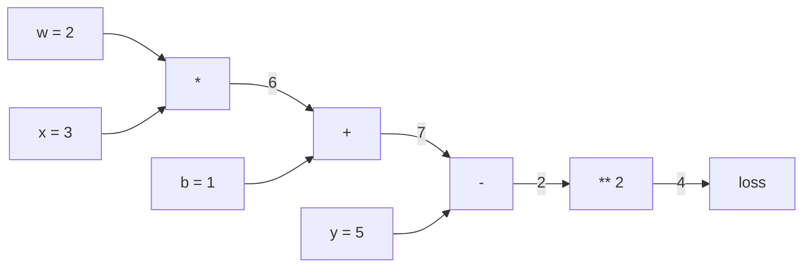
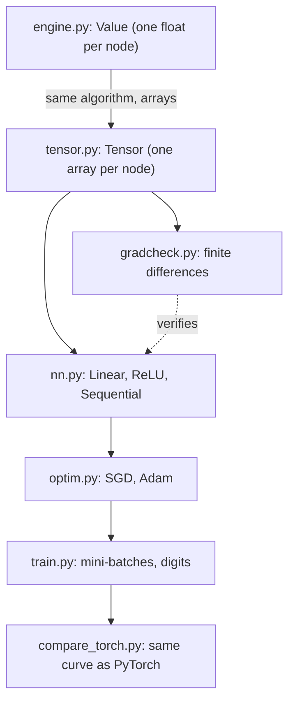

# Project 1: Neural Network From Scratch

`loss.backward()` is one line in PyTorch, and everything else on this site depends on it. In this project you write what is behind that line. First an autograd engine that works on single numbers, then the same engine on numpy arrays, then layers, optimizers and a training loop on top of it. The result classifies handwritten digits at about 97% test accuracy in under a second of training on a laptop CPU. The last step puts your engine next to PyTorch, with the same initial weights and the same batches, and the two loss curves agree to 15 decimal places. After that, a framework is no longer a black box: it is a faster version of code you have written.

!!! abstract "What you'll build"
    - `engine.py`: `Value`, a scalar autograd engine with `+`, `*`, `**`, `exp`, `log`, `tanh`, `relu`, and `backward()` by topological sort
    - `tensor.py`: `Tensor`, the same engine on numpy arrays, with broadcasting, matrix multiplication and a fused softmax cross-entropy
    - `nn.py`: `Linear` with He and Xavier initialization, `ReLU`, `Tanh`, `Sequential`, an L2 penalty
    - `optim.py`: SGD with momentum, Adam, and both kinds of weight decay
    - `gradcheck.py`: a finite-difference gradient checker
    - `train.py`: mini-batch training of an MLP on handwritten digits
    - `compare_torch.py`: the same model in PyTorch, compared step by step

    Full code: [code/nn_from_scratch](https://github.com/vivek-rm-14286/llm-from-scratch/tree/main/code/nn_from_scratch). Prerequisites: [Math You Actually Need](../foundations/math.md) (the chain rule, softmax, cross-entropy), [Python & PyTorch](../foundations/pytorch.md) (broadcasting, the training loop) and [Neural Networks & Backprop](../foundations/neural-networks.md), which introduces every idea used here.

!!! info "Two ways to do this project"
    **Fill in the starter.** `starter/` has every file with signatures, docstrings and `TODO`s. `tests/` has 82 tests. Run `pytest`, read the first failure, write the function, repeat. You are done when `pytest` prints `82 passed`. This is the route the project is designed for, and it takes about 8 hours.

    **Read and modify.** Read `solution/` next to this page, run each command, then change something and predict the effect before measuring it: remove the ReLU mask and run the gradient check, switch He initialization to a standard deviation of 1, turn off momentum. This takes 2 to 3 hours. The stretch goals work from either route.

    The two packages have identical file names and function signatures, so every command below works with `starter` in place of `solution` once your tests pass.

## 0. Setup

```bash
git clone https://github.com/vivek-rm-14286/llm-from-scratch
cd llm-from-scratch/code/nn_from_scratch
uv venv && source .venv/bin/activate      # or python -m venv .venv
uv pip install -r requirements.txt
```

The dependencies are numpy, scikit-learn (for the bundled digits dataset) and pytest. PyTorch is only used in Step 7. To skip it, delete the `torch` line from `requirements.txt`; the tests for Step 7 are then skipped.

**Hardware.** Any laptop CPU. No GPU and, with the default dataset, no download. The numbers on this page are from an Apple M1 Pro.

**Check the setup.** Both commands finish in a few seconds:

```bash
pytest --impl solution     # 82 passed
pytest                     # 82 failed: that is your to-do list
```

`--impl` selects the package under test (default `starter`). `NN_IMPL=solution pytest` does the same through an environment variable. Every starter function raises `NotImplementedError`, so the failures point at the function to write next.

**Expected time per step** on the fill-in route:

| Step | File | Tests | Time |
|---|---|---|---|
| 1. Scalar autograd | `engine.py` | `tests/test_engine.py` (14) | 1.5 hours |
| 2. Tensor autograd | `tensor.py` | `tests/test_tensor.py` (24) | 2 hours |
| 3. Layers and initialization | `nn.py` | `tests/test_nn.py` (12) | 1 hour |
| 4. Optimizers | `optim.py` | `tests/test_optim.py` (12) | 1 hour |
| 5. Gradient check | `gradcheck.py` | `tests/test_gradcheck.py` (5) | 45 minutes |
| 6. Training on digits | `data.py`, `train.py` | `tests/test_train.py` (9) | 1 hour |
| 7. PyTorch comparison | `compare_torch.py` | `tests/test_torch.py` (6) | 45 minutes |

## The design

The whole project is one idea applied twice. A computation is a graph of small operations. Each operation knows its local derivative. Backpropagation walks the graph from the loss back to the inputs and multiplies local derivatives along the way.



The forward pass computes the numbers on the arrows from left to right. The backward pass starts with $\partial L / \partial L = 1$ at the right and moves left. Each node receives the gradient of its output and passes it to its inputs, multiplied by the local derivative. For this graph, $\partial L / \partial w = 2 \cdot 2 \cdot 3 = 12$.

The files stack on each other in this order:



Two decisions shape the code:

- **Autograd, not hand-written backward passes per layer.** The [numpy MLP in the lesson](../foundations/neural-networks.md#a-two-layer-mlp-in-numpy) derives the backward pass of one specific network. Here each operation carries its own backward rule, so any network built from those operations gets its gradients for free. That is how PyTorch works.
- **Everything in float64.** The tensors use numpy's default 64-bit floats. Finite-difference checks need the precision, and it lets the PyTorch comparison in Step 7 use a tolerance of $10^{-8}$ instead of a vague "looks similar".

## 1. A scalar autograd engine

`engine.py` is the [micrograd-style engine from the lesson](../foundations/neural-networks.md#a-micrograd-style-autograd-engine). A `Value` holds a float, its gradient, the values it was computed from, and a closure that applies the chain rule for the operation that produced it:

```python title="engine.py"
def __mul__(self, other):
    other = other if isinstance(other, Value) else Value(other)
    out = Value(self.data * other.data, (self, other), "*")

    def _backward():
        self.grad += other.data * out.grad    # d(ab)/da = b
        other.grad += self.data * out.grad    # d(ab)/db = a
    out._backward = _backward
    return out
```

Every operation follows this shape: compute the result, record the inputs, and define how `out.grad` flows back. Two details matter in every one of them:

- **`+=`, never `=`.** A value used in two places receives gradient from both, and the contributions add. `a * a + a` must give $2a + 1$. One of the tests checks exactly this.
- **Multiply by `out.grad`.** The local derivative alone is only correct when the operation is the last one in the graph. The tests multiply every result by 3 to catch a missing `out.grad`.

You write `__add__`, `__mul__`, `__pow__`, `exp`, `log`, `tanh` and `relu`. Subtraction, division and the reflected operators (`2 * a`, `1 - a`) are already built from those.

### backward: topological sort

`_backward` on a node is only correct once that node's own gradient is complete, which means every node that consumes it has already run. A **topological order** lists each node after all its inputs, so walking it in reverse gives the right sequence:

```python title="engine.py"
def backward(self):
    topo, seen = [], set()
    stack = [(self, False)]
    while stack:
        node, children_done = stack.pop()
        if children_done:
            topo.append(node)                 # after everything it depends on
        elif id(node) not in seen:
            seen.add(id(node))
            stack.append((node, True))
            for child in node._prev:
                if id(child) not in seen:
                    stack.append((child, False))
    self.grad = 1.0                           # dL/dL = 1
    for node in reversed(topo):
        node._backward()
```

The lesson builds the order with a short recursive function. This version uses an explicit stack, because Python's `sum()` over $n$ values builds a chain $n$ nodes deep and the default recursion limit is 1000. A node is pushed twice: once to visit its inputs, and once (with `children_done=True`) to be appended after them. `tests/test_engine.py` includes a chain of 5,000 nodes.

### Why the scalar engine is not enough

`scalar_demo.py` is complete in both packages. It builds a 64 → 16 → 10 MLP out of `Value`s and trains it on the digits:

```bash
python -m solution.scalar_demo
```

It learns: the loss falls from 2.82 to 1.87 in 20 steps. It is also very slow. One batch of 16 images builds a graph of 56,507 `Value` objects for a model of 1,210 parameters, and one training step takes 0.3 to 0.4 seconds. Each multiplication is a Python object with a closure attached. The tensor engine in the next step runs the same model and batch size in 0.085 ms per step, roughly 4,000 times faster, with a graph of about ten nodes.

## 2. The same engine on numpy arrays

`tensor.py` repeats Step 1 with one change: a node holds an array. `backward()` is the same code with `np.ones_like(self.data)` as the seed. The elementwise operations (`exp`, `log`, `tanh`, `relu`, `**`) are the scalar versions with `np.` in front. Three things are new.

### Broadcasting needs to be undone

In `x @ W + b`, the product has shape `(N, D)` and `b` has shape `(D,)`. Numpy [broadcasts](../foundations/pytorch.md#broadcasting) `b` by copying it to all $N$ rows. The gradient arriving at the `+` node has shape `(N, D)`, but `b.grad` must have shape `(D,)`. Each row used a copy of `b`, and every copy affects the loss, so the contributions are summed:

```python title="tensor.py"
def unbroadcast(grad, shape):
    while grad.ndim > len(shape):                 # leading axes that were added
        grad = grad.sum(axis=0)
    for axis, size in enumerate(shape):           # axes that were stretched from 1
        if size == 1 and grad.shape[axis] != 1:
            grad = grad.sum(axis=axis, keepdims=True)
    return grad

def __add__(self, other):
    other = other if isinstance(other, Tensor) else Tensor(other)
    out = Tensor(self.data + other.data, (self, other), "+")

    def _backward():
        self.grad += unbroadcast(out.grad, self.shape)
        other.grad += unbroadcast(out.grad, other.shape)
    out._backward = _backward
    return out
```

This is the multi-path chain rule again: `+=` handles a value reused across graph nodes, and `unbroadcast` handles a value reused inside one node. A useful invariant, enforced by the tests: `t.grad.shape == t.data.shape`, always.

### Matrix multiplication

For $C = AB$ with a scalar loss $L$:

$$
\frac{\partial L}{\partial A} = \frac{\partial L}{\partial C} B^\top, \qquad \frac{\partial L}{\partial B} = A^\top \frac{\partial L}{\partial C}
$$

```python title="tensor.py"
def _backward():
    self.grad += out.grad @ other.data.T      # (n, m) @ (m, k) -> (n, k), the shape of A
    other.grad += self.data.T @ out.grad      # (k, n) @ (n, m) -> (k, m), the shape of B
```

If you forget the formulas, the shapes recover them: there is only one way to multiply `out.grad`, `A` and `B` that produces a result shaped like `A`. The [lesson's derivation](../foundations/neural-networks.md#backward-pass) arrives at the same expressions as `dW2 = A1.T @ G2`.

### Softmax cross-entropy as one operation

Cross-entropy can be composed from `exp`, `sum`, `log` and `*`, and one of the tests does that. The training code uses a single fused operation instead, for two reasons. `exp` of a large logit overflows unless the row maximum is subtracted first. And the gradient of the combination is much simpler than its parts, as shown in [the softmax + cross-entropy gradient](../foundations/math.md#the-softmax-cross-entropy-gradient): the probabilities minus the one-hot targets.

```python title="tensor.py"
def cross_entropy(logits, targets):
    targets = np.asarray(targets, dtype=np.int64)
    n = logits.shape[0]
    z = logits.data - logits.data.max(axis=1, keepdims=True)       # stability
    log_probs = z - np.log(np.exp(z).sum(axis=1, keepdims=True))
    out = Tensor(-log_probs[np.arange(n), targets].mean(), (logits,), "cross_entropy")

    def _backward():
        g = np.exp(log_probs)                         # softmax probabilities
        g[np.arange(n), targets] -= 1.0
        logits.grad += g / n * out.grad
    out._backward = _backward
    return out
```

The tests check the value against a direct computation, the gradient against finite differences, logits of ±1000 (the loss must be 500, not `nan`), and agreement with the composed version to $10^{-12}$.

## 3. Layers and initialization

With `Tensor` in place, a layer needs no backward code at all:

```python title="nn.py"
class Linear(Module):
    def __init__(self, n_in, n_out, rng, init="he"):
        if init == "he":
            w = rng.normal(0.0, np.sqrt(2.0 / n_in), size=(n_in, n_out))
        elif init == "xavier":
            a = np.sqrt(6.0 / (n_in + n_out))
            w = rng.uniform(-a, a, size=(n_in, n_out))
        else:
            raise ValueError(f"unknown init {init!r}")
        self.W = Tensor(w)
        self.b = Tensor(np.zeros(n_out))

    def forward(self, x):
        return x @ self.W + self.b                    # b broadcasts over the batch

    def parameters(self):
        return [self.W, self.b]
```

**Initialization.** He initialization draws weights with variance $2 / n_\text{in}$, which keeps the scale of activations constant through ReLU layers. Xavier uses variance $2 / (n_\text{in} + n_\text{out})$ and suits tanh; a uniform distribution on $[-a, a]$ has variance $a^2/3$, which gives $a = \sqrt{6 / (n_\text{in} + n_\text{out})}$. [Initialization](../foundations/neural-networks.md#initialization) in the lesson explains where both come from. Biases start at zero. All randomness comes from the `rng` passed in, so a seed fixes the model exactly. Step 7 depends on that.

`make_mlp([64, 64, 10], rng)` returns `Linear(64, 64) → ReLU → Linear(64, 10)`: an activation after every layer except the last, which outputs raw logits for `cross_entropy`. That model has $64 \cdot 64 + 64 + 64 \cdot 10 + 10 = 4{,}810$ parameters.

**The L2 penalty.** `l2_penalty(params, lam)` returns $\frac{\lambda}{2} \sum \theta^2$ as a `Tensor`, so it can be added to the loss. Its gradient is $\lambda\theta$. Step 4 uses that fact.

## 4. Optimizers

An optimizer holds the parameter tensors and turns their `.grad` into an update of `.data`. The equations are in [Optimizers](../foundations/neural-networks.md#optimizers); the code follows them line by line.

```python title="optim.py"
class SGD(Optimizer):
    def step(self):
        for p, v in zip(self.params, self.v):
            g = p.grad + self.weight_decay * p.data     # L2 as part of the gradient
            v *= self.momentum
            v += g                                      # v = momentum * v + g
            p.data -= self.lr * v
```

```python title="optim.py"
class Adam(Optimizer):
    def step(self):
        self.t += 1
        for p, m, v in zip(self.params, self.m, self.v):
            g = p.grad
            if self.weight_decay and self.decoupled:
                p.data *= 1.0 - self.lr * self.weight_decay    # AdamW
            elif self.weight_decay:
                g = g + self.weight_decay * p.data             # L2 inside the gradient
            m *= self.b1
            m += (1.0 - self.b1) * g
            v *= self.b2
            v += (1.0 - self.b2) * g * g
            m_hat = m / (1.0 - self.b1 ** self.t)              # bias correction
            v_hat = v / (1.0 - self.b2 ** self.t)
            p.data -= self.lr * m_hat / (np.sqrt(v_hat) + self.eps)
```

**Two kinds of weight decay.** Adding `weight_decay * p` to the gradient is the same as adding the L2 penalty to the loss. In plain SGD the two are identical, and a test trains one model each way and requires the weights to agree to $10^{-12}$. In Adam they are not the same: the added term gets divided by $\sqrt{\hat{v}}$ along with the rest of the gradient. `decoupled=True` shrinks the weights directly instead, which is [AdamW](../foundations/neural-networks.md#adamw). Both variants decay every tensor they are given, biases included, which matches PyTorch's behavior when all parameters are in one group.

**Update in place.** `p.data -= ...` modifies the array that the model's layers hold. The optimizer state (`v`, `m`) is also updated in place, with `*=` and `+=`, so the arrays in `self.v` and `self.m` persist between steps.

A quick check from the tests: on the first Adam step the bias-corrected moments are $\hat{m} = g$ and $\hat{v} = g^2$, so each parameter moves by `lr` regardless of whether its gradient is 0.001 or 200.

## 5. A gradient checker

Before training anything, prove the gradients are right. The derivative of $f$ in one coordinate is approximately the central difference

$$
\frac{\partial f}{\partial \theta_i} \approx \frac{f(\theta + \epsilon e_i) - f(\theta - \epsilon e_i)}{2\epsilon}
$$

which needs no knowledge of how $f$ is built. `numerical_grad` nudges each entry of an array up and down by $\epsilon = 10^{-6}$ and restores it. `gradcheck` compares the result with backprop:

```python title="gradcheck.py"
def rel_error(a, b):
    denom = np.linalg.norm(a) + np.linalg.norm(b)
    return float(np.linalg.norm(a - b) / denom) if denom > 0 else 0.0

def gradcheck(loss_fn, params, eps=1e-6):
    for p in params:
        p.grad = np.zeros_like(p.data)
    loss_fn().backward()
    analytic = [p.grad.copy() for p in params]
    worst = 0.0
    for p, a in zip(params, analytic):
        numeric = numerical_grad(lambda: float(loss_fn().data), p.data, eps)
        worst = max(worst, rel_error(a, numeric))
    return worst
```

The error is measured per parameter tensor, as $\lVert a - n \rVert / (\lVert a \rVert + \lVert n \rVert)$, and not per entry. Finite differences carry an absolute rounding error of roughly $10^{-10}$, which is a large relative error on an entry whose true gradient is $10^{-9}$. Comparing whole tensors keeps such entries from raising false alarms. The cost is one forward pass per parameter per direction, so the checker is for small models only.

```bash
python -m solution.gradcheck
```

```text
MLP 64-32-10 (relu), 2410 parameters: max relative error 1.66e-09
MLP 64-32-10 (tanh), 2410 parameters: max relative error 2.34e-09
```

A correct implementation lands around $10^{-9}$. A bug lands many orders of magnitude higher, as the results below show. Random inputs are used on purpose: they keep pre-activations away from ReLU's kink at zero, where the central difference straddles two slopes.

## 6. Training on handwritten digits

**The data.** scikit-learn ships `load_digits`: 1,797 grayscale images of 8×8 pixels, 10 classes, no download. `load_digits_data` scales the pixels to $[0, 1]$ and makes a stratified split of 1,257 training, 180 validation and 360 test images. The validation set is for choosing hyperparameters. The test set is looked at once, at the end.

**Mini-batches.** `batches` is the one function to write in `data.py`. It yields the data once per call, in a new random order each time when given an `rng`:

```python title="data.py"
def batches(x, y, batch_size, rng=None):
    n = len(x)
    order = rng.permutation(n) if rng is not None else np.arange(n)
    for start in range(0, n, batch_size):
        idx = order[start:start + batch_size]
        yield x[idx], y[idx]
```

**The loop.** It is the same five lines as [the PyTorch training loop](../foundations/pytorch.md#the-training-loop), because the engine has the same interface:

```python title="train.py"
def train_epoch(model, optimizer, x, y, batch_size, rng):
    total_loss = 0.0
    for xb, yb in batches(x, y, batch_size, rng):
        loss = cross_entropy(model(xb), yb)       # forward: builds the graph
        optimizer.zero_grad()                     # clear gradients from the last step
        loss.backward()                           # backward: fills p.grad
        optimizer.step()                          # update the weights
        total_loss += float(loss.data) * len(xb)
    return total_loss / len(x)
```

The graph is rebuilt on every step and thrown away afterward. Parameters persist; intermediate tensors do not. `evaluate` runs the model over a split in batches and weights each batch by its size, since the last batch is usually smaller.

```bash
python -m solution.train
```

```text
digits: 1257 train / 180 val / 360 test, 64 features
epoch   1  train loss 1.6435  val loss 0.9760  val acc 0.8722
epoch   2  train loss 0.6219  val loss 0.4677  val acc 0.9000
...
epoch  10  train loss 0.0894  val loss 0.1804  val acc 0.9611
epoch  20  train loss 0.0371  val loss 0.1668  val acc 0.9667
epoch  30  train loss 0.0176  val loss 0.1781  val acc 0.9611
parameters 4810  training time 0.2 s
test loss 0.1477  test accuracy 0.9722
```

Two sanity checks from [Debugging a Training Run](../pretraining/debugging.md) are built into the tests. The loss of an untrained model must be near $\ln 10 \approx 2.30$, the loss of a uniform guess over 10 classes. And the model must be able to [overfit a single batch](../pretraining/debugging.md#2-overfit-a-single-batch) of 32 images to a loss below 0.01. Note also that the validation loss stops improving after about epoch 20 while the training loss keeps falling: with 1,257 training images, the model starts to memorize.

Other settings to try:

```bash
python -m solution.train --optimizer sgd                     # SGD, lr 0.05, momentum 0.9
python -m solution.train --optimizer sgd --momentum 0        # plain SGD
python -m solution.train --optimizer adamw --weight-decay 0.01
python -m solution.train --hidden 128 64                     # two hidden layers
python -m solution.train --dataset mnist --hidden 256 --epochs 10 --batch-size 64
```

`--dataset mnist` downloads the four MNIST files (about 12 MB) into `data/mnist/` on first use and splits them into 55,000 / 5,000 / 10,000. Nothing is downloaded without that flag.

## 7. The same model in PyTorch

Passing a gradient check shows that the gradients are right. It says nothing about the optimizer, the loss reduction or the order of operations in the loop. A stronger test is to run a trusted implementation on the same problem and compare numbers.

`compare_torch.py` builds the model with your library, copies its weights into a `torch.nn.Sequential`, and trains both on identical batches with matching optimizer settings. The function to write is `to_torch`:

```python title="compare_torch.py"
def to_torch(model):
    import torch

    layers = []
    for layer in model.layers:
        if isinstance(layer, Linear):
            n_in, n_out = layer.W.shape
            lin = torch.nn.Linear(n_in, n_out, dtype=torch.float64)
            with torch.no_grad():
                lin.weight.copy_(torch.from_numpy(layer.W.data.T.copy()))   # (1)!
                lin.bias.copy_(torch.from_numpy(layer.b.data.copy()))
            layers.append(lin)
        else:
            layers.append({"ReLU": torch.nn.ReLU, "Tanh": torch.nn.Tanh}[type(layer).__name__]())
    return torch.nn.Sequential(*layers)
```

1. `torch.nn.Linear` stores its weight as `(n_out, n_in)` and computes `x @ weight.T`. This project stores `(n_in, n_out)` and computes `x @ W`. Without the transpose, a square layer raises no shape error and silently computes a different function.

```bash
python -m solution.compare_torch
```

```text
step    ours        torch       |diff|
   0  2.41458090  2.41458090  0.0e+00
   1  2.25616229  2.25616229  0.0e+00
   2  2.57141210  2.57141210  0.0e+00
  10  2.22699841  2.22699841  4.4e-16
  50  1.61584931  1.61584931  0.0e+00
 100  1.04176959  1.04176959  0.0e+00
 199  0.70179130  0.70179130  1.1e-16
adam, weight decay 0.0: max |loss difference| over 200 steps = 4.44e-16
max |weight difference| after 200 steps = 1.67e-16
MATCH
```

The script prints `MATCH` when the largest loss difference over all steps is below $10^{-8}$. Float64 arithmetic has about 16 significant digits, so differences near $10^{-16}$ mean the two implementations perform the same arithmetic. This works because both sides use float64, the batches come from the same seeded generator, and the update rules match PyTorch's: `v = momentum * v + g` for SGD, and $\epsilon$ added outside the square root for Adam. In float32 the curves would still agree, but only to about 6 digits, and would drift apart slowly as rounding differences compound.

## Results from one run

Measured on an Apple M1 Pro (CPU) with Python 3.12, numpy 2.5 and torch 2.15.

**Correctness**

| Check | Result |
|---|---|
| Test suite on `solution/` | 82 passed in 4.5 s |
| Gradient check, MLP 64-32-10, ReLU | max relative error $1.7 \times 10^{-9}$ |
| Gradient check, MLP 64-32-10, tanh | max relative error $2.3 \times 10^{-9}$ |
| Gradient check with the ReLU mask removed from `relu`'s backward | max relative error 0.40 |
| Gradient check with `unbroadcast` averaging instead of summing | max relative error 0.88 |
| PyTorch comparison, Adam, 200 steps | max loss difference $4.4 \times 10^{-16}$ |
| PyTorch comparison, SGD with momentum 0.9 and weight decay $10^{-4}$ | max loss difference $5.0 \times 10^{-16}$ |
| PyTorch comparison, AdamW with weight decay 0.01 | max loss difference $8.9 \times 10^{-16}$ |

**Training on the 8×8 digits** (30 epochs, batch size 32, 64 → 64 → 10 unless noted; five seeds change both the split and the initialization)

| Setting | Test accuracy, seed 0 | Mean of 5 seeds (min to max) | Training time |
|---|---|---|---|
| Adam, lr 0.003 (the default) | 97.2% | 97.4% (96.7 to 98.3) | 0.2 s |
| SGD, lr 0.05, momentum 0.9 | 96.7% | 97.1% (96.4 to 98.3) | 0.2 s |
| SGD, lr 0.05, no momentum | 95.0% | 95.8% (93.9 to 96.9) | 0.2 s |
| Adam, lr 0.001 | 96.1% | 96.6% (95.3 to 97.5) | 0.2 s |
| Adam, lr 0.003, hidden layers 128 and 64 (17,226 parameters) | 97.5% | 97.8% (97.5 to 98.3) | 0.4 s |

**Speed and scale**

| Measurement | Result |
|---|---|
| Scalar engine, 64-16-10 MLP, batch of 16 | 0.3 to 0.4 s per step, 56,507 graph nodes |
| Tensor engine, same model and batch size | 0.085 ms per step |
| MNIST, one hidden layer of 256 (203,530 parameters), 10 epochs, batch size 64, default Adam | 97.7% test accuracy, 25 s of training |
| MNIST, hidden layers 512 and 256 (535,818 parameters), 20 epochs, batch size 64, AdamW, lr 0.001, weight decay 0.01 | 98.1% test accuracy, 118 s of training |

What the numbers show:

- **The test set has 360 images, so one image is 0.28 points.** The spread between seeds (96.7% to 98.3% for the default) is larger than the gap between Adam and SGD with momentum. A single run cannot rank those two. It can separate momentum from no momentum, which differ by more than a point on average after the same 30 epochs.
- **A gradient bug is not subtle.** Correct code gives errors near $10^{-9}$ and the two planted bugs give errors eight orders of magnitude larger. There is no gray zone to interpret.
- **A buggy network can still train.** Gradients that are wrong but point roughly downhill often reduce the loss anyway, just worse than they should. A falling loss curve is weak evidence of correctness. The gradient check and the PyTorch comparison are the real tests.

## Milestones

- [ ] `pytest tests/test_engine.py`: 14 passed, including the 5,000-node chain
- [ ] `python -m starter.scalar_demo` runs, and its loss after 20 steps is below 2.0
- [ ] `pytest tests/test_tensor.py`: 24 passed
- [ ] `pytest tests/test_nn.py tests/test_optim.py`: 24 passed
- [ ] `python -m starter.gradcheck` prints a max relative error below $10^{-6}$ for both activations (the reference is about $2 \times 10^{-9}$)
- [ ] You broke one backward rule on purpose, saw the gradient check report an error above $10^{-2}$, and restored it
- [ ] `python -m starter.train` reaches at least 96% test accuracy on the digits in 30 epochs
- [ ] The training loss on a single batch of 32 images goes below 0.01
- [ ] `python -m starter.compare_torch` prints `MATCH` (max loss difference below $10^{-8}$) for `adam`, `sgd` and `adamw`
- [ ] `pytest` prints `82 passed` (or 76 passed and 1 skipped without torch)
- [ ] You ran the default configuration with 5 seeds and wrote down the mean and the range of test accuracy

## Stretch goals

1. **MNIST to 98%, and past it.** The one-hidden-layer run above stops just short, and a wider two-layer model with AdamW reaches 98.1% in about two minutes. Reproduce that using only the validation set for decisions, then push further with a learning-rate schedule such as the [cosine decay](../foundations/neural-networks.md#learning-rate-schedules) from the lesson, dropout, or small random shifts of the training images.
2. **Dropout.** Add a `Dropout(p)` module with inverted scaling, as in [Regularization](../foundations/neural-networks.md#regularization). It needs a train/eval switch on `Module`, and a fixed mask during gradient checking. Measure the gap between training and validation loss on the digits with and without it.
3. **Batch normalization.** Implement `BatchNorm1d` from `Tensor` primitives (`mean` over axis 0 needs `sum(axis=0)` and a multiply), with running statistics for evaluation. Gradient-check it in training mode, then compare it with `torch.nn.BatchNorm1d`.
4. **A convolution layer.** Write `Conv2d` for the 8×8 digits. The simplest correct route is `im2col`: gather the patches into a matrix with fancy indexing, which turns the convolution into the `@` you already have, plus a new `Tensor` operation for the gather with its own backward rule (`np.add.at` scatters the gradient back). Gradient-check it before training.
5. **More operations.** Add `max(axis)`, `reshape`, indexing and `__truediv__` to `Tensor`, each with a finite-difference test like those in `tests/test_tensor.py`.
6. **A learning-rate finder.** Train for 100 steps while multiplying the learning rate by a constant each step from $10^{-5}$ to 10, and record the loss. Read off where it starts to fall and where it diverges.
7. **Draw the graph.** Walk `_prev` from a loss `Value` and emit Graphviz or Mermaid text, with `data` and `grad` on each node, for the example in the design section.

## Check your understanding

??? question "Why does every `_backward` use `+=` on the inputs' gradients, and what breaks with `=`?"
    A value that feeds several operations affects the loss through each of them, and the total derivative is the sum over those paths. With `=`, the last consumer to run overwrites the others. In `a * a + a` the gradient would come out as 1 or $2a$ depending on the order, never $2a + 1$. A network would be affected everywhere: each weight matrix is used by every example in the batch, and each hidden activation feeds every unit of the next layer.

??? question "Why must `backward()` process nodes in reverse topological order? Why not simply recurse from the output?"
    A node's `_backward` multiplies by `out.grad`, so that gradient has to be complete first, meaning every consumer of the node has already added its contribution. Reverse topological order guarantees it. Naive recursion from the output would run a shared node's `_backward` once per path that reaches it, each time with a partial gradient. The results are wrong, and the cost grows exponentially with depth in a graph where paths rejoin.

??? question "`b` has shape `(10,)` and is added to an array of shape `(32, 10)`. Why is `b.grad` the sum over the 32 rows and not the mean?"
    Broadcasting makes 32 copies of `b`, one per row, and each copy has its own effect on the loss. The derivative with respect to the shared original is the sum of the derivatives with respect to the copies. The averaging over the batch has already happened once, in the `1/N` of the mean cross-entropy. Taking a mean here as well would shrink the bias gradient by another factor of 32, which is the kind of bug that still trains, only slower. The gradient check reports it immediately.

??? question "The gradient check passes at $10^{-9}$. What can still be wrong with the training code?"
    Everything outside the gradient: the optimizer update, bias correction in Adam, a forgotten `zero_grad` (gradients accumulate across steps), shuffling `x` and `y` with different permutations, weighting a small last batch incorrectly in `evaluate`, or evaluating on training data. The check also only covers the inputs it was run on, so a branch never taken (a dead ReLU region, a clipped value) is untested. That is why the project adds the PyTorch comparison and the unit tests for each optimizer step.

??? question "With SGD, `weight_decay=λ` and adding `l2_penalty(params, λ)` to the loss give identical weights. Why is that not true for Adam?"
    The penalty contributes $\lambda\theta$ to the gradient. SGD subtracts the gradient times a constant, so adding $\lambda\theta$ to the gradient or subtracting $\eta\lambda\theta$ from the weights is the same thing. Adam divides the gradient by $\sqrt{\hat{v}}$, so the $\lambda\theta$ term is rescaled per parameter: weights with large gradients are barely decayed. AdamW applies the shrink directly to the weights, outside the adaptive scaling, which is what `decoupled=True` does.

??? question "The loss curves match PyTorch to $10^{-16}$. What would make them differ at $10^{-7}$, and would that be a bug?"
    Running either side in float32 would. Each operation then rounds at about 7 significant digits, and the two libraries do not round identically (different summation order inside matrix multiplication, for example). The differences compound over steps, so the curves drift apart gradually. That is not a bug. A bug looks different: a mismatch that is large from the first or second step, such as a missing transpose, a different $\epsilon$ placement in Adam, or a different batch order.

## Further reading

- Andrej Karpathy, [micrograd](https://github.com/karpathy/micrograd): the scalar engine this project's first step follows
- Rumelhart, Hinton & Williams (1986), "Learning representations by back-propagating errors", *Nature* 323
- Baydin et al., [Automatic Differentiation in Machine Learning: a Survey](https://arxiv.org/abs/1502.05767) (2015)
- He et al., [Delving Deep into Rectifiers](https://arxiv.org/abs/1502.01852) (2015): He initialization
- Glorot & Bengio (2010), "Understanding the difficulty of training deep feedforward neural networks": Xavier initialization
- Kingma & Ba, [Adam: A Method for Stochastic Optimization](https://arxiv.org/abs/1412.6980) (2014)
- Loshchilov & Hutter, [Decoupled Weight Decay Regularization](https://arxiv.org/abs/1711.05101) (2017)
- [PyTorch autograd mechanics](https://pytorch.org/docs/stable/notes/autograd.html)
- [scikit-learn: the digits dataset](https://scikit-learn.org/stable/datasets/toy_dataset.html)

With a working autograd engine and training loop behind you, [Project 2: Tiny GPT](tiny-gpt.md) builds a small language model with the real PyTorch.
