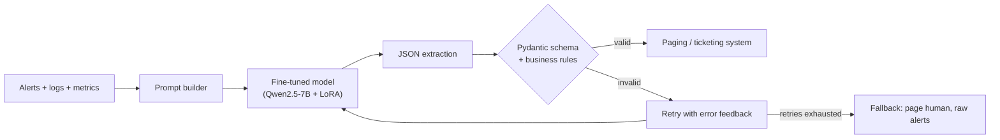
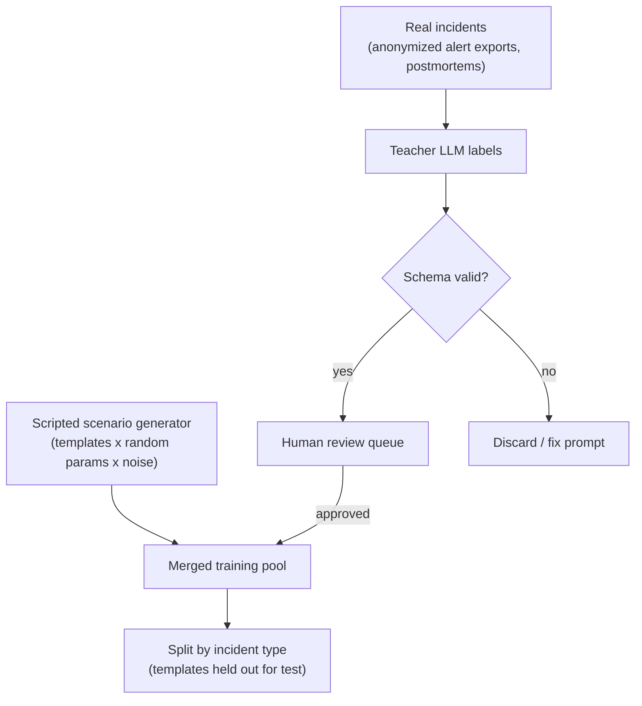
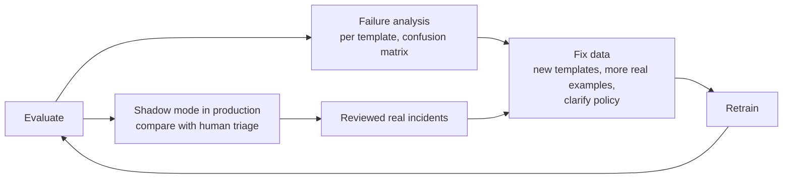

# Project 2: Fine-tune an Open-Weight Model, the Incident Triage Copilot

It is 03:12 and your pager fires. Twelve alerts, three of them noise, a wall of logs and a metrics dashboard. The first five minutes of every incident are the same: figure out how bad it is, what kind of problem it is, where it lives, and who to wake up. In this project you fine-tune an open-weight model to do that first pass. It reads raw alerts, log snippets and metrics, and returns **strict JSON** that a paging system can act on. You will build the whole loop: frame the problem, measure a prompted baseline, generate and label data, train with QLoRA on one 24 GB GPU, evaluate field by field, serve with vLLM or Ollama, and wrap the model in guardrails.

!!! abstract "What you'll learn"
    - How to frame an LLM task as a measurable, structured-output problem
    - Why you always build a prompted baseline before fine-tuning
    - A synthetic + real data strategy: scripted scenario generator, teacher-LLM labeling, human review
    - How to split data by incident *type* so your test set isn't secretly memorized
    - QLoRA training with `transformers` + `peft` + `trl` + `bitsandbytes`
    - Evaluating structured output: JSON validity, field accuracy, a severity confusion matrix
    - Merging adapters, serving with vLLM's OpenAI-compatible API, exporting GGUF for llama.cpp / Ollama
    - Guardrails: pydantic schema validation, business rules, retries with error feedback

**Full code:** [code/p2_incident_triage](https://github.com/vivek-rm-14286/llm-from-scratch/tree/main/code/p2_incident_triage). Background reading: [Supervised Fine-Tuning](../post-training/sft.md) and [LoRA & QLoRA](../finetuning/lora-qlora.md). Two sections that the roadmap schedules later are used here, and can be read on their own: [Structured output](../applications/prompting.md#structured-output) (JSON-schema-constrained decoding) and [Deployment patterns](../production/llmops.md#deployment-patterns) (shadow mode).

!!! info "Two ways to do this project"
    **Run and modify.** Clone the repository, run each step below, then change the data generator, the prompt or the LoRA settings and measure the effect with `evaluate.py`. This is the faster route and the one the [roadmap](../start/roadmap.md) assumes.

    **Rebuild.** Write each file yourself from the walkthrough and compare it with the supplied one. Keep the supplied `prompts.py` and `generate_data.py` (they define the task), and rebuild `schema.py`, `inference.py`, `evaluate.py` and `train_qlora.py`. The check that exists: `python evaluate.py --self-check` replays the gold answers through your `triage()` function, schema, business rules and scoring, and must print `SELF-CHECK PASS` with every accuracy at 1.000. There is no automated check for `train_qlora.py`. Compare its trainable-parameter printout and its first evaluation loss with the supplied script's.

## 0. Setup

```bash
git clone https://github.com/vivek-rm-14286/llm-from-scratch
cd llm-from-scratch/code/p2_incident_triage
uv venv && source .venv/bin/activate      # or python -m venv .venv
uv pip install -r requirements.txt        # bitsandbytes is installed on Linux only
```

**One-minute smoke test.** No GPU and no model download:

```bash
python generate_data.py --out data --n-per-template 120 --seed 7   # writes 1,414 train / 146 val / 840 test rows
python evaluate.py --self-check                                    # gold answers through the whole pipeline
```

The second command must end with `SELF-CHECK PASS`. It proves that the data, the pydantic schema, the business rules, the retry loop and the scoring agree with each other before any model is involved. Both commands finish in about a second.

**Hardware tiers.** Pick one row and use its model everywhere below.

| Tier | Base model | Prompted baseline | QLoRA training |
|---|---|---|---|
| One 24 GB NVIDIA GPU (RTX 3090/4090, A10G, L4), local or rented | `Qwen/Qwen2.5-7B-Instruct` | vLLM | yes |
| 16 GB NVIDIA GPU or a free Colab T4 | `Qwen/Qwen2.5-1.5B-Instruct` | local HF backend | yes, with `--fp16 --batch-size 2` |
| Apple Silicon Mac | 7B through Ollama, or 1.5B through the local HF backend | yes | no: 4-bit `bitsandbytes` training needs CUDA. Train on Colab or a rented GPU, then serve the result on the Mac as GGUF |

A rented 24 GB GPU costs roughly USD 0.30-0.80 per hour (see [Setup, Hardware & Budget](../start/setup.md#rough-price-ranges)), so the whole project is a few USD of GPU time.

**Expected wall-clock per step.** Only the first two rows and the Mac baseline rate are measurements. The rest are estimates that depend heavily on the GPU.

| Step | Time |
|---|---|
| Generate data, self-check | about a second each |
| Prompted baseline, 200 test incidents, 7B on vLLM (24 GB GPU) | estimate: a few minutes |
| Prompted baseline on a Mac with the local HF backend | about 5 s per incident with the 0.5B model on an M1 Pro; larger models are slower, so start with `--limit 50` |
| QLoRA training, 7B, 2 epochs of 1,414 examples | estimate: an hour or less on a modern 24 GB card |
| QLoRA training, 1.5B on a T4 | estimate: under an hour |
| Evaluate the adapter with the HF backend, 200 incidents | estimate: 10-20 minutes |
| Merge, GGUF export, re-evaluation | estimate: 30-60 minutes, mostly downloads and conversion |

## 1. Problem framing

### Input and output

The input is everything an on-call engineer would see in the first minute, pasted as text:

```text
[ALERTS]
2026-08-04T05:20:04Z [WARNING] Monitor 'SlowPageLoad' triggered on service:reporting-ui (tier:3) - dashboard render p95 3.1s
2026-08-04T05:21:00Z [CRITICAL] Monitor 'PostgresConnectionsNearLimit' triggered on service:orders-db (tier:1) - active connections 499/500
2026-08-04T05:22:00Z [CRITICAL] Monitor 'HighErrorRate' triggered on service:checkout-api (tier:1) - HTTP 5xx rate 23.4% > 5% for 5m

[LOGS]
2026-08-04T05:21:30Z ERROR [checkout-api] HikariPool-1 - Connection is not available, request timed out after 30000ms
2026-08-04T05:21:35Z FATAL [orders-db] sorry, too many clients already

[METRICS]
orders-db.pg_stat_activity_count = 500
checkout-api.http_5xx_ratio = 0.234
```

The output is a fixed schema:

```json
{
  "severity": "P2",
  "category": "database",
  "affected_service": "orders-db",
  "probable_root_cause": "orders-db has hit max_connections; many sessions are idle in transaction, so checkout-api cannot get connections from its pool.",
  "recommended_next_steps": [
    "Inspect pg_stat_activity on orders-db for idle-in-transaction or long-running sessions",
    "Terminate stuck idle sessions to free connection slots",
    "Check recent deploys of checkout-api for connection leaks or larger pool sizes"
  ],
  "escalate_to": "database-oncall",
  "confidence": 0.9
}
```

Severity follows an explicit, written policy (it lives in the system prompt in [`prompts.py`](https://github.com/vivek-rm-14286/llm-from-scratch/tree/main/code/p2_incident_triage/prompts.py)): first classify user impact (outage / major / minor / none) from error rates, latency and queue lag, then combine it with the service's tier. A tier-1 service with a 23% error rate is "major" impact, so P2. Writing the policy down matters twice: it makes labels consistent, and it gives the prompted baseline a fair chance.

### Why fine-tune at all?

A capable instruct model with a good prompt gets surprisingly far on this task. Fine-tuning earns its place when you need some of:

- **Reliability of format**: near-100% schema-valid JSON on the first try, without constrained decoding.
- **Policy adherence**: your severity matrix and escalation map, applied consistently, every time.
- **Cost and latency**: a 7B (or 1.5B) model on your own GPU instead of a frontier API on every alert.
- **Privacy**: logs often contain customer identifiers and secrets that must not leave your network.

### Success metrics (decide them before training)

| Metric | Why it matters | Target to set |
|---|---|---|
| JSON/schema validity (first try) | Invalid output means a retry or a human | Near 100% |
| Severity accuracy | The field that decides who gets woken up | Beat baseline by a clear margin |
| Under-triage rate (predicted less severe than gold) | Missing a P1 is far worse than over-paging | As low as possible |
| Category / affected_service / escalate_to accuracy | Routing correctness | High |
| Root-cause token F1, next-step recall | Rough proxies for the free-text fields | Track trend, review samples by hand |
| p50 latency | Must be faster than a human skim | A few seconds at most |

Pick targets that reflect what your team would accept. The code reports all of these.



## 2. Baseline first: prompting

Before training anything, measure what prompting alone gets you. The baseline is the same system prompt plus `k` few-shot examples from the training set, served from the base model. `evaluate.py` talks to any OpenAI-compatible endpoint (the default backend), or loads the model itself with `--backend hf`:

=== "24 GB GPU: vLLM"

    ```bash
    vllm serve Qwen/Qwen2.5-7B-Instruct --max-model-len 8192
    LLM_BASE_URL=http://localhost:8000/v1 python evaluate.py \
        --model Qwen/Qwen2.5-7B-Instruct --few-shot 3 --name baseline --limit 200
    ```

=== "Mac: Ollama"

    ```bash
    ollama pull qwen2.5:7b            # 4-bit GGUF, about 5 GB; use qwen2.5:1.5b on an 8 GB Mac
    LLM_BASE_URL=http://localhost:11434/v1 python evaluate.py \
        --model qwen2.5:7b --few-shot 3 --name baseline --limit 200
    ```

    Ollama serves a 4-bit quantized build, so this baseline is slightly different from the bf16 model that vLLM serves. Compare like with like: if the fine-tuned model will be served as GGUF, this is the fairer baseline anyway.

=== "Mac or Colab T4: local HF backend"

    ```bash
    # Mac (MPS): no bitsandbytes, so load in bf16 with --no-4bit
    python evaluate.py --backend hf --no-4bit --model Qwen/Qwen2.5-1.5B-Instruct \
        --few-shot 3 --name baseline --limit 50

    # Colab T4: 4-bit loading works, so drop --no-4bit
    python evaluate.py --backend hf --model Qwen/Qwen2.5-1.5B-Instruct \
        --few-shot 3 --name baseline --limit 200
    ```

    No server is needed. The HF backend does not support `--structured` (constrained decoding); use Ollama or vLLM for that comparison.

This gives you the bar to beat and, just as importantly, a **failure analysis**. Read twenty baseline predictions. Typical failure modes you will see with prompted models: markdown fences or prose around the JSON, severity that ignores the tier matrix, `affected_service` set to the symptomatic service instead of the root cause, and noise alerts treated as signal. Each failure mode should be represented in your training data.

!!! tip "Also try constrained decoding"
    vLLM and Ollama support JSON-schema-constrained generation (how it works: [Structured output](../applications/prompting.md#structured-output)). Run the baseline with `--structured` to see how much of the gap is pure formatting. If constrained decoding plus a good prompt meets your targets, you may not need to fine-tune at all.

## 3. Data strategy: synthetic + real

You rarely have thousands of cleanly labeled incidents. The practical recipe combines three sources:



### 3a. A scripted scenario generator

[`generate_data.py`](https://github.com/vivek-rm-14286/llm-from-scratch/tree/main/code/p2_incident_triage/generate_data.py) is standard-library-only and encodes domain knowledge as **20 scenario templates** across 7 categories: connection pool exhaustion, replication lag, lock contention from a migration, DNS failures, unhealthy load balancer targets, TLS expiry, inter-AZ packet loss, OOM crash loops, CPU throttling, NotReady nodes, full disks, IOPS throttling, bad deploys, memory leaks, third-party timeouts, credential stuffing, leaked secrets, bot floods, Kafka rebalance storms and dead-letter-queue growth.

Each template randomizes the service, magnitudes, error messages and phrasing, and emits correlated signals. Impact is made *observable* through a shared symptom helper, so the label is derivable from the input:

```python title="generate_data.py (excerpt)"
def db_conn_pool_exhausted(inc: Incident):
    r = inc.rng
    db = r.choice(list(DATABASES))
    app = r.choice(DB_CLIENTS[db])
    impact = pick_impact(r, allow_none=False)
    max_conn = r.choice([200, 300, 500])
    inc.alert(0, "CRITICAL", db, "PostgresConnectionsNearLimit",
              f"active connections {max_conn - r.randint(0, 3)}/{max_conn}")
    symptom(inc, app, impact)             # error-rate / latency alert consistent with impact
    inc.log(30, "ERROR", app, "HikariPool-1 - Connection is not available, request timed out after 30000ms")
    inc.log(35, "FATAL", db, "sorry, too many clients already")
    ...
    return {"category": "database", "affected_service": db, "probable_root_cause": cause,
            "recommended_next_steps": nxt, "team": "database-oncall"}, app, impact
```

On top of each scenario, the generator adds realism the model must learn to handle:

- **Three alert formats** (Prometheus/Alertmanager-like, Datadog-like, Nagios-like), and logs as plain text or JSON.
- **Noise alerts** from unrelated services (a slow dashboard, a backup completing) that must be ignored.
- **Missing signals**: logs or metrics randomly dropped, with `confidence` lowered accordingly.
- **Severity from policy**: `SEVERITY_MATRIX[tier][impact]`, with a floor of P2 for confirmed security compromise; escalation is `none` for P4.

Run it (no GPU, no pip installs):

```bash
python generate_data.py --out data --n-per-template 120 --seed 7
```

It prints split sizes and the label distribution per split. Check that every severity and category is well represented in train; synthetic generators drift into imbalance easily.

### 3b. Teacher-LLM labeling of real incidents

Synthetic data teaches the format and the policy; real incidents teach the messiness. Export alerts and logs from past incidents, **anonymize** them (customer IDs, IPs, emails, secrets), and have a strong teacher model label them with the same system prompt and guardrails:

```bash
TEACHER_BASE_URL=https://<provider>/v1 TEACHER_MODEL=<strong-model> TEACHER_API_KEY=... \
    python teacher_label.py label raw_incidents.jsonl review_queue.jsonl
```

[`teacher_label.py`](https://github.com/vivek-rm-14286/llm-from-scratch/tree/main/code/p2_incident_triage/teacher_label.py) reuses the same `triage()` function as production (schema validation plus retries), so only schema-valid labels reach the review queue. Note that sending logs to a hosted teacher may conflict with your data policy; a large open model on your own hardware is a valid teacher too.

### 3c. Human review

Every teacher label goes into `review_queue.jsonl` with `status: pending_review`. An engineer who knows the systems fixes labels and marks each row `approved` or `rejected`. Postmortems are gold here: they contain the *actual* root cause, which you can compare against the teacher's guess. Then:

```bash
python teacher_label.py export review_queue.jsonl data/real_train.jsonl
```

Even 100 to 300 reviewed real incidents mixed into a few thousand synthetic ones make a noticeable difference to robustness. Track how often reviewers change the teacher's label; a high correction rate on some field means the teacher prompt or the policy is unclear.

### Dataset format

Each row is a chat conversation plus metadata used for splitting and analysis:

```json
{"messages": [
   {"role": "system", "content": "You are an incident triage assistant ..."},
   {"role": "user", "content": "[ALERTS]\n...\n[LOGS]\n...\n[METRICS]\n..."},
   {"role": "assistant", "content": "{\"severity\": \"P2\", \"category\": \"database\", ...}"}],
 "meta": {"template": "db_conn_pool_exhausted", "impact": "major", "impacted_service": "checkout-api"}}
```

### Splitting without leakage

A random split of generated data is close to useless: the test set would contain near-duplicates of training examples (same template, different random numbers), and you'd measure memorization. Instead, **hold out entire incident types**. The generator assigns one template per category to test:

```python
TEST_TEMPLATES = {"db_lock_contention", "packet_loss", "node_not_ready", "iops_throttling",
                  "upstream_timeout", "waf_bot_spike", "dlq_growth"}
```

So the test set asks: "given a kind of incident the model has never seen, but in a category it knows, does it triage correctly?" That is the question production asks. The validation split is drawn from the training templates and is used only for loss curves and checkpoint selection. For real incidents, split by time (train on older, test on newer) and by service, never randomly.

## 4. Training with QLoRA

### Picking the base model and the budget

| Setup | Base model | Notes |
|---|---|---|
| Single 24 GB GPU (RTX 3090/4090, A10G, L4) | `Qwen/Qwen2.5-7B-Instruct` | QLoRA 4-bit, batch 4, seq 2048 fits with gradient checkpointing |
| Alternative 8B | `meta-llama/Llama-3.1-8B-Instruct` | Gated on Hugging Face (accept the license); same script |
| 16 GB GPU / free Colab T4 | `Qwen/Qwen2.5-1.5B-Instruct` | Use `--fp16` (T4 has no bf16), `--batch-size 2` |

Why QLoRA: the 7B model's weights are stored in 4-bit NF4 (roughly 5-6 GB instead of about 15 GB in bf16, since the embeddings and output head stay in 16-bit), frozen, and you train small low-rank adapters on top in bf16. See [LoRA & QLoRA](../finetuning/lora-qlora.md) for the math.

### The training script

The key decisions in [`train_qlora.py`](https://github.com/vivek-rm-14286/llm-from-scratch/tree/main/code/p2_incident_triage/train_qlora.py):

```python title="train_qlora.py (key parts)"
def to_prompt_completion(row):
    msgs = row["messages"]
    return {"prompt": msgs[:-1], "completion": msgs[-1:]}   # (1)!

bnb = BitsAndBytesConfig(
    load_in_4bit=True, bnb_4bit_quant_type="nf4",
    bnb_4bit_use_double_quant=True, bnb_4bit_compute_dtype=torch.bfloat16)
model = AutoModelForCausalLM.from_pretrained(
    args.model, quantization_config=bnb, dtype=torch.bfloat16, device_map={"": 0})

peft_config = LoraConfig(
    r=16, lora_alpha=32, lora_dropout=0.05, task_type="CAUSAL_LM",
    target_modules=["q_proj", "k_proj", "v_proj", "o_proj", "gate_proj", "up_proj", "down_proj"])  # (2)!

cfg = SFTConfig(
    output_dir=args.out,
    num_train_epochs=2,
    per_device_train_batch_size=4,
    gradient_accumulation_steps=4,          # effective batch 16
    learning_rate=2e-4,                     # (3)!
    lr_scheduler_type="cosine",
    warmup_steps=0.03,                      # a fraction of total steps; see the version note below
    bf16=True,
    gradient_checkpointing=True,
    max_length=2048,
    packing=False,
    completion_only_loss=True,
    eval_strategy="steps", eval_steps=50,
    save_steps=50, load_best_model_at_end=True, metric_for_best_model="eval_loss",
    report_to="none",
)
trainer = SFTTrainer(model=model, args=cfg, train_dataset=ds["train"], eval_dataset=ds["validation"],
                     processing_class=tokenizer, peft_config=peft_config)
trainer.train()
trainer.save_model(args.out)   # (4)!
```

1. Splitting each conversation into `prompt` (system + user) and `completion` (assistant) lets TRL apply the chat template and compute loss **only on the JSON answer**. Training on the long alert text would waste capacity learning to predict logs.
2. Adapting all attention and MLP projections tends to work better than attention-only LoRA for a new task, at a modest memory cost.
3. LoRA tolerates much higher learning rates than full fine-tuning. 1e-4 to 2e-4 is a common starting range.
4. This saves only the adapter (roughly 160 MB at rank 16 on all seven projection types), not a copy of the 7B model.

!!! warning "TRL API versions"
    TRL's SFT API has changed several times (`max_seq_length` became `max_length`, `tokenizer` became `processing_class`, completion-only loss moved from a data collator into `SFTConfig`). The script targets TRL 1.x (API stable since 0.20), as required by `requirements.txt`. One argument moved underneath TRL as well: `transformers` 5 removed `warmup_ratio`, and a `warmup_steps` value below 1 is now read as a ratio. The excerpt above shows the `transformers` 5 form, `warmup_steps=0.03`. The script checks which of the two the installed version has, and falls back to `warmup_ratio=0.03` on `transformers` 4.x, where a fractional `warmup_steps` is not supported. If you hit an unexpected-keyword error, check your installed versions first.

Run it:

```bash
python train_qlora.py --model Qwen/Qwen2.5-7B-Instruct --data data --out out/qwen7b-triage

# 16 GB GPU or a free Colab T4: the 1.5B model with fp16 compute
python train_qlora.py --model Qwen/Qwen2.5-1.5B-Instruct --out out/qwen1.5b-triage --fp16 --batch-size 2
```

With the generated 1,414 training examples this is an estimated hour or less on a modern 24 GB card; it varies a lot with GPU and sequence length.

### What to watch while training

- **Eval loss** should drop fast and flatten. Because outputs are templated, train loss can go very low; if eval loss starts rising, you are overfitting (reduce epochs).
- **Sample generations** at checkpoints: loss alone doesn't tell you whether the JSON is valid.
- **Memory**: if you OOM, lower `--batch-size` and raise `--grad-accum`, or shorten `--max-length` (check your longest example first).

## 5. Evaluation

[`evaluate.py`](https://github.com/vivek-rm-14286/llm-from-scratch/tree/main/code/p2_incident_triage/evaluate.py) runs every test example through the same `triage()` function you will use in production and scores it:

```bash
python evaluate.py --backend hf --model Qwen/Qwen2.5-7B-Instruct --adapter out/qwen7b-triage \
    --name finetuned --limit 200 --compare reports/baseline.json
```

What it measures:

- `valid_first_try` and `valid_after_retries`: schema validity before and after guardrail retries.
- `acc_severity`, `acc_category`, `acc_affected_service`, `acc_escalate_to`, and `acc_all_exact_fields`. **Invalid outputs count as wrong** for every field, so validity failures cannot hide.
- `severity_under_triage_rate`: predicted less severe than gold, the dangerous direction.
- `root_cause_token_f1` and `next_step_recall`: crude lexical proxies for free text. Use them for trends, and read samples (or add an LLM judge) for real quality.
- A **severity confusion matrix** and **per-template accuracy**, which tell you *which* unseen incident types the model gets wrong.

```python title="evaluate.py (scoring excerpt)"
for field in EXACT_FIELDS:
    m[f"acc_{field}"] = sum(r["ok"] and r["triage"][field] == r["gold"][field] for r in records) / n
m["severity_under_triage_rate"] = sum(
    int(r["triage"]["severity"][1]) > int(r["gold"]["severity"][1]) for r in valid) / max(len(valid), 1)
```

The report looks like this (layout only; your numbers will differ):

```text
=== finetuned (n=200) ===
valid_first_try                     ...   (vs ..., delta +...)
acc_severity                        ...   (vs ..., delta +...)
...
severity confusion matrix (rows = gold, cols = predicted, inv = invalid output):
gold\pred    P1    P2    P3    P4   inv
       P1     .     .     .     .     .
```

Interpret with care. Synthetic test data is generated by the same author's mental model as the training data, so high scores mean "learned the policy," not "ready for production." Your real gate should be a held-out set of **real, reviewed incidents**.

## 6. Merging and serving

You have three options, and you should re-run the evaluation against whichever you deploy, because merging and quantization can change outputs.

=== "vLLM + LoRA adapter"

    No merge needed; vLLM applies the adapter at runtime and can serve several adapters on one base model.

    ```bash
    vllm serve Qwen/Qwen2.5-7B-Instruct --enable-lora --max-lora-rank 16 \
        --lora-modules triage=out/qwen7b-triage --max-model-len 8192
    ```

=== "vLLM + merged weights"

    ```bash
    python merge_adapter.py --base Qwen/Qwen2.5-7B-Instruct \
        --adapter out/qwen7b-triage --out out/qwen7b-triage-merged
    vllm serve out/qwen7b-triage-merged --served-model-name triage --max-model-len 8192
    ```

    Merging loads the base in bf16 and computes $W \leftarrow W + \frac{\alpha}{r} BA$. The adapter was trained against NF4-quantized base weights, so merged bf16 outputs can differ slightly. Evaluate.

=== "GGUF + llama.cpp / Ollama"

    For CPU, Apple Silicon or small edge boxes:

    ```bash
    python llama.cpp/convert_hf_to_gguf.py out/qwen7b-triage-merged --outfile triage-f16.gguf --outtype f16
    ./llama.cpp/build/bin/llama-quantize triage-f16.gguf triage-q4_k_m.gguf Q4_K_M
    printf 'FROM ./triage-q4_k_m.gguf\nPARAMETER temperature 0\n' > Modelfile
    ollama create triage -f Modelfile
    ```

All three expose an OpenAI-compatible endpoint, so the client code is identical:

```bash
LLM_BASE_URL=http://localhost:8000/v1  LLM_MODEL=triage python inference.py incident.txt   # vLLM
LLM_BASE_URL=http://localhost:11434/v1 LLM_MODEL=triage python inference.py incident.txt   # Ollama
```

See [Quantization & Serving](../inference/serving.md#quantization) for why Q4_K_M is a common size/quality trade-off.

## 7. Guardrails

A model that is right 97% of the time still emits something broken several times a day at alert volume. Never pass model output straight to a pager. [`schema.py`](https://github.com/vivek-rm-14286/llm-from-scratch/tree/main/code/p2_incident_triage/schema.py) and [`inference.py`](https://github.com/vivek-rm-14286/llm-from-scratch/tree/main/code/p2_incident_triage/inference.py) implement three layers.

**1. Schema validation with pydantic.** Enumerations, ranges and no extra keys:

```python title="schema.py"
class Triage(BaseModel):
    model_config = ConfigDict(extra="forbid")
    severity: Literal["P1", "P2", "P3", "P4"]
    category: Literal["database", "network", "compute", "storage", "application", "security", "messaging"]
    affected_service: str = Field(min_length=1, max_length=100)
    probable_root_cause: str = Field(min_length=5, max_length=600)
    recommended_next_steps: list[str] = Field(min_length=1, max_length=8)
    escalate_to: Literal["database-oncall", "network-oncall", "platform-oncall",
                         "service-owner", "security-oncall", "none"]
    confidence: float = Field(ge=0.0, le=1.0)
```

(The real file builds the `Literal`s from the shared tuples in `prompts.py`, so the prompt and validator can't drift apart.)

**2. Business rules the schema can't express.** For example, the affected service must literally appear in the input (a cheap hallucination check), and P4 must not page anyone:

```python title="inference.py"
def business_rule_errors(t: Triage, incident_text: str) -> list[str]:
    errors = []
    if t.affected_service not in incident_text:
        errors.append(f"affected_service '{t.affected_service}' does not appear in the input; ...")
    if t.severity == "P4" and t.escalate_to != "none":
        errors.append("severity P4 requires escalate_to 'none'")
    if t.severity != "P4" and t.escalate_to == "none":
        errors.append("severity P1-P3 requires an escalation target")
    return errors
```

**3. Retry with error feedback, then fail safe.** On failure, the invalid answer and the specific error go back to the model. After the retry budget, return `ok: false` and let the caller fall back to the old behavior (page a human with the raw alerts). Fail *open toward humans*, never silently.

```python title="inference.py"
for attempt in range(1, max_retries + 2):
    raw = backend.generate(messages)
    result, error = parse_triage(raw)
    if result is not None:
        rule_errors = business_rule_errors(result, incident_text)
        if not rule_errors:
            return {"ok": True, "triage": result.model_dump(), "attempts": attempt, ...}
        error = "; ".join(rule_errors)
    messages = messages + [
        {"role": "assistant", "content": raw},
        {"role": "user", "content": f"Your previous answer was rejected: {error}. "
                                    "Return ONLY the corrected JSON object."},
    ]
return {"ok": False, "triage": None, "error": error, ...}
```

Add `--structured` to request JSON-schema-constrained decoding from vLLM or Ollama. It removes formatting failures, but not wrong *values*, so keep layers 2 and 3.

Other production guardrails worth adding: redact secrets from logs **before** they reach the model, truncate inputs to a token budget (keep the alerts, trim logs), and log every input/output pair for audit and future training data.

## 8. The iteration loop



Most improvements come from data, not hyperparameters:

1. Look at the per-template table. A held-out template with low accuracy usually means the training data lacks something it needs (for example, no other scenario where the root cause service differs from the symptomatic one).
2. Read 20 failures. Are labels wrong, or is the model wrong? Fix labels first.
3. Add targeted templates or real examples, regenerate, retrain, re-evaluate. Keep the held-out templates fixed so numbers stay comparable over time.
4. Deploy in **shadow mode**: the model triages every real incident, but humans still decide. Compare, collect disagreements, review, and feed them back as training data. [Deployment patterns](../production/llmops.md#deployment-patterns) covers shadow, canary and A/B releases.

## Milestones

### Core (definition of done)

Everything here runs on the synthetic data and one GPU (or Colab). When these are checked, the project is complete.

- [ ] Generate data; inspect 10 examples and the label distribution; `evaluate.py --self-check` passes
- [ ] Run the prompted baseline on the base model (with and without `--structured` if your backend supports it)
- [ ] Write down target metrics, including a maximum acceptable under-triage rate
- [ ] Train a QLoRA adapter (1.5B first if you want a fast smoke test, then 7B if you have 24 GB)
- [ ] Evaluate and compare against the baseline; read the confusion matrix and per-template table
- [ ] Read 20 failures and make one data change (a new template, clearer policy wording), retrain, and re-evaluate
- [ ] Serve the model in one format (vLLM with the adapter or merged weights, or GGUF in Ollama) and re-evaluate what you serve

### At work (optional)

These need real incident data and a team, so they are not part of the definition of done.

- [ ] Serve in a second format and compare its scores with the first
- [ ] Label 50+ real (anonymized) incidents with the teacher, review them, and evaluate on them
- [ ] Run in [shadow mode](../production/llmops.md#deployment-patterns) for a week; triage the disagreements

!!! warning "Common pitfalls"
    - **Random splits of templated data.** Near-duplicates leak into test and inflate every metric. Split by template (and by time for real data).
    - **Training on the prompt tokens.** Without completion-only loss, most of the gradient goes into predicting alert text.
    - **Skipping the baseline.** Without it you can't tell whether fine-tuning bought anything over prompting plus constrained decoding.
    - **Trusting synthetic test scores.** They measure how well the model learned *your generator*. Validate on real incidents.
    - **Evaluating the adapter, deploying the GGUF.** Quantization and merging change behavior. Evaluate what you ship.
    - **Secrets in logs.** Incident logs contain tokens and customer data. Redact before training, before teacher labeling, and before inference.

## Stretch goals

- **Severity-weighted loss or rebalancing**: oversample P1/P2 examples so the rare, important classes get more signal.
- **Calibrated confidence**: measure whether `confidence` predicts correctness (reliability diagram) and route low-confidence triages to humans.
- **Preference tuning**: collect pairs where reviewers preferred one triage over another and apply DPO ([Preference Optimization](../post-training/preference.md)).
- **Retrieval-augmented triage**: retrieve similar past incidents and runbook sections into the prompt, combining this project with [Project 3](p3-rag.md).
- **Distill down**: train the 1.5B model on 7B outputs and compare quality vs latency on CPU.
- **Multi-turn investigation**: give the model tools (query metrics, fetch more logs) and let it ask for evidence before committing to a root cause.

## Check your understanding

??? question "Why hold out whole scenario templates for the test set instead of a random 10%?"
    Examples from the same template share structure, phrasing and next steps; a random split puts near-duplicates of training rows into test, so you'd measure memorization. Holding out templates tests generalization to unseen incident types, which is what production requires.

??? question "What does `completion_only_loss=True` with a prompt/completion dataset change?"
    The loss is computed only on the assistant tokens (the JSON). System and user tokens are masked out. The model doesn't spend capacity learning to predict alert and log text, and the gradient focuses on the behavior you actually want.

??? question "Why should under-triage be tracked separately from severity accuracy?"
    Errors are asymmetric. Calling a P1 a P3 can leave an outage unattended; calling a P3 a P2 wakes someone unnecessarily. Two models with equal accuracy can have very different under-triage rates, and that rate is what an on-call team cares about.

??? question "If constrained decoding guarantees valid JSON, why keep the retry loop?"
    Constrained decoding guarantees the *shape*, not correct *values*. Business rules (the affected service must exist in the input, P4 means no page) still fail sometimes, and the retry with specific feedback often fixes them. And not every serving path supports constrained decoding.

??? question "You merged the adapter and exported Q4_K_M GGUF. What must you do before shipping?"
    Re-run the evaluation on the exact artifact you will serve. Merging into bf16 weights (the adapter was trained against NF4 weights) and 4-bit GGUF quantization can both shift outputs, sometimes enough to change validity or severity accuracy.

## Further reading

- Hu et al., [LoRA: Low-Rank Adaptation of Large Language Models](https://arxiv.org/abs/2106.09685) (2021).
- Dettmers et al., [QLoRA: Efficient Finetuning of Quantized LLMs](https://arxiv.org/abs/2305.14314) (2023).
- Qwen Team, [Qwen2.5 Technical Report](https://arxiv.org/abs/2412.15115) (2024).
- [TRL SFTTrainer documentation](https://huggingface.co/docs/trl/sft_trainer), [PEFT documentation](https://huggingface.co/docs/peft), [bitsandbytes](https://huggingface.co/docs/bitsandbytes).
- [vLLM: OpenAI-compatible server](https://docs.vllm.ai/) and LoRA adapters; [llama.cpp](https://github.com/ggml-org/llama.cpp); [Ollama docs](https://github.com/ollama/ollama/tree/main/docs).
- Google, [Site Reliability Engineering](https://sre.google/books/), chapters on incident management, for severity and escalation practice.
