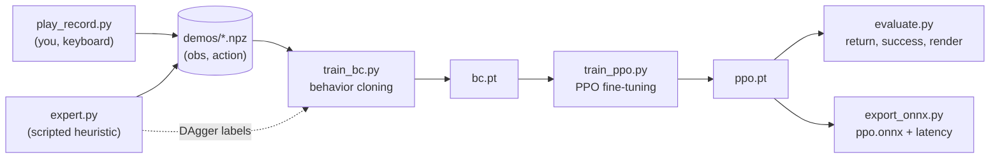

# Project 4: A Decision Model That Plays

In this project you build a complete decision-model pipeline around a small game designed from scratch for this site, **Orbital Courier**. A courier drone with momentum has to collect packages in an arena while avoiding drifting hazards. You will write the game as a Gymnasium environment, record demonstrations (your own, or a scripted expert's), behavior-clone an MLP policy, fine-tune it with your own PPO implementation, evaluate it properly, and export it to ONNX as a System 1 controller that decides in microseconds. Before any of that, you can play the game and train an agent right here in your browser.

!!! abstract "What you'll build"
    - `env.py`: a headless, numpy-only Gymnasium environment with ray-cast sensors and an optional pygame renderer
    - `play_record.py` and `expert.py`: two sources of demonstrations, human and scripted
    - `train_bc.py`: behavior cloning, plus DAgger
    - `train_ppo.py`: PPO fine-tuning from the BC policy, in one file
    - `evaluate.py`: mean return, success and crash rates on held-out levels, and live visualization
    - `export_onnx.py`: ONNX export and a latency measurement for real-time inference

    Full code: [code/p4_game_agent](https://github.com/vivek-rm-14286/llm-from-scratch/tree/main/code/p4_game_agent). Prerequisites: [RL Basics](../decision/rl-basics.md), [DQN & PPO](../decision/policy-methods.md), [Imitation Learning](../decision/imitation.md).

## Try it first: train an agent in your browser

The demo below is a JavaScript copy of the same game, simplified to 4 hazards and 8 rays per sensor. The policy is a tiny MLP (21 inputs → 16 tanh units → 9 actions, 505 weights) with a hand-written forward pass. It is trained live with the **cross-entropy method (CEM)**, a simple evolution strategy: sample 40 random weight vectors around a mean, score each on 3 levels, refit the mean and spread to the top 8, and repeat. No gradients, no backprop.

- **Train 10 generations** runs 10 CEM generations (a fraction of a second each). Click it several times. 20-40 generations usually produce an agent that collects several packages, and sometimes all five.
- **Watch best agent** shows the best policy so far playing new, unseen levels.
- **Play yourself** lets you fly the drone with the arrow keys (combine two keys for diagonals).
- **Reset** starts over from a new random population.

<div id="oc-demo" class="oc-demo">
<div class="oc-bar">
<button type="button" data-act="train">Train 10 generations</button>
<button type="button" data-act="watch">Watch best agent</button>
<button type="button" data-act="play">Play yourself</button>
<button type="button" data-act="reset">Reset</button>
</div>
<canvas class="oc-canvas" tabindex="0" aria-label="Orbital Courier game canvas"></canvas>
<div class="oc-status" aria-live="polite">Loading demo...</div>
<canvas class="oc-chart" aria-label="Training fitness chart"></canvas>
</div>
<style>
.oc-demo { max-width: 560px; margin: 1.2em auto; }
.oc-bar { display: flex; flex-wrap: wrap; gap: .4em; margin-bottom: .5em; }
.oc-bar button { flex: 1 1 auto; font: inherit; font-size: .72rem; padding: .45em .7em; border-radius: .3em; cursor: pointer;
  border: 1px solid var(--accent); color: var(--accent); background: transparent; }
.oc-bar button:hover, .oc-bar button.oc-on { background: var(--accent); color: var(--surface); }
.oc-bar button:disabled { opacity: .5; cursor: wait; }
.oc-canvas, .oc-chart { display: block; width: 100%; border-radius: .3em; }
.oc-canvas { outline: 1px solid var(--border); }
.oc-canvas:focus { outline: 2px solid var(--accent); }
.oc-status { font-size: .68rem; min-height: 2.6em; margin: .4em 0; color: var(--muted); }
</style>
<script>
// ---- CORE (sim + policy + CEM); mirrored into the page ----
var OC = (function () {
  var A = 10, DR = 0.25, PR = 0.35, HR = 0.6, ACC = 0.05, DAMP = 0.97, VMAX = 0.35;
  var NR = 8, RANGE = 4, NH = 4, MAXT = 400, WIN = 5;
  var OBS = 2 * NR + 5, HID = 16, NA = 9;
  var RD = [], AD = [[0, 0]];
  for (var i = 0; i < NR; i++) { var a = i * 2 * Math.PI / NR; RD.push([Math.cos(a), Math.sin(a)]); }
  for (var k = 0; k < 8; k++) { var b = k * Math.PI / 4; AD.push([Math.cos(b), Math.sin(b)]); }
  function rng(seed) { var s = seed >>> 0; return function () { s = (s + 0x6D2B79F5) >>> 0; var t = s; t = Math.imul(t ^ (t >>> 15), t | 1); t ^= t + Math.imul(t ^ (t >>> 7), t | 61); return ((t ^ (t >>> 14)) >>> 0) / 4294967296; }; }
  function gauss(r) { var u = 1 - r(), v = r(); return Math.sqrt(-2 * Math.log(u)) * Math.cos(2 * Math.PI * v); }
  function Game(seed) { this.r = rng(seed); this.reset(); }
  Game.prototype.reset = function () {
    var r = this.r; this.x = A / 2; this.y = A / 2; this.vx = 0; this.vy = 0; this.h = [];
    for (var i = 0; i < NH; i++) {
      var hx, hy;
      do { hx = HR + r() * (A - 2 * HR); hy = HR + r() * (A - 2 * HR); } while (Math.hypot(hx - this.x, hy - this.y) < 3);
      var an = r() * 2 * Math.PI, sp = 0.02 + r() * 0.04;
      this.h.push({ x: hx, y: hy, vx: Math.cos(an) * sp, vy: Math.sin(an) * sp });
    }
    this.t = 0; this.got = 0; this.done = false; this.event = ""; this.spawn();
  };
  Game.prototype.spawn = function () {
    var r = this.r, px, py, ok, n = 0;
    do {
      px = 1 + r() * (A - 2); py = 1 + r() * (A - 2); ok = Math.hypot(px - this.x, py - this.y) > 2;
      for (var i = 0; i < this.h.length; i++) if (Math.hypot(px - this.h[i].x, py - this.h[i].y) < HR + 1) ok = false;
    } while (!ok && ++n < 100);
    this.px = px; this.py = py;
  };
  Game.prototype.rays = function () {
    var hz = [], wl = [];
    for (var i = 0; i < NR; i++) {
      var dx = RD[i][0], dy = RD[i][1], best = RANGE, rr = HR + DR;
      for (var j = 0; j < this.h.length; j++) {
        var rx = this.h[j].x - this.x, ry = this.h[j].y - this.y, t = rx * dx + ry * dy;
        var p2 = rx * rx + ry * ry - t * t;
        if (t > 0 && p2 < rr * rr) { var d = Math.max(0, t - Math.sqrt(rr * rr - p2)); if (d < best) best = d; }
      }
      var tx = dx > 1e-9 ? (A - this.x) / dx : dx < -1e-9 ? -this.x / dx : Infinity;
      var ty = dy > 1e-9 ? (A - this.y) / dy : dy < -1e-9 ? -this.y / dy : Infinity;
      hz.push(best); wl.push(Math.min(tx, ty, RANGE));
    }
    return [hz, wl];
  };
  Game.prototype.obs = function () {
    var rw = this.rays(), o = [], i;
    for (i = 0; i < NR; i++) o.push(rw[0][i] / RANGE);
    for (i = 0; i < NR; i++) o.push(rw[1][i] / RANGE);
    var tx = this.px - this.x, ty = this.py - this.y, d = Math.hypot(tx, ty) + 1e-8;
    o.push(this.vx / VMAX, this.vy / VMAX, tx / d, ty / d, d / (A * Math.SQRT2));
    return o;
  };
  Game.prototype.step = function (a) {
    var d0 = Math.hypot(this.px - this.x, this.py - this.y);
    this.vx = this.vx * DAMP + AD[a][0] * ACC; this.vy = this.vy * DAMP + AD[a][1] * ACC;
    var s = Math.hypot(this.vx, this.vy); if (s > VMAX) { this.vx *= VMAX / s; this.vy *= VMAX / s; }
    this.x += this.vx; this.y += this.vy;
    if (this.x < DR) { this.x = DR; this.vx = Math.abs(this.vx) * 0.5; } else if (this.x > A - DR) { this.x = A - DR; this.vx = -Math.abs(this.vx) * 0.5; }
    if (this.y < DR) { this.y = DR; this.vy = Math.abs(this.vy) * 0.5; } else if (this.y > A - DR) { this.y = A - DR; this.vy = -Math.abs(this.vy) * 0.5; }
    for (var j = 0; j < this.h.length; j++) {
      var h = this.h[j]; h.x += h.vx; h.y += h.vy;
      if (h.x < HR || h.x > A - HR) { h.vx = -h.vx; h.x = Math.min(Math.max(h.x, HR), A - HR); }
      if (h.y < HR || h.y > A - HR) { h.vy = -h.vy; h.y = Math.min(Math.max(h.y, HR), A - HR); }
    }
    this.t++;
    var d1 = Math.hypot(this.px - this.x, this.py - this.y), rew = -0.01 + 0.5 * (d0 - d1);
    if (d1 < DR + PR) { rew += 10; this.got++; this.event = "pickup"; if (this.got >= WIN) { this.done = true; this.event = "win"; } else this.spawn(); }
    for (j = 0; j < this.h.length; j++) if (Math.hypot(this.h[j].x - this.x, this.h[j].y - this.y) < DR + HR) { rew -= 10; this.done = true; this.event = "crash"; }
    if (!this.done && this.t >= MAXT) { this.done = true; this.event = "timeout"; }
    return rew;
  };
  var NP = OBS * HID + HID + HID * NA + NA;
  function act(w, o) {
    var hdn = new Array(HID), i, j, k = 0, best = 0, bv = -Infinity;
    for (j = 0; j < HID; j++) { var s = w[OBS * HID + j]; for (i = 0; i < OBS; i++) s += w[i * HID + j] * o[i]; hdn[j] = Math.tanh(s); }
    var off = OBS * HID + HID;
    for (k = 0; k < NA; k++) { var z = w[off + HID * NA + k]; for (j = 0; j < HID; j++) z += w[off + j * NA + k] * hdn[j]; if (z > bv) { bv = z; best = k; } }
    return best;
  }
  function episode(w, seed) { var g = new Game(seed), R = 0; while (!g.done) R += g.step(act(w, g.obs())); return { R: R, got: g.got, win: g.event === "win" }; }
  function CEM(seed) { this.r = rng(seed); this.mu = new Float64Array(NP); this.sd = new Float64Array(NP).fill(0.5); this.gen = 0; this.best = null; this.bestF = -Infinity; this.hist = []; this.pop = 40; this.elite = 8; this.eps = 3; }
  CEM.prototype.generation = function () {
    var cands = [], c, i, e;
    for (c = 0; c < this.pop; c++) {
      var w = new Float64Array(NP);
      for (i = 0; i < NP; i++) w[i] = this.mu[i] + this.sd[i] * gauss(this.r);
      var f = 0, wins = 0;
      for (e = 0; e < this.eps; e++) { var res = episode(w, this.gen * 1000 + e + 1); f += res.R; wins += res.win ? 1 : 0; }
      cands.push({ w: w, f: f / this.eps, wins: wins });
    }
    cands.sort(function (a, b) { return b.f - a.f; });
    var el = cands.slice(0, this.elite);
    for (i = 0; i < NP; i++) {
      var m = 0, v = 0;
      for (e = 0; e < el.length; e++) m += el[e].w[i];
      m /= el.length;
      for (e = 0; e < el.length; e++) v += (el[e].w[i] - m) * (el[e].w[i] - m);
      this.mu[i] = m; this.sd[i] = Math.sqrt(v / el.length) + 0.02; // noise floor keeps exploring
    }
    var meanF = 0; for (e = 0; e < el.length; e++) meanF += el[e].f; meanF /= el.length;
    if (cands[0].f > this.bestF) { this.bestF = cands[0].f; this.best = cands[0].w; }
    this.gen++; this.hist.push({ best: cands[0].f, elite: meanF });
    return this.hist[this.hist.length - 1];
  };
  return { Game: Game, CEM: CEM, act: act, episode: episode, A: A, DR: DR, PR: PR, HR: HR, NR: NR, RD: RD, RANGE: RANGE, WIN: WIN, NP: NP };
})();
// ---- END CORE ----
// ---- UI ----
function initOrbitalDemo() {
  var root = document.getElementById("oc-demo");
  if (!root || root.dataset.ready === "1") return;
  root.dataset.ready = "1";
  var cv = root.querySelector(".oc-canvas"), ctx = cv.getContext("2d");
  var ch = root.querySelector(".oc-chart"), cctx = ch.getContext("2d");
  var statusEl = root.querySelector(".oc-status");
  var btns = {};
  root.querySelectorAll("button[data-act]").forEach(function (b) { btns[b.dataset.act] = b; });
  var S = { mode: "idle", cem: new OC.CEM(42), best: null, bestScore: null, training: false,
            game: new OC.Game(7), seed: 1000, keys: {}, acc: 0, last: 0, msg: "", msgT: 0, colors: null, colorsT: 0 };
  function colors() {
    var now = performance.now();
    if (S.colors && now - S.colorsT < 500) return S.colors;
    var cs = getComputedStyle(root);
    function v(n, d) { var x = cs.getPropertyValue(n).trim(); return x || d; }
    S.colors = { fg: v("--text", "#222"), fgl: v("--muted", "#888"),
                 bg: v("--code-bg", "#f5f5f5"), primary: v("--accent", "#2563c9"),
                 accent: "#e0a100", hazard: "#e5484d" };
    S.colorsT = now;
    return S.colors;
  }
  function resize() {
    var dpr = window.devicePixelRatio || 1, w = Math.max(200, Math.floor(cv.clientWidth));
    cv.width = Math.floor(w * dpr); cv.height = Math.floor(w * dpr); cv.style.height = w + "px";
    var cw = Math.max(200, Math.floor(ch.clientWidth));
    ch.width = Math.floor(cw * dpr); ch.height = Math.floor(90 * dpr); ch.style.height = "90px";
    draw(); drawChart();
  }
  function setStatus(t) { statusEl.textContent = t; }
  function setMode(m) {
    S.mode = m;
    Object.keys(btns).forEach(function (k) { btns[k].classList.toggle("oc-on", k === m); });
    if (m === "watch" || m === "play") newEpisode();
  }
  function newEpisode() { S.game = new OC.Game(S.seed++); S.acc = 0; }
  function evalPolicy(w) { var R = 0; for (var s = 0; s < 6; s++) R += OC.episode(w, 50000 + s).R; return R / 6; }
  function train(n) {
    if (S.training) return;
    S.training = true; btns.train.disabled = true;
    var left = n;
    (function tick() {
      if (!root.isConnected) return;
      var h = S.cem.generation();
      left--;
      setStatus("Training: generation " + S.cem.gen + " | best candidate " + h.best.toFixed(1) + " | elite mean " + h.elite.toFixed(1));
      drawChart();
      if (left > 0) { setTimeout(tick, 0); return; }
      var muW = Float64Array.from(S.cem.mu), muS = evalPolicy(muW), bS = evalPolicy(S.cem.best);
      var cand = muS >= bS ? { w: muW, s: muS } : { w: S.cem.best, s: bS };
      if (S.bestScore === null || cand.s > S.bestScore) { S.best = cand.w; S.bestScore = cand.s; }
      S.training = false; btns.train.disabled = false;
      setStatus("Done: " + S.cem.gen + " generations. Best agent scores " + S.bestScore.toFixed(1) +
                " on held-out levels (a perfect run is about 55). Click \"Watch best agent\" or train more.");
      if (S.mode === "idle") setMode("watch");
    })();
  }
  function humanAction() {
    var k = S.keys, dx = (k.ArrowRight ? 1 : 0) - (k.ArrowLeft ? 1 : 0), dy = (k.ArrowUp ? 1 : 0) - (k.ArrowDown ? 1 : 0);
    if (!dx && !dy) return 0;
    var ang = Math.atan2(dy, dx); if (ang < 0) ang += 2 * Math.PI;
    return 1 + (Math.round(ang / (Math.PI / 4)) % 8);
  }
  function stepOnce() {
    var g = S.game;
    if (g.done) return;
    var a = 0;
    if (S.mode === "watch" && S.best) a = OC.act(S.best, g.obs());
    else if (S.mode === "play") a = humanAction();
    g.step(a);
    if (g.done) {
      S.msg = g.event === "win" ? "Delivered all " + OC.WIN + "!" : g.event === "crash" ? "Crashed!" : "Out of time";
      S.msgT = performance.now();
    }
  }
  function draw() {
    var c = colors(), W = cv.width, sc = W / OC.A, g = S.game;
    ctx.fillStyle = c.bg; ctx.fillRect(0, 0, W, W);
    function X(x) { return x * sc; } function Y(y) { return W - y * sc; }
    var rays = g.rays()[0];
    ctx.lineWidth = Math.max(1, W / 500);
    for (var i = 0; i < OC.NR; i++) {
      var hit = rays[i] < OC.RANGE;
      ctx.strokeStyle = hit ? c.hazard : c.fgl; ctx.globalAlpha = hit ? 0.9 : 0.5;
      ctx.beginPath(); ctx.moveTo(X(g.x), Y(g.y));
      ctx.lineTo(X(g.x + OC.RD[i][0] * rays[i]), Y(g.y + OC.RD[i][1] * rays[i])); ctx.stroke();
    }
    ctx.globalAlpha = 1;
    ctx.fillStyle = c.hazard;
    for (var j = 0; j < g.h.length; j++) { ctx.beginPath(); ctx.arc(X(g.h[j].x), Y(g.h[j].y), OC.HR * sc, 0, 2 * Math.PI); ctx.fill(); }
    ctx.fillStyle = c.accent; ctx.beginPath(); ctx.arc(X(g.px), Y(g.py), OC.PR * sc, 0, 2 * Math.PI); ctx.fill();
    ctx.fillStyle = c.primary; ctx.beginPath(); ctx.arc(X(g.x), Y(g.y), OC.DR * sc * 1.2, 0, 2 * Math.PI); ctx.fill();
    ctx.strokeStyle = c.fg; ctx.lineWidth = Math.max(1, W / 300);
    ctx.beginPath(); ctx.moveTo(X(g.x), Y(g.y)); ctx.lineTo(X(g.x + g.vx * 3), Y(g.y + g.vy * 3)); ctx.stroke();
    ctx.fillStyle = c.fg; ctx.font = Math.round(W / 32) + "px sans-serif"; ctx.textBaseline = "top";
    var label = { idle: "Press a button below", watch: S.best ? "Agent playing" : "Untrained agent (train first)", play: "You: arrow keys", train: "" }[S.mode] || "";
    ctx.fillText(label + "   packages " + g.got + "/" + OC.WIN + "   t=" + g.t, W * 0.02, W * 0.02);
    if (g.done && S.msg) { ctx.font = "bold " + Math.round(W / 16) + "px sans-serif"; ctx.textAlign = "center"; ctx.fillText(S.msg, W / 2, W / 2 - W / 32); ctx.textAlign = "left"; }
  }
  function drawChart() {
    var c = colors(), W = ch.width, H = ch.height, hist = S.cem.hist;
    cctx.clearRect(0, 0, W, H);
    cctx.fillStyle = c.fg; cctx.font = Math.round(H / 7) + "px sans-serif"; cctx.textBaseline = "top";
    if (!hist.length) { cctx.fillText("Fitness per generation appears here after training.", 4, 4); return; }
    var lo = -15, hi = 60, n = Math.max(hist.length, 10), pad = H * 0.18;
    function px(i) { return 4 + (W - 8) * i / (n - 1); }
    function py(v) { return H - pad / 2 - (H - pad * 1.5) * (Math.min(hi, Math.max(lo, v)) - lo) / (hi - lo); }
    function line(key, col, wdt) {
      cctx.strokeStyle = col; cctx.lineWidth = wdt; cctx.beginPath();
      hist.forEach(function (h, i) { if (i) cctx.lineTo(px(i), py(h[key])); else cctx.moveTo(px(i), py(h[key])); });
      if (hist.length === 1) cctx.lineTo(px(0) + 2, py(hist[0][key]));
      cctx.stroke();
    }
    line("best", c.fgl, Math.max(1, H / 60)); line("elite", c.primary, Math.max(2, H / 30));
    cctx.fillText("elite mean (bold) and best candidate per generation  |  gen " + hist.length, 4, 2);
  }
  function loop(ts) {
    if (!root.isConnected) { if (window.__ocDemo === api) window.__ocDemo = null; return; }
    var dt = S.last ? Math.min(100, ts - S.last) : 0; S.last = ts;
    if (S.mode === "watch" || S.mode === "play") {
      S.acc += dt;
      while (S.acc >= 1000 / 30) { stepOnce(); S.acc -= 1000 / 30; }
      if (S.game.done && performance.now() - S.msgT > 1500) newEpisode();
    }
    draw();
    requestAnimationFrame(loop);
  }
  var api = {
    key: function (e, down) {
      if (S.mode !== "play" || !/^Arrow/.test(e.key)) return;
      var r = cv.getBoundingClientRect();
      if (r.bottom < 0 || r.top > window.innerHeight) return;  // only when the game is on screen
      S.keys[e.key] = down; e.preventDefault();
    }
  };
  window.__ocDemo = api;
  btns.train.addEventListener("click", function () { train(10); });
  btns.watch.addEventListener("click", function () {
    setMode("watch");
    if (!S.best) setStatus("No trained agent yet: it just coasts. Click \"Train 10 generations\" first.");
  });
  btns.play.addEventListener("click", function () { setMode("play"); cv.focus(); setStatus("Arrow keys thrust (combine for diagonals). Collect " + OC.WIN + " packages, avoid red hazards."); });
  btns.reset.addEventListener("click", function () {
    if (S.training) return;
    S.cem = new OC.CEM((Math.random() * 1e9) | 0); S.best = null; S.bestScore = null; S.keys = {};
    S.game = new OC.Game(7); S.mode = "idle"; setMode("idle"); S.msg = "";
    setStatus("Reset: a fresh random population of " + S.cem.pop + " policies (" + OC.NP + " weights each)."); drawChart();
  });
  if (window.ResizeObserver) new ResizeObserver(resize).observe(cv); else window.addEventListener("resize", resize);
  resize();
  setStatus("Policy: MLP with " + OC.NP + " weights (21 inputs: 8 hazard rays, 8 wall rays, velocity, package direction and distance). Trainer: cross-entropy method, " + S.cem.pop + " candidates per generation.");
  requestAnimationFrame(loop);
}
if (!window.__ocKeys) {
  window.__ocKeys = true;
  window.addEventListener("keydown", function (e) { if (window.__ocDemo) window.__ocDemo.key(e, true); });
  window.addEventListener("keyup", function (e) { if (window.__ocDemo) window.__ocDemo.key(e, false); });
}
window.__ocInit = initOrbitalDemo;  // the app calls this again each time the page is shown (guarded inside)
if (document.readyState === "loading") document.addEventListener("DOMContentLoaded", initOrbitalDemo);
else initOrbitalDemo();
</script>

What to notice while it trains:

- The first generations crash or coast. Then they learn "move toward the package". Avoiding hazards comes later, because it only matters once the agent survives long enough to meet them.
- The best candidate's score (thin line) is noisy because it is measured on only 3 levels. The elite mean (bold) is the better progress signal.
- Training directly on the reward with a black-box optimizer works for 505 weights. Black-box search needs many more episodes as the parameter count grows, so for the 23k-parameter policy below the Python version uses gradients: BC and then PPO.

## The design

### The game

| Element | Details |
|---|---|
| Arena | 10 × 10 units, soft walls (the drone bounces off at half speed) |
| Drone | radius 0.25, thrust 0.05/step, velocity damping 0.97, max speed 0.35 |
| Hazards | 6 discs of radius 0.6, drifting at 0.02-0.06 per step and bouncing off walls |
| Packages | one at a time, spawned away from the drone and the hazards; 5 to win |
| Episode end | 5 packages (success), a collision (crash), or 600 steps (truncation) |

**Observation, 37 floats, all roughly in [-1, 1]:**

- 16 **hazard rays**: distance to the nearest hazard along each of 16 directions, divided by the 4-unit sensor range (1.0 means nothing seen)
- 16 **wall rays**: the same for walls
- **velocity** (2), divided by max speed
- **unit vector to the package** (2) and **distance to the package** (1), divided by the arena diagonal

**Actions:** `Discrete(9)`: coast, or thrust toward one of 8 compass directions.

**Reward:** −0.01 per step, plus 0.5 × (decrease in distance to the package), +10 per package, −10 for a crash. The progress term is the potential-based shaping from [DQN & PPO](../decision/policy-methods.md#reward-shaping), with Φ = −0.5 × distance and γ taken as 1. It is measured against the package that was active at the start of the step, so a respawn does not create a fake penalty.

These choices follow the System 1 recipe from [System 1 & System 2 Models](../decision/system-one.md). The input is compact and engineered (rays rather than pixels), so a small MLP is enough, and the observation contains everything needed to act (velocity is included, so the problem is Markov).

### The pipeline



## Walkthrough of the key code

Everything below is excerpted from the repo. The files are short, so read them in full alongside this page.

### `env.py`: the environment

The environment subclasses `gymnasium.Env`, declares its spaces, and draws all randomness from `self.np_random` so that `reset(seed=...)` is reproducible.

```python title="env.py (excerpt)"
class OrbitalCourierEnv(gym.Env):
    metadata = {"render_modes": ["human", "rgb_array"], "render_fps": 30}

    def __init__(self, render_mode=None, n_hazards=6, packages_to_win=5, max_steps=600, shaping=0.5):
        ...
        self.observation_space = spaces.Box(-1.0, 1.0, shape=(OBS_DIM,), dtype=np.float32)
        self.action_space = spaces.Discrete(N_ACTIONS)

    def step(self, action):
        d_prev = np.linalg.norm(self.pkg - self.pos)
        self.vel = self.vel * DAMPING + ACTION_DIRS[action] * ACCEL   # thrust + drag
        ...                                                          # speed cap, walls, hazards drift
        d_new = np.linalg.norm(self.pkg - self.pos)
        reward = -0.01 + self.shaping * (d_prev - d_new)
        if d_new < DRONE_R + PKG_R:
            reward += 10.0; self.collected += 1
            ...                                                      # win or respawn package
        if np.any(np.linalg.norm(self.haz_pos - self.pos, axis=1) < DRONE_R + HAZ_R):
            reward -= 10.0; terminated = True
        truncated = (not terminated) and self.steps >= self.max_steps
        return self._obs(), float(reward), terminated, truncated, info
```

The ray-cast sensor is vectorized over all rays × hazards at once. For a ray from the drone in unit direction $d$ and a disc at relative position $c$, the projection $t = c \cdot d$ gives the closest approach. The ray hits if $t > 0$ and the perpendicular distance is less than the radius, and the entry distance is $t - \sqrt{r^2 - \text{perp}^2}$:

```python title="env.py (excerpt)"
def _hazard_rays(self):
    rel = self.haz_pos - self.pos                      # (H, 2)
    t = RAY_DIRS @ rel.T                               # (R, H) projection on each ray
    perp2 = (rel ** 2).sum(1)[None, :] - t ** 2        # squared perpendicular distance
    r = HAZ_R + DRONE_R                                # inflate by drone size
    hit = (t > 0) & (perp2 < r ** 2)
    dist = t - np.sqrt(np.clip(r ** 2 - perp2, 0, None))
    dist = np.where(hit, np.clip(dist, 0, None), RAY_RANGE)
    return np.minimum(dist.min(1), RAY_RANGE)
```

Running `python env.py` calls Gymnasium's `check_env` and plays one random episode. The random agent typically crashes within about 100 steps with a return around −10.

Rendering is a separate concern. `pygame` is imported lazily inside `render()`, so training never needs a display.

### `expert.py`: a scripted expert that only uses the observation

The expert is a **potential-field controller**: it is attracted to the package, repelled by close hazard rays (quadratic falloff), and gently repelled by walls it is about to touch. It converts the desired direction into a desired velocity (slowing near the package) and picks the thrust direction that best closes the velocity gap:

```python title="expert.py (excerpt)"
def expert_action(obs, hazard_gain=2.5, wall_gain=1.5):
    haz, wall = obs[:N_RAYS], obs[N_RAYS:2 * N_RAYS]
    vel = obs[2 * N_RAYS:2 * N_RAYS + 2] * V_MAX
    tdir = obs[2 * N_RAYS + 2:2 * N_RAYS + 4]
    tdist = obs[2 * N_RAYS + 4] * ARENA * np.sqrt(2)

    desired = tdir.copy()
    closeness = np.clip(1.0 - haz / 0.6, 0.0, None)          # only rays shorter than 60% of range
    desired -= hazard_gain * (closeness ** 2) @ RAY_DIRS
    wclose = np.clip(1.0 - wall / 0.15, 0.0, None)
    desired -= wall_gain * (wclose ** 2) @ RAY_DIRS

    speed = V_MAX * min(1.0, 0.3 + tdist / 3.0)               # brake near the package
    need = desired / np.linalg.norm(desired) * speed - vel
    if np.linalg.norm(need) < 0.02:
        return 0                                              # coast
    return int(np.argmax(ACTION_DIRS[1:] @ need)) + 1
```

!!! tip "Why the expert reads only the observation"
    If the expert used privileged simulator state (exact hazard positions), the student would have to imitate decisions based on information it cannot see, and cloning would be ill-posed. With an observation-only expert, a perfect clone is achievable in principle. It also makes DAgger trivial, because you can query the expert on any observation the student produces. (In robotics the opposite pattern, a privileged teacher distilled into a sensor-limited student, is also common. Try it as a stretch goal.)

On 100 held-out levels the expert succeeds about 98% of the time (mean return about 57). It is good but not perfect, which leaves room for both imitation and RL.

### `play_record.py`: your own demonstrations

The human recorder maps the arrow keys (or WASD) to the nearest of the 8 compass actions, steps the environment at 30 FPS, and saves `(obs, action)` pairs to `.npz`. By default it drops crashed episodes. Pass `--keep-crashes` to keep them, and think about what that does to the dataset. Five or ten good episodes give a few thousand transitions, enough for BC to pick up your style. Expect your clone to fly like you, mistakes included.

### `train_bc.py`: behavior cloning and DAgger

The policy is a 37 → 128 → 128 → 9 tanh MLP, about 23k parameters. The same `PolicyNet` class is used by PPO, by evaluation and by the ONNX export, so checkpoints are interchangeable.

```python title="train_bc.py (excerpt)"
class PolicyNet(nn.Module):
    def __init__(self, obs_dim=OBS_DIM, n_actions=N_ACTIONS, hidden=128):
        super().__init__()
        self.net = nn.Sequential(
            nn.Linear(obs_dim, hidden), nn.Tanh(),
            nn.Linear(hidden, hidden), nn.Tanh(),
            nn.Linear(hidden, n_actions))

    def forward(self, obs):
        return self.net(obs)

# BC = cross-entropy on (obs, expert action)
loss = F.cross_entropy(policy(X[b]), Y[b])

# DAgger: the learner drives, the expert labels, aggregate, refit
for it in range(args.dagger_iters):
    new_obs = []
    for e in range(args.dagger_episodes):
        o, _, _, _ = rollout(env, torch_policy_fn(policy), seed=50_000 + it * 1000 + e)
        new_obs += o
    new_acts = np.array([expert_action(x) for x in new_obs])
    obs, acts = np.concatenate([obs, new_obs]), np.concatenate([acts, new_acts])
    fit(policy, obs, acts, ...)
```

A surprise you will see in the log: **validation accuracy is only about 45-55%** (about 45% after plain BC, a little higher after the DAgger rounds), yet the cloned policy succeeds on about 94% of levels. The expert is a bang-bang controller. When the drone is near its desired velocity, neighboring thrust directions (N vs NE) score almost the same, and the expert's choice between them flips back and forth. Those "errors" barely change the trajectory. This is the lesson from [Imitation Learning](../decision/imitation.md): **per-step accuracy is a weak proxy. Judge the policy by closed-loop rollouts.**

### `train_ppo.py`: PPO fine-tuning from the BC policy

This follows the compact PPO from [DQN & PPO](../decision/policy-methods.md#a-compact-ppo-in-pytorch), with three additions for fine-tuning a pretrained policy:

```python title="train_ppo.py (excerpt)"
class ActorCritic(nn.Module):
    def __init__(self, hidden=128):
        super().__init__()
        self.pi = PolicyNet(hidden=hidden)       # same architecture as BC -> weights load directly
        self.v = nn.Sequential(nn.Linear(OBS_DIM, hidden), nn.Tanh(),
                               nn.Linear(hidden, hidden), nn.Tanh(), nn.Linear(hidden, 1))

ac = ActorCritic()
ac.pi.load_state_dict(load_policy(args.init).state_dict())        # (1)!
...
warmup = it <= args.critic_warmup                                  # (2)!
if warmup:
    loss = args.vf_coef * v_loss
else:
    ratio = torch.exp(logp - b_logp[mb])
    pi_loss = -torch.min(ratio * a_mb, torch.clamp(ratio, 1 - clip, 1 + clip) * a_mb).mean()
    loss = pi_loss + args.vf_coef * v_loss - args.ent_coef * entropy
...
if not warmup and approx_kl > args.target_kl:                      # (3)!
    break
```

1. **BC initialization.** The actor starts from the cloned weights, so exploration begins from competent behavior instead of random flailing.
2. **Critic warmup.** For the first few iterations only the value function trains. A random critic produces garbage advantages, and a few policy updates with garbage advantages can wreck a good BC policy.
3. **KL early stopping.** Stop the update epochs once the new policy has moved too far from the rollout policy. This plays the role of RLHF's KL penalty: improve, but do not wander far from a competent initialization.

Time-limit truncations are bootstrapped (`r += γ·V(s_final)`), and the GAE recursion resets at episode boundaries, exactly as in [DQN & PPO](../decision/policy-methods.md#a-compact-ppo-in-pytorch).

### `evaluate.py`: honest evaluation

Evaluation uses **held-out seeds** (≥ 100000, never used in training), a **greedy** policy by default (`--stochastic` to sample), and reports mean return with standard error, success rate, crash rate, packages per episode and episode length. `--render` opens a pygame window so you can watch the agent. The same script evaluates `.pt` checkpoints, `.onnx` files, and the scripted `expert`.

### Results from one run

On a laptop CPU, with 200 expert episodes, BC for 30 epochs plus 3 DAgger rounds, and PPO for 150 iterations of 2048 steps (about 300k steps, a couple of minutes), one seed gave the following on 100 held-out levels:

| Policy | Mean return | Success | Crash | Mean length |
|---|---|---|---|---|
| Scripted expert | 57.1 | 98% | 1% | 201 steps |
| BC + 3× DAgger | 56.1 | 94% | 5% | 197 steps |
| PPO from BC (150 iters) | 55.3 | 91% | 8% | 156 steps |
| PPO from scratch (150 iters) | 55.7 | 94% | 6% | 151 steps |

Your numbers will differ by a few points between seeds, so run 3 seeds before you draw conclusions. What is interesting is the *shape* of the results:

- **BC gets most of the way immediately.** The BC-initialized PPO run starts at about 100% training success at iteration 1. The from-scratch run starts at about −9 return and 0% success, and is still climbing (about 76% success with its stochastic training policy) at iteration 150. BC buys a lot of sample efficiency.
- **PPO optimizes the reward you wrote, not the metric you care about.** Both PPO policies finish episodes about 25% faster than the expert (156 vs 201 steps), because the per-step cost and the shaping term reward speed. They also crash a little more often, because a −10 crash costs about as much as one package. If safety matters more to you, change the reward (for example a −30 crash penalty) and watch the trade-off move. That is reward design in practice.
- **Greedy beats stochastic at evaluation.** Training-time success with sampled actions is lower than greedy success on the same policy.

### `export_onnx.py`: a System 1 controller

```python title="export_onnx.py (excerpt)"
torch.set_num_threads(1)
policy = load_policy(args.policy).eval()
torch.onnx.export(policy, (torch.zeros(1, OBS_DIM),), args.out,
                  input_names=["obs"], output_names=["logits"],
                  dynamic_axes={"obs": {0: "batch"}, "logits": {0: "batch"}},
                  opset_version=17, dynamo=False)
sess = ort.InferenceSession(args.out, so, providers=["CPUExecutionProvider"])
```

The script checks that ONNX Runtime and PyTorch produce the same logits (max difference around 1e-6 and the same argmax), then times a single-observation forward pass. On a laptop CPU this takes about **18 µs per step in PyTorch eager and about 7 µs in ONNX Runtime**. That is under 0.1% of a 60 Hz frame budget (16.7 ms). A decision model this size could run hundreds of agents per frame, or drive a 1 kHz control loop. This is the [System 1](../decision/system-one.md) end of the spectrum: fixed, tiny compute per decision. Compare it with the tens of milliseconds a [decision language model](../decision/routing-models.md#decision-language-models) needs for one choice, and with the seconds a reasoning model spends.

!!! note "`dynamo=False`"
    PyTorch 2.9 and later default to the new `torch.export`-based ONNX exporter. The script pins the legacy TorchScript exporter, which is simpler for a plain MLP. The `dynamo` argument exists from PyTorch 2.5, which is why `requirements.txt` asks for `torch>=2.5`. Both exporters produce equivalent graphs for this model.

## Running it

```bash
cd code/p4_game_agent
uv pip install -r requirements.txt
python expert.py --episodes 200 --out demos/expert.npz
python train_bc.py --demos "demos/*.npz" --epochs 30 --dagger-iters 3 --out checkpoints/bc.pt
python train_ppo.py --init checkpoints/bc.pt --iters 150 --out checkpoints/ppo.pt
python evaluate.py --policy checkpoints/ppo.pt --episodes 100
python evaluate.py --policy checkpoints/ppo.pt --episodes 5 --render
python export_onnx.py --policy checkpoints/ppo.pt --out checkpoints/ppo.onnx
```

The repository [README](https://github.com/vivek-rm-14286/llm-from-scratch/tree/main/code/p4_game_agent) has a smoke-test variant of every command with tiny iteration counts, which finishes in about a minute.

!!! warning "Common pitfalls"
    - **Evaluating on training seeds.** Always use held-out seeds. Levels are random, and a policy can overfit to specific layouts.
    - **Destroying the BC policy in the first PPO updates.** If the return drops sharply right after warmup, lengthen `--critic-warmup`, lower `--lr`, or tighten `--target-kl`.
    - **Mixing demos from different environment settings.** Demonstrations recorded with 5 hazards and trained against 6 still work, but they are off-distribution. Record and train with the same settings.
    - **Changing the observation without retraining.** The ONNX model and the checkpoints are tied to `OBS_DIM = 37` and the feature order.
    - **Pygame font errors on very new Python versions.** The renderer skips the HUD text if `pygame.font` fails to import. `pygame-ce` or Python 3.12 avoids this.

## Milestones

- [ ] `python env.py` passes `check_env`, and a random agent crashes quickly
- [ ] The scripted expert reaches at least 90% success on 100 held-out levels
- [ ] You recorded at least 5 episodes of your own play with `play_record.py`
- [ ] A BC policy trained only on your demos completes at least one level, and you can see your own habits in it
- [ ] BC on expert demos reaches at least 85% success. Compare it with and without DAgger.
- [ ] PPO from BC shortens episodes while keeping success within a few points of BC. Plot the return per iteration.
- [ ] PPO from scratch, for comparison: how many iterations does it need to match BC's starting point?
- [ ] `evaluate.py --render` shows the agent dodging hazards
- [ ] ONNX export matches PyTorch, and you measured per-step latency (mean and p99)
- [ ] You changed the reward (for example a larger crash penalty) and measured how the success/speed trade-off moved

## Stretch goals

1. **Decision Transformer.** Log trajectories from the expert, BC, PPO and random policies with their returns-to-go, train the [Decision Transformer](../decision/imitation.md#the-decision-transformer-rl-as-sequence-modeling) on windows of 20 steps, and evaluate it conditioned on different target returns. Does asking for a higher return actually produce faster deliveries?
2. **Pixels instead of rays.** Render 64×64 grayscale frames (`render_mode="rgb_array"`, then downsample), stack 3 frames for velocity, and train a small CNN policy. Use the ray-based PPO policy as a privileged teacher and DAgger-distill it into the pixel student. This is the teacher-student pattern from robotics.
3. **Self-play.** Make it two-player: two drones compete for the same package stream. Train with self-play against a pool of past checkpoints (to avoid strategy cycling) and track an Elo rating.
4. **A System 2 layer.** Add multiple packages visible at once and a slow planner (exhaustive search over pickup orders, or a small LLM given a text description) that picks *which* package to go for every second. The MLP stays the fast controller.
5. **Robustness.** Randomize hazard counts, speeds and sizes during training (domain randomization) and evaluate on harder settings than any seen in training.
6. **Deploy it in the browser.** Load `ppo.onnx` with ONNX Runtime Web and replace the CEM policy in the demo above with your PPO agent.

## Check your understanding

??? question "Why does the observation include velocity? What would happen without it?"
    Without velocity the state is not Markov: two identical ray readings could call for opposite thrusts depending on whether the drone is already moving fast toward a hazard. The policy would have to infer velocity from history, which an MLP without memory cannot do. You would need frame stacking or a recurrent policy.

??? question "Validation accuracy of the BC policy is about 45-55%, but it succeeds on about 94% of levels. How?"
    Many expert "decisions" are near-ties between neighboring thrust directions, and they lead to almost identical trajectories, so per-step mismatches rarely matter. What matters is closed-loop behavior, which is why you evaluate by rollouts.

??? question "Why warm up the critic before updating a BC-initialized actor?"
    PPO's policy gradient is weighted by advantages computed from the critic. A randomly initialized critic produces essentially random advantages, so the first policy updates would push the good BC policy in random directions. Training only the critic for a few iterations makes the advantages meaningful before the actor changes.

??? question "The PPO agent crashes more often than the expert but scores a similar return. Is the agent wrong?"
    No. It is optimizing the reward as written, in which time costs and progress shaping reward speed, and a crash costs about as much as one package. If crashes are worse than that for your purposes, the reward should say so. Reward design is part of building the decision model.

## Further reading

- [Gymnasium: Create a Custom Environment](https://gymnasium.farama.org/introduction/create_custom_env/)
- Schulman et al., [Proximal Policy Optimization Algorithms](https://arxiv.org/abs/1707.06347) (2017)
- Ross, Gordon & Bagnell, [DAgger](https://arxiv.org/abs/1011.0686) (2011)
- de Boer et al. (2005), "A Tutorial on the Cross-Entropy Method"
- Salimans et al., [Evolution Strategies as a Scalable Alternative to Reinforcement Learning](https://arxiv.org/abs/1703.03864) (2017)
- [ONNX Runtime](https://onnxruntime.ai/docs/) documentation
