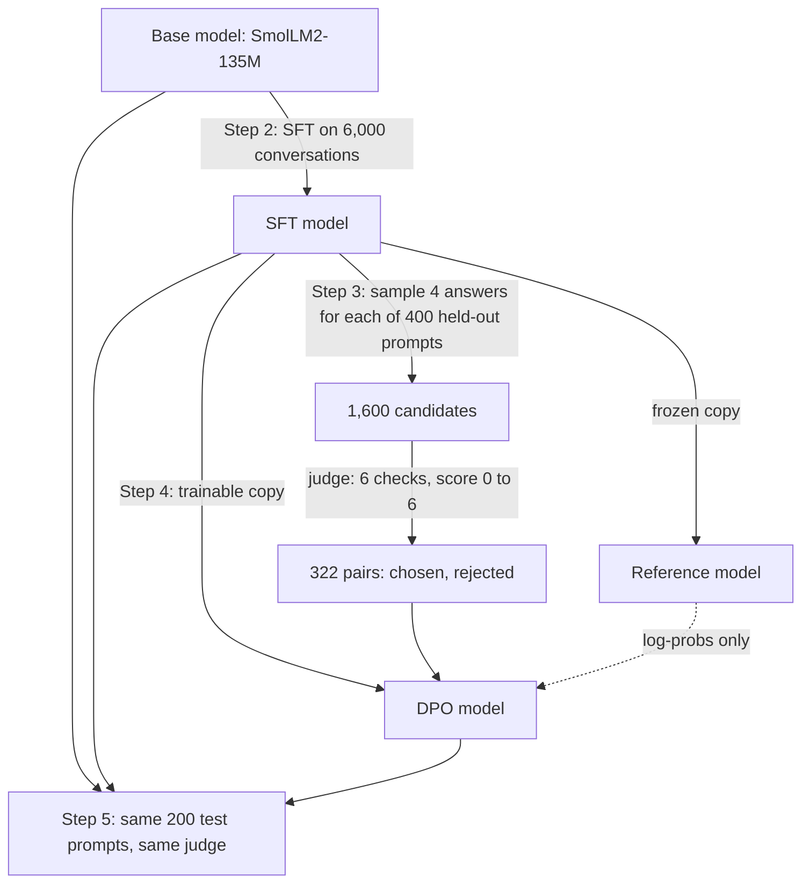

# Project 7: Post-train a Small Model, SFT Then DPO

A pretrained base model continues text. Ask it a question and it writes more questions. The step that turns it into an assistant is post-training, and in this project you write that step by hand, twice. First supervised fine-tuning: ChatML rendering, a loss mask and an explicit training loop that teach a 135M-parameter base model to answer and to stop. Then preference optimization: you sample several answers per prompt from your own SFT model, label them with a judge you can read in one screen, and train with a DPO loss you wrote against a frozen copy of the model. On a laptop the whole run takes about 25 minutes. In the run on this page the share of answers that pass every check goes from 0% for the base model to 31% after SFT and 44% after DPO, and the last section looks hard at what that 44% is made of, because part of it is the model learning the judge.

!!! abstract "What you'll build"
    - `data.py`: ChatML rendering with special tokens, the prompt-token loss mask, padding, and length-bucketed batching
    - `sft.py`: the masked next-token loss, a warmup-plus-cosine schedule, token-weighted eval loss, and the SFT training loop
    - `judge.py`: a programmatic judge made of six boolean checks, and the rule that turns sampled answers into (chosen, rejected) pairs
    - `dpo.py`: masked sequence log-probabilities, the DPO loss with its diagnostics, the frozen reference model, and the DPO training loop
    - Complete scripts around them: data preparation, `run_sft.py`, `build_prefs.py`, `run_dpo.py`, `evaluate.py`, and a cross-check of the DPO loss against a hand computation and TRL

    Full code: [code/post_train_assistant](https://github.com/vivek-rm-14286/llm-from-scratch/tree/main/code/post_train_assistant). Prerequisites: [Post-training overview](../post-training/index.md), [Supervised Fine-Tuning](../post-training/sft.md) (chat templates, loss masking, the SFT loop), [Preference Optimization](../post-training/preference.md) (the DPO derivation and loss) and the filtering sections of [Distillation & Synthetic Data](../post-training/distillation-synthetic-data.md). The functions here keep the names and shapes used on those pages.

!!! info "Two ways to do this project"
    **Fill in the starter.** `starter/` has the four files with signatures, docstrings and `TODO`s. `tests/` has 38 tests that run on a tiny randomly initialized model, so they need no download and finish in seconds. Run `pytest`, read the first failure, write the function, repeat. You are done with the code when `pytest` prints `38 passed`, and done with the project when the run in Steps 1 to 5 completes with `--impl starter`. This is the route the project is designed for, and it takes about 11 hours.

    **Read and modify.** Read `solution/` next to this page, run each command, then change one thing and predict the effect before measuring it: train on the user turns too, raise the DPO learning rate tenfold, remove one check from the judge. This takes 3 to 4 hours, most of it waiting for runs. The stretch goals work from either route.

    The two packages have identical file names and function signatures. The scripts take `--impl solution` (the default) or `--impl starter`.

## 0. Setup

```bash
git clone https://github.com/vivek-rm-14286/llm-from-scratch
cd llm-from-scratch/code/post_train_assistant
uv venv && source .venv/bin/activate      # or python -m venv .venv
uv pip install -r requirements.txt
```

The dependencies are torch, transformers (version 5: the code uses `dtype=`, not `torch_dtype=`), datasets and pytest. TRL is only used by the second half of Step 6. To skip it, delete the `trl` line from `requirements.txt`.

**Check the setup.** Both commands finish in a few seconds and download nothing:

```bash
pytest --impl solution     # 38 passed
pytest                     # 37 failed, 1 passed: that is your to-do list
```

`--impl` selects the package under test (default `starter`). `PTA_IMPL=solution pytest` does the same through an environment variable. Every starter function raises `NotImplementedError`, so each failure names the function to write. The one test that passes covers a helper that is already complete.

**Hardware tiers.** Pick one row. Only the first row is measured.

| Tier | Model | Settings | Whole run (Steps 1 to 5) |
|---|---|---|---|
| Laptop: Apple Silicon (MPS) with 16 GB, or a CPU | `HuggingFaceTB/SmolLM2-135M` | the defaults: 6,000 training conversations, batch size 8 | 24 minutes on an M1 Pro; on a CPU without a GPU, add `--limit 1000` to `run_sft.py` |
| One 16 GB GPU, such as an RTX 5070 Ti | `HuggingFaceTB/SmolLM2-360M` | `--model HuggingFaceTB/SmolLM2-360M --batch-size 16 --lr 3e-5`, and `python prepare_data.py --n-train 12000` | estimate: 15 to 30 minutes |
| One 24 GB GPU | `HuggingFaceTB/SmolLM2-360M` | as above with `--batch-size 32`, 2 epochs | estimate: 15 to 30 minutes |

The 135M model also runs on either GPU, in a few minutes. On CUDA the SFT loop uses bf16 autocast; DPO stays in float32.

**Expected time per step.** Coding time is for the fill-in route. Run time is measured on an Apple M1 Pro (16 GB, MPS) while other jobs were using the machine, so a quiet laptop is somewhat faster.

| Step | File | Tests | Coding | Run time |
|---|---|---|---|---|
| 0. Prepare data | `prepare_data.py` (complete) | | | 34 s |
| 1. Baseline | `evaluate.py` (complete) | | 30 minutes of reading | 175 s |
| 2. SFT | `data.py`, `sft.py` | `test_data.py` (7), `test_sft.py` (6) | 4 hours | 651 s training, 59 s evaluation |
| 3. Preference data | `judge.py` | `test_judge.py` (17) | 2 hours | 204 s |
| 4. DPO | `dpo.py` | `test_dpo.py` (8) | 3 hours | 237 s |
| 5. Evaluation | `evaluate.py` (complete) | | 1 hour of reading outputs | 56 s |
| 6. Cross-check | `crosscheck_dpo.py` (complete) | | 30 minutes | 4 s |

## The design



Four decisions shape the project:

- **A base model, not an instruct model.** `SmolLM2-135M` is the pretrained checkpoint. The `-Instruct` variant has already been through the process built here. Starting from the base model means every behavior the assistant ends up with was put there by your code.
- **A behavior that a program can check.** The assistant is asked to follow a length or format instruction appended to the question: `Answer in at most 20 words.`, `Answer in at most 40 words.`, `Answer in one sentence.` or `Answer with a numbered list of exactly 3 items.` Whether an answer complies is a string operation, so the judge needs no model, costs nothing, and can be read and argued with. Whether the answer is *correct* is not checked, and that gap is the subject of the discussion at the end.
- **On-policy preference pairs.** Both answers in every pair are samples from the SFT model itself. DPO then moves probability between things the model already does, which works better than pushing it toward text it would never produce (see the pitfalls in [Preference Optimization](../post-training/preference.md#reward-hacking-and-length-bias)).
- **Three disjoint prompt sets.** `prepare_data.py` streams the `openhermes-100k` subset of [HuggingFaceTB/smoltalk](https://huggingface.co/datasets/HuggingFaceTB/smoltalk) (Apache-2.0), keeps single-turn conversations of at most 200 tokens, removes duplicate questions, and splits 6,900 of them: 6,000 for SFT training, 300 for SFT eval loss, 400 prompts for building preference pairs, 200 prompts for the final test. No question appears in two sets.

```bash
python prepare_data.py
```

```text
read 44602 rows of smoltalk/openhermes-100k, kept 6900
sft_train 6000 (1295 with a relabeled constraint), sft_eval 300, pref_prompts 400, test_prompts 200
```

The "relabeled" count is a small data trick. The source data contains no length instructions, so SFT would never see one. For each training answer, `constraints.py` works out which of the instructions it happens to satisfy (an 18-word answer satisfies "at most 20 words"), and for half of those the instruction is appended to the question. The answer is untouched; only the question changes. The 600 held-out prompts all get an instruction, cycling through the four kinds.

## 1. The baseline: a base model does not follow instructions

Measure before training. `evaluate.py` renders each of the 200 test prompts in ChatML, generates up to 96 new tokens greedily and again with sampling at temperature 0.8, runs the judge from Step 3 on every answer, and reports the masked loss on the SFT eval set.

```bash
python evaluate.py --name base
```

```text
[base] SFT eval loss 1.9604
[base] greedy   pass-rate 0.000  mean score 2.54/6  mean words 62.6
   checks: finished 0.00  not_empty 1.00  clean 0.89  no_repeat 0.06  on_topic 0.57  constraint 0.04
----------------------------------------------------------------------
USER: Write a humorous one-liner about the advantages of having a dog.
Answer in one sentence.
BASE (greedy): Answer in one sentence.
Answer in one sentence.
Answer in one sentence.
...
```

Not one of 200 answers ends its turn: `finished` is 0.00, and every generation runs to the 96-token limit. The model has seen the token `<|im_end|>` in its vocabulary but was never trained to emit it after an answer. It treats the prompt as a document to continue, so it repeats the instruction, invents `Question 10`, or writes multiple-choice options. This is the gap between a language model and an assistant, as a number: 0 of 200.

## 2. SFT from scratch

### ChatML tokens

The [chat template](../post-training/sft.md#chat-templates) used here is ChatML: each turn is `<|im_start|>role\ncontent<|im_end|>\n`. The two markers must be single tokens, so that the model can end a turn with one prediction. `ensure_chatml_tokens` handles both cases:

```python title="data.py"
def ensure_chatml_tokens(tokenizer, model):
    vocab = tokenizer.get_vocab()
    missing = [t for t in (IM_START, IM_END) if t not in vocab]
    if missing:
        old_n = model.get_input_embeddings().weight.size(0)
        tokenizer.add_special_tokens({"additional_special_tokens": missing})
        model.resize_token_embeddings(len(tokenizer))
        with torch.no_grad():
            emb = model.get_input_embeddings().weight
            emb[old_n:] = emb[:old_n].mean(dim=0, keepdim=True)          # (1)!
            out = model.get_output_embeddings()
            if out is not None and out.weight is not emb:      # untied output head
                out.weight[old_n:] = out.weight[:old_n].mean(dim=0, keepdim=True)
    return tokenizer.convert_tokens_to_ids(IM_START), tokenizer.convert_tokens_to_ids(IM_END)
```

1. A new row initialized to the mean of the existing rows starts as an "average token". A randomly initialized row has a different scale from the trained ones and produces large, arbitrary logits until training fixes it.

SmolLM2's tokenizer already reserves both markers (ids 1 and 2), so on the default model nothing is resized and `run_sft.py` prints `<|im_start|>=1 <|im_end|>=2, vocab 49152`. The resize branch is exercised by `tests/test_data.py` with a tokenizer that lacks them, and it is the branch that runs if you swap in a base model such as GPT-2.

### Rendering and the loss mask

`render_chatml` is the function from the [loss masking section of the SFT lesson](../post-training/sft.md#loss-masking-train-on-answers-not-questions). It tokenizes turn by turn, so the mask never has to be recovered by searching a token stream:

```python title="data.py"
def render_chatml(messages, encode, im_start_id, im_end_id, nl_ids):
    ids, labels = [], []
    for msg in messages:
        header = [im_start_id] + encode(msg["role"]) + nl_ids
        body = encode(msg["content"]) + [im_end_id]
        ids += header
        labels += [IGNORE] * len(header)
        ids += body
        labels += body if msg["role"] == "assistant" else [IGNORE] * len(body)
        ids += nl_ids
        labels += [IGNORE] * len(nl_ids)
    return ids, labels
```

Labels are `-100` everywhere except the assistant's content and its `<|im_end|>`. Including `<|im_end|>` in the labels is what teaches the model to stop. `tests/test_data.py` checks the function on a known conversation with a character-level tokenizer, where the positions can be counted by hand: the conversation `2+2=?` / `4` / `10+7=?` / `17` renders to 56 tokens, and exactly positions 24, 25, 52, 53 and 54 carry labels (`4`, `<|im_end|>`, `1`, `7`, `<|im_end|>`).

`render_prompt` reuses it and appends `<|im_start|>assistant\n`, the generation prompt. On the real data, 64% of the tokens are trained on and 36% are masked:

```text
train 6000 conversations, 733317 tokens, 468832 trained tokens (64%); eval 300
```

### Length bucketing

Conversations here range from 33 to 223 tokens. A batch is padded to its longest member, so random batches waste computation on padding. The SFT lesson describes [packing](../post-training/sft.md#packing) as one remedy. This project uses the other, **length bucketing**, because it keeps one conversation per row and leaves the mask logic untouched:

```python title="data.py"
def length_bucketed_batches(lengths, batch_size, *, bucket_mult=50, seed=0):
    rng = random.Random(seed)
    idx = list(range(len(lengths)))
    rng.shuffle(idx)
    chunk = batch_size * bucket_mult
    batches = []
    for s in range(0, len(idx), chunk):
        part = sorted(idx[s : s + chunk], key=lambda i: lengths[i])     # (1)!
        batches += [part[b : b + batch_size] for b in range(0, len(part), batch_size)]
    rng.shuffle(batches)                                                # (2)!
    return batches
```

1. Sorting inside chunks of 400 examples, not over the whole dataset, keeps batch composition random from epoch to epoch.
2. Without this shuffle the model would see lengths in ascending order within each chunk, which is a curriculum nobody asked for.

On the 6,000 training conversations with batch size 8, random batches are 36.5% padding and bucketed batches are 1.3% padding. That is a third of the compute recovered by twelve lines.

### The loss and the loop

The loss is the shifted next-token cross-entropy over labeled positions only:

$$
\mathcal{L}_{\text{SFT}} = -\frac{1}{\sum_t m_t} \sum_{t} m_t \log \pi_\theta(x_t \mid x_{<t})
$$

```python title="sft.py"
def sft_loss(model, x, y):
    logits = model(input_ids=x).logits[:, :-1, :]      # position t predicts token t+1
    targets = y[:, 1:]
    return F.cross_entropy(logits.reshape(-1, logits.size(-1)).float(),
                           targets.reshape(-1), ignore_index=-100)
```

`tests/test_sft.py` compares it with a hand computation that loops over every labeled position in float64, and checks that a two-conversation batch equals the token-weighted mean of the two single losses (5 and 13 labeled tokens). `eval_loss` applies the same weighting across batches, so its value does not depend on the batch size.

The training loop is the [from-scratch SFT loop](../post-training/sft.md#a-from-scratch-sft-loop) with nothing hidden: AdamW, a learning rate set by hand every step, gradient clipping, and an evaluation every 150 steps.

```python title="sft.py"
for epoch in range(epochs):
    for idx in length_bucketed_batches(lengths, batch_size, seed=seed + epoch):
        x, y = collate([train_data[i] for i in idx], pad_id, max_len)
        x, y = x.to(device), y.to(device)
        cur_lr = lr_at(step, base_lr=lr, warmup_steps=warmup_steps, total_steps=total_steps)
        for group in opt.param_groups:
            group["lr"] = cur_lr
        with torch.autocast(device_type="cuda", dtype=torch.bfloat16, enabled=use_amp):
            loss = sft_loss(model, x, y)
        opt.zero_grad(set_to_none=True)
        loss.backward()
        torch.nn.utils.clip_grad_norm_(model.parameters(), grad_clip)
        opt.step()
        step += 1
        running.append(loss.item())
        release_cache(device)                                           # (1)!
```

1. On Apple Silicon the MPS allocator keeps a buffer for every tensor shape it has seen, and with bucketing nearly every batch has a new shape. Without this call the 135M model grows past 6 GB within a few batches and the machine starts swapping: generating answers for 64 prompts took 140 s, against 19 s with the cache released. On CUDA and CPU the call does nothing.

`lr_at` is linear warmup for 50 steps, then cosine decay to 10% of the peak. All parameters are trained (full fine-tuning; a 135M model does not need LoRA), at a peak learning rate of $5 \times 10^{-5}$ for one epoch. Right padding needs no attention mask in a causal model: padded positions come after the real ones and their labels are `-100`.

```bash
python run_sft.py
```

```text
device mps, 134.5M parameters, <|im_start|>=1 <|im_end|>=2, vocab 49152
step 0/750 eval_loss 1.9604
step 150/750 train_loss 1.6661 eval_loss 1.3021 lr 4.78e-05 145s
step 300/750 train_loss 1.4212 eval_loss 1.2651 lr 3.73e-05 270s
step 450/750 train_loss 1.3681 eval_loss 1.2445 lr 2.25e-05 393s
step 600/750 train_loss 1.3585 eval_loss 1.2366 lr 9.91e-06 518s
step 750/750 train_loss 1.3400 eval_loss 1.2328 lr 5.00e-06 642s
eval loss 1.9604 -> 1.2328 in 643s; saved to out/sft
```

Most of the drop happens in the first 150 steps. That part is the format: the model learns that an answer follows `<|im_start|>assistant\n` and that `<|im_end|>` closes it. The slow remainder is content.

```bash
python evaluate.py --model out/sft --name sft --against base
```

```text
[sft] greedy   pass-rate 0.310  mean score 4.82/6  mean words 29.9
   checks: finished 0.83  not_empty 0.95  clean 1.00  no_repeat 0.71  on_topic 0.91  constraint 0.41
   vs base: win 179 tie 18 loss 3 -> win-rate 0.940
```

The model now ends its turn 83% of the time and never leaks a template marker. It satisfies the stated constraint in only 41% of answers. SFT taught it to be an assistant; it mostly ignores the instruction about length. That is the behavior Step 4 goes after.

## 3. A preference dataset from a transparent judge

DPO needs triples: a prompt, a preferred answer, a rejected answer. Human labels are the usual source ([Preference data](../post-training/preference.md#preference-data)). Here a program writes them, in the generate-then-filter pattern of [rejection sampling and verification](../post-training/distillation-synthetic-data.md#rejection-sampling-and-verification).

### The rubric

`judge.py` scores one answer with six boolean checks. The score is the number that pass, 0 to 6.

| Check | Passes when | Catches |
|---|---|---|
| `finished` | generation stopped at the end-of-turn token before the 96-token limit | rambling, never ending the turn |
| `not_empty` | the answer has at least 3 words | empty or one-word answers |
| `clean` | no template marker in the text and no line that is only `user`, `assistant` or `system` | leaked markers, invented turns |
| `no_repeat` | no sequence of 4 consecutive words occurs twice | loops |
| `on_topic` | the answer shares at least one content word (4+ letters, not a stopword) with the question | answers about something else |
| `constraint` | the instruction is met: word count, exactly one sentence, or exactly $n$ numbered lines and nothing else | ignoring the instruction |

```python title="judge.py"
def check_response(question, response, constraint, finished):
    text = response.strip()
    q_words = content_words(question)
    return {
        "finished": bool(finished),
        "not_empty": len(words(text)) >= 3,
        "clean": not any(m in text for m in _LEAKS)
                 and not any(_ROLE_LINE.match(ln) for ln in text.splitlines()),
        "no_repeat": not has_repeated_ngram(text, 4),
        "on_topic": not q_words or bool(q_words & content_words(text)),
        "constraint": bool(text) and satisfies(text, constraint),
    }
```

Every check is a few lines of string handling, and `tests/test_judge.py` has a case that fails each one in isolation. The rubric says nothing about whether the answer is true, helpful or well written. It is a proxy, chosen because it is cheap and inspectable. Keep its blind spots in mind:

- A wrong answer that is short, tidy and on topic scores 6.
- `on_topic` is word overlap. A good answer that paraphrases the question fails it, and an answer that copies the question passes it.
- `finished`, `no_repeat` and three of the four constraints are easier to pass with a shorter answer. Only `not_empty` pushes the other way, and its bar is 3 words.

### From scores to pairs

`build_prefs.py` samples 4 answers per prompt from the SFT model at temperature 0.8 and scores each. `pick_pair` chooses the pair:

```python title="judge.py"
def pick_pair(scores, min_gap=1):
    if not scores:
        return None
    best = max(range(len(scores)), key=lambda i: (scores[i], -i))
    worst = min(range(len(scores)), key=lambda i: (scores[i], i))
    if scores[best] - scores[worst] < min_gap:
        return None
    return best, worst
```

The chosen answer is the highest-scoring sample and the rejected one the lowest. Ties go to the lower index, never to the shorter answer, so the pairing rule adds no length preference of its own. A prompt whose four samples all score the same carries no signal and produces no pair.

```bash
python build_prefs.py
```

```text
322 pairs from 400 prompts x 4 samples (candidate pass-rate 0.309)
mean words: chosen 28.4, rejected 46.2; chosen is shorter in 260/322 pairs
checks that separate chosen from rejected: {'constraint': 141, 'no_repeat': 173, 'finished': 139, 'not_empty': 22, 'on_topic': 46}
```

Read these three lines before training anything. 78 of the 400 prompts gave no pair. The pairs are separated mostly by `no_repeat`, `constraint` and `finished`, which is the intended signal. And the chosen answer is shorter in 81% of the pairs, by 18 words on average. Nothing in the code asked for short answers, but the dataset now says "shorter is better" far more consistently than it says anything else. Length bias usually runs the other way, toward long answers, because human raters and LLM judges like detail ([length bias](../post-training/preference.md#reward-hacking-and-length-bias)). The direction depends on the judge. The mechanism is the same.

Two pairs from the file, as written by the SFT model:

```text
Q: You pick 5 flowers and then catch 3 butterflies. How many flowers did you pick?
   Answer in at most 20 words.
chosen   (6/6): You picked 5 flowers.
rejected (4/6): To calculate the number of flowers you picked, I would need to know the total number
                of flowers you picked. So, 5 + 3 = 8 flowers.

Q: A farmer has 15 sheep, and all but 8 die. How many are left?
   Answer in one sentence.
chosen   (6/6): A farmer has 15 sheep, so 15 - 8 = 8 sheep die.
rejected (5/6): The farmer has 15 sheep, and all but 8 die. 8 die and are left. 15 sheep die, so
                there are 15 - 8 = 11 sheep left.
```

The first pair is what the project hopes for. In the second, the chosen answer is wrong arithmetic in one sentence, and it scores 6 of 6.

### Optional: an LLM judge

`build_prefs.py --llm-judge` adds a second opinion through any OpenAI-compatible `/chat/completions` endpoint (set `OPENAI_BASE_URL`, `OPENAI_API_KEY` and `JUDGE_MODEL`; a local Ollama or vLLM server works). `llm_judge.py` asks for a 1-to-5 rating of correctness and maps it to a number in $[0, 1]$, which is added to the programmatic score. Because it is at most 1, with the default `--min-gap 1` it separates answers that tie on the rubric and can cancel a one-check difference, but it cannot make an answer that fails two more checks win. A judge that knows arithmetic would cancel the one-point lead of the chosen answer in the sheep pair above, and the pair would be dropped. Trying it is the second stretch goal. See [LLM-as-judge filtering](../post-training/distillation-synthetic-data.md#llm-as-judge-filtering) for what such a judge gets wrong in turn.

## 4. DPO from scratch

The [derivation](../post-training/preference.md#dpo-from-the-rlhf-objective-to-a-simple-loss) ends in one line. For a prompt $x$ with chosen answer $y_w$ and rejected answer $y_l$:

$$
\mathcal{L}_{\text{DPO}} = -\log \sigma\Big(\beta\big[\log \pi_\theta(y_w \mid x) - \log \pi_{\text{ref}}(y_w \mid x)\big] - \beta\big[\log \pi_\theta(y_l \mid x) - \log \pi_{\text{ref}}(y_l \mid x)\big]\Big)
$$

$\pi_\theta$ is the model being trained, $\pi_{\text{ref}}$ a frozen copy of the model it started from. Each bracket is an implicit reward: how much more likely the policy makes an answer than the reference did. The loss asks for the chosen answer's reward to exceed the rejected one's. Three functions implement it.

**Sequence log-probabilities.** The summed log-probability of the answer tokens, with the same `-100` mask as SFT. The only difference from `sft_loss` is a sum per row where SFT takes a mean over the batch:

```python title="dpo.py"
def sequence_logprobs(model, input_ids, labels):
    logits = model(input_ids=input_ids).logits[:, :-1, :]
    targets = labels[:, 1:]
    mask = targets != IGNORE
    safe = targets.masked_fill(~mask, 0)                  # gather needs valid indices
    logp = torch.log_softmax(logits.float(), dim=-1)
    tok = logp.gather(-1, safe.unsqueeze(-1)).squeeze(-1)
    return (tok * mask).sum(-1)
```

**The loss and its diagnostics.**

```python title="dpo.py"
def dpo_loss(pi_w, pi_l, ref_w, ref_l, beta=0.1):
    chosen_reward = beta * (pi_w - ref_w)
    rejected_reward = beta * (pi_l - ref_l)
    margin = chosen_reward - rejected_reward
    loss = -F.logsigmoid(margin).mean()
    return loss, {
        "reward_acc": (margin > 0).float().mean().item(),
        "margin": margin.mean().item(),
        "chosen_reward": chosen_reward.mean().item(),
        "rejected_reward": rejected_reward.mean().item(),
    }
```

`reward_acc` is the share of pairs in which the policy has moved toward the chosen answer more than toward the rejected one. `chosen_reward` and `rejected_reward` show *how* the margin is being opened: by raising the chosen answers, lowering the rejected ones, or both.

**One forward pass for both halves.** `build_dpo_example` renders `prompt + chosen` and `prompt + rejected` with the SFT renderer, masking the prompt. `dpo_batch` stacks the chosen rows on top of the rejected rows, and `dpo_forward` runs the reference without gradients and the policy with them:

```python title="dpo.py"
def dpo_forward(policy, ref_model, ids, labels, beta):
    B = ids.size(0) // 2
    with torch.no_grad():
        ref_lp = sequence_logprobs(ref_model, ids, labels)
    pi_lp = sequence_logprobs(policy, ids, labels)
    return dpo_loss(pi_lp[:B], pi_lp[B:], ref_lp[:B], ref_lp[B:], beta)
```

The tests pin the behavior down from three sides. On a toy batch with margins of $1.0$ and $-1.5$ the loss must equal $\tfrac{1}{2}\big[\ln(1 + e^{-1}) + \ln(1 + e^{1.5})\big]$. When the policy is the reference, every margin is 0 and the loss must be $\ln 2 = 0.6931$, whatever the model and data. And at that starting point the gradient with respect to the chosen log-probability must be $-\beta/2$ and with respect to the rejected one $+\beta/2$.

`train_dpo` is a plain loop around `dpo_forward`: AdamW without weight decay, a constant learning rate after 5 warmup steps, gradient clipping at 1.0, and a held-out set of pairs evaluated every 10 steps. The learning rate is $2 \times 10^{-6}$, 25 times smaller than the SFT rate, with $\beta = 0.1$.

```bash
python run_dpo.py
```

```text
device mps; 290 training pairs, 32 held-out pairs, beta 0.1, lr 2e-06
step 0  eval_loss 0.6931 eval_reward_acc 0.0000 eval_margin 0.0000
step 10 reward_acc 0.7250 margin 0.0058 chosen_reward 0.0015 rejected_reward -0.0043 loss 0.6902 eval_loss 0.6849 eval_reward_acc 0.8125 eval_margin 0.0166
step 30 reward_acc 0.7500 margin 0.0468 chosen_reward -0.0115 rejected_reward -0.0583 loss 0.6712 eval_loss 0.6637 eval_reward_acc 0.7812 eval_margin 0.0613
step 50 reward_acc 0.9125 margin 0.2353 chosen_reward 0.0177 rejected_reward -0.2176 loss 0.5862 eval_loss 0.6434 eval_reward_acc 0.7812 eval_margin 0.1063
step 74 reward_acc 0.9062 margin 0.3673 chosen_reward -0.0215 rejected_reward -0.3888 loss 0.5379 eval_loss 0.6064 eval_reward_acc 0.8125 eval_margin 0.1969
done in 232s; saved to out/dpo
```

(The log is trimmed to five of its nine rows and the `seconds` column is removed.) Three things to read off:

- **Step 0 is exactly $\ln 2$** with a margin of 0. If your loop prints anything else there, the reference is not a copy of the starting policy, or the two halves of the batch are misaligned.
- **The margin opens almost entirely by lowering the rejected answers.** `chosen_reward` stays within 0.03 of zero while `rejected_reward` falls to $-0.39$. Dividing by $\beta$, the rejected answers lost about 3.9 nats of log-probability and the chosen ones barely moved. The chosen answers were already things the model was likely to say; the cheap way to separate the pair is to stop saying the other one.
- **Training reward accuracy reaches 0.91, held-out 0.81**, and the training loss (0.54) pulls away from the held-out loss (0.61) in the second epoch. With 290 pairs, two epochs is already the beginning of memorization. The held-out number rests on 32 pairs, so one pair is 3 points.

## 5. Evaluation

The same command as in Steps 1 and 2, now with `--against sft`:

```bash
python evaluate.py --model out/dpo --name dpo --against sft
```

```text
[dpo] SFT eval loss 1.2485
[dpo] greedy   pass-rate 0.440  mean score 5.24/6  mean words 20.2
   checks: finished 0.96  not_empty 0.93  clean 1.00  no_repeat 0.89  on_topic 0.89  constraint 0.57
   by constraint: Answer in at most 20 words. 23/50  Answer in at most 40 words. 33/50  Answer in one sentence. 27/50  Answer with a numbered list of exactly 3 items. 5/50
   vs sft: win 63 tie 125 loss 12 -> win-rate 0.627
```

It reports four things, each answering a different question:

- **Rubric pass-rate**: the share of the 200 test answers that pass all six checks. This is the headline number for the behavior.
- **Win-rate against SFT**: for each test prompt, the two models' answers are scored by the same judge. A higher score is a win, an equal score a tie, and the win-rate counts ties as half. It is the held-out version of what DPO trained on.
- **SFT eval loss**: the masked loss on the 300 held-out SFT conversations. DPO has no term that keeps the model good at the original data, so this number is the regression alarm.
- **Mean words**, because a win-rate without a length next to it hides the most common failure of preference optimization.

`evaluate.py` writes every generation to `out/gen_<name>.jsonl` with its per-check results. Reading 30 of them next to each other is part of the evaluation, not an extra.

## 6. Cross-check the loss

A loss that goes down proves little. `crosscheck_dpo.py` checks the DPO loss value on a fixed batch of three pairs against two independent computations, on a tiny random model so it needs no download:

```bash
python crosscheck_dpo.py
```

```text
from-scratch loss 0.635398   hand computation 0.635398   |diff| 9.22e-08
TRL 1.18.0 DPOTrainer loss 0.634263   from-scratch on the same tensors 0.634250   |diff| 1.28e-05
```

The first line compares against explicit Python loops over tokens in float64. The second hands the same three pairs to TRL's `DPOTrainer` (see [DPO with TRL](../post-training/preference.md#dpo-with-trl)), lets it tokenize them with a ChatML template, asks it for the loss on its first batch, and then runs `dpo_forward` on TRL's own `input_ids` and completion mask. The two lines show different loss values because TRL builds slightly different tensors from the same pairs. On identical tensors the two implementations agree to about $10^{-5}$, which is float32 rounding. Without `trl` installed, the second check is skipped.

## Results from one run

Measured on an Apple M1 Pro (16 GB, MPS) with Python 3.12, torch 2.15, transformers 5.23 and datasets 5.2, seed 0, default settings throughout, while other jobs were using the same machine. `SmolLM2-135M`, 6,000 SFT conversations for 1 epoch, 322 preference pairs (290 for training) for 2 epochs, 200 test prompts.

**The three models on the 200 test prompts** (greedy decoding unless noted)

| | Base | SFT | DPO |
|---|---|---|---|
| SFT eval loss (300 conversations) | 1.960 | 1.233 | 1.249 |
| Rubric pass-rate, greedy | 0.0% | 31.0% | 44.0% |
| Rubric pass-rate, sampled at temperature 0.8 | 0.0% | 28.5% | 42.5% |
| Mean score out of 6 | 2.54 | 4.82 | 5.24 |
| Mean answer length in words | 62.6 | 29.9 | 20.2 |
| Win-rate against the previous stage (win / tie / loss) | | 94.0% (179 / 18 / 3) | 62.7% (63 / 125 / 12) |

**Per check** (share of the 200 greedy answers that pass)

| Check | Base | SFT | DPO |
|---|---|---|---|
| `finished` | 0.00 | 0.83 | 0.96 |
| `not_empty` | 1.00 | 0.95 | 0.93 |
| `clean` | 0.89 | 1.00 | 1.00 |
| `no_repeat` | 0.06 | 0.71 | 0.89 |
| `on_topic` | 0.57 | 0.91 | 0.89 |
| `constraint` | 0.04 | 0.41 | 0.57 |

**Per instruction** (answers out of 50 that pass all six checks)

| Instruction | SFT | DPO | Mean words, SFT to DPO |
|---|---|---|---|
| At most 20 words | 15 | 23 | 33.8 to 25.4 |
| At most 40 words | 24 | 33 | 30.7 to 19.6 |
| One sentence | 15 | 27 | 29.6 to 18.7 |
| Numbered list of exactly 3 items | 8 | 5 | 25.6 to 17.2 |

**Training**

| Measurement | Result |
|---|---|
| SFT: 750 steps, batch size 8 | eval loss 1.960 to 1.233 in 643 s (0.86 s per step, evaluations included) |
| Padding with length bucketing, against random batches | 1.3% against 36.5% |
| Preference data: 400 prompts, 4 samples each | 322 pairs in 204 s; 30.9% of the 1,600 candidates pass all checks |
| Chosen answer shorter than rejected | 260 of 322 pairs; mean 28.4 against 46.2 words |
| DPO: 74 steps, batch size 8 | loss 0.693 to 0.538 in 232 s (3.1 s per step, evaluations included) |
| DPO reward accuracy, last 4 training steps / 32 held-out pairs | 0.91 / 0.81 |
| DPO held-out loss and margin | 0.693 to 0.606; margin 0 to 0.197 |
| Whole pipeline, data preparation through the DPO evaluation | 1,416 s, about 24 minutes |
| Test suite on `solution/` | 38 passed in about 4 s |

**The same prompts, three models** (greedy)

```text
USER: Consider the following scenario and suggest a possible response for the character: 'A store
      manager receives a complaint about a rude staff member from a customer.'
      Answer in at most 40 words.
BASE: Consider the following scenario and suggest a possible response for the character: 'A
      store manager receives a complaint about a rude staff member from a customer.'
      Answer in at most 40 words.

      Question 10

      The following scenario is a description of a situation that you would encounter in a job interview. [...]
SFT:  The store manager should take the following action:
      1. Respond promptly and professionally to the complaint.
      2. Implement a corrective action plan to address the issue.
      3. Provide feedback to the customer and the staff member to improve their behavior.
      4. Encourage the customer to report the issue to the manager.
DPO:  The store manager should take immediate action to address the issue and apologize to the customer.
```

```text
USER: Explain the concept of conformity with two examples.
      Answer in one sentence.
SFT:  Conformity is the process of following the opinions, beliefs, or practices of others, often
      without question or reflection. It can be seen in the way people conform to social norms,
      such as wearing the same clothes or hairstyle, or in the way they conform to the opinions of their peers.
DPO:  Conformity is the process of following the opinions, beliefs, or practices of others, often
      without question or reflection.
```

```text
USER: If a trader initially had 55 bags of rice in stock and currently has 164 bags of rice after
      restocking with 132 bags, how many bags of rice did she sell?
      Answer in one sentence.
SFT:  If the trader initially had 55 bags of rice in stock, then she initially had 55/100 = 0.55 bags of rice.
      After restocking with 132 bags, she now has 132/100 = 1.32 bags of rice.
      Therefore, the trader sold 1.32 bags of rice.
      #### 1.32
      The answer is: 1                                         (3/6, cut off at the token limit)
DPO:  She sold 164 bags of rice.                               (6/6)
```

```text
USER: Given 4 words "apartment", "building", "store", "clean", rank them according to the most
      important to the least important
      Answer with a numbered list of exactly 3 items.
SFT:  1. apartment
      2. building
      3. store                                                 (6/6)
DPO:  1. apartment                                             (4/6)
```

## What DPO did and did not change

**What it changed.** With 290 pairs and four minutes of training, the pass-rate rose from 31.0% to 44.0%, and the model won 63 held-out prompts against 12 losses. The gains are where the pairs pointed: `finished` from 0.83 to 0.96, `no_repeat` from 0.71 to 0.89, `constraint` from 0.41 to 0.57. The first two sample outputs show the intended effect. The SFT model knew what to say and ignored the instruction; the DPO model says the first part and stops.

**It learned "shorter", which is not the same as "follows the instruction".** Mean length fell from 29.9 to 20.2 words, and it fell under every instruction, including the one that asks for a three-item list. That row is the evidence: list answers passing all checks went *down*, from 8 to 5, because the model now often stops after `1.` The preference data said "shorter wins" in 81% of pairs, and that is the rule that generalized. For three of the four instructions, shorter and compliant coincide, so the pass-rate rises. For the fourth they conflict, and the count falls (8 and 5 of 50 are small numbers, so treat the direction as a warning and not as a measurement). The mean length under "at most 20 words" is still 25.4 words: the model became briefer, it did not learn to count.

**It gamed the judge, mildly.** The rice example scores 6 of 6 and is wrong; the SFT answer was also wrong, but visibly so. A short confident sentence that reuses a noun from the question passes every check, and nothing in the rubric separates it from a correct one. At the extreme, answers of fewer than three words rose from 9 to 15 of 200, and two of the 12 losses are answers that collapsed to the single word `Yes`. `not_empty` and `on_topic` each dipped by about 2 points. None of this is the optimizer malfunctioning. It is the optimizer doing its job on a proxy, as described under [reward hacking](../post-training/preference.md#reward-hacking-and-length-bias). The rubric never measured correctness, so the 13-point gain is a gain in *form* and says nothing about whether answers got more accurate.

**It cost a little on the original task.** SFT eval loss went from 1.233 to 1.249. That is consistent with the shift in length: the model now puts more probability on ending early, and the reference answers in that set do not. The change is small because the learning rate is small and $\beta$ ties the policy to the reference, and it grows with every extra epoch. This is the number to watch when turning DPO up.

**What the numbers cannot support.** One seed, 200 test prompts: a pass-rate near 40% has a standard error of about 3.5 points, so 31.0% against 44.0% is a real difference and 44.0% against 42.5% (greedy against sampled) is not. Of the 200 comparisons with SFT, 125 are ties, so the win-rate of 62.7% rests on 75 decided prompts. Held-out reward accuracy rests on 32 pairs.

**What to try next**, in order of expected effect: balance the pairs so that the shorter answer wins about half the time (drop pairs until it does, and compare); raise `not_empty` to a bar that depends on the question; add the LLM judge so that wrong short answers stop scoring 6; and evaluate each change with mean length and SFT eval loss printed next to the pass-rate.

## Milestones

- [ ] `pytest tests/test_data.py`: 7 passed, including the label positions `[24, 25, 52, 53, 54]` on the known conversation
- [ ] `pytest tests/test_sft.py`: 6 passed; the masked loss matches the hand computation to $10^{-4}$
- [ ] `python evaluate.py --name base` reports a pass-rate of 0.000 and `finished 0.00`, and you can say why
- [ ] `python run_sft.py --impl starter` prints an eval loss of about 1.96 at step 0 and below 1.30 at the last step
- [ ] The SFT model's greedy pass-rate is at least 0.25 and `finished` is at least 0.75 (the reference run: 0.310 and 0.83)
- [ ] `pytest tests/test_judge.py`: 17 passed
- [ ] `python build_prefs.py --impl starter` writes at least 250 pairs, and you wrote down the share of pairs in which the chosen answer is shorter
- [ ] `pytest tests/test_dpo.py`: 8 passed; the loss is $\ln 2$ within $10^{-5}$ when the policy equals the reference
- [ ] `python run_dpo.py --impl starter` prints `eval_loss 0.6931` at step 0, and held-out reward accuracy of at least 0.70 at the last step (the reference run: 0.81)
- [ ] The DPO model's win-rate against SFT is above 0.55 and its SFT eval loss is within 0.05 of the SFT model's (the reference run: 0.627 and +0.016)
- [ ] `python crosscheck_dpo.py --impl starter` prints a difference below $10^{-4}$ on both lines
- [ ] `pytest` prints `38 passed`
- [ ] You read at least 30 rows of `out/gen_sft.jsonl` next to `out/gen_dpo.jsonl` and found one answer that passes all six checks and is wrong

## Stretch goals

1. **A reward model and best-of-n.** Train a small reward model on the 322 pairs with the Bradley-Terry loss from [Reward models](../post-training/preference.md#reward-models-and-the-bradley-terry-model): a copy of the SFT model with a scalar head on the last token. Then skip DPO entirely: sample 8 answers per test prompt from the SFT model and return the one the reward model scores highest. Compare its pass-rate and mean length with the DPO model's, and its cost per answer.
2. **An LLM judge.** Run `build_prefs.py --llm-judge` against a local model served by Ollama or vLLM, retrain, and re-evaluate. Then score 100 test answers from the SFT and DPO models with the LLM judge alone and see whether it agrees that DPO improved. Report how often the two judges disagree on which answer in a pair is better.
3. **Remove the length bias.** Subsample the pairs until the chosen answer is shorter in about half of them, or add a seventh check that fails answers under a question-dependent minimum length. Retrain and fill in the "per instruction" table again. The target: the numbered-list row improves and mean length under the other three rows stops falling.
4. **GRPO on a verifiable task.** Replace the preference pairs with a reward that needs no pairs at all: generate arithmetic questions, give reward 1 when the final number is correct and the constraint holds, and train with the [GRPO update](../post-training/reasoning-rl.md#grpo-from-scratch). `sequence_logprobs` and the sampling code from `common.py` are most of what it needs.
5. **The 360M model.** On a GPU, repeat the run with `HuggingFaceTB/SmolLM2-360M` and 12,000 training conversations (the second hardware tier). Compare the SFT pass-rate with the 135M model's before running DPO, and check whether a stronger SFT model leaves DPO less to fix.
6. **The DPO knobs.** Sweep $\beta \in \{0.01, 0.1, 0.5\}$ and the learning rate over $\{5 \times 10^{-7}, 2 \times 10^{-6}, 10^{-5}\}$. For each run record pass-rate, mean words and SFT eval loss. Find the setting at which SFT eval loss rises by more than 0.1 and read its samples.
7. **Precomputed reference log-probabilities.** The reference never changes. Compute `ref_w` and `ref_l` for every pair once, store them, and drop the reference model from memory during training. Measure the time per step before and after.

## Check your understanding

??? question "The base model's `finished` rate is 0.00 even though `<|im_end|>` is in its vocabulary. What has to be true of the SFT labels for that to change?"
    The label at the position after the last answer token must be `<|im_end|>`, not `-100`. The model learns to emit a token only if that token appears as a target. `render_chatml` puts `<|im_end|>` inside the assistant body for exactly this reason. Mask it out and the model learns the content of answers and never learns that they end, so generation runs to the token limit as the base model does.

??? question "Why is the DPO loss exactly $\ln 2$ at step 0, and what does a different value tell you?"
    The policy starts as a copy of the reference, so $\log \pi_\theta - \log \pi_{\text{ref}}$ is 0 for every answer, every margin is 0, and $-\log \sigma(0) = \ln 2$. A different value means the two models are not computing the same thing on the same tokens: the reference was copied from a different checkpoint, one of them is in training mode with dropout, the chosen and rejected halves of the batch are misaligned between the two forward passes, or one pass runs in a different precision.

??? question "During DPO, `chosen_reward` stayed near 0 while `rejected_reward` fell to $-0.39$. Is the model getting better at producing chosen answers?"
    Not directly. The implicit reward is $\beta$ times the change in log-probability relative to the reference, so the chosen answers are about as likely as before and the rejected ones lost about 3.9 nats. The loss only constrains the difference, and lowering an answer's probability is easy: make one of its early tokens unlikely and the whole sequence becomes unlikely. The probability mass removed from rejected answers goes somewhere, and where it goes is not controlled by the loss. In this run it went to shorter answers, some of them good and two of them the single word `Yes`.

??? question "The pass-rate rose by 13 points. Why can't that be reported as \"DPO made the assistant 13 points better\"?"
    Because the judge that measured the gain is the judge that wrote the training labels, and it checks form only. The gain shows that the model moved toward what the rubric rewards, on prompts it had not seen. It does not show that answers became more correct, and the samples include wrong answers with perfect scores. An independent measurement is needed for that claim: a different judge, a task with verifiable answers, or human reading. The honest summary is "13 points more answers pass the format rubric, mean length fell by a third, and the list instruction got worse".

??? question "`pick_pair` breaks ties by index, not by length. The dataset still ended up with the shorter answer chosen in 81% of pairs. Where does the bias come from?"
    From the checks, not from the pairing rule. `finished` fails answers that hit the token limit, `no_repeat` is more likely to fail the more words there are, and three of the four constraints are upper bounds on length. A longer sample has more ways to fail. The bias is a property of what the rubric measures, so it cannot be removed by changing how pairs are picked from scores. It has to be removed by changing the rubric or by rebalancing the pairs afterwards.

??? question "Why does the padding fraction matter more for this training loop than the 36% figure suggests on a laptop?"
    Padded positions still go through every layer and through the output projection onto 49,152 vocabulary entries, which is the largest tensor in the forward pass. With random batches a third of that work is discarded by the mask. On MPS there is a second cost: the allocator caches buffers by shape, and padded batches take many different, larger shapes. Bucketing reduces the first cost and the explicit cache release handles the second.

## Further reading

- Rafailov et al., [Direct Preference Optimization: Your Language Model is Secretly a Reward Model](https://arxiv.org/abs/2305.18290) (2023)
- Ouyang et al., [Training language models to follow instructions with human feedback](https://arxiv.org/abs/2203.02155) (2022): the SFT, reward model, PPO pipeline that DPO simplifies
- Tunstall et al., [Zephyr: Direct Distillation of LM Alignment](https://arxiv.org/abs/2310.16944) (2023): SFT then DPO on synthetic preferences, at 7B scale
- Meng et al., [SimPO: Simple Preference Optimization with a Reference-Free Reward](https://arxiv.org/abs/2405.14734) (2024): a length-normalized objective
- Park et al., [Disentangling Length from Quality in Direct Preference Optimization](https://arxiv.org/abs/2403.19159) (2024)
- Allal et al., [SmolLM2: When Smol Goes Big](https://arxiv.org/abs/2502.02737) (2025): the base model and the SmolTalk dataset
- [HuggingFaceTB/smoltalk](https://huggingface.co/datasets/HuggingFaceTB/smoltalk) and [HuggingFaceTB/SmolLM2-135M](https://huggingface.co/HuggingFaceTB/SmolLM2-135M)
- [TRL documentation: DPO Trainer](https://huggingface.co/docs/trl/dpo_trainer)

With a model you post-trained yourself and a clear view of what a judge can and cannot certify, [Project 8: On-Call Agent](oncall-agent.md) puts models to work behind tools, guardrails and an evaluation gate.
