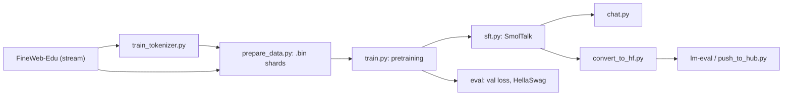

# Project 9: Build a ~500M-Parameter SLM From Scratch

In this project you build a small language model end to end. You train your own tokenizer, stream and tokenize billions of tokens of web text, write a modern Llama-style transformer, pretrain it on one or more GPUs, evaluate it, turn it into a chatbot with supervised fine-tuning (SFT), convert it to Hugging Face format, and publish it on the Hub. When you finish you will have a 487M-parameter model that you understand line by line, and that `transformers`, `lm-evaluation-harness`, vLLM and llama.cpp can load like any other Llama checkpoint.

!!! abstract "What you'll learn"
    - How to pick a concrete architecture (width, depth, heads, FFN size, vocab) for a parameter budget, and how to count the parameters exactly
    - How to train a byte-level BPE tokenizer and turn a streamed dataset into memory-mapped token shards
    - How a production-style pretraining loop works: bf16 autocast, `torch.compile`, gradient accumulation to a fixed tokens-per-step, WSD schedule, DDP, checkpoint/resume, and MFU
    - How to budget compute with $C \approx 6ND$ and turn FLOPs into GPU-hours and money
    - How SFT works mechanically: chat templates, special tokens, and loss masking
    - How to check that your weights are *really* compatible with HF `LlamaForCausalLM` (the RoPE layout trap), then evaluate and release

All code is in [`code/slm_500m`](https://github.com/vivek-rm-14286/llm-from-scratch/tree/main/code/slm_500m). Every script has a `--tiny` mode or a self-test that runs on a laptop CPU or Apple-silicon GPU in under a minute, so you can read, run and break everything before you rent a GPU.

!!! info "Two ways to do this project"
    **Run and modify.** Clone the repository, run each script as described, read it against the walkthrough, then change something (a schedule, a width, the data mix) and predict the effect before you run it. This is the faster route and the one the [roadmap](../start/roadmap.md) assumes.

    **Rebuild.** Write each file yourself from the walkthrough, in the order of the file table below, and use the supplied file only to compare. The checks that exist tell you when your version is right:

    - `config.py`, `model.py`: `python count_params.py` must print 486,605,824 for both the analytic and the instantiated count.
    - `model.py` (RoPE layout, GQA, KV cache): `python convert_to_hf.py --check` must print `PASS`.
    - `train_tokenizer.py`, `prepare_data.py`, `train.py`: `python train.py --tiny` must take the validation loss from about 6.1 to about 1.3 in 60 steps.
    - `sft.py`, `chat.py`: `python sft.py --tiny`, then `chat.py` on the result, must produce a reply that ends on its own.

    There are no per-file unit tests beyond these, so for the other scripts compare your output with the supplied script's output on the tiny data.

## How the project is split

| Part | What you do | Hardware | When (roadmap) |
|---|---|---|---|
| [Part 0](#part-0-train-a-30m-model-on-your-laptop) | Train a 31.5M model on TinyStories with the same code | Laptop (Apple Silicon) or a free Colab GPU | Optional from week 7; otherwise weeks 25-26 |
| [Part A](#part-a-pretrain-and-evaluate-the-base-model) | Tokenizer, data, pretraining, validation loss and HellaSwag | CPU machine for data; 1-8 rented H100s for the run | Weeks 25-28 |
| [Part B](#part-b-sft-chat-and-release) | SFT, chat, Hugging Face conversion, release | One rented GPU for a few hours | Week 29, after [Supervised Fine-Tuning](../post-training/sft.md) |

Part A needs the Language Models and Pretraining pages only. Part B starts from the checkpoint Part A produces, so the two can be weeks apart.



## 0. Setup and the one-minute smoke test

```bash
git clone https://github.com/vivek-rm-14286/llm-from-scratch
cd llm-from-scratch/code/slm_500m
uv venv && source .venv/bin/activate      # or python -m venv .venv
uv pip install -r requirements.txt        # torch, numpy, tokenizers, transformers, datasets, ...

python count_params.py                    # prints the parameter breakdown and compute budget
python train.py --tiny                    # builds a synthetic dataset, trains 60 steps on CPU/MPS
python sft.py --tiny                      # runs SFT on the tiny model
python chat.py --ckpt out/tiny_sft/ckpt_latest.pt --prompt "What is 3 plus 4?"
python convert_to_hf.py --check           # this model's logits == HF LlamaForCausalLM logits
```

The tiny run takes about ten seconds on an M-series laptop. The validation loss falls from about 6.1 ($\ln 450$, the tiny vocab size) to about 1.3, and the sample changes from random bytes to sentences like `"Ada said that an old map was big. Then Barbara said that..."`. The tiny model is too small to do the arithmetic in its synthetic data correctly. That is expected: the point of the tiny run is to exercise every code path. All scripts assume you run them from `code/slm_500m/`.

| File | What it does |
|---|---|
| `config.py` | `ModelConfig` dataclass plus presets `p500m`, `p125m`, `p30m`, `tiny` |
| `model.py` | The transformer: RMSNorm, RoPE, GQA attention, SwiGLU, KV cache, sampling |
| `count_params.py` | Analytic and instantiated parameter count, plus the FLOPs/GPU-hours estimate |
| `train_tokenizer.py` | Byte-level BPE with HF `tokenizers` |
| `prepare_data.py` | Parallel tokenization into uint16 `.bin` shards plus a val split; data mixing |
| `train.py` | Pretraining: single GPU, DDP, bf16, compile, WSD/cosine, resume, MFU, wandb |
| `sft.py` | ChatML SFT with loss masking on `HuggingFaceTB/smoltalk` |
| `chat.py` | Interactive chat or completion with KV cache, temperature and top-p |
| `eval_hellaswag.py` | HellaSwag scoring with the same preprocessing as lm-evaluation-harness |
| `convert_to_hf.py` | Export to `LlamaForCausalLM`; `--check` proves logit equality |
| `push_to_hub.py` | Writes a model card and uploads to the Hub |
| `configs/*.json` | Ready-made runs: `p500m_10b`, `p500m_50b`, `p125m_24gb`, `p30m_laptop` |

## Part 0: train a 30M model on your laptop

Before renting anything, run the whole pretraining pipeline at a size a laptop can finish: the `p30m` preset on [TinyStories](https://huggingface.co/datasets/roneneldan/TinyStories), a corpus of short children's stories written with a small vocabulary. Every step is the same code path as the 500M run (tokenizer, shards, `train.py`, resume, sampling), so the mistakes made here are free.

```python title="config.py"
"p30m": ModelConfig(vocab_size=8192, d_model=512, n_layers=8, n_heads=8, n_kv_heads=2,
                    ffn_hidden=1792, max_seq_len=512),
```

```text
$ python count_params.py --model p30m
per layer: attn=655,360  ffn=2,752,512  norms=1,024  -> 3,408,896
8 layers           = 27,271,168
embedding (tied)    = 4,194,304
analytic total      = 31,465,984
instantiated total  = 31,465,984  (31.5M)
```

It is the same architecture at one sixteenth of the size: 8 layers of width 512, head dimension 64, 4 query heads per K/V head, a 3.5x SwiGLU, and an 8,192-token vocabulary, which is plenty for TinyStories.

```bash
# 1. An 8k tokenizer from 200k stories (a few minutes; streams, so no full download)
python train_tokenizer.py --dataset roneneldan/TinyStories --name "" \
    --num_docs 200000 --vocab_size 8192 --out tokenizer_ts

# 2. 60M training tokens plus 1M validation tokens, as uint16 shards (about 120 MB)
python prepare_data.py --tokenizer tokenizer_ts/tokenizer.json --out data/tinystories \
    --source roneneldan/TinyStories::text:1.0 --total_tokens 60e6 \
    --val_tokens 1000000 --shard_tokens 20000000

# 3. Train on 50M tokens: 1,526 steps of 32,768 tokens
python train.py --config configs/p30m_laptop.json
```

```json title="configs/p30m_laptop.json"
{
  "model": "p30m", "data_dir": "data/tinystories", "out_dir": "out/p30m",
  "seq_len": 512, "batch_size": 16, "total_batch_tokens": 32768,
  "lr": 6e-4, "schedule": "wsd", "warmup_steps": 200, "decay_frac": 0.2,
  "max_steps": 1526, "eval_every": 250, "sample_every": 500, "save_every": 250,
  "sample_prompt": "Once upon a time"
}
```

**How long it takes.** The model costs about 0.21 GFLOP per training token, so 50M tokens are about $1.1 \times 10^{16}$ FLOPs.

| Machine | Throughput | 50M tokens |
|---|---|---|
| M1 Pro, 16 GB (MPS, fp32) | 5,000-6,500 tokens/s over a short run | about 2.5 hours |
| Free Colab T4 (`--dtype fp32`) | not measured | estimate: 1-2 hours |

Only the M1 Pro row is a measurement, and it comes from the first dozen steps, not a full run. Newer and larger Apple Silicon chips are faster. For your own machine, read `tok/s` from the log after 20 steps and divide: time = 50,000,000 / tokens per second. On a T4, pass `--dtype fp32`: the default on CUDA is bf16 autocast, which the T4 does not support natively. The MFU column in the log assumes an H100, so ignore it here. To stop early, press ++ctrl+c++ and continue later with `--resume out/p30m/ckpt_latest.pt`. A shorter run (`--max_steps 600`, about 20M tokens) already shows the whole shape of the curve.

**What to expect.** The step-0 loss is about $\ln 8192 \approx 9.0$. It falls fast in the first hundred steps as the model learns which tokens are common, then more slowly. The samples printed every 500 steps should move from noise, to story-like word salad, to short grammatical stories with recurring characters. They will still lose the plot after a few sentences. No reference loss is given, because the full run was not measured for this page. Judge the run by the shape of the curve, by train and validation loss staying close together, and by the samples.

**Before moving on,** try three things: resume the run from a checkpoint and confirm that the loss continues where it stopped; switch to `--schedule cosine` for a few hundred steps and compare; and run `python chat.py --ckpt out/p30m/ckpt_latest.pt --base --prompt "Once upon a time"`.

## Part A: pretrain and evaluate the base model

Part A covers sections 1 to 6: choose the architecture, budget the run, train the tokenizer, prepare the data, pretrain, and evaluate the base model with validation loss and HellaSwag.

## 1. The architecture: choosing a ~500M config

The model is a decoder-only transformer with the same design as Llama 3, Qwen2.5, SmolLM2 and most other open models released in the last two years. If any component is unfamiliar, read [Modern Architectures & SLM Design](../llm/modern-architectures.md) first. Here we focus on why each choice fits a model of this size.

### The config

```python title="config.py"
@dataclass
class ModelConfig:
    vocab_size: int = 49152      # 3 * 2^14: multiple of 64/128 for fast matmuls
    d_model: int = 1024          # hidden size
    n_layers: int = 32           # deep-and-thin
    n_heads: int = 16            # query heads -> head_dim = 64
    n_kv_heads: int = 4          # GQA: 4 query heads share each K/V head
    ffn_hidden: int = 3584       # SwiGLU hidden size (3.5 x d_model)
    max_seq_len: int = 2048
    rope_theta: float = 10000.0
    norm_eps: float = 1e-5
    tie_embeddings: bool = True
```

Here is the reasoning behind each number:

- **Deep and thin (32 layers × 1024 wide).** For a fixed budget under 1B parameters, more layers at smaller width tends to beat fewer, wider layers. The MobileLLM paper studied this directly, and SmolLM2-360M (32 layers, width 960) follows the same pattern. Depth costs some throughput, because each layer is a sequential step and small matmuls use the GPU less efficiently. At this scale you still get good MFU.
- **Head dimension 64.** 16 heads × 64 = 1024. A head dimension of 64 or 128 is standard, and FlashAttention kernels are tuned for both.
- **GQA with 4 KV heads.** Each group of 4 query heads shares one K/V head. That shrinks the KV cache 4× at inference time and removes 75% of the $W_k, W_v$ parameters, with very little quality loss ([GQA paper](https://arxiv.org/abs/2305.13245)). At this size the KV cache is small anyway. You mostly gain inference speed and better-spent parameters.
- **SwiGLU FFN of 3584.** SwiGLU has three matrices instead of two, so the "parameter-neutral" hidden size versus a 4× GELU MLP is $\tfrac{8}{3}d \approx 2731$. We go wider, to 3.5×, between SmolLM2 (about 2.7×) and Llama 3.2 1B (4×), because FFN parameters are where most of the model's knowledge goes. 3584 = 14 × 256, which keeps the matmuls tile-friendly.
- **Vocab 49,152, tied embeddings.** This is the same vocab size as the SmolLM family. With width 1024 the embedding is 50M parameters, about 10% of the model. Tying input and output embeddings saves a *second* 50M. At 500M scale, that 10% is better spent on transformer layers. Llama 3.2 1B, SmolLM2 and Gemma all tie. A vocab below 65,536 also lets us store tokens as `uint16`, which halves disk and RAM use.
- **No biases, RMSNorm, pre-norm.** Biases add almost nothing and slightly hurt stability at scale. RMSNorm is cheaper than LayerNorm and works as well.
- **Context 2048, RoPE theta 10,000.** This is enough for pretraining on FineWeb-Edu, where most documents are shorter. You can extend the context later (see the [stretch goals](#stretch-goals)).

### Counting parameters by hand

Let $d=1024$, $L=32$, head dimension $h=64$, $n_q=16$, $n_{kv}=4$, $f=3584$, $V=49152$.

| Component | Formula | Count |
|---|---|---|
| $W_q$, $W_o$ | $2 \cdot d \cdot n_q h$ | 2 × 1,048,576 = 2,097,152 |
| $W_k$, $W_v$ | $2 \cdot d \cdot n_{kv} h$ | 2 × 262,144 = 524,288 |
| SwiGLU $W_1, W_2, W_3$ | $3 \cdot d \cdot f$ | 11,010,048 |
| 2 RMSNorm gains | $2d$ | 2,048 |
| **Per layer** | | **13,633,536** |
| × 32 layers | | 436,273,152 |
| Embedding (tied with output head) | $V \cdot d$ | 50,331,648 |
| Final RMSNorm | $d$ | 1,024 |
| **Total** | | **486,605,824** |

`count_params.py` builds the model on PyTorch's `meta` device, which allocates no memory and runs no init. It checks that `sum(p.numel())` matches the formula:

```text
$ python count_params.py
per layer: attn=2,621,440  ffn=11,010,048  norms=2,048  -> 13,633,536
32 layers           = 436,273,152
embedding (tied)    = 50,331,648
analytic total      = 486,605,824
instantiated total  = 486,605,824  (486.6M)
non-embedding       = 436,274,176
```

!!! tip "Tied weights and `parameters()`"
    `self.lm_head.weight = self.tok_emb.weight` makes both modules hold *the same* `Parameter`. `model.parameters()` de-duplicates it, so it is counted once. `model.state_dict()` lists it under both keys, pointing at one storage. That matters for conversion later.

### The model code

The entire model is about 200 lines. These are the parts that matter most.

**RoPE, in the same layout HF uses.** This is the most important detail in the project if you want your weights to load in `LlamaForCausalLM`. There are two common ways to pair up dimensions for rotation. Meta's original Llama code rotates *adjacent* pairs `(x0,x1), (x2,x3), ...`. Hugging Face's Llama rotates the *first half against the second half* `(x0, x32), (x1, x33), ...`, using `rotate_half`. When HF converts Meta checkpoints, it permutes the rows of $W_q$ and $W_k$ to bridge the two layouts. We avoid that step entirely by implementing the HF layout ourselves:

```python title="model.py"
def precompute_rope(head_dim, max_seq_len, theta):
    inv_freq = 1.0 / (theta ** (torch.arange(0, head_dim, 2).float() / head_dim))
    freqs = torch.outer(torch.arange(max_seq_len).float(), inv_freq)  # (T, hd/2)
    emb = torch.cat((freqs, freqs), dim=-1)                           # (T, hd): HF layout
    return emb.cos(), emb.sin()

def rotate_half(x):
    x1, x2 = x.chunk(2, dim=-1)
    return torch.cat((-x2, x1), dim=-1)

def apply_rope(x, cos, sin):          # x: (B, heads, T, hd)
    return x * cos + rotate_half(x) * sin
```

Both layouts give a valid RoPE model, and both train equally well. They are simply not interchangeable. The conversion self-test below catches the mismatch: if you swap `rotate_half` for the interleaved version, the logits differ by around 1e-2 and the test fails.

**Attention with GQA and an optional KV cache.** We use `F.scaled_dot_product_attention`, which dispatches to FlashAttention or memory-efficient kernels on GPU. Query head $i$ reads K/V head $i // 4$. `repeat_interleave` on the head dimension produces exactly the grouping HF's `repeat_kv` uses.

```python title="model.py" hl_lines="11 12 13 14 15 19 20"
class Attention(nn.Module):
    ...
    def forward(self, x, cos, sin, kv_cache=None, start_pos=0):
        B, T, _ = x.shape
        q = self.wq(x).view(B, T, self.n_heads, self.head_dim).transpose(1, 2)
        k = self.wk(x).view(B, T, self.n_kv_heads, self.head_dim).transpose(1, 2)
        v = self.wv(x).view(B, T, self.n_kv_heads, self.head_dim).transpose(1, 2)
        q, k = apply_rope(q, cos, sin), apply_rope(k, cos, sin)

        if kv_cache is not None:  # write new K/V at their positions, read everything so far
            kv_cache["k"][:B, :, start_pos:start_pos + T] = k
            kv_cache["v"][:B, :, start_pos:start_pos + T] = v
            k = kv_cache["k"][:B, :, :start_pos + T]
            v = kv_cache["v"][:B, :, :start_pos + T]

        n_rep = self.n_heads // self.n_kv_heads
        if n_rep > 1:
            k = k.repeat_interleave(n_rep, dim=1)
            v = v.repeat_interleave(n_rep, dim=1)

        if start_pos == 0:
            y = F.scaled_dot_product_attention(q, k, v, is_causal=True)
        elif T == 1:
            y = F.scaled_dot_product_attention(q, k, v)  # 1 new token attends to all cached
        else:
            S = start_pos + T
            mask = torch.ones(T, S, dtype=torch.bool, device=x.device).tril(diagonal=start_pos)
            y = F.scaled_dot_product_attention(q, k, v, attn_mask=mask)
        return self.wo(y.transpose(1, 2).reshape(B, T, -1))
```

Note that `is_causal=True` is only correct when queries and keys start at the same position. During cached decoding with one new token there is nothing to mask. For a multi-token chunk after a cache, the mask must be shifted by `start_pos`.

**Initialization.** All matrices are drawn from $\mathcal{N}(0, 0.02)$. The two projections that write into the residual stream, $W_o$ and $W_2$, are scaled by $1/\sqrt{2L}$. Without this, each of the $2L$ residual additions adds variance, and a 32-layer model starts with an oversized residual stream. This is the GPT-2 trick, and it matters more for deep-and-thin models.

```python title="model.py"
@torch.no_grad()
def init_weights(self):
    for name, p in self.named_parameters():
        if p.dim() == 2:
            std = 0.02 / math.sqrt(2 * self.cfg.n_layers) if name.endswith(("wo.weight", "w2.weight")) else 0.02
            nn.init.normal_(p, 0.0, std)
        else:
            nn.init.ones_(p)  # RMSNorm gains
```

A useful sanity check: at init the model should be close to uniform over the vocab, so the first loss should be close to $\ln V = \ln 49152 \approx 10.8$. If your step-0 loss is much higher, your init or output scaling is off.

??? example "Full `model.py`"
    ```python
    --8<-- "code/slm_500m/model.py"
    ```

## 2. The compute budget

Before writing a training loop, decide how many tokens you can afford. The standard estimate for training compute is

$$
C \approx 6ND
$$

where $N$ is the parameter count and $D$ is the number of training tokens. The 6 comes from 2 FLOPs per parameter per token (one multiply plus one add) in the forward pass and about twice that in the backward pass. Attention's $QK^\top$ and $AV$ matmuls are not covered by $6N$. Following the PaLM paper, they add $12 \cdot L \cdot d \cdot T$ per token, where $T$ is the sequence length. For us that is $12 \times 32 \times 1024 \times 2048 \approx 0.81$ GFLOP per token, on top of $6N \approx 2.92$ GFLOP. So the model costs **about 3.72 GFLOP per training token**. We use the full $N$, including the embedding, because the tied output head is a real $d \times V$ matmul on every token.

Chinchilla ([Hoffmann et al. 2022](https://arxiv.org/abs/2203.15556)) found that compute-optimal training uses about 20 tokens per parameter, which is 10B tokens for us. Compute-optimal means "best loss for a fixed training budget". It does *not* mean "best model to deploy". Small models are cheap to serve, so modern SLMs are heavily *overtrained*: SmolLM2 and Llama 3.2 trained small models on trillions of tokens, hundreds to thousands of tokens per parameter. Loss keeps improving long past Chinchilla, just with diminishing returns. See [Scaling Laws & Compute](../llm/scaling-laws.md).

**Assumptions:** H100 SXM dense bf16 peak ≈ 989 TFLOP/s. MFU is roughly 35-50% when well tuned; below about 25% means something is wrong. The table uses 40%, which gives about 396 effective TFLOP/s per GPU. Rental prices vary a lot by provider and commitment. Treat roughly USD 2-4 per H100-hour as a ballpark, not a quote.

| Run | Tokens | Tokens/param | Total FLOPs | H100-hours (40% MFU) | Wall clock on 8×H100 | Approx. cost |
|---|---|---|---|---|---|---|
| Chinchilla-optimal | 10B | ~21 | 3.7 × 10¹⁹ | ~26 | ~3.5 h | roughly USD 50-105 |
| Overtrained (better SLM) | 50B | ~103 | 1.9 × 10²⁰ | ~131 | ~16 h | roughly USD 260-525 |
| Cheap path: `p125m` on one RTX 4090 | 2.5B | ~20 | 2.6 × 10¹⁸ | ~12 (4090-hours) | ~12 h | electricity, or a few USD of rented 4090 time |
| Same, on a 16 GB RTX 5070 Ti (`configs/p125m_16gb.json`) | 2.5B | ~20 | 2.6 × 10¹⁸ | ~23 (5070 Ti-hours) | ~23 h | electricity (about 7 kWh) |
| SFT for Part B (one H100, 2 epochs of SmolTalk) | ~1.25B (assumed) | n/a | ~4.7 × 10¹⁸ | ~3-5 (25-40% MFU) | ~3-5 h on one GPU | roughly USD 6-20 |

`count_params.py` reproduces the pretraining rows. For the cheap path, run `python count_params.py --model p125m --tokens 2.5e9 --peak_tflops 165 --mfu 0.35`. The 4090 figure assumes about 165 TFLOP/s dense bf16 with fp32 accumulation. The RTX 5070 Ti row assumes about 88 TFLOP/s by the same convention (`--peak_tflops 88`) and a micro-batch of 4 sequences to fit 16 GB; the full `p500m` run on that card would take about 14 days, so it is not listed. None of these rows is a measured run.

The SFT row is computed the same way, from tokens × FLOPs per token, with these assumptions: about 1.04M SmolTalk conversations averaging about 600 tokens after truncation to 2048, so about 0.62B tokens per epoch and 1.25B for the default 2 epochs; the pretraining cost of 3.72 GFLOP per token as an upper bound (shorter sequences have a smaller attention term); and 25-40% MFU, lower than pretraining because `sft.py` runs on one GPU without `torch.compile` and pads each batch to its longest conversation. The token count is the weakest assumption. `sft.py` prints the real number of training tokens when it starts, so rescale from that.

Multiply the raw cost by about 1.5 for failed starts, evaluations and debugging: roughly USD 80-155 for the 10B run and roughly USD 390-790 for the 50B run. On a rented node, debug with `--tiny` *before* you start the meter.

!!! info "Memory: will it fit?"
    Mixed-precision AdamW keeps about 16 bytes per parameter: fp32 weights (4), fp32 grads (4), and Adam's two moments (8). That is about 7.8 GB for 487M parameters, before activations. Activations for a micro-batch of 16 × 2048 tokens add tens of GB, and the logits tensor $B \cdot T \cdot V$ is large too (see [OOM](#oom)). An 80 GB H100 runs `batch_size=16` comfortably. A 24 GB card trains the 500M model with `batch_size=2-4` and more accumulation, or the 125M model with `batch_size=8`.

## 3. Tokenizer

We train a **byte-level BPE**, the same family GPT-2, Llama 3 and Qwen use. Byte-level means the base alphabet is the 256 possible bytes, so *any* string is encodable and there is no `<unk>` token. BPE then repeatedly merges the most frequent adjacent pair until the vocab reaches 49,152. See [Tokenization](../llm/tokenization.md) for the algorithm.

```python title="train_tokenizer.py"
SPECIAL_TOKENS = ["<|endoftext|>", "<|im_start|>", "<|im_end|>", "<|pad|>"]

tok = Tokenizer(models.BPE())
tok.pre_tokenizer = pre_tokenizers.ByteLevel(add_prefix_space=False, use_regex=True)
tok.decoder = decoders.ByteLevel()
trainer = trainers.BpeTrainer(
    vocab_size=49152, min_frequency=2, special_tokens=SPECIAL_TOKENS,
    initial_alphabet=pre_tokenizers.ByteLevel.alphabet(),   # all 256 bytes
)
tok.train_from_iterator(texts, trainer=trainer, length=num_docs)
```

```bash
python train_tokenizer.py --num_docs 1000000 --vocab_size 49152 --out tokenizer
```

Design notes:

- **Train on the same distribution you pretrain on.** About 1M FineWeb-Edu documents (a few GB of text) is plenty for a 49k vocab. The run takes minutes and mostly needs RAM.
- **Reserve the chat special tokens now**, even though pretraining never uses them. If you add tokens later, you must resize the embedding, and the new rows start untrained.
- **`use_regex=True`** applies the GPT-2 pre-split pattern, so merges never cross letter/digit/punctuation boundaries. Without it you get tokens like `"ing the"`, which waste vocab.
- The script asserts `decode(encode(s)) == s`. Byte-level BPE must round-trip exactly.
- If you plan to mix in a lot of code or math later, include some in the tokenizer training sample too. Otherwise indentation and LaTeX will tokenize poorly.

## 4. Data

### Source

[FineWeb-Edu](https://huggingface.co/datasets/HuggingFaceFW/fineweb-edu) is web text filtered by an educational-quality classifier ([FineWeb paper](https://arxiv.org/abs/2406.17557)). Small models trained on it learn faster than on unfiltered web text, which makes it close to the best freely available choice for a budget SLM. It comes in sample subsets: `sample-10BT` (about 10B GPT-2 tokens) and `sample-100BT`. Your tokenizer will give a somewhat different count. You stream it with `datasets`, so nothing has to fit on disk except the output shards.

For the 50B run, mix in some math and code. This helps reasoning-flavored benchmarks and makes the model more useful after SFT:

```bash
python prepare_data.py --tokenizer tokenizer/tokenizer.json --out data/mix --total_tokens 50e9 \
    --source HuggingFaceFW/fineweb-edu:sample-100BT:text:0.85 \
    --source HuggingFaceTB/finemath:finemath-4plus:text:0.10 \
    --source codeparrot/codeparrot-clean::content:0.05
```

Each `--source` is `dataset:config:text_field:fraction`. The mix ratios here are a reasonable starting point, not a tuned recipe. See [Data Pipelines](../pretraining/data.md) for how to think about mixtures.

### Format: flat uint16 shards

Every document is tokenized, followed by `<|endoftext|>`, and appended to one long stream. The stream is cut into 100M-token shards of raw `uint16`, 200 MB each. The first 10M tokens of each source go into a validation file. There are no headers or indices: `meta.json` records the dtype and the tokenizer path. Raw binary means `np.memmap` can read any window at any offset with zero parsing.

10B tokens × 2 bytes = 20 GB on disk. 50B = 100 GB.

### Parallel tokenization with backpressure

```python title="prepare_data.py"
def tokenize_stream(texts, tok_path, writer, budget, workers, batch_docs=512):
    max_inflight = workers * 4
    with Pool(workers, initializer=_init_worker, initargs=(tok_path,)) as pool:
        inflight, batches, exhausted = deque(), batched(texts, batch_docs), False
        while True:
            while not exhausted and len(inflight) < max_inflight:
                try:
                    inflight.append(pool.apply_async(_encode_batch, (next(batches),)))
                except StopIteration:
                    exhausted = True
            if not inflight:
                break
            writer.add(inflight.popleft().get())   # in order -> deterministic output
            if writer.total >= budget:
                break
    writer.close()
```

Each worker loads the tokenizer once and encodes batches of 512 documents with the Rust-parallel `encode_batch`. Two traps are avoided here:

1. **`Pool.imap` over a streaming dataset has no backpressure.** Its feeder thread pulls the *entire* iterable as fast as it can, so on a 100B-token stream your RAM fills up. The bounded `deque` of in-flight jobs fixes that.
2. **Don't accumulate tokens in a Python list.** 100M Python ints cost about 3 GB. The `ShardWriter` writes into a preallocated `np.uint16` buffer.

With 16-32 CPU cores, 10B tokens take a few hours. Network streaming is often the bottleneck. Run this on a cheap CPU machine, not on your GPU node.

### Loading batches

The training loader picks random `seq_len + 1` windows from the shards. Each shard is chosen with probability proportional to its length, which is equivalent to sampling tokens uniformly, so a data mix keeps its proportions.

```python title="train.py"
def get_batch(self, batch_size, rng, device):
    shard_ids = rng.choice(len(self.files), size=batch_size, p=self.probs)
    rows = []
    for s in shard_ids:
        data = np.memmap(self.files[s], dtype=self.dtype, mode="r")
        start = rng.integers(0, len(data) - self.seq_len - 1)
        rows.append(np.array(data[start:start + self.seq_len + 1], dtype=np.int64))
    buf = torch.from_numpy(np.stack(rows))
    return buf[:, :-1].contiguous(), buf[:, 1:].contiguous()     # inputs, next-token targets
```

The RNG is seeded with `(seed, rank, step, micro_step)`. Every GPU sees different data, and a resumed run sees exactly the batches it would have seen without the crash, with no loader state to checkpoint. The trade-off is that random windows sample with replacement: over one "epoch" some tokens appear twice and some never. At pretraining scale this makes no measurable difference. Windows also cross document boundaries at `<|endoftext|>`, and the model learns that the token means "new document".

## 5. Pretraining

```bash
# one GPU
python train.py --config configs/p500m_10b.json
# one node, 8 GPUs
torchrun --standalone --nproc_per_node=8 train.py --config configs/p500m_10b.json
# resume after a crash or preemption (same command + --resume)
torchrun --standalone --nproc_per_node=8 train.py --config configs/p500m_10b.json --resume out/p500m/ckpt_latest.pt
```

The JSON config sets defaults for every CLI flag, and any flag still overrides it, for example `--lr 6e-4`. Without a config, `--lr` defaults to 8e-4, the 10B-run value; only `--tiny` raises it to 3e-3.

For the mechanics of a multi-hour run on rented hardware (tmux, syncing `ckpt_latest.pt` off the node, a spot-instance wrapper around `--resume`, a cost-cap checklist), see [Running a long job on a rented GPU node](../start/setup.md#running-a-long-job-on-a-rented-gpu-node). If the loss misbehaves, work through [Debugging a Training Run](../pretraining/debugging.md).

```json title="configs/p500m_10b.json"
{
  "model": "p500m", "data_dir": "data/fwe", "out_dir": "out/p500m",
  "seq_len": 2048, "batch_size": 16, "total_batch_tokens": 524288,
  "lr": 8e-4, "schedule": "wsd", "warmup_steps": 1000, "decay_frac": 0.2,
  "max_steps": 19073, "eval_every": 500, "sample_every": 1000, "save_every": 1000
}
```

### Tokens per step and gradient accumulation

The quantity that matters for optimization is **tokens per optimizer step**, not micro-batch size. We fix it at $2^{19} = 524{,}288$ tokens (256 sequences of 2048) for the 10B run and $2^{20}$ for the 50B run. That is in the 0.5M-1M range GPT-3 and Llama used for models this size. The script derives the accumulation count from the hardware:

$$
\text{grad\_accum} = \frac{\text{total\_batch\_tokens}}{\text{batch\_size} \cdot \text{seq\_len} \cdot \text{world\_size}}
$$

On 8 GPUs with `batch_size=16` that is 2 micro-steps. On 1 GPU it is 16. Either way the optimizer sees the same batch, so results are comparable across hardware. 10B / 524,288 = 19,073 steps.

### The core loop

```python title="train.py"
for step in range(start_step, args.max_steps):
    lr = lr_at(step, args)
    for g in optimizer.param_groups:
        g["lr"] = lr

    optimizer.zero_grad(set_to_none=True)
    for micro in range(grad_accum):
        rng = np.random.default_rng((args.seed, rank, step, micro))
        x, y = train_data.get_batch(args.batch_size, rng, device)
        # Only all-reduce gradients on the last micro-step.
        sync = contextlib.nullcontext() if (not ddp or micro == grad_accum - 1) else model.no_sync()
        with sync:
            with autocast:                          # bf16 matmuls, fp32 master weights
                _, loss = model(x, y)
            (loss / grad_accum).backward()          # average, not sum, over micro-steps
    grad_norm = torch.nn.utils.clip_grad_norm_(raw_model.parameters(), 1.0)
    optimizer.step()
```

Each piece, and why it is there:

- **bf16 autocast.** Matmuls run in bf16 on tensor cores. Weights, gradients and Adam state stay fp32. bf16 has fp32's exponent range, so unlike fp16 you need no loss scaling. RMSNorm and the loss are computed in fp32 inside the model.
- **`torch.compile`** fuses the elementwise ops (RMSNorm, SiLU·mul, RoPE, residual adds) into a handful of kernels. Expect a meaningful speedup on GPU, often tens of percent. The first steps are slow while it compiles. The default is on for CUDA and off elsewhere (`--compile 0/1`).
- **`model.no_sync()`** under DDP skips the gradient all-reduce on all but the last micro-step. Without it you pay the communication cost `grad_accum` times per step.
- **Dividing the loss by `grad_accum`** makes the accumulated gradient a mean over the full batch. If you forget it, your effective learning rate is `grad_accum`× too large.
- **Gradient clipping at 1.0** caps the update size when a bad batch produces a huge gradient. Log `grad_norm`: it is your best early warning of instability.

### Optimizer: AdamW (0.9, 0.95), weight decay 0.1

```python title="train.py"
decay    = [p for p in model.parameters() if p.dim() >= 2]   # matrices + embedding
no_decay = [p for p in model.parameters() if p.dim() < 2]    # RMSNorm gains
optimizer = torch.optim.AdamW(
    [{"params": decay, "weight_decay": 0.1}, {"params": no_decay, "weight_decay": 0.0}],
    lr=args.lr, betas=(0.9, 0.95), eps=1e-8, fused=device.type == "cuda")
```

Using $\beta_2 = 0.95$ instead of the default 0.999 makes Adam's second-moment estimate adapt faster. When gradient statistics shift suddenly, the update does not blow up while the estimate catches up. This is the standard LLM setting. Norm gains are excluded from weight decay because decaying them toward 0 fights the normalization. `fused=True` runs the update in one kernel.

**Learning rate:** 8e-4 peak for the 10B run and 1e-3 for the 50B run (larger batch). These are sensible starting points, not tuned optima. If you have budget, run a quick sweep, say 4e-4 / 8e-4 / 1.6e-3 for 500 steps each, and keep the best that is still stable.

### Schedule: WSD (warmup-stable-decay)

```python title="train.py"
def lr_at(step, args):
    peak, floor = args.lr, args.lr * args.min_lr_frac
    if step < args.warmup_steps:
        return peak * (step + 1) / args.warmup_steps            # linear warmup
    if args.schedule == "cosine":
        t = (step - args.warmup_steps) / max(1, args.max_steps - args.warmup_steps)
        return floor + 0.5 * (peak - floor) * (1 + math.cos(math.pi * min(t, 1.0)))
    decay_start = int(args.max_steps * (1 - args.decay_frac))
    if step < decay_start:
        return peak                                              # stable
    t = (step - decay_start) / max(1, args.max_steps - decay_start)
    return floor + (peak - floor) * (1 - t)                     # linear decay to floor
```

Warmup (1000 steps) gives Adam's moment estimates time to settle before full-size updates. After that, WSD (used by MiniCPM, SmolLM2 and others) holds the LR constant and decays it over the last 15-20% of training. Its practical advantage over cosine: the stable-phase checkpoints are reusable. To train longer, resume from the last stable checkpoint, extend `max_steps`, and decay again. With cosine, the schedule is tied to the total length from step 0. Expect the loss to drop noticeably during the decay phase. That is normal, not a bug. `--schedule cosine` is available if you prefer it.

### Validation, samples, MFU and checkpoints

Every `eval_every` steps the script computes loss on the same fixed set of validation windows (seeded, averaged across GPUs) and prints perplexity $e^{\text{loss}}$. Every `sample_every` steps it generates text from `--sample_prompt`. Looking at samples catches bugs that loss curves hide, such as a broken tokenizer or the model repeating one token.

**MFU** (model FLOPs utilization) is the fraction of peak hardware FLOPs spent on useful model math:

$$
\text{MFU} = \frac{\text{FLOPs/token} \times \text{tokens/s}}{\text{peak FLOPs} \times \text{num GPUs}}
$$

```text
step   1200 | loss 3.4120 | lr 8.00e-04 | gnorm 0.31 | 640 ms | 819,000 tok/s | MFU 38.5% | 0.629B tok
```

(This line is illustrative, to show the format.) MFU is the number to watch when you optimize throughput: roughly 35-50% when well tuned; below about 25% means something is wrong (see [troubleshooting](#slow-throughput) and the [throughput-tuning checklist](../pretraining/gpu-performance.md#a-practical-throughput-tuning-checklist)).

**Checkpoints** contain model and optimizer state, step, config and the tokenizer path. They are written to a temporary file and then `os.replace`d, so a crash during a save never corrupts your last good checkpoint. `ckpt_latest.pt` is overwritten every `save_every` steps, and `ckpt_<step>.pt` is kept every `keep_every`. With WSD, keep the one from just before the decay starts. A 500M checkpoint with Adam state is about 6 GB.

Add `--wandb` to log everything to Weights & Biases. `--eval_only --resume <ckpt>` prints the validation loss and perplexity of any checkpoint.

??? example "Full `train.py`"
    ```python
    --8<-- "code/slm_500m/train.py"
    ```

### What the loss curve should look like

Exact values depend on your tokenizer (a bigger vocab means each token carries more information, so the loss per token is higher). Don't compare losses across tokenizers. A qualitative picture of a healthy run:

- **Step 0:** about $\ln V \approx 10.8$.
- **First few hundred steps:** a very fast fall as the model learns unigram and bigram statistics, then common words and syntax. Samples go from noise to plausible-looking word salad.
- **First ~1B tokens:** loss is down to roughly the 3s and falling steadily. Samples become grammatical but drift off topic.
- **Rest of the stable phase:** slow, steady, roughly log-linear improvement with small noise. Train and val loss stay close together, because you never repeat data, so there is no overfitting.
- **Decay phase:** a visible extra drop as the LR anneals.
- For a model this size on FineWeb-Edu with a ~49k vocab, the final validation loss typically lands somewhere around the high 2s to low 3s. More tokens push it lower, with diminishing returns.

## 6. Evaluating the base model

### Validation loss and perplexity

This is your primary pretraining metric. It is cheap, smooth, and directly comparable between checkpoints of the same tokenizer and data.

```bash
python train.py --config configs/p500m_10b.json --resume out/p500m/ckpt_latest.pt --eval_only --eval_batches 200
```

### HellaSwag with your own script

HellaSwag gives a context and four candidate endings, and the model must pick the plausible one. A base model can't "answer", so we *score* each ending by its log-probability under the model:

```python title="eval_hellaswag.py"
for e in endings:
    cont = tok.encode(" " + e).ids
    full = ctx_ids + cont
    ...
logp = F.log_softmax(model(x)[0].float(), dim=-1)
# tokens at positions L-n..L-1 are predicted by positions L-n-1..L-2
lp = logp[i, L - n - 1:L - 1].gather(-1, tgt[:, None]).sum()
acc_norm_score = lp / len(ending_text)      # length-normalized by characters
```

The script applies lm-evaluation-harness's preprocessing (strip `[title]` artifacts, join `ctx_a` with a capitalized `ctx_b`) and report both `acc` (sum of log-probs) and `acc_norm` (divided by the ending's length in characters, the number papers usually quote). Random chance is 25%. Expect a small model to beat random clearly but stay far from large-model scores. HellaSwag tracks pretraining quality well, so plot it over checkpoints alongside val loss.

```bash
python eval_hellaswag.py --ckpt out/p500m/ckpt_latest.pt              # full 10,042-item val set
python eval_hellaswag.py --ckpt out/p500m/ckpt_latest.pt --limit 1000  # quick, noisier estimate
```

Record both numbers for several checkpoints, including one from just before the WSD decay and the final one. Copy the checkpoints off the node. That completes Part A. The same two measurements work on the Hugging Face export in Part B, where `lm_eval` cross-checks the HellaSwag number.

## Part B: SFT, chat and release

Part B needs the base checkpoint from Part A and one GPU for a few hours (see the SFT row of the [budget table](#2-the-compute-budget)). Read [Supervised Fine-Tuning](../post-training/sft.md) first. In the roadmap this is week 29.

## 7. Supervised fine-tuning (SFT)

A pretrained base model *continues* text. It does not answer questions. SFT teaches it a conversation format and the habit of producing helpful replies. See [Supervised Fine-Tuning](../post-training/sft.md) for the theory. Here is the mechanical core.

### Chat template and special tokens

We use ChatML, the format Qwen and SmolLM use:

```text
<|im_start|>system
You are a helpful assistant.<|im_end|>
<|im_start|>user
What is 2+2?<|im_end|>
<|im_start|>assistant
2+2 is 4.<|im_end|>
```

`<|im_start|>` and `<|im_end|>` are single special tokens we reserved when training the tokenizer. Their embeddings are still essentially untrained after pretraining, because those tokens never appeared in the data. SFT is where they get learned.

### Loss masking

```python title="sft.py"
def encode_chat(messages, tok, max_len):
    im_start, im_end = tok.token_to_id("<|im_start|>"), tok.token_to_id("<|im_end|>")
    nl = tok.encode("\n", add_special_tokens=False).ids
    ids, labels = [], []
    for m in messages:
        header = [im_start] + tok.encode(m["role"] + "\n").ids
        body = tok.encode(m["content"]).ids + [im_end]
        ids += header + body + nl
        train = m["role"] == "assistant"
        labels += [IGNORE] * len(header) + (body if train else [IGNORE] * len(body)) + [IGNORE] * len(nl)
    ids, labels = ids[: max_len + 1], labels[: max_len + 1]
    return ids[:-1], labels[1:]       # position t predicts token t+1
```

Only assistant content *and its closing `<|im_end|>`* contribute to the loss. Every other position gets label `-100`, which `F.cross_entropy(..., ignore_index=-100)` skips. This has two effects. The model does not spend capacity learning to imitate users. And it learns that `<|im_end|>` is where an answer ends, which is why generation stops cleanly later. If you forget to train on `<|im_end|>`, your chatbot rambles on forever and invents the next user turn.

Batches are right-padded with `<|pad|>` and label `-100`. With a causal mask, right padding is harmless: real tokens never attend to pads that come after them. (Packing several conversations into one row is more efficient, but needs per-document attention masks to be fully correct. Padding keeps the code simple.)

### Running it

```bash
python sft.py --init out/p500m/ckpt_latest.pt --out_dir out/sft     # SmolTalk "all", 2 epochs
python sft.py --init ... --max_examples 200000                      # a quicker subset
```

[SmolTalk](https://huggingface.co/datasets/HuggingFaceTB/smoltalk) is the open instruction mix Hugging Face built to SFT SmolLM2. It contains about a million conversations covering rewriting, summarization, math and coding, with a `messages` column in exactly the role/content format above. Defaults: LR 1e-4 with 3% warmup and cosine decay, batch 16 × 4 accumulation, 2 epochs, gradient clipping 1.0. SFT LRs are typically 3-10× below the pretraining peak. Too high and the model forgets what it learned in pretraining; too low and it barely picks up the format. On one H100, the default 2 epochs are an estimated 3-5 hours (see the [budget table](#2-the-compute-budget) for the assumptions).

### Chatting with a KV cache

```bash
python chat.py --ckpt out/sft/ckpt_latest.pt                    # interactive; /reset clears history
python chat.py --ckpt out/p500m/ckpt_latest.pt --base           # base model: plain completion
```

Generation runs the whole prompt once (prefill), filling a preallocated per-layer K/V cache. After that, each step feeds only *one* new token and attends to the cache. Without the cache, every step would recompute attention over the full prefix, so generation cost would grow quadratically instead of linearly. Sampling uses temperature and nucleus (top-p) filtering:

```python title="model.py"
def sample_next(logits, temperature=0.8, top_p=0.95):
    if temperature <= 0:
        return logits.argmax(dim=-1, keepdim=True)              # greedy
    probs = F.softmax(logits.float() / temperature, dim=-1)
    sorted_probs, sorted_idx = probs.sort(dim=-1, descending=True)
    cum = sorted_probs.cumsum(dim=-1)
    sorted_probs[(cum - sorted_probs) > top_p] = 0.0            # keep the smallest set with mass >= top_p
    sorted_probs /= sorted_probs.sum(dim=-1, keepdim=True)
    return sorted_idx.gather(-1, torch.multinomial(sorted_probs, 1))
```

`chat.py` decodes the *growing* list of generated ids, not one token at a time. Byte-level BPE can split a multi-byte UTF-8 character such as an emoji across tokens, and decoding the pieces separately prints garbage. See [Decoding: Sampling, KV Cache & Batching](../inference/inference.md) for more.

## 8. Convert to Hugging Face format, and prove it is correct

Because our model uses HF's RoPE layout and the same block structure, conversion is a rename with no reshaping or permutation:

| Ours | `LlamaForCausalLM` |
|---|---|
| `tok_emb.weight` | `model.embed_tokens.weight` (and `lm_head.weight`, tied) |
| `layers.{i}.attn_norm.weight` | `model.layers.{i}.input_layernorm.weight` |
| `layers.{i}.attn.wq / wk / wv / wo` | `model.layers.{i}.self_attn.q_proj / k_proj / v_proj / o_proj` |
| `layers.{i}.ffn_norm.weight` | `model.layers.{i}.post_attention_layernorm.weight` |
| `layers.{i}.ffn.w1 / w3 / w2` | `model.layers.{i}.mlp.gate_proj / up_proj / down_proj` |
| `norm.weight` | `model.norm.weight` |

The config maps one to one too: `hidden_size=1024`, `intermediate_size=3584`, `num_hidden_layers=32`, `num_attention_heads=16`, `num_key_value_heads=4`, `head_dim=64`, `rope_theta=10000`, `rms_norm_eps=1e-5`, `tie_word_embeddings=True`, `attention_bias=False`, `mlp_bias=False`. Note that `transformers` v5 stores `rope_theta` inside `rope_parameters`. Passing `rope_theta=` to `LlamaConfig` still works, and the script handles both versions.

"It loaded without errors" is not proof of correctness. A wrong RoPE layout or a swapped `w1`/`w3` loads fine and silently produces a worse model. So `--check` builds a random tiny model, makes the norm gains non-trivial so swapped norms would show up, converts it, and asserts:

```text
$ python convert_to_hf.py --check
max |logit diff| ours vs HF          : 0.00e+00
max |logit diff| after save/load     : 0.00e+00
greedy decode (our KV cache) == HF   : True
KV-cache decode == no-cache decode   : True
PASS
```

The last two lines also validate our KV-cache implementation against HF's `generate`. Then convert the real checkpoints:

```bash
python convert_to_hf.py --ckpt out/p500m/ckpt_latest.pt --out hf/slm-500m-base
python convert_to_hf.py --ckpt out/sft/ckpt_latest.pt   --out hf/slm-500m-instruct --chat
```

The folder gets `model.safetensors`, `config.json`, a `PreTrainedTokenizerFast` built from your `tokenizer.json`, and the ChatML `chat_template`. `--chat` sets EOS to `<|im_end|>`, so `generate()` stops at the end of a reply. After that, the standard tooling works:

```bash
uv pip install "lm_eval[hf]"
lm_eval --model hf --model_args pretrained=hf/slm-500m-base,dtype=bfloat16 \
        --tasks hellaswag,arc_easy,arc_challenge,piqa,winogrande --batch_size 32
```

Your own HellaSwag `acc_norm` should agree closely with lm-eval's. Small differences can come from tokenization at the context/ending boundary. This doubles as an end-to-end check of the conversion. See [Evaluation](../pretraining/evaluation.md) for which benchmarks are informative at small scale (many are near random for sub-1B models).

## 9. Release

```bash
hf auth login                 # older huggingface_hub: huggingface-cli login
python push_to_hub.py --folder hf/slm-500m-instruct --repo <your-username>/slm-500m-instruct \
    --tokens_trained 10e9 --val_loss <your number> --hellaswag_acc_norm <your number>
```

`push_to_hub.py` writes a `README.md` model card with YAML metadata (license, datasets, `pipeline_tag: text-generation`), an architecture table read from `config.json`, *only* the evaluation numbers you pass in, a usage snippet, and an honest limitations section. It then calls `HfApi().create_repo` and `upload_folder`. Use `--dry_run` to preview the card. Release the base model too (`--base`), since other people may want to fine-tune it differently.

A good model card states what data you trained on, how many tokens, the exact architecture, how you evaluated, and what the model is bad at. Anyone reading it should be able to reproduce the run from your repo.

## Milestones

**Part 0: laptop warm-up**

- [ ] `count_params.py --model p30m` prints 31,465,984
- [ ] The `p30m` run on TinyStories finishes, and its samples read like simple stories
- [ ] You resumed it once with `--resume` and the loss continued smoothly

**Part A: pretrain and evaluate (roadmap weeks 25-28)**

- [ ] `count_params.py` prints 486,605,824 and you can derive it by hand
- [ ] `train.py --tiny`, `sft.py --tiny` and `convert_to_hf.py --check` all pass locally
- [ ] Tokenizer trained; you inspected how it splits English, numbers and code
- [ ] 10B tokens tokenized to shards; `meta.json` written; spot-checked by decoding a random window
- [ ] On the GPU node: a 200-step run with the real config shows falling loss and MFU above ~30%
- [ ] Full pretraining run finished; loss curve looks like the [qualitative picture](#what-the-loss-curve-should-look-like)
- [ ] Val loss and HellaSwag recorded for several checkpoints (including pre- and post-decay)
- [ ] Checkpoints copied off the node; node shut down

**Part B: SFT, chat and release (roadmap week 29)**

- [ ] SFT run; the model answers in ChatML and stops at `<|im_end|>`
- [ ] Converted to HF; `lm_eval` runs; your HellaSwag agrees with it
- [ ] Model card written and both base and instruct models pushed to the Hub

## Troubleshooting

### Loss spikes

A sudden jump in loss, often with a `grad_norm` spike just before it.

- **Small ones that recover in a few hundred steps** are normal. Ignore them.
- **Large or repeated spikes:** lower the peak LR (by 1.5-2×), lengthen warmup, and make sure gradient clipping is active. Make sure norm gains are not weight-decayed.
- **Spike that never recovers / NaN:** resume from a checkpoint a few hundred steps before the spike and skip ahead in the data with a different `--seed`. Your sampler is keyed on `(seed, rank, step)`, so this changes the batches. This is the same "rewind and skip" fix large labs use.
- Check the data. A shard full of one repeated token, or a binary blob decoded as text, can cause spikes. Decode a few random windows from each source.
- More architectural fixes exist if you need them: QK-norm (RMSNorm on q and k before RoPE, used by OLMo 2, Gemma 3 and Qwen3) and z-loss on the logits both suppress logit blow-ups.

### OOM

- Lower `batch_size` and keep `total_batch_tokens` fixed. The script increases `grad_accum` automatically, so optimization is unchanged.
- **The logits are big:** $B \cdot T \cdot V$ = 16 × 2048 × 49,152 ≈ 1.6B values per micro-batch. The loss casts them to fp32, which is about 6.4 GB, plus the gradient. Lowering `batch_size` helps most. A chunked cross-entropy, or fused kernels like Liger's, avoids materializing the full fp32 logits.
- Add activation checkpointing (`torch.utils.checkpoint` around each `Block`). It trades about 30% more compute for much less activation memory.
- Memory fragmentation after a long run: set `PYTORCH_CUDA_ALLOC_CONF=expandable_segments:True`.
- OOM only at eval or sample time: these run outside the compiled graph. Lower `--eval_batches` or the batch size.

### Slow throughput

- **Check MFU first.** If it is low, find out whether the GPU is waiting on data. Run with `--eval_every 100000 --sample_every 0` and see whether `tok/s` changes. The memmap loader is very light, but slow network storage can still starve it. Copy shards to local NVMe.
- Make sure `torch.compile` is on (look for `compile True` in the startup line) and that you are not recompiling every step. Variable shapes cause recompiles. `TORCH_LOGS=recompiles` shows them.
- Make sure bf16 autocast is active, and that the SDPA call hits the flash backend. It needs bf16/fp16 inputs and a head dim it supports; 64 works.
- **DDP:** make sure `no_sync` is used for the non-final micro-steps (it is in this script). On multiple nodes without InfiniBand, the gradient all-reduce can dominate. See [Distributed Training](../pretraining/distributed.md).
- A larger micro-batch (if memory allows) usually raises MFU. Small matmuls underuse the tensor cores, and deep-thin models suffer from this more than wide ones.
- `print` and `.item()` force GPU syncs. The script only syncs on logging steps; keep it that way.

### Other common problems

- **Generated text is garbage after a lot of training, but the loss looks fine:** tokenizer mismatch between data prep and inference. The checkpoint stores the tokenizer path; make sure it is the same file.
- **Chat model never stops:** `<|im_end|>` wasn't in the labels, or EOS in the HF config isn't `<|im_end|>` (use `--chat` when converting).
- **HF model is worse than your native model:** run `convert_to_hf.py --check`. Logits must match to around 1e-5 in fp32.
- **Resumed run has a loss jump:** you probably changed `total_batch_tokens` or the LR schedule length. Resume needs the same config.

!!! warning "Common pitfalls"
    - Comparing losses across different tokenizers. A larger vocab gives a higher per-token loss that is not "worse".
    - Forgetting to divide the loss by `grad_accum`, which silently multiplies your LR.
    - Using `is_causal=True` for cached decoding of a chunk: the mask is then aligned to the wrong positions.
    - Implementing interleaved RoPE and loading into HF Llama without permuting $W_q/W_k$. The model loads and runs, but scores worse.
    - Skipping the 200-step test on the real config, then discovering an OOM, a typo in `data_dir`, or 12% MFU six hours into a paid run.
    - Not saving the checkpoint from just before the WSD decay, which is the one you need to continue training later.

## Stretch goals

<div class="grid cards" markdown>

-   **MoE variant**

    ---

    Replace the SwiGLU FFN with $E$ experts (e.g. 8) and a top-2 router plus a load-balancing loss. Active parameters per token stay close to the dense model, while total parameters grow several-fold. Compare loss at equal *active* FLOPs. DeepSeek-V3 and Qwen3's MoE models show where this leads at scale.

-   **Longer context**

    ---

    Continue pretraining at 8k context for a few billion tokens with `rope_theta` raised (e.g. to 100k-500k) and long documents up-weighted. Increase `max_seq_len`; the RoPE tables are recomputed from the config. Test with a needle-in-a-haystack retrieval task.

-   **Distillation from a larger teacher**

    ---

    Train on the KL divergence to a bigger open model's next-token distribution instead of (or in addition to) one-hot targets. Gemma 2/3's small models and Llama 3.2 1B/3B used logit distillation. The teacher must share your tokenizer, or you need a cross-tokenizer method. The simplest version: retrain your tokenizer as the teacher's, or adopt the teacher's tokenizer outright.

-   **DPO after SFT**

    ---

    Build preference pairs (chosen/rejected answers, e.g. from an open preference dataset) and run DPO on your SFT model. It is about 50 lines on top of `sft.py`: compute summed log-probs of chosen and rejected answers under the policy and a frozen reference copy. See [Preference Optimization](../post-training/preference.md).

</div>

Other ideas: swap AdamW for Muon on the matrix parameters, add QK-norm and compare stability at a higher LR, train the `p125m` model on 2.5B versus 25B tokens to see overtraining returns yourself, or quantize the HF export to 4-bit GGUF and run it on a phone.

## Check your understanding

??? question "Why does tying the embeddings save about 50M parameters, and why does it matter more for a 500M model than a 70B one?"
    The input embedding ($V \times d$) and the output projection ($d \times V$) have the same shape, so you can use one matrix for both. With $V = 49152$ and $d = 1024$ that is 50.3M parameters, about 10% of our model. In a 70B model the embedding is a much smaller share of the total, so tying saves relatively little. That is why large models usually leave them untied.

??? question "Your step-0 loss is 10.8. After 20 steps it's 7.5; after 2,000 steps it's 3.6. Is anything wrong?"
    No. $\ln 49152 \approx 10.8$ is exactly what a near-uniform initial distribution should give. A fast early fall (learning token frequencies) followed by a slower decline is the normal shape. A step-0 loss far above 10.8 would point to an init or output-scaling bug.

??? question "You move from 8 GPUs to 1 GPU. What do you change so the run still matches?"
    Nothing in the config. `total_batch_tokens` stays fixed, and the script raises `grad_accum` from 2 to 16 so the optimizer sees the same 524,288 tokens per step. The run just takes 8× longer.

??? question "Why does HF-format conversion need no tensor permutation for our model, when converting Meta's original Llama weights does?"
    RoPE can rotate adjacent dimension pairs (Meta's original code) or the first half of the head against the second half (HF's `rotate_half`). The two layouts are equivalent up to a fixed permutation of $W_q$/$W_k$ output rows. HF permutes Meta weights to match its layout. Our model already uses `rotate_half`, so the weights are already in HF order.

??? question "In SFT, why do we put `<|im_end|>` in the labels but not `<|im_start|>assistant\n`?"
    The header is always supplied by the chat template at inference time, so the model never needs to generate it. `<|im_end|>` *is* something the model must generate: it is how the model signals that its answer is finished, and generation stops on it.

## Further reading

- Touvron et al., [Llama 2: Open Foundation and Fine-Tuned Chat Models](https://arxiv.org/abs/2307.09288) and Grattafiori et al., [The Llama 3 Herd of Models](https://arxiv.org/abs/2407.21783): the architecture we copy
- Liu et al., [MobileLLM: Optimizing Sub-billion Parameter Language Models for On-Device Use Cases](https://arxiv.org/abs/2402.14905): deep-and-thin, GQA, tied embeddings at small scale
- Allal et al., [SmolLM2: When Smol Goes Big](https://arxiv.org/abs/2502.02737): a data-centric recipe for small models, including SmolTalk
- Penedo et al., [The FineWeb Datasets](https://arxiv.org/abs/2406.17557): how FineWeb-Edu was built
- Hoffmann et al., [Training Compute-Optimal Large Language Models (Chinchilla)](https://arxiv.org/abs/2203.15556)
- Chowdhery et al., [PaLM](https://arxiv.org/abs/2204.02311), Appendix B: the MFU definition and attention FLOPs
- Hu et al., [MiniCPM](https://arxiv.org/abs/2404.06395): the WSD schedule
- Su et al., [RoFormer (RoPE)](https://arxiv.org/abs/2104.09864); Ainslie et al., [GQA](https://arxiv.org/abs/2305.13245); Shazeer, [GLU Variants Improve Transformer](https://arxiv.org/abs/2002.05202); Zhang & Sennrich, [RMSNorm](https://arxiv.org/abs/1910.07467)
- Rafailov et al., [Direct Preference Optimization](https://arxiv.org/abs/2305.18290); Hinton et al., [Distilling the Knowledge in a Neural Network](https://arxiv.org/abs/1503.02531)
- Docs: [PyTorch DDP](https://pytorch.org/docs/stable/notes/ddp.html), [`torch.compile`](https://pytorch.org/docs/stable/generated/torch.compile.html), [HF `tokenizers`](https://huggingface.co/docs/tokenizers), [lm-evaluation-harness](https://github.com/EleutherAI/lm-evaluation-harness)
