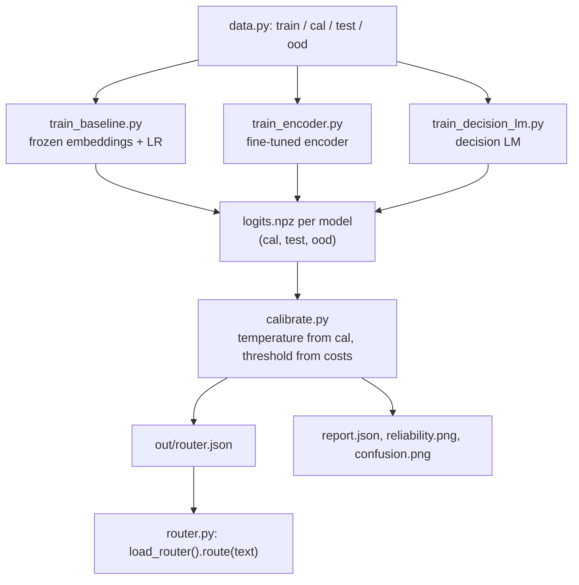
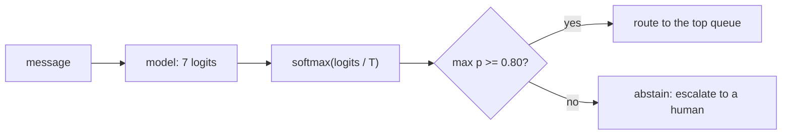

# Project 3: Ticket Router, a Calibrated Decision Model

A support inbox receives "we were charged twice", "getting 403" and "my smart watch stopped tracking my heart rate" in the same minute. The first belongs to billing. The second could be three different queues. The third is not about the product at all. A router that always answers with its best guess sends two of those three to the wrong team. In this project you build a router for the fictional Nimbus Monitor support inbox that returns a probability for every queue in one fast pass, and that says "send this one to a human" when its confidence is too low to act on. You build it three ways (frozen embeddings with logistic regression, a fine-tuned encoder, and a decision language model), calibrate all three, choose the abstain threshold from costs, and compare them on the same held-out messages. On this data the most expensive model is not the best one, and the page shows why.

!!! abstract "What you'll build"
    - `data.py`: a seeded generator for a synthetic inbox with paraphrases, messages that mention two queues, short ambiguous messages, label noise and an out-of-distribution slice
    - `metrics.py`: accuracy, macro-F1, a confusion matrix, ECE, temperature fitting and a cost-weighted abstain threshold, in numpy
    - `train_baseline.py`: `BAAI/bge-small-en-v1.5` embeddings + logistic regression
    - `train_encoder.py`: the same 33M-parameter encoder fine-tuned end to end with a classification head
    - `decision_lm.py`, `train_decision_lm.py`: `HuggingFaceTB/SmolLM2-135M` as a decision language model that scores all seven queues in one forward pass and cannot be affected by option order
    - `calibrate.py`: temperature scaling, a reliability diagram, the threshold, a confusion matrix and the comparison table
    - `benchmark.py`: p50 and p95 latency per request on CPU
    - `router.py`: `load_router()`, one stable entry point that [Project 8](oncall-agent.md) calls

    Full code: [code/ticket_router](https://github.com/vivek-rm-14286/llm-from-scratch/tree/main/code/ticket_router). Prerequisites: [Decision Models for Routing & Classification](../decision/routing-models.md), which introduces every idea used here, and the [Decision Models overview](../decision/index.md). [Embeddings & Attention](../llm/attention.md) helps with Step 5 (attention masks and position ids). The training loops are the ones from [Python & PyTorch](../foundations/pytorch.md).

!!! info "Two ways to do this project"
    **Fill in the starter.** `starter/` has every file with signatures, docstrings and `TODO`s. `tests/` has 28 fast tests. Run `pytest`, read the first failure, write the function, repeat. You are done when `pytest` prints `28 passed` and your comparison table is close to the one on this page. This route takes about 9 hours.

    **Read and modify.** Read `solution/` next to this page, run each command, then change something and predict the effect before measuring it: set the label noise to 0.2, change the cost of a misroute from 5 to 20, drop the position-id restart in the decision LM and run its tests. This takes about 3 hours, of which 25 minutes is training time on a CPU.

    The two packages have identical file names and function signatures, so every command below works with `starter` in place of `solution` once your tests pass.

## 0. Setup

```bash
git clone https://github.com/vivek-rm-14286/llm-from-scratch
cd llm-from-scratch/code/ticket_router
uv venv && source .venv/bin/activate      # or python -m venv .venv
uv pip install -r requirements.txt
```

The dependencies are torch, transformers, sentence-transformers, scikit-learn, numpy, matplotlib and pytest. The code passes `dtype=` when loading models, which needs a recent transformers release (the numbers on this page are from transformers 5.23).

**Hardware.** Any laptop CPU. No GPU is needed. The first training run downloads two checkpoints, about 130 MB for the encoder and 270 MB for the decoder. The numbers on this page are from an Apple M1 Pro.

**Check the setup.** Both commands need no download:

```bash
pytest --impl solution     # 28 passed, 2 deselected
pytest                     # 20 failed, 1 passed, 7 errors: that is your to-do list
```

`--impl` selects the package under test (default `starter`). Every starter function raises `NotImplementedError` with a TODO, so the failures point at the function to write next. The two deselected tests carry the `model` marker: they download SmolLM2-135M and read trained artifacts, and run with `pytest --impl solution -m model` after Step 6.

**Expected time per step** on the fill-in route:

| Step | File | Tests | Time | Compute |
|---|---|---|---|---|
| 1. The synthetic inbox | `data.py` | `tests/test_data.py` (9) | 1.5 hours | under a second |
| 2. Metrics and the decision rule | `metrics.py` | `tests/test_metrics.py` (11) | 1.5 hours | none |
| 3. Embeddings + logistic regression | `train_baseline.py` | none (check the printed accuracy) | 45 minutes | 12 s |
| 4. Fine-tuned encoder | `train_encoder.py` | none (check the printed accuracy) | 1 hour | 3 minutes |
| 5. Decision language model | `decision_lm.py`, `train_decision_lm.py` | `tests/test_decision_lm.py` (5) | 2.5 hours | 21 minutes on CPU |
| 6. Calibrate, threshold, compare | `calibrate.py` | covered by the metric tests | 1 hour | 1 s |
| 7. Router and latency | `router.py`, `benchmark.py` | `tests/test_router.py` (3, plus 2 with `-m model`) | 45 minutes | 1 minute |

## The design

The project follows the split from [the lesson](../decision/routing-models.md#decisions-vs-generations): a model produces **scores**, and a separate **decision rule** turns scores into an action. The three models are interchangeable because each one is only a function from a list of texts to an array of logits with one column per queue.



Three decisions shape the code:

- **Four splits with different jobs.** `train` fits the models. `cal` fits the temperature and nothing else. `test` is looked at once, for the comparison. `ood` is never trained on and measures whether the router abstains on messages that belong to no queue.
- **Training scripts store logits, not decisions.** Each script scores `cal`, `test` and `ood` once and saves the raw logits. Calibration, thresholds and plots then run in about a second with numpy, and changing a cost does not require loading a model.
- **The decision rule lives in one place.** `Router.route` applies the temperature, then the threshold. The models know nothing about either.

At request time the path is short:



## 1. The synthetic inbox

There is no public dataset of Nimbus Monitor tickets, so the project generates one. A generator that only fills templates produces a task that any model solves at 100%, which teaches nothing about calibration. `data.py` adds five kinds of difficulty on purpose, all taken from what real inboxes look like:

| Kind | Share of test | What it is | What it tests |
|---|---|---|---|
| `plain` | 25% | a phrasing the training split may also contain, with new slot values and surface noise | the easy case |
| `paraphrase` | 24% | a phrasing held out of training: same problem, different words, usually no error code | generalization beyond the training wording |
| `two_queue` | 28% | the request belongs to one queue, and the message also mentions another | reading the request, not the vocabulary |
| `short` | 22% | a few words such as "getting 403" that fit several queues | knowing when there is too little information |
| `ood` | separate file | spam, other companies' products, other languages, keyboard noise | abstaining on messages outside the label set |

`bank.py` holds the text and is complete in both packages. Each of the seven queues has six intents and each intent has five phrasings. Phrasings 0 to 2 are available to `train`; phrasings 3 and 4 appear only in `cal` and `test`.

**Two-queue messages.** The label is the queue that owns the request. The second queue appears either as context or as an explicitly minor second issue:

```python title="data.py"
def make_two_queue(primary, rng, allow_heldout):
    """A message whose request belongs to `primary` but that also talks about another queue."""
    secondary = rng.choice([q for q in QUEUES if q != primary])
    main, _ = sample_issue(primary, rng, allow_heldout)
    form = rng.randrange(4)
    if form == 0:
        text = f"{main} For context, {fill_slots(rng.choice(MENTIONS[secondary]), rng)}."
    elif form == 1:
        mention = fill_slots(rng.choice(MENTIONS[secondary]), rng)
        text = f"{mention[0].upper()}{mention[1:]}, but that is not the issue. {main}"
    elif form == 2:
        side, _ = sample_issue(secondary, rng, allow_heldout)
        text = f"{main} Separately, and much less urgent: {side}"
    else:
        side, _ = sample_issue(secondary, rng, allow_heldout)
        text = f"Two things. The main one: {main} A minor one for later: {side}"
    return text, secondary
```

**Short messages.** Each short text comes with a list of candidate queues, and the label is drawn uniformly from that list. "getting 403" is `api`, `access` or `ingestion` with probability one third each. No model can score above 55% on this slice in expectation, and the correct behavior is a low confidence followed by an abstention. Counting the other three kinds as fully solvable, the ceiling for test accuracy is about 90%.

**Label noise.** 5% of the training labels are flipped to a queue a hurried human would plausibly pick instead (`api` to `access`, `agent-install` to `ingestion`). `cal` and `test` keep clean labels: they stand for a sample that was reviewed twice. Every row stores both `label` and `clean_label`, so the noise is always measurable.

**Determinism.** `generate` uses a single `random.Random(seed)` in a fixed order, so the same arguments always give the same rows:

```python title="data.py"
def generate(seed=0, n_train=1600, n_cal=500, n_test=1000, n_ood=200, noise=0.05):
    rng = random.Random(seed)
    train = make_split("train", n_train, rng, allow_heldout=False, exclude=())
    train = apply_label_noise(train, noise, rng)
    used = {r["text"] for r in train}
    cal = make_split("cal", n_cal, rng, allow_heldout=True, exclude=used)
    used |= {r["text"] for r in cal}
    test = make_split("test", n_test, rng, allow_heldout=True, exclude=used)
    return {"train": train, "cal": cal, "test": test, "ood": make_ood(n_ood, rng)}
```

`exclude` keeps every long message in `cal` and `test` out of the earlier splits, so no evaluation message is an exact copy of a training message. Short messages are exempt, because real inboxes do receive "locked out" many times. The `data/` folder is git-ignored and is not shipped with the repo: this command recreates it byte for byte.

```bash
python -m solution.data
```

```text
train  1600 rows  kinds={'two_queue': 428, 'short': 297, 'plain': 875}  noisy labels=66
cal     500 rows  kinds={'two_queue': 136, 'plain': 132, 'short': 97, 'paraphrase': 135}  noisy labels=0
test   1000 rows  kinds={'two_queue': 283, 'paraphrase': 241, 'short': 221, 'plain': 255}  noisy labels=0
ood     200 rows  kinds={'ood': 200}  noisy labels=0
  [two_queue ] other          Do you offer onboarding training for new teams? For context, we manage everything through the API and Terraform. Please advise.
  [two_queue ] agent-install  The agent disk buffer is full, NM-2001. For context, we got an alert about it this morning.
  [paraphrase] billing        the card on file was replaced by our bank, how do i put the new one in?
  [short     ] access         locked out
```

!!! tip "Working on a later step first"
    Every later step reads `data/*.jsonl`. If your own `data.py` is not finished, run `python -m solution.data` once and continue with `starter` for everything else.

## 2. Metrics and the decision rule

`metrics.py` is numpy only, so every function can be checked against a number worked out by hand. Write it before any model exists. The tests use small arrays whose answers fit in a comment.

**ECE.** [Expected calibration error](../decision/routing-models.md#calibration) bins the predictions by confidence and averages the gap between confidence and accuracy, weighted by bin size:

```python title="metrics.py"
def expected_calibration_error(probs, labels, n_bins=10):
    probs = np.asarray(probs, dtype=np.float64)
    labels = np.asarray(labels)
    conf = probs.max(axis=1)
    correct = (probs.argmax(axis=1) == labels).astype(np.float64)
    edges = np.linspace(0.0, 1.0, n_bins + 1)
    ece, rows = 0.0, []
    for lo, hi in zip(edges[:-1], edges[1:]):
        in_bin = (conf > lo) & (conf <= hi)
        if in_bin.any():
            bin_conf, bin_acc = conf[in_bin].mean(), correct[in_bin].mean()
            ece += in_bin.mean() * abs(bin_acc - bin_conf)
            rows.append((float(lo), float(hi), float(bin_conf), float(bin_acc), int(in_bin.sum())))
    return float(ece), rows
```

A worked example, which is also one of the tests. Four predictions have confidences 0.95, 0.95, 0.65, 0.65 and outcomes right, wrong, right, right. The bin $(0.9, 1.0]$ holds half the samples with confidence 0.95 and accuracy 0.5, a gap of 0.45. The bin $(0.6, 0.7]$ holds the other half with confidence 0.65 and accuracy 1.0, a gap of 0.35. So $\text{ECE} = 0.5 \cdot 0.45 + 0.5 \cdot 0.35 = 0.40$. The `rows` returned alongside are the points of the reliability diagram.

**Temperature scaling.** One scalar $T$ divides the logits, fitted to minimize the negative log-likelihood on held-out data. NLL has a single minimum in $\log T$, so a golden-section search is enough and needs no optimizer:

```python title="metrics.py"
def fit_temperature(logits, labels, lo=0.05, hi=20.0, iters=60):
    a, b = math.log(lo), math.log(hi)
    ratio = (math.sqrt(5) - 1) / 2
    c, d = b - ratio * (b - a), a + ratio * (b - a)
    fc, fd = nll(logits, labels, math.exp(c)), nll(logits, labels, math.exp(d))
    for _ in range(iters):
        if fc < fd:                                    # minimum is in [a, d]
            b, d, fd = d, c, fc
            c = b - ratio * (b - a)
            fc = nll(logits, labels, math.exp(c))
        else:                                          # minimum is in [c, b]
            a, c, fc = c, d, fd
            d = a + ratio * (b - a)
            fd = nll(logits, labels, math.exp(d))
    return float(math.exp((a + b) / 2))
```

$T > 1$ flattens the probabilities of an overconfident model. $T < 1$ sharpens an underconfident one. Both happen in this project. The tests cover both directions, and require that scaling lowers NLL on a held-out half, cuts ECE by at least half on deliberately overconfident logits, and leaves every argmax unchanged.

**The threshold from costs.** Suppose a misroute costs 5 units (a wrong team reads the ticket, bounces it, and the customer waits) and an escalation costs 1 (a human triages it). With calibrated top probability $p$, routing costs $(1 - p) \cdot 5$ in expectation and escalating costs 1. Routing is the cheaper action when

$$
(1 - p) \cdot c_\text{misroute} \le c_\text{escalate} \quad\Longleftrightarrow\quad p \ge 1 - \frac{c_\text{escalate}}{c_\text{misroute}} = 0.80
$$

```python title="metrics.py"
def bayes_threshold(cost_misroute, cost_escalate):
    return 1.0 - cost_escalate / cost_misroute
```

This is the [expected-cost rule](../decision/routing-models.md#thresholds-and-abstention) from the lesson, reduced to one line by the cost structure: every misroute costs the same and an escalation costs the same whatever the truth is. The threshold comes from the costs alone and is the same for all three models. It is only correct if $p$ is calibrated, which is why calibration comes first. `selective_stats` reports what a threshold does to a set of predictions (abstain rate, error rate among routed messages, mean cost per message), and `sweep_threshold` finds the cheapest threshold empirically, as a cross-check on the formula.

## 3. Model (a): embeddings + logistic regression

The baseline embeds each message with a frozen sentence encoder and fits a linear layer on top. `BAAI/bge-small-en-v1.5` has 33M parameters and returns 384 numbers per message.

```python title="train_baseline.py"
@classmethod
def fit(cls, texts, labels, embedder_name=EMBEDDER, C=10.0):
    from sklearn.linear_model import LogisticRegression
    model = cls(embedder_name, np.zeros((len(QUEUES), 1)), np.zeros(len(QUEUES)))
    X = model.embed(texts)                              # normalized embeddings, (N, 384)
    clf = LogisticRegression(C=C, max_iter=2000).fit(X, labels)
    # multinomial logistic regression: predict_proba == softmax(X @ coef_.T + intercept_)
    model.weight = np.zeros((len(QUEUES), X.shape[1]), dtype=np.float32)
    model.bias = np.full(len(QUEUES), -30.0, dtype=np.float32)   # classes absent from training
    model.weight[clf.classes_] = clf.coef_
    model.bias[clf.classes_] = clf.intercept_
    return model
```

The fitted weights are copied out of scikit-learn, so inference is `embed(texts) @ weight.T + bias`: a matrix product that returns logits like the other two models, with no scikit-learn at serving time. `C=10` regularizes less than the scikit-learn default of 1. It is the one hyperparameter of this model, and Step 6 shows that the resulting probabilities are already close to calibrated.

```bash
python -m solution.train_baseline
```

```text
baseline: embedded 1600 messages and fit logistic regression in 12.3 s
  test accuracy (uncalibrated argmax): 0.739
```

## 4. Model (b): a fine-tuned encoder

The second model starts from the same checkpoint, `BAAI/bge-small-en-v1.5`, and trains all of it together with a new classification head. Using one network for both models isolates a single question: what does updating the encoder buy over freezing it? The encoder is small enough to fine-tune on a CPU in about three minutes.

```python title="train_encoder.py"
model = AutoModelForSequenceClassification.from_pretrained(
    name, num_labels=len(QUEUES), dtype=torch.float32).to(device)   # new, randomly initialized head
opt = torch.optim.AdamW(model.parameters(), lr=lr, weight_decay=0.01)
steps = epochs * ((len(texts) + batch_size - 1) // batch_size)
warmup = max(1, int(warmup_frac * steps))
sched = torch.optim.lr_scheduler.LambdaLR(                     # linear warmup, then linear decay
    opt, lambda s: (s + 1) / warmup if s < warmup else max(0.0, (steps - s) / max(1, steps - warmup)))
...
for epoch in range(epochs):
    order = rng.permutation(len(texts))
    for i in range(0, len(order), batch_size):
        idx = order[i:i + batch_size]
        enc = tok([texts[j] for j in idx], truncation=True, max_length=MAX_LEN, padding=True,
                  return_tensors="pt").to(device)
        loss = F.cross_entropy(model(**enc).logits, y[idx].to(device))
        opt.zero_grad()
        loss.backward()
        torch.nn.utils.clip_grad_norm_(model.parameters(), 1.0)
        opt.step()
        sched.step()
```

The loop is written out instead of using `Trainer`, so every step is visible: 4 epochs, batch size 32, 200 steps, learning rate $5 \times 10^{-5}$ with warmup over the first 10% of the steps.

```bash
python -m solution.train_encoder
```

```text
  epoch 1 step 20/200 loss 1.893
  epoch 2 step 100/200 loss 1.109
  epoch 4 step 200/200 loss 0.868
encoder: fine-tuned BAAI/bge-small-en-v1.5 on 1600 messages in 166 s (cpu)
  test accuracy (uncalibrated argmax): 0.769
```

The loading message about `classifier.weight` and `classifier.bias` being newly initialized is expected: that is the new head.

## 5. Model (c): a decision language model

Models (a) and (b) have the seven queues baked into their output layer. A [decision language model](../decision/routing-models.md#decision-language-models) takes the options as input instead: a context plus a list of option texts goes in, and one logit per option comes out of a single forward pass. Adding a queue then means adding a line of text. The model here is `HuggingFaceTB/SmolLM2-135M`, a 30-layer decoder with hidden size 576, used without its language-model head.

Each option is a queue name with a one-line description, for example `billing: invoices, charges, refunds, plans and payment methods`. Everything is packed into one sequence:

```text
[context tokens] [\nOption: billing: ...] [\nOption: ingestion: ...] ... [\nOption: other: ...]
```

A plain causal LM would let the tokens of option 3 attend to options 1 and 2, and would place option 3 further from the context than option 1. Its scores would then depend on the order of the list. Two changes remove that dependence completely.

**The attention mask.** A token may attend to earlier context tokens and to earlier tokens of its own option, and to nothing else:

```python title="decision_lm.py"
def build_option_mask(seg):
    """seg: (B, L). 0 = context token, k >= 1 = token of option k, -1 = padding.
    Returns allowed: (B, L, L) bool, allowed[b, i, j] is True when token i may attend to token j."""
    seg = torch.as_tensor(seg)
    n = seg.shape[-1]
    causal = torch.ones(n, n, dtype=torch.bool, device=seg.device).tril()
    same_or_context = (seg[:, :, None] == seg[:, None, :]) | (seg[:, None, :] == 0)
    allowed = causal & same_or_context & (seg[:, None, :] >= 0)
    return allowed | torch.eye(n, dtype=torch.bool, device=seg.device)
```

The last line lets every token attend to itself. Without it a padding row is fully masked, its softmax is over nothing, and the output is `nan`.

**The position ids.** Every option restarts counting right after the context, so all options sit at the same distance from it:

```python title="decision_lm.py"
def pack(self, context, options):
    ids = self._ids(context)[: self.max_context_tokens]
    n_ctx = len(ids)
    seg, pos, last = [0] * n_ctx, list(range(n_ctx)), []
    for k, option in enumerate(options, start=1):
        o = self._option_ids(option)
        ids = ids + o
        seg += [k] * len(o)
        pos += list(range(n_ctx, n_ctx + len(o)))       # the same start for every option
        last.append(len(ids) - 1)
    return ids, seg, pos, last
```

With both changes, the hidden states of option $k$ are what the model would compute for `context + option k` alone. The forward pass passes the 4-D boolean mask and the position ids to the backbone, reads the hidden state at each option's last token, and applies one shared linear scorer:

```python title="decision_lm.py"
def forward(self, contexts, options_list):
    device = self.scorer.weight.device
    packed = [self.pack(c, o) for c, o in zip(contexts, options_list)]
    n = max(len(p[0]) for p in packed)
    pad = self.tok.pad_token_id or 0
    ids = torch.tensor([p[0] + [pad] * (n - len(p[0])) for p in packed], device=device)
    seg = torch.tensor([p[1] + [-1] * (n - len(p[1])) for p in packed], device=device)
    pos = torch.tensor([p[2] + [0] * (n - len(p[2])) for p in packed], device=device)
    allowed = build_option_mask(seg)[:, None]        # (B, 1, L, L), True = may attend
    h = self.backbone(input_ids=ids, attention_mask=allowed, position_ids=pos).last_hidden_state
    max_opts = max(len(p[3]) for p in packed)
    logits = torch.full((len(packed), max_opts), float("-inf"), device=device)
    for b, p in enumerate(packed):
        logits[b, : len(p[3])] = self.scorer(h[b, p[3]].float()).squeeze(-1)
    return logits
```

The `-inf` fill lets one batch hold examples with different numbers of options: softmax gives a missing option probability zero.

**Testing invariance without a download.** `tests/test_decision_lm.py` builds a two-layer `LlamaModel` with random weights and a whitespace tokenizer, then requires three things to hold within $10^{-4}$: shuffling the options permutes the scores and changes nothing else, each score equals the score of that option presented alone, and padding inside a batch does not move any score. The scorer is initialized to zero, which would make every one of those tests pass trivially, so the tests give it random weights first. With `-m model`, the same permutation check runs on the real SmolLM2-135M.

**Training.** The loss is cross-entropy over the options. The bottom 24 layers stay frozen; the top 6 layers, the final norm and the scorer train, 21.2M of 134.5M parameters. The scorer gets a larger learning rate than the backbone because it starts from zero:

```python title="train_decision_lm.py"
model = DecisionLM(name).to(device)
model.set_trainable(top_layers)                          # top 6 blocks + final norm + scorer
backbone_params = [p for p in model.backbone.parameters() if p.requires_grad]
opt = torch.optim.AdamW([{"params": backbone_params, "lr": lr},                    # 5e-5
                         {"params": model.scorer.parameters(), "lr": head_lr}],    # 1e-3
                        weight_decay=0.01)
...
contexts, opts, targets = make_batch(texts, labels, order[i:i + batch_size], rng)
loss = F.cross_entropy(model(contexts, opts), targets.to(device))
```

`make_batch` shuffles the option order for every example. For this design the shuffle cannot change the loss, and it is kept as a habit: the letter-scoring design from the lesson learns "the answer is usually B" without it.

```bash
python -m solution.train_decision_lm                         # CPU, 2 epochs
python -m solution.train_decision_lm --device mps --epochs 4 # Apple GPU
```

```text
  epoch 1 step 10/200 loss 2.000
  epoch 1 step 100/200 loss 1.345
  epoch 2 step 200/200 loss 0.880
decision LM: trained 21.2M of 134.5M parameters on 1600 messages in 1239 s (cpu)
  test accuracy (uncalibrated argmax): 0.652
```

The loss starts near $\ln 7 \approx 1.95$: the zero-initialized scorer makes the first prediction a uniform guess over seven options, as it should be. Each sequence holds the message plus seven option descriptions, about 170 tokens of which 135 are the options, against about 20 tokens for the encoder. A training step takes about 6 seconds on the CPU, where the encoder needs under 1, so this is the slow step of the project: 21 minutes for 2 epochs. On the Apple GPU (`--device mps`) a step takes about 1.3 seconds, and 4 epochs finish in 502 seconds. Both runs are in the results below.

## 6. Calibrate, set the threshold, compare

`calibrate.py` reads the stored logits of every model that has been trained and does four things per model: fits $T$ on `cal`, measures accuracy, macro-F1, NLL and ECE on `test` before and after scaling, applies the cost threshold, and counts abstentions on `ood`.

```python title="calibrate.py"
T = M.fit_temperature(logits["cal"], y_cal)                   # never on test
raw, cal = M.softmax(logits["test"]), M.softmax(logits["test"], T)
pred = cal.argmax(1)
correct = pred == y_test
tau = M.bayes_threshold(cost_misroute, cost_escalate)
ood_conf = M.softmax(logits["ood"], T).max(1)
in_dist = M.selective_stats(cal.max(1), correct, tau, cost_misroute, cost_escalate)
# traffic mix = test set plus the OOD slice; routing an OOD message anywhere is a misroute
n_all = len(y_test) + len(ood_conf)
mixed_cost = (in_dist["mean_cost"] * len(y_test)
              + ((ood_conf >= tau).sum() * cost_misroute + (ood_conf < tau).sum() * cost_escalate)) / n_all
```

```bash
python -m solution.calibrate
```

```text
costs: misroute 5, escalate 1  ->  abstain below p = 0.80

model           acc     F1     T  ECE raw  ECE cal  abstain err|routed   cost  no-abst  OOD abst
baseline      0.739  0.735  0.80    0.052    0.036    0.462      0.080  0.677    1.305     0.820
encoder       0.769  0.761  0.51    0.251    0.052    0.351      0.083  0.621    1.155     0.745
decision_lm   0.652  0.643  0.87    0.109    0.076    0.731      0.141  0.921    1.740     0.850

accuracy by kind of message (and share abstained):
  baseline     paraphrase 0.705 (53%)  plain 0.996 (8%)  short 0.584 (70%)  two_queue 0.657 (56%)
  encoder      paraphrase 0.627 (55%)  plain 1.000 (7%)  short 0.534 (50%)  two_queue 0.866 (32%)
  decision_lm  paraphrase 0.734 (87%)  plain 0.898 (47%)  short 0.511 (88%)  two_queue 0.470 (73%)

default model for load_router(): baseline (lowest cost on test + OOD traffic: 0.851)

confusion matrix, baseline:
               billin ingest alerti agent-    api access  other   (rows = true, columns = predicted)
  billing         136     12      2      2      4      9      8
  ingestion         5    128     13      3     10      5      4
  alerting         10      5    119      0      8      4      2
  agent-install     1     26      3     99     10      6     14
  api               0     13     11      4     76      4      5
  access            8      7      4      3      8    103      9
  other             1      2      8      5      1      2     78
```

The script also writes `out/report.json` (every number above and more), `out/reliability.png`, `out/confusion.png` and `out/router.json`. The last one is the artifact the router loads: the default model, its temperature, the threshold and the queue list. The default is the model with the lowest mean cost on the test set plus the OOD slice; `--default encoder` overrides it.

**Reading the confusion matrix.** The largest off-diagonal cell is 26 `agent-install` messages routed to `ingestion`. "No data since the upgrade" is an agent problem that looks like an ingestion problem, and the two queues share most of their vocabulary. The next cells are `ingestion` to `alerting` and `api` to `ingestion` (13 each). `other` has the fewest test messages (97) and, together with `api`, the lowest precision at 65%: its column collects messages from every row.

**Reading the reliability diagram.** `reliability.png` has one panel per model, with confidence on the x-axis, accuracy on the y-axis, a dashed diagonal for perfect calibration, a red line before scaling and a blue line after.

- **Baseline.** Both lines stay close to the diagonal. Before scaling, the two highest bins sit above it (confidence 0.86 with accuracy 0.92, confidence 0.95 with accuracy 1.00): mildly underconfident. $T = 0.80$ sharpens the probabilities, and ECE goes from 0.052 to 0.036.
- **Encoder.** The red line is far above the diagonal. No raw confidence exceeds 0.8, and the bin around 0.63 is right 96% of the time. After four epochs with a decaying learning rate the logits are still small, so the model is strongly underconfident, the opposite of the usual finding for networks trained to convergence. $T = 0.51$ doubles the logits and ECE falls from 0.251 to 0.052. The blue line then runs below the diagonal up to 0.8 (the model is now somewhat overconfident there) and meets it above 0.8, which is the region the threshold uses.
- **Decision LM.** Both lines run above the diagonal at low confidence and below it in the top bin (confidence 0.96, accuracy 0.87). One temperature moves all bins in the same direction, so it cannot fix a model that is underconfident at one end and overconfident at the other. ECE only improves from 0.109 to 0.076. (The 4-epoch run in the results is nearly calibrated as trained: $T = 1.04$, and ECE moves from 0.043 to 0.049, a change inside the noise of the estimate.)

## 7. The router and its latency

`router.py` is the interface other code depends on. A `Router` wraps any logits function with the temperature and the threshold:

```python title="router.py"
def route_batch(self, texts):
    probs = softmax(np.asarray(self._logits_fn(list(texts)), dtype=np.float64), self.temperature)
    results = []
    for p in probs:
        top = int(p.argmax())
        confidence = float(p[top])
        results.append({
            "queue": self.queues[top],
            "probs": {q: float(v) for q, v in zip(self.queues, p)},
            "confidence": confidence,
            "abstain": bool(confidence < self.threshold),   # True = escalate to a human
        })
    return results

def route(self, text: str) -> dict:
    return self.route_batch([text])[0]
```

The return value is plain Python: `str`, `float`, `bool` and a `dict`. A caller can serialize it to JSON without knowing that numpy was involved, and `tests/test_router.py` checks the types.

`load_router(path=None, model=None)` reads `out/router.json` and loads the default model, or the one named by `model`. If the manifest does not exist, it warns and returns a **keyword baseline** with the same interface, whose `name` starts with `keyword-baseline`. It counts keyword hits per queue and turns the counts into logits. A message with no hits gets uniform probabilities and therefore abstains. The fallback exists so that code calling the router, such as the agent in Project 8, runs on a machine where nothing has been trained, and can tell from `router.name` that it is not using a trained model.

```bash
python -m solution.router "we were charged twice" "getting 403" "banana bread recipe?" \
    "The agent on web-01 will not start after the upgrade"
```

```text
[baseline] 'we were charged twice' -> billing (0.98)
[baseline] 'getting 403' -> api (0.49)  ABSTAIN: escalate to a human
[baseline] 'banana bread recipe?' -> api (0.51)  ABSTAIN: escalate to a human
[baseline] 'The agent on web-01 will not start after the upgrade' -> agent-install (0.98)
```

From other code, with `code/ticket_router` on `sys.path`:

```python
from solution.router import load_router

router = load_router()
router.route("Data points are rejected with NM-4012")
# {"queue": "ingestion", "probs": {"billing": 0.01, ...}, "confidence": 0.93, "abstain": False}
```

**Latency.** `benchmark.py` sends 200 test messages one at a time, as a live inbox would, after 10 warmup calls, and reports percentiles. It pins torch to 4 threads and all models run in fp32:

```bash
python -m solution.benchmark
```

```text
200 single requests each, CPU, 4 threads, fp32
model          p50 ms   p95 ms  mean ms
keyword          0.16     0.26     0.16
baseline        14.34    19.47    14.62
encoder         13.31    16.66    13.20
decision_lm    123.67   160.97   126.01
```

Models (a) and (b) run the same 33M-parameter encoder over about 20 tokens, so they cost the same. The linear layer of the baseline is negligible. The decision LM runs a 135M-parameter network over about 170 tokens (the message plus seven option descriptions) and is roughly 9 times slower. That is still one prefill and no token-by-token generation, as the [latency section of the lesson](../decision/routing-models.md#decision-language-models) explains.

## Results from one run

Measured on an Apple M1 Pro (CPU, 4 threads for the latency numbers) with Python 3.12, torch 2.15, transformers 5.23, sentence-transformers 6.3 and scikit-learn 1.9. Data: seed 0, 1,600 training messages with 5% label noise, 500 calibration, 1,000 test, 200 OOD. Costs: misroute 5, escalation 1, so the threshold is 0.80.

**Accuracy and calibration on the 1,000 test messages**

| Model | Training time | Accuracy | Macro-F1 | $T$ | NLL raw → scaled | ECE raw → scaled |
|---|---|---|---|---|---|---|
| Keyword fallback (no training) | none | 50.1% | 0.484 | not fitted | not measured | not measured |
| (a) Embeddings + logistic regression | 12 s | 73.9% | 0.735 | 0.80 | 0.725 → 0.718 | 0.052 → 0.036 |
| (b) Fine-tuned encoder, 4 epochs | 166 s | **76.9%** | **0.761** | 0.51 | 0.921 → 0.720 | 0.251 → 0.052 |
| (c) Decision LM, 2 epochs, CPU | 1,239 s | 65.2% | 0.643 | 0.87 | 1.087 → 1.079 | 0.109 → 0.076 |
| (c) Decision LM, 4 epochs, MPS | 502 s | 67.9% | 0.674 | 1.04 | 0.897 → 0.897 | 0.043 → 0.049 |

The ceiling for accuracy is about 90%, because the labels of the short messages are random among their candidates.

**The abstain rule at threshold 0.80** (calibrated probabilities)

| Model | Abstain rate | Error rate among routed | Error rate with no abstention | Mean cost per message | Cost with no abstention | OOD messages abstained |
|---|---|---|---|---|---|---|
| (a) Embeddings + LR | 46.2% | 8.0% | 26.1% | 0.677 | 1.305 | **82.0%** |
| (b) Fine-tuned encoder | **35.1%** | 8.3% | 23.1% | **0.621** | 1.155 | 74.5% |
| (c) Decision LM, 2 epochs | 73.1% | 14.1% | 34.8% | 0.921 | 1.740 | 85.0% |
| (c) Decision LM, 4 epochs, MPS | 61.8% | 9.2% | 32.1% | 0.793 | 1.605 | 78.5% |
| Escalate everything | 100% | none routed | not applicable | 1.000 | not applicable | 100% |

Mean cost on mixed traffic (the 1,000 test messages plus the 200 OOD messages): baseline **0.851**, encoder 0.854, decision LM 1.034 after 2 epochs and 0.971 after 4.

**Accuracy by kind of message** (share abstained in parentheses)

| Model | plain | paraphrase | two_queue | short |
|---|---|---|---|---|
| (a) Embeddings + LR | 99.6% (8%) | 70.5% (53%) | 65.7% (56%) | 58.4% (70%) |
| (b) Fine-tuned encoder | 100% (7%) | 62.7% (55%) | 86.6% (32%) | 53.4% (50%) |
| (c) Decision LM, 2 epochs | 89.8% (47%) | 73.4% (87%) | 47.0% (73%) | 51.1% (88%) |
| (c) Decision LM, 4 epochs, MPS | 96.1% (24%) | 72.6% (81%) | 51.6% (69%) | 51.1% (76%) |

**Latency per request on CPU** (200 single requests, fp32)

| Model | p50 | p95 |
|---|---|---|
| Keyword fallback | 0.16 ms | 0.26 ms |
| (a) Embeddings + LR | 14.3 ms | 19.5 ms |
| (b) Fine-tuned encoder | 13.3 ms | 16.7 ms |
| (c) Decision LM | 123.7 ms | 161.0 ms |

What the numbers show:

- **Abstaining pays for itself.** For every model, escalating the low-confidence messages cuts the error rate among routed messages by a factor of 2.5 to 3.3 and roughly halves the mean cost. The encoder routes 65% of the inbox with 8.3% errors instead of all of it with 23.1%. A cost of 1.0 is what a team with no router pays, so (a) and (b) save about a third of the triage cost on this inbox.
- **The baseline and the encoder tie, and the baseline is the default.** The encoder is 3 points more accurate and cheaper on in-distribution messages (0.621 against 0.677). The baseline abstains on more of the OOD slice (82.0% against 74.5%), and with OOD traffic included the two costs are 0.851 and 0.854. That difference is far inside the noise of a 1,200-message sample, so `calibrate.py` picking the baseline is a coin flip, not a ranking. With equal cost and equal latency, the baseline has the practical advantages: it trains in 12 seconds, so it can be refit whenever a queue is added, and has 2,695 trained numbers to inspect.
- **Fine-tuning helped where reading matters and hurt where wording matters.** On `two_queue` messages the encoder scores 86.6% and the baseline 65.7%: an averaged sentence embedding blends both topics, and the fine-tuned model learned which clause carries the request. On held-out `paraphrase` messages the order flips, 62.7% against 70.5%. Fine-tuning on three phrasings per intent pulls the encoder toward those surface forms, and the frozen embedding keeps the general similarity it was pretrained for.
- **The decision LM is the worst model at this budget.** Two epochs with the top six layers on 1,600 messages leave it at 65.2%. Four epochs lift it to 67.9% and a cost of 0.793, still behind both smaller models, and it is the slowest by a factor of 9. Its one win is the `paraphrase` slice (73.4% and 72.6%), where reading the option descriptions helps with wording never seen in training. It is weakest on `two_queue` messages (47.0% and 51.6%). Its strength is not measured by this task at all: the option list can change per request without retraining, which matters for tool selection and model routing, and matters little for seven fixed queues.
- **A threshold on uncalibrated scores can be useless.** The raw encoder never reaches a confidence of 0.8, so the same threshold applied before scaling escalates 100% of the messages. After scaling it escalates 35.1%. The threshold did not change; the meaning of the scores did.
- **Calibration measured by ECE does not guarantee the cheapest decisions.** For the baseline, the raw probabilities give a slightly lower test cost than the scaled ones (0.639 against 0.677), because the raw model abstains more (56.9%) and misroutes less. Temperature scaling minimizes NLL over all bins, and the cost only depends on what happens around 0.8, where the scaled baseline is overconfident (confidence 0.86, accuracy 0.77). The empirical sweep on the calibration split agrees with the formula to within a few points for (a) and (b), at 0.82 and 0.83, and picks 0.92 for the decision LM, which is the top-bin overconfidence showing up again.
- **OOD abstention is the weak spot of every model.** Between 15% and 26% of the OOD messages are routed with high confidence. The baseline sends "My laptop monitor flickers when I plug in the HDMI cable" to `alerting` with confidence 0.99 and "My smart watch stopped tracking my heart rate" with 0.98: the words "monitor" and "tracking" are enough. Softmax probabilities always sum to 1 over the known queues, so a message from outside them still has to put its mass somewhere. Low confidence catches keyboard noise and other languages, and does not catch off-topic messages that share vocabulary with a queue. The keyword fallback abstains on all 200, and on 96.5% of the real messages as well.

## Milestones

- [ ] `pytest tests/test_data.py`: 9 passed, and `python -m starter.data` run twice writes identical files
- [ ] `pytest tests/test_metrics.py`: 11 passed, including ECE = 0.40 on the four-prediction example
- [ ] `python -m starter.train_baseline` prints a test accuracy of at least 0.70 in under a minute
- [ ] `python -m starter.train_encoder` prints a test accuracy of at least 0.74 and a final loss below 1.0
- [ ] `pytest tests/test_decision_lm.py`: 5 passed (scores equal under permutation to $10^{-4}$)
- [ ] The first loss printed by `python -m starter.train_decision_lm` is between 1.8 and 2.1, and the test accuracy is at least 0.60 after 2 epochs
- [ ] `python -m starter.calibrate` reports a scaled ECE below 0.06 for the baseline and the encoder, each lower than its raw ECE
- [ ] At threshold 0.80, the error rate among routed messages is below 10% for the baseline and the encoder, and the mean cost is below 0.75 for both
- [ ] At least 70% of the OOD slice is abstained on by the default model
- [ ] `python -m starter.benchmark` shows a p95 under 30 ms for the baseline and the encoder, and under 250 ms for the decision LM
- [ ] `pytest` prints `28 passed, 2 deselected`, and `pytest -m model` prints `2 passed`
- [ ] You renamed `out/` temporarily, called `load_router()`, and saw the warning and a `name` starting with `keyword-baseline`
- [ ] You changed `--cost-misroute` to 20, predicted the new threshold (0.95) and the direction of the abstain rate, and checked both

## Stretch goals

1. **Priority as a second head.** Add a `priority` field (`low`, `normal`, `urgent`) to the generator, driven by phrases such as "production is down" and "this is urgent" and partly independent of the queue. Give the encoder a second linear head on the same pooled output and train with the sum of two cross-entropy losses. Calibrate each head with its own temperature, and report whether the joint model loses queue accuracy against the single-head model.
2. **Active learning from abstentions.** The abstained messages are the ones the model is least sure about, and a human labels them anyway. Simulate that loop: take the abstained messages from a fresh generated pool, add 200 of them with their true labels to the training set, retrain the baseline, and compare with adding 200 random messages. Measure the abstain rate at a fixed error rate among routed messages.
3. **Distill the decision LM into the encoder.** Train the decision LM longer until it beats the encoder on the `paraphrase` slice, then use its calibrated probabilities on unlabeled generated messages as soft targets for the encoder (a KL-divergence loss mixed with the cross-entropy on the labeled set). The goal is the wording robustness of the LM at 13 ms per request.
4. **Reject OOD properly.** Softmax confidence misses off-topic messages with product vocabulary. Try two fixes and compare OOD abstention at the same in-distribution abstain rate: an eighth `none of these` class trained on a few hundred generated OOD messages (held out from the ones in `ood.jsonl`), and a distance check on the embedding (abstain when the nearest training embedding is farther than a threshold fitted on `cal`).
5. **Per-queue thresholds and a full cost matrix.** A billing ticket in the wrong queue may cost more than an `other` ticket in the wrong queue. Replace the scalar costs with a matrix $C[\text{action}, \text{truth}]$ and choose the action of minimum expected cost, as in the lesson's `bayes_decision`.
6. **Variable option sets.** Train the decision LM with a random subset of four to seven options per example, always including the true one. Then add an eighth queue with a description and 50 examples and measure accuracy on it without touching the other seven.
7. **LoRA on the decision LM.** Replace "train the top six layers" with [LoRA](../finetuning/lora-qlora.md) adapters on all 30 layers and compare accuracy, training time and the size of the saved artifact.
8. **Confidence intervals.** Bootstrap the 1,000 test messages 1,000 times and put a 95% interval on each cost in the table. Check the claim above that 0.851 and 0.854 cannot be told apart.

## Check your understanding

??? question "The encoder's fitted temperature is 0.51. What does a temperature below 1 mean, and why can it happen to a fine-tuned transformer?"
    $T < 1$ multiplies the logits by $1/T > 1$, which sharpens the probabilities: the model was underconfident. Overconfidence is the usual result of training until the training loss is near zero, since the logits keep growing after the predictions stop changing. This encoder was trained for 200 steps with a new head and a decaying learning rate and stopped at a training loss of about 0.87. Its argmax is already right 77% of the time, and its logits are still small. Calibration error has a direction, and the temperature has to be fitted, not assumed to be above 1.

??? question "Why is the threshold 0.80 the same for all three models, although their accuracy differs by more than 10 points?"
    The threshold answers "at which probability of being right is routing cheaper than escalating", and that depends only on the two costs: $1 - 1/5$. A weaker model does not get a lower bar. It reaches the bar less often, so it abstains more (73% for the decision LM against 35% for the encoder). The model changes how many messages clear the threshold, not where the threshold is. This only holds once the probabilities are calibrated.

??? question "Shuffling the options changes nothing for the decision LM in this project. Which two mechanisms guarantee that, and what breaks if only one is present?"
    The attention mask stops an option's tokens from attending to other options, and the position ids restart after the context for every option. With the mask alone, option 3 has the same inputs as before and different positions, so its rotary position encoding differs from the one it would get in first place, and the scores shift with order. With the position restart alone, option 3 still attends to the tokens of options 1 and 2. Both are needed for the hidden states to equal those of `context + option` alone, which is what `test_each_score_equals_scoring_that_option_alone` checks.

??? question "The baseline routes \"My laptop monitor flickers when I plug in the HDMI cable\" to alerting with confidence 0.99. Why does a calibrated model do that, and why does temperature scaling not help?"
    Calibration was fitted and measured on messages from the seven queues. It says that among in-distribution messages with confidence 0.99, about 99% are right, and it says nothing about inputs from elsewhere. Softmax distributes all probability over the known queues, so an off-topic message whose words match one queue ("monitor") gets a confident answer. A single temperature rescales every prediction the same way and cannot single out this one. The fix needs a different signal: an explicit reject class, a distance to the training data, or a separate in-scope classifier.

??? question "The short messages have random labels among their candidates. Is it a problem that test accuracy cannot exceed about 90%?"
    No, and it makes the test set more realistic. Real inboxes contain messages that do not carry enough information, and reviewers disagree on them. The right response is a low probability followed by an abstention, and accuracy does not reward that, which is why the comparison uses mean cost. It also sets expectations: a model at 77% is 13 points from the ceiling, not 23.

??? question "The temperature is fitted on `cal` and the costs are reported on `test`. What goes wrong if the temperature is fitted on `train`, or on `test`?"
    Fitting on `train` uses logits for examples the model has already fitted, including the 5% with wrong labels that it may have memorized. Those logits are more confident than the model deserves on new data, so the fitted $T$ is too low and the router is overconfident in production. Fitting on `test` makes the reported ECE and cost optimistic, since one parameter was tuned on the data used to grade it. With a single parameter the leak is small, but the number no longer estimates performance on new messages.

## Further reading

- Guo, Pleiss, Sun & Weinberger, [On Calibration of Modern Neural Networks](https://arxiv.org/abs/1706.04599) (2017): temperature scaling and ECE
- Geifman & El-Yaniv, [Selective Classification for Deep Neural Networks](https://arxiv.org/abs/1705.08500) (2017): abstaining at a target risk
- Hendrycks & Gimpel, [A Baseline for Detecting Misclassified and Out-of-Distribution Examples in Neural Networks](https://arxiv.org/abs/1610.02136) (2016): what the maximum softmax probability can and cannot detect
- Zheng et al., [Large Language Models Are Not Robust Multiple Choice Selectors](https://arxiv.org/abs/2309.03882) (2023): position bias in option scoring
- Xiao et al., [C-Pack: Packed Resources For General Chinese Embeddings](https://arxiv.org/abs/2309.07597) (2023): the BGE embedding models
- Allal et al., [SmolLM2: When Smol Goes Big](https://arxiv.org/abs/2502.02737) (2025)
- Hinton, Vinyals & Dean, [Distilling the Knowledge in a Neural Network](https://arxiv.org/abs/1503.02531) (2015): for the distillation stretch goal
- [scikit-learn: probability calibration](https://scikit-learn.org/stable/modules/calibration.html)

The router makes one decision per message and is done. [Project 4: A Decision Model That Plays](game-agent.md) trains a model that makes a sequence of decisions, where each one changes what it sees next.
