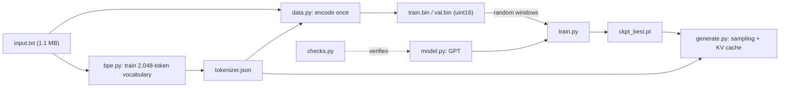
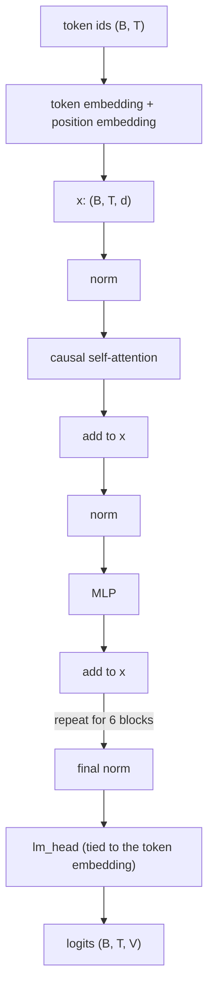

# Project 2: Tiny GPT

A language model is four programs that have to agree with each other: a tokenizer that turns text into integers, a network that predicts the next integer, a loop that trains the network, and a sampler that turns predictions back into text. In this project you write all four, in about 800 lines of Python and PyTorch, at a size a laptop trains in nine minutes. The model has 11.5M parameters and learns Shakespeare from 1 MB of text. You build it GPT-2 style first, then swap in the three parts every current open model uses (RMSNorm, RoPE, SwiGLU) and measure the difference. Along the way you write the checks that tell a working model from one that only looks like it is training, because a transformer with no causal mask still passes two of the three most common sanity checks.

!!! abstract "What you'll build"
    - `bpe.py`: a byte-level BPE tokenizer with `train`, `encode`, `decode`, `save` and `load`
    - `model.py`: a decoder-only transformer with switchable parts (LayerNorm or RMSNorm, learned positions or RoPE, GELU MLP or SwiGLU), a closed-form parameter count, and a KV cache
    - `checks.py`: step-0 loss, overfit one batch, causality, and cached versus uncached logits
    - `data.py`: tokenize once into `uint16` files, then sample random windows from a memory map
    - `train.py`: AdamW, warmup and cosine decay, gradient clipping, validation loss, checkpoint and resume
    - `generate.py`: temperature, top-k and top-p sampling, with and without the KV cache

    Full code: [code/tiny_gpt](https://github.com/vivek-rm-14286/llm-from-scratch/tree/main/code/tiny_gpt). Prerequisites: [Tokenization](../llm/tokenization.md), [Embeddings & Attention](../llm/attention.md), [The Transformer, Line by Line](../llm/transformer.md), [Modern Architectures & SLM Design](../llm/modern-architectures.md) (RMSNorm, RoPE and SwiGLU only) and [Debugging a Training Run](../pretraining/debugging.md). [Project 1](nn-from-scratch.md) is not required, but it explains what `loss.backward()` does here.

!!! info "Two ways to do this project"
    **Fill in the starter.** `starter/` has every file with signatures, docstrings and `TODO`s. `tests/` has 50 tests. Run `pytest`, read the first failure, write the function, repeat. You are done when `pytest` prints `50 passed` and your own training run produces Shakespeare-shaped text. This is the route the project is designed for, and it takes about 12 hours.

    **Read and modify.** Read `solution/` next to this page, run each command, then change something and predict the effect before measuring it: delete `is_causal=True` and run the checks, initialize with a standard deviation of 0.2, set the dropout to 0, slice the RoPE tables from position 0 in the cached path. This takes 3 to 4 hours. The stretch goals work from either route.

    The two directories have identical file names, function signatures and command-line flags, so every command below works in `starter/` once your tests pass.

## 0. Setup

```bash
git clone https://github.com/vivek-rm-14286/llm-from-scratch
cd llm-from-scratch/code/tiny_gpt
uv venv && source .venv/bin/activate      # or python -m venv .venv
uv pip install -r requirements.txt
```

The dependencies are torch, numpy and pytest. `datasets` is in `requirements.txt` only for the optional TinyStories slice in Step 4; delete that line if you do not want it.

**Hardware.** Any laptop. On Apple Silicon the training script uses the GPU through MPS; elsewhere it uses CUDA if present and the CPU otherwise. The numbers on this page are from an Apple M1 Pro with 16 GB. On a CPU without a GPU, train the smaller configuration given in Step 5. The tests always run on the CPU.

**Check the setup.** Both commands finish in about ten seconds:

```bash
pytest --impl solution     # 50 passed
pytest                     # 50 failed: that is your to-do list
```

`--impl` selects the directory under test (default `starter`). `TINY_GPT_IMPL=solution pytest` does the same through an environment variable. Every starter function raises `NotImplementedError`, so the failures point at the function to write next.

**Expected time per step** on the fill-in route:

| Step | File | Tests | Time |
|---|---|---|---|
| 1. Tokenizer | `bpe.py` | `tests/test_tokenizer.py` (8) | 2 hours |
| 2. The transformer, GPT-2 style | `model.py` | `tests/test_model.py -k "gpt2 and not cache"` (8) | 2.5 hours |
| 3. Sanity checks | `checks.py` | the same tests, plus the script | 1 hour |
| 4. Data pipeline | `data.py` | `tests/test_train.py -k "prepare or batch"` (3) | 1 hour |
| 5. Training loop | `train.py` | `tests/test_train.py` (7) | 2 hours, plus a 9-minute run |
| 6. RMSNorm, RoPE, SwiGLU | `model.py` | `tests/test_model.py` (25) | 2 hours, plus a 9-minute run |
| 7. Sampling and the KV cache | `generate.py`, `model.py` | `tests/test_generate.py` (10) | 1.5 hours |

## The design



Three decisions shape the code:

- **One model class, switched by a config.** `GPTConfig()` is GPT-2 style: learned positions, LayerNorm, a GELU MLP, biases. `GPTConfig.modern()` turns on RMSNorm, RoPE and SwiGLU and turns the biases off. Everything else (the residual stream, the attention shapes, the loop, the sampler) is shared, so the comparison in Step 6 changes three parts and nothing else.
- **The interface of the lesson's model.** `model(idx)` returns logits, `model(idx, targets)` returns `(logits, loss)`, exactly like [the GPT in the Transformer lesson](../llm/transformer.md#the-complete-model). One argument is added: `model(idx, cache=cache)` for cached decoding.
- **A small vocabulary on purpose.** The corpus is 1.1 MB. With 2,048 tokens, most of the vocabulary appears often enough to learn, and the embedding table is 7% of the parameters instead of most of them. The step-0 loss target is $\ln 2048 = 7.62$.

## 1. A byte-level BPE tokenizer

`bpe.py` keeps the interface of the [`ByteBPE` class in the Tokenization lesson](../llm/tokenization.md#implementation-from-scratch): 256 byte tokens to start, then one new token per merge of the most frequent adjacent pair. The lesson's version rescans the whole corpus for every merge, which is fine for a paragraph and slow for a megabyte. This one adds three things.

**Pre-tokenization.** The text is first cut into chunks (a word with its leading space, a run of digits, punctuation, whitespace) by a GPT-2-style regular expression written for the standard-library `re` module. Merges are only counted inside a chunk, so no token ever spans two words. `PAT` is given in the starter.

**Count each distinct chunk once.** Tiny Shakespeare splits into 297,833 chunks, of which only 15,057 are distinct. Training works on the distinct chunks, each weighted by how often it occurs.

**Incremental pair counts.** A merge only changes the chunks that contain the merged pair. The trainer keeps, for every pair, its count and the set of chunks containing it, and updates only those:

```python title="bpe.py"
for new_id in range(256, vocab_size):
    if not counts:
        break
    # Most frequent pair; ties go to the smaller pair so training is deterministic.
    pair = max(counts, key=lambda p: (counts[p], -p[0], -p[1]))
    if counts[pair] <= 0:
        break
    self.merges[pair] = new_id
    self.vocab[new_id] = self.vocab[pair[0]] + self.vocab[pair[1]]
    for w in list(where[pair]):                 # only the chunks that contain the pair
        ids, f = words[w], freqs[w]
        for p in zip(ids, ids[1:]):             # remove this chunk's old pairs
            counts[p] -= f
            where[p].discard(w)
        ids = words[w] = merge(ids, pair, new_id)
        for p in zip(ids, ids[1:]):             # add its new pairs back
            counts[p] += f
            where[p].add(w)
    del counts[pair], where[pair]
```

The tie-break matters more than it looks. Without it, two machines can learn different vocabularies from the same text, and a tokenizer that does not match the one used for training turns a checkpoint into noise.

**Encoding** applies merges in the order they were learned, not in the order they appear in the text. For each chunk, find the adjacent pair with the lowest merge id, merge it everywhere, repeat until no pair is in the table:

```python title="bpe.py"
def _encode_chunk(self, chunk: str) -> list[int]:
    cached = self._cache.get(chunk)
    if cached is not None:
        return cached
    ids = list(chunk.encode("utf-8"))
    while len(ids) >= 2:
        pair = min(zip(ids, ids[1:]), key=lambda p: self.merges.get(p, float("inf")))
        if pair not in self.merges:
            break
        ids = merge(ids, pair, self.merges[pair])
    self._cache[chunk] = ids
    return ids
```

The per-chunk cache is what makes encoding a whole corpus practical in pure Python: `" the"` is encoded once and looked up thousands of times.

**Decoding** concatenates the bytes of each id and decodes UTF-8 with `errors="replace"`, because a single token can hold half of a multi-byte character. **Special tokens** such as `<|endoftext|>` get ids after the merges and are split out of the text before chunking, so they are never broken into bytes (see [Special tokens](../llm/tokenization.md#special-tokens-and-chat-templates)). **Saving** writes only the merges in learned order and the special tokens: everything else can be rebuilt from those.

```bash
pytest tests/test_tokenizer.py        # 8 passed
python bpe.py                         # trains on a toy string and round-trips "naïve 東京 12345"
```

The tests cover the first merge on a known string, round trips on text the tokenizer never saw (accents, CJK, an emoji, tabs), a check that no token crosses a word boundary, special tokens, and save/load. On tiny Shakespeare, training 2,047 tokens takes 4.0 seconds and encoding the full text takes 0.3 seconds. The result is 388,533 tokens at 2.87 bytes per token.

## 2. The transformer, GPT-2 style

The model is the one from [The Transformer, Line by Line](../llm/transformer.md), written from an empty file: token and position embeddings, a stack of pre-norm blocks, a final norm, and a linear head that shares its weight matrix with the token embedding.



```python title="model.py"
@dataclass
class GPTConfig:
    vocab_size: int = 2048
    block_size: int = 256        # maximum context length
    n_layer: int = 6
    n_head: int = 6
    d_model: int = 384
    dropout: float = 0.0
    bias: bool = True            # biases in Linear and LayerNorm (GPT-2 style)
    tie_weights: bool = True     # lm_head shares the token embedding matrix
    rmsnorm: bool = False        # step 6
    rope: bool = False           # step 6
    swiglu: bool = False         # step 6
    rope_base: float = 10000.0
```

### Attention

One linear layer produces queries, keys and values together. Each is reshaped to `(B, H, T, Dh)` so that the heads become a batch dimension, and `F.scaled_dot_product_attention` does the rest: the scaled dot product, [the causal mask](../llm/attention.md#the-causal-mask), the softmax and attention dropout, in one fused call.

```python title="model.py"
def forward(self, x, cos=None, sin=None, cache=None):
    B, T, C = x.shape
    q, k, v = self.qkv(x).split(C, dim=2)
    q, k, v = (t.view(B, T, self.n_head, self.head_dim).transpose(1, 2) for t in (q, k, v))
    if self.rope:                                           # step 6
        q, k = apply_rope(q, cos, sin), apply_rope(k, cos, sin)
    if cache is None:
        y = F.scaled_dot_product_attention(
            q, k, v, is_causal=True, dropout_p=self.dropout if self.training else 0.0)
    else:
        ...                                                 # step 7
    y = y.transpose(1, 2).contiguous().view(B, T, C)
    return self.resid_drop(self.proj(y))
```

`dropout_p` is a plain number, not a module, so it does not turn itself off in eval mode. The `if self.training` is required. Leaving it out makes validation loss noisy and too high, and nothing crashes.

### The model

```python title="model.py"
def forward(self, idx, targets=None, cache=None):
    B, T = idx.shape
    past = cache[0]["k"].size(2) if cache is not None and "k" in cache[0] else 0
    assert past + T <= self.cfg.block_size, f"sequence length {past + T} > block_size"
    x = self.tok_emb(idx)
    cos = sin = None
    if self.cfg.rope:
        cos, sin = self.rope_cos[past:past + T], self.rope_sin[past:past + T]
    else:
        x = x + self.pos_emb(torch.arange(past, past + T, device=idx.device))
    x = self.drop(x)
    for i, block in enumerate(self.blocks):
        x = block(x, cos, sin, None if cache is None else cache[i])
    logits = self.lm_head(self.norm_f(x))
    if targets is None:
        return logits
    loss = F.cross_entropy(logits.view(-1, logits.size(-1)), targets.reshape(-1))
    return logits, loss
```

For now `cache` is always `None` and `past` is 0. Writing `past` into the position lookup from the start means Step 7 needs no changes here.

**Initialization.** All weights are drawn from $\mathcal{N}(0, 0.02^2)$ and biases start at zero. The last linear layer of each attention and MLP sublayer writes into the residual stream, and $2L$ of them add up, so their standard deviation is scaled by $1/\sqrt{2L}$. In the code those layers carry a `RESIDUAL_SCALE` attribute that `_init_weights` looks for. With this init the logits of an untrained model are close to zero, which is what makes the step-0 check in the next step meaningful.

**Weight tying** is one line, `self.lm_head.weight = self.tok_emb.weight`, and it must come before `self.apply(self._init_weights)` so the shared matrix is initialized once. [The LM head and weight tying](../llm/transformer.md#the-lm-head-and-weight-tying) explains why it helps.

### Count the parameters before building them

`count_params(cfg)` returns the parameter count from the config alone, and a test requires it to equal `GPT(cfg).num_params()`. Derive it on paper first, following [Counting parameters](../llm/transformer.md#counting-parameters). For the GPT-2-style default ($V = 2048$, $T = 256$, $L = 6$, $d = 384$):

| Part | Formula | Count |
|---|---|---|
| Token embedding (tied with the head) | $V d$ | 786,432 |
| Position embedding | $T d$ | 98,304 |
| Blocks | $L\,(12d^2 + 13d)$ | 10,646,784 |
| Final LayerNorm | $2d$ | 768 |
| **Total** | | **11,532,288** |

```bash
python model.py
```

```text
gpt2-style instantiated 11,532,288  formula 11,532,288
modern     instantiated 11,408,256  formula 11,408,256
```

A mismatch between the two columns is a bug report: a missing bias, an untied head (off by exactly $Vd$), or a layer that was created twice.

```bash
pytest tests/test_model.py -k "gpt2 and not cache"     # 8 passed
```

One of those eight, `test_overfit_one_batch`, imports `configure_optimizer` from `train.py`. It is five lines, shown in Step 5. Write it now, or leave that test red until then.

## 3. Sanity checks before any training

A language model that is wrong usually still trains: the loss falls, the samples look like text, and the bug shows up days later as a model that is worse than it should be. [Debugging a Training Run](../pretraining/debugging.md) lists the cheap checks that catch the common bugs first. `checks.py` implements five, and `tests/test_model.py` runs the same ideas on random tokens.

| Check | What it asserts | Lesson section |
|---|---|---|
| Shift | `x[:, 1:] == y[:, :-1]` | [Shifted targets](../pretraining/debugging.md#3-shifted-targets-and-causal-mask-leaks) |
| Step-0 loss | the untrained loss is within 0.15 of $\ln V$ | [The step-0 loss](../pretraining/debugging.md#1-the-step-0-loss-should-be-lnvocab) |
| Causality | changing token $t$ leaves the logits at positions before $t$ unchanged | [Causal-mask leaks](../pretraining/debugging.md#3-shifted-targets-and-causal-mask-leaks) |
| KV cache | prefill plus one-token-at-a-time decoding gives the logits of one full forward pass | Step 7 |
| Overfit | a fresh model reaches a loss below 0.1 on one fixed batch in 150 steps | [Overfit a single batch](../pretraining/debugging.md#2-overfit-a-single-batch) |

The causality check is a dozen lines and is the most valuable one:

```python title="checks.py"
@torch.no_grad()
def check_causal(model, x) -> float:
    """Change the LAST input token. Logits at every earlier position must not move."""
    model.eval()
    x2 = x.clone()
    x2[:, -1] = (x2[:, -1] + 1) % model.cfg.vocab_size
    a, b = model(x), model(x2)
    diff = (a[:, :-1] - b[:, :-1]).abs().max().item()
    assert diff < 1e-5, f"a future token changed past logits by {diff:.2e}: the causal mask leaks"
    assert (a[:, -1] - b[:, -1]).abs().max().item() > 0, "the last position ignores its own input"
    return diff
```

Write all five functions now. The script itself reads real tokens, so run it at the end of Step 4:

```bash
python checks.py && python checks.py --modern
```

```text
shift:    PASS  targets are inputs shifted by one
step 0:   PASS  loss 7.628 vs ln(2048) = 7.625
causal:   PASS  max change in past logits 0.0e+00
kv cache: PASS  max |cached - uncached| 6.6e-07
overfit:  PASS  loss on one batch after 150 steps 0.012
```

### Which check catches which bug

Four bugs were planted in the reference model, one at a time, and all four checks were run on a 4-layer, 128-wide model. The numbers in parentheses are what each check measured:

| Planted bug | Step-0 loss | Causality | KV cache | Overfit |
|---|---|---|---|---|
| None | passes (7.62) | passes (0) | passes ($7 \times 10^{-7}$) | passes (0.008) |
| No causal mask | passes (7.62) | **fails** (0.026) | **fails** (0.44) | passes (0.006) |
| Init standard deviation 0.2 instead of 0.02 | **fails** (10.10) | passes | passes | passes (0.003) |
| Targets equal to inputs (no shift) | **fails** (6.65) | passes | passes | passes (0.004) |
| RoPE tables sliced from position 0 in the cached path | passes (7.61) | passes | **fails** (0.016) | passes (0.011) |

Three things to take from the table:

- **The overfit check passes on every row.** It proves that gradients flow and the optimizer works. It says nothing about whether the model is solving the right problem.
- **A model with no mask starts at $\ln V$ and memorizes a batch without trouble.** After 300 steps on fresh batches its training loss is 4.50, against 4.62 for the correct model, so it looks like the better model. The causality check reports the leak directly. The cache check also fails, because the cached path only ever holds the past and so disagrees with a full pass that can see the future.
- **The step-0 loss can be too low as well as too high.** With unshifted targets it is 6.65, a full nat below $\ln V$. The head shares its weights with the embedding, so an untrained model already gives its own input token the largest logit, and the input is the target. Left running, that model reaches a training loss of 0.026 in 300 steps by learning to copy. A loss that falls toward zero on fresh data means the answer is in the input.

## 4. The data pipeline

Tokenizing is slow and training reads the same tokens thousands of times, so the text is tokenized once and stored as raw integers. `prepare` downloads the text, trains the tokenizer on it, encodes everything, and writes four files:

```python title="data.py"
tok = ByteBPE()
tok.train(text[:tokenizer_chars].replace(EOT, "\n"), vocab_size - 1)   # leave one id for EOT
tok.add_special_tokens([EOT])
tok.save(os.path.join(out_dir, "tokenizer.json"))

ids = np.array(tok.encode(text), dtype=np.uint16)         # vocab <= 65,536 fits in 2 bytes
n_val = int(len(ids) * val_frac)
ids[:-n_val].tofile(os.path.join(out_dir, "train.bin"))   # the validation split is the tail
ids[-n_val:].tofile(os.path.join(out_dir, "val.bin"))
```

The validation split is the last 10% of the text, not a random sample of windows. Random windows from one file overlap, so a random split would put nearly every validation token in the training set too.

`load_tokens` opens a file with `np.memmap`. Nothing is read until a window is sliced, and the operating system keeps the pages that are used in its cache. For 700 KB this is not needed. It is the same code that reads the [multi-gigabyte shards](../pretraining/data.md#tokenizing-at-scale-and-packing-into-shards) of a real run, which is why it is written this way here.

```python title="data.py"
def get_batch(data, batch_size: int, block_size: int, device="cpu", generator=None):
    """Random windows. x: (B, T) int64, y: x shifted left by one token."""
    starts = torch.randint(len(data) - block_size, (batch_size,), generator=generator).tolist()
    x = np.stack([data[s:s + block_size] for s in starts]).astype(np.int64)
    y = np.stack([data[s + 1:s + 1 + block_size] for s in starts]).astype(np.int64)
    return torch.from_numpy(x).to(device), torch.from_numpy(y).to(device)
```

The `generator` argument is a `torch.Generator` owned by the training script. Its state goes into every checkpoint, so a resumed run draws the batches the interrupted run would have drawn.

```bash
python data.py
```

```text
{
  "dataset": "shakespeare",
  "vocab_size": 2048,
  "chars": 1115394,
  "train_tokens": 349680,
  "val_tokens": 38853,
  "bytes_per_token": 2.871,
  "tokenizer_train_s": 4.0,
  "encode_s": 0.3
}
first validation tokens: [' you', ',', ' if', ' I', ' look', ' p', 'ale', '.', '\n', '\n', 'BAPTISTA', ':']
```

Always decode a few tokens from the files, as the last line does. A tokenizer and a token file that do not belong together produce a model that trains normally and generates garbage.

!!! example "Optional: a TinyStories slice"
    Tiny Shakespeare is small enough that the model starts to memorize it within minutes. For more data, `data.py` can stream the first stories of [TinyStories](https://huggingface.co/datasets/roneneldan/TinyStories) (CDLA-Sharing-1.0) with the `datasets` library:

    ```bash
    python data.py --dataset tinystories --stories 20000 --vocab-size 4096 --out data/tinystories
    python train.py --data data/tinystories --out out/ts --dropout 0.0 --max-steps 3000
    python generate.py --ckpt out/ts/ckpt_best.pt --data data/tinystories --prompt "Once upon a time"
    ```

    Preparing 20,000 stories takes about a minute including the download: 18.2 MB of text, 9.6 seconds to train the 4,096-token vocabulary on the first 2 MB, 3.3 seconds to encode, 4.59M tokens at 3.96 bytes per token. The training run on this slice was not measured for this page.

## 5. The training loop

Every piece here is covered in [The Training Loop](../pretraining/training.md); this step puts them in one file.

**Schedule.** Linear warmup, then cosine decay to a floor ([Warmup + cosine](../pretraining/training.md#warmup-cosine)):

```python title="train.py"
def lr_at(step: int, max_lr: float, warmup_steps: int, max_steps: int, min_lr: float = 0.0) -> float:
    if step < warmup_steps:
        return max_lr * (step + 1) / warmup_steps
    if step >= max_steps:
        return min_lr
    progress = (step - warmup_steps) / (max_steps - warmup_steps)
    return min_lr + 0.5 * (max_lr - min_lr) * (1 + math.cos(math.pi * progress))
```

`step + 1` keeps the first update from having a learning rate of exactly zero.

**Optimizer.** [AdamW](../pretraining/training.md#adamw-for-language-models) with $\beta = (0.9, 0.95)$ and weight decay on matrices only. Biases and norm gains are one-dimensional and are not decayed:

```python title="train.py"
def configure_optimizer(model, lr: float, weight_decay: float = 0.1, betas=(0.9, 0.95)):
    decay = [p for p in model.parameters() if p.requires_grad and p.dim() >= 2]
    no_decay = [p for p in model.parameters() if p.requires_grad and p.dim() < 2]
    groups = [{"params": decay, "weight_decay": weight_decay},
              {"params": no_decay, "weight_decay": 0.0}]
    return torch.optim.AdamW(groups, lr=lr, betas=betas)
```

**The loop.** The argument parsing and the `evaluate` helper are given in the starter. The loop is the part to write:

```python title="train.py"
while step < args.max_steps:
    if step % args.eval_every == 0:
        tr, va = evaluate()
        print(f"step {step:5d} | eval train {tr:.4f} val {va:.4f} | elapsed {time.time() - t_start:.0f}s")
        if va < best_val and step > 0:
            best_val = va
            save_checkpoint(os.path.join(args.out, "ckpt_best.pt"), model, optimizer, step, best_val, gen)
        t_log = time.time()                              # do not count eval time as training time

    lr = lr_at(step, args.lr, args.warmup_steps, args.max_steps, args.min_lr)
    for group in optimizer.param_groups:
        group["lr"] = lr
    x, y = get_batch(train_data, args.batch_size, cfg.block_size, device, gen)
    with autocast:
        _, loss = model(x, y)
    optimizer.zero_grad(set_to_none=True)
    loss.backward()
    grad_norm = torch.nn.utils.clip_grad_norm_(model.parameters(), args.grad_clip)   # (1)!
    optimizer.step()
    step += 1

    if step % args.log_every == 0:
        loss_val = loss.item()                           # (2)!
        dt = time.time() - t_log
        t_log = time.time()
        print(f"step {step:5d} | loss {loss_val:.4f} | lr {lr:.2e} | grad norm {grad_norm:.2f} | "
              f"{args.log_every * tokens_per_step / dt:,.0f} tok/s")
    if step % args.eval_every == 0 or step == args.max_steps:
        save_checkpoint(os.path.join(args.out, "ckpt_last.pt"), model, optimizer, step, best_val, gen)
```

1. `clip_grad_norm_` returns the norm before clipping. Log it: a norm that sits at the clip value on every step means the learning rate is too high, and a spike marks the batch to look at. See [Gradient clipping](../pretraining/training.md#gradient-clipping).
2. On a GPU, `loss.item()` waits for the queued work to finish. Read the clock after it, or the tokens-per-second figure measures how fast Python can queue work.

**Validation.** `estimate_loss` averages the loss over 20 random batches in eval mode and switches back to train mode afterwards. The script reseeds a separate generator before every evaluation, so every evaluation sees the same batches and the curve is comparable from one point to the next. It evaluates the training set the same way, with dropout off. That is the number to compare with validation loss; the per-step training loss has dropout on and is higher.

**Checkpoint and resume.** A checkpoint holds everything that changes during training: the weights, the optimizer's moment estimates, the step, the best validation loss, the config and the state of the batch generator. It is written to a temporary file and moved into place with `os.replace`, so an interruption during the write cannot leave a truncated file ([Checkpointing and resume](../pretraining/training.md#checkpointing-and-resume)).

```python title="train.py"
def save_checkpoint(path: str, model, optimizer, step: int, best_val: float, generator=None):
    ckpt = {"model": model.state_dict(), "optimizer": optimizer.state_dict(), "step": step,
            "best_val": best_val, "config": asdict(model.cfg),
            "rng": None if generator is None else generator.get_state()}
    torch.save(ckpt, path + ".tmp")
    os.replace(path + ".tmp", path)
```

The test for this trains 5 steps, saves, trains 5 more, then loads the checkpoint into a new model and requires the next 5 losses to match to $10^{-5}$. The same holds for the script: a small CPU run (2 layers, width 64, no dropout, 400 steps) that was killed after step 200 and restarted with `--resume` printed the same train and validation loss at steps 300 and 400 as the uninterrupted run, to all four decimals (4.9736 and 5.0214 at step 400). Two limits apply. Resume with the same `--max-steps`, because the schedule depends on it. And with dropout on, the resumed run is statistically the same but not bit-identical, because the dropout masks come from PyTorch's global generator, which the checkpoint does not store.

**Mixed precision.** On CUDA the script runs the forward pass under `torch.autocast` with bf16, as in [Mixed precision with bf16](../pretraining/training.md#mixed-precision-with-bf16). On MPS and CPU it stays in fp32 unless `--amp on` is passed. On MPS, `--amp on` uses fp16 autocast. It trains normally (validation loss 5.36 after 60 steps, against 5.33 in fp32), but in back-to-back 60-step runs it was slower for the GPT-2-style model (9,200 against 12,200 tokens/s) and faster for the modern one (8,600 against 6,300), on a machine busy enough that neither difference is reliable. With no clear gain, fp32 stays the default there. The test takes a minute on your own machine: run 60 steps each way and compare the `tok/s` column.

### Run it

```bash
python train.py --out out/gpt2
```

The defaults are 1,000 steps of 32 windows of 256 tokens (8,192 tokens per step), peak learning rate $10^{-3}$, 50 warmup steps, floor $10^{-4}$, weight decay 0.1, dropout 0.2 and clipping at 1.0.

```text
device mps | 11,532,288 parameters | ln(vocab) = 7.625
step     0 | eval train 7.6335 val 7.6255 | elapsed 7s
step    10 | loss 6.6430 | lr 2.00e-04 | grad norm 1.48 | 10,666 tok/s
step    20 | loss 5.9840 | lr 4.00e-04 | grad norm 1.00 | 12,687 tok/s
step    30 | loss 5.7434 | lr 6.00e-04 | grad norm 0.40 | 20,290 tok/s
...
step   100 | eval train 4.8848 val 4.9078 | elapsed 62s
...
step   500 | eval train 3.6762 val 4.1738 | elapsed 261s
...
step  1000 | eval train 3.1657 val 4.0098 | best val 4.0098 | total 529s
```

The first line of output is the step-0 check again, on the full-size model and real data: 7.63 against $\ln 2048 = 7.625$.

**On a CPU.** The default model is slow without a GPU: about 900 tokens/s on this machine's CPU while it was busy with other work, which puts 1,000 steps at two hours or more. Use a smaller model:

```bash
python train.py --device cpu --n-layer 4 --n-head 4 --d-model 256 --block-size 128 --out out/small
```

That is 3,716,608 parameters and 4,096 tokens per step. On the M1 Pro's CPU it ran at a median of 11,000 tokens/s and finished 1,000 steps in 624 seconds with a best validation loss of 4.17 (train 3.75) at step 900.

## 6. The modern upgrade: RMSNorm, RoPE, SwiGLU

GPT-2 is from 2019. Llama, Qwen, Mistral and SmolLM all use the same three replacements, described in [Modern Architectures](../llm/modern-architectures.md#what-changed-since-gpt-2). Each one is a few lines.

**RMSNorm** divides by the root mean square of the vector and multiplies by a learned gain. Compared with LayerNorm it drops the mean subtraction and the bias ([RMSNorm](../llm/modern-architectures.md#rmsnorm)):

```python title="model.py"
class RMSNorm(nn.Module):
    def __init__(self, dim: int, eps: float = 1e-6):
        super().__init__()
        self.eps = eps
        self.weight = nn.Parameter(torch.ones(dim))

    def forward(self, x):
        return self.weight * x * torch.rsqrt(x.pow(2).mean(-1, keepdim=True) + self.eps)
```

**RoPE** removes the position table. Instead, inside every attention layer, each pair of dimensions of the query and key is rotated by an angle proportional to the token's position. The dot product of a rotated query and a rotated key then depends only on the distance between the two positions ([RoPE](../llm/modern-architectures.md#rope-rotary-position-embeddings)):

```python title="model.py"
def rope_cache(seq_len: int, head_dim: int, base: float = 10000.0, device=None):
    """cos and sin tables of shape (seq_len, head_dim)."""
    inv_freq = 1.0 / (base ** (torch.arange(0, head_dim, 2, device=device).float() / head_dim))
    angles = torch.outer(torch.arange(seq_len, device=device).float(), inv_freq)   # (T, Dh/2)
    angles = torch.cat([angles, angles], dim=-1)                                   # (T, Dh)
    return angles.cos(), angles.sin()


def apply_rope(x, cos, sin):
    """x: (B, H, T, Dh); cos, sin: (T, Dh). Rotates each pair (x_i, x_{i + Dh/2})."""
    x1, x2 = x.chunk(2, dim=-1)
    return x * cos + torch.cat([-x2, x1], dim=-1) * sin
```

The tables are computed once in `GPT.__init__` and stored with `register_buffer(..., persistent=False)`: they follow the model to the GPU, are not trained, and are not written to checkpoints. Queries and keys are rotated; values are not. `test_rope_relative_position_property` places one query and one key at every position from 0 to 99 and requires the score to be constant along each diagonal, that is, for every pair with the same offset.

**SwiGLU** replaces the MLP with a gated one, `proj(silu(gate(x)) * up(x))`, which has three matrices instead of two. To keep the parameter count, the hidden size shrinks from $4d$ to $\tfrac{8}{3}d$, rounded up to a multiple of 8 ([SwiGLU](../llm/modern-architectures.md#swiglu)). For $d = 384$ that is exactly 1,024.

```python title="model.py"
class SwiGLU(nn.Module):
    def __init__(self, cfg: GPTConfig):
        super().__init__()
        self.gate = nn.Linear(cfg.d_model, cfg.mlp_hidden, bias=False)
        self.up = nn.Linear(cfg.d_model, cfg.mlp_hidden, bias=False)
        self.proj = nn.Linear(cfg.mlp_hidden, cfg.d_model, bias=False)
        self.proj.RESIDUAL_SCALE = True
        self.drop = nn.Dropout(cfg.dropout)

    def forward(self, x):
        return self.drop(self.proj(F.silu(self.gate(x)) * self.up(x)))
```

**The new parameter count.** With [no biases](../llm/modern-architectures.md#no-biases), no position table and hidden size $h$:

$$
N = Vd + L\,(4d^2 + 3dh + 2d) + d
$$

For the default that is $786{,}432 + 6 \times 1{,}770{,}240 + 384 = 11{,}408{,}256$, about 1% fewer than the GPT-2-style model. Extend `count_params` to cover both.

```bash
pytest tests/test_model.py -k "not cache"       # 21 passed
python checks.py --modern                       # five lines of PASS
python train.py --modern --out out/modern
```

```text
device mps | 11,408,256 parameters | ln(vocab) = 7.625
step     0 | eval train 7.6678 val 7.6545 | elapsed 6s
step   100 | eval train 4.5877 val 4.6486 | elapsed 65s
...
step   700 | eval train 2.5823 val 3.8712 | elapsed 514s
...
step  1000 | eval train 2.2596 val 3.9074 | best val 3.8712 | total 729s
```

With the same data, steps, batch size, learning rate and seed, the modern model is ahead at every evaluation and reaches a best validation loss of 3.87 against 4.01. It also overfits sooner: its validation loss bottoms out at step 700 and rises afterwards, while its training loss keeps falling to 2.26. `ckpt_best.pt` holds the step-700 weights, which is the reason the script keeps a best checkpoint as well as a last one. This is one seed on one small corpus, so it shows the direction and not the size of the effect.

## 7. Sampling and the KV cache

### Sampling

The model outputs logits for the next token. `sample_next` turns them into one token id, with the three controls from [Sampling strategies](../inference/inference.md#sampling-strategies):

```python title="generate.py"
def sample_next(logits, temperature: float = 1.0, top_k: int = 0, top_p: float = 1.0):
    """logits: (B, V) for the last position. Returns the next token ids, shape (B, 1)."""
    logits = logits.float()
    if temperature == 0.0:                                        # greedy
        return logits.argmax(dim=-1, keepdim=True)
    logits = logits / temperature
    if top_k > 0:
        kth = torch.topk(logits, min(top_k, logits.size(-1))).values[:, [-1]]
        logits = logits.masked_fill(logits < kth, float("-inf"))
    probs = F.softmax(logits, dim=-1)
    if top_p < 1.0:
        sorted_p, sorted_idx = torch.sort(probs, descending=True, dim=-1)
        before = sorted_p.cumsum(dim=-1) - sorted_p               # probability mass ranked above each token
        sorted_p = sorted_p.masked_fill(before >= top_p, 0.0)     # keeps the token that crosses top_p
        probs = torch.zeros_like(probs).scatter_(1, sorted_idx, sorted_p)
        probs = probs / probs.sum(dim=-1, keepdim=True)
    return torch.multinomial(probs, num_samples=1)
```

The top-p line is where implementations go wrong. The nucleus is the smallest set of tokens whose probability reaches `top_p`, so the token that crosses the threshold stays in. Masking on `cumsum >= top_p` instead drops it, and with a confident model that can leave nothing but the top token. The tests use a five-token distribution (0.5, 0.25, 0.15, 0.07, 0.03) where the correct sets are easy to work out by hand: `top_p=0.6` must keep the first two tokens.

### The KV cache

Without a cache, generating token $t$ re-runs the model on all $t$ previous tokens. With a causal mask their keys and values cannot have changed, so each layer can store them and process only the new token ([A first look at the KV cache](../llm/transformer.md#a-first-look-at-the-kv-cache), [The KV cache](../inference/inference.md#the-kv-cache)). The cache here is a list with one dict per layer, and the attention's cached branch is six lines:

```python title="model.py"
past = cache["k"].size(2) if "k" in cache else 0
if past:
    k = torch.cat([cache["k"], k], dim=2)
    v = torch.cat([cache["v"], v], dim=2)
cache["k"], cache["v"] = k, v                             # (B, H, past + T, Dh)
# new position i sits at absolute position past + i and may see keys 0..past+i
mask = torch.ones(T, past + T, dtype=torch.bool, device=x.device).tril(diagonal=past)
y = F.scaled_dot_product_attention(q, k, v, attn_mask=mask)
```

Three details decide whether cached logits equal uncached ones:

- **Positions are absolute.** The new tokens sit at positions `past .. past + T - 1`. `GPT.forward` already uses `past` for the position embedding and for slicing the RoPE tables. Slicing from 0 is the fourth planted bug in Step 3.
- **Rotate keys before caching them.** A cached key must already carry its own position.
- **The mask is rectangular.** Prefill sends many tokens at once, so the mask has `T` rows and `past + T` columns. For a single new token it is one row of ones.

`generate` then has two phases, which [inference engines name prefill and decode](../inference/inference.md#prefill-vs-decode):

```python title="generate.py"
for _ in range(max_new_tokens):
    if not use_cache:
        logits = model(idx[:, -block:])                       # re-run the whole window
    elif cache is None or cache[0]["k"].size(2) >= block:
        # First step, or the cache is full: rebuild it from the most recent tokens.
        keep = block if cache is None else block // 2
        cache = model.new_cache()
        logits = model(idx[:, -keep:], cache=cache)           # prefill
    else:
        logits = model(idx[:, -1:], cache=cache)              # decode: one new token
    next_id = sample_next(logits[:, -1, :], temperature, top_k, top_p)
    idx = torch.cat([idx, next_id], dim=1)
```

When the cache reaches `block_size` positions it cannot grow. Dropping the oldest entry is not an option with learned absolute positions, because every remaining key was computed at a position that would now be wrong, and with RoPE the positions would run past the end of the precomputed tables. The loop starts a new cache from the last half window instead, which costs one prefill every `block_size / 2` tokens.

```bash
pytest                                   # 50 passed
python generate.py --ckpt out/gpt2/ckpt_best.pt --prompt "ROMEO:" --tokens 120
python generate.py --ckpt out/gpt2/ckpt_best.pt --benchmark
```

```text
use_cache=False: 255 tokens in 4.79s = 53 tok/s
use_cache=True: 255 tokens in 0.86s = 297 tok/s
```

That output is from `--device cpu`. Across four CPU runs of the GPT-2-style model, uncached decoding ran at 41 to 53 tokens/s and cached decoding at 149 to 297, a speedup of 3 to 6 times; the modern model gave 43 to 78 against 196 to 252. On MPS the result was not stable: runs ranged from no difference (about 500 tokens/s both ways) to several times faster with the cache. A model this small spends most of each GPU call on overhead, not arithmetic, so the saving is small and the timings are noisy. Greedy output is identical with and without the cache in every case, which `test_generate_cached_equals_uncached` asserts.

## Results from one run

Measured on an Apple M1 Pro (16 GB) with Python 3.12, torch 2.15 and numpy 2.5. The machine was running other jobs at the same time, so the throughput figures are a lower bound for this hardware; the losses do not depend on that.

**Correctness**

| Check | Result |
|---|---|
| Test suite on `solution/` | 50 passed in 9 s (CPU) |
| Test suite on the untouched `starter/` | 50 failed in 1 s, every one with `NotImplementedError` |
| Parameter count, formula and instantiated | 11,532,288 (GPT-2 style), 11,408,256 (modern) |
| Step-0 loss, 11.5M model on real data | 7.634 train, 7.626 val, against $\ln 2048 = 7.625$ |
| Causality, 4-layer model | past logits change by exactly 0 |
| Cached versus uncached logits | $6.6 \times 10^{-7}$ (GPT-2 style), $8.3 \times 10^{-7}$ (modern) |
| Overfit one batch of 8 × 64 tokens, 150 steps | loss 0.012 (GPT-2 style), 0.008 (modern) |
| Resume after a kill at step 200 of 400 (CPU, no dropout) | identical losses to four decimals |

**Tokenizer and data**

| Measurement | Result |
|---|---|
| Train 2,047 tokens on 1,115,394 characters | 4.0 s |
| Encode the full text | 0.3 s |
| Tokens | 349,680 train, 38,853 validation |
| Compression | 2.87 bytes per token |

**Training** (1,000 steps, batch 32 × 256, MPS, fp32)

| Step | GPT-2 style: train | GPT-2 style: val | Modern: train | Modern: val |
|---|---|---|---|---|
| 0 | 7.634 | 7.626 | 7.668 | 7.655 |
| 100 | 4.885 | 4.908 | 4.588 | 4.649 |
| 200 | 4.387 | 4.579 | 3.891 | 4.184 |
| 400 | 3.845 | 4.258 | 3.205 | 3.909 |
| 600 | 3.519 | 4.109 | 2.757 | 3.887 |
| 700 | 3.394 | 4.063 | 2.582 | **3.871** |
| 800 | 3.300 | 4.038 | 2.446 | 3.891 |
| 1,000 | 3.166 | **4.010** | 2.260 | 3.907 |

| Measurement | GPT-2 style | Modern |
|---|---|---|
| Parameters | 11,532,288 | 11,408,256 |
| Best validation loss | 4.010 (step 1,000) | 3.871 (step 700) |
| Validation perplexity at the best step | 55 | 48 |
| Wall-clock, including 11 evaluations | 529 s | 729 s |
| Training throughput, median over the run | 18,600 tokens/s | 15,200 tokens/s over the first 400 steps |
| Checkpoint size (weights plus optimizer state) | 138 MB | 137 MB |

The modern run shared the machine with a CPU training job from about step 480, which inflates its wall-clock. Up to step 400 it took 259 s against 211 s for the GPT-2-style run.

**Other runs**

| Measurement | Result |
|---|---|
| 3.7M-parameter model on the CPU (4 layers, width 256, context 128), 1,000 steps | best val 4.171, 624 s, median 11,000 tokens/s |
| Default model on the CPU, 30 steps | about 900 tokens/s |
| Cached versus uncached decoding, 255 tokens, CPU, GPT-2 style | 149 to 297 against 41 to 53 tokens/s |
| Cached versus uncached decoding, 255 tokens, CPU, modern | 196 to 252 against 43 to 78 tokens/s |
| fp16 autocast on MPS, 60 steps | no consistent speedup |

**Samples** from the GPT-2-style checkpoint, temperature 0.8, top-p 0.95, seed 0:

```text
ROMEO:
O, but I were undgive.

JULIET:
Here comes a wife, and she she hath a name of my father;
To bear her father's name;
And I tell herself.

Nurse:
Why, I have married?

Nurse:
Ay, she will be dark, and she will she not be.
```

```text
First Citizen:
What are you?

Third Citizen:
We have made noise of us.

Third Citizen:
A go with my worship is no more thanks
monforn.

Second Citizen:
How could you be done?
```

Greedy decoding (`--temperature 0`) from the same checkpoint:

```text
KING RICHARD III:
I will not be a breathearted,
And I am a brow of my tale.

KING RICHARD III:
My lord, my lord, my lord,
And I will not be a happy day.

KING RICHARD III:
My lord, my lord, my lord, my lord,
And I will not be a happy day.
```

The modern checkpoint (step 700), same settings:

```text
ROMEO:
I would I were more fierce but grown, that thou
Rest with me; and I'll hang thee in a mortal tyrant;
And for the time I cannot do't; therefore, here comes
And to see thee dead; for, if thou art all.

ROMEO:
Alas, I will tell thee what I can yield to thee,
And I'll tell thee what thou wilt, thou must not go.
```

What the numbers show:

- **The model memorizes within minutes.** 1,000 steps process 8.2M tokens, which is 23 passes over a training set of 350k tokens. Training loss keeps falling to 3.17 while validation loss flattens near 4.01: between steps 800 and 1,000 it improves by 0.03. More steps on this corpus buy nothing. More data does, which is what the TinyStories slice is for. [The train/validation gap](../pretraining/debugging.md#6-the-trainvalidation-gap) covers how to read this curve.
- **Loss per token is not comparable across tokenizers.** 4.01 nats per token at 2.87 bytes per token is 1.40 nats per byte. A character-level model on the same text reports a loss near 1.5, which looks far better than 4.01 and is in fact slightly worse per byte. Convert to bytes before comparing two models with different vocabularies.
- **The samples have the form and not the content.** Speaker names, line breaks, short exchanges and period vocabulary are right; the sentences do not mean anything. That is what 11.5M parameters and 1 MB of text give.
- **Greedy decoding loops.** With temperature 0 the model falls into "My lord, my lord" and stays there, because the most likely continuation of a repeated phrase is the phrase again. Sampling breaks the loop.
- **The modern parts fit faster, in both senses.** At step 400 the modern model's training loss is 3.21 against 3.85, and its validation loss is 3.91 against 4.26. It then overfits from step 700. On a corpus this small, faster learning mostly means reaching the memorization point earlier; the validation gap of 0.14 at the best step is the part that carries over.
- **A smaller model on the CPU gets most of the way.** The 3.7M model reaches 4.17, which is 0.16 behind the 11.5M model, in about the same wall-clock time and with no GPU. The data is the limit here, not the parameter count.

## Milestones

- [ ] `pytest tests/test_tokenizer.py`: 8 passed
- [ ] `python data.py` reports 2,048 tokens of vocabulary, between 2.7 and 3.0 bytes per token, and the decoded validation tokens read as Shakespeare
- [ ] `python model.py` prints 11,532,288 for the GPT-2-style model in both columns
- [ ] `python checks.py`: five lines of `PASS`, with a step-0 loss within 0.15 of 7.625 and an overfit loss below 0.1
- [ ] You removed `is_causal=True`, saw the causality check fail while the step-0 and overfit checks still passed, and restored it
- [ ] `python train.py` reaches a validation loss below 4.15 in 1,000 steps (the reference run: 4.01)
- [ ] You stopped a run with ++ctrl+c++ after a checkpoint, continued it with `--resume`, and the validation loss at the next evaluation was within 0.02 of an uninterrupted run
- [ ] `pytest tests/test_model.py`: 25 passed, and `python model.py` prints 11,408,256 for the modern model
- [ ] `python train.py --modern` reaches a validation loss below 4.15, and you wrote down both curves side by side
- [ ] `python checks.py --modern` reports a cached-versus-uncached difference below $10^{-3}$
- [ ] `python generate.py --benchmark --device cpu` shows cached decoding at least 2 times faster than uncached
- [ ] `pytest` prints `50 passed`
- [ ] You generated from the prompt `ROMEO:` at temperatures 0, 0.8 and 1.5 and can describe the difference

## Stretch goals

1. **Grouped-query attention.** Add `n_kv_head` to the config so that several query heads share one key/value head, as in [GQA and MQA](../llm/modern-architectures.md#gqa-and-mqa-shrinking-the-kv-cache). The key and value projections shrink to `n_kv_head * head_dim` outputs and are repeated across each group before attention. Update `count_params`, keep the cached-versus-uncached test green, and measure the cache size and validation loss at `n_kv_head` of 6, 2 and 1.
2. **Weight tying ablation.** Train with `--no-tie`. The model gains $Vd = 786{,}432$ parameters. Compare the validation loss at 1,000 steps with the tied run, then repeat with a 4,096-token vocabulary, where the embedding is a larger share of the model.
3. **Warmup-stable-decay.** Add a `--schedule wsd` option that holds the peak learning rate and decays only over the last 20% of the steps ([WSD](../pretraining/training.md#warmup-stable-decay-wsd)). Compare the validation curves, then resume from the constant phase with a larger `--max-steps`, which cosine does not allow.
4. **More data.** Prepare the TinyStories slice from Step 4 and train the modern configuration on it with `--dropout 0.0`. With 4.1M training tokens, 1,000 steps are two passes, not 23, so watch whether the train/validation gap closes.
5. **A 30M run.** `python train.py --modern --n-layer 8 --n-head 8 --d-model 512 --block-size 512 --data data/tinystories` builds a model of about 27M parameters with a 4,096-token vocabulary. Compute the exact count with `count_params` before starting, read the throughput after 20 steps, and decide how many tokens fit in the time you have. Throughput for this configuration was not measured for this page.
6. **The same thing at production scale.** [Part 0 of Project 9](slm-500m.md#part-0-train-a-30m-model-on-your-laptop) runs a 31.5M model on TinyStories with the codebase that later trains a 500M model: sharded data, gradient accumulation, WSD and GQA. Having written each part here, read that code and list what it adds.
7. **Ablate one part at a time.** `GPTConfig(rope=True)`, `GPTConfig(rmsnorm=True)` and `GPTConfig(swiglu=True)` each work alone. Add flags to `train.py`, train three more models, and find which of the three changes accounts for the difference between the two curves in the results.

## Check your understanding

??? question "The step-0 loss is 7.63 and the overfit check passes. Why is that not enough to trust the model?"
    Both checks pass with no causal mask at all. An untrained model outputs near-uniform logits whether or not it can see the future, so the step-0 loss is $\ln V$ either way. Memorizing one batch is easier with the answers visible, not harder. In the measurement above the unmasked model even had a lower training loss after 300 steps (4.50 against 4.62). Only a test that changes a future token and looks at past outputs detects the leak. Each check covers a different class of bug, so they are run together.

??? question "Why is the validation set the last 10% of the text and not a random 10% of the windows?"
    Windows drawn from one long token array overlap. A window starting at token 1,000 and one starting at token 1,001 share 255 of their 256 tokens. A random split of windows would put almost every validation token into some training window, and validation loss would track training loss while the model memorized. Holding out one contiguous region keeps the two sets disjoint.

??? question "The validation loss is 4.01 with a 2,048-token vocabulary. A character-level model on the same text reaches about 1.5. Which is better?"
    The losses are per token, and the tokens are different sizes. Divide by the average token length in bytes: $4.01 / 2.87 = 1.40$ nats per byte for the BPE model, against about 1.5 for the character model, where one token is one byte. The BPE model is slightly better. The same conversion is needed whenever two models use different tokenizers, including two BPE vocabularies of different sizes.

??? question "With RoPE, why must keys be rotated before they are stored in the KV cache, and why must the tables be sliced from `past`?"
    The attention score between a query at position $m$ and a key at position $n$ must depend on $m - n$. That requires each vector to be rotated by its own absolute position. A cached key was produced when its token was the newest one, so that is when its position is known: rotate it then and store the result. On a later step the new token is at position `past`, not 0. Slicing the tables from 0 rotates every new query and key as if it were the first token, so all offsets are wrong. The model still produces fluent-looking logits, and only the cached-versus-uncached comparison shows the difference.

??? question "SwiGLU has three weight matrices and the GELU MLP has two. Why does the modern model have fewer parameters?"
    The hidden size shrinks to compensate. The GELU MLP has $2 \cdot d \cdot 4d = 8d^2$ weights. SwiGLU with hidden size $\tfrac{8}{3}d$ has $3 \cdot d \cdot \tfrac{8}{3}d = 8d^2$: the same. The difference comes from the rest: no biases ($13d$ per block reduced to $2d$ of norm gains) and no position table ($Td = 98{,}304$). Together that is 124,032 parameters, about 1%.

??? question "Why does `top_p=0.6` on the distribution (0.5, 0.25, 0.15, ...) keep two tokens and not one?"
    The nucleus is the smallest set whose total probability is at least `top_p`. The first token alone has 0.5, which is less than 0.6, so the second is needed. The code expresses this by looking at the mass ranked above each token: a token is dropped only when the tokens before it already reach `top_p`. Masking on the cumulative sum including the token itself would drop the token that crosses the threshold, and at `top_p=0.3` would drop every token.

??? question "Cached and uncached decoding give the same tokens. Why is the cache 3 to 6 times faster for 255 tokens on the CPU, and not 128 times?"
    Uncached decoding processes $1 + 2 + \dots + 255$ positions in total and cached decoding processes 255, a ratio of 128 in positions. Wall-clock time does not scale that way for a model this small. From the benchmark, one cached step takes about 4 ms and one uncached step, over 128 positions on average, about 20 ms. Each forward pass has a fixed cost per layer (Python, operator dispatch, memory allocation) that a single position pays in full, and a pass over 128 positions runs its matrix products as a few large vectorized operations. The cached path also concatenates a growing key and value tensor on every step. The ratio moves toward the arithmetic one as the model and the context grow, which is why every inference engine uses a cache.

## Further reading

- Vaswani et al., [Attention Is All You Need](https://arxiv.org/abs/1706.03762) (2017)
- Radford et al., "Language Models are Unsupervised Multitask Learners" (2019): GPT-2
- Sennrich, Haddow & Birch, [Neural Machine Translation of Rare Words with Subword Units](https://arxiv.org/abs/1508.07909) (2015): BPE
- Zhang & Sennrich, [Root Mean Square Layer Normalization](https://arxiv.org/abs/1910.07467) (2019)
- Su et al., [RoFormer: Enhanced Transformer with Rotary Position Embedding](https://arxiv.org/abs/2104.09864) (2021)
- Shazeer, [GLU Variants Improve Transformer](https://arxiv.org/abs/2002.05202) (2020): SwiGLU
- Press & Wolf, [Using the Output Embedding to Improve Language Models](https://arxiv.org/abs/1608.05859) (2016): weight tying
- Holtzman et al., [The Curious Case of Neural Text Degeneration](https://arxiv.org/abs/1904.09751) (2019): nucleus sampling
- Eldan & Li, [TinyStories: How Small Can Language Models Be and Still Speak Coherent English?](https://arxiv.org/abs/2305.07759) (2023)
- Andrej Karpathy, [nanoGPT](https://github.com/karpathy/nanoGPT) and [minbpe](https://github.com/karpathy/minbpe)
- [PyTorch: `scaled_dot_product_attention`](https://pytorch.org/docs/stable/generated/torch.nn.functional.scaled_dot_product_attention.html)

With a language model built end to end, [Project 3: Ticket Router](ticket-router.md) turns to a different kind of model: one that outputs a decision and a calibrated confidence instead of text.
