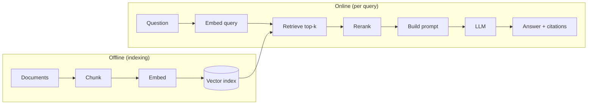

# Retrieval-Augmented Generation

A language model only knows what was in its training data, frozen at a cutoff date, and it will confidently make things up when it does not know. Retrieval-Augmented Generation (RAG) fixes both problems with a simple idea: before the model answers, *look up* relevant text and put it in the prompt. The model stops being a memory and becomes a reader. This section teaches RAG from first principles, from a 100-line numpy implementation up to a production system with hybrid search, reranking, access control and evaluation.

!!! abstract "What you'll learn"
    - Why RAG exists and when it beats fine-tuning or long context
    - The full pipeline: ingest, chunk, embed, index, retrieve, rerank, generate with citations
    - How embedding models are trained and how approximate nearest-neighbour search (HNSW) works
    - Advanced retrieval: hybrid BM25 + dense, cross-encoder reranking, query rewriting, HyDE, contextual retrieval, agentic RAG
    - How to evaluate retrieval and generation separately, and what breaks in production

## The pipeline at a glance

## Pages in this section

-   **[RAG Fundamentals](fundamentals.md)**

    ---

    Why RAG, embeddings and contrastive training, cosine similarity, HNSW, chunking, vector databases, a from-scratch RAG in about 100 lines, and prompts that cite sources.

-   **[Advanced RAG & Evaluation](advanced.md)**

    ---

    Hybrid search with reciprocal rank fusion, rerankers, query rewriting and HyDE, metadata filtering, parent-document and contextual retrieval, agentic RAG, GraphRAG, evaluation metrics and production concerns.

## Prerequisites

- [Embeddings & Attention](../llm/attention.md): you should know what an embedding vector is.
- [Sampling, KV Cache & Quantization](../inference/inference.md): helpful for understanding latency and cost of the generation step.

## Where this leads

The capstone for this section is [Project 3: Build a Production RAG System](../projects/p3-rag.md), a support-engineer copilot with hybrid search, a reranker, per-document access control, a FastAPI service and an evaluation harness.

Next: [RAG Fundamentals](fundamentals.md)
