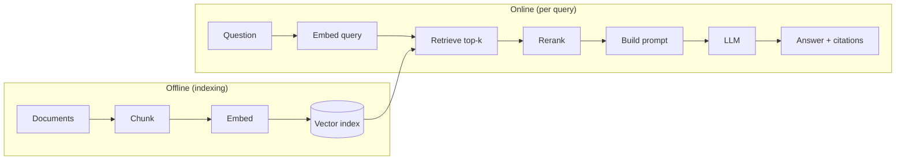

# Retrieval-Augmented Generation

A language model only knows what was in its training data, frozen at a cutoff date, and it will confidently make things up when it does not know. Retrieval-Augmented Generation (RAG) fixes both problems with a simple idea: before the model answers, *look up* relevant text and put it in the prompt. The model stops being a memory and becomes a reader. This section teaches RAG from first principles, from a 100-line numpy implementation up to a production-style system with hybrid search, reranking, access control, guardrails and evaluation.

!!! abstract "What you'll learn"
    - Why RAG exists and when it beats fine-tuning or long context
    - The full pipeline: ingest, chunk, embed, index, retrieve, rerank, generate with citations
    - How embedding models are trained and how approximate nearest-neighbor search (HNSW) works
    - Advanced retrieval: hybrid BM25 + dense, cross-encoder reranking, query rewriting, HyDE, contextual retrieval, agentic RAG
    - How to choose an embedding model and fine-tune it on your own data
    - How to evaluate retrieval and generation separately, and what breaks in production

## Why RAG

Three properties of a trained model make it a poor source of facts about *your* world, and retrieval addresses each one:

| Problem with the model alone | What retrieval changes |
|---|---|
| **Knowledge is frozen** at the training cutoff, and the model has never seen your internal documents | The index is updated when a document changes; no training run is involved |
| **It guesses when it does not know**, in the same fluent tone as when it does | The prompt carries the evidence, the answer cites it, and "the sources do not say" becomes a valid, checkable answer |
| **Everyone gets the same model**, so anything it memorized is available to every user | Each query retrieves only what that user is allowed to read |

Fine-tuning is the wrong tool for these: it teaches behavior (format, tone, a task) well and facts badly, it has to be redone when facts change, and it cannot give two users different answers. Long context windows help with small, static corpora, but paying to re-read everything on every query does not scale, and one prompt has one audience. The trade-offs are worked through in [Why RAG?](fundamentals.md#why-rag) and [Long context vs RAG](advanced.md#long-context-vs-rag).

The price is a second system to build and operate. Most of the quality of a RAG application is decided before the language model is called: if the right passage is not retrieved, no prompt can rescue the answer. That is why this section spends more time on retrieval and on measuring it than on generation.

## The pipeline at a glance

## Pages in this section

| Page | What it covers | You can then |
|---|---|---|
| [RAG Fundamentals](fundamentals.md) | Why RAG, embeddings and contrastive training, cosine similarity, exact search and HNSW, chunking strategies, where to store vectors, a complete RAG in about 100 lines, prompts that cite sources. Ends with three hands-on tasks that measure a small retriever. | Build a working question-answering script over a folder of documents and say how good its retrieval is |
| [Advanced RAG & Evaluation](advanced.md) | Hybrid search with BM25 and reciprocal rank fusion, cross-encoder rerankers, choosing and fine-tuning the embedding model, query rewriting and HyDE, metadata filtering, parent-document and contextual retrieval, agentic RAG, GraphRAG, long context vs RAG, retrieval and generation metrics, golden sets, LLM-as-judge, production concerns | Diagnose why a RAG system gives a wrong answer, choose the technique that addresses it, and show with numbers that it helped |

Read them in order. Advanced RAG assumes the vocabulary and the 100-line implementation from Fundamentals.

## Prerequisites

- [Embeddings & Attention](../llm/attention.md): what an embedding vector is and why similar text gets similar vectors.
- Python with numpy. No GPU: every example in this section, and the whole project, runs on a laptop CPU.
- Helpful, not required: [Quantization & Serving](../inference/serving.md) for the latency and cost of the generation step, and [Evaluation](../pretraining/evaluation.md) for [LLM-as-judge pitfalls](../pretraining/evaluation.md#llm-as-judge-pitfalls).

You do not need to have trained or fine-tuned a model. RAG uses a language model and an embedding model as given.

## The project this section feeds

[Project 3: Build a Production RAG System](../projects/p3-rag.md) is the capstone: a support-engineer copilot over product docs and resolved tickets, with hybrid search, a reranker, per-document access control, guardrails, a FastAPI service and an evaluation harness. Its sample corpus is built so that the techniques from these two pages separate in the measurements: dense retrieval misses look-alike error codes, keyword search misses paraphrased questions, and the project page shows the measured table for all four retrieval modes.

| Page | Used in the project for |
|---|---|
| [RAG Fundamentals](fundamentals.md) | `ingest.py`: heading-aware chunking, embedding, indexing with metadata; `generate.py`: the cited-answer prompt |
| [Advanced RAG & Evaluation](advanced.md) | `retrieve.py`: BM25, fusion, reranking, access filters; `eval.py`: recall@k, MRR, LLM judge; `finetune_embedder.py` |

Two topics the project touches are taught later in the course. Read these sections when the project reaches them: [prompt injection](../production/safety.md#prompt-injection) and the [guardrail pipeline](../production/safety.md#a-guardrail-pipeline-from-scratch) for content planted in retrieved documents, and [eval-driven development](../production/llmops.md#eval-driven-development) for running the evaluation as a CI gate.

## What you can skip

- **Only want a working prototype?** Read Fundamentals up to and including "A complete RAG in about 100 lines", then come back when the answers disappoint.
- **HNSW internals** in Fundamentals matter once you tune an index with millions of vectors. Below about a hundred thousand chunks, exact search is fast enough and the section can wait.
- **GraphRAG and agentic RAG** in Advanced RAG are surveys. Skip them unless you have multi-hop or corpus-wide questions that a single retrieval demonstrably fails.
- **Fine-tuning the embedder** is optional and comes after hybrid search and reranking, not before.
- **Do not skip evaluation.** The retrieval metrics and the golden set are what make every other choice in this section a measurement instead of a guess.
