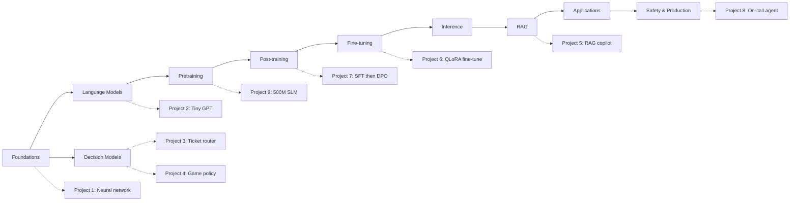

# Start Here

This site takes you from "I can write Python" to "I wrote a neural network and a GPT by hand, fine-tuned and post-trained open-weight models for a real job, built a retrieval system and an agent people can trust, trained a neural policy that plays a game, and pretrained a 500M-parameter language model." Every idea is built from first principles. You get the intuition first, then the minimum math, then PyTorch code you can run, then the things that go wrong in practice.

!!! abstract "What you'll learn on this page"
    - Who this site is written for and what it assumes you already know
    - How the sections fit together, from math up to nine projects ordered by difficulty
    - How to work through a page and a project so the material sticks
    - Where to go next: the [roadmap](roadmap.md), [Choose Your Path](paths.md) and the [setup guide](setup.md)

## Who this is for

You are a software engineer. You are comfortable with Python, git, the command line, and reading other people's code. You may have called an LLM API, but you have not trained a model of your own. Your math is rusty: you remember that matrices multiply and derivatives exist, but you would not want to derive backpropagation on a whiteboard today.

You want to understand what is happening inside these models well enough to build one, not just use one. You also want results you can point to: a trained checkpoint, a fine-tuned adapter, a working retrieval pipeline, a calibrated router, an agent with an evaluation gate.

You do **not** need:

- A machine learning degree or prior deep learning courses.
- A rack of GPUs. Most pages run on a laptop. The projects state their hardware needs up front, and [Setup, Hardware & Budget](setup.md) shows how to rent what you need for a bounded cost.
- Strong math. [Math You Actually Need](../foundations/math.md) covers exactly the linear algebra, calculus, and probability used later, with numpy examples.

!!! note "What this site is not"
    It is not a survey of every model released this year, and it is not a prompt-engineering cookbook. It focuses on the mechanisms that stay stable across model generations: tokenization, attention, the training loop, optimization, scaling, preference learning, retrieval, and reinforcement learning.

## How the site is organized

The sidebar groups the site into five tracks: **Fundamentals** (Start Here, Foundations, Language Models), **Training Models** (Pretraining, Post-training, Fine-tuning, and the Beyond the Core electives), **Applying Models** (Inference, RAG, Applications, Safety & Production), **Decision Models**, and **Projects**. Within the language-model tracks, the sections follow the order in which a model is actually built and used, and each one depends on the ones before it. Decision Models depends on Foundations, plus the first Language Models pages for its routing page. The Projects track is a ladder of nine builds; the dotted arrows below show the section each project comes after.

The app tracks which pages are done and shows progress per module, remembers the roadmap's checkboxes, and has full-text search over every page. Progress is stored in your browser only.

-   **[Foundations](../foundations/index.md)**

    The math, PyTorch, and neural-network mechanics everything else rests on. You implement backpropagation and a tiny autograd engine by hand.

-   **[Language Models](../llm/index.md)**

    Tokenization, embeddings, attention, the transformer line by line, modern architecture choices (RoPE, GQA, SwiGLU, RMSNorm), and scaling laws.

-   **[Pretraining](../pretraining/index.md)**

    Data pipelines, the training loop at scale, debugging a training run, mixed precision, distributed training, GPU performance engineering, and how to evaluate a base model.

-   **[Post-training](../post-training/index.md)**

    Turning a base model into an assistant: supervised fine-tuning, preference optimization (RLHF, DPO), reinforcement learning with verifiable rewards for reasoning, and distillation and synthetic data.

-   **[Fine-tuning](../finetuning/index.md)**

    Adapting an existing open-weight model to your task cheaply with LoRA and QLoRA, continued pretraining on domain data, and model merging.

-   **Beyond the Core (electives)**

    [Architecture Families & Beyond Transformers](../llm/architecture-families.md) (BERT, T5, Mamba, hybrids, diffusion LMs) and [Multimodal Models](../llm/multimodal.md). No project depends on them, so they can be skipped on a first pass.

-   **[Inference](../inference/index.md)**

    Sampling strategies, the KV cache, quantization, serving stacks, and what limits speed and cost when you serve a model.

-   **[RAG](../rag/index.md)**

    Retrieval-augmented generation: chunking, embeddings, vector search, hybrid retrieval, reranking, and how to evaluate the whole system.

-   **[Applications](../applications/index.md)**

    Prompt and context engineering, structured output and constrained decoding, agents, tool use and MCP.

-   **[Safety & Production](../production/index.md)**

    Red-teaming, prompt injection, guardrails, interpretability, and LLMOps: evals in CI, observability, cost, and licensing.

-   **[Decision Models](../decision/index.md)**

    Models that choose actions rather than words: RL basics, DQN and PPO, imitation learning, fast "System 1" policies, and small models for routing and classification.

-   **[Projects](../projects/index.md)**

    Nine builds in order of difficulty, from a neural network written by hand to a 500M-parameter language model. Each has a walkthrough, runnable code and a definition of done.

The **Reference** section has a [Glossary](../glossary.md) of the terms used across the site, a [Cheat Sheet](../cheatsheet.md) of formulas, memory math and default hyperparameters, and a short list of [Resources](../resources.md) for going deeper.

### The nine projects

The projects form a ladder. Each is harder than the one before, and the level says what it asks of you: levels 1 and 2 run on a laptop, level 3 wants one consumer GPU, and level 4 ties everything together.

| # | Level | Project | What you build | Main sections used |
|---|---|---------|----------------|--------------------|
| 1 | 1 | [Neural Network From Scratch](../projects/nn-from-scratch.md) | An autograd engine and a numpy MLP that classifies digits | Foundations |
| 2 | 1 | [Tiny GPT](../projects/tiny-gpt.md) | A BPE tokenizer and a GPT of about 10M parameters, written by hand and trained on a laptop | Language Models |
| 3 | 2 | [Ticket Router: a Calibrated Decision Model](../projects/ticket-router.md) | A support-ticket router built three ways (classifier, encoder, decision LM), calibrated, with an abstain option | Decision Models |
| 4 | 2 | [A Decision Model That Plays](../projects/game-agent.md) | A neural policy controlling an on-screen game character, trained by imitation learning then PPO | Foundations, Decision Models |
| 5 | 2 | [Build a Production RAG System](../projects/support-rag.md) | A support-engineering copilot over product docs and resolved tickets | RAG |
| 6 | 3 | [Fine-tune an Open-Weight Model](../projects/incident-triage-finetune.md) | A QLoRA adapter that triages IT-operations incidents | Post-training, Fine-tuning, Inference |
| 7 | 3 | [Post-train a Small Model: SFT, Then DPO](../projects/post-train-assistant.md) | A small assistant model, trained with SFT and DPO loops written by hand | Post-training |
| 8 | 4 | [On-Call Agent: Tools, MCP, Guardrails](../projects/oncall-agent.md) | An agent that uses the builds from Projects 3, 5 and 6 as tools, behind guardrails and an evaluation gate | Applications, Safety & Production |
| 9 | 4 | [Build a 500M SLM From Scratch](../projects/slm-500m.md) | A decoder-only transformer, pretrained from random weights on a public corpus, then turned into a chat model | Language Models, Pretraining, Post-training |

Projects 1 to 5 and Project 8 run on a laptop; Projects 5 and 8 also need an LLM endpoint, which can be a local one. Project 6 needs a single consumer GPU or a free Colab GPU, and Project 7 runs on a laptop with its small model or on one GPU with a larger one. Project 9 is the most expensive in compute and comes last. It is split: a warm-up that trains a 31M model on a laptop, Part A (pretraining) after the Pretraining pages, and Part B (SFT and release) after the SFT page.

The intended order is 1 to 9, and the [roadmap](roadmap.md) follows it. Some projects feed later ones: Project 2 is the small version of Project 9, and Project 8 integrates Projects 3, 5 and 6. Outside those links you can skip: if you mainly care about applied work, Projects 5, 6 and 8 give the best return on your time, and you can come back to Project 9 later. The [projects overview](../projects/index.md#the-projects-side-by-side) compares level, hardware, cost and time, and says when each project can be skipped.

## How to use this site

### Reading a concept page

Every concept page has the same shape:

1. A short hook explaining why the topic matters.
2. A **What you'll learn** box. Read it so you know what to look for.
3. Intuition, then math, then code. Do not skip the intuition, even if the math looks familiar.
4. A **Common pitfalls** box. These are the bugs and misunderstandings that cost people days.
5. **Build it** (on core pages): one to three hands-on tasks with an expected result, and a collapsible solution sketch.
6. **Check your understanding**: a few collapsible questions. Answer them in your head (or on paper) *before* expanding.
7. **Further reading**. Previous and next cards at the bottom of every page follow the curriculum order.

### Run the code, then break it

Reading code is not the same as understanding it. For each snippet:

- Run it as written and check the output matches what the page says.
- Change one thing: a shape, a learning rate, a seed, an activation. Predict what will happen before you run it.
- When something fails, read the full error. Most deep learning bugs are shape, dtype, or device mismatches, and the [PyTorch page](../foundations/pytorch.md) has a section on recognizing them.

### Keep a lab notebook

Keep one plain-text or markdown file per project. Write down every run: the config, the commit, what you expected, what happened. Training runs are slow and the details blur fast. A notebook is how you find out that the run which worked used a different learning rate warmup than the one that diverged. The [setup guide](setup.md) covers experiment trackers that record most of this automatically, but your notes on *why* you ran something are still worth writing.

### Time budget

The [roadmap](roadmap.md) assumes roughly 8-12 hours per week for about 29 weeks, with all nine projects. If you have more time, compress it. If you have less, follow the same order and stretch it out. If you want only part of the site (RAG, fine-tuning, building a model, decision models, or agents), [Choose Your Path](paths.md) lists the pages and projects for each goal. Skipping Foundations to get to transformers faster usually costs more time later, when a bug in a training loop turns out to be a misunderstanding of gradients.

!!! tip "If you only have a weekend"
    Read [Math You Actually Need](../foundations/math.md) sections on softmax and cross-entropy, then [Embeddings & Attention](../llm/attention.md) and [The Transformer, Line by Line](../llm/transformer.md). You will come away understanding what a language model computes, even if you have not trained one yet.

## Check your understanding

??? question "You want to adapt an existing open-weight model to classify support tickets. Which sections matter most?"
    [Fine-tuning](../finetuning/index.md) (LoRA and QLoRA) and the [Supervised Fine-Tuning](../post-training/sft.md) page (data formats and loss masking). [Decision Models for Routing & Classification](../decision/routing-models.md) is also relevant, since a small classifier may beat a generative model for this. Project 3 is the worked example for the classifier route, and Project 6 for fine-tuning a generative model.

??? question "Why does the site put Pretraining before Fine-tuning, when most people only ever fine-tune?"
    Fine-tuning changes weights that pretraining produced. Knowing what pretraining optimizes (next-token prediction over a huge corpus), what the loss curve looks like, and how learning rate and batch size interact makes fine-tuning failures much easier to diagnose. The projects reflect this: Project 6 comes well before Project 9 on the ladder and does not need it, but reading [The Training Loop](../pretraining/training.md) first helps.

??? question "Which project can you start with the least hardware?"
    Projects 1 to 5 and Project 8 run on a laptop with no GPU (Projects 5 and 8 call an LLM, which can be a local one through Ollama), and so does Project 9's warm-up (a 31M model). Project 7 runs on a laptop with its small model. Project 6 needs one 24 GB GPU for the 7B model, or a 16 GB GPU or free Colab T4 for the 1.5B model. Project 9's full run needs rented data-center GPUs to finish in reasonable time.
