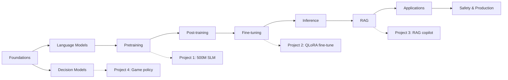

# Start Here

This site takes you from "I can write Python" to "I trained a 500M-parameter language model, fine-tuned an open-weight model for a real job, built a retrieval system people can trust, and trained a neural policy that plays a game." Every idea is built from first principles. You get the intuition first, then the minimum math, then PyTorch code you can run, then the things that go wrong in practice.

!!! abstract "What you'll learn on this page"
    - Who this site is written for and what it assumes you already know
    - How the sections fit together, from math up to four end-to-end projects
    - How to work through a page and a project so the material sticks
    - Where to go next: the [roadmap](roadmap.md) and the [setup guide](setup.md)

## Who this is for

You are a software engineer. You are comfortable with Python, git, the command line, and reading other people's code. You may have called an LLM API, but you have not trained a model of your own. Your math is rusty: you remember that matrices multiply and derivatives exist, but you would not want to derive backpropagation on a whiteboard today.

You want to understand what is happening inside these models well enough to build one, not just use one. You also want results you can point to: a trained checkpoint, a fine-tuned adapter, a working retrieval pipeline, a trained agent.

You do **not** need:

- A machine learning degree or prior deep learning courses.
- A rack of GPUs. Most pages run on a laptop. The projects state their hardware needs up front, and [Setup, Hardware & Budget](setup.md) shows how to rent what you need for a bounded cost.
- Strong math. [Math You Actually Need](../foundations/math.md) covers exactly the linear algebra, calculus, and probability used later, with numpy examples.

!!! note "What this site is not"
    It is not a survey of every model released this year, and it is not a prompt-engineering cookbook. It focuses on the mechanisms that stay stable across model generations: tokenization, attention, the training loop, optimization, scaling, preference learning, retrieval, and reinforcement learning.

## How the site is organized

The sections follow the order in which a model is actually built and used. Each one depends on the ones before it.

-   **[Foundations](../foundations/index.md)**

    The math, PyTorch, and neural-network mechanics everything else rests on. You implement backpropagation and a tiny autograd engine by hand.

-   **[Language Models](../llm/index.md)**

    Tokenization, embeddings, attention, the transformer line by line, modern architecture choices (RoPE, GQA, SwiGLU, RMSNorm), scaling laws, other architecture families (BERT, T5, Mamba, hybrids, diffusion LMs), and multimodal models.

-   **[Pretraining](../pretraining/index.md)**

    Data pipelines, the training loop at scale, mixed precision, distributed training, GPU performance engineering, and how to evaluate a base model.

-   **[Post-training](../post-training/index.md)**

    Turning a base model into an assistant: supervised fine-tuning, preference optimization (RLHF, DPO), reinforcement learning with verifiable rewards for reasoning, and distillation and synthetic data.

-   **[Fine-tuning](../finetuning/index.md)**

    Adapting an existing open-weight model to your task cheaply with LoRA and QLoRA, continued pretraining on domain data, and model merging.

-   **[Inference](../inference/index.md)**

    Sampling strategies, the KV cache, quantization, and what limits speed and cost when you serve a model.

-   **[RAG](../rag/index.md)**

    Retrieval-augmented generation: chunking, embeddings, vector search, hybrid retrieval, reranking, and how to evaluate the whole system.

-   **[Applications](../applications/index.md)**

    Prompt and context engineering, structured output and constrained decoding, agents, tool use and MCP.

-   **[Safety & Production](../production/index.md)**

    Red-teaming, prompt injection, guardrails, interpretability, and LLMOps: evals in CI, observability, cost, and licensing.

-   **[Decision Models](../decision/index.md)**

    Models that choose actions rather than words: RL basics, DQN and PPO, imitation learning, fast "System 1" policies, and small models for routing and classification.

-   **[Projects](../projects/index.md)**

    Four end-to-end builds with complete, runnable code, each tying together several sections.

The **Reference** section has a [Glossary](../glossary.md) of the terms used across the site and a short list of [Resources](../resources.md) for going deeper.

### The four projects

| # | Project | What you build | Main sections used |
|---|---------|----------------|--------------------|
| 1 | [Build a 500M SLM From Scratch](../projects/p1-500m-model.md) | A decoder-only transformer, pretrained from random weights on a public corpus | Language Models, Pretraining |
| 2 | [Fine-tune an Open-Weight Model](../projects/p2-finetune.md) | A QLoRA adapter that triages IT-operations incidents | Post-training, Fine-tuning |
| 3 | [Build a Production RAG System](../projects/p3-rag.md) | A support-engineering copilot over product docs and resolved tickets | Inference, RAG |
| 4 | [A Decision Model That Plays](../projects/p4-decision-model.md) | A neural policy controlling an on-screen game character, trained by imitation learning then PPO | Foundations, Decision Models |

Project 1 is the most expensive in compute. Projects 2, 3, and 4 fit on a single consumer GPU, and parts of each run on a laptop. You do not have to do them in order. If you mainly care about applied work, Projects 2 and 3 give the best return on your time, and you can come back to Project 1 later.

## How to use this site

### Reading a concept page

Every concept page has the same shape:

1. A short hook explaining why the topic matters.
2. A **What you'll learn** box. Read it so you know what to look for.
3. Intuition, then math, then code. Do not skip the intuition, even if the math looks familiar.
4. A **Common pitfalls** box. These are the bugs and misunderstandings that cost people days.
5. **Check your understanding**: a few collapsible questions. Answer them in your head (or on paper) *before* expanding.
6. **Further reading** and a **Next** link.

### Run the code, then break it

Reading code is not the same as understanding it. For each snippet:

- Run it as written and check the output matches what the page says.
- Change one thing: a shape, a learning rate, a seed, an activation. Predict what will happen before you run it.
- When something fails, read the full error. Most deep learning bugs are shape, dtype, or device mismatches, and the [PyTorch page](../foundations/pytorch.md) has a section on recognizing them.

### Keep a lab notebook

Keep one plain-text or markdown file per project. Write down every run: the config, the commit, what you expected, what happened. Training runs are slow and the details blur fast. A notebook is how you find out that the run which worked used a different learning rate warmup than the one that diverged. The [setup guide](setup.md) covers experiment trackers that record most of this automatically, but your notes on *why* you ran something are still worth writing.

### Time budget

The [roadmap](roadmap.md) assumes roughly 8-12 hours per week for about 21 weeks. If you have more time, compress it. If you have less, follow the same order and stretch it out. Skipping Foundations to get to transformers faster usually costs more time later, when a bug in a training loop turns out to be a misunderstanding of gradients.

!!! tip "If you only have a weekend"
    Read [Math You Actually Need](../foundations/math.md) sections on softmax and cross-entropy, then [Embeddings & Attention](../llm/attention.md) and [The Transformer, Line by Line](../llm/transformer.md). You will come away understanding what a language model computes, even if you have not trained one yet.

## Check your understanding

??? question "You want to adapt an existing open-weight model to classify support tickets. Which sections matter most?"
    [Fine-tuning](../finetuning/index.md) (LoRA and QLoRA) and [Post-training](../post-training/index.md) (SFT data formats). [Decision Models for Routing & Classification](../decision/routing-models.md) is also relevant, since a small classifier may beat a generative model for this. Project 2 is the worked example.

??? question "Why does the site put Pretraining before Fine-tuning, when most people only ever fine-tune?"
    Fine-tuning changes weights that pretraining produced. Knowing what pretraining optimizes (next-token prediction over a huge corpus), what the loss curve looks like, and how learning rate and batch size interact makes fine-tuning failures much easier to diagnose. You do not need to finish Project 1 before Project 2, but you should read the Pretraining pages.

??? question "Which project can you start with the least hardware?"
    Project 4 (the game policy) and most of Project 3 (RAG) run on a laptop. Project 2 needs a GPU with enough memory for a quantized model, typically 16-24 GB. Project 1 needs rented data-center GPUs to finish in reasonable time.

## Next

Next: [Learning Roadmap](roadmap.md)
