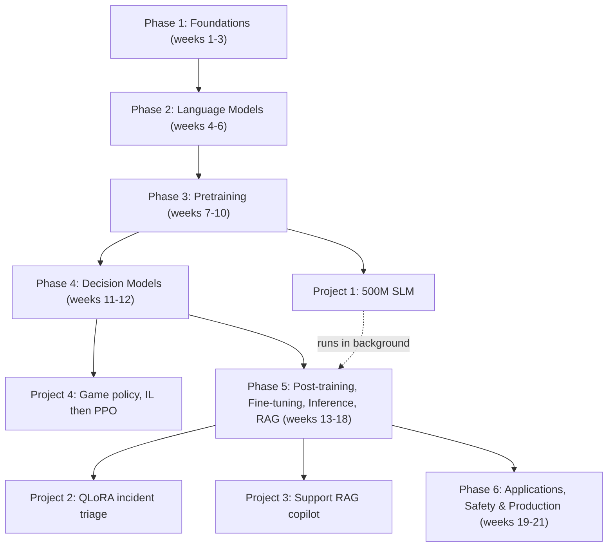

# Learning Roadmap

This is a 21-week, part-time plan that takes you through every section of the site and all four projects. It assumes about **8-12 hours a week**: two or three weekday evenings of reading and small experiments, plus one longer weekend block for project work. Each week lists the pages to read, what to build, and a short checklist so you know when you are done.

!!! abstract "What you'll learn"
    - The order to read the site in, and why that order matters
    - Which weeks to spend on which pages and projects
    - Concrete milestones, as checklists, that tell you when to move on
    - How to adjust the plan if you have more time, less time, or a narrower goal

## The path at a glance

The plan has six phases. Projects sit at the end of the phase that teaches what they need. Project 4 is placed mid-course on purpose: it is a change of pace after the language-model phases, and it reuses Foundations directly.

Project 1 needs long GPU runs. You start the full pretraining run around week 10 and let it train while you work through Phases 4 and 5, checking on it a couple of times a week.

## Phase 1: Foundations (weeks 1-3)

Goal: you can derive and implement backpropagation, and you can write a PyTorch training loop from memory.

### Week 1: Setup and math

- Read [Start Here](index.md) and [Setup, Hardware & Budget](setup.md). Install your environment, create Hugging Face and Weights & Biases accounts.
- Read [Math You Actually Need](../foundations/math.md). Run every numpy snippet.
- Optional: watch the 3Blue1Brown linear algebra series if vectors and matrices feel shaky (see [Resources](../resources.md)).

- [ ] `python -c "import torch; print(torch.__version__)"` works and reports your accelerator (CUDA or MPS)
- [ ] You can compute softmax and cross-entropy by hand for a 3-class example
- [ ] You can explain why we subtract the max before `exp` in softmax

### Week 2: PyTorch

- Read [Python & PyTorch](../foundations/pytorch.md).
- Write a training loop for a small classifier on MNIST or a synthetic dataset, without copying.

- [ ] You can explain what `loss.backward()`, `optimizer.step()`, and `optimizer.zero_grad()` each do
- [ ] You can write an `einsum` for batched matrix multiply and for attention scores
- [ ] You have hit and fixed at least one shape bug and one device bug

### Week 3: Neural networks and backprop

- Read [Neural Networks & Backprop](../foundations/neural-networks.md).
- Implement the numpy MLP and the micrograd-style autograd engine from the page. Compare your gradients to PyTorch's.

- [ ] Your hand-written gradients match `torch.autograd` to within about `1e-6`
- [ ] You can write the AdamW update equations from memory
- [ ] You can explain why a learning rate that is too high makes the loss go to `nan`

## Phase 2: Language Models (weeks 4-6)

Goal: you can write a GPT-style decoder from scratch and train a tiny one on a laptop.

### Week 4: Tokenization and attention

- Read [Tokenization](../llm/tokenization.md). Train a small BPE tokenizer.
- Read [Embeddings & Attention](../llm/attention.md). Implement causal self-attention.

- [ ] You can explain why a model cannot "see" individual characters in a token
- [ ] Your attention implementation matches `torch.nn.functional.scaled_dot_product_attention`
- [ ] You can explain what the causal mask prevents

### Week 5: The transformer

- Read [The Transformer, Line by Line](../llm/transformer.md).
- Train a character- or BPE-level model with a few million parameters on a small text corpus. Generate samples.

- [ ] Your tiny model's loss drops well below the uniform baseline of `ln(vocab_size)`
- [ ] Samples look like the training text's style, even if they are nonsense
- [ ] You can count your model's parameters by hand and match `sum(p.numel() for p in model.parameters())`

### Week 6: Modern architectures and scaling

- Read [Modern Architectures & SLM Design](../llm/modern-architectures.md) and [Scaling Laws & Compute](../llm/scaling-laws.md).
- Skim [Architecture Families & Beyond Transformers](../llm/architecture-families.md) and [Multimodal Models](../llm/multimodal.md). Come back to them in depth later.
- Swap your tiny model to RMSNorm, RoPE, and SwiGLU. Compare loss curves at equal parameter count.

- [ ] You can estimate training FLOPs with the `6 * N * D` rule
- [ ] You can explain roughly how many tokens a compute-optimal 500M model wants
- [ ] You can justify each architectural choice in Project 1's config

## Phase 3: Pretraining and Project 1 (weeks 7-10)

Goal: a 500M-parameter model pretraining on rented GPUs, with a loss curve you understand.

### Week 7: Data

- Read [Pretraining](../pretraining/index.md) and [Data Pipelines](../pretraining/data.md).
- Start [Project 1](../projects/p1-500m-model.md): download a slice of the corpus, tokenize it, write sharded binary token files.

- [ ] You have a tokenized shard and can sample random training windows from it
- [ ] You know how many tokens your full dataset contains

### Week 8: The training loop

- Read [The Training Loop](../pretraining/training.md).
- Add mixed precision, gradient accumulation, LR warmup and cosine decay, gradient clipping, checkpointing, and logging to the Project 1 training script.

- [ ] A small config (around 50M parameters) trains on one GPU or your laptop without errors
- [ ] You can resume from a checkpoint and the loss curve continues smoothly
- [ ] You can explain your effective batch size in tokens

### Week 9: Distributed training and evaluation

- Read [Distributed Training](../pretraining/distributed.md), [GPU Performance Engineering](../pretraining/gpu-performance.md), and [Evaluation](../pretraining/evaluation.md).
- Make the script work with DDP (or FSDP). Add validation loss and a small downstream eval.

- [ ] The script runs on 2+ GPUs and throughput scales close to linearly
- [ ] You measure tokens/second and model FLOPs utilization (MFU)
- [ ] You have a budget estimate for the full run (see [Setup](setup.md#budgeting-a-run))

### Week 10: Launch the full run

- Rent the hardware and launch the full 500M pretraining run.
- Watch the first hour closely, then check in every day or two.

- [ ] Loss is falling smoothly with no spikes you cannot explain
- [ ] Checkpoints are being written to durable storage (not only the instance's local disk)
- [ ] You have a hard spending cap or a scheduled shutdown

## Phase 4: Decision Models and Project 4 (weeks 11-12)

Goal: a neural network that controls a game character, first by copying demonstrations, then by improving with RL.

### Week 11: RL concepts and imitation

- Read [Decision Models](../decision/index.md), [Reinforcement Learning Basics](../decision/rl-basics.md), and [Imitation Learning](../decision/imitation.md).
- Start [Project 4](../projects/p4-decision-model.md): set up the environment, record demonstrations, train a behavior-cloning policy.

- [ ] You can define state, action, reward, return, and policy in one sentence each
- [ ] Your behavior-cloning policy moves the character sensibly on easy levels
- [ ] You have seen compounding errors happen and can explain them

### Week 12: PPO and fast policies

- Read [DQN & PPO](../decision/policy-methods.md), [System 1 & System 2 Models](../decision/system-one.md), and [Decision Models for Routing & Classification](../decision/routing-models.md).
- Fine-tune the behavior-cloning policy with PPO. Compare against PPO from scratch.

- [ ] PPO improves on behavior cloning by a measurable margin on your evaluation levels
- [ ] You can explain the clipped surrogate objective
- [ ] You can explain why initializing from imitation speeds up RL

## Phase 5: Post-training, Fine-tuning, Inference, RAG (weeks 13-18)

Goal: you can take an open-weight model, adapt it to a real job, serve it, and ground it in your own documents.

### Week 13: SFT and preference optimization

- Read [Post-training](../post-training/index.md), [Supervised Fine-Tuning](../post-training/sft.md), and [Preference Optimization](../post-training/preference.md).
- If Project 1 has finished, run a small SFT pass on your own base model with a chat template.

- [ ] You can explain why SFT masks the loss on prompt tokens
- [ ] You can write the DPO loss and say what each term does

### Week 14: Reasoning and LoRA

- Read [Reasoning & RL with Verifiable Rewards](../post-training/reasoning-rl.md), [Distillation & Synthetic Data](../post-training/distillation-synthetic-data.md), [Fine-tuning](../finetuning/index.md), and [LoRA & QLoRA](../finetuning/lora-qlora.md).
- Start [Project 2](../projects/p2-finetune.md): build and clean the incident-triage dataset, define the output schema, write the evaluation script first.

- [ ] You have a held-out test set that the model never sees during training
- [ ] You have a baseline score from the un-tuned model (prompted only)
- [ ] You can compute how much GPU memory QLoRA needs for your chosen model

### Week 15: Finish Project 2

- Train the QLoRA adapter. Evaluate, inspect failures, iterate on data rather than hyperparameters first.
- Read [Continued Pretraining & Model Merging](../finetuning/merging-continued-pretraining.md) and try merging two adapters.

- [ ] The adapter beats the prompted baseline on your test set
- [ ] You have read at least 30 model outputs by hand
- [ ] The adapter is pushed to the Hugging Face Hub (private is fine)

### Week 16: Inference

- Read [Inference](../inference/index.md) and [Sampling, KV Cache & Quantization](../inference/inference.md).
- Serve your Project 2 model (merged or with adapter) and measure latency and throughput. Try a quantized version.

- [ ] You can explain why decoding is memory-bandwidth bound
- [ ] You can estimate KV cache size for a given context length and batch size
- [ ] You have compared quality before and after quantization on your test set

### Week 17: RAG

- Read [RAG](../rag/index.md), [RAG Fundamentals](../rag/fundamentals.md), and [Advanced RAG & Evaluation](../rag/advanced.md).
- Start [Project 3](../projects/p3-rag.md): ingest product docs and resolved tickets, chunk, embed, index.

- [ ] You have a labeled set of questions with known relevant documents
- [ ] You measure retrieval recall@k before touching the generator

### Week 18: Finish Project 3

- Add hybrid search and reranking, citation of sources, and an "I don't know" path. Evaluate end to end.
- Finish evaluating Project 1's final checkpoint.

- [ ] The copilot cites the source for every answer
- [ ] You have measured faithfulness and answer quality, not just retrieval
- [ ] Project 1 has a final eval report and samples

## Phase 6: Applications, Safety & Production (weeks 19-21)

Goal: turn your models into applications that are safe and that you can operate.

### Week 19: Prompting and agents

- Read [Applications](../applications/index.md), [Prompt & Context Engineering](../applications/prompting.md), and [Agents & Tool Use](../applications/agents.md).
- Wrap your Project 3 copilot and Project 2 model as tools in the from-scratch agent loop. Expose one of them as an MCP server.

- [ ] Your Project 2 model always returns valid JSON with constrained decoding
- [ ] The agent stops at its step limit and asks a human before irreversible actions

### Week 20: Safety and interpretability

- Read [Safety & Production](../production/index.md), [Safety, Red-Teaming & Guardrails](../production/safety.md), and [Interpretability](../production/interpretability.md).
- Red-team your Project 3 copilot with indirect prompt injection planted in a document. Add guardrails, then measure attack success rate before and after.
- Train a linear probe and run the logit lens on your Project 1 model.

- [ ] You have an attack success rate measured on a fixed attack set
- [ ] You can show one feature your Project 1 model represents linearly

### Week 21: LLMOps and wrap-up

- Read [LLMOps: Shipping & Operating Models](../production/llmops.md).
- Put each project's eval suite in CI as a regression gate. Build a cost-per-1K-requests estimate for Projects 2 and 3.
- Work through the production readiness checklist for one project.

- [ ] Evals run automatically on every change, and a regression blocks the merge
- [ ] All four projects have a short README: what you built, results, what you would do next

## Adjusting the plan

=== "More time (20+ h/week)"

    Run two weeks per calendar week through Phases 1-2. Keep Phase 3 at its pace, since GPU runs take wall-clock time regardless. You can finish in about 10-12 weeks.

=== "Less time (4-6 h/week)"

    Keep the order and double each week. Consider shrinking Project 1 to around 125M parameters: it teaches the same lessons at a fraction of the cost.

=== "Applied focus"

    If your goal is shipping LLM features at work, do Phase 1, Phase 2 weeks 4-5, then jump to Phase 5. Do Projects 2 and 3. Come back to Pretraining and Project 1 later.

=== "RL focus"

    Do Phase 1, then Phase 4 immediately, then Project 4. Add the [Reasoning & RL](../post-training/reasoning-rl.md) page to see how the same policy-gradient ideas are used to train language models.

!!! warning "Common pitfalls"
    - **Skipping Foundations.** The most common time sink later is a training bug that is really a misunderstanding of gradients, dtypes, or shapes.
    - **Starting the big run too early.** Debug the Project 1 script on a tiny config until it is boring. Every bug found on rented 8-GPU hardware is expensive.
    - **Tuning hyperparameters before fixing data.** In Projects 2 and 3, data quality and evaluation design matter more than learning rate.
    - **No held-out evaluation.** If you cannot measure it, you cannot tell whether a change helped.
    - **Forgetting to shut down instances.** Set billing alerts and auto-shutdown before you launch anything.

## Check your understanding

??? question "Why does Project 1's full run start in week 10 rather than at the end?"
    Pretraining takes wall-clock time, from many hours to a few days depending on hardware and token budget. Starting it early lets it run while you learn other material, and it leaves time to restart if something goes wrong.

??? question "Why write the evaluation script before training in Project 2?"
    It forces you to define what "good" means, gives you a baseline from the un-tuned model, and prevents you from unconsciously tuning toward examples you have looked at.

??? question "You are in week 15 and your adapter is worse than the prompted baseline. What do you check first?"
    The data and the formatting: is the chat template correct, is the loss masked to responses only, do train labels match the output schema, is there leakage or mislabeling. Then check that the learning rate is not far too high. Hyperparameter sweeps come last.

## Next

Next: [Setup, Hardware & Budget](setup.md)
